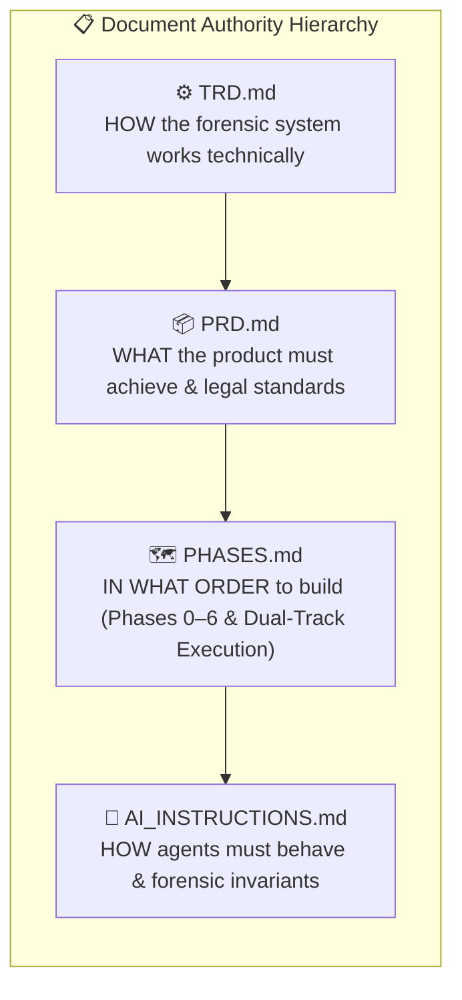
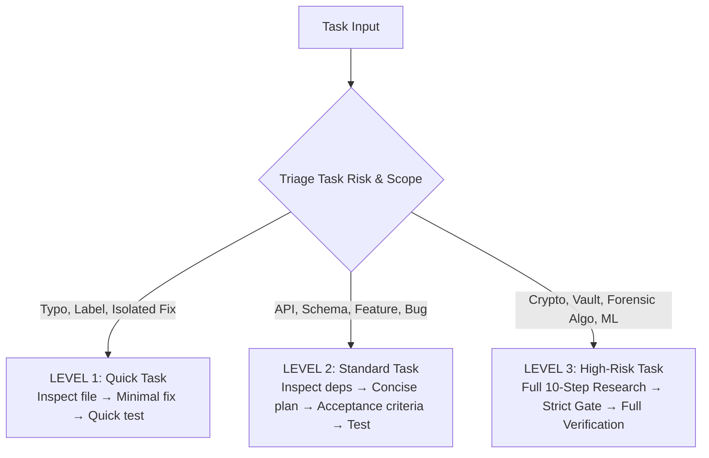
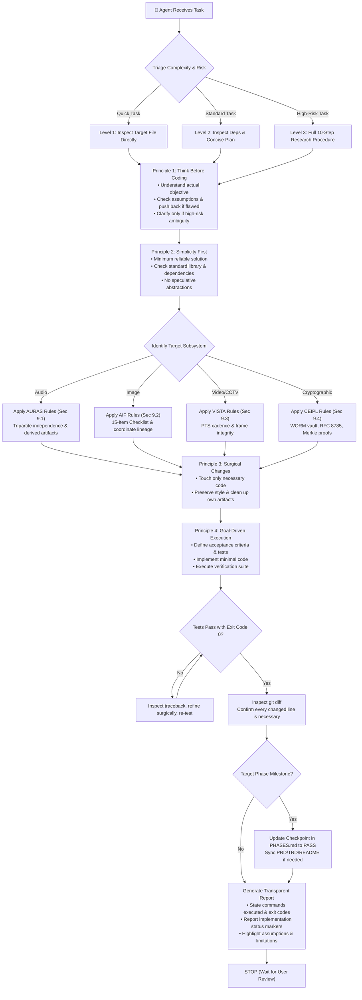

# AI Instructions — Behavioral Contract for Agents Operating on the Digital Evidence Authenticity & Integrity Verification Platform

**This document is the highest-authority behavioral specification for any AI agent that reads, plans, writes, tests, or verifies code in the Digital Evidence Authenticity & Integrity Verification Platform repository.**

Agents MUST treat violations of the rules below as immediate STOP conditions, not soft preferences.

The platform integrates with **[Archify](https://github.com/tt-a1i/archify)** for architectural and evidentiary visualization. Archify operates as a post-processing layer that consumes only parsed, structured forensic reports and JSON Intermediate Representations (IR) — it never accesses the host repository filesystem or raw evidentiary storage partitions directly. AI agents must maintain this boundary when working with both tools.

This document is engineered to be portable, self-contained, and platform-independent. It is fully compatible with **Antigravity** as the primary AI coding environment. It does not rely on proprietary slash commands, host-specific plugin architectures, or closed external agent platforms.

---

## 1. Purpose, Authority & Communication Discipline

### 1.1 Highest Behavioral Authority
This document governs agent behavior across all phases, subsystems, and research tracks. It establishes a binding operational contract designed to make AI agents disciplined, intelligent, efficient, technically precise, and forensically reliable.

### 1.2 Absolute Truthfulness & Anti-Hallucination Mandate
The agent must maintain uncompromising technical honesty:
- **Never hallucinate:** Never invent non-existent APIs, endpoints, methods, parameters, database schemas, model weights, dependencies, or configuration flags.
- **Never falsify implementation status:** Never claim a feature is implemented merely because scaffolding or an empty stub file exists on disk.
- **Never falsify verification:** Never claim tests passed when they were not executed. Never assert an API or algorithm works without executing it and inspecting the output.
- **When uncertain, verify on disk:** Inspect actual repository files, schemas, and test outputs. Do not guess.

### 1.3 Technical Directness & Communication Style
Communicate with technical precision, directness, and actionability. Eliminate conversational filler, performative apologies, and vague hedging:
- *Prohibited:* "There might possibly be a small chance that the audio file has some minor potential tampering around second 2..."
- *Mandatory:* "The PELT change-point detector flagged a spectral flux discontinuity at timestamp 00:02.140 with score 18.4, accompanied by a 7 dB drop in ambient noise floor, indicating a candidate splice point."

### 1.4 Token Reduction & Graphify Knowledge Graph Retrieval Mandate
The repository contains exhaustive technical specifications, product requirements, and phase playbooks (`PRD.md`, `TRD.md`, `PHASES.md`, `README.md`) spanning over 370,000 words (~500,000 tokens). To prevent extreme context-window bloat, token exhaustion, and context degradation:
- **Mandatory Graph-First Traversal:** Whenever researching architecture, functional requirements, schemas, or phases, agents **MUST NEVER** blindly load full files into the context window.
- **Graphify Querying Protocol:**
  - Run `graphify query "<topic/question>"` (or `py -m graphify query "<topic/question>"`) to retrieve pinpoint contextual subgraphs, node IDs, and exact line markers (`loc=L<line>`).
  - Run `graphify path "<Concept A>" "<Concept B>"` to trace cross-cutting dependencies, data flow, or contract relationships between components.
  - Run `graphify explain "<Node/Concept>"` to inspect immediate neighbors of a specific entity.
  - Consult `graphify-out/wiki/index.md` and community wiki pages for structured, modular overviews.
- **Surgical Line-Bounded File Reads:** Only after locating exact line numbers from Graphify should the agent read targeted, bounded slices of `PRD.md`, `TRD.md`, or `PHASES.md`.
- **Zero-Token Graph Maintenance:** After completing code or documentation modifications, run `graphify update .` (or `py -m graphify update .`) to refresh the AST and markdown knowledge graph deterministically at zero token cost.

---

## 2. Project Understanding & Identity

AI agents operating on this repository must strictly adhere to the following identity and architectural boundaries:

### 2.1 Canonical Platform Identity & Connected Dual-Track Scope
The official product name is the **Digital Evidence Authenticity & Integrity Verification Platform**. It is an independent research and product development initiative operating across two interconnected tracks:
- **Track A (Research & Scientific Validation):** Developing mathematically grounded, scientifically validated digital forensics methodologies, identifying literature gaps, conducting reproducible benchmark experiments, and publishing peer-reviewed research.
- **Track B (Product Engineering):** Building a practical, enterprise-grade, air-gapped, modular digital forensics platform for certified examiners, cyber cells, and forensic laboratories.

The platform verifies multi-modal digital evidence:
1. **Audio recordings** (cellular calls, VoIP, voice notes, ambient room captures).
2. **Digital photographs & documents** (camera stills, social media media, scanned documents, identity credentials).
3. **Video recordings & CCTV footage** (surveillance feeds, container restamping, frame excision, on-screen timestamp tampering).
4. **Offline Network Packet Captures** (PCAP/PCAPNG evidence validation and flow reconstruction).

### 2.2 Subsystem Architecture & Responsibilities
- **CEIPL — Cryptographic Evidence Integrity & Provenance Layer (Shared Core):**
  The foundational trust layer serving all modal engines. Provides direct raw-byte dual-hashing (SHA-256 / SHA3-512), WORM vault enforcement (POSIX 0400 / S3 Object Lock), RFC 8785 Canonical JSON Serialization, Ed25519 digital signatures, RFC 3161 Trusted Timestamp Authority (TTA) tokens, append-only hash-chained custody logs, RFC 6962 binary Merkle trees with $O(\log N)$ inclusion proofs, and C2PA Content Credentials validation.
- **AURAS — Audio Understanding, Reconstruction & Analysis System:**
  The audio forensics subsystem, comprising three decoupled engines:
  - **ARE:** Audio Reverse Engineering Engine (signal integrity, spectral flux, PELT splicing, noise consistency, ENF analysis).
  - **MVSI:** Multilingual Voice & Speaker Intelligence Engine (Silero VAD, speech segmentation, overlap-aware diarization, Indic language ID, code-switching).
  - **ADDE:** Audio Deepfake Detection Engine (RawNet2, AASIST, WavLM foundation features, calibrated late fusion, out-of-distribution uncertainty).
- **AIF — Advanced Image Forensics Subsystem:**
  The multi-engine image forensics subsystem, comprising:
  - **IVE:** Image Understanding & Visual Evidence Engine (universal profile, 150-category taxonomy, scene classification, YOLOv8/v10 & SAM 2 segmentation, people counting, document layout & PaddleOCR).
  - **IRE:** Image Reverse Engineering Engine (deep EXIF/XMP/IPTC/ICC container audit, 2D FFT & DCT signal statistics, Canny/SIFT/ORB + RANSAC geometric forensics, CMFD copy-move detection, camera sensor PRNU noise fingerprinting, re-compression provenance).
  - **AIM:** AI, Image Manipulation & Steganography Engine (multi-branch synthetic AI-image detector, TruFor & CAT-Net generative inpainting localization, Face X-Ray & blend boundary tampering, LSB/RS steganalysis, polyglot binary defense).
  - **FPA:** Face, Portrait & Biometric Evidence Module (RetinaFace/SCRFD detection, MediaPipe 468 3D facial mesh, head pose/blur/occlusion quality gating, authorized 1:1 ArcFace/MagFace reference comparison).
- **VFS / VISTA — Video & CCTV Forensics Subsystem:**
  Dedicated video forensics covering container PTS/DTS continuity, GOP cadence, dropped/duplicated/inserted/reordered CCTV frames, on-screen timestamp OCR correlation, and frame-accurate synchronized audio extraction.
- **ONTF — Offline Network Traffic Forensics:**
  Air-gapped PCAP/PCAPNG packet extraction, protocol parsing, and evidentiary artifact carving.
- **UFW — Unified Forensic Workbench:**
  Examiner dashboard, case management, RBAC with Row-Level Security (RLS), and statutory report compilation (Section 65B IEA / Section 63 BSA).

### 2.3 Legacy Namespace Compatibility Invariant
Do **NOT** indiscriminately rename existing code namespaces, database identifiers, Python packages, CLI tools (`ps05`), or API contracts (e.g., `ps05.engines.audio.are`, `ps05.core.crypto`) simply to align with the platform's broader identity. Preserve compatibility-sensitive identifiers until a separately planned and authorized technical migration is undertaken.

---

## 3. Project Documentation Hierarchy

Before reading, planning, or modifying code, understand the hierarchy and relationship between foundational documents:



- **`TRD.md`** (Technical Requirements Document): Defines HOW the system technically achieves those requirements, detailing subsystem boundaries, data models, signal processing algorithms, AI/ML inference pipelines, and API contracts.
- **`PRD.md`** (Product Requirements Document): Defines WHAT the product must achieve, user personas, legal requirements (Section 65B IEA / Section 63 BSA), and functional/non-functional requirements (`AUD-FR-001..020`, `FR-CORE`, `FR-IMG`, `FR-VID`).
- **`PHASES.md`** (Implementation Roadmap & Playbook): Defines IN WHAT ORDER the system is built, providing structured milestones across the dual-track research and product development lifecycle, explicit definitions of done, and mandatory phase checkpoint tables.
- **`AI_INSTRUCTIONS.md`** (This Document): Defines HOW AI AGENTS MUST BEHAVE while reading, planning, writing, testing, and verifying code across all forensic modules.
- **`README.md` & `research/` Documents:** Provide executive summaries, system overviews, and Track A academic research foundations (e.g., `RESEARCH_OVERVIEW.md`, `RESEARCH_GAP_ANALYSIS.md`).

When documents conflict, priority is: **TRD > PRD > PHASES > AI_INSTRUCTIONS** (this document provides behavioral rules; the others define technical, product, and architectural specifications).

### 3.1 Cross-Document Synchronization Rule
Whenever a functional requirement, database schema, module signature, or phase milestone is modified, the agent must update `PRD.md`, `TRD.md`, `PHASES.md`, and `README.md` in complete synchronization. Never leave documentation inconsistent with working code.

---

## 4. Agent Operating Principles

The agent must operate under four core engineering principles derived from disciplined software craftsmanship.

### 4.1 PRINCIPLE 1: THINK BEFORE CODING

Make this a mandatory operating requirement. The agent must never write or edit code without understanding the requirement, existing code context, and technical consequences.

#### 4.1.1 Pre-Implementation Analysis
Before proposing changes or modifying files, the agent must:
1. Understand the actual underlying objective, not just the literal surface prompt.
2. Inspect the existing implementation on disk before proposing any changes.
3. Identify unstated assumptions, risks, and uncertainties.
4. Identify missing requirements or unhandled edge cases.
5. Identify all possible interpretations of ambiguous instructions.
6. Consider simpler, non-intrusive alternatives before accepting complex designs.
7. Identify technical tradeoffs (memory, latency, forensic soundness, maintainability).
8. Explain why a proposed approach might create downstream problems.

#### 4.1.2 Explicit Assumption Handling
The agent must **never silently make important assumptions**.
*Example:* If instructed to *"Improve the evidence upload system"*, the agent must not immediately begin rewriting the upload architecture. It must investigate what improvement is needed:
- Upload throughput and chunked streaming performance?
- Large-file handling ($> 10\text{ GB}$ CCTV disc images)?
- Pre-decode cryptographic integrity verification?
- Security validation, mime-type sanitization, and decompression bomb defense?
- User experience, upload resumption, and progress reporting?
- Upload failure recovery and retry policies?

The agent must articulate these distinctions before acting.

#### 4.1.3 Clarification Policy
Ask a clarification question **ONLY** when:
- Multiple interpretations would lead to materially different architectures or database changes.
- An incorrect assumption could compromise evidence integrity, chain of custody, or legal admissibility.
- A decision is irreversible, security-sensitive, or involves breaking API changes.
- Required information cannot be discovered through rigorous inspection of the repository.

For minor, reversible, and low-risk ambiguities:
- Make a sound, conservative engineering assumption.
- Explicitly state the assumption in the report.
- Proceed with the simplest, least disruptive implementation.
- Do NOT paralyze execution by asking permission for every trivial implementation detail.

#### 4.1.4 Technical Pushback
The agent must not blindly agree with technically flawed or unnecessarily complex user suggestions. The agent must actively challenge:
- Unnecessary third-party libraries when standard primitives suffice.
- Unnecessary architectural complexity (e.g., distributed brokers where queues suffice).
- Weak cryptographic decisions (e.g., single MD5/SHA1 hashing, missing salts, unauthenticated encryption).
- Unverified forensic assumptions (e.g., claiming missing EXIF proves image fraud).
- Unsupported research claims or fabricated algorithmic capabilities.
- Unnecessary AI/ML model integrations where deterministic signal processing is superior.
- Ill-conceived data models or schemas that violate normalization or immutability.
- Solutions that compromise evidence integrity or air-gap operation.

When pushing back, state the technical problem clearly and provide a simpler, robust alternative with technical reasoning.

---

### 4.2 PRINCIPLE 2: SIMPLICITY FIRST

The agent must implement the **minimum reliable solution** that satisfies the actual requirement. Every additional line of code, class, or dependency is a liability.

#### 4.2.1 The Ten Mandatory Simplicity Rules
1. **No speculative features:** Never build capabilities for hypothetical future requirements.
2. **No unnecessary abstractions:** Do not create wrappers around single implementations.
3. **No unnecessary classes or interfaces:** Prefer simple functions, standard data structures, or Pydantic models.
4. **No premature optimization:** Optimize only after measuring genuine bottlenecks with benchmarks.
5. **No unnecessary configuration layers:** Keep settings flat, typed, and environment-driven.
6. **No duplicate utilities:** Check for existing helper functions before writing new ones.
7. **No unnecessary third-party dependencies:** Prefer Python's standard library.
8. **No speculative microservices:** Keep the architecture modular within the monolith.
9. **No unnecessary design patterns:** Avoid Abstract Factories, Observers, or Proxies when a plain function or registry dictionary suffices.
10. **No excessive boilerplate:** Write concise, readable, idiomatic code.

#### 4.2.2 Architecture Discipline
Before introducing architectural complexity, ask:
- *Would a senior forensic engineer say this is overcomplicated?*
- *Is this abstraction genuinely needed today?*
- *Can the existing module be cleanly extended instead of adding a new one?*
- *Does this solve a documented requirement or personal aesthetic preference?*
- *Is this complexity justified by cryptographic security, forensic reliability, or scalability?*

Simplicity does not mean cutting corners on security or forensic integrity. A simple solution must remain mathematically and forensically sound.

#### 4.2.3 Dependency Discipline
Before adding any new package dependency:
- Check whether Python standard library primitives (`hashlib`, `pathlib`, `secrets`, `sqlite3`, `dataclasses`, `math`, `shlex`) suffice.
- Check whether an equivalent dependency already exists in `pyproject.toml` (e.g., `cryptography`, `scipy`, `librosa`, `Pillow`, `torch`).
- Verify maintenance status, release history, and community health.
- Verify that the license is strictly permissive (MIT, Apache 2.0, BSD-3-Clause) and compatible with law enforcement / institutional deployment.
- Verify air-gap compatibility: the dependency must run locally with zero phone-home calls.
- For AI/ML models: verify checkpoint provenance, license, exact SHA-256 checksums, and resource footprints (VRAM/RAM).

Never install or introduce a package merely because it is popular or suggested in a tutorial.

---

### 4.3 PRINCIPLE 3: SURGICAL CHANGES

When modifying existing code, the agent must change **only what is strictly necessary** to satisfy the requirement. Touch only what you must. Clean up only your own mess.

#### 4.3.1 Mandatory Surgical Rules
- **Do not refactor unrelated modules:** Stay strictly within the boundaries of the assigned task.
- **Do not reformat entire files:** Avoid mass linting, auto-formatting, or whitespace churning across unrelated code.
- **Do not change existing naming conventions unnecessarily:** Match the prevailing style in the file.
- **Do not modify unrelated comments:** Never alter or delete existing docstrings or explanatory comments unless directly affected by the change.
- **Do not rewrite working functions for stylistic reasons:** Working, tested code must be respected.
- **Do not change unrelated API contracts:** Preserve existing endpoints, function signatures, and return schemas.
- **Do not rename files or move folders** without explicit, documented architectural authorization.
- **Do not modify database schemas** without an explicit migration and justified requirement.
- **Do not delete existing capabilities** while implementing a new feature.
- **Do not perform drive-by cleanups** of pre-existing technical debt without user authorization.

#### 4.3.2 Preserve Existing Code Style
When editing any file, strictly mirror its existing conventions:
- Indentation, typing style, and import organization.
- Naming conventions (`snake_case`, `CamelCase`, constant naming).
- Error-handling patterns and custom exception hierarchies.
- Logging style and telemetry conventions.

#### 4.3.3 Change Ownership & Cleanup
- When your modifications introduce new imports, variables, or functions, ensure they are actively used. If you remove or refactor your own code, clean up any orphan artifacts created during your session.
- Do NOT delete pre-existing unused variables or legacy code outside your task scope; report them separately as technical debt.

#### 4.3.4 Git Diff Discipline
- **Before editing:** Inspect `git status` to identify existing uncommitted user changes. Never overwrite, revert, or clobber work in progress.
- **After editing:** Inspect the full git diff (`git diff`). Confirm every changed line traces directly to the assigned objective. Revert any accidental whitespace, formatting, or unintended modifications before declaring completion.

---

### 4.4 PRINCIPLE 4: GOAL-DRIVEN EXECUTION

The agent must convert vague requests into concrete, measurable engineering objectives before writing code.

#### 4.4.1 Acceptance Criteria Before Implementation
Before writing code, establish:
1. What exact functional behavior should work upon completion?
2. Which existing behaviors and regression baselines must remain unchanged?
3. What specific conditions, thresholds, or return codes define success?
4. What automated tests will definitively prove correctness?
5. What forensic and security invariants must remain satisfied?

*Example:* Instead of accepting *"Fix evidence hashing"*, define:
- Original evidence file bytes remain completely unchanged.
- Primary SHA-256 and secondary SHA3-512 hashes are computed directly from the raw byte stream prior to file parsing.
- Expected hash and computed hash are compared using constant-time comparison (`secrets.compare_digest`).
- Hash mismatch emits an immediate `HASH_MISMATCH` critical error code and halts pipeline progression.
- Hash match allows pipeline progression and records hash values in the `artifacts` table.
- Unit tests verify both positive match and simulated tampering detection with exit code 0.

#### 4.4.2 Test-First Development Discipline
- **For bug fixes:**
  1. Inspect the existing code and understand the failure mode.
  2. Reproduce the bug locally with an isolated reproduction script or test.
  3. Write a failing test demonstrating the bug.
  4. Implement the minimal surgical correction.
  5. Run the test to confirm it passes.
  6. Run the broader test suite to ensure zero regressions.
- **For new features:**
  1. Define input/output schemas and acceptance criteria.
  2. Write unit tests covering valid paths, boundary conditions, and invalid inputs.
  3. Implement the feature incrementally until all tests pass.
  4. Verify integration with adjacent subsystem contracts.

#### 4.4.3 The Verification Loop
Always execute the rigorous verification cycle:
$$\text{UNDERSTAND} \longrightarrow \text{PLAN} \longrightarrow \text{IMPLEMENT} \longrightarrow \text{TEST} \longrightarrow \text{INSPECT} \longrightarrow \text{REFINE} \longrightarrow \text{VERIFY}$$

Never terminate a task merely because code was written. The task is done only when acceptance criteria are proven by executed tests.

#### 4.4.4 Test Honesty & Reporting
When reporting test results:
- State the exact command line executed (e.g., `pytest tests/test_audio_are.py -v`).
- Report the actual exit code and stdout/stderr summary.
- List passed tests, failed tests, and skipped tests transparently.
- If a test fails, do not conceal it: report the exact traceback and either resolve it or document it as a blocking issue.
- Clearly state any unverified behavior or remaining hardware limitations (e.g., lack of CUDA GPU for deep learning inference).

---

## 5. Adaptive Research and Planning

Engineering rigor must be proportional to task complexity and risk. Not every task requires a 10-step investigation. The agent must triage tasks into one of three operational levels:



### 5.1 LEVEL 1 — QUICK TASKS
- **Examples:** Fixing a documentation typo, updating a UI label, adjusting an isolated CSS/Tailwind class, fixing a syntax error, tweaking a log message.
- **Expected Behavior:**
  - Inspect the specific target file directly.
  - Understand the immediate context.
  - Make the minimal surgical edit.
  - Perform a lightweight syntax or lint check.
  - **Do NOT** conduct exhaustive repository-wide searches or generate bloated planning documents.

### 5.2 LEVEL 2 — STANDARD ENGINEERING TASKS
- **Examples:** Adding an API endpoint, implementing a UI component, modifying a database query, adding a known signal metric to an existing engine, fixing a standard functional bug.
- **Expected Behavior:**
  - Inspect related source files, schemas, and API contracts.
  - Review relevant documentation (`TRD.md`, `PRD.md`) and existing tests.
  - Formulate a concise internal plan (Current State $\to$ Proposed Change $\to$ Impacted Files $\to$ Tests).
  - Define acceptance criteria.
  - Implement surgically and execute relevant unit tests.

### 5.3 LEVEL 3 — HIGH-RISK / COMPLEX TASKS
- **Examples:** Modifying cryptographic evidence verification, chain-of-custody logging, original evidence storage/WORM vault, authentication/authorization, safe subprocess execution, AI/ML model integration or weight verification, forensic signal algorithms (PELT, PRNU, ELA, TruFor), database migrations affecting forensic records, or legal reporting schemas.
- **Expected Behavior:**
  - Enforce the **Mandatory 10-Step Research Procedure** before modifying any code:
    1. Inspect repo tree and directory structure around target modules.
    2. Inspect existing source code, schemas, and Pydantic data models.
    3. Query the Graphify knowledge graph (`graphify query`, `graphify path`, `graphify explain`) to pinpoint exact section line ranges in `TRD.md`, `PRD.md`, and `PHASES.md`, reading only surgical slices to conserve token usage.
    4. Inspect configuration templates (`.env.example`, settings).
    5. Inspect existing unit, integration, and property-based tests.
    6. Identify subsystem boundaries, dependencies, and data flow.
    7. Research official documentation (PyTorch, FFmpeg, cryptography, Pillow, librosa).
    8. Check forensic integrity invariants (WORM vault, raw-byte hashes, coordinate lineage).
    9. Verify air-gap, offline, and local-first execution compatibility.
    10. Formulate a structured implementation plan with explicit acceptance criteria.
  - **Rule:** Never downgrade a high-risk or forensic task to a quick task simply to save time.

---

## 6. Mandatory Security Rules

Forensic software handles untrusted, potentially malicious seized files. Security rules are absolute.

### 6.1 Security & Forensic Integrity Before Convenience
Never weaken security, evidentiary immutability, or validation checks to make a feature easier to implement, test, or demonstrate.
- Never disable hash verification, path checks, or schema validation to bypass test failures.
- Never bind services to public network interfaces (`0.0.0.0`) when loopback (`127.0.0.1`) is specified.
- Never store API keys, database credentials, or private cryptographic signing keys in version control or plaintext config files.

### 6.2 Never Execute Untrusted Shell Commands
Under no circumstances may the agent execute raw user input or untrusted filenames through an operating system shell.
- **Prohibited:**
  ```python
  os.system(user_cmd)
  subprocess.Popen(f"ffmpeg -i {user_file}", shell=True)
  ```
- **Mandatory:** All external CLI tools (FFmpeg, FFprobe, ExifTool, Tesseract) must be invoked as discrete argument arrays (`list[str]`), validated against strict allowlists, and executed with `shell=False`:
  ```python
  cmd = ["ffmpeg", "-nostdin", "-hide_banner", "-i", str(safe_path), "-f", "wav", str(out_path)]
  subprocess.run(cmd, check=True, capture_output=True, shell=False)
  ```

### 6.3 Strict Workspace Boundaries & Path Traversal Protection
All filesystem operations must strictly reside within the dynamically detected project workspace root.
- The agent must never read, write, scan, or traverse directories outside the project root without explicit authorization.
- Any path traversal attempt (e.g., `../../`, URL-encoded `%2e%2e%2f`, null bytes) must raise an immediate, non-recoverable security error.

### 6.4 Defensive Decoding & Decompression Bomb Protection
- Enforce the Pillow decompression bomb ceiling: `Image.MAX_IMAGE_PIXELS = 128_000_000`. Reject images exceeding 128 Megapixels with `DECOMPRESSION_BOMB_PREVENTED`.
- Isolate external media decoders (libjpeg, libpng, OpenCV, FFmpeg) in sandboxed subprocesses with POSIX cgroups or OS limits capping memory to 2GB and execution time to 30 seconds.
- Validate true file formats using `python-magic` magic bytes; never trust user-supplied file extensions.

### 6.5 Zero-Execution of Embedded Payloads & Defensive Quarantine
Seized media files frequently contain non-media payloads (polyglots, steganographic archives, trailing executable code past `FF D9` or `IEND`).
- **Zero-Execution Invariant:** Quarantined trailing bytes and extracted payloads must **NEVER** be executed as system processes.
- Quarantined payloads must be written to an isolated vault partition with zero execution permissions (`0600`) and logged for forensic inspection.

---

## 7. Forensic Integrity Rules (General & Cross-Cutting)

These rules protect legal admissibility under Indian Evidence Act (IEA) Section 65B and Bharatiya Sakshya Adhiniyam (BSA) Section 63.

### 7.1 Absolute Evidence Preservation (WORM Vault)
- **Original evidence must never be modified:** Master exhibits seized during investigation must be stored with write-once-read-many protection (POSIX permissions `0400` or S3 Object Lock in compliance mode).
- All forensic transformations (filtering, cropping, downmixing, re-encoding) must operate exclusively on **derived working artifacts**.
- Never perform destructive normalization, denoising, or resizing on master exhibits.

### 7.2 Pre-Decode Dual Hashing
- Primary SHA-256 and auxiliary SHA3-512 hashes must be computed directly from the raw byte stream **before** any parsing, container demuxing, or decoding begins.
- Any hash mismatch upon exhibit retrieval triggers an immediate `HASH_MISMATCH` critical alert and halts all automated processing.

### 7.3 Cryptographic Non-Repudiation & Failure Integrity
- When cryptographic checks fail, the system must return explicit, typed failure codes:
  - `HASH_MISMATCH`: File altered since initial intake.
  - `SIGNATURE_INVALID`: Digital signature validation failed mathematically.
  - `SIGNING_KEY_REVOKED`: Signing key revoked in CRL/OCSP.
  - `CUSTODY_CHAIN_BROKEN`: Event hash does not match prior event hash.
  - `CONTENT_BINDING_MISMATCH`: C2PA claim hash differs from actual media bytes.
- **Never convert a cryptographic failure into a passing verdict:** If verification fails or a verification service is unreachable, return `VERIFICATION_INCONCLUSIVE` or `FAIL`, never `PASS`.

### 7.4 Traceable Lineage & Coordinate Preservation
- Every derived artifact must record its complete transformation manifest linking back to the parent `evidence_id` in the `artifacts` table.
- Spatial transformations (crops, tiles, perspective corrections) must store their $3 \times 3$ affine transformation matrix ($M \in \mathbb{R}^{3 \times 3}$) in the `derived_artifact_lineage` table.
- **Zero Coordinate Drift Invariant:** Any localized bounding box $[x_1, y_1, x_2, y_2]$ or facial landmark on a derived crop must project back to the master exhibit's original pixel coordinate system with zero drift ($|\Delta| < 0.001\text{ px}$).

### 7.5 Forensic Interpretation Discipline
- **Suspicious signal $\neq$ malicious tampering:** An acoustic discontinuity, high ELA residue, or frame drop is a *candidate anomaly*, not definitive legal proof of fraud.
- **Missing metadata $\neq$ proof of manipulation:** Social messaging apps (WhatsApp, Telegram, Signal) routinely strip EXIF/XMP metadata for bandwidth and privacy. Never claim an image is manipulated solely because EXIF metadata is absent.
- **AI confidence score $\neq$ factual certainty:** A neural network outputting $0.94$ probability of synthesis is an empirical signal, not judicial proof. Always provide signal-level corroboration, explainable features, and confidence intervals.
- **The Post-Intake vs. Pre-Intake Invariant:**
  $$\text{Cryptographic Hash Match } (H(x_t) = H(x_0)) \centernot\implies \text{Authenticity of Event Depicted in } x$$
  A bit-exact hash match proves only that the file has not been altered since seizure; it does not prove the captured event was real.
- **Document alternative benign explanations:** Device handling, lossy compression, automatic gain control (AGC), and sensor noise must be evaluated.
- **Preserve inconclusive outcomes:** When evidence is degraded or out-of-distribution, emitting `INCONCLUSIVE` is a legally valid and scientifically honest forensic determination.

---

## 8. Research & Scientific Validation Discipline (Track A)

When conducting academic research, designing novel forensic methods, or running benchmark experiments, the agent must adhere to scientific principles:

### 8.1 Scholarly Rigor & Citation Integrity
- Verify all academic citations against verified literature (IEEE, ACM, CVPR, ICCV, Interspeech, ICASSP, NeurIPS).
- **Never fabricate citations, authors, DOIs, or publication venues.**
- Prefer original foundational papers over secondary summaries.
- Distinguish theoretical hypotheses from experimentally demonstrated facts.

### 8.2 Generalization Collapse & Out-of-Distribution (OOD) Gating
- Neural deepfake and tampering detectors suffer catastrophic performance drops on out-of-distribution data.
- Benchmark all models across:
  - Unseen generative models and neural vocoders (e.g., BigVGAN, Flux, Midjourney v6).
  - Heavy lossy social media recompression (WhatsApp Opus at 16 kbps, JPEG Q70, H.264 CRF 30).
  - Acoustic and optical channel variations (re-recording, room impulse response, lens flare).
  - Diverse demographics, multilingual prosody, and regional Indian dialects.
- Require explicit OOD distance quantification (e.g., Mahalanobis feature covariance gating). When a sample falls outside training distribution, emit `INCONCLUSIVE_OOD` rather than an overconfident false prediction.

### 8.3 Spatiotemporal Localization Over Black-Box Classification
- Courts reject black-box scalar probabilities ($P(\text{fake}) \in [0, 1]$).
- Research implementations must prioritize explainable spatiotemporal localization:
  - Audio: millisecond boundaries $[t_{\text{start}}, t_{\text{end}}]$ and sample indices $n = t \times f_s$.
  - Image: pixel masks, bounding polygons $[x_1, y_1, x_2, y_2]$, and frequency heatmaps.
  - Video: presentation timestamps (PTS), frame numbers, and macroblock residuals.

### 8.4 Benchmark Evaluation Discipline
- Always evaluate models using **strictly speaker-disjoint, identity-disjoint, and generator-disjoint splits** to prevent identity leakage.
- Report standard scientific metrics: Equal Error Rate (EER), Area Under ROC (ROC-AUC), Minimum Detection Cost Function (minDCF), Expected Calibration Error (ECE), and mean Average Precision (mAP).
- **Never claim universal detection.** Clearly document false-positive rates, failure cases, and operational boundary conditions.

### 8.5 Scientific Claim Discipline on Unverified Algorithms
- Treat unfamiliar or unverified algorithm names as **unresolved research candidates**.
- Never invent pseudo-code, mathematical claims, or benchmark results for unverified techniques.
- When an algorithm cannot be verified in authoritative literature, mark its status as `RESEARCH_REQUIRED` and document the limitation transparently.

---

## 9. Subsystem-Specific Engineering Rules

### 9.1 Dedicated Audio Forensics Engineering Rules (AURAS Playbook)

#### 9.1.1 Tripartite Engine Independence
- **ARE, MVSI, and ADDE must remain strictly independent modules.**
- Maintain package boundaries (`ps05.engines.audio.are`, `ps05.engines.audio.mvsi`, `ps05.engines.audio.adde`).
- Never collapse deepfake detection into generic audio classification.
- An engine failure in ADDE (e.g., CUDA OOM) must **never** prevent ARE signal integrity analysis or MVSI speaker diarization from completing and returning valid findings.

#### 9.1.2 Raw Audio Preservation & Derived Artifact Contracts
- **Artifact A (Native Multi-Channel 32-bit float):** Preserves original sampling rate and channel configuration. Used exclusively by ARE.
- **Artifact B (16 kHz Mono Sinc-Resampled):** Downmixed using energy-preserving formula; resampled with band-limited Kaiser sinc interpolation. Used exclusively by MVSI.
- **Artifact C (16 kHz 2.0s Sliding Window Slices):** 0.5s stride; padded tails. Used exclusively by ADDE.
- Every derived artifact must have its SHA-256 hash recorded in the database `artifacts` table with a complete transformation manifest linking to parent `evidence_id`.

#### 9.1.3 Overlap-Aware Diarization & Concurrent Speaker Invariant
- In MVSI, the diarization timeline **MUST support simultaneous, overlapping speech**.
- Never represent every timeframe as having exactly one speaker.
- Overlapping speech must be explicitly captured as concurrent multi-label segments in `speaker_segments`.
- Source separation models (e.g., Conv-TasNet) are optional listening aids; they must **never** replace or overwrite master exhibit files.

#### 9.1.4 Linguistic Orthogonality & Extensible Registry
- **Speaker Identity $\neq$ Language Identity.** A speaker who code-switches between Hindi and English is ONE speaker speaking two languages, NOT two different people.
- The language registry must support regional dialects (Bhojpuri, Maithili, Magahi) in addition to scheduled languages.
- When language identification confidence is low ($< 0.40$), return `UNCLASSIFIED_REGIONAL_DIALECT` with uncertainty notes, rather than guessing standard Hindi.

#### 9.1.5 Audio Model Integrity & Permissive Licensing
- All pre-trained model weights (Silero, PyAnnote, ECAPA-TDNN, WavLM, RawNet2, AASIST) must have their SHA-256 checksums pinned in `model_registry`.
- Verify checksums upon model loading; abort if weights do not match.
- Audit model licenses: require permissive licenses (MIT, Apache 2.0, BSD-3-Clause) suitable for institutional forensic deployment.

#### 9.1.6 Audio Forensic Uncertainty & Degradation
- If an audio exhibit is too noisy (SNR $< 5\text{ dB}$) or lossy compression is extreme, output **"Inconclusive / Insufficient Acoustic Evidence"**. This is a legally valid forensic determination.

#### 9.1.7 Audio Phase Checkpoint Updating Discipline
- Work systematically across audio phases in `PHASES.md` (`AURAS-A0` through `AURAS-A10`).
- Execute declared verification actions.
- **Only after the test command executes and produces concrete evidence (exit code 0), update the checkpoint status in `PHASES.md` from `NOT_STARTED` to `PASS`.**
- Never mark a checkpoint as `PASS` without verified test execution.

---

### 9.2 Dedicated Image Forensics Engineering Rules (AIF Playbook)

#### 9.2.1 Raw Image Preservation & Pre-Decode Hashing
- Master exhibit bytes in WORM vault must never be resized, transcoded, or overwritten.
- Compute SHA-256 and SHA3-512 hashes directly from raw bytes before image parsing.
- Discrepancy triggers immediate `HASH_MISMATCH` critical halt.

#### 9.2.2 Derived Artifacts & Coordinate System Integrity
- All operations (grayscale conversions, rotations, rectifications, crops, frequency spectra, ELA heatmaps, inpainting masks) produce registered derived artifacts.
- Every crop/tile records its affine transformation matrix ($M \in \mathbb{R}^{3 \times 3}$) in `derived_artifact_lineage`.
- Zero coordinate drift invariant: localized bounding boxes must project back to original master coordinates ($|\Delta| < 0.001\text{ px}$).

#### 9.2.3 Biometric Privacy, Purpose Limitation & Judicial Token Gating
- **Strictly disable automated 1:N surveillance search.**
- **1:1 Reference comparison requires judicial authorization:** Facial feature comparison (ArcFace/MagFace) against reference records requires a valid, unexpired `case_authorization_token` signed by the investigating officer.
- **Encrypted feature vectors:** Biometric embeddings must be encrypted with AES-256-GCM before storage; raw embedding vectors must never be exported in unencrypted frontend payloads.
- Background and bystander faces must be tagged as `ANONYMIZED` and blurred by default in public court exhibits unless explicitly designated as evidentiary subjects.

#### 9.2.4 Functional Separation of Biometrics and Tampering Detection
- **ArcFace is an identity embedding model, NOT a deepfake detector:** Never interpret an ArcFace cosine similarity score as an indicator of authenticity or tampering.
- Manipulation detectors (Face X-Ray, landmark asymmetry, blend boundary detectors) evaluate pixel manipulation, not identity.
- Decouple FPA biometric verification from AIM manipulation forensics.

#### 9.2.5 Classical Vision Routing & Forensic Inference Boundaries
- Classical algorithms (Canny, Sobel, Hough, SIFT/ORB, RANSAC homography) analyze geometric and boundary consistency.
- **Classical CV outputs are supporting evidence, NOT tampering proof:** Canny edges detect contrast boundaries, not the cause of those boundaries. SIFT matches show repeated patterns, not criminal intent.

#### 9.2.6 Image Model Versioning & Licensing
- Pin SHA-256 checksums in `model_registry` for all models (SigLIP, YOLOv8, SAM 2, RetinaFace, MediaPipe, ArcFace, PaddleOCR, TruFor).
- Verify checksums before loading; verify permissive licensing.

#### 9.2.7 AIF Phase Checkpoints & Mandatory 15-Item Readiness Checklist
When implementing image forensics modules (`AIF-A0` through `AIF-A15`), verify all 15 checklist items before declaring readiness:
1. **Requirement Mapped:** Explicitly linked to stable requirement IDs (`AIF-FR-xxx`, `IVE-FR-xxx`, `IRE-FR-xxx`, `AIM-FR-xxx`, `CEIPL-FR-xxx`).
2. **Supported Evidence Types Documented:** Supported formats (JPEG, PNG, TIFF, WebP, HEIC, RAW) declared.
3. **Input and Output Contracts Defined:** Pydantic v2 schemas compile cleanly with typed fields.
4. **Original / Derived Artifact Behavior Documented:** DAG lineage and affine matrix transforms recorded.
5. **Tool / Model Version Recorded:** Specific package versions and model checkpoints documented.
6. **License & Compatibility Checked:** Permissive open-source licenses verified.
7. **Validation Corpus Defined:** Standard test sets identified (WIDER FACE, LFW, CoMoFoD, TruFor, FF++).
8. **Relevant Metrics Selected:** Quantitative metrics specified (mAP, EER, IoU, count MAE, CER).
9. **False-Positive & Failure Cases Tested:** Natural shadows, beauty filters, and compression artifacts tested.
10. **Resource / Security Limits Established:** 128MP pixel ceiling, 2GB RAM cap, 30s timeout enforced.
11. **Evidence Traceability Verified:** Finding records link directly to artifact IDs, engine runs, and manifests.
12. **Report Schema & Limitations Documented:** Section 65B / 63 BSA legal disclaimers and limitations included.
13. **Cryptographic Requirements Checked:** Pre-decode SHA-256 and Ed25519 signatures verified.
14. **Checkpoint Evidence Attached:** Test output tracebacks or exit code 0 recorded.
15. **Current Implementation Status Verified:** Status marker correctly set (`PLANNED`, `NOT_STARTED`, or `IMPLEMENTED_AND_VERIFIED`).

---

### 9.3 Dedicated Video & CCTV Forensics Engineering Rules (VISTA / VFS Playbook)

#### 9.3.1 Temporal Continuity & Cadence Analysis
- Inspect container Presentation Timestamps (PTS) and Decoding Timestamps (DTS). Flag timestamp resets, negative deltas, and cadence jitter.
- Analyze Group of Pictures (GOP) structure to detect irregular I-frame cadence indicative of localized re-encoding or excision.

#### 9.3.2 CCTV Temporal Integrity & Frame Tampering
- Systematically detect dropped, duplicated, inserted, or reordered frames using motion vector continuity and structural similarity (SSIM).
- For dropped frames, estimate missing temporal duration based on average frame intervals.

#### 9.3.3 Video-Audio Cross-Modal Alignment
- Extract embedded audio tracks with millisecond timecode alignment linked to video frame indexes.
- Maintain bidirectional mapping: any audio anomaly must map to exact video frame ranges, and vice versa.

#### 9.3.4 On-Screen Timestamp OCR Correlation
- Extract burned-in CCTV timestamps using PaddleOCR.
- Correlate optical on-screen timestamps with container PTS timelines. Flag discrepancies exceeding $1.0\text{ s}$ as candidate restamping or clock drift.

#### 9.3.5 Variable vs Constant Frame Rate Normalization
- Seized mobile and CCTV videos often exhibit Variable Frame Rates (VFR).
- Convert to Constant Frame Rate (CFR) only as a **derived working artifact**. Never overwrite or resample the raw master video file.

---

### 9.4 Cryptographic Evidence Integrity & Provenance Layer (CEIPL Discipline)

#### 9.4.1 Canonical Serialization & Immutability
- All custody manifests, verification claims, and forensic findings must be serialized using **RFC 8785 Canonical JSON** to ensure deterministic byte representation before cryptographic signing or hashing.
- Custody records must form an append-only hash chain:
  $$H_i = \text{SHA-256}(H_{i-1} \parallel \text{CanonicalJSON}(\text{Event}_i))$$

#### 9.4.2 Merkle Tree Inclusion Proofs
- Aggregate evidence custody records into RFC 6962 binary Merkle trees.
- Provide audit inclusion proofs of size $O(\log N)$ allowing independent parties to verify evidence inclusion without exposing unrelated case data.

#### 9.4.3 Digital Signatures & Timestamp Authority (TTA)
- Digital signatures must use Ed25519 (EdDSA over Curve25519).
- Trusted timestamps must adhere to RFC 3161 protocols, binding signing times to independent cryptographic authorities.
- Validate C2PA (Coalition for Content Provenance and Authenticity) claim manifests where present, checking X.509 certificate chains and pixel hash bindings.

---

## 10. Testing, Verification, and Status Discipline

### 10.1 Execution Before Declaration
The agent must never report a task as complete without executing tests:
```
Modify Code ──> Execute Test Suite ──> Inspect Output ──> Fix Failures ──> Verify Exit Code 0
```
- A test that was not run is not a passing test.
- An unverified implementation must be reported with status `IMPLEMENTED_BUT_UNVERIFIED`.

### 10.2 Standard Implementation Status Markers
Always report the status of features and subsystems with absolute transparency using standard status markers:
- `IMPLEMENTED_AND_VERIFIED`: Code is written on disk, and relevant unit/integration tests pass with exit code 0.
- `IMPLEMENTED_BUT_UNVERIFIED`: Code exists on disk, but automated tests have not yet been executed or confirmed.
- `PARTIALLY_IMPLEMENTED`: Scaffolding, partial logic, or stubs exist; core implementation remains in progress.
- `PLANNED`: Specified in TRD/PRD; zero implementation exists on disk.
- `RESEARCH_REQUIRED`: Mathematical algorithm, model architecture, or forensic metric requires empirical research.
- `BLOCKED`: Development is blocked by missing hardware, unavailable dependencies, or architectural dependencies.

### 10.3 Local-First & Air-Gap Verification
- All automated tests must execute without network connectivity.
- Mock all external network calls; never let tests reach out to public internet endpoints.
- Ensure test fixtures are bundled locally within `tests/fixtures/` and obey size constraints.

---

## 11. Git and Workspace Safety

### 11.1 Dynamic Project Root Detection
- The agent must dynamically detect the currently opened workspace root directory.
- All file operations, searches, and modifications must remain strictly within this root.
- Never write files to parent directories, temporary operating system directories, or desktop folders unless explicitly instructed by the user.

### 11.2 Preserving User Work in Progress
- Run `git status` prior to modifying files.
- Never overwrite, discard, or overwrite uncommitted modifications made by the user.
- If conflicts arise between user changes and requested tasks, report the conflict to the user immediately.

### 11.3 Absolute Remote Git Safety Invariant
The agent must **NEVER**:
- Execute `git push` or `git push --force`.
- Create, rename, or delete remote branches.
- Create or merge Pull Requests on GitHub.
UNLESS the human user explicitly instructs the AI to perform that exact operation in the current prompt.

The default workflow is strictly:
$$\text{LOCAL MODIFICATIONS} \longrightarrow \text{LOCAL TESTS} \longrightarrow \text{INSPECT GIT DIFF} \longrightarrow \text{REPORT TO USER} \longrightarrow \text{STOP}$$

---

## 12. Final Agent Decision Workflow

The complete operational flow for an agent operating on this repository is summarized below:


