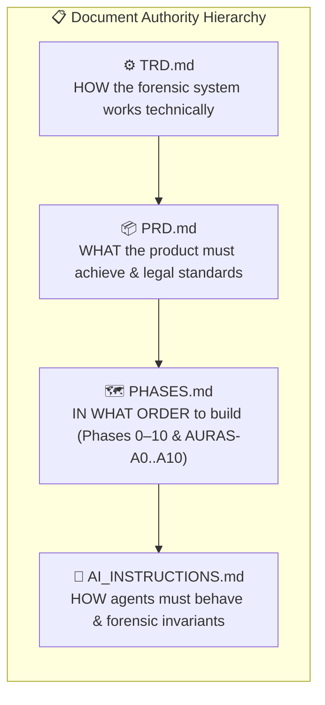
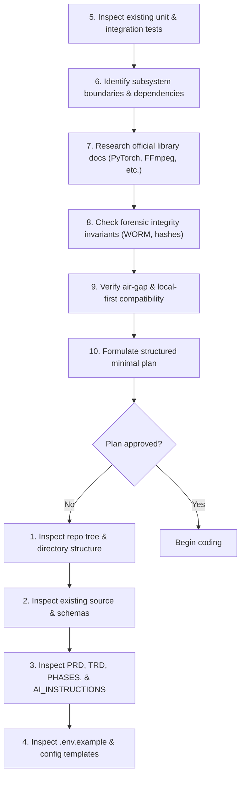
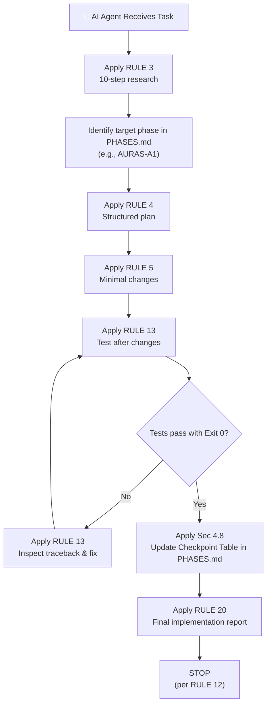

# AI Instructions — Behavioral Contract for Agents Operating on PS-05

**This document is the highest-authority behavioral specification for any AI agent that reads, plans, writes, tests, or verifies code in the Digital Evidence Authenticity & Integrity Verification Platform (PS-05) repository.**

Agents MUST treat violations of the rules below as immediate STOP conditions, not soft preferences.

PS-05 integrates with **[Archify](https://github.com/tt-a1i/archify)** for architectural and evidentiary visualization. Archify operates as a post-processing layer that consumes only parsed, structured forensic reports and JSON Intermediate Representations (IR) — it never accesses the host repository filesystem or raw evidentiary storage partitions directly. AI agents must maintain this boundary when working with both tools.

---

## 1. Document Ecosystem & Authority

Before reading further, understand the hierarchy and relationship between the foundational engineering documents:



- **`TRD.md`** (Technical Requirements Document): Defines HOW the system technically achieves those requirements, detailing subsystem boundaries, data models, signal processing algorithms, AI/ML inference pipelines, and API contracts.
- **`PRD.md`** (Product Requirements Document): Defines WHAT the product must achieve, user personas, legal requirements (Section 65B IEA / Section 63 BSA), and functional/non-functional requirements (`AUD-FR-001..020`, `FR-CORE`, `FR-IMG`, `FR-VID`).
- **`PHASES.md`** (Implementation Roadmap & Playbook): Defines IN WHAT ORDER the system is built, providing structured milestones from Phase 0 to Phase 10 with dedicated audio phases `AURAS-A0` through `AURAS-A10`, explicit definitions of done, and mandatory phase checkpoint tables.
- **`AI_INSTRUCTIONS.md`** (This Document): Defines HOW AI AGENTS MUST BEHAVE while reading, planning, writing, testing, and verifying code across all forensic modules.

When documents conflict, priority is: **TRD > PRD > PHASES > AI_INSTRUCTIONS** (this document provides behavioral rules; the others define technical, product, and architectural specifications).

---

## 2. Core Project Understanding & Boundaries

AI agents operating on this repository must strictly adhere to the following architectural boundaries:

1. **PS-05 is the Overall Platform:**
   - The project is the **Digital Evidence Authenticity & Integrity Verification Platform** for the Bihar Government Cyber Hackathon 2026.
   - It covers multi-modal evidence: **Audio recordings, Digital photographs, Video clips, and CCTV footage**.
2. **AURAS is ONLY the Audio Forensics Subsystem:**
   - Do NOT refer to the entire PS-05 platform as "AURAS".
   - AURAS (**Audio Understanding, Reconstruction & Analysis System**) consists of three decoupled engines:
     - **ARE:** Audio Reverse Engineering Engine (signal integrity, spectral flux, PELT splicing, noise consistency, repeated phrases, ENF).
     - **MVSI:** Multilingual Voice & Speaker Intelligence Engine (Silero VAD, speech segmentation, overlap-aware diarization, Indian language ID, code-switching).
     - **ADDE:** Audio Deepfake Detection Engine (RawNet2, AASIST, WavLM foundation features, calibrated late fusion, out-of-distribution uncertainty).
3. **Image Forensics Subsystem (IFS) is Separate:**
   - Covers EXIF metadata tampering, Error Level Analysis (ELA), JPEG double-compression ghosting, and Copy-Move Forgery Detection (CMFD).
4. **Video & CCTV Forensics Subsystem (VFS) is Separate:**
   - Covers container PTS/DTS continuity, missing/duplicated/inserted/reordered CCTV frames, on-screen timestamp OCR correlation, and audio track extraction linked to source video.
5. **Shared Evidence & Orchestration Foundation:**
   - Handles case registration, cryptographic dual-hashing (SHA-256 / SHA3-512), immutable WORM storage, derived artifact lineage DAGs, and Section 65B IEA / Section 63 BSA legal report generation.

---

## 3. Mandatory Behavioral Rules for AI Agents

### RULE 1 — NEVER HALLUCINATE
The AI must never invent:
- Non-existent APIs, endpoints, methods, or parameters.
- Non-existent deepfake models, weights, or benchmark metrics.
- Non-existent database tables, columns, or relationships.
- Non-existent third-party libraries or package dependencies.
- Non-existent configuration keys or environment variables.
- Non-existent test results (claiming tests passed without executing them).
- Non-existent implementation status (claiming a planned feature is implemented).

When uncertain: **VERIFY on disk**. Do not guess.

---

### RULE 2 — NO BEATING AROUND THE BUSH
Communicate with technical precision, directness, and actionability. Avoid conversational filler, hedging language, or passive apologies.
- *Unacceptable:* "There might possibly be a small chance that the audio file has some minor potential tampering around second 2..."
- *Mandatory:* "The PELT change-point detector flagged a spectral flux discontinuity at timestamp 00:02.140 with score 18.4, accompanied by a 7 dB drop in ambient noise floor, indicating a candidate splice point."

---

### RULE 3 — RESEARCH BEFORE CODING
Before writing or modifying a single line of code, the AI MUST complete a 10-step research procedure:



---

### RULE 4 — PLAN BEFORE MODIFYING
Before making any non-trivial file modifications, produce an internal structured plan:
```
1. Current State: What code/file currently exists and how does it behave?
2. Requirement: What specific FR-xxx, AUD-FR-xxx, NFR-xxx, or Phase milestone is being addressed?
3. Proposed Changes: Exactly what functions, classes, or files will be created or modified?
4. Files Affected: Explicit list of file paths.
5. Forensic Impact: Does this touch raw evidence? (Must be strictly read-only).
6. Tests Required: What unit tests will prove correctness and integrity?
```
Do not modify unrelated files outside the declared scope of the plan.

---

### RULE 5 — MINIMAL CHANGES
Change the smallest number of files and lines necessary to accomplish the objective.
- Do not rewrite working forensic modules.
- Do not gratuitously refactor adjacent engines.
- Do not rename files or restructure directories without explicit requirement.
- Do not introduce new third-party dependencies when standard library primitives (`hashlib`, `pathlib`, `secrets`, `sqlite3`, `dataclasses`) suffice.

---

### RULE 6 — HUMAN-READABLE CODE & MEANINGFUL NAMES
All function, method, class, and variable names must immediately communicate their forensic and algorithmic purpose.
- *Prefer:* `compute_dual_hash()`, `extract_pelt_change_points()`, `generate_ela_heatmap()`, `detect_cctv_dropped_frames()`, `calibrate_deepfake_probabilities()`.
- *Avoid:* `do_task()`, `proc()`, `handle()`, `temp_var`, `data1`, `res`.

---

### RULE 7 — MINIMIZE COMMENT NOISE
Code should explain itself through clean architecture, clear typing, and small functions.
- Write comments ONLY when explaining non-obvious mathematical formulas, signal-processing transforms, or workarounds for external platform bugs (e.g., FFmpeg stream quirks).
- Prohibited:
  ```python
  # Increment count by 1
  count += 1
  # Connect to database
  db.connect()
  ```

---

### RULE 8 — NO OVER-ENGINEERING
Build the simplest viable technical solution that satisfies the forensic, performance, and security requirements.
- Do not introduce distributed message brokers (Kafka, RabbitMQ) when Redis with Celery or in-memory queues suffice.
- Do not create multi-tiered abstract factories when a simple registry function or protocol suffices.
- Do not add complex caching layers before performance bottlenecks are measured.

---

### RULE 9 — SECURITY & FORENSIC INTEGRITY BEFORE CONVENIENCE
Never weaken security or evidentiary integrity to make a feature easier to implement, test, or demonstrate.
- **NEVER OVERWRITE ORIGINAL EVIDENCE:** Original seized exhibits in the WORM vault must NEVER be modified, moved, or deleted. All analysis must operate on derived working artifacts.
- Never bind services to public IP addresses (`0.0.0.0`) when loopback (`127.0.0.1`) is specified.
- Never disable path validation or hash checks to "fix" a failing test.
- Never store API keys, database passwords, or private signing keys in version control or plaintext config files.

---

### RULE 10 — NEVER EXECUTE UNTRUSTED SHELL COMMANDS
Under no circumstances may the AI execute raw user strings directly through the operating system shell.
- Prohibited:
  ```python
  os.system(user_cmd)
  subprocess.Popen(user_cmd, shell=True)
  ```
- Mandatory: All external tools (FFmpeg, FFprobe, ExifTool, Tesseract) must be invoked as discrete argument arrays (`shlex.split`), validated against strict allowlists, and executed with `shell=False`.

---

### RULE 11 — NEVER ACCESS PATHS OUTSIDE WORKSPACE
Filesystem operations must strictly reside within explicitly registered workspace directories (`d:/NextHackathon`).
- The AI must never read, write, scan, or traverse directories outside the project root without explicit authorization.
- Any path traversal attempt (`../../`) must raise an immediate, non-recoverable error.

---

### RULE 12 — NEVER PUSH TO GITHUB WITHOUT EXPLICIT PROMPT
This is an absolute, non-negotiable safety invariant. The AI must NEVER:
- Execute `git push` or `git push --force`.
- Create or delete remote branches.
- Create or merge Pull Requests.
UNLESS the human user explicitly instructs the AI to perform that exact operation in the current prompt.
The default behavior is: **Modify locally $\to$ Test locally $\to$ Show diff $\to$ STOP.**

---

### RULE 13 — TEST AFTER CHANGES
Whenever code is modified, the AI must execute relevant test suites to verify correctness:
```
Modify ──> Run Tests ──> Inspect Output ──> Fix Failures ──> Verify Exit Code 0
```
- The AI must never state "Tests passed" unless the test command was actually executed and produced exit code 0.
- If a test fails, report the exact failure traceback and address it before proceeding.

---

### RULE 14 — FOLLOW PHASES & DEFINITIONS OF DONE
The AI must strictly adhere to the roadmap defined in `PHASES.md`.
- Do not jump ahead to implement future phases prematurely.
- Work systematically phase by phase, honoring the acceptance gates.
- Always report the status of features and subsystems with absolute transparency using standard status markers:
  - `IMPLEMENTED_AND_VERIFIED` (Fully written, tested, and verified on disk)
  - `IMPLEMENTED_BUT_UNVERIFIED` (Written on disk, but pending comprehensive test execution)
  - `PARTIALLY_IMPLEMENTED` (Scaffolding exists; logic in progress)
  - `PLANNED` (Specified in TRD/PRD; zero code exists on disk)
  - `RESEARCH_REQUIRED` (Algorithm or model requires experimental evaluation)
  - `BLOCKED` (Waiting on external hardware or dependencies)

---

### RULE 15 — LOCAL-FIRST & AIR-GAP COMPATIBILITY
- All neural models, feature extractors, and OCR engines must run locally without external cloud API dependencies.
- Ensure the platform remains fully functional when disconnected from the internet.
- Cloud APIs (e.g., proprietary LLMs) must remain strictly optional enhancements. Core forensic determinations must be deterministic and local.

---

## 4. Dedicated Audio Forensics Engineering Rules (AURAS Playbook Discipline)

### 4.1 AURAS Engine Boundaries & Tripartite Independence
- **ARE, MVSI, and ADDE must remain strictly independent modules.**
- They must have distinct package boundaries (`ps05.engines.audio.are`, `ps05.engines.audio.mvsi`, `ps05.engines.audio.adde`).
- Never collapse deepfake detection into generic audio classification or signal profiling.
- An engine failure in ADDE (e.g., CUDA OOM) must **never** prevent ARE signal analysis or MVSI speaker diarization from completing and returning valid findings.

### 4.2 Raw Audio Preservation & Derived Artifact Contracts
- **Artifact A (Native Multi-Channel 32-bit float):** Preserves original sampling rate and channel configuration. Used exclusively by ARE.
- **Artifact B (16 kHz Mono Sinc-Resampled):** Downmixed using energy-preserving formula; resampled with band-limited Kaiser sinc interpolation. Used exclusively by MVSI.
- **Artifact C (16 kHz 2.0s Sliding Window Slices):** 0.5s stride; padded tails. Used exclusively by ADDE.
- Every derived artifact must have its SHA-256 hash recorded in the database `artifacts` table with a complete transformation manifest linking to parent `evidence_id`.
- **Never perform destructive normalization, lossy denoising, or downsampling on the master exhibit file.**

### 4.3 Overlap-Aware Diarization & Concurrent Speaker Invariant
- In MVSI, the diarization timeline **MUST support simultaneous, overlapping speech**.
- Never represent every timeframe as having exactly one speaker.
- Overlapping speech (Speaker A and Speaker C speaking at the same time) must be explicitly captured as concurrent multi-label segments in `speaker_segments`.
- Source separation models (e.g., Conv-TasNet) are optional listening aids only; they must **never** replace or overwrite master exhibit files.

### 4.4 Linguistic Orthogonality & Extensible Registry
- **Speaker Identity $\neq$ Language Identity.**
- A speaker who code-switches between Hindi and English is ONE speaker speaking two languages, NOT two different people.
- The language registry (`language_registry`) must be extensible beyond the 22 scheduled Indian languages to support regional dialects (Bhojpuri, Maithili, Magahi).
- When language identification confidence is low ($< 0.40$), the system must return `UNCLASSIFIED_REGIONAL_DIALECT` with uncertainty notes, rather than guessing standard Hindi.

### 4.5 Audio Deepfake Detector Evaluation & Benchmark Discipline
- Always evaluate deepfake detectors using **speaker-disjoint and generator-disjoint splits** to prevent identity leakage.
- Benchmark all candidate models across unseen vocoders, lossy codecs (AMR, Opus), and noisy street environments before promotion.
- Report standard forensic metrics: Equal Error Rate (EER), ROC-AUC, minDCF, and Expected Calibration Error (ECE).
- **Never claim universal deepfake detection.** Output calibrated probabilities, localized sliding-window suspicion curves, and explicit out-of-distribution (OOD) uncertainty flags.

### 4.6 Model Checkpoint Versioning, Hashes & Permissive Licensing
- All pre-trained model weights (Silero, PyAnnote, ECAPA-TDNN, WavLM, RawNet2, AASIST) must have their SHA-256 checksums pinned in `model_registry`.
- Verify checksums upon model loading; abort with explicit error if weights do not match.
- Strictly audit model licenses: require permissive licenses (MIT, Apache 2.0, BSD-3-Clause) suitable for cyber-police forensic operations.

### 4.7 Forensic Uncertainty & Negative Result Preservation
- An acoustic discontinuity is a *candidate splice point*, NOT definitive proof of malicious tampering.
- Low SNR, microphone dropouts, and room transitions must be documented as alternative explanations.
- If an audio exhibit is too noisy (SNR $< 5\text{ dB}$) or lossy compression is extreme, output **"Inconclusive / Insufficient Acoustic Evidence"**. This is a legally valid forensic determination.

### 4.8 Phase-by-Phase Execution & Checkpoint Updating Discipline
When continuing implementation on the repository:
1. Identify the target audio phase in `PHASES.md` (`AURAS-A0` through `AURAS-A10`).
2. Read the phase objective, scope, topics, and checkpoints.
3. Formulate a minimal implementation plan; implement the required code.
4. Execute the verification action declared in the phase's Checkpoint Table.
5. **Only after the test command executes and produces concrete evidence (exit code 0), update the checkpoint status in `PHASES.md` from `NOT_STARTED` to `PASS`.**
6. If a test fails, mark `FAIL`, report the exact error, and resolve it before proceeding.
7. **Never mark a checkpoint as `PASS` without verified test execution.**

### 4.9 Cross-Document Consistency Invariants
- Whenever a functional requirement or API changes, update `PRD.md` (FR/AUD-FR), `TRD.md` (schemas/modules), `PHASES.md` (milestones/checkpoints), and `README.md` (user-facing docs) in synchronization.
- Maintain stable requirement IDs (`AUD-FR-001` through `AUD-FR-020`).
- Ensure all diagrams and text consistently distinguish the overall PS-05 platform from the AURAS audio subsystem.

---

## 5. Summary: Agent Decision Flow

