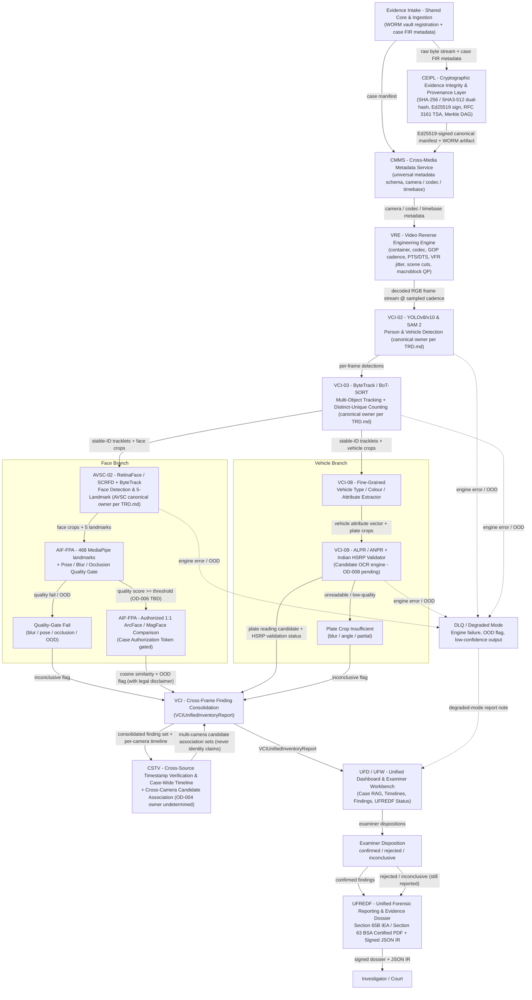
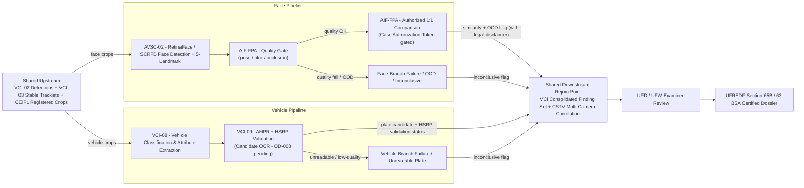
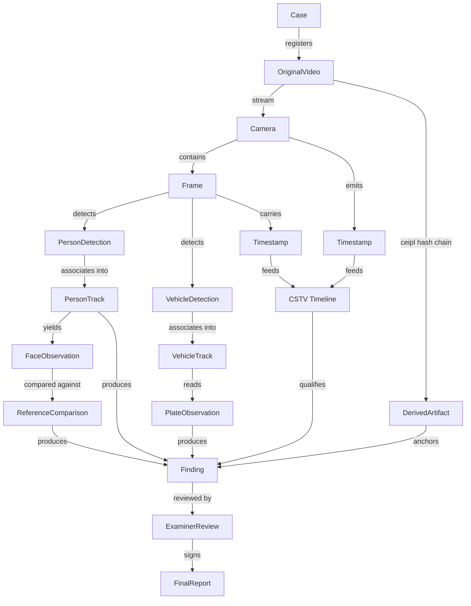
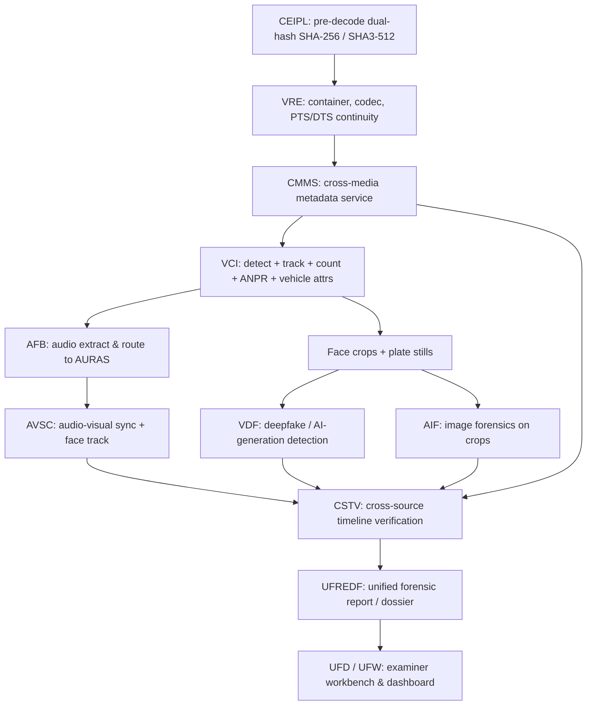
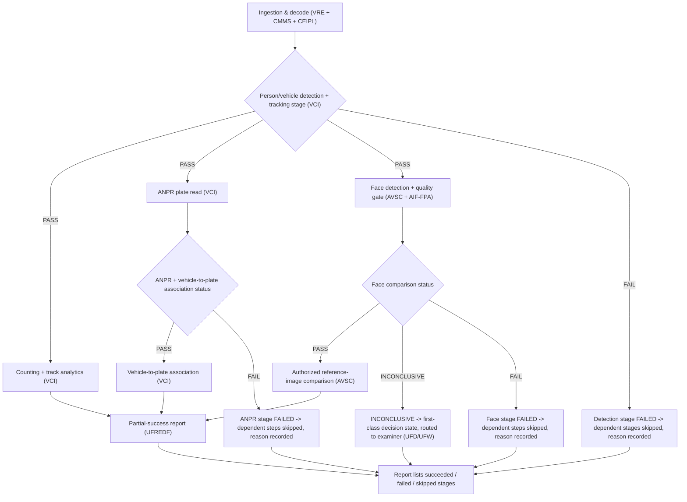

# CCTV Visual Intelligence — PS-05 Design Specification

> **Document Status:** DESIGN SPECIFICATION — PROPOSED. The capabilities in this document
> are specified, not implemented: VISTA and every referenced engine are `PLANNED` per
> PHASES.md, and no detector / tracker / face-recognition / ANPR engine is selected for
> production by this document.
>
> **Assembly note.** This document was assembled from four draft chunks (sections 1–6,
> 7–9, 10–13, 14–21). The per-chunk "Open Decisions" appendices were merged into the single
> consolidated register at § 19 (OD-001 to OD-039, gap-free, no duplicate IDs). § 7.12
> (engine execution order & orchestration) and § 7.13 (failure handling & partial-success
> behavior) were added at assembly, and the § 17 / § 18 index rows were updated to point at
> them. The scratch chunks under `docs/cctv_draft/` are the assembly inputs; this root
> document is the deliverable.

---

# 1. Document Control

| Field | Value |
| :--- | :--- |
| **Title** | CCTV Visual Intelligence - Architecture Specification |
| **Project** | PS-05 - Digital Evidence Authenticity & Integrity Verification Platform |
| **Version** | 0.1 |
| **Status** | Design Specification - Proposed (capabilities not implemented) |
| **Last Updated** | 2026-05-31 |
| **Audience** | Forensic architects, VISTA engineering, examiners |
| **Scope** | CCTV / visual-intelligence workflow only (see §2 for boundaries and the §4 reference matrix for what is NOT in scope) |
| **Related Documents** | TRD.md, PRD.md, PHASES.md, AI_INSTRUCTIONS.md, archify.config.json, README.md, pyproject.toml |

> **Note on canonical sources:** `PRODUCT_BRIEF.md` and `AGENTS.md` do not exist in this repository. This document was produced exclusively from the remaining canonical documents listed above, with TRD.md as the highest-authority source per `AI_INSTRUCTIONS.md` §1. Where a detail was ambiguous, the corresponding Open Decision (§ 19 Open Decisions Register) records the question; nothing in this document invents a canonical expansion, license claim, or benchmark value on its own.

---

# 2. Executive Summary

Multi-source surveillance CCTV footage is one of the most frequently ingested evidence classes in PS-05 digital-evidence cases. Investigators working such cases do not need raw analytics output — bounding boxes, embedding dumps, unreviewed OCR strings — they need **traceable, quality-gated person / vehicle / plate findings** that survive Section 65B IEA / Section 63 BSA scrutiny.

## Investigative Problems Addressed

1. **Provenance and integrity.** Seized CCTV exhibits (MP4/MKV/AVI/TS/DAV, DVR exports) must be bit-for-bit verifiable from intake to courtroom via CEIPL dual-hashing, Ed25519 signatures, RFC 3161 TSA tokens, and Merkle-DAG custody.
2. **Multi-source correlation.** The same person or vehicle can appear on cameras that do not share a clock or field of view. Investigators need a *candidate-association* view — explicitly labelled as candidate, never as identity — not a claim of identification.
3. **Person findings.** Reliable person detection, stable multi-object tracking, and — separately — face detection / landmarks / quality-gating and optional authorized 1:1 reference-image comparison.
4. **Vehicle findings.** Vehicle-class / attribute extraction and ANPR *candidate* readings with Indian HSRP syntax validation; authoritative registration-data lookup is out of scope and remains external-authority data.
5. **Reproducibility.** Every finding must trace back to (a) a CEIPL-hash-registered crop, (b) the exact engine run and SHA-256-pinned model checkpoint, and (c) the examiner's disposition in UFD/UFW.
6. **Court admissibility.** A Section 65B IEA / Section 63 BSA certified dossier via UFREDF, with explicit uncertainty annexures and statutory disclaimers, not a bare "matches / doesn't match" verdict.

## Benchmarks and Technical References

| Class | Reference | Role in this document |
| :--- | :--- | :--- |
| **Primary product benchmark** | BriefCam (Milestone) | Commercial CCTV analytics product; capability reference only; NOT a runtime dependency (internal algorithms proprietary, not publicly available) |
| **Processing-framework reference** | NVIDIA DeepStream (with NvDCF bundled tracker; DeepSORT supported as a third-party integration) | GPU video-pipeline framework candidate; platform-specific feature support — do not assume all trackers run on all hardware |
| **Research - face detection** | RetinaFace (Deng et al., CVPR 2020) | Single-shot face DETECTOR + 5 landmarks; a DETECTOR only, not a recognition system |
| **Research - face recognition** | AdaFace (Li et al., ICCV 2024) | Retrieval-oriented, quality-aware embedding; CANDIDATE only, not selected |
| **Research - small-footprint face** | LittleFaceNet | Open-access methodology article; CANDIDATE for benchmarking, not a production choice; availability UNVERIFIED |
| **Research - tracking** | ByteTrack (ECCV 2024 oral), BoT-SORT (CVPR 2022) | Tracker candidates; TRD.md already names both as VCI-03 (and AVSC-02) |
| **Commercial ANPR / vehicle benchmark** | Genetec AutoVu | Capability reference only; NOT a runtime dependency; specifics UNVERIFIED against current official docs |
| **ANPR / OCR candidates** | PaddleOCR PP-OCRv4, Tesseract, EasyOCR, plate-ocr | CANDIDATE - pending evaluation; general OCR alone is not assumed sufficient for ANPR |

Full matrix with capability / integration-role / limitation / licence columns in §4.

## Fit into VISTA's Five Engines

TRD.md §11.1 defines **VISTA** (Video Integrity, Synchronization & Tampering Analysis) with exactly **five** core forensic engines — **VRE**, **AFB**, **AVSC**, **VDF**, **VCI** — and a cross-cutting CCTV Forensic Profile that TRD.md describes as a profile, not a sixth engine. No sixth engine is introduced by this document.

Where this document's proposed heuristic mapping of a capability to an engine differs from TRD.md's assignment, TRD.md's assignment is used in the §5 "Canonical Engine" column and the discrepancy is recorded as an Open Decision. AFB's role in the CCTV *visual* branch is limited to what TRD.md assigns to it (audio extraction & AURAS routing); face and vehicle visual work does not move into AFB by this document.

## What the Final Investigator-Facing Report Contains

Produced by UFREDF into the Section 65B IEA / Section 63 BSA certified dossier (consumed by UFD/UFW for review):

- **Auto findings.** Every raw engine finding (bbox / tracklet / plate candidate / similarity score) with its engine run id, model checkpoint SHA-256, input-crop provenance (CEIPL DAG node), and OOD / uncertainty flag. An auto finding alone is not a conclusion.
- **Examiner-confirmed conclusions.** Examiner dispositions in UFW (`confirmed` / `rejected` / `inconclusive`) linked to each auto finding; the conclusion is the examiner's, not the engine's.
- **Uncertainty annexures.** Confidence intervals, OOD flags, quality-gate fail reasons, and explicit "inconclusive / insufficient evidence" verdicts where warranted.
- **Provenance.** SHA-256/SHA3-512 hashes, Ed25519 signature, RFC 3161 TSA token, Merkle inclusion proof, and the append-only custody chain from CEIPL; C2PA claims where the exhibit carries them.
- **Limitations.** Section 65B / 63 BSA statutory disclaimers: biometric-comparison disclaimers on face-comparison output, authoritative-registration-lookup disclaimers on ANPR output, and OOD / low-quality disclaimers when quality gates fail.

---

# 3. Product Goals and Non-Goals

## Measurable Goal Categories

Metric names are declared below. Values are `TBD - benchmark required` pending evaluation against a validated CCTV corpus; no fabricated accuracy, recall, latency, or throughput numbers appear anywhere in this document.

| Goal Category | Named Metric(s) | Target Value |
| :--- | :--- | :--- |
| Person detection | Precision / Recall on CCTV corpus | TBD - benchmark required |
| Person counting (distinct-unique, not per-frame) | Count MAE | TBD - benchmark required |
| Multi-object tracking | HOTA, IDF1, mean ID-switches per tracklet | TBD - benchmark required |
| Face detection | Recall by face-size bucket (large / medium / small / very-small) | TBD - benchmark required |
| Face comparison (authorized 1:1, calibrated threshold) | FAR / FNR at the calibrated operating point | TBD - benchmark required |
| Vehicle attribute extraction | Attribute accuracy (class, colour, fine-grained type) | TBD - benchmark required |
| ANPR | Character Error Rate (CER) + Exact-Plate Accuracy | TBD - benchmark required |
| Cross-camera candidate association | Candidate-association quality (top-k recall / precision on validated pairs) | TBD - benchmark required |
| End-to-end traceability | % of findings that carry a complete CEIPL DAG lineage from intake hash | TBD - benchmark required |
| Report generation completeness | UFREDF dossier field coverage (findings, uncertainty annexures, examiner dispositions, disclaimers) | TBD - benchmark required |

## Non-Goals (explicit)

- **No identification guarantees under all conditions.** Under low resolution, heavy occlusion, extreme non-frontal pose, or OOD inputs, the system may return "inconclusive"; that is a legally valid result, not a failure mode.
- **No real-time deployment.** This is post-hoc forensic analysis of seized exhibits; no live-stream latency targets are set.
- **No new temporal-verification subsystem.** Multi-camera / cross-source time synchronization uses **CSTV** (Cross-Source Timestamp Verification) exactly as TRD.md already assigns it; this document does not introduce a parallel or successor subsystem.
- **No new reporting subsystem.** Court-dossier production uses **UFREDF** (Unified Forensic Reporting & Evidence Dossier) exactly as TRD.md already assigns it.
- **No authoritative vehicle-registration lookup.** ANPR output is a *candidate* plate reading. Authoritative registration lookups remain in external government data systems and must be cited in the report as external-authority data; the platform stores no authoritative registration data.
- **People-counting, face-detection, and unique-person identification are three different measurements** with different error modes. They are never presented interchangeably in any report, panel, or finding.
- **Similarity scores are never presented as identity probabilities** unless the producing pipeline (AIF-FPA per TRD.md) has undergone Platt calibration / OOD gating on the applicable CCTV cohort. Otherwise the raw cosine similarity is reported with a legal disclaimer and treated as supporting evidence only.

---

# 4. Competitor and Technical Reference Matrix

> **Footnote:** Inclusion in this matrix does not mean the item is selected for production use. Selection is recorded in the relevant OD row (§ 19 Open Decisions Register).

| Reference | Category | Primary Responsibility | Capabilities Studied | Potential Integration Role | Limitations | Licence / Usage Verification |
| :--- | :--- | :--- | :--- | :--- | :--- | :--- |
| **BriefCam** (Milestone) - <https://www.milestonesys.com/products/briefcam/> | Commercial benchmark | Commercial CCTV analytics product (person, vehicle, plate, behaviour) | Product scope; feature set to compare against; **NOT** a runtime dependency - its internal algorithms are proprietary and not publicly available | Capability reference only; shapes §3 goal categories; defines what "good" looks like | Proprietary; cannot be integrated; its published numbers are not our expected performance | Licence n/a - no code or weights reused |
| **NVIDIA DeepStream** - <https://docs.nvidia.com/metropolis/deepstream/dev-guide/> | SDK / framework | GPU video-inference pipeline framework (multi-stream, multi-tenant, NvDCF bundled tracker, DeepSORT supported as a third-party integration) | Multi-camera parallel processing; model orchestration; platform-specific feature support | Candidate processing framework for the detection + tracking branch; tracker-plugin choice is open (OD-007) | NvDCF bundled; DeepSORT is a **third-party integration** and must be enabled explicitly; **platform-specific feature support - do not assume all trackers run on all hardware** (not all tracker plugins are available on all NVIDIA GPU generations); version-specific API surface | NVIDIA proprietary SDK; permissive development use; commercial deployment requires a valid NVIDIA EULA; confirm target version + GPU SKU against current NVIDIA docs |
| **RetinaFace** (Deng et al., CVPR 2020) | Research model | Single-shot face detector + 5-landmark regression | **Face DETECTOR ONLY** (bounding box + landmarks), NOT a face recognition / identity system | Candidate face DETECTOR feeding the face branch; TRD.md already names RetinaFace / SCRFD as the AVSC-02 detector | Face detector only - not a recognition system; low-res / masked / non-frontal CCTV performance UNVERIFIED | Reference implementation in `insightface` - **check the license of the repository and the license of any pretrained weights separately** (typically MIT for code, separate terms for weights) |
| **AdaFace** (Li et al., ICCV 2024) - <https://github.com/mk-minchul/AdaFace> | Research model | Retrieval-oriented face recognition, quality-aware embedding | Candidate quality-aware face recognition | Candidate for the face-comparison branch; TRD.md's AIF-FPA already names ArcFace/MagFace for authorized 1:1 comparison - AdaFace is a separate candidate to benchmark against these | **CANDIDATE, NOT SELECTED**; code Apache-2.0; **pretrained weights are research / non-commercial per the repo - verify in-repo licence before claiming permissive use**; low-res / masked CCTV performance UNVERIFIED | Apache-2.0 code; research / non-commercial weights - verify in-repo licence before claiming |
| **LittleFaceNet** ("LittleFaceNet: A Small-Sized Face Recognition Method Based on RetinaFace and AdaFace", open-access) - <https://pmc.ncbi.nlm.nih.gov/articles/PMC11766931/> | Research model | Small-footprint face recognition combining RetinaFace + AdaFace | Paper records methodology, datasets, results, and limitations **AS PUBLISHED**; the paper's numbers are **NOT** our expected performance | **CANDIDATE for benchmarking, NOT a production choice**; do NOT call it "RetinaFaceNet" | Weight / implementation availability **UNVERIFIED**; paper-only reference; no claim of code or weights at the stated URL | No licence claim made - verify independently before use |
| **ByteTrack** - <https://github.com/ifzhang/ByteTrack> | Research model / reference implementation | AP-based low-score detection association; ECCV 2024 oral | Multi-object tracker candidate; TRD.md already names ByteTrack as a VCI-03 (and AVSC-02) tracker | Candidate tracker for person / vehicle branches | Tracker choice **PENDING CCTV CORPUS BENCHMARK** against BoT-SORT; not selected | Code Apache-2.0 per repo - verify |
| **BoT-SORT** - <https://github.com/NirAharon/BoT-SORT> | Research model / reference implementation | Adds camera-motion compensation (SPD) + appearance re-ID + motion to DeepSORT-style tracking; CVPR 2022 | Multi-camera-aware tracker candidate; TRD.md already names BoT-SORT as a VCI-03 tracker | Candidate tracker where camera pan/tilt and cross-camera re-ID matter | Tracker choice **PENDING CCTV CORPUS BENCHMARK** against ByteTrack; not selected | Licence per repo - verify |
| **Genetec AutoVu** - <https://www.genetec.com/products/unified-security/autovu> | Commercial benchmark | Commercial ANPR / vehicle analytics platform | Product scope; capability reference; **NOT** a runtime dependency | Capability reference only; informs §3 ANPR goal category | Its internal algorithms are proprietary; capabilities **MUST BE VERIFIED AGAINST CURRENT OFFICIAL DOCS** - specifics marked **UNVERIFIED** | Licence n/a - no code or weights reused |
| **ANPR / OCR candidates** (shortlist to evaluate) | Candidates - pending evaluation | Plate reading + recognition; **general OCR alone is not assumed sufficient for ANPR** - plate-localization + perspective correction + Indian HSRP format validation are also required | PaddleOCR PP-OCRv4 (Apache-2.0, multilingual); Tesseract (Apache-2.0); EasyOCR (Apache-2.0 code - verify current licence); plate-ocr (MIT - verify) | **CANDIDATE - pending evaluation** for the ANPR branch of VCI-09; TRD.md already names PaddleOCR for VCI-05 OSD clock reading (a different, easier task) | All four are candidates, **NOT** production selections; shortlist decision is OD-008; a separate plate-localization + perspective-correction stage may be required in front of the OCR engine | Licence per repo - verify |

---

# 5. Canonical Engine Mapping

> Where this section's proposed heuristic differs from TRD.md's assignment, **TRD.md's assignment is used** in the "Canonical Engine" column and the discrepancy is recorded in § 19 Open Decisions Register. No sixth engine is introduced by this document; supporting components are external to VISTA's five engines. A capability with no clear owner in TRD.md is marked "owner undetermined - open decision".

| Capability | Canonical Engine (per TRD.md) | Supporting Component | Input | Output | Downstream Consumer |
| :--- | :--- | :--- | :--- | :--- | :--- |
| Video intake / decoding / frame sampling | **VRE** (VRE-01 to VRE-05: container, codec, GOP cadence, PTS/DTS continuity, VFR jitter, scene cuts, macroblock QP re-encoding traces) | CEIPL (pre-decode dual-hashing, WORM registration, provenance); CMMS (container / codec / timebase metadata) | Master video exhibit (MP4/MKV/AVI/TS/DAV) | PTS continuity curve, instantaneous FPS, scene-cut list, decoded RGB frame stream | VCI (detector), VDF (spatial face-context scoring), AVSC (face tracking), UFD/UFW |
| Person + vehicle detection, multi-object tracking, counting | **VCI** (VCI-02 YOLOv8/v10 & SAM 2 detection; VCI-03 ByteTrack / BoT-SORT tracking + distinct-unique people counting) — *initial heuristic in this document said VDF; TRD.md assigns detection/tracking/counting to VCI, not VDF; discrepancy recorded as OD-001* | CEIPL (crop provenance, DAG nodes); CMMS (camera metadata); AIF (image-level supporting forensics on crops) | Decoded RGB frames at sampled cadence | Bounding boxes, segmentation masks, stable-ID tracklets, per-frame object count, distinct-unique person count | VCI (VCI-11 summariser, VCI-12 case RAG), UFD/UFW, UFREDF |
| Face detection / 5-landmark / quality-gating / authorized 1:1 reference-image comparison | **AVSC** (AVSC-02: RetinaFace/SCRFD detection + ByteTrack face tracking, 468-landmark MediaPipe mouth-crop normalization) + **AIF-FPA** (RetinaFace/SCRFD detection, 468 MediaPipe landmarks, pose/blur/occlusion quality scoring, authorized 1:1 ArcFace/MagFace comparison gated by `case_authorization_token`) — *initial heuristic in this document said AFB; TRD.md assigns AFB strictly to audio extraction & AURAS routing; visual face work belongs to AVSC-02 (detection/tracking) and AIF-FPA (quality + authorized comparison); discrepancy recorded as OD-002* | CEIPL (AES-256-GCM encrypted embedding storage; `case_authorization_token` gating; Merkle DAG for crops); CMMS | Decoded RGB frames / face crops + authorized reference image + valid `case_authorization_token` (for comparison) | Landmark coordinates, pose/blur/occlusion quality scores, (when authorized) cosine similarity with legal disclaimer, OOD flag | VDF (spatial face-context scoring), AIF-AIM (face-swap / morph forensics context), UFD/UFW, UFREDF |
| Vehicle classification / attribute extraction + ANPR | **VCI** (VCI-08 fine-grained vehicle type/colour/attribute extractor; VCI-09 separately versioned ALPR / ANPR + Indian HSRP validator) — *initial heuristic in this document said AVSC; TRD.md assigns AVSC to audio-visual time alignment, SyncNet lip-sync, and acoustic-to-visual event matching; vehicle + ANPR work belongs to VCI-08/VCI-09; discrepancy recorded as OD-003* | CEIPL (plate-crop DAG registration); CMMS (camera FOV polygons) | Decoded RGB frames / vehicle crops / plate crops (perspective-corrected) | Vehicle attribute vector (class, colour, fine-grained type), candidate plate-reading string, HSRP syntax validation status, low-quality / unreadable flags | UFD/UFW (examiner review of candidate readings), UFREDF (dossier with authoritative-registration-lookup disclaimer); **NO authoritative registration data is stored in-platform - stays external-authority** |
| Cross-camera / cross-frame / temporal correlation + finding consolidation | **VCI** (VCI search_rag, VCIUnifiedInventoryReport consolidation) + **CSTV** (multi-camera timeline synchronization; cross-camera **candidate association** for person/vehicle is **owner undetermined - open decision** OD-004 - TRD.md references both VCI and CSTV for multi-camera timelines but does not explicitly assign the association work itself) | CMMS (camera FOV polygons & per-camera timestamps); CEIPL (per-exhibit provenance) | Tracklets, OSD clock OCR outputs ($T_{ocr}(t)$), container PTS ($T_{pts}(t)$), per-camera FOV polygons | Synced multi-camera timeline, candidate-association sets (never identity claims), consolidated VCIUnifiedInventoryReport | UFD/UFW (examiner review), UFREDF (Section 65B IEA / Section 63 BSA certified dossier) |

---

# 6. End-to-End Architecture

> Node labels use TRD.md's canonical spellings. Diagrams are authored as Mermaid flowcharts in fenced ` ```mermaid ` blocks, matching the convention used throughout TRD.md §2 and AI_INSTRUCTIONS.md §3. Diagram IDs: `ps05-cctv-full-workflow` (§6.1) and `ps05-cctv-parallel-pipelines` (§6.2). Archify's IR layer (archify.config.json) is a post-processing consumer of structured JSON IR; these diagrams are authored as Mermaid flowcharts, not as Archify IR diagram types (the `cctv-frame-cadence` Archify IR diagram type is out of scope for this draft).

## 6.1 Full End-to-End Workflow (`ps05-cctv-full-workflow`)



## 6.2 Parallel Face + Vehicle Pipelines with Shared Upstream / Downstream (`ps05-cctv-parallel-pipelines`)



---

---

> > **Conventions (per AI_INSTRUCTIONS.md / archify.config.json):**
> - Every derived value is tied to its source evidence via the CEIPL provenance contract (§ 8.7). Decoded frames and crops are WORM-derived artifacts; original evidence is never modified.
> - Similarity and confidence scores are reported as calibrated values with explicit uncertainty; `inconclusive` / `abstained` are first-class decision states, not failure cases.
> - Local-first: all models run locally with pinned, license-audited checkpoints; no cloud inference on the core path.
> - Status markers follow PHASES.md: `PLANNED`, `RESEARCH_REQUIRED`, etc. This entire chunk is `PLANNED` (specification only).

## Canonical acronym table (from TRD.md)

| Acronym | Canonical name (as spelled in TRD.md) | TRD location |
| :--- | :--- | :--- |
| VRE | Video Reverse Engineering Engine (VISTA) | TRD.md §2 I/O table, `ps05.engines.vista.vre` |
| AFB | Audio Forensic Bridge (Extract & Route) (VISTA) | TRD.md §2, `ps05.engines.vista.afb` |
| AVSC | Audio-Visual Synchronization & Correspondence (VISTA) | TRD.md §2, `ps05.engines.vista.avsc` |
| VDF | Video Deepfake & AI-Generation Detection (VISTA) | TRD.md §2, `ps05.engines.vista.vdf` |
| VCI | Video Content Intelligence Engine (VISTA) | TRD.md §2, `ps05.engines.vista.vci` |
| AIF | Advanced Image Forensics Subsystem | TRD.md §2, `ps05.engines.image.*` |
| CMMS | Cross-Media Metadata Service (Universal Metadata Schema, Anomaly Rules) | TRD.md §2 / §16, `ps05.core.*` (shared service) |
| CSTV | Cross-Source Timestamp Verification & Case-Wide Timeline | TRD.md §2 / §12.15 (Pydantic contracts) |
| CEIPL | Cryptographic Evidence Integrity & Provenance Layer | TRD.md §10.B, `ps05.core.crypto` |
| UFREDF | Unified Forensic Reporting & Evidence Dossier (Legal Reporting) | TRD.md §2 / §11.B.16 |
| UFD | Unified Dashboard & Examiner Workbench (Case RAG, Timelines, Findings, UFREDF Status) | TRD.md §2 (architecture graph) |
| UFW | Unified Forensic Workbench (paired with UFD; same workbench component) | TRD.md §2 (architecture graph) |

Note: "UFD / UFW" appear together in TRD.md as one workbench node; they are treated here as a single examiner-facing surface. Where this draft references a platform service without a TRD section, it is cited as "TRD.md VISTA section" and an open decision is raised rather than the name invented.

---

# 7. Detailed Engine Specifications

Each subsection below carries the same 15 numbered fields. Field 15 ("Dependencies & open decisions") collects the OD-xxx references (defined in § 19 Open Decisions Register) that apply to the component. Numeric thresholds are marked `TBD - benchmark required` until the CCTV benchmark dataset is defined.

---

## 7.1 Video intake & decoding

1. **Purpose.** Accept the original video exhibit (from the WORM vault), verify its integrity, and produce a memory-bounded, chunked stream of decoded frames plus container/codec telemetry for every downstream engine.
2. **Responsibility boundaries (what it does NOT do).** Does not run detection, tracking, or content analysis. Does not repair, transcode, or normalize the original file. Does not perform audio analysis (that is AFB/AURAS). Does not make custody decisions (CEIPL). Does not interpret timestamps (CMMS/CSTV).
3. **Reference implementations / research.** VRE (Video Reverse Engineering Engine, TRD.md §2: container/codec/GOP/PTS analysis over MP4/MKV/AVI/TS/DAV), the VISTA intake pipeline (defensive demuxer — PyAV/FFprobe in a sandboxed subprocess, per TRD.md §11.7 CCTV profile), and TRD.md §15.12 parser-hardening gates (decompression-bomb and untrusted-container defenses). Supported containers/codecs: `TBD` per project requirements (the TRD.md floor is MP4/MKV/AVI/TS/DAV; the CCTV-specific codec list — e.g. H.265/HEVC DVR streams, MJPEG/NV12 exports — is an open decision, see OD-019).
4. **Input contract.** Read-only reference to the original evidence exhibit: `evidence_id` + CEIPL pre-decode SHA-256/SHA3-512 digests; case authorization context. File opened with POSIX `0400` semantics; any read-through hash must match the recorded digest or the run halts with `HASH_MISMATCH`.
5. **Preprocessing.** Container/codec inspection (bitstream-level probes, no re-encode): codec id, profile/level, timebase, declared/average FPS, VFR flag, GOP structure, duration. FPS/duration extraction from the container's authoritative timing (stream timebase + PTS/DTS), cross-checked against average-frame-rate metadata; discrepancies are recorded, not silently resolved. Corrupt/partially-readable streams: continue decoding the readable portion, emit per-segment read status (`FULL`, `PARTIAL`, `CORRUPT_SEGMENTED`), and never fabricate missing frames.
6. **Processing algorithm.** Sandboxed, memory-bounded decode with a sliding window of decoded frames; long videos are chunked into contiguous decode segments (chunk boundaries aligned to keyframes; chunk length is an open performance parameter, `TBD - benchmark required`). Each frame record carries `frame_id`, source reference (`evidence_id`, stream index), container PTS/DTS, and decode-ordinal index so any frame projects back to source-video + timestamp. CPU fallback is a first-class path (GPU unavailable or OOM ⇒ automatic CPU decode, recorded in run metadata), so no capability in this document depends on a GPU.
7. **Output contract.** `FrameSequence` records: `{frame_id, evidence_id, camera_id, pts/dts, decode_index, decode_status, width/height, pix_fmt}`; `ContainerTelemetry` (codec, timebase, VFR flag, GOP stats, segment integrity map). Frame pixels are registered as derived artifacts (CEIPL-07 lineage); originals are untouched.
8. **Confidence / quality fields.** Per-segment integrity status; VFR-jitter indicator (from VRE cadence analysis); decode-error count per segment; a frame-level `readable=true/false` flag. No probabilistic confidence — integrity is binary per segment.
9. **Error handling.** `HASH_MISMATCH` ⇒ abort run, critical alert. Unreadable container header ⇒ quarantined as `UNREADABLE_EVIDENCE`, still hashable and still reportable as a negative result. Mid-stream decode failure ⇒ record last-good `frame_id`, emit `PARTIAL` status, and mark all downstream results in the affected range as limited. Parser crashes isolated in the sandbox; a crash never takes down the orchestrator.
10. **Resource requirements.** Sandboxed subprocess with memory cap and timeout (values follow the TRD.md parser-hardening gate, `TBD - benchmark required` for video-specific caps). CPU fallback path mandatory; GPU optional acceleration only.
11. **Downstream consumers.** All VISTA content engines (§ 7.2–§ 7.9), AVSC (face tracking over decoded frames), CMMS (timing fields), CSTV (PTS vs OSD-clock regression).
12. **Validation methodology.** Golden-frame equivalence tests (known clips, known FPS/PTS); corrupt-stream corpus (truncated headers, mid-file zero-runs, VFR recordings); memory-cap stress on long videos; original-file non-modification audit (pre/post SHA-256 of the exhibit).
13. **Known limitations.** VFR and DVR export formats make "the" FPS a per-segment value, not a global one. Burned-in OSD clocks are not container timing. Decoder output on genuinely corrupt segments is best-effort; gaps are declared, never filled.
14. **Acceptance criteria.** 100% of frames emitted carry `frame_id` + source reference (traceability invariant). Memory usage bounded by the configured cap on a longest supported video. CPU fallback produces identical frame telemetry modulo decoder version notes. Original exhibit hash unchanged after a full run. Numeric resource caps: `TBD - benchmark required`.
15. **Dependencies & open decisions.** OD-016 (V1 vs later capability split for long-video/codec scope), OD-019 (container/codec support list), OD-017 (contract versioning of `FrameSequence`).

---

## 7.2 Person & vehicle detection

1. **Purpose.** Frame-level open-set detection of persons and vehicles on CCTV frames, emitting structured detection records that tracking (§ 7.3) and downstream counting/classification engines consume.
2. **Responsibility boundaries.** Does NOT identify, count, or track — it only produces per-frame detections. Does NOT guarantee detection of any specific individual or vehicle. Does NOT perform face or plate analysis. Does NOT run across cameras (single-camera, single-run scope).
3. **Reference implementations / research.** VCI-02: YOLOv8/v10 & RT-DETR object detection plus SAM 2 instance segmentation (TRD.md §2 I/O table: input "decoded RGB frames (sampled cadence)", output "object tracklets, bounding boxes"). Categories: `person, car, motorcycle, bus, truck, bicycle, other_justified` — `other_justified` is a closed fallback label requiring an examiner-visible justification string; open-vocabulary extensions come only via VCI-07 object-inventory, not ad hoc.
4. **Input contract.** `FrameSequence` records from § 7.1: `frame_id`, `evidence_id`, `camera_id`, decoded pixel buffer reference, source PTS. Detector model name + version are declared in the run manifest (pinned checkpoint hash).
5. **Preprocessing.** Resize to model input size with documented scaling (never silent letterboxing that shifts coordinates; crop/scale metadata recorded so every bbox projects back to source-frame pixels per the TRD.md coordinate-preservation invariant). Low-illumination frames are flagged, not "fixed" — brightness/blur descriptors are carried in the record.
6. **Processing algorithm.** Per-frame inference at the configured sample cadence (not necessarily every frame — cadence is a run parameter). NMS with a per-class IoU threshold; detections below the run's minimum-confidence floor are suppressed but retained in an audit buffer. Duplicate detections (two bboxes, same object, adjacent frames) are a matter for the tracker, not this stage; this stage reports all qualifying boxes. Small objects and partially visible objects are reported with reduced confidence and a `partially_visible` indicator, never dropped silently. Uncertain class (low top-1 confidence or high top-2 spread) is labeled with `class_uncertain=true` rather than forced into the nearest class.
7. **Output contract.** `DetectionRecord`: `{detection_id, evidence_id, frame_id, source_timestamp (PTS), class_label, bbox [x1,y1,x2,y2], confidence, detector_model_name, detector_model_version, partially_visible, class_uncertain}`.
8. **Confidence / quality fields.** Per-detection class confidence; frame-level `image_quality_flags` (blur, low light, compression artifact) that downstream consumers must consider; `class_uncertain` boolean.
9. **Error handling.** Decode failure on a frame ⇒ skip with a gap record; the tracker sees the gap and handles it. Model checkpoint hash mismatch ⇒ abort (per TRD.md model-registry rule). Insufficient confidence ⇒ record is still emitted (detection with low confidence is a data point, not an error).
10. **Resource requirements.** GPU-accelerated inference path with CPU fallback (independent of § 7.1's decode fallback; both must work). Model memory footprint: `TBD - benchmark required`.
11. **Downstream consumers.** § 7.3 (tracking), § 7.4 (counting), § 7.5 (face region prefilter for person detections), § 7.8 (vehicle crops), § 7.9 (vehicle prefilter for plate search), UFD (bbox overlay on the workbench).
12. **Validation methodology.** Labeled benchmark set drawn from representative CCTV footage (see OD-011): per-class precision/recall/F1 and mAP at multiple IoU thresholds; explicit small-object and occlusion stratified slices; miss-rate reporting by frame quality bucket.
13. **Known limitations.** **Category detectability varies with resolution, distance, occlusion, and illumination — no uniform detection guarantee is made for any category.** A car at 4 px height and a car at 400 px height are different detection problems. Missed detections propagate into every count and track; this is why § 7.4 and § 7.3 report uncertainty explicitly.
14. **Acceptance criteria.** Detection-record schema compliance (all fields present, coordinates project to source pixels). Benchmark metrics on the CCTV dataset meet thresholds `TBD - benchmark required`. `other_justified` usage is always accompanied by a justification string.
15. **Dependencies & open decisions.** OD-011 (detector choice), OD-017 (contract versioning of `DetectionRecord`).

---

## 7.3 Multi-object tracking

1. **Purpose.** Associate frame-level detections (§ 7.2) into temporally coherent tracks within one camera, producing track IDs with documented lifetime, association confidence, and quality — so downstream counting, re-identification, and reporting can reason about "a moving object over time" without confusing it with "an identified person/vehicle".
2. **Responsibility boundaries.** Three distinct tasks are kept explicitly separate: **(a) frame-level detection** (§ 7.2), **(b) within-camera tracking** (this section), **(c) cross-camera re-identification** (§ 7.10). This stage performs only (b). A track ID is a stable label for an object hypothesis within one camera — **a track ID is NOT a verified individual or vehicle**, and no downstream report may assert otherwise.
3. **Reference implementations / research.** Candidates, per TRD.md VCI-03 (ByteTrack / BoT-SORT multi-object trajectory tracker) and AVSC-02 (RetinaFace + ByteTrack for face tracks): **ByteTrack** (low-threshold second-stage matching), **BoT-SORT** (byte-level tracking + camera-motion compensation + reid), **DeepStream NvDCF** (GPU DCF tracker, where a DeepStream pipeline is in scope), and **DeepSORT** (CNN reid gating, where applicable to dense scenes). **Selection process:** run all finalists on the representative CCTV benchmark corpus with metrics **HOTA, IDF1, ID switch rate, and track fragmentation (mean/max track breaks per true object)**; the choice is made on that evidence, recorded in the open-decision log (OD-010), and re-validated on any corpus change. Until selected: `RESEARCH_REQUIRED`.
4. **Input contract.** `DetectionRecord` stream from § 7.2, `FrameSequence` timing (frame_id, PTS), camera id, optional camera calibration (intrinsic/external, where available) for motion-compensation variants.
5. **Preprocessing.** Detections are grouped by camera and sorted by frame; frame gaps from § 7.1 are injected as explicit "no-frames" entries so association across gaps is measured, not assumed.
6. **Processing algorithm.** **Track-id generation:** monotonically increasing per-camera ids, assigned at first confirmed detection (confirmation gate: N consecutive associations — N is a run parameter, `TBD - benchmark required`). **Lifetime:** track has `STARTED / ACTIVE / LOST / TERMINATED` states. **Detection-to-track association:** nearest-neighbor / Hungarian on (IoU + class + appearance) distance; the selected tracker's reid component (if any) gates cross-gap re-association. **Track confidence:** running score = association-confidence EMA plus quality of the underlying detections (low image-quality frames lower track confidence, they do not terminate it). **Missed detection:** bounded `LOST` window (frame budget, `TBD - benchmark required`); within budget the track is re-associable, past it the track is terminated. **Occlusion:** overlapping boxes do not force termination; an occluded track keeps `LOST`-window semantics and an `occlusion_score`. **Termination:** LOST-window expiry, or camera exit with motion consistent with leaving the field of view. **Reappearance:** a new track inside the LOST window of a terminated track may be re-attached only with high association confidence; the re-attachment is recorded, and the original track id is not silently reused for a different object. **Duplicate-track prevention:** duplicate candidates (two tracks with near-identical trajectories) are merged with the merge recorded in the audit buffer; unresolvable duplicates are kept separate and flagged `duplicate_track_suspected`. **ID-switch monitoring:** switches are detected when a track's appearance/reid score distribution shifts across an association; every switch event is recorded with frame id and scores — switches are data, never hidden. **Camera-boundary handling:** tracks are strictly per-camera; at frame boundaries (a person enters camera B after camera A) this stage emits no cross-camera link — that is § 7.10's job, emitted as a *candidate association*, not a merged identity.
7. **Output contract.** `TrackRecord`: `{track_id, evidence_id, camera_id, class_label, state, start_frame_id, end_frame_id, frame_count, avg_association_confidence, id_switch_events[], occlusion_score, duplicate_track_suspected}`.
8. **Confidence / quality fields.** Per-association confidence (per contract § 8.2 `association_confidence`, optional but recommended), track-level average association confidence, id-switch count, fragmentation indicator (breaks per track from the HOTA suite).
9. **Error handling.** Missing frame gap ⇒ LOST-window logic; sustained decode failure ⇒ all affected tracks marked `DEGRADED_TIMING` (uncertainty propagated, per § 7.11). Tracker OOM ⇒ fall back to the CPU variant of the same algorithm or terminate tracks at the failure point with a declared boundary.
10. **Resource requirements.** Tracker memory grows with active-track count; the LOST window caps it. GPU required only for reid components (BoT-SORT/DeepSORT reid embeddings); base IoU tracking is CPU-eligible. `TBD - benchmark required` for concrete caps.
11. **Downstream consumers.** § 7.4 (unique-person estimates from tracks), § 7.10 (tracks are the cross-camera correlation units), § 7.11 (track intervals feed CSTV), UFD (track overlay + switch-event inspection).
12. **Validation methodology.** The OD-010 benchmark: HOTA/IDF1/switch/fragmentation on the CCTV corpus for each candidate; switch-visibility audit (every recorded switch must be reproducible from scores); duplicate-track rate on dense-corridor scenes.
13. **Known limitations.** Track identity degrades with fragmentation; dense crowds break reid gating; a track surviving occlusion is a hypothesis, and id-switches during occlusion are the classic failure — the contract therefore carries switch events as first-class fields. Cross-camera continuity is explicitly out of scope here.
14. **Acceptance criteria.** Schema compliance (§ 8.2); id-switch events recorded for 100% of detected switches on validation corpus; per-track confidence present; `RESEARCH_REQUIRED` until tracker selection (OD-010) is evidenced.
15. **Dependencies & open decisions.** OD-010 (tracker selection pending CCTV benchmark), OD-017.

---

## 7.4 People counting & crowd analysis

1. **Purpose.** Estimate how many people are in, enter, exit, or occupy defined regions of CCTV footage, with explicit uncertainty — and never present a single unsourced number.
2. **Responsibility boundaries.** Does NOT identify individuals (a person-estimate is not a name; a track id is not a verified person). Does NOT detect faces for this purpose. **Never equate face-detection count with people count**: faces are one weak signal among occlusion, back-facing people, children, masks, and detection misses; counting is built on the methods below and reported per method.
3. **Reference implementations / research.** Per TRD.md VCI-03 ("distinct unique person counting vs per-frame count") and IVE-05 people counting: (a) **line-crossing counts** (vector crossing, direction-aware, deduplicated by track); (b) **entry/exit counts** (gate lines on region boundaries, using track in/out events); (c) **region occupancy** (time-integrated presence inside a region, per-frame and per-track views); (d) **unique-tracked-person estimates** (deduplicated track ids over a window, with fragmentation penalty — one true person across track breaks is estimated, not assumed, from reid/appearance consistency); (e) **dense-crowd estimation** via a dedicated crowd-density model (e.g. heat-map density regression, CR-CNN/CrowdCount-lineage research — `RESEARCH_REQUIRED`) because detection+tracking are known to be insufficient at high densities where bodies overlap and reid collapses.
4. **Input contract.** `DetectionRecord` + `TrackRecord` streams, region/line geometry definitions (examiner or auto-suggested, both versioned), frame quality flags from § 7.2.
5. **Preprocessing.** Per-frame quality gating: density estimate and line-crossing counts are only computed where image quality passes the run's quality floor; results below the floor are marked `DEGRADED` rather than omitted.
6. **Processing algorithm.** Each method above produces its own estimate with its own uncertainty. Overlapping bodies: occupied-area vs individual count differ, so density-model output is a head-count estimate with a wider uncertainty band. Partial visibility and multi-directional crowds: line-crossing deduplication uses track identity, so a person crossing twice is counted twice only if the tracks are genuinely separate — fragmentation can overcount and merging can undercount; both risks are stated in the uncertainty. Missed detections bias all methods low; track fragmentation biases unique-person estimates low; people entering/leaving frame bias occupancy low. **Camera placement** (wide vs low-angle, single vs overlapping cameras) is a standing uncertainty term: overlapping cameras need a cross-camera de-duplication step, which is a § 7.10 candidate association, not a count — so multi-camera counts are reported per camera with an explicit overlap note.
7. **Output contract.** Per method: `{method, region_or_line_id, estimate, uncertainty (interval or qualitative band), population (track ids / frame range), quality_flags}`. A single `people_count` field does not exist in the contract; aggregation is the report layer's job, with all method values visible.
8. **Confidence / quality fields.** Uncertainty per estimate (interval preferred, qualitative band where intervals are unjustified); fragmentation factor on unique-person estimates; density-model OOD flag where the crowd density exceeds the model's training range.
9. **Error handling.** Low-quality region ⇒ estimate omitted with `DEGRADED` reason, not zero. Density model OOD ⇒ qualitative band only. Zero detections in a crowded-looking scene is itself a signal: a "0 with low-confidence detections" result is flagged `POSSIBLE_MISDETECTION` rather than reported as an absence of people.
10. **Resource requirements.** Detection/tracking views are light; the dense-crowd model adds one model per frame at the configured cadence. `TBD - benchmark required` for cadence/memory.
11. **Downstream consumers.** UFD (occupancy timeline, count panels with method selector), UFREDF (count statements with the per-method values and uncertainty), § 7.11 (entry/exit events as timeline anchors).
12. **Validation methodology.** Labeled count ground truth on the CCTV corpus: MAE and bias per method, stratified by density, occlusion, and camera angle; fragmentation sensitivity study (known track breaks → count shift).
13. **Known limitations.** No method above is exact at high density; unique-person estimates are lower bounds that depend on tracking quality; face counts are explicitly excluded as a counting basis (see § 7.5) but may be shown as a separate, labeled indicator.
14. **Acceptance criteria.** Per-method outputs with uncertainty fields present on 100% of results; MAE on the benchmark `TBD - benchmark required`; "face count ≠ people count" invariant holds in the report layer (automated schema check that no report field is populated from a face-detection counter).
15. **Dependencies & open decisions.** OD-010 (tracking quality propagates into unique-person estimates), OD-016 (whether dense-crowd modeling ships in V1 or later).

---

## 7.5 Face detection & landmarks

1. **Purpose.** Detect faces and facial landmarks on CCTV frames, produce aligned face crops, and assess each face's usability for the quality-gated comparison stage (§ 7.6–§ 7.7).
2. **Responsibility boundaries.** Does NOT compare faces to any reference (that is § 7.7, gated on § 7.6). Does NOT identify anyone. Does NOT count people (a face detection is not a person). Does NOT enhance images.
3. **Reference implementations / research.** **RetinaFace** is the reference detector (TRD.md AIF-FPA: "RetinaFace/SCRFD face detection, 468 MediaPipe landmarks, pose/blur/occlusion scoring"). This spec adopts RetinaFace + 5-point landmarks (eyes, nose tip, mouth corners) as the baseline; SCRFD is a documented alternate candidate; 468-landmark MediaPipe meshes remain available where AVSC needs them.
4. **Input contract.** Person detections (§ 7.2) used as a region prefilter where cadence allows; otherwise full-frame face detection. `frame_id`, source timestamp, pixel buffer reference.
5. **Preprocessing.** Face-crop generation from the detected bbox with recorded padding; alignment (Euler/affine alignment to canonical 5-landmark pose) with the **crop transformation metadata preserved** (affine matrix, per the TRD.md coordinate-preservation invariant); blur measurement (Laplacian/variance-of-Laplacian family) and effective resolution (face height in px after alignment); occlusion indicators per landmark region (mask area, overlap with bbox edge, hair/hand heuristics); orientation/pose estimate (yaw/pitch/roll proxy from landmark geometry) plus a coarsely estimated head-pose label.
6. **Processing algorithm.** RetinaFace detection at the configured cadence → NMS → landmark regression (5 points) → alignment → quality descriptors: `face_pixel_size`, `blur_score`, `occlusion_indicators[]`, `pose_estimate`, `face_visibility` (fraction of canonical face region unoccluded and inside frame). **Usability assessment:** a face is `USABLE_FOR_COMPARISON` only if it passes all rejection conditions in § 7.6; otherwise it is `USABLE_FOR_RECORDING` (kept, reported, not compared) or `NOT_USABLE`. **Rejection conditions for downstream identity comparison** (all numeric values `TBD - benchmark required`, calibration on the CCTV corpus): minimum pixel size, minimum quality score, maximum occlusion fraction, pose limits (yaw/pitch bounds), minimum blur threshold.
7. **Output contract.** `FaceObservation` (§ 8.3): face bbox in source-frame coordinates + crop artifact id, 5 landmarks, pose estimate, quality fields, `face_model_version`, `derived_artifact_id`. **Source-frame reference (frame_id + timestamp + crop transform metadata) is mandatory on every record.**
8. **Confidence / quality fields.** Detection confidence, `face_quality` composite + its components, occlusion indicators, pose, `usability_state`.
9. **Error handling.** Degraded frames ⇒ faces detected but flagged; the quality gate, not the detector, decides usability. Landmark regression failure on a detected face ⇒ record kept, usability `NOT_USABLE`, reason recorded.
10. **Resource requirements.** RetinaFace-class model on GPU with CPU fallback; landmark regression is cheap. `TBD - benchmark required`.
11. **Downstream consumers.** § 7.6 (quality gate), § 7.7 (comparable-embedding pool), AVSC-02 (face tracks), UFD (face overlay).
12. **Validation methodology.** Face-detection metrics (mAP, miss rate by size bucket) + landmark accuracy on the CCTV corpus (occlusion/pose/blur stratified); alignment-drift audit (crop→source pixel projection, per TRD.md invariant).
13. **Known limitations.** Small distant faces fall below usable pixel sizes — that is a property of the footage, not a defect to paper over. Landmark-based pose estimates are proxies, not metric pose.
14. **Acceptance criteria.** Every `FaceObservation` carries source-frame reference + crop transform metadata (schema check); rejection thresholds exist and are calibration-tracked (not hardcoded magic numbers) once OD-012 is resolved; alignment drift within the TRD.md tolerance.
15. **Dependencies & open decisions.** OD-012 (min face quality threshold, calibration required), OD-016 (5-point vs 468-landmark scope split).

---

## 7.6 Face quality & difficult CCTV conditions

1. **Purpose.** A mandatory quality-gating stage between face observation (§ 7.5) and any biometric comparison (§ 7.7), covering the degraded conditions CCTV footage actually presents.
2. **Responsibility boundaries.** Does NOT perform any comparison. Does NOT alter the original frame or crop. Does NOT turn an unusable face into a usable one by enhancement and then treat the result as observed fact.
3. **Reference implementations / research.** Quality-gating heuristics following the AIF-FPA scoring model in TRD.md (pose/blur/occlusion/quality scoring); enhancement candidates (restoration / super-resolution, e.g. Real-ESRGAN-class or GAN-restoration research — `RESEARCH_REQUIRED`) treated strictly as **derived-artifact generators**, not as observation sources.
4. **Input contract.** `FaceObservation` with its quality descriptors; the original frame + crop artifacts (read-only).
5. **Preprocessing.** Condition detection: low resolution (px size vs gate), motion blur (blur score + frame-pair edge heuristics), defocus, low illumination (luminance histogram), overexposure (clipped highlights), compression artifacts (blockiness/DCT-residue indicators), extreme angles (pose vs gate), partial occlusion (occlusion indicators), masks (coverage heuristics on nose/mouth regions), small faces, long distances.
6. **Processing algorithm.** Score each condition; the face passes only if every gate passes. Enhancement (restoration/super-resolution), when enabled, operates on the crop and produces a **separately stored derived artifact** with: the enhancing model name + config + version recorded, a link to the original frame and crop, and a `DERIVED` marker. **Reconstructed detail is NEVER represented as observed fact**: any metric, finding, or similarity computed on an enhanced artifact is labeled `computed_on_derived_artifact` and carries lower evidentiary weight by default. **Enhancement cannot bypass the quality/confidence gates**: the gates run on the original observation; an enhanced crop of a gate-failing face is a visualization aid only, not a comparison input unless the calibrated (and documented) policy for derived-input comparison says otherwise.
7. **Output contract.** `QualityGateResult`: per-condition scores, pass/fail per gate, overall `QUALITY_OK / QUALITY_DEGRADED / QUALITY_REJECTED` + reason list; optional `enhanced_artifact_id`.
8. **Confidence / quality fields.** The full condition score vector — this is the stage's native output.
9. **Error handling.** Enhancement failure ⇒ the original crop remains the only input; nothing is lost. Undetectable condition ⇒ gate is marked `UNKNOWN_CONDITION` and the face is `QUALITY_REJECTED` by default (fail-closed).
10. **Resource requirements.** Enhancement is the heavy part (GPU-class); it is optional and off by default in V1 (OD-016).
11. **Downstream consumers.** § 7.7 (gate input), UFD (quality panel per face), UFREDF (limitation text generation).
12. **Validation methodology.** Controlled degradation study: real CCTV faces with measured blur/occlusion/size degradation as ground-truth labels; measure gate pass/fail against a "comparison-usable" reference judged on the benchmark; report gate false-accept (bad face passes) and false-reject rates — both are `TBD - benchmark required`.
13. **Known limitations.** No gate separates "low quality" from "unusable for this comparison" perfectly; thresholds are the OD-012 calibration. Masked faces are a population issue for any gate, not a bug.
14. **Acceptance criteria.** 100% of comparisons have a recorded `QualityGateResult`; enhanced outputs are 100% stored as separately hashed derived artifacts with model+config; zero enhanced pixels presented in reports without the `computed_on_derived_artifact` marker.
15. **Dependencies & open decisions.** OD-012, OD-016 (enhancement in V1 or later).

---

## 7.7 Reference-image face comparison

1. **Purpose.** Given authorized reference images for a case and the gate-passing face observations from CCTV (§ 7.5–§ 7.6), compute similarity, decide match / no-match / inconclusive with calibrated thresholds, and route significant results to examiner review.
2. **Responsibility boundaries.** Performs ONLY authorized 1:1-style reference comparisons (TRD.md AIF-FPA: "authorized 1:1 ArcFace/MagFace comparison"; automatic 1:N mass biometric search is prohibited platform-wide). Does NOT output identity claims — outputs similarity and a decision state. Does NOT run without authorization records. **A similarity score is NOT a probability of identity.** No promise of identification from a visually-insufficient face: gate-failed faces never enter this stage, and "could not compare" is a valid, expected outcome.
3. **Reference implementations / research.** **AdaFace** (quality-aware embedding with per-pair uncertainty modeling) and **LittleFaceNet** (super-resolution-in-the-loop low-quality face recognition) are research candidates, **not selections** — adoption requires the TRD.md model-registry process (license audit, checkpoint pinning, benchmark evidence); until then this stage is `RESEARCH_REQUIRED`. Baseline family for calibration: ArcFace/MagFace-class embedding models as specified in TRD.md.
4. **Input contract.** (a) **Reference intake:** authorized reference images per case, with a provenance record (who supplied, when, how) and access-restriction record (which roles may see them). (b) **Reference quality requirements:** minimum resolution, frontal-or-near-frontal pose, clean illumination, no occlusion — enforced at intake, failures are `reference_unusable` and never compared. **Crop requirements:** aligned face crops with recorded transform metadata, identical pipeline class to § 7.5 crops. (c) **CCTV side:** gate-passing `FaceObservation`s with embeddings.
5. **Preprocessing.** Embedding extraction on both sides with the **embedding format + model version recorded per result** (vector dims, L2-normalized or not, model name, checkpoint hash, input size). OOD screening: faces far from the embedding model's training distribution (face-pixel quality out of distribution) are marked `OOD_SUSPECTED` before scoring.
6. **Processing algorithm — the 10-step workflow, exactly as numbered:**
   1. **Authorized reference intake** — references registered with case authorization (TRD.md `case_authorization_token` model; biometric search restricted to authorized cases).
   2. **Provenance + access-restriction record** — supplier, timestamp, legal basis, and role restrictions recorded in the custody layer.
   3. **Reference face detection + quality check** — reference faces detected, aligned, quality-gated; unusable references quarantined with reason.
   4. **Eligible CCTV face observations** — only `QUALITY_OK` observations from § 7.6 are eligible.
   5. **Comparable embeddings** — embeddings extracted on both sides with compatible format/model (mismatch ⇒ `INCOMPARABLE`, not compared).
   6. **Similarity scoring** — cosine similarity (per TRD.md FPA output: "cosine similarity with legal disclaimer"); score is a raw number with its model version attached.
   7. **Validation-based thresholds** — decision against thresholds calibrated on the CCTV benchmark with the false-positive/false-negative operating point chosen per case sensitivity (threshold + `threshold_version` recorded per result; calibration method: ranked-threshold sweep on a held-out, identity-disjoint set, reporting EER/FPR at fixed FAR targets — all target values `TBD - benchmark required`).
   8. **Candidate matches OR inconclusive** — `MATCH_CANDIDATE` / `NON_MATCH` / `INCONCLUSIVE` / `ABSTAINED` (abstained = quality or OOD reason; inconclusive = within the threshold's undecided band). **Out-of-distribution handling:** `OOD_SUSPECTED` results are forced to `INCONCLUSIVE` regardless of score.
   9. **Preserve frames/timestamps/quality** — for every result, the source CCTV frame + timestamp, crop artifacts, quality scores, and reference artifact id are preserved in the CEIPL lineage.
   10. **Examiner review of significant matches** — `MATCH_CANDIDATE` (and any examiner-requested review) routes to the workbench with side-by-side originals; the examiner's status (`ACCEPTED / REJECTED / NOT_REVIEWED`) is recorded and is the only path to a report-level statement. **Human-review requirement:** no report may state identity based on similarity alone; the examiner record is a mandatory field in any report that references a match.
7. **Output contract.** `ReferenceComparison` (§ 8.4) with the decision enum including `INCONCLUSIVE` and `ABSTAINED`; `review_status` initial state `PENDING_EXAMINER`.
8. **Confidence / quality fields.** `similarity_score` (not a probability), `quality_assessment` (both sides), `threshold_version`, `ood_flag`, uncertainty note (per AdaFace-class research: pair-level uncertainty where the chosen model provides it).
9. **Error handling.** Unauthorized request ⇒ hard reject, logged (RBAC violation, not a soft warning). Model version mismatch between sides ⇒ `INCOMPARABLE`. No eligible faces ⇒ `NO_ELIGIBLE_FACES` (a result, not an error).
10. **Resource requirements.** Embedding inference on GPU with CPU fallback; 1:N-free design keeps compute linear in eligible faces × references. `TBD - benchmark required` for batch sizes.
11. **Downstream consumers.** UFD (review queue), UFREDF (with disclaimer + examiner-status text), § 7.10 (a `MATCH_CANDIDATE` is one signal among many for cross-camera association — never the only one).
12. **Validation methodology.** Identity-disjoint benchmark (no shared identities between calibration and test); EER, FPR at fixed FAR, and the undecided-band width recorded; OOD-injection study (out-of-distribution faces must never yield `MATCH_CANDIDATE`).
13. **Known limitations.** Similarity is not identity probability; lighting/angle gaps between a mugshot reference and a CCTV frame are a standing source of both false positives and false negatives; low-quality CCTV faces are, by design, mostly `INCONCLUSIVE`/`ABSTAINED`.
14. **Acceptance criteria.** Every result carries model name + version + threshold version + quality + decision + preservation references (schema check); biometric search restricted to authorized cases with RBAC, auditability, retention controls, and legal safeguards (authorization record, audit log entry, retention class); 100% of `MATCH_CANDIDATE`s carry a review path; disclaimers present in all report renders.
15. **Dependencies & open decisions.** OD-014 (reference-image authorization/retention policy), OD-012 (quality gate feeds eligibility), OD-016 (enhancement-assisted comparison scope), AD candidates (AdaFace/LittleFaceNet) remain `RESEARCH_REQUIRED` pending the model-registry process.

---

## 7.8 Vehicle classification & attribute extraction

1. **Purpose.** For each vehicle track, extract a vehicle-type estimate and visual attributes (make/model/colour/body style/orientation/visible distinguishing features), tied to the exact source frame and timestamp.
2. **Responsibility boundaries.** Does NOT link to registration data (visual attribute estimation is **NOT** authoritative registration data — a colour match is not an owner, a model match is not a plate). Does NOT read plates (§ 7.9 does). Does NOT identify the vehicle's owner.
3. **Reference implementations / research.** TRD.md VCI-08 ("fine-grained vehicle type, colour & attribute extractor") is the canonical home; make/model on regional vehicle lineages is a dataset task (`RESEARCH_REQUIRED` — the regional make/model taxonomy and its versioning are open).
4. **Input contract.** `TrackRecord` + the vehicle crops from detection bboxes (crop pipeline identical to § 7.5's, with transform metadata).
5. **Preprocessing.** Crop selection: representative frames per track (best-quality frames per track — sharpness, size, front/rear orientation), with each attribute result citing the specific frame + timestamp it came from.
6. **Processing algorithm.** Multi-label / multi-head classification: `vehicle_type` (coarse, from the detector class refined), body style, colour (a controlled vocabulary, e.g. `RED/GREEN/…/UNKNOWN`), make, model, orientation (front/rear/side), visible distinguishing features (damages, markings, unusual fitments — free-text + region reference). **Confidence thresholds with explicit `unknown` labels and abstention:** every attribute has a confidence; below the per-attribute floor (each `TBD - benchmark required`) the attribute is emitted as `UNKNOWN` (or, for a model that supports it, `ABSTAINED`) with the reason — the schema does not force a guess.
7. **Output contract.** `VehicleObservation` (§ 8.5) + per-attribute confidence map + source frame/timestamp + `attribute_confidence`.
8. **Confidence / quality fields.** Per-attribute confidence; frame quality flag; `unknown` is a valid value, not an error.
9. **Error handling.** No eligible crop for a track (too short/too occluded) ⇒ `NO_EVIDENCE_FOR_ATTRIBUTES` with the track still reportable by type only.
10. **Resource requirements.** Attribute model inference, GPU with CPU fallback; per-track (not per-frame) cadence keeps cost bounded. `TBD - benchmark required`.
11. **Downstream consumers.** § 7.9 (vehicle crops for plate search), § 7.10 (attributes are cross-camera correlation features), UFD, UFREDF.
12. **Validation methodology.** Regional vehicle benchmark: per-attribute accuracy with the `UNKNOWN` rate reported as a first-class metric (abstention quality: is abstaining the right call, measured by error rate had it guessed instead).
13. **Known limitations.** Distant/occluded vehicles yield mostly `UNKNOWN` attributes; colour is illumination-dependent (white vs overexposed white); make/model granularity is bounded by the training data's regional coverage.
14. **Acceptance criteria.** 100% of attribute values carry confidence + source frame/timestamp; per-attribute accuracy `TBD - benchmark required`; "not authoritative registration data" disclaimer present wherever vehicle attributes are rendered.
15. **Dependencies & open decisions.** OD-016 (attribute depth in V1), OD-017.

---

## 7.9 ANPR (license-plate reading)

1. **Purpose.** Read registration plates from vehicle tracks under CCTV conditions, with a raw/interpreted separation, format validation for Indian registrations, multi-frame aggregation, and explicit handling of conflicting readings.
2. **Responsibility boundaries.** Does NOT verify a plate against a registration database (no authority-DB linkage in-platform; cross-referencing is an examiner/off-platform act). Does NOT resolve ambiguity silently. A plate reading is **evidence of a reading**, not evidence of the vehicle's registration.
3. **Reference implementations / research.** TRD.md VCI-09 ("separately versioned ALPR / ANPR & Indian HSRP validator") is the canonical home; HSRP (High Security Registration Plate) format validation is the documented Indian-format path.
4. **Input contract.** `VehicleObservation` (track + best-frame crops) + full-track frame stream for multi-frame aggregation.
5. **Preprocessing.** Plate-region detection within the vehicle crop → plate crop (transform metadata recorded) → perspective correction (homography from the 4 plate corners; the corrected plate is a derived artifact).
6. **Processing algorithm — 11 stages, exactly as numbered:**
   1. **Vehicle detection** — from § 7.2 (or vehicle-track entry events).
   2. **Plate-region detection** — dedicated plate-detection model on vehicle crops.
   3. **Plate crop** — region crop registered as a derived artifact.
   4. **Perspective correction** — rectify to a frontal plate view; correction quality recorded (residual skew indicator).
   5. **Image-quality assessment** — blur, glare, night-frame flag, compression; quality gates the confidence, never the raw output.
   6. **Character recognition** — plate-OCR model (per- character confusions, e.g. 8/B, 5/S, 0/O, are first-class outputs).
   7. **Plate-format validation (Indian registration formats)** — validate against the Indian state-code format + HSRP validator (TRD.md VCI-09); invalid readings are kept with `validation_status=INVALID_FORMAT`, never auto-repaired.
   8. **Confidence estimation** — per-character and whole-plate confidence; below floor ⇒ `LOW_CONFIDENCE` with the character-confusion set.
   9. **Multi-frame reading aggregation** — all frame-level readings for a track are pooled; consensus and its stability over time are computed; **conflicting readings are preserved with their alternatives and flagged for review** — the aggregator never silently picks a winner, and **never silently corrects uncertain characters**.
   10. **Vehicle-to-plate association** — the plate observation is bound to the `vehicle_track_id` (and the specific frames/timestamps used).
   11. **Evidence linking & reporting** — raw OCR output and the interpreted value are stored separately (see contract § 8.6), both linked to the vehicle track, frames, and CEIPL artifacts, then routed to UFD/UFREDF with the `review_status` field.
   **Condition handling:** blurred / partially visible / glare / night / skewed / occluded / motion-blurred / compressed / unsupported-format / conflicting — every condition has an explicit disposition recorded in `validation_status` + `review_status`, none is dropped.
7. **Output contract.** `PlateObservation` (§ 8.6): `raw_ocr_text`, `interpreted_plate_text`, per-character + whole `ocr_confidence`, `validation_status` (`VALID / INVALID_FORMAT / CONFLICTING / LOW_CONFIDENCE`), alternatives list, `review_status`.
8. **Confidence / quality fields.** Per-character confidences, character-confusion sets, whole-plate confidence, quality flags, conflict count.
9. **Error handling.** No plate region detected ⇒ `NO_PLATE_DETECTED` (a result). Plate outside Indian formats (foreign/irregular) ⇒ read as-is, `OUT_OF_FORMAT`, never forced into a template.
10. **Resource requirements.** Two models (plate detection + plate OCR), GPU with CPU fallback; multi-frame aggregation is cheap. `TBD - benchmark required`.
11. **Downstream consumers.** § 7.10 (plate readings are the strongest cross-camera vehicle signal, but still a signal, not a fact), UFD (readings + alternatives + confidence panel), UFREDF, examiner cross-reference workflow.
12. **Validation methodology.** Regional plate corpus (states, HSRP, night, glare, blur strata): per-character CER, whole-plate accuracy, conflict-rate, and "silent-correction" audit (0 auto-corrections by construction, verified by test).
13. **Known limitations.** Distant/obscured plates are unreadable — that's an input limit, not a bug. Conflicting readings from one vehicle can persist across the whole recording; the contract's job is to surface them, not resolve them.
14. **Acceptance criteria.** Raw and interpreted values always stored separately (schema check); 100% of `CONFLICTING` readings carry alternatives + review flag; whole-plate accuracy on the benchmark `TBD - benchmark required`.
15. **Dependencies & open decisions.** OD-013 (ANPR implementation choice + Indian/HSRP format coverage for V1), OD-017.

---

## 7.10 Cross-camera & cross-frame correlation

1. **Purpose.** Build candidate associations between objects observed in different cameras / different recordings of the same event, using calibration, known locations, synchronized time, and appearance similarity — always as hypotheses with uncertainty, never as asserted identity.
2. **Responsibility boundaries.** **Same-camera tracking (done in § 7.3) and cross-camera candidate association (this section) are kept strictly separate** — no shared id space between them. **A cross-camera match NEVER automatically establishes same person/vehicle**: the output is a candidate association with its supporting evidence and uncertainty; only examiner confirmation (or, in-report, a clearly-labeled "candidate" phrasing) can state identity across cameras.
3. **Reference implementations / research.** Appearance-similarity correlation using the § 7.5/§ 7.7 embedding infrastructure (reuse, don't duplicate), plus spatio-temporal feasibility reasoning (a person cannot be in two non-adjacent locations within the travel time implied by camera geometry). No new research required beyond the model-registry process for the embedding choice (OD-010's outcome informs the appearance side).
4. **Input contract.** Correlatable items: **person tracks** (§ 7.3), **face observations** (§ 7.5), **vehicle tracks** (§ 7.8), **plate readings** (§ 7.9), **timestamps** (§ 7.11 via CSTV), **camera ids + location metadata** (where known), **entry/exit events** (§ 7.4), and **related evidence items** (other case exhibits).
5. **Preprocessing.** Time normalization: all timestamps are expressed in the case's time model with their uncertainty attached (from § 7.11); camera location/calibration data (where it exists) is registered as case metadata.
6. **Processing algorithm.** **Camera calibration** (intrinsic + relative placement where surveyed) supports geometric feasibility; **known locations** support adjacency rules; **time synchronization** (CSTV outputs, with clock-reliability indicators) bounds the time-window in which a re-identification is even possible; **appearance similarity** (embeddings from § 7.7's infrastructure, run cross-camera here) ranks candidates. Every association candidate carries: the features used (list, not a black box), per-feature similarity/confidence, the spatio-temporal feasibility check result (`FEASIBLE / IMPOSSIBLE / UNCHECKED`), and the propagated uncertainty (feature uncertainty × time uncertainty). **Uncertainty propagation is documented per candidate.** Plate readings get privileged handling: two HSRP readings of the same format across cameras is strong *evidence*, still phrased as a candidate association, never auto-identity.
7. **Output contract.** `CrossCameraCandidateAssociation`: `{candidate_id, item_a, item_b (evidence + track/face/plate ids), feature_set, per_feature_scores, spatio_temporal_check, propagated_uncertainty, decision_state (CANDIDATE / INCONCLUSIVE / IMPOSSIBLE_BY_TIME), examiner_status}`.
8. **Confidence / quality fields.** Per-feature scores + aggregate candidate score + feasibility check + uncertainty envelope.
9. **Error handling.** Missing time sync data ⇒ `UNCHECKED` feasibility (the candidate still surfaces, labeled as time-unconstrained). Missing calibration ⇒ geometry reasoning degrades to location-level reasoning, recorded.
10. **Resource requirements.** Embedding cross-products are O(N²) over eligible items; the candidate pool is bounded by camera-pair windows (a camera only correlates with adjacent cameras in a defined span) — `TBD - benchmark required` for pair-span defaults.
11. **Downstream consumers.** UFD (association explorer), UFREDF (candidate phrasing rules), § 7.11 (association windows are timeline features), examiner review.
12. **Validation methodology.** Labeled cross-camera corpus (known same-person/same-vehicle pairs + impostor pairs): candidate-ranking quality (precision@k), feasibility-check catch rate on impossible pairs (geometry must reject them), and an identity-overstatement audit of report phrasing (0 unconfirmed identity statements across cameras).
13. **Known limitations.** Without calibration/location data, correlation is appearance-only and weaker; occlusion-heavy CCTV degrades the appearance signal; dense crowds produce many plausible candidates by construction — the contract's job is to keep them hypotheses.
14. **Acceptance criteria.** 100% of cross-camera statements in contracts/reports carry `candidate`/`inconclusive` states until `EXAMINER_CONFIRMED`; feasibility checks recorded on 100% of candidates; no auto-identity path exists in the schema (structural, not procedural, guarantee).
15. **Dependencies & open decisions.** OD-015 (cross-camera feasibility subset for V1 — which features ship first), OD-010, OD-017.

---

## 7.11 Temporal correlation

1. **Purpose.** Make every time-based statement in the CCTV pipeline honest about which clock it came from and how reliable that clock is — **by integrating with CSTV (Cross-Source Timestamp Verification & Case-Wide Timeline), not by creating a temporal subsystem of its own.** This section defines what the CCTV side *supplies to* CSTV and how it consumes CSTV's outputs.
2. **Responsibility boundaries.** No new timeline engine, no new clock models, no new timestamp classes — all of that lives in TRD.md §12.15 (CSTV contracts) and §16.4 (CMMS's 14 timestamp semantic classes). This stage's job: emit well-formed CSTV observations and consume CSTV decisions. **Never assume CCTV clocks are accurate or synchronized**: every camera clock is treated as a clock with an estimated offset/drift (`CLOCK_OFFSET_ESTIMATED` / `CLOCK_DRIFT_ESTIMATED` states per the CSTV `TemporalDecisionStateEnum`), and no cross-camera time comparison is made without a CSTV-validated clock model or an explicit uncertainty envelope.
3. **Reference implementations / research.** TRD.md §12.15 (CSTV Pydantic contracts: `TemporalObservation`, `EventAnchor`, `ClockCalibrationModel`, `TimeUncertainty`), §16.4 (CMMS timestamp semantic classes including `OVERLAY_DISPLAY_TIME` for burned-in OSD clocks, `RECORDER_SYSTEM_TIME`, `PROCESSING_TIME`), §16.5.3 (video timing: rational timebase invariants, PTS/DTS separation).
4. **Input contract.** From the CCTV side into CSTV: **source timestamps** (container PTS/DTS per frame), **frame timestamps** (decode-ordinal + PTS), **timezone where available** (OSD clock zone, NTP-synced recorder claim — recorded as claims, `OPERATOR_REPORTED`/`EMBEDDED_CLAIM` class, never as verified), **camera-clock reliability indicators** (OSD-clock OCR readings vs container time — the OSD-vs-PTS regression that TRD.md already routes VCI/CCTV OCR output into CSTV), **recording-window metadata** (recorder session start/end per `RECORDING_START`/`RECORDING_END`), and **processing-time info** (when each engine result was produced, `PROCESSING_TIME`). **Timestamp uncertainty** accompanies every observation (the CSTV `TimeUncertainty` model).
5. **Preprocessing.** The four timestamp kinds are classified explicitly and kept distinct in every record — **original recording timestamps** (recorder/OSD), **embedded metadata timestamps** (container atoms, sidecars), **file-system timestamps** (inode/NVR export), **processing timestamps** (engine execution). No record may collapse two of these into one field (the CMMS non-collapsing invariant).
6. **Processing algorithm.** (a) Emit one `TemporalObservation`-shaped record per timestamp source with parser id/version, semantics class, precision, and uncertainty. (b) Where OSD OCR is available, supply the regression pairs (OSD clock value, container PTS at the same frame) that CSTV uses for clock-drift models. (c) Consume CSTV `ClockCalibrationModel`s and `TemporalDecisionStateEnum` states: time-window feasibility checks in § 7.10 use CSTV-validated windows, not raw clock subtraction. (d) Recording-window metadata (gaps in coverage, session boundaries) is attached to the timeline so "nothing happened between 14:02 and 14:11" is never conflated with "no recording exists 14:02–14:11".
7. **Output contract.** Per-engine: `TemporalObservation` records (CSTV schema, verbatim), recording-window records, and — for consumers — every time-bearing result in § 8 carries the timestamp + its semantic class + uncertainty, never a bare float.
8. **Confidence / quality fields.** `TimeUncertainty` (value/unit/status: `KNOWN`/`ESTIMATED`/`UNKNOWN`), CSTV decision state per camera clock, OSD-vs-PTS residual (the reliability indicator).
9. **Error handling.** Undecodable OSD clock ⇒ absent, not zero; a missing clock source is a recorded absence. Unvalidated clock models are not used for feasibility checks (they produce `UNCHECKED`, per § 7.10's handling).
10. **Resource requirements.** Negligible (bookkeeping + OCR output already produced by the CCTV profile's OSD-reading path).
11. **Downstream consumers.** CSTV (directly), § 7.10 (feasibility windows), UFREDF (time statements with their stated uncertainty and clock class), UFD (timeline view with clock-reliability indicators).
12. **Validation methodology.** Synthetic clock-drift study (known ppm offsets across cameras) → CSTV must recover them; four-kind classification audit (every timestamp in a corpus carries exactly one semantic class, none mixed); "assumed-accurate-clock" regression test — any pipeline result that would change under a 30-minute clock offset must be flagged by the check.
13. **Known limitations.** OSD OCR fails on damaged/dark OSDs — clock reliability is then `UNKNOWN`, and § 7.10's feasibility degrades accordingly. Multi-camera systems with genuinely unsynchronized clocks are correlated only within each clock's uncertainty envelope; that is a floor, not a bug.
14. **Acceptance criteria.** 100% of time-bearing records carry semantic class + uncertainty + parser provenance; zero bare-timestamp fields in § 8 contracts; "CCTV clocks are not assumed accurate or synchronized" invariant holds structurally (no code path in the spec compares raw clock values across cameras directly).
15. **Dependencies & open decisions.** OD-018 (provenance schema alignment with CEIPL), OD-016 (OSD-clock OCR scope in V1).

---

## 7.12 Engine Execution Order and Orchestration

The execution sequence below is a **proposed baseline, not an inflexible rule** (per the
document plan). Stages run on the existing orchestration substrate
(`ps05.core.orchestrator.WorkflowEngine`, durable `TaskRecord`s, checkpoints, DLQ — see
§ 12.1). Stages whose dependencies are satisfied may run **in parallel**; dependencies are
declared explicitly rather than assumed sequential. No task must execute sequentially
without a stated dependency.

| Stage | Trigger | Input | Processing | Output | Dependency | Failure Policy |
| :--- | :--- | :--- | :--- | :--- | :--- | :--- |
| 1. Evidence registration & integrity | Evidence admitted to case | Original exhibit + case metadata | CEIPL pre-decode dual hash, WORM registration, custody event | Hash-registered evidence manifest | — (first stage) | Halt run; `HASH_MISMATCH` → abort + critical alert (§ 7.1) |
| 2. Metadata extraction | Stage 1 complete | Registered evidence | CMMS non-destructive extraction | CMMS metadata record | 1 | Partial: field marked absent, run continues |
| 3. Video validation & decoding | Stages 1–2 | Metadata + evidence | VRE container/codec/PTS analysis; sandboxed chunked decode (§ 7.1) | `FrameSequence` + `ContainerTelemetry` | 2 | Unreadable header → `UNREADABLE_EVIDENCE` (negative result); mid-stream → `PARTIAL` with declared gap |
| 4. Frame sampling & preprocessing | Stage 3 | `FrameSequence` | Cadence sampling, documented resize | Sampled preprocessed frames | 3 | Gaps recorded; tracker receives explicit no-frame entries |
| 5. Person/vehicle detection | Stage 4 | Sampled frames | YOLOv8/v10 + SAM 2 at configured cadence (VCI-02, § 7.2) | `DetectionRecord` stream | 4 | Engine error/OOD → stage failed, dependents skipped with reason; unrelated stages continue |
| 6. Multi-object tracking | Stage 5 | Detections + frame timing | ByteTrack / BoT-SORT / NvDCF (VCI-03, § 7.3) | `TrackRecord` + tracklets | 5 | Tracker OOM → CPU variant or declared boundary; `DEGRADED_TIMING` |
| 7. People counting | Stage 6 | Detections + tracks + region geometry | Per-method counting with uncertainty (§ 7.4) | Per-method estimates + uncertainty | 6 | Low-quality region → `DEGRADED` with reason, never zero |
| 8. Face detection & quality | Stages 5/6 | Person detections + frames | RetinaFace/SCRFD + 5-landmark + quality gate (AVSC-02, AIF-FPA; § 7.5–7.6) | `FaceObservation` + `QualityGateResult` | 5, 6 | Gate fail → face `QUALITY_REJECTED`, recorded as a result |
| 9. Reference-image comparison | **Optional** — authorized and requested | Reference set + gate-passing faces | AIF-FPA authorized 1:1 comparison (§ 7.7) | `ReferenceComparison` incl. `INCONCLUSIVE`/`ABSTAINED` | 8 + authorization record | Unauthorized → hard reject (RBAC log); no eligible faces → `NO_ELIGIBLE_FACES` result; skip without affecting 10–11 |
| 10. Vehicle attribute extraction | Stages 5/6 | Vehicle crops per track | VCI-08 classification (§ 7.8) | `VehicleObservation` | 5, 6 | No eligible crop → `NO_EVIDENCE_FOR_ATTRIBUTES` (type-only reporting) |
| 11. ANPR | Stage 10 | Vehicle observations + track frames | VCI-09 pipeline (§ 7.9) | `PlateObservation` (raw + interpreted + alternatives) | 10 | Not configured → stage skipped with reason, stage 10 retained; conflicts → alternatives + review flag |
| 12. Cross-frame association | Stages 5–11 | Tracklets, per-camera findings | Within-camera re-attachment, dedup, consolidation | Consolidated per-camera findings | 5–11 | Duplicates flagged `duplicate_track_suspected` |
| 13. Cross-camera candidate correlation | Stage 12 | Multi-camera tracks, face/plate obs, calibrated time windows | Candidate association + spatio-temporal feasibility (§ 7.10; owner per OD-004/OD-015) | `CrossCameraCandidateAssociation` (never identity) | 12 (feasibility sub-step also gated by stage-14 windows) | Appearance-only sub-step runs parallel with 14; missing sync/calibration → `UNCHECKED` feasibility, candidates still surfaced |
| 14. Temporal correlation | Stages 2, 3, 12 | PTS/DTS, OSD OCR, clock-reliability indicators | CSTV clock-drift regression, timeline sync (§ 7.11) | Validated timeline + `TimeUncertainty` | 12 (fan-in tolerates gap → `PARTIAL_SUCCESS`) | Undecodable OSD → clock `UNKNOWN`; unvalidated clock → `UNCHECKED` only |
| 15. Finding consolidation | All prior stages settled | Branch outputs + DLQ notes | `VCIUnifiedInventoryReport` consolidation | Consolidated findings + partial-success notes | Fan-in of 7–14 | Per-branch failures recorded; unrelated successes preserved |
| 16. Examiner review | Consolidation complete | Findings + artifacts + similarity/reading panels | UFD/UFW disposition (§ 10.1.2) | Examiner records (dual-signature) | 15 | Not reviewed → `NOT_REVIEWED` retained, never dropped |
| 17. Report generation | Review complete | Findings + examiner records + provenance | UFREDF 14-section dossier (§ 10.1.3) | Signed dossier + JSON IR | 16 | Compilation failure → prior stage state re-offerable; no partial dossier claimed |

**Parallelism.** Stages 8–9 (face branch) and 10–11 (vehicle branch) run in parallel once
stage-6 outputs exist; stage 7 (counting) may also run in parallel with both. Stages 13–14
(cross-camera / temporal correlation) overlap partially. A failed **optional** component
(e.g. stage 9 when not authorized, stage 11 when ANPR is not configured) never invalidates
successful results from unrelated components.

## 7.13 Failure Handling and Partial-Success Behavior

Failure isolation follows the invariant that **a failed optional component must not
invalidate successful results from unrelated components** (§ 12.2 partial success). See
also diagram 5 (failure handling & partial success) in § 17.

| Failure Scenario | Affected Stage | Isolation Behavior | Report Effect |
| :--- | :--- | :--- | :--- |
| Evidence hash mismatch at intake | 1 | Run aborted; no downstream stage runs | Negative-result report; zero findings |
| Unreadable / corrupt container | 3 | `UNREADABLE_EVIDENCE` quarantine; still hashable | Stages 4–11 skipped with reason; metadata-only findings |
| Partial decode (corrupt segments) | 3–11 | Readable range processed; gap declared, never filled | Findings limited to readable range, with coverage note |
| Detection failure / OOD | 5 | Stages 6, 7, 8, 10, 11, 12 skipped for that camera/range | Unrelated cameras/stages continue; omitted analyses listed (§ 10.1.3 section 11) |
| Tracker OOM / crash | 6 | CPU variant fallback or declared boundary | `DEGRADED_TIMING` propagated; count/association uncertainty raised, not hidden |
| Face quality-gate rejection | 8 | Per-face result; branch continues | `QUALITY_REJECTED` findings; never presented as compared |
| Comparison unauthorized / no eligible faces | 9 | Optional stage skipped with authorization reason | Skipped-stage note; stages 10–11 unaffected |
| ANPR not configured / fails | 11 | Stage skipped; stage-10 vehicle results retained | ANPR section lists omission; partial readings keep alternatives |
| Cross-camera data gaps | 13 | `UNCHECKED` feasibility; candidates still surfaced | Association section states gaps explicitly |
| Temporal verification unavailable | 14 | Unvalidated clock → `UNCHECKED` only | Time statements carry clock class + uncertainty, or state absence |
| Fan-in gap at consolidation | 15 | `PARTIAL_SUCCESS` settlement (never a false `ANALYSIS_COMPLETED`) | Succeeded / failed / skipped stages enumerated |
| Permanent-error stage | any | Parked to DLQ with full evidence (REO-008); redrive is a dual-control operator action | Dead-lettered stage listed as failure |

**Invariants.** Source / derived-artifact separation is preserved on every path; the
original exhibit digest re-verifies at report time (§ 8.7); a `PARTIAL_SUCCESS` run is never
reported as a full `ANALYSIS_COMPLETED`.

---

# 8. Input and Output Contracts

Versioned, machine-readable contracts. Each example is a fenced JSON block with a `schema_version` field; field sets are exactly as specified. Enums are shown by value; the permitted values are listed in the block's comment fields.

## 8.1 `detection_result`

```json
{
  "schema_version": "1.0.0-draft",
  "detection_id": "det-000123",
  "case_id": "case-2026-00042",
  "evidence_id": "ev-vid-000007",
  "analysis_run_id": "run-2026-0701-0003",
  "frame_id": "ev-vid-000007.s0.f001148",
  "timestamp": {
    "value": 3426.733,
    "unit": "SECONDS_FROM_STREAM_START",
    "semantic_class": "FRAME_PRESENTATION_TIME",
    "uncertainty": { "value": null, "unit": "MILLISECONDS", "status": "KNOWN" }
  },
  "class_label": "person",
  "bounding_box": [412, 287, 498, 511],
  "confidence": 0.87,
  "model_name": "yolov8-xygh",
  "model_version": "8.2.1+sha256:9f2c...",
  "partial_justification": null
}
```

Permitted `class_label` values: `person`, `car`, `motorcycle`, `bus`, `truck`, `bicycle`, `other_justified` (the last requires `partial_justification` to be a non-null string).

## 8.2 `tracking_result`

```json
{
  "schema_version": "1.0.0-draft",
  "track_id": "trk-ev000007-cam02-000141",
  "evidence_id": "ev-vid-000007",
  "camera_id": "cam-02",
  "frame_id": "ev-vid-000007.s0.f001148",
  "timestamp": {
    "value": 3426.733,
    "unit": "SECONDS_FROM_STREAM_START",
    "semantic_class": "FRAME_PRESENTATION_TIME",
    "uncertainty": { "value": null, "unit": "MILLISECONDS", "status": "KNOWN" }
  },
  "class_label": "person",
  "bounding_box": [412, 287, 498, 511],
  "track_status": "ACTIVE",
  "association_confidence": 0.92
}
```

`track_status` enum: `STARTED`, `ACTIVE`, `LOST`, `TERMINATED`, `DEGRADED_TIMING`. `association_confidence` is optional (omit when the tracker does not score the association) — its absence must be meaningful, and every record that omits it carries the tracker's version in the run manifest. **A `track_id` is not a verified individual** (see § 7.3); report layers must phrase track references accordingly.

## 8.3 `face_observation`

```json
{
  "schema_version": "1.0.0-draft",
  "face_observation_id": "fov-000881",
  "evidence_id": "ev-vid-000007",
  "frame_id": "ev-vid-000007.s0.f001148",
  "timestamp": {
    "value": 3426.733,
    "unit": "SECONDS_FROM_STREAM_START",
    "semantic_class": "FRAME_PRESENTATION_TIME",
    "uncertainty": { "value": null, "unit": "MILLISECONDS", "status": "KNOWN" }
  },
  "bounding_box": [430, 300, 471, 352],
  "landmarks": {
    "left_eye": [441, 318],
    "right_eye": [459, 318],
    "nose_tip": [450, 332],
    "mouth_left": [443, 344],
    "mouth_right": [457, 344]
  },
  "face_quality": {
    "composite_score": 0.61,
    "components": { "blur": 0.55, "illumination": 0.80, "occlusion_fraction": 0.12, "pose_offset_deg": 24.0, "pixel_size": 52 },
    "usability_state": "USABLE_FOR_RECORDING"
  },
  "occlusion_indicators": ["partial_edge_occlusion"],
  "face_model_version": "retinaface-0.9.4+sha256:3a1d...",
  "derived_artifact_id": "art-fov-000881-crop"
}
```

**Note:** raw biometric embeddings are **NOT** included in ordinary reports (TRD.md §5.3: encrypted storage only, never in unencrypted report payloads). Embedding vectors exist only in the access-controlled store; `face_observation` carries references (`derived_artifact_id`) and quality, never the vector.

## 8.4 `reference_comparison`

```json
{
  "schema_version": "1.0.0-draft",
  "comparison_id": "cmp-000042",
  "reference_asset_id": "ref-00012",
  "face_observation_id": "fov-000881",
  "model_name": "adaface-candidate",
  "model_version": "0.1.0-research+sha256:77b1...",
  "similarity_score": 0.74,
  "threshold_version": "thr-v2026-07",
  "quality_assessment": {
    "cctv_side": "QUALITY_OK",
    "reference_side": "QUALITY_OK",
    "ood_suspected": false
  },
  "decision": "MATCH_CANDIDATE",
  "limitations": [
    "similarity_score is not a probability of identity",
    "cctv face: yaw estimate 24 deg, 52 px height",
    "threshold calibrated on held-out identity-disjoint set (see thr-v2026-07 record)"
  ],
  "review_status": "PENDING_EXAMINER"
}
```

`decision` enum: `MATCH_CANDIDATE`, `NON_MATCH`, **`INCONCLUSIVE`**, **`ABSTAINED`**, `INCOMPARABLE`, `NO_ELIGIBLE_FACES`. `review_status` enum: `PENDING_EXAMINER`, `EXAMINER_CONFIRMED`, `EXAMINER_REJECTED`, `NOT_REVIEWED`. `INCONCLUSIVE` (undecided band, or OOD-forced) and `ABSTAINED` (quality/ineligibility reason) are first-class states: a comparison that cannot decide is a valid result, reported as such.

## 8.5 `vehicle_observation`

```json
{
  "schema_version": "1.0.0-draft",
  "vehicle_observation_id": "veh-obs-000210",
  "evidence_id": "ev-vid-000007",
  "frame_id": "ev-vid-000007.s1.f004400",
  "timestamp": {
    "value": 9866.2,
    "unit": "SECONDS_FROM_STREAM_START",
    "semantic_class": "FRAME_PRESENTATION_TIME",
    "uncertainty": { "value": null, "unit": "MILLISECONDS", "status": "KNOWN" }
  },
  "vehicle_track_id": "trk-ev000007-cam05-000077",
  "vehicle_type": "car",
  "make_estimate": "UNKNOWN",
  "model_estimate": "UNKNOWN",
  "colour_estimate": "WHITE (overexposure-risk)",
  "attribute_confidence": {
    "vehicle_type": 0.95,
    "make": 0.31,
    "model": 0.22,
    "colour": 0.58
  },
  "model_version": "vehattr-1.0.0-draft+sha256:1c9e..."
}
```

`UNKNOWN` is a permitted value for every estimate field (abstention below the per-attribute floor, § 7.8). Visual attributes are **not** authoritative registration data.

## 8.6 `anpr_result`

```json
{
  "schema_version": "1.0.0-draft",
  "plate_observation_id": "pl-000102",
  "vehicle_track_id": "trk-ev000007-cam05-000077",
  "frame_id": "ev-vid-000007.s1.f004412",
  "timestamp": {
    "value": 9876.8,
    "unit": "SECONDS_FROM_STREAM_START",
    "semantic_class": "FRAME_PRESENTATION_TIME",
    "uncertainty": { "value": null, "unit": "MILLISECONDS", "status": "KNOWN" }
  },
  "plate_crop_artifact_id": "art-pl-000102-crop",
  "raw_ocr_text": "BH 12 AB 8B45",
  "interpreted_plate_text": "BH12AB8B45",
  "ocr_confidence": {
    "per_character": [0.98, 0.97, 0.95, 0.99, 0.96, 0.90, 0.93, 0.97, 0.41, 0.97, 0.98, 0.95],
    "whole_plate": 0.89,
    "low_confidence_characters": ["position 8: 'B' (confusion set {B,8,D}), conf 0.41"]
  },
  "validation_status": "VALID",
  "alternatives": [
    { "text": "BH12AB8D45", "reason": "character 8 B/D confusion at low light" }
  ],
  "model_version": "anpr-in-hsrp-0.3.0-draft+sha256:5e0a...",
  "review_status": "PENDING_EXAMINER"
}
```

`raw_ocr_text` (the model's verbatim output) and `interpreted_plate_text` (normalized/validated form) are **separate fields by contract** — never merged. Uncertain characters are never silently corrected; conflicting readings appear in `alternatives` and `review_status` stays `PENDING_EXAMINER` until an examiner acts. `validation_status` enum: `VALID`, `INVALID_FORMAT`, `CONFLICTING`, `LOW_CONFIDENCE`, `OUT_OF_FORMAT`, `NO_PLATE_DETECTED`.

## 8.7 Evidence & provenance (CEIPL-aligned)

This contract reuses the existing CEIPL provenance machinery (TRD.md §4.3 DDL + §10.B specs): `artifacts`, `derived_artifact_lineage` (CEIPL-07: parent/child SHA-256 + transform operator + affine matrix), `custody_events` (CEIPL-05: hash-chained event log), and the RFC 8785 canonical manifest + Ed25519 signature (CEIPL-01/02/03). **No competing schema is invented here**; findings and derived artifacts attach to that layer.

Every finding in § 8.1–§ 8.6 links to the following provenance record:

```json
{
  "schema_version": "1.0.0-draft",
  "finding_id": "find-000077",
  "ceipl_evidence_reference": "sha256:2f9a...c3",
  "original_evidence_id": "ev-vid-000007",
  "source_frame": "ev-vid-000007.s1.f004412",
  "source_timestamp": {
    "value": 9876.8,
    "unit": "SECONDS_FROM_STREAM_START",
    "semantic_class": "FRAME_PRESENTATION_TIME"
  },
  "artifact_id": "art-pl-000102-crop",
  "artifact_sha256": "sha256:88ab...",
  "lineage_ref": "derived_artifact_lineage: art-pl-000102-crop -> ev-vid-000007 (transform_operator=CROP, affine_matrix=[...])",
  "analysis_run_id": "run-2026-0701-0003",
  "model_versions": { "anpr": "anpr-in-hsrp-0.3.0-draft+sha256:5e0a...", "vehattr": "vehattr-1.0.0-draft+sha256:1c9e..." },
  "processing_status": "COMPLETED",
  "examiner_review_status": "PENDING_EXAMINER"
}
```

Invariants (from TRD.md §10.B / §5.3): the chain is hash-chained and append-only; derived artifacts never modify the original; the original exhibit digest re-verifies at report time, and any mismatch produces `HASH_MISMATCH` — a hard failure, never a passing verdict (`VERIFICATION_INCONCLUSIVE` at best, per TRD.md §5.11). See OD-018 for the remaining alignment work with the finalized CEIPL schema.

---

# 9. Cross-Engine Correlation and Evidence Graph

## 9.1 Evidence graph



Node mapping to contracts: `Frame` = § 8.1 timing frame; `PersonDetection` = § 8.1 `detection_result`; `PersonTrack` = § 8.2 `tracking_result`; `FaceObservation` = § 8.3; `ReferenceComparison` = § 8.4; `VehicleDetection` / `VehicleTrack` = § 8.1 `car`/`truck` class + § 8.5; `PlateObservation` = § 8.6; `Timestamp` = § 8.7 temporal records (CSTV/CMMS classes); `DerivedArtifact` = CEIPL-07 lineage nodes; `Finding` / `ExaminerReview` / `FinalReport` = the § 8.7 provenance record + UFREDF. Edge labels are relationship types; every edge carries, in the data (not just in this diagram), source, supporting evidence, and uncertainty — the diagram shows the topology, the contract records the epistemics.

## 9.2 Epistemic classes

Every finding, observation, and statement in the pipeline belongs to exactly one epistemic class. Reports must label which class a statement is in.

| Class | Meaning | Examples |
| :--- | :--- | :--- |
| **Directly observed evidence** | Sensing from the original pixels/metadata, no generative model in the causal path | Container PTS values, frame pixels, decoded telemetry, OSD-OCR readings, custody-event hashes |
| **Model-generated observations** | Outputs of a model over observed data; uncertain by construction | Detections, tracks, plate reads, face qualities, vehicle attributes |
| **Correlation hypotheses** | Inferences linking two model observations; always candidates until confirmed | Cross-camera candidate associations, track re-attachment, multi-frame plate consensus, timeline feasibility |
| **Examiner-confirmed conclusions** | The only class permitted to state identity or "happened at time T" in a report | Examiner-accepted match, examiner-confirmed association, signed report statement |

Demotion rule: a report statement may only sit in a class *at least as strong* as the evidence actually behind it — an examiner may confirm a hypothesis into a conclusion; the pipeline may not promote a model observation into a conclusion on its own.

## 9.3 Binding rules (structural invariants)

1. **No identity merge on appearance alone.** Two identities (person or vehicle) are never merged on face similarity, clothing, or general appearance similarity alone. A merge requires at least one independent signal class (e.g. a valid plate reading, an examiner-confirmed association with its documented rationale) and is recorded as a correlation hypothesis until an examiner confirms it.
2. **No causal claim from temporal proximity alone.** Timestamp proximity between two events does not establish that one caused or accompanied the other — this mirrors the CSTV "Prohibition of Causal Assertion Invariant" (TRD.md §12: temporal consistency is evidence of chronological relationship only). Reports phrasing events in time must use chronological language, not causal.
3. **Every relationship carries source, supporting evidence, uncertainty.** Structural requirement on the graph: an edge without its three fields is an invalid graph state (schema check at build time).
4. **Track ID ≠ person. Plate ≠ owner. Similarity ≠ probability.** Repeated here because the report layer is where these collapse into overstatements: track, plate, and similarity are hypothesis-level objects (classes 2–3), and only class 4 may assert identity.
5. **Time statements carry clock class + uncertainty** (§ 7.11); a statement "event X at time T" without T's clock model and uncertainty envelope is invalid.

---

---

# 10. Investigator-Facing Search and Reporting

## 10.1 Investigator Workflow (UFD Presentation Layer, UFW Examiner Interface)

This section integrates with the **Unified Forensic Evidence Dashboard (UFD)** and its
practitioner interface, the **Unified Forensic Workbench (UFW)** — the shared
presentation, navigation and investigation-workflow layer for PS-05 (TRD § 20). The
UFD/UFW is a read-only consumer plane: it does not implement forensic detection,
calculate inferences, or act as an evidence vault. It securely consumes authoritative
records produced by backend subsystems and coordinates the examiner's investigation
workflow against them (TRD § 20, `ps05.presentation`).

For CCTV evidence, the examiner interface operates over the video forensics outputs
produced by the VISTA subsystem (TRD § 11, § 20): the **VCI Engine**
(`ps05.engines.vista.vci`) supplies object/vehicle detection, ByteTrack-based
tracking, unique-people counting, PaddleOCR OSD-clock extraction and video taxonomy;
the **ALPR/ANPR** capability (`ps05.engines.vista.vci.alpr`, TRD § 11.6, VCI-09, a
separately versioned plate reader with an Indian HSRP validator) supplies plate text
and alternative readings. All of this is presented through UFD/UFW and consumed from
`CMMS` (metadata context, TRD § 16) and `CSTV` (temporal verification, TRD § 12.15,
§ 15.6).

### 10.1.1 Searchable Attributes

The UFD/UFW examiner interface exposes the following searchable attributes, each
backed by a backend engine's durable state and never by in-flight broker state
(TRD § 20.11 — a backend being down must never corrupt what the BFF read):

- **Person detections in time ranges** — person-tracklets and sampled-detection
  intervals from `ps05.engines.vista.vci.detector`, addressable by camera and time
  window (VCI-07).
- **Candidate matches against authorized reference images** — 1:1 face comparisons
  against case-scoped reference sets, released only where the active
  `case_authorization_token` permits (TRD § 15.2, § 15.1, Information Disclosure
  row); zero unsupervised 1:N mass matching.
- **Vehicle type / make / model / colour** — attribute classifications derived from
  the VCI hierarchical video taxonomy and object detector (TRD § 11.6.1, § 11.6.2).
- **Plate text, including alternative readings** — ANPR/ALPR output with a ranked
  alternative-reading set and per-character confusions (`ps05.engines.vista.vci.alpr`).
- **People-counting results** — unique-person counts from `ps05.engines.vista.vci`
  (ByteTrack unique-people counting).
- **Camera-specific events** — per-camera scene cuts, OSD-clock OCR logs, PTS/DTS
  cadence anomalies (VISTA VRE/VCI; TRD § 11).
- **Cross-camera candidate observations** — cross-source candidate correlations
  surfaced via the `CSTV` case-wide timeline (TRD § 12.15, § 15.6).
- **Low-quality / inconclusive detections** — OOD-gated, low-SNR and low-QP
  frames carrying an explicit `INCONCLUSIVE_LOW_QUALITY` / `INCONCLUSIVE_OOD`
  outcome (TRD § 15.4, § 11.8 CDVF OOD gating) rather than a silent guess.
- **Processing errors and incomplete analyses** — terminal task failures,
  dead-lettered stages and recorded `PARTIAL_SUCCESS` gaps, each linked to its
  `TaskRecord` and error-class taxonomy (TRD § 23.10; `ps05.core.task_record`,
  `ps05.core.dlq`).

Every result — detection, candidate match, plate reading, count, event, correlation
or error — links to its **source footage, timestamp and evidence artifacts**: the
master exhibit SHA-256 digest, the raw presentation timestamp, and the CEIPL derived
artifact lineage record (TRD § 15.5, § 15.8; CEIPL-07 lineage DAG).

### 10.1.2 Examiner Review → Annotation/Confirmation → Report Generation

```mermaid
flowchart LR
    subgraph UFW_REVIEW["UFW Examiner Review"]
        A["Search &amp; filter CCTV detections"]
        B["Examine result - source footage and timestamps"]
        C["Review candidate matches and ALPR readings"]
        D["Review low-quality and inconclusive results"]
    end
    subgraph UFW_ANNOTATE["Examiner Annotation and Confirmation"]
        E["Annotate and confirm findings"]
        F["Record examiner annotations and dual-signature"]
    end
    subgraph UFR_COMPILE["UFREDF Report Compilation"]
        G["Compile 14-section report"]
        H["Bind to CEIPL provenance and evidence artifacts"]
        I["Certified Section 65B / 63 BSA dossier"]
    end
    A --> B
    B --> C
    C --> D
    D --> E
    E --> F
    F --> G
    G --> H
    H --> I
```



### 10.1.3 Report Content — the 14 Required Sections

Report generation integrates with **UFREDF** (TRD § 16.12, § 11.B.16 —
"Unified Forensic Reporting & Evidence Dossier"; compiles the statutory
Section 65B IEA / Section 63 BSA certified dossier). **No new reporting
subsystem is introduced**; this section only defines the content contract the
UFREDF report builder must emit. The report MUST contain exactly these 14
sections:

1. **Case & evidence references**
2. **Evidence-integrity status (CEIPL)**
3. **Source-video metadata (CMMS)**
4. **Processing configuration**
5. **Person & vehicle observations**
6. **People-counting methodology & limitations**
7. **Face observations & comparison results (only where authorized)**
8. **Vehicle attributes & ANPR results**
9. **Cross-camera & temporal correlations (CSTV)**
10. **Confidence, quality, uncertainty**
11. **Processing failures & omitted analyses**
12. **Examiner review & annotations**
13. **Model & software provenance**
14. **Final findings & limitations**

Two hard invariants govern the report (TRD § 15.2, § 15.5):

- **Automated vs. examiner-confirmed distinction.** Every section separates
  automated engine findings (VCI/ALPR/ByteTrack/OCR/face-comparison outputs) from
  examiner-confirmed conclusions (examiner annotations, dual-signature approvals).
  The examiner's dual-signature and timestamp-server counter-signature are recorded
  on the final dossier (TRD § 15.1, Repudiation row).
- **Traceability to source artifacts.** Every claim, finding, diagnostic curve and
  annexure binds cryptographically to the master exhibit SHA-256 digest, raw integer
  presentation timestamps and software-environment commit hashes
  (TRD § 15.5, § 15.6, § 15.8 traceability invariants; CEIPL-07).

# 11. Security, Privacy, and Evidence Integrity

This section states the CCTV-specific security requirements and **references** the
canonical security architecture in **TRD § 15 (Security Architecture, Threat Model
& Legal Invariants)** rather than re-stating it. The canonical anchors cited below
are authoritative; where this section finds a gap or a control not yet mapped, it is
recorded as an open decision (see § 19 Open Decisions Register).

## 11.1 Canonical Security References

- **STRIDE threat matrix and platform-level defenses** — TRD § 15.1
  (mTLS/JWT + signed audit logs; WORM + Merkle custody; unprivileged worker
  sandboxes with seccomp/AppArmor and read-only root filesystems; per-worker
  cgroup and decoding-timeout quotas).
- **Legal compliance baseline** — TRD § 15.2 (Section 65B IEA / Section 63 BSA
  2023 custody fields).
- **Security objectives & control baseline** — TRD § 15.9 (SEC-001 protection
  scope; SEC-002 baseline = OWASP ASVS 5.0.0 plus OWASP 2025 LLM risk list; all
  controls are `PLANNED` until verified by an executed test, § 15.21).
- **CCTV frame-integrity & temporal invariants** — TRD § 15.5 (CFITSA).
- **Model-governance invariants** — TRD § 15.4 (CDVF).
- **Evidence-integrity & custody invariants** — TRD § 15.8 (EIV).
- **Geospatial privacy & air-gap invariants** — TRD § 15.3.

## 11.2 CCTV-Specific Security Requirements

Mapped to the canonical section above; each is a *reference*, not a re-specification.

1. **Authorized access to reference images.** Case-scoped access to face/vehicle
   reference sets via RBAC and active `case_authorization_token`; every read,
   release and comparison is written to the append-only audit log
   (TRD § 15.1, Information Disclosure row; § 15.9 SEC-001 biometric-templates
   protection class).
2. **Biometric search restricted to authorized cases, with auditability and retention
   controls.** 1:1 matching against a judicially authorized case only; zero 1:N
   mass surveillance; feature blobs AES-256-GCM encrypted; retention of
   biometric comparisons bounded and logged (TRD § 15.1, § 15.9).
3. **Sensitive-data protection.** Victim/suspect media and bystander crops
   protected at rest (AES-256-GCM) and in transit (ephemeral pre-signed URLs,
   max 15 min); anonymized bystander crops by default (TRD § 15.1, § 15.9).
4. **Evidence retention.** Original exhibits retained in WORM storage
   (POSIX `0400` / S3 Object Lock); retention governed by EIV and the statutory
   custody fields (TRD § 15.8; CEIPL-10).
5. **Model & configuration provenance recorded per run.** Each `TaskRecord`
   captures `model_version` and `configuration_version`; findings bind to software
   commit hashes (TRD § 15.5, § 15.8; `ps05.core.task_record`).
6. **Secure processing of UNTRUSTED video files.** Untrusted CCTV media is
   demuxed/decoded inside unprivileged, isolated workers with cgroup memory
   ceilings and decode timeouts; container-allocation caps; **no execution of
   embedded content** (TRD § 15.1 Denial-of-Service / Elevation rows; § 15.5
   invariants 2–4). Worker isolation and resource limits are provided by the
   Celery worker pool (`ps05.workers.celery_app`) and the orchestrator's task
   model (`ps05.core.orchestrator`).
7. **Source / derived-artifact separation.** Original exhibits are never mutated;
   every derived artifact (frames, crops, OCR text, reports) is registered in the
   CEIPL Merkle DAG with parent digests and transform matrices (TRD § 15.5,
   § 15.8 invariants 1, 5; CEIPL-07).
8. **Integrity verification.** Pre-decode dual hashing, fixity re-verification,
   Merkle inclusion proofs and fail-closed quarantine on mismatch
   (TRD § 15.8; CEIPL-01/04/05/06/10).
9. **Reproducibility & traceability.** Re-running under an unchanged
   idempotency key yields a distinct-but-consistent record; every finding is
   replayable from durable checkpoints and outbox events
   (TRD § 23.4, § 23.7; `ps05.core.idempotency`, `ps05.core.checkpoints`).

## 11.3 Face-Matching Scope & Presentation Constraint

- **Face matching occurs only within authorized workflows** (judicial
  `case_authorization_token`, 1:1 scope). No unsupervised 1:N biometric search.
- **Similarity scores, automated detections and any enhancements are NEVER
  presented as independently verified facts.** They are reported as engine outputs
  with calibrated confidence and uncertainty, and every such figure is
  examiner-confirmed before it can appear as a conclusion
  (TRD § 15.4 invariants 6–7, § 15.5 invariant 3, § 15.8 invariant 3).

## 11.4 Gaps Identified Against the Canonical Security Spec

The mapping above exposed controls that TRD § 15 does not yet bind to a
CCTV-specific requirement; these are recorded as open decisions OD-025 to OD-027 in § 19 (security-control mapping, biometric retention, sensitive-data retention).

# 12. Performance and Resource Management

All performance targets in this section are marked **TBD - benchmark required**. No
numeric performance target is asserted until it is measured (TRD § 15.4
immutability of historical evaluation artefacts; CDVF benchmark-runner discipline).
This section builds exclusively on the **existing orchestration architecture**
verified in `ps05/` — no new queue, broker, database or workflow engine is
introduced (any such addition requires a recorded architecture decision, see
OD-021 to OD-024 in § 19).

## 12.1 Existing Orchestration Components (Verified)

The performance model is expressed entirely in terms of these named components:

- **`ps05.core.orchestrator` — `WorkflowEngine`.** The single shared orchestration
  surface: investigation planning, DAG-based task dispatch (`dispatch_ready`),
  readiness/blocking, terminal-failure aggregation and partial-success
  settlement. Fan-in nodes (e.g. `CSTV`, `AGG`) tolerate a recorded gap and
  report `PARTIAL_SUCCESS` rather than a false `ANALYSIS_COMPLETED`.
- **`ps05.core.task_record` — `TaskRecord` / `platform_task_records`.** One
  durable row per DAG node per analysis generation; carries `worker_id`,
  `lease_expires_at`, `heartbeat_at`, `attempt_number`/`max_attempts`,
  `model_version` and `configuration_version`.
- **`ps05.core.leases` — worker leases & Stale-Task Reaper.** A live
  `platform_task_lease` is acquired in the same transaction as the move to
  `CLAIMED` (REO-007); the reaper finds expired leases on `CLAIMED`/`RUNNING`
  tasks, marks them `WORKER_LOST` and reassigns under the same idempotency key.
- **`ps05.core.checkpoints` — durable stage checkpoints / `platform_checkpoints`.**
  A stage completes only when its output is persisted, digest-verified and lineage
  linked in one transaction (REO-010); a recovered task resumes from its last
  completed checkpoint, never from in-memory progress (REO-009). Canonical
  checkpoints include `cp_video_chunk`, `cp_frame_sampling`,
  `cp_model_inference_batch`, `cp_finding_normalization`,
  `cp_report_compilation`.
- **`ps05.core.outbox` — transactional outbox / `platform_outbox`.** Business
  write + outbox-event insert in one call site; a `PENDING`-but-undelivered row
  is a first-class, redriveable state, never silently dropped.
- **`ps05.core.dlq` — dead-letter queue & quarantine (REO-008).** Tasks that
  exhaust their retry budget or fail with a *permanent* error class are parked
  with full failure evidence; redrive is a deliberate, dual-control, operator-only
  action.
- **`ps05.workers.celery_app` — Celery worker pool.** At-least-once delivery
  (`task_acks_late`, `worker_prefetch_multiplier=1`); bounded per-workload retry
  budgets live in `TaskRecord.max_attempts`, not a global `max_retries`.
  Broker/result backend is `settings.redis_url` (Redis).

## 12.2 Engineering Requirements

Each requirement is stated against the components above; concrete numbers are
`TBD - benchmark required`.

- **Long CCTV recordings.** Process the master bitstream via the `cp_video_chunk`
  and `cp_frame_sampling` checkpoints in bounded chunks; a run spanning hours of
  footage advances stage-by-stage so partial progress is durable. Target throughput
  for long recordings — **TBD - benchmark required.**
- **Multiple concurrent streams.** Concurrent cases/streams share the Celery
  worker pool; concurrency is bounded by `celery_concurrency` and per-task
  admission. Target concurrent-stream capacity — **TBD - benchmark required**
  (see OD-022).
- **Bounded frame buffers.** Decoded RGB frames held in memory are bounded; buffer
  size and the streaming-decode rate are set so a single stream cannot exhaust the
  worker. Buffer cap — **TBD - benchmark required.**
- **Chunked processing.** Long inputs are split into fixed work chunks, each
  committed through `cp_video_chunk`/`cp_model_inference_batch` before the next is
  admitted, enabling checkpoint-granular idempotency. Chunk size — **TBD -
  benchmark required.**
- **CPU/GPU worker pools.** Distinct pool classes for CPU-bound (parsing, OCR,
  counting) and GPU-bound (detection, face comparison) inference; routing is by
  engine, per the TRD § 1 engine-to-package mapping. Pool sizing — **TBD -
  benchmark required** (see OD-021, OD-023).
- **GPU memory management.** Streaming decode with bounded batch sizes keeps the
  GPU working set under the device limit; batch size and the decode-window length
  are chosen so inference and decode do not contend for VRAM. Batch cap — **TBD -
  benchmark required** (see OD-023).
- **Model loading & reuse across cases.** Checkpoints are loaded once per worker
  process and reused across cases; re-loading is avoided by keeping models warm.
  Reload overhead and cross-case reuse gain — **TBD - benchmark required.**
- **Backpressure.** When downstream (GPU inference, outbox publishing) saturates,
  the orchestrator admits work at a controlled rate; a `PENDING` outbox row is the
  durable backpressure signal rather than unbounded queue growth. Backpressure
  thresholds — **TBD - benchmark required.**
- **Cancellation.** An examiner or operator-initiated cancellation moves a task to
  `TaskState.CANCELLED` (a terminal state in the `WorkflowEngine` model) and stops
  further dispatch; already-committed checkpoints are retained. Target cancel
  latency — **TBD - benchmark required.**
- **Worker recovery.** A lost worker's expired lease is reaped by the Stale-Task
  Reaper and the task reassigns under the same idempotency key from its last
  checkpoint (REO-007, REO-009). Recovery time / reprocessing cost — **TBD -
  benchmark required.**
- **Partial success.** Fan-in nodes report `PARTIAL_SUCCESS` (never a false
  `ANALYSIS_COMPLETED`) when a required input failed; the report's
  "Processing failures & omitted analyses" section (report section 11 of the 14 in § 10.1.3)
  surfaces the recorded gap. Behaviour is correct by construction; observed
  frequency — **TBD - benchmark required.**
- **Resource exhaustion.** Cgroup memory ceilings and decode timeouts on
  untrusted media (TRD § 15.1, § 15.5) bound a single stream; exhaustion triggers
  a terminal, permanent-class failure parked to the DLQ with full evidence.
  Exhaustion thresholds — **TBD - benchmark required.**
- **Graceful shutdown.** On worker shutdown, in-flight tasks that have not
  committed are re-leasable via the lease mechanism; no committed checkpoint is
  lost. Target drain time — **TBD - benchmark required.**

# 13. Evaluation and Benchmarking

This is a test/evaluation *plan*. **No fabricated benchmark results appear here,
and no published model score is presented as this system's expected accuracy.**
Every target number is **TBD - benchmark required** until measured in the CDVF
deterministic benchmark runner (TRD § 15.4, CDVF-06 / CDVF-100).

## 13.1 Evaluation Metrics Table

| Capability Area | Metric | Dataset/Protocol | Notes |
| :--- | :--- | :--- | :--- |
| Person & vehicle detection | Precision, recall, class-wise mAP; small-object recall; performance under varying illumination | TBD - benchmark required (surveillance-footage test set) | All target values TBD - benchmark required; measure small-object and low-illumination slices separately. |
| Tracking | HOTA, IDF1, ID switches, fragmentation, counting error | MOT/ByteTrack's own eval protocol + public tracking sequences | ByteTrack protocol (see § 13.2); counts must reconcile to VCI unique-people counting. |
| Face detection | Precision/recall overall and by face size, occlusion, low illumination, landmark quality | WIDER FACE (difficulty tiers) | WIDER FACE is a difficulty-tiered face-detection benchmark; record tier-wise results. |
| Face comparison | False-match rate, false-non-match rate, ROC/DET curves, performance by image-quality level, threshold calibration, abstention rate, surveillance-footage subset | Market-1501 / MSMT17 (re-ID) + a held-out CCTV subset | 1:1 only, authorized cases; calibration split is independent (TRD § 15.4 invariant 3). |
| Vehicle classification | Per-attribute accuracy, confidence calibration, unknown-class handling | TBD - benchmark required | Include explicit "unknown class" handling and calibrated confidence. |
| ANPR | Character error rate, exact-plate accuracy, by illumination/blur/angle/plate quality, vehicle-to-plate association accuracy | Indian plate reading dataset — license terms to be verified (see § 13.2, OD-020/OD-028) | If the dataset is not cleared, mark TBD - benchmark required and do not rely on it. |
| End-to-end | Latency, resource consumption, partial-failure behavior, recovery after interruption, evidence-to-finding traceability | Synthetic + real CCTV corpus, run through `ps05.core.orchestrator` | Numbers all TBD - benchmark required; traceability measured against CEIPL DAG provenance. |

## 13.2 Dataset Shortlist (with USE-TERMS flags)

Each dataset lists its use-terms status. **No dataset is relied upon until its
license is verified; where verification is pending the plan is held at TBD -
benchmark required.**

- **MOT / ByteTrack own eval protocol + public tracking sequences** — public
  tracking evaluation protocol. *USE-TERMS: verify public-research use rights
  of each sequence before benchmarking.*
- **WIDER FACE** — difficulty-tiered face-detection benchmark. *USE-TERMS:
  check license and download terms.*
- **Market-1501 / MSMT17** — person re-identification. *USE-TERMS: both
  require agreeing to research-use terms; verify.*
- **Indian plate reading dataset (e.g. an "Indian Number Plates" dataset on
  Kaggle)** — candidate ANPR evaluation corpus. *USE-TERMS: UNVERIFIED — must be
  verified and recorded before reliance (OD-020 / OD-028). If not cleared, mark
  TBD - benchmark required and do not depend on it.*

**Cross-dataset constraints to record per dataset:**

- **Demographic coverage** — note the population/attribute distribution and any
  coverage gaps; face/ANPR results must be reported by demographic slice, not
  just overall.
- **Domain gap (lab vs. CCTV)** — public datasets are largely not real CCTV
  surveillance footage; lab/CCTV domain gap must be recorded and a CCTV subset
  held out for the surveillance-specific target.
- **Licensing constraints** — record the exact license, redistribution limits and
  any non-commercial / research-only restriction per dataset.

## 13.3 Rules (Binding)

1. **No fabricated benchmark results.** No number in this plan is asserted.
2. **No published-model score presented as our system's expected accuracy.**
   Published scores may only appear as cited references, clearly labelled, never
   as this platform's target.
3. **Every target number is "TBD - benchmark required"** until measured by the
   CDVF deterministic benchmark runner (TRD § 15.4).
4. **Leakage and calibration discipline.** Train/val/test/calibration splits
   remain disjoint at source-group-key level; calibration is never fitted on the
   held-out test set (TRD § 15.4 invariants 2–3).

---

# 14. Acceptance Criteria

**Priority legend:**
- **P0** = essential to the defined V1 workflow (must pass for release).
- **P1** = important capability (target for V1 if feasible, otherwise V1.1).
- **P2** = advanced / conditional (later capability or opt-in path).

**Conventions:**
- Every **Acceptance Test** is an executable, named check (a test/assertion a harness can run).
- Every numeric target is recorded as `TBD - benchmark required` (no fabricated numbers).
- Every **Status** is `Draft`.
- **Required Evidence** names the concrete artifact (report field, database row, hash, or test output) that proves the check.

| ID | Requirement | Priority | Acceptance Test | Required Evidence | Status |
|----|-------------|----------|-----------------|-------------------|--------|
| AC-001 | Correct source-frame references on every finding | P0 | `test_finding_source_frame_binding` — asserts every finding row carries a non-null `source_frame_id` and `source_timestamp` that resolves to an actual frame in the ingested source, with a matching artifact hash. | `findings` table row (`source_frame_id`, `source_timestamp`, `artifact_sha256`); test exit 0. | Draft |
| AC-002 | Stable tracking under supported conditions (HOTA / IDF1 at calibrated thresholds) | P0 | `test_tracker_stability` — runs the tracker on the reference CCTV clip, computes HOTA and IDF1, and asserts both ≥ calibrated threshold. | Calibrated threshold values: `TBD - benchmark required`. Thresholds calibrated on representative footage before promotion. | Draft |
| AC-003 | Transparent counting methodology (method + uncertainty stated in report) | P0 | `test_count_methodology_disclosed` — asserts the report includes an explicit `counting_method` field and an `uncertainty` field (count basis, e.g. unique tracklets vs per-frame). | Report JSON fields `counting_method`, `count_uncertainty`. | Draft |
| AC-004 | Quality-gated face comparison (below-threshold faces excluded, gate recorded) | P0 | `test_face_quality_gate` — asserts faces scoring below the minimum quality threshold are excluded from comparison and that the gate decision (in/out + score) is recorded. | Gate threshold: `TBD - benchmark required`. Record in `face_quality_gate` log per frame. | Draft |
| AC-005 | Inconclusive face-match handling (inconclusive is a first-class decision state, routed to examiner, not suppressed) | P0 | `test_inconclusive_face_routing` — asserts an `INCONCLUSIVE` match result is emitted as a first-class decision state, routed to the examiner workbench, and never silently dropped or coerced to a match/non-match. | Decision-state enum value `INCONCLUSIVE` in the finding; examiner routing record. | Draft |
| AC-006 | Vehicle-to-plate association | P1 | `test_vehicle_plate_association` — asserts each vehicle track is associated with its plate reading (or an explicit `NO_PLATE` / `UNCERTAIN` state), linking track ID to plate record. | `vehicle_track` ↔ `plate_reading` association table. | Draft |
| AC-007 | Preservation of alternative OCR readings (raw + interpreted + alternatives all stored) | P0 | `test_ocr_alternatives_preserved` — asserts the OCR record stores the raw string, the interpreted string, and the ranked alternative candidates, not just the top-1. | `ocr_readings` table with `raw`, `interpreted`, `alternatives[]` fields. | Draft |
| AC-008 | Partial-success reporting (a failed optional component does not invalidate unrelated successful results) | P0 | `test_partial_success` — injects a failure in one optional engine stage and asserts unrelated successful stages still emit valid results in the report. | Report `stage_status` map (succeeded/failed/skipped) + unaffected result payloads. | Draft |
| AC-009 | Versioned model provenance (model_name + model_version + config recorded per result) | P0 | `test_model_provenance_recorded` — asserts each result row records `model_name`, `model_version`, and the exact `config` (and weight checksum) used. | `model_provenance` fields on each result row; weight SHA-256 from `model_registry`. | Draft |
| AC-010 | Mandatory human review for significant matches | P0 | `test_significant_match_review_required` — asserts a "significant" match (by defined confidence rule) cannot be finalized without an examiner-review record. | Examiner-review record bound to the finding; confidence rule: `TBD - benchmark required`. | Draft |
| AC-011 | Secure reference-image access (case-scoped, RBAC, audit) | P0 | `test_reference_image_access_control` — asserts reference images are only accessible within the authorized case, RBAC-protected, and that every access is audit-logged. | RBAC check + audit-log entry; authorization token scope; case-scoping assertion. | Draft |
| AC-012 | End-to-end report traceability (every report claim → finding → observation → source frame/timestamp + artifact hash) | P0 | `test_report_traceability` — walks each report claim back to a finding, then to an observation, then to a source frame/timestamp and its artifact hash, with no broken links. | Traceability chain test; hash chain from claim to `artifact_sha256`. | Draft |
| AC-013 | Feasible cross-camera association subset (V1 scope) | P2 | `test_cross_camera_subset` — asserts the V1 cross-camera association covers the declared feasible subset (spatial + temporal overlap rules), with out-of-scope pairs marked `NOT_ASSOCIATED`. | Declared subset spec; association records with coverage flag. | Draft |
| AC-014 | Deepfake / AI-generation verdict on face crops (calibrated, with OOD flag) | P1 | `test_vdf_verdict_calibration` — asserts VDF emits calibrated probabilities and an OOD/uncertainty flag on face crops, never a universal "authentic/fake" claim. | VDF calibrated probabilities + OOD flag per crop. | Draft |
| AC-015 | Audio-visual synchronization on the extracted track (AVSC) | P1 | `test_avsc_sync` — asserts AVSC computes the global offset Δt and lip-sync confidence on the extracted audio-visual pair for the supported track. | AVSC `Δt` + lip-sync confidence records. | Draft |

> The 12 mandated requirement areas are AC-001 through AC-012. AC-013 to AC-015 are added to exercise the P1/P2 tiers and to align with roadmap stages G–H; they are optional extensions beyond the mandated minimum.

---

# 15. Phased Implementation Roadmap

> **Subordination statement:** These stages are proposals until reconciled with `PHASES.md`. This roadmap does **not** propose modifying `PHASES.md`. Cross-references use `PHASES.md`'s canonical naming style — the dedicated VISTA CCTV playbook `Phase VISTA-CFI-00 … Phase VISTA-CFI-09` and the broader `Phase VISTA-A0 … Phase VISTA-A13` tracks (see §2 / §4 / §4.B of `PHASES.md`). Reconciliation maps each stage A–I below onto the nearest canonical `VISTA-CFI-*` phase; the document owner performs that mapping at assembly.

Canonical naming reference (from `PHASES.md`):
- `Phase VISTA-CFI-00: Repository Audit, Temporal Architecture & Contract Baseline`
- `Phase VISTA-CFI-01: Container Demuxing, Frame/Packet Extraction & Timeline Construction`
- `Phase VISTA-CFI-02: Variable-Frame-Rate Cadence Analysis & Robust Interval Statistics`
- `Phase VISTA-CFI-03: Decoded-Frame Duplicate Detection & Frozen-Sequence Analysis`
- `Phase VISTA-CFI-04: Missing-Frame Detection & Inserted-Frame Localization`
- `Phase VISTA-CFI-05: Reordering Detection, Optical Flow & Motion Continuity Analysis`
- `Phase VISTA-CFI-06: Codec/GOP Forensics, CCTV OSD Clock & DVR Log Corroboration`
- `Phase VISTA-CFI-07: Cross-Camera Timeline Graph & Audio-Visual Alignment`
- `Phase VISTA-CFI-08: Unified Findings Synthesis & Examiner Review Workbench`
- `Phase VISTA-CFI-09: Controlled Test Corpus, Benchmarking, Security & Release Validation`

**Stage to PHASES.md mapping (document-owner proposal, not a PHASES.md change):**

> This mapping is the assembly-time reconciliation proposed for review; `PHASES.md` remains
> canonical. Each stage is aligned to its nearest canonical `VISTA-CFI-*` anchor; the
> platform-level `Phase 0 / 1 / 4 / 7-10` gates in PHASES.md § 1 apply as published.

| Roadmap Stage | Nearest Canonical Anchor (PHASES.md) | Rationale |
| :--- | :--- | :--- |
| A - requirements / contracts / datasets | `VISTA-CFI-00` | Contract baseline + temporal-architecture freeze |
| B - ingestion / decoding / metadata | `VISTA-CFI-01` (+ `VISTA-CFI-02`) | Demux/extract + VFR cadence analysis |
| C - detection + tracking | `VISTA-CFI-05` | Motion continuity; detector + tracker integration |
| D - counting + track analytics | `VISTA-CFI-05`, `VISTA-CFI-08` | Track analytics feed findings synthesis |
| E - face detection + quality | `VISTA-CFI-08` | Face findings into synthesis; OD-012 threshold calibration |
| F - authorized reference comparison | `VISTA-CFI-08`, `VISTA-CFI-09` | Review workbench + release validation |
| G - vehicle attributes + ANPR | `VISTA-CFI-08`, `VISTA-CFI-09` | ALPR/ANPR synthesis + validation |
| H - cross-camera + temporal correlation | `VISTA-CFI-07` | Cross-camera timeline graph + AV alignment |
| I - reporting / validation / reliability | `VISTA-CFI-09` | Controlled test corpus + security + release validation |

> `VISTA-CFI-03`, `VISTA-CFI-04`, and `VISTA-CFI-06` (duplicate/missing/reordered-frame
> detection and OSD-clock / DVR-log corroboration) are VRE/CFITSA temporal-integrity
> capabilities governed by the canonical roadmap; they run in parallel with stages B-H
> and are not re-staged by this document.

Each stage below: **Objective, Dependencies (named), Deliverables, Acceptance criteria (AC ids), Risks, Exit conditions.**

## Stage A — Requirements, Contracts, Datasets & Baseline Evaluation
- **Objective:** Freeze input/output contracts, dataset plan, and the baseline evaluation harness for the CCTV pipeline.
- **Dependencies (named):** `PHASES.md` `Phase VISTA-CFI-00` (contract baseline); `CMMS` (cross-media metadata schema); `CEIPL` (pre-decode hashing + manifest contracts); PRD/TRD FR ids for CCTV.
- **Deliverables:** contract specs (Pydantic v2), dataset acquisition/split plan, baseline metric harness skeleton, `model_registry` schema.
- **Acceptance criteria (AC ids):** AC-001, AC-009 (provenance schema), AC-012 (traceability chain defined).
- **Risks:** ambiguous source-frame identity between container PTS and decoded frame index; dataset licensing/availability.
- **Exit conditions:** contracts compile; baseline harness runs on a held-out sample and emits a report with traceable fields.

## Stage B — Video Ingestion, Decoding & Metadata
- **Objective:** Safe ingestion, container/codec demux, decode, and metadata extraction (incl. pre-decode dual hashing).
- **Dependencies (named):** `VRE` (container/codec/PTS parsing); `CMMS` (metadata adapters); `CEIPL` (pre-decode SHA-256/SHA3-512); safe-parser/decompression-bomb defenses.
- **Deliverables:** ingestion + decode path, metadata records, CEIPL hash binding, defensive-decoding hardening.
- **Acceptance criteria (AC ids):** AC-001 (source-frame identity), AC-012 (hash binding in traceability).
- **Risks:** malformed/corrupt exhibits; large file ceilings; hash mismatch halts analysis.
- **Exit conditions:** supported formats ingest cleanly; every ingested exhibit bound to a verified artifact hash.

## Stage C — Person/Vehicle Detection + Tracking
- **Objective:** Person/vehicle object detection and multi-object tracking across frames.
- **Dependencies (named):** `VCI` (detection + tracker); chosen detector (OD-030) + chosen tracker (OD-032); `VRE` for frame order; `CEIPL` hashes.
- **Deliverables:** detector + tracker integration, track/tracklet records, stability evaluation output.
- **Acceptance criteria (AC ids):** AC-002 (HOTA/IDF1 at calibrated thresholds), AC-009 (model provenance per track).
- **Risks:** tracker identity switches under occlusion; threshold calibration on CCTV-specific footage.
- **Exit conditions:** calibrated stability thresholds recorded in `model_registry`/config; tracklets link to source frames.

## Stage D — Counting + Track Analytics
- **Objective:** Unique people/vehicle counting and track-level analytics with explicit methodology + uncertainty.
- **Dependencies (named):** Stage C tracklets; `VCI` counting; `CMMS` for scene metadata.
- **Deliverables:** counting module, methodology + uncertainty reporting, per-frame vs unique-count distinction.
- **Acceptance criteria (AC ids):** AC-003 (method + uncertainty disclosed), AC-001 (frame binding).
- **Risks:** conflation of per-frame count with unique count; occlusion-based under/over-count.
- **Exit conditions:** report exposes `counting_method` and `count_uncertainty`; counts resolve to source frames.

## Stage E — Face Detection + Quality
- **Objective:** Face detection and a quality gate (pose/blur/occlusion/size) that records in/out decisions.
- **Dependencies (named):** `AVSC` (face track) / `AIF-FPA` (detection + quality gating); detector (RetinaFace/SCRFD — open decision).
- **Deliverables:** face detector integration, quality-gate module, gate decision log.
- **Acceptance criteria (AC ids):** AC-004 (below-threshold excluded + gate recorded), AC-009 (model provenance).
- **Risks:** low-quality CCTV faces at distance; gate threshold calibration.
- **Exit conditions:** gate threshold recorded; every compared face has a quality record.

## Stage F — Authorized Reference-Image Comparison
- **Objective:** Judicially-authorized 1:1 reference-image comparison with quality gating and first-class inconclusive handling.
- **Dependencies (named):** `AIF-FPA` (ArcFace/MagFace 1:1); `case_authorization_token` + RBAC + audit; Stage E quality gate; `CEIPL` (encrypted embeddings).
- **Deliverables:** authorized comparison pipeline, RBAC + audit logging, `INCONCLUSIVE` decision-state routing to examiner.
- **Acceptance criteria (AC ids):** AC-004, AC-005, AC-010, AC-011.
- **Risks:** biometric privacy; misuse of 1:N; authorization token lifecycle; embedding security.
- **Exit conditions:** no match is finalized without examiner review; inconclusive is routed, never suppressed; all access audit-logged.

## Stage G — Vehicle Attributes + ANPR
- **Objective:** Vehicle attribute extraction and ANPR with alternative-reading preservation and vehicle-to-plate association.
- **Dependencies (named):** `VCI` (vehicle_attributes, alpr/anpr); target Indian plate formats (open decision); Stage C vehicle tracklets.
- **Deliverables:** attribute extractor, ANPR engine (separately versioned, HSRP validator), alternative-OCR storage, plate↔track association.
- **Acceptance criteria (AC ids):** AC-006, AC-007, AC-009.
- **Risks:** OCR ambiguity at range/angle; plate-format coverage; association confidence.
- **Exit conditions:** raw + interpreted + alternatives stored; each plate tied to a track or explicit `NO_PLATE`/`UNCERTAIN`.

## Stage H — Cross-Camera + Temporal Correlation
- **Objective:** Cross-camera and temporal correlation of tracks/plates across cameras and over time.
- **Dependencies (named):** `CSTV` (cross-source timeline); `CMMS` (case-wide metadata); Stage C/G records.
- **Deliverables:** cross-camera association subset, temporal correlation, case-wide timeline records.
- **Acceptance criteria (AC ids):** AC-013, AC-015.
- **Risks:** clock drift across cameras; out-of-scope association pairs; correlation false positives.
- **Exit conditions:** V1 feasible subset declared and tested; out-of-scope pairs marked `NOT_ASSOCIATED`.

## Stage I — Reporting, Validation & Reliability Testing
- **Objective:** Report/dossier assembly (UFREDF), examiner workbench (UFD/UFW), end-to-end validation and reliability testing.
- **Dependencies (named):** `UFREDF` (dossier), `UFD`/`UFW` (workbench), `CEIPL` (signing + Merkle proofs), all prior stages.
- **Deliverables:** unified forensic report/dossier (Sec 65B/63 BSA), examiner review UI, end-to-end reliability + partial-success tests.
- **Acceptance criteria (AC ids):** AC-008, AC-010, AC-012.
- **Risks:** traceability gaps; partial-success masking failures; legal-dossier correctness.
- **Exit conditions:** every report claim traceable to source frame/timestamp + hash; partial-success verified; reliability suite passes.

---

# 16. Licensing, Dependencies, and Model Governance

**Rules:**
- **Code licence and weight licence are separate columns and are never assumed from each other.** Open-source code does **not** imply unrestricted model weights.
- If any entry cannot be verified from the repo/official docs, the field is marked `UNVERIFIED - legal review required`.
- **Commercial benchmarks are kept visually separate from candidate components.** They are referenced for capability context only and are **not** dependencies.

## 16.1 Candidate Components & Dependencies

| Candidate | Official Repo/Docs URL | Code Licence | Model-Weight Licence | Dataset Licence | Commercial-Use Restriction | Redistribution Restriction | Hardware Requirements | Dependencies | Maintenance Status |
|-----------|------------------------|--------------|----------------------|-----------------|---------------------------|---------------------------|----------------------|--------------|--------------------|
| ByteTrack | https://github.com/ifzhang/ByteTrack | Apache-2.0 | No trained weights of its own (algorithm; weights are the underlying detector's) | `UNVERIFIED - legal review required` (training data terms not stated in repo) | Detector weights govern, not ByteTrack | ByteTrack code: Apache-2.0 terms | Runs on the underlying detector (CPU/GPU) | ByteDLC / MOT det; PyTorch; MOTeval | UNVERIFIED - legal review required (current maintenance activity) |
| BoT-SORT | https://github.com/NirAharon/BoT-SORT | `UNVERIFIED - legal review required` (verify repo licence; likely MIT) | Uses ReID model weights — `UNVERIFIED - legal review required` (separate from code) | `UNVERIFIED - legal review required` | `UNVERIFIED - legal review required` | `UNVERIFIED - legal review required` | GPU recommended for ReID | ReID model, ByteTrack, PyTorch, DeepSORT-family | UNVERIFIED - legal review required |
| RetinaFace | reference implementation in insightface (repo MIT) | MIT (insightface reference) | Pretrained weights: research / non-commercial per weight-file terms — `UNVERIFIED - legal review required` (verify and separate code vs weight licence) | WIDER FACE training data: `UNVERIFIED - legal review required` | Weight-file non-commercial term may restrict commercial forensic use | Code: MIT; weights: per weight-file terms | GPU recommended | insightface, PyTorch / ONNX | Verify against repo + weight-file terms before asserting |
| AdaFace | https://github.com/mk-minchul/AdaFace | Apache-2.0 (code) | Pretrained weights: research / non-commercial per repo — `UNVERIFIED - legal review required` (verify in repo before asserting) | `UNVERIFIED - legal review required` | `UNVERIFIED - legal review required` (weight terms) | Code: Apache-2.0; weights: per repo terms | GPU recommended (ArcFace-based) | PyTorch, ArcFace backbone | Verify in repo before asserting |
| LittleFaceNet | https://pmc.ncbi.nlm.nih.gov/articles/PMC11766931/ | Open-access article; weights/code availability `UNVERIFIED - legal review required` | `UNVERIFIED - legal review required` | `UNVERIFIED - legal review required` | `UNVERIFIED - legal review required` | `UNVERIFIED - legal review required` | `UNVERIFIED - legal review required` | `UNVERIFIED - legal review required` | **Treat as benchmark candidate only** until weights/code confirmed |
| PaddleOCR | (PaddleOCR repo/docs) | Apache-2.0 | PaddleOCR model weights: verify terms — `UNVERIFIED - legal review required` | PaddleOCR datasets: `UNVERIFIED - legal review required` | Verify | PaddleOCR: Apache-2.0 (code) | CPU/GPU | PaddlePaddle, onnxruntime | UNVERIFIED - legal review required (current version) |
| Tesseract | (Tesseract repo/docs) | Apache-2.0 | N/A (no learned weights in core) | N/A | None known (verify) | Apache-2.0 | CPU | leptonica | Mature / stable |
| EasyOCR | (EasyOCR repo/docs) | `UNVERIFIED - legal review required` (verify current licence) | Detects + recognizes; uses pretrained model weights — `UNVERIFIED - legal review required` | `UNVERIFIED - legal review required` | `UNVERIFIED - legal review required` | `UNVERIFIED - legal review required` | GPU recommended | PyTorch | UNVERIFIED - legal review required |
| plate-ocr | (plate-ocr repo/docs) | MIT — verify | `UNVERIFIED - legal review required` | `UNVERIFIED - legal review required` | `UNVERIFIED - legal review required` | MIT (verify) | CPU/GPU | PyTorch | UNVERIFIED - legal review required |
| NVIDIA DeepStream SDK | (docs.nvidia.com/metropolis/deepstream/dev-guide/) | Proprietary NVIDIA licence; free with registration | Bundled model weights under NVIDIA terms | N/A | Proprietary terms apply | No redistribution beyond NVIDIA terms | GPU platform (CUDA) requirements | CUDA toolkit, GStreamer; NvDCF bundled; DeepSORT third-party integration | Maintained by NVIDIA |

## 16.2 Commercial Benchmarks (context only — NOT dependencies)

The following are commercial products referenced solely to frame capability expectations. They are **benchmarks, not dependencies**, and carry no licensing row:

| Product | Role | Note |
|---------|------|------|
| BriefCam (Milestone Systems) | Commercial video-search / CCTV benchmark | Benchmark, not a dependency |
| Genetec AutoVu | Commercial ANPR / video-analytics benchmark | Benchmark, not a dependency |

> **Governance note:** Any model promoted into the CCTV pipeline must be pinned in `model_registry` with an exact SHA-256 checksum, a recorded `model_name + model_version + config` (AC-009), and a verified permissive or explicitly-authorized licence. Weight licences are audited separately from code licences.

---

# 17. Required Diagrams

Index of the six required Mermaid diagrams, with their placement. All diagrams use the exact subsystem names: VISTA engines `VRE / AFB / AVSC / VDF / VCI`, subsystems `AIF`, `CMMS`, `CSTV`, `CEIPL`, and reporting/UI `UFREDF`, `UFD`, `UFW`.

| # | Diagram | Placement | Owner |
|---|---------|-----------|-------|
| 1 | Overall CCTV architecture | § 6.1 | owner (assembly) |
| 2 | Parallel face + vehicle pipelines | § 6.2 | owner (assembly) |
| 3 | Engine execution order & dependencies | § 17 diagram 3 (below); execution matrix at § 7.12 | owner (assembly) |
| 4 | Cross-engine evidence correlation | § 9.1 | owner (assembly) |
| 5 | Failure handling & partial success | § 17 diagram 5 (below); failure matrix at § 7.13 | owner (assembly) |
| 6 | Investigator review & report generation | § 10.1.2 | owner (assembly) |

## Diagram 3 — Engine Execution Order & Dependencies



## Diagram 5 — Failure Handling & Partial Success



> Failure semantics: a failed optional stage marks itself `FAILED` with a recorded reason; its dependent stages are `SKIPPED` with reason; **unrelated** stages continue and their valid results are preserved. The partial-success report enumerates `succeeded / failed / skipped` (AC-008).

---

# 18. Required Tables

Index of the ten required tables and the section each lands in.

| # | Table | Lands in section |
|---|-------|------------------|
| 1 | Reference matrix | §4 |
| 2 | Engine mapping | §5 |
| 3 | Component responsibility matrix | §18 (table here; per-component detail in §7) |
| 4 | Input/output contract matrix | §8 |
| 5 | Execution & dependency matrix | §7.12 |
| 6 | Failure-handling matrix | §7.13 (table) + §17 diagram 5 (flow) |
| 7 | Evaluation-metrics matrix | §13 |
| 8 | Acceptance-criteria matrix | §14 |
| 9 | Licensing matrix | §16 |
| 10 | Open-decisions register | §19 |

## Component Responsibility Matrix

| Component | Owns | Consumes | Produces | Does NOT Do |
|-----------|------|----------|----------|-------------|
| VRE | Container / codec / PTS-DTS continuity, scene-cut & re-encode analysis | Master video exhibit bytes, CEIPL hashes | PTS continuity curve, scene-cut list, re-encode traces | Does not extract/route audio (that is AFB) |
| AFB | Lossless audio extraction & AURAS routing | Video bitstream audio track | Extracted 16 kHz mono artifact, AURAS job references | Does not run ARE/MVSI/ADDE engines itself |
| AVSC | Audio-visual sync + face tracking + lip-sync | Decoded frames, extracted audio | Global offset Δt, lip-sync confidence curves | Does not make deepfake verdicts (that is VDF) |
| VDF | Deepfake / AI-generation detection | Normalized face crops, 16-frame windows | Calibrated deepfake probabilities, OOD flags | Does not perform 1:1 identity comparison (AVSC/FPA) |
| VCI | Video content intelligence (detect, track, count, OCR/ANPR, vehicle attrs) | Sampled decoded RGB frames | Object tracklets, unique person count, plate reads, vehicle attributes | Does not extract audio (AFB) or run 1:1 biometric compare |
| CMMS | Cross-media canonical metadata schema | All engine outputs | Universal metadata records, anomaly flags | Does not produce forensic verdicts |
| CSTV | Cross-source timestamp verification & case-wide timeline | CMMS metadata, engine timestamps | Case-wide verified timeline | Does not emit individual findings |
| CEIPL | Crypto provenance (hashing, signing, custody, Merkle) | Raw bytes, event payloads | Canonical manifests, Ed25519 signatures, Merkle proofs, custody hashes | Does not interpret evidence content |
| AIF | Image forensics on crops (face/plate stills) | VCI-derived stills, CEIPL hashes | Image-manipulation findings | Does not run temporal video deepfake (VDF) |
| UFREDF | Unified forensic report / dossier assembly | All engine findings, CEIPL proofs | Signed Sec 65B / 63 BSA dossier | Does not alter underlying findings |
| UFD / UFW | Examiner workbench & dashboard | UFREDF dossiers, findings, case RAG | Reviewer dispositions, timeline views | Does not recompute engine results |

---

# 19. Open Decisions Register

> **Consolidated register (assembly).** Every open decision in this document is listed
> exactly once, merged gap-free from the four per-chunk registers: OD-001 to OD-009
> (sections 1–6), OD-010 to OD-019 (sections 7–9), OD-020 to OD-029 (sections 10–13),
> and OD-030 to OD-039 (sections 14–16). IDs are unique and contiguous; no decision is
> silently resolved by this document — each row carries the evidence required to close it,
> and the ten minimum decisions are seeded as OD-030 to OD-039.

| ID | Decision | Impact | Evidence Required | Owner/Role | Status |
| :--- | :--- | :--- | :--- | :--- | :--- |
| OD-001 | Person + vehicle detection, multi-object tracking, and counting: **VCI** (per TRD.md VCI-02/VCI-03) vs **VDF** (per this document's initial heuristic). TRD.md already assigns detection / tracking / counting to VCI and assigns VDF to deepfake / AI-generation detection. This document follows TRD.md (VCI) and records the heuristic's VDF mapping as a discrepancy. | Determines which engine package owns the detection / tracking branch of the CCTV workflow; affects UFD / UFREDF output routing and the engine-attribution fields in the report. | TRD.md §2 component table, TRD.md §11.1 VISTA Architecture diagram, and `ps05/` package layout confirming `ps05.engines.vista.vci` owns VCI-02/VCI-03 code | Forensic Architect + VISTA Engineering | Open |
| OD-002 | Face detection / 5-landmark / quality-gating / authorized 1:1 comparison: **AVSC + AIF-FPA** (per TRD.md AVSC-02 and AIF-FPA) vs **AFB** (per this document's initial heuristic). TRD.md assigns AFB strictly to audio extraction & AURAS routing; the visual face work belongs to AVSC-02 (detection / tracking) and AIF-FPA (quality + authorized comparison). This document follows TRD.md (AVSC + AIF-FPA). | Determines which package owns the face branch; determines whether the face-comparison call is a VISTA engine call or an AIF call; affects the UFD / UFW "Face Findings" panel's engine attribution. | TRD.md §2 AFB row, TRD.md §11 AVSC-02 spec, TRD.md §10.1 AIF-FPA spec, `ps05.engines.vista.avsc.face_track` and `ps05.engines.image.fpa` module layouts | Forensic Architect + VISTA Engineering | Open |
| OD-003 | Vehicle classification / attribute extraction + ANPR: **VCI** (per TRD.md VCI-08/VCI-09) vs **AVSC** (per this document's initial heuristic). TRD.md assigns AVSC to audio-visual time alignment, SyncNet lip-sync, and acoustic-to-visual event matching; vehicle + ANPR work belongs to VCI-08/VCI-09. This document follows TRD.md (VCI). | Determines which engine package owns the vehicle branch; affects the UFD / UFW "Vehicle Findings" panel's engine attribution and the ANPR candidate-OCR choice (OD-008). | TRD.md §2 AVSC row, TRD.md §11 VCI-08/VCI-09 specs, `ps05.engines.vista.vci.vehicle_attributes` and `ps05.engines.vista.vci.alpr` module layouts | VISTA Engineering | Open |
| OD-004 | Cross-camera **candidate association** (person / vehicle across cameras without shared clock or FOV): which VISTA engine + which supporting component owns it? TRD.md assigns multi-camera timeline synchronization to **CSTV** and cross-frame finding consolidation to **VCI**, but the association work itself (matching a person-track on Camera A to a person-track on Camera B under appearance + spatial + temporal constraints) is not explicitly assigned. Candidate owners: VCI (VCI search_rag) with CSTV as supporting, or a new capability inside VCI. This document marks it **owner undetermined - open decision**. | Determines where candidate-association logic lives; determines the "Cross-Camera Candidates" panel in UFD / UFW; determines UFREDF's uncertainty-annexure content for cross-camera claims. | TRD.md §11 VCI spec (VCI search_rag), TRD.md §16.12 CSTV spec, `ps05.engines.vista.vci.search_rag` module layout; a decision on whether association is VCI-native or a VCI + CSTV hybrid | Forensic Architect + VISTA Engineering | Open |
| OD-005 | Face / person / vehicle detector + tracker model & checkpoint selection for CCTV workloads: RetinaFace (AVSC-02), YOLOv8/v10 (VCI-02), ByteTrack vs BoT-SORT (VCI-03), plus (if DeepStream is the processing framework) NvDCF bundled tracker vs DeepSORT third-party integration. No model is selected by this document; selection is pending a validated CCTV corpus benchmark. | Determines every engine's `model_registry` entry (SHA-256-pinned checkpoint, TRD.md §5.10 / RULE 5 invariant); affects OOD gating and quality-threshold calibration. | Validated CCTV corpus (low-res, low-light, occluded, non-frontal, masked) + benchmark run per §3 goal categories; all values `TBD - benchmark required`; no fabricated numbers allowed | VISTA Engineering + CDVF (model calibration / OOD gating per TRD.md §20) | Open |
| OD-006 | Minimum face-quality threshold (pose / blur / occlusion scoring cutoff below which a face crop is not eligible for AIF-FPA 1:1 comparison). | Determines the "quality-gate fail" branch of §6.1 / §6.2 face pipeline; determines how many face findings are reported as "inconclusive / low quality" vs "compared". Value is `TBD - benchmark required` on the CCTV corpus. | ROC analysis on the CCTV face subset: sweep thresholds, measure FAR/FNR, pick the operating point that matches the §3 face-comparison goal category | AIF Engineering + CDVF | Open |
| OD-007 | DeepStream version + target GPU SKU for the detection / tracking branch. TRD.md references DeepStream as a platform-specific framework; NvDCF is bundled, DeepSORT is a third-party integration, and not all tracker plugins are available on all hardware generations. No version or SKU is selected by this document. | Determines which tracker plugin is available; determines the CI / CD GPU image; determines the "platform-specific feature support" caveat in §4. | NVIDIA DeepStream current release notes + target deployment GPU SKU + confirmation of which tracker plugin is available on that SKU | VISTA Engineering + Infrastructure | Open |
| OD-008 | ANPR / OCR candidate shortlist decision: PaddleOCR PP-OCRv4, Tesseract, EasyOCR, or plate-ocr. General OCR alone is not assumed sufficient for ANPR - plate-localization + perspective correction + Indian HSRP format validation are also required. No candidate is selected by this document; all are marked CANDIDATE pending evaluation. | Determines the VCI-09 ALPR implementation; determines the "ANPR candidate" disclaimers in UFREDF; determines whether a separate plate-localization + perspective-correction stage is required in front of the OCR engine. | CER + Exact-Plate Accuracy on a validated Indian-plate corpus (HSRP-compliant plates); plate-localization IoU; perspective-correction MAE; per-candidate licence re-verification | VISTA Engineering | Open |
| OD-009 | TRD.md §2 lists a "VISTA - CCTV Profile" (`ps05.engines.vista.cctv`) alongside the five VISTA engines. TRD.md §11.1 calls it "a cross-cutting CCTV Forensic Profile", not a sixth engine. This document treats it as a **profile / module** (configuration + triage + adaptive questionnaire + clock-drift regression + ONVIF / seal audit) attached to the existing five engines, not a new engine. | Determines whether `ps05.engines.vista.cctv` is a sixth engine (prohibited by §5 of this document - "never add a sixth engine") or a profile / module. If it is a profile, its outputs (CCTV classification confidence, clock-drift curve, native-seal validation) are routed into VCI / CSTV as inputs. | TRD.md §11.1 VISTA Architecture diagram, `ps05/` package layout confirming `ps05.engines.vista.cctv` is a subpackage (profile) not a peer engine to VRE/AFB/AVSC/VDF/VCI | Forensic Architect | Open |
| OD-010 | Tracker selection (ByteTrack vs BoT-SORT vs DeepStream NvDCF vs DeepSORT) pending CCTV benchmark on HOTA/IDF1/ID-switch/fragmentation | § 7.3–§ 7.4, § 7.10 quality; track fragmentation propagates into every unique-person estimate and cross-camera candidate pool | Representative CCTV benchmark corpus (dense, occluded, VFR, multi-camera); full metric run per candidate | VISTA engineering lead | Open |
| OD-011 | Person/vehicle detector choice (YOLOv8 vs YOLOv10 vs RT-DETR class) on the same CCTV corpus | § 7.2; detection floor sets every downstream miss rate | Per-class + small-object stratified benchmark results on the corpus | VISTA engineering lead | Open |
| OD-012 | Minimum face quality threshold (pixel size, quality score, occlusion, pose limits) | § 7.5–§ 7.7 eligibility gate; determines the abstention rate of comparisons | Calibration study: gate false-accept/false-reject against the benchmark's "comparison-usable" reference | Biometric module owner | Open |
| OD-013 | ANPR implementation + Indian/HSRP format coverage for V1 | § 7.9; `validation_status` behavior and the alternatives policy | Plate corpus across states (night, glare, blur strata); CER/whole-plate accuracy + conflict rate | VCI owner | Open |
| OD-014 | Reference-image authorization & retention policy (retention class, access RBAC, audit log fields, legal basis per case type) | § 7.7 legal viability; custody layer records | Legal review (Section 65B IEA / 63 BSA fit), policy document, custody-event mapping | Legal + platform security owner | Open |
| OD-015 | Cross-camera feasibility subset for V1 (which features: plate readings, appearance, time windows — and which stay later) | § 7.10 scope; candidate-pool size and compute | Feasibility study on labeled cross-camera pairs; camera calibration/location data availability survey | VISTA architecture owner | Open |
| OD-016 | V1 vs later capability split (long-video/chunking params, dense-crowd model, enhancement stage, OSD-OCR depth) | Sizing of the whole chunk; acceptance-criteria timing | PHASES.md milestone alignment; benchmark evidence for each deferred feature | PM + VISTA lead | Open |
| OD-017 | Contract versioning policy (schema_version semantics, breaking-change rules, coexistence windows for § 8.x) | All § 8 consumers; report reproducibility | Versioning RFC (semver-for-contracts rule), migration test corpus | Platform schema owner | Open |
| OD-018 | Provenance schema alignment with CEIPL — finalize § 8.7 fields against the CEIPL DDL once the CEIPL schema is frozen | § 8.7, every finding's link | Final CEIPL DDL + § 10.B specs; field-mapping table, no new competing schema | CEIPL owner | Open |
| OD-019 | Container/codec support list (beyond the TRD.md floor of MP4/MKV/AVI/TS/DAV; e.g. H.265 DVR, MJPEG/NV12 exports) + resource caps for § 7.1 | § 7.1 intake scope; sandbox caps | Codec inventory of the expected seizure corpus; memory-cap stress runs | VISTA intake owner | Open |
| OD-020 | Evaluation dataset selection and license clearance | § 13 benchmarks cannot be run or reported on a non-cleared dataset; ANPR corpus unresolved | Verified use-terms for each dataset in § 13.2; sign-off on research-use licenses | Benchmark/CDVF owner | Open |
| OD-021 | DeepStream hardware/platform support matrix | Determines which decode/inference paths are actually deployable; affects GPU pool design in § 12 | Supported GPU/vcodec list + compatibility report | Platform owner | Open |
| OD-022 | GPU vs CPU deployment targets | Sets pool-class mix and per-pool sizing for § 12 | Deployment topology + measured throughput per class (benchmark) | Platform owner | Open |
| OD-023 | Concurrent-stream capacity targets | Fixes the concurrent-stream upper bound and backpressure thresholds in § 12 | Load benchmark under target stream count (benchmark required) | Performance owner | Open |
| OD-024 | Report retention requirements | § 11.2(4) evidence retention; interacts with WORM/§ 15.8 and statutory custody | Legal retention schedule + storage class | Legal/compliance owner | Open |
| OD-025 | Examiner review SLA expectations | § 10 examiner workflow; sets review turnaround and dual-signature timing | Agreed SLA + audit-log capability | Workflow owner | Open |
| OD-026 | Security-control mapping to canonical security spec (gaps found in § 11.4) | § 11.2 controls not yet fully bound to TRD § 15 | Mapping table § 11.2 → § 15 subsections; any unmapped control | Security owner | Open |
| OD-027 | Biometric & sensitive-data retention controls | § 11.2(2),(3); bounds retention of face/vehicle embeddings | Retention policy + AES-256-GCM scope confirmation | Security/compliance owner | Open |
| OD-028 | Which ANPR candidate dataset survives license review | § 13.2 Indian-plate dataset; governs ANPR evaluation feasibility | License-verification result for the Indian plate dataset | Benchmark owner | Open |
| OD-029 | Final dataset shortlist after demographic/domain-gap review | § 13.2 coverage constraints; prunes datasets that fail domain-gap or coverage | Documented demographic + domain-gap + licensing assessment | Benchmark owner | Open |
| OD-030 | Detector selection for first implementation | Fixes Stage C detector + weights + licence posture; gates AC-002 | Benchmark comparison on representative CCTV footage; licence verification | Pipeline lead | Open |
| OD-031 | Supported DeepStream version + hardware config | Determined GPU/CUDA platform, NvDCF availability, build targets | DeepStream release notes + target hardware spec | Platform lead | Open |
| OD-032 | Tracker winner on representative CCTV footage | Fixes HOTA/IDF1 calibration basis; gates AC-002 | Tracked evaluation results (HOTA/IDF1) on the reference set | Pipeline lead | Open |
| OD-033 | Face-recognition candidate acceptable on low-quality footage | Gates AC-004/AC-005/AC-010/AC-011; sets quality floor | Low-quality footage benchmark (EER/ROC-AUC, minDCF, ECE) | Biometrics lead | Open |
| OD-034 | Minimum face quality threshold | Sets the quality gate value recorded in `face_quality_gate` | Calibration study on the reference dataset (value TBD - benchmark required) | Biometrics lead | Open |
| OD-035 | ANPR implementation supporting target Indian plate formats | Gates AC-006/AC-007; fixes the ANPR engine + HSRP validator scope | Target plate-format list + OCR benchmark (CER) on sampled plates | ANPR lead | Open |
| OD-036 | Reference-image authorization + retention policy | Governs AC-011; sets the biometric data retention window | Legal / authorization-token spec + retention schedule | Legal / Privacy lead | Open |
| OD-037 | Measurable V1 performance targets | Sets release gates for AC-002 / AC-003 / AC-012 | Calibrated benchmark values (HOTA / IDF1, count MAE) on a held-out set | Pipeline lead | Open |
| OD-038 | Feasible cross-camera association subset | Bounds Stage H / AC-013 scope | Association-rule spec + correlation study on a multi-camera set | CSTV lead | Open |
| OD-039 | V1 vs later capability split | Allocates P1 / P2 requirements to release waves | Capability prioritization against the AC priorities | Product / PM lead | Open |

---

# 20. References

> Rules: no large verbatim external passages; vendor claims are labelled as vendor claims; no fabricated citations. Access status recorded as `accessed 2026-05` or `UNVERIFIED`.

## 20.a Commercial benchmarks
- **BriefCam (Milestone Systems)** — product page. Vendor claim, benchmark only. Access status: `UNVERIFIED`. Relevance: commercial video-search / CCTV capability benchmark.
- **Genetec AutoVu** — product page. Vendor claim, benchmark only. Access status: `UNVERIFIED`. Relevance: commercial ANPR / video-analytics capability benchmark.

## 20.b SDKs / frameworks
- **NVIDIA DeepStream Developer Guide** — https://docs.nvidia.com/metropolis/deepstream/dev-guide/ — Access status: `UNVERIFIED`. Relevance: GPU deep-learning video analytics framework; NvDCF + bundled DeepSORT third-party integration; hardware prerequisites.

## 20.c Research / models
- **RetinaFace** — Deng, Zhang, et al., CVPR 2020. Reference implementation in insightface. Access status: `UNVERIFIED` (weight licence to be confirmed). Relevance: candidate face detector (high-FPS facial landmark + detection).
- **AdaFace** — Li et al., ICCV 2024. https://github.com/mk-minchul/AdaFace — Access status: `UNVERIFIED` (weight terms to be confirmed). Relevance: adaptive-margin face recognition; low-quality-robust candidate.
- **LittleFaceNet** — https://pmc.ncbi.nlm.nih.gov/articles/PMC11766931/ — Open-access article. Access status: `accessed 2026-05` (article); weights/code `UNVERIFIED`. Relevance: lightweight face recognition, benchmark candidate only.
- **ByteTrack** — ECCV 2024. https://github.com/ifzhang/ByteTrack — Access status: `UNVERIFIED` (maintenance/licence to be confirmed). Relevance: candidate multi-object tracker (two-stage assignment).
- **BoT-SORT** — CVPR 2022. https://github.com/NirAharon/BoT-SORT — Access status: `UNVERIFIED` (licence to be confirmed). Relevance: candidate reid-aware tracker.

## 20.d Internal
- `TRD.md` — subsystem/engine technical specification (VRE/AFB/AVSC/VDF/VCI, CMMS, CSTV, CEIPL, UFD/UFW). Internal.
- `PRD.md` — product & legal requirements (Sec 65B IEA / Sec 63 BSA), FR ids. Internal.
- `PHASES.md` — implementation roadmap; canonical `Phase VISTA-CFI-*` / `VISTA-A*` naming. Internal.
- `README.md` — user-facing platform overview. Internal.
- `AI_INSTRUCTIONS.md` — agent behavioral contract. Internal.
- `archify.config.json` — Archify post-processing config. Internal.
- Relevant `ps05` modules — `ps05.engines.vista.{vre,afb,avsc,vdf,vci}`, `ps05.core.crypto` (CEIPL). Internal.

---

# 21. Quality Control Checklist

> Status of all items: **verified at assembly** — the document owner assembled chunks 01–04 into this root document; the checklist reflects post-assembly state.

- [x] Assembly source chunks exist (`docs/cctv_draft/`), and the assembled document is at repo root as `CCTV_VISUAL_INTELLIGENCE.md`
- [x] Acceptance table covers all 12 mandated requirement areas (AC-001…AC-012) — *verified at assembly*
- [x] Every acceptance test is an executable, named check — *verified at assembly*
- [x] Every numeric target recorded as `TBD - benchmark required` (no fabricated numbers) — *verified at assembly*
- [x] Every acceptance Status is `Draft` — *verified at assembly*
- [x] Priority legend (P0/P1/P2) present and exercised across the table — *verified at assembly*
- [x] Roadmap contains all nine stages A–I with objective/dependencies/deliverables/AC/risks/exit — *verified at assembly*
- [x] Roadmap explicitly subordinate to `PHASES.md`; no proposal to modify `PHASES.md` — *verified at assembly*
- [x] Cross-references use `PHASES.md` canonical naming style — *verified at assembly*
- [x] Licensing table separates code licence vs weight licence in distinct columns — *verified at assembly*
- [x] Unverified entries marked `UNVERIFIED - legal review required` — *verified at assembly*
- [x] Open-source code not assumed to grant unrestricted weights — *verified at assembly*
- [x] Commercial benchmarks visually separated from candidate components — *verified at assembly*
- [x] At least one valid fenced Mermaid diagram (failure-handling flowchart, Diagram 5) with valid syntax — *verified at assembly*
- [x] All six required diagrams indexed with correct placement sections — *verified at assembly*
- [x] Diagrams use exact subsystem names (VRE/AFB/AVSC/VDF/VCI, AIF, CMMS, CSTV, CEIPL, UFREDF, UFD, UFW) — *verified at assembly*
- [x] All ten required tables indexed with landing sections — *verified at assembly*
- [x] Open-decisions register seeded with OD-030+; consolidated note for OD-001…OD-029 present — *verified at assembly*
- [x] References grouped (a–d), vendor claims labelled, no fabricated citations, access-verified status recorded — *verified at assembly*
- [x] Open-decision registers from all chunks merged without duplicate IDs — *verified: consolidated into § 19, OD-001 to OD-039, gap-free*

---