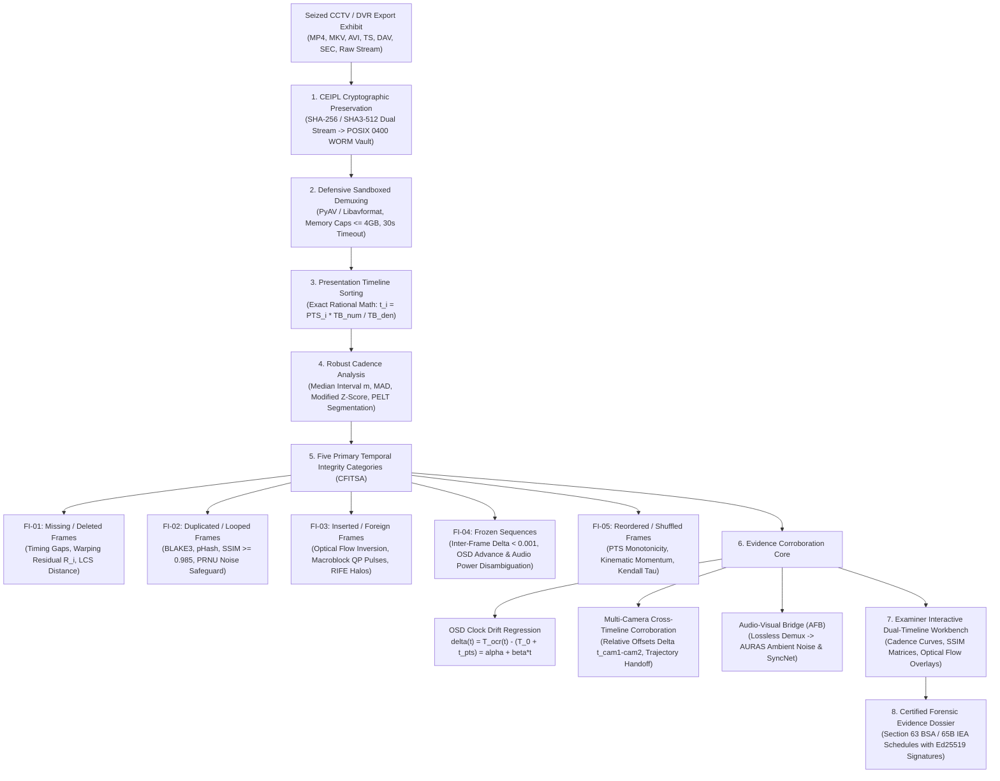
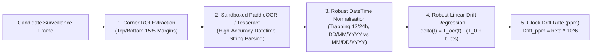

# CCTV Visual Intelligence & Temporal Sequence Forensics — Technical Specification

**Subsystem:** Video Integrity, Synchronization & Tampering Analysis Subsystem (VISTA)  
**Core Capabilities:** Dedicated CCTV Forensic Profile & CCTV Frame Integrity and Temporal Sequence Analysis (CFITSA)  
**Document Track:** Track B (Product Engineering) & Track A (Research Methodology)  
**Status:** Approved Technical Specification  
**Version:** 1.0.0  

---

## 1. Executive Summary & Operational Mission

Surveillance CCTV, digital video recorders (DVR), network video recorders (NVR), and body-worn cameras represent the most contested categories of electronic evidence in modern criminal and civil litigation. Questioned CCTV evidence is routinely challenged on claims of:
* Selective frame excision (cutting critical seconds of footage).
* Frame duplication or video looping (simulating inactivity while an incident occurred).
* Video freezing (freezing visual frames while audio or burned-in clocks advance).
* Altered chronology (reordering frames to reverse apparent causation).
* Discrepancies between visible on-screen display (OSD) clock text and container presentation timestamps.

The **CCTV Visual Intelligence & Temporal Sequence Forensics** capability provides an evidence-preserving, mathematically defensible framework that audits surveillance video streams across the physical bitstream, temporal cadence, spatial visual content, and on-screen overlays without manufacturing artificial certainty.

---

## 2. Mathematical Foundations of Temporal Sequence Forensics (CFITSA)

### 2.1 Coordinate Systems & Legal Invariants
Surveillance video bitstreams decouple transmission order from presentation order. CFITSA preserves five independent index coordinates for every frame:
1. `packet_index` ($k$): Raw sequential index within the container bitstream.
2. `decode_order_index` ($\text{DTS}_i$): Decoding timestamp order required by predictive decoders.
3. `presentation_order_index` ($\text{PTS}_i$): Exact presentation timestamp order when rendered to the display.
4. `source_reference_index`: Keyframe-relative GOP position (I, P, or B-frame).
5. `scene_relative_index`: Frame offset relative to verified scene cut boundaries.

* **B-Frame Legal Codec Invariant:** In streams utilizing bidirectional predictive coding (H.264 / H.265 / MPEG-4), decoding order naturally precedes presentation order ($\text{DTS}_i \le \text{PTS}_i$). This is legitimate, standard codec behavior governed by the `ctts` (composition time-to-sample) atom and must **never** be reported as evidence tampering.

### 2.2 Timebase & Exact Rational Timestamp Mathematics
To eliminate floating-point rounding drift across multi-hour surveillance recordings, all timestamp calculations are computed as unrounded rational integers:
$$t_i = \text{PTS}_i \times \frac{\text{TB}_{\text{num}}}{\text{TB}_{\text{den}}} \quad (\text{seconds})$$
$$\Delta t_i = t_i - t_{i-1} \quad (\text{frame interval})$$

### 2.3 Robust Non-Parametric Cadence Statistics
Surveillance systems frequently employ variable frame rates (VFR) to conserve bandwidth. Standard deviation and Gaussian statistics fail on VFR jitter. CFITSA computes robust non-parametric metrics:
* **Median Interval:** $m = \text{median}(\Delta t_i)$
* **Median Absolute Deviation (MAD):**
  $$\text{MAD} = \text{median}(|\Delta t_i - m|)$$
* **Modified Z-Score:**
  $$z_i = \frac{0.6745 \times (\Delta t_i - m)}{\text{MAD}}$$
  An observation with $|z_i| > 3.5$ triggers a candidate cadence discontinuity requiring corroboration.

---

## 3. The Five Core Frame Integrity Categories (FI-01 through FI-05)

### FI-01: Missing & Deleted Frame Detection
Evaluates four distinct detection modes:
* **Mode A (Timestamp Gap):** Measures presentation timestamp step discontinuities exceeding the expected cadence threshold: $\Delta t_i > (m + 3.5 \times \text{MAD})$.
* **Mode B (Sequence Edit Distance):** When an authentic companion stream or uncompressed reference exists, computes Longest Common Subsequence (LCS) and Levenshtein frame distance.
* **Mode C (Optical Flow Warping Residual):** Computes forward-backward dense Farnebäck or RAFT optical flow between adjacent frames. When a frame has been excised during motion, the bidirectional motion warping residual exhibits a sharp spike:
  $$R_i = \|\mathbf{I}_i - \mathcal{W}(\mathbf{I}_{i-1}, \mathbf{F}_{i \to i-1})\|_1 > \tau_{\text{motion}}$$
* **Mode D (Companion DVR Logs):** Correlates stream discontinuities with companion DVR export alarm/event logs (`motion_start`, `manual_pause`, `storage_rollover`).

### FI-02: Duplicated & Looped Frame Detection
* **Multi-Stage Filter:**
  1. *Exact Planar Hash:* 256-bit BLAKE3 hash computed on decoded planar luma ($Y$) raster bytes. Matches indicate bit-identical duplicated frames.
  2. *Perceptual Hash:* 64-bit DCT perceptual hash ($d_H(\text{pHash}_i, \text{pHash}_{i-1}) \le 2$).
  3. *Structural Similarity:* $\text{SSIM}(\mathbf{I}_i, \mathbf{I}_{i-1}) \ge 0.985$.
* **The Static Scene vs. Video Freeze Safeguard:** In surveillance footage, a camera viewing an empty hallway or static parking lot naturally yields near-identical frames ($\text{SSIM} > 0.98$). Declaring duplication based solely on SSIM generates unacceptable false alarms. CFITSA enforces a **PRNU sensor noise consistency check**:
  $$\text{Corr}(\mathbf{W}_i, \mathbf{W}_{i-1}) = \text{NormalizedCrossCorrelation}(\mathbf{I}_i - F(\mathbf{I}_i), \; \mathbf{I}_{i-1} - F(\mathbf{I}_{i-1}))$$
  In an authentic static scene, temporal camera sensor noise fluctuates naturally ($\text{Corr} < 0.20$); in an artificially cloned or frozen video loop, high-frequency noise is bit-identical ($\text{Corr} \to 1.0$).

### FI-03: Inserted & Foreign Frame Detection
* **Motion Inversion & Halos:** Detects frames synthesized via AI frame interpolation (RIFE, DAIN, Video-Swin) by measuring high-frequency boundary interpolation halos and unnatural bidirectional optical flow vectors.
* **Quantization Variance Spikes:** Evaluates macroblock-level quantization parameter ($\text{QP}$) distributions. An inserted frame encoded with different rate-distortion parameters exhibits a sharp variance spike relative to neighbor frames:
  $$\Delta \text{Var}(\text{QP}_i) = |\text{Var}(\text{QP}_i) - \text{median}(\text{Var}(\text{QP}_{i-k:i+k}))| > \tau_{\text{qp}}$$

### FI-04: Frozen Sequence Detection
* Flags consecutive sequences where inter-frame delta $D_i = \frac{1}{HW}\sum |Y_i(x,y) - Y_{i-1}(x,y)| < 0.001$ for duration $> 1.0\text{s}$.
* **Multimodal Freeze Disambiguation:** Automatically cross-references companion audio power and OCR clock strings. If the video image is frozen but the audio background power continues naturally, or the burned-in OSD clock continues advancing, the system distinguishes video encoder buffer freezes from scene stillness.

### FI-05: Reordered & Shuffled Frame Detection
* **Monotonicity Audit:** Verifies that presentation timestamps strictly ascend ($\text{PTS}_i > \text{PTS}_{i-1}$). Non-monotonic reversals flag container timestamp restructuring.
* **Kinematic Momentum Continuity:** Evaluates object tracking bounding boxes (via ByteTrack). Sudden unphysical reversals in velocity or acceleration vectors ($|\mathbf{a}_k(t)| > a_{\max}$) flag reversed or interleaved sequences:
  $$\mathbf{v}_k(t) = \frac{\mathbf{p}_k(t) - \mathbf{p}_k(t - \Delta t)}{\Delta t}$$
  $$\mathbf{a}_k(t) = \frac{\mathbf{v}_k(t) - \mathbf{v}_k(t - \Delta t)}{\Delta t}$$

---

## 4. CCTV On-Screen Display (OSD) Clock OCR & Drift Regression

Surveillance cameras routinely burn human-readable datetime strings directly into video pixels (e.g., in the top-right or bottom-left corner). CFITSA automates clock extraction and regression modeling:

### 4.1 Drift Formulation
Let $T_{\text{ocr}}(t)$ be the extracted display time at frame timestamp $t_{\text{pts}}$, and let $T_0$ be the initial recorded start epoch. The instantaneous clock discrepancy is:
$$\delta(t) = T_{\text{ocr}}(t) - (T_0 + t_{\text{pts}}) = \alpha + \beta t_{\text{pts}} + \epsilon(t)$$
* **Slope Parameter $\beta$:** Represents relative hardware clock drift. Estimated drift in parts per million:
  $$\text{Drift}_{\text{ppm}} = \beta \times 10^6$$
* **Huber Loss Minimization:** Solved via robust M-estimation to reject OCR character recognition errors (e.g., misreading `0` as `8`).
* **Sudden Reset Detection (PELT):** If $|\Delta \delta(t)| > 1.0\text{s}$ occurs abruptly, the system segments the recording into piecewise intervals, prohibiting a single global regression line across an NTP synchronization step or manual DVR clock adjustment.

---

## 5. Multi-Camera Corroboration & Timeline Alignment

When multiple cameras monitor an incident (e.g., overlapping views of an intersection, building entrance, or bank teller counter):
1. **Independent WORM Exhibits:** Each camera export is preserved as an independent exhibit in CEIPL with distinct SHA-256 digests.
2. **Relative Offset Estimation ($\Delta t_{\text{cam1-cam2}}$):** Evaluates visual flash onsets, lighting changes, or vehicle trajectory entries across both feeds to establish empirical cross-camera time offsets.
3. **Cross-Camera Trajectory Continuity:** Traces entity bounding boxes across camera field-of-view handoffs, verifying that an individual exiting Camera 1's view arrives at Camera 2 within physical velocity bounds ($v = d / \Delta t \le v_{\max}$).

---

## 6. Surveillance Video Content Intelligence (VCI)

Beyond temporal sequence integrity, the VISTA **VCI** engine provides structured visual content auditing:

| Intelligence Domain | Algorithmic Implementation | Forensic Guardrail |
| :--- | :--- | :--- |
| **Hierarchical Source Taxonomy** | 15-category classification (Fixed CCTV, PTZ, Dashcam, Bodycam, Drone, Mobile) | Differentiates mobile handheld pans from stationary surveillance setups. |
| **Multi-Label Scene Classification** | Time-segmented scene tags (Urban street, highway, junction, interior, public hall) | Identifies camera orientation switches or scene splices. |
| **General Object Inventory** | YOLOv8/v10 and SAM 2 instance segmentation | Bounded confidence tiers; emits `UNKNOWN_OBJECT` rather than guessing. |
| **Vehicle & ALPR/ANPR Forensics** | Multi-class vehicle categorization + license plate OCR with syntax validation | Enforces high-accuracy syntax validation; zero character hallucination. |
| **Candidate Hazard Triage** | Spatial detection of candidate hazard objects (weapons, fire, collisions) | Strictly flags as *candidate visual alerts* requiring human examiner review; zero intent assertions. |
| **Unique Entity Tracking** | ByteTrack / BoT-SORT multi-object kinematic tracking | Distinguishes *visible tracked instances* from *biometrically verified individuals*. |

---

## 7. Native Surveillance Export & Digital Seal Verification

Surveillance DVRs frequently package recordings in proprietary export formats with cryptographic seals:
* **ONVIF Export File Format:** Parses ISO/IEC 14496-12 based surveillance exports conforming to ONVIF Profile G and Profile S.
* **ONVIF Media Signing Verification:** Validates detached RSA/ECDSA digital signatures embedded in container user-data (`uuid`) atoms against X.509 surveillance manufacturer certificates.
* **Vendor Sidecar Files:** Audits companion JSON/XML metadata sidecars, verifying that file size, frame count, and camera channel IDs match the physical bitstream.

---

## 8. Forensic Uncertainty Principles & Courtroom Limitations

1. **Cadence Anomaly $\neq$ Definite Proof of Criminal Tampering:** Dropped frames, variable frame rates, and clock drift occur naturally in commercial surveillance due to network transmission loss, RTSP buffer drops, motion-triggered keyframing, and uncalibrated quartz oscillators. All findings must be reported as *cadence anomalies with alternative benign hypotheses*.
2. **Burned-In OSD Text $\neq$ Satellite Ground Truth:** On-screen clock text represents software rendered by DVR firmware. Battery depletion, unconfigured timezones, and operator error cause display offsets without intentional fraud.
3. **Static Scene Preservation:** Identical frames viewing an unmoving scene do not constitute video freezing if high-frequency camera sensor noise continues fluctuating.
4. **Mandatory Inconclusive Policy:** When CCTV footage resolution is below $320\times 240$, optical blur is severe, or frame rates drop below 5 fps, the system issues a formal **`INCONCLUSIVE / INSUFFICIENT VIDEO EVIDENCE`** determination.