# Implementation Roadmap & Phases (PHASES.md)

## Project: Digital Evidence Authenticity & Integrity Verification Platform (PS-05)
**Hackathon:** Bihar Government Cyber Hackathon 2026 (C-DAC Patna, CCSU, Bihar Police)  
**Track:** Digital Forensics  
**Problem Statement:** PS-05 — Digital Evidence Authenticity and Integrity Verification Platform  
**Document Version:** 1.1.0  
**Status:** Canonical Implementation Roadmap & Engineering Playbook  

---

## 1. Roadmap Architecture & Phase Progression

The PS-05 development lifecycle is structured into eleven platform-level phases (Phase 0 through Phase 10). Subsystems are decomposed into dedicated, sequential engineering tracks:
- **AURAS Audio Forensics Subsystem:** Eleven engineering phases (**AURAS-A0 through AURAS-A10**).
- **VISTA Video Forensics Subsystem:** Fourteen engineering phases (**VISTA-A0 through VISTA-A13**).
- **AIF Image Forensics Subsystem:** Retained as Phase 4 with its multi-branch visual examination modules.
- **Shared Platform Layer:** Common pre-decode dual-hashing, WORM vault persistence, Celery worker orchestration, and Section 65B/63 BSA legal reporting infrastructure.

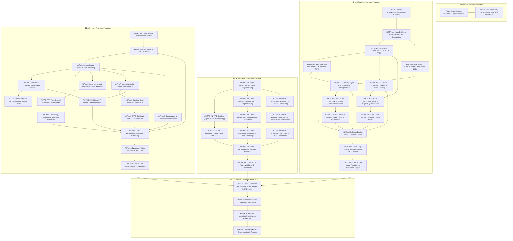

---

## 2. Master Implementation Status Inventory

| Phase ID | Phase Name | Subsystem / Workstream | Status | Prerequisite Gates | Primary Deliverables |
| :--- | :--- | :--- | :--- | :--- | :--- |
| **Phase 0** | Architecture Baseline & Repo Standards | All Subsystems / Docs | `IMPLEMENTED_AND_VERIFIED` | None | PRD, TRD, PHASES, AI_INSTRUCTIONS, pyproject.toml |
| **AURAS-A0**| Audio Evidence Contracts & Ingestion | Shared Core / AURAS | `PLANNED` | Phase 0 Gate | Dual-hasher, WORM vault, artifact manifests, decoder |
| **AURAS-A1**| ARE Baseline: Signal & Spectral Profiling | ARE Engine | `PLANNED` | AURAS-A0 Gate | RMS/clipping metrics, STFT, Welch PSD, spectral flux |
| **AURAS-A2**| ARE Advanced: Splicing, Noise & ENF | ARE Engine | `PLANNED` | AURAS-A1 Gate | PELT splice detector, noise floor tracker, FAISS, ENF |
| **AURAS-A3**| MVSI Foundation: VAD & Segmentation | MVSI Engine | `PLANNED` | AURAS-A0 Gate | Silero VAD, neural speech chunker, pause filtering |
| **AURAS-A4**| MVSI Advanced: Overlap-Aware Diarization | MVSI Engine | `PLANNED` | AURAS-A3 Gate | ECAPA-TDNN, PyAnnote OSD, concurrent speaker timeline |
| **AURAS-A5**| MVSI Multilingual & Speaker-Language | MVSI Engine | `PLANNED` | AURAS-A4 Gate | Whisper/MMS Indian LID, code-switching, language stats |
| **AURAS-A6**| ADDE Foundation: Independent Framework | ADDE Engine | `PLANNED` | AURAS-A0 Gate | RawNet2, AASIST, model registry, sliding windowing |
| **AURAS-A7**| ADDE Advanced: WavLM SSL & Robustness | ADDE Engine | `PLANNED` | AURAS-A6 Gate | WavLM Base+, partial splice localization, CodecFake |
| **AURAS-A8**| ADDE Ensemble, Calibration & OOD | ADDE Engine | `PLANNED` | AURAS-A7 Gate | Platt scaling, late-fusion ensemble, Mahalanobis OOD |
| **AURAS-A9**| Audio Orchestration & Reviewer Workflow | Reporting / AURAS | `PLANNED` | A2, A5, A8 Gates | Finding merger, timeline alignment, Archify JSON IR |
| **AURAS-A10**| End-to-End Audio Validation & Benchmark | Validation / Benchmarks | `PLANNED` | AURAS-A9 Gate | ASVspoof/synthetic benchmark report, test corpus |
| **VISTA-A0**| Video Architecture Baseline & Standards | VISTA Core / Shared | `PLANNED` | Phase 0 Gate | Directory structure, PyAV/FFprobe defensive harnesses |
| **VISTA-A1**| Video Contracts & CEIPL Provenance | CEIPL / VISTA Core | `PLANNED` | VISTA-A0 Gate | Pre-decode dual-hasher, WORM vault, RFC 8785 manifests, Ed25519 signer |
| **VISTA-A2**| Demuxing, Container & PTS Cadence | VRE Baseline | `PLANNED` | VISTA-A1 Gate | Container atom parser, PTS/DTS cadence analyzer, VFR detector |
| **VISTA-A3**| Advanced VRE: Macroblock QP & Splicing | VRE Advanced | `PLANNED` | VISTA-A2 Gate | Macroblock QP parser, PySceneDetect transitions, ExifTool, RIFE flow |
| **VISTA-A4**| AFB Stream-Copy & AURAS Subsystem Bridge | AFB Engine | `PLANNED` | VISTA-A1 Gate | FFmpeg stream-copy, 16kHz float32 factory, DAG lineage, AURAS client |
| **VISTA-A5**| AVSC Lip-Sync & Audio-Visual Sync | AVSC Engine | `PLANNED` | VISTA-A3, A4 Gates | Container AV alignment, RetinaFace/ByteTrack, SyncNet correlation |
| **VISTA-A6**| VCI Taxonomy, Tracking & Unique Counting| VCI Engine | `PLANNED` | VISTA-A2 Gate | 15-category taxonomy, YOLOv8/v10, SAM 2, ByteTrack unique count |
| **VISTA-A7**| CCTV Discovery & Adaptive Questionnaire | CCTV Baseline | `PLANNED` | VISTA-A2, A6 Gates | Automated triage, pre-questioning extractor, adaptive questions A-E |
| **VISTA-A8**| CCTV Clock Drift & Native Export Seals | CCTV Advanced | `PLANNED` | VISTA-A7 Gate | OSD clock drift regression delta(t), freeze detector, ONVIF verifier |
| **VISTA-A9**| VDF Frame Deepfake & Spatial Heads | VDF Baseline | `PLANNED` | VISTA-A5 Gate | XceptionNet, EfficientNet-B4 dual-domain, face swap/inpainting heads |
| **VISTA-A10**| VDF Temporal Models, 3D FFT & OOD | VDF Advanced | `PLANNED` | VISTA-A9 Gate | FTCN temporal network, VideoMAE SSL, 3D FFT generative, Mahalanobis OOD |
| **VISTA-A11**| Cross-Engine Video Evidence Fusion | Fusion / VISTA | `PLANNED` | VISTA-A5, A8, A10 | Multi-track timeline alignment, conflict resolution matrix, finding merger |
| **VISTA-A12**| Video Legal Reporting & Sec 65B/63 BSA | Reporting / VISTA | `PLANNED` | VISTA-A11 Gate | Section 65B/63 BSA PDF certificate, Archify JSON IR, digital signature |
| **VISTA-A13**| End-to-End Video Validation & Benchmark | Validation / Release | `PLANNED` | VISTA-A12 Gate | FF++, Celeb-DF, DFDC, CCTV synthetic corpus, air-gap verification |
| **AIF-A0**  | AIF Architecture Baseline & Audit | AIF Core / Docs | `PLANNED` | Phase 0 Gate | Directory structure, module boundary contracts, threat model |
| **AIF-A1**  | Shared Contracts & CEIPL Foundation | CEIPL / AIF Core | `PLANNED` | AIF-A0 Gate | Pre-decode dual-hasher, WORM vault, RFC 8785 canonical manifests |
| **AIF-A2**  | Secure Image Intake & Safe Decoding | IVE Baseline | `PLANNED` | AIF-A1 Gate | Magic bytes, Pillow 128MP quota, isolated parser sandbox |
| **AIF-A3**  | Hierarchical Taxonomy & Scene Triage | IVE Taxonomy | `PLANNED` | AIF-A2 Gate | 150-category registry, SigLIP multi-label classifier, temperature calib |
| **AIF-A4**  | Object Detection & People Counting | IVE Vision | `PLANNED` | AIF-A2 Gate | YOLOv8/SAM 2, high-res tiling DAG, occlusion-aware people counter |
| **AIF-A5**  | FPA Face, Portrait & Biometric Landmarks| FPA Module | `PLANNED` | AIF-A2 Gate | RetinaFace, MediaPipe 468 mesh, pose/blur/occlusion, ArcFace 1:1 gate |
| **AIF-A6**  | Document Layout, Quad Rectification & OCR| IVE Docs | `PLANNED` | AIF-A2 Gate | Perspective transform, PaddleOCR Indian scripts, seal/signature detect |
| **AIF-A7**  | Metadata Audit & Signal Profiling | IRE Baseline | `PLANNED` | AIF-A2 Gate | ExifTool deep audit, 2D FFT log-spectrum, DCT quantization check |
| **AIF-A8**  | Classical CV & Geometric Forensics | IRE Geometric | `PLANNED` | AIF-A7 Gate | Canny, Sobel, Hough, SIFT/ORB + RANSAC homography alignment |
| **AIF-A9**  | CMFD Splicing & Camera Sensor PRNU | IRE Advanced | `PLANNED` | AIF-A8 Gate | DBSCAN SIFT keypoint CMFD, DCT block match, PRNU sensor noise |
| **AIF-A10** | Multi-Branch AI-Gen & TruFor Inpainting | AIM Detection | `PLANNED` | AIF-A2 Gate | Multi-branch ResNet/FFT/SigLIP, TruFor inpainting localization mask |
| **AIF-A11** | Face Swap, Morphing & Synthesis | AIM Facial | `PLANNED` | AIF-A5 Gate | Face X-Ray blend boundary, landmark asymmetry, corneal specularity |
| **AIF-A12** | Steganalysis & Malformed File Defense | AIM Security | `PLANNED` | AIF-A2 Gate | LSB randomness, RS analysis, trailing bytes quarantine, polyglot block |
| **AIF-A13** | CEIPL Provenance & Custody Hardening | CEIPL Hardening | `PLANNED` | AIF-A1, A10 Gates| Ed25519 signer, RFC 3161 TSA, hash-chained log, Merkle inclusion proofs |
| **AIF-A14** | Evidence Fusion & Legal Reporting | Reporting / AIF | `PLANNED` | AIF-A10..A13 Gates| Cross-engine finding merger, Archify JSON IR, Section 65B/63 BSA PDF |
| **AIF-A15** | End-to-End Image Validation & Release | Validation / Release | `PLANNED` | AIF-A14 Gate | Benchmark suite, CoMoFoD, TruFor eval, 5-run determinism, air-gap |
| **Phase 7** | Platform Cross-Engine Reporting | Core Reporting | `PLANNED` | A10, VA13, IA15 Gates| Section 65B IEA / Section 63 BSA unified multi-modal certificate |
| **Phase 8** | Web Dashboard & Examiner Workbench | UI / Presentation | `PLANNED` | Phase 7 Gate | Next.js interactive UI, multi-modal waveform viewer |
| **Phase 9** | Security Hardening & Air-Gapped Packaging | DevOps / Security | `PLANNED` | Phase 8 Gate | Offline Docker containers, POSIX 0400 WORM scripts |
| **Phase 10** | Final Hackathon Demonstration & Release | Quality & Release | `PLANNED` | Phase 9 Gate | Verified demonstration scripts & curated case pack |

---

## 3. Dedicated Audio Forensics Engineering Playbook (AURAS-A0 through AURAS-A10)

### Phase AURAS-A0: Audio Foundation, Evidence Contracts & Preprocessing

**Status:** `PLANNED`

**Objective:**  
Establish the secure, cryptographically verifiable evidentiary foundation for audio processing. Implement bitstream dual-hashing, immutable WORM storage access controls, channel-preserving audio decoding, standardized derived artifact generation, and schema-validated engine contracts without altering original exhibit bytes.

**Scope:**
- *Included:* File ingestion, SHA-256 and SHA3-512 dual hashing, POSIX 0400 WORM write-blocking, FFprobe container audit, Kaiser sinc-resampling (16 kHz), channel downmixing, 2.0s sliding window generation, and transformation lineage manifests.
- *Explicit Exclusions:* Signal anomaly detection (deferred to A1/A2), speech intelligence (deferred to A3/A4/A5), deepfake inference (deferred to A6/A7/A8).

**Prerequisites:**  
Phase 0 architectural baseline completed; `pyproject.toml` and `.env.example` configured.

**Topics & Subtopics:**
1. **Audio Evidence Registration & Ingestion:** Ingest raw audio exhibits (`.wav`, `.mp3`, `.m4a`, `.aac`, `.flac`); assign UUIDv4 `evidence_id`; extract file size and MIME type.
2. **Dual-Hashing Engine:** Stream bytes through chunked SHA-256 and SHA3-512 accumulators (64KB chunks). Compare against optional police seizure hash memos (`trusted_sha256`).
3. **Immutable WORM Vault Management:** Store master raw bytes in `/data/vault_worm/`; enforce POSIX `0400` read-only permissions; verify S3 Object Lock compliance when S3 backend is active.
4. **FFmpeg/FFprobe Decoder Integration:** Safe invocation of FFprobe via `subprocess.run(shell=False)` with argument arrays; extract container streams, sample rate ($f_s$), channel count, bit depth, and duration.
5. **Channel-Preserving Raw Working Representation (Artifact A):** Decode bitstream to uncompressed multi-channel 32-bit float WAV preserving native sample rate.
6. **Normalized Speech Representation (Artifact B):** Downmix to mono ($M = 0.5(L + R)$); resample to 16 kHz using band-limited Kaiser sinc interpolation (`torchaudio.transforms.Resample`).
7. **Standardized Window Slices (Artifact C):** Segment into 2.0-second sliding windows with 0.5-second stride (75% overlap); pad short files with reflective padding.
8. **Transformation Manifest DAG:** For every derived artifact, compute SHA-256 and insert lineage record linking parent `evidence_id`, transformation operator, parameters, and child hash.
9. **Shared Engine Schemas:** Implement Pydantic v2 data models for `AudioEvidence`, `AudioArtifact`, `EngineRun`, and `ForensicFinding`.
10. **Resource Limits & Corrupt-Input Handling:** Enforce max file size quota (500 MB); safely catch truncated bitstreams, corrupted headers, or non-audio payloads without worker crash.

**Execution Workflow:**

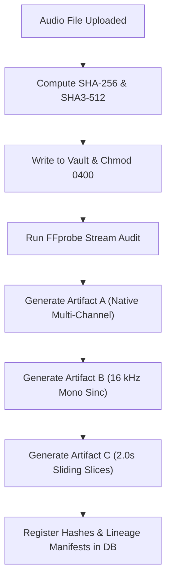

**Validation Strategy:**  
Upload genuine and corrupt audio samples; verify bitstream checksums before and after processing; assert that attempting to modify Artifact files throws `PermissionError`; verify Pydantic schema validation.

**Definition of Done:**  
All ingestion and transformation modules implemented in `src/ps05/core/` and `src/ps05/engines/audio/common/`; unit tests in `tests/unit/test_audio_ingest.py` pass with exit code 0.

**Dependencies & Risks:**  
*Risk:* System FFmpeg version incompatibility. *Mitigation:* Pin FFmpeg $\ge 6.0$ and verify binary presence on application startup.

**Checkpoint Table:**

| Checkpoint ID | Topic / Subtopic | Verification action | Expected evidence | Status | Pass criteria |
| :--- | :--- | :--- | :--- | :--- | :--- |
| **A0-CP-01** | Evidence Hashing | Execute dual-hashing on test WAV fixture | SHA-256 and SHA3-512 matching known fixture checksums | `NOT_STARTED` | Checksums match reference values exactly |
| **A0-CP-02** | WORM Immutability | Attempt to write to stored exhibit file | Caught `PermissionError` (POSIX 0400) | `NOT_STARTED` | File permissions strictly enforce read-only |
| **A0-CP-03** | Artifact Lineage | Query database for generated artifacts A, B, C | Database rows with parent FK and distinct hashes | `NOT_STARTED` | Complete DAG linking parent to derived artifacts |
| **A0-CP-04** | Decoder Robustness | Feed truncated and 0-byte corrupt files | Clean HTTP 422 / validation error response | `NOT_STARTED` | System fails safely without worker crash |

---

### Phase AURAS-A1: ARE Baseline — Integrity, Metadata & Signal Profiling

**Status:** `PLANNED`

**Objective:**  
Implement baseline electroacoustic and physical signal analysis for audio exhibits. Quantify dynamic range, detect clipping and DC offset bias, compute Short-Time Fourier Transform (STFT) spectrograms, and extract container metadata tags.

**Scope:**
- *Included:* ARE-01 (Integrity), ARE-02 (Metadata & DAW audit), ARE-03 (Signal profiling), ARE-04 (Spectral analysis & Welch PSD), high-frequency cutoff detection.
- *Explicit Exclusions:* Splice localization (deferred to A2), diarization (deferred to A3–A5), deepfake inference (deferred to A6–A8).

**Prerequisites:**  
Phase AURAS-A0 Gate passed; working Artifact A (native multi-channel) and Artifact B (16 kHz mono) available.

**Topics & Subtopics:**
1. **Metadata & DAW Signature Audit (ARE-02):** Scan RIFF chunks, ID3 tags, and BWF headers for software signatures (ProTools, Logic, Audacity, FL Studio, Adobe Audition); detect non-standard bitrates and truncated padding.
2. **Electroacoustic Signal Profiling (ARE-03):** Compute RMS energy, true peak, dynamic range (dB), DC offset bias ($\mu_x$), and zero-crossing rate (ZCR) across all audio channels.
3. **Clipping & Dynamic Compression Analysis:** Measure consecutive saturated samples ($|x[n]| \ge 0.9999$); calculate clipping percentage and estimate crest factor.
4. **SNR Estimation:** Implement WADA-SNR algorithm to estimate signal-to-noise ratio in decibels.
5. **Time-Frequency Spectral Analysis (ARE-04):** Compute STFT with Hann window (2048-point FFT, 512 hop size); generate 128-bin log-mel spectrogram; compute Welch Power Spectral Density (PSD).
6. **Spectral Rolloff & High-Frequency Cutoff Estimation:** Estimate upper cutoff frequency ($f_{\text{cutoff}}$) to identify lossy compression boundaries (e.g., 16 kHz cutoff indicative of 128 kbps MP3/AAC).
7. **Spectral Flux Computation:** Calculate first-order spectral difference series $SF[m] = \sum_k |X[k, m] - X[k, m-1]|^2$ for downstream change-point localization.
8. **Channel Phase & Balance Correlation:** For stereo recordings, evaluate inter-channel phase difference (IPD) and channel cross-correlation.
9. **Structured Signal Finding Serialization:** Wrap all electroacoustic metrics into `ARESegmentFindings` Pydantic models.
10. **Regression & Synthetic Testing:** Test against pure sine waves, synthetic clipped audio, and clean vs. lossy compressed files.

**Execution Workflow:**

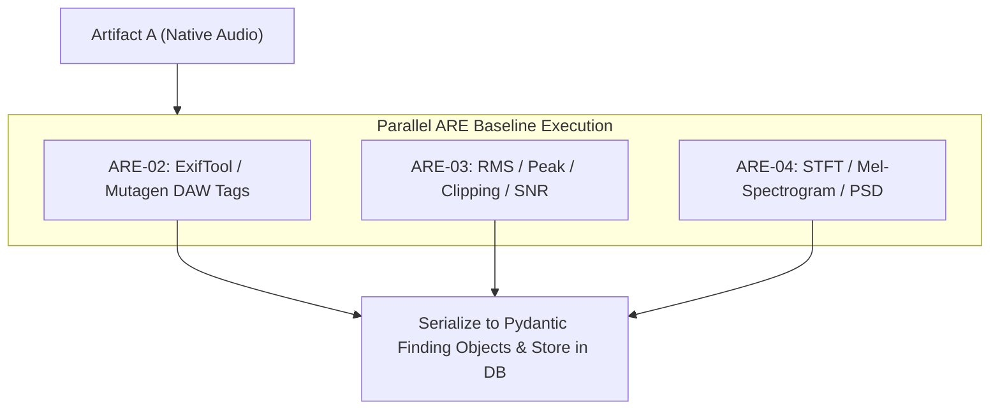

**Validation Strategy:**  
Execute unit tests on synthetic audio fixtures with injected DC offset ($+0.05$), 100 clipped samples, and a 1 kHz sine wave; verify that measured parameters match ground-truth values within 1% tolerance.

**Definition of Done:**  
Modules `src/ps05/engines/audio/are/signal.py` and `spectral.py` implemented; `tests/unit/test_are_signal.py` passes 100%.

**Dependencies & Risks:**  
*Risk:* Memory exhaustion on long 2-hour recordings during STFT. *Mitigation:* Chunk STFT computation in 5-minute blocks.

**Checkpoint Table:**

| Checkpoint ID | Topic / Subtopic | Verification action | Expected evidence | Status | Pass criteria |
| :--- | :--- | :--- | :--- | :--- | :--- |
| **A1-CP-01** | Clipping Counting | Run signal profiler on fixture with 100 clipped peaks | `clip_count == 100` | `NOT_STARTED` | Exact sample count match |
| **A1-CP-02** | DAW Signature Tagging | Inspect WAV file exported from Audacity | `daw_tags_found == ["Audacity"]` | `NOT_STARTED` | Accurately identifies editing workstation |
| **A1-CP-03** | Spectral Cutoff | Compute PSD on 128 kbps MP3 file | High-frequency cutoff flagged at $\approx 16.0\text{ kHz}$ | `NOT_STARTED` | Cutoff localized within $\pm 200\text{ Hz}$ |
| **A1-CP-04** | Signal Schema Validity | Validate output dictionary against `SignalProfile` | Pydantic validation passes without error | `NOT_STARTED` | All numeric fields within defined ranges |

---

### Phase AURAS-A2: ARE Advanced — Edit, Splice, Noise, Repetition & ENF

**Status:** `PLANNED`

**Objective:**  
Implement advanced signal-level tampering detection: localizing candidate edit/splice points via change-point algorithms, tracking ambient noise-floor stationarity, detecting duplicated/cloned phrases via FAISS acoustic self-similarity, and extracting 50 Hz Electric Network Frequency (ENF).

**Scope:**
- *Included:* ARE-05 (Splice detection via PELT), ARE-06 (Noise consistency), ARE-07 (FAISS repetition), ARE-08 (Codec re-encoding), ARE-09 (ENF forensics), ARE-10 (Acoustic manifests).
- *Explicit Exclusions:* Speaker identification (deferred to MVSI), deepfake neural classification (deferred to ADDE).

**Prerequisites:**  
Phase AURAS-A1 Gate passed; spectral flux and STFT spectrograms operational.

**Topics & Subtopics:**
1. **Change-Point Splice Detection (ARE-05):** Apply Pruned Exact Linear Time (PELT) change-point search on spectral flux and short-time energy series using RBF kernel (`ruptures` library).
2. **Splice Candidate Boundary Localization:** Filter change-points by energy jump magnitude ($> 3\sigma$); pinpoint candidate edit timestamps ($\pm 50\text{ ms}$).
3. **Ambient Noise Floor Tracking (ARE-06):** Implement Martin's minimum statistics spectral subtraction to extract stationary background room tone; flag abrupt noise floor shifts ($> 4\text{ dB}$).
4. **Reverberation & Room Acoustic Discontinuity:** Track early-to-late reverberation energy ratio across speech pauses.
5. **MFCC Acoustic Feature Extraction:** Extract 13 MFCC coefficients over 25ms frames with 10ms hop length for acoustic fingerprinting.
6. **FAISS Self-Similarity Search (ARE-07):** Build FAISS index of normalized MFCC vectors; compute full pairwise cosine similarity matrix; search for off-diagonal matching trajectories ($> 1.0\text{ s}$, similarity $> 0.92$).
7. **Candidate Repeated Phrase Verification:** Verify candidate cloned segments using cross-correlation to distinguish natural speech repetition from copy-pasted audio clones.
8. **Codec Re-Encoding Analysis (ARE-08):** Analyze MDCT quantization error patterns and rolloff steepness to detect multi-pass lossy compression.
9. **50 Hz ENF Grid Extraction (ARE-09):** Bandpass filter audio between 49.8 Hz and 50.2 Hz (8th-order Butterworth); compute analytic signal via Hilbert transform; track instantaneous frequency.
10. **ENF Grid Log Correlation:** Compare extracted ENF curve against reference state electrical grid database (when reference logs are available); output Pearson correlation coefficient $r$.
11. **Signed Acoustic Manifest Generation (ARE-10):** Compile all signal findings into an immutable JSON manifest signed with examiner private key.
12. **Alternative Explanations & False-Positive Evaluation:** Distinguish benign microphone bumps from manual splices; flag low-SNR conditions where ENF is unextractable.
13. **Benchmark Corpus Testing:** Run on synthetic splice dataset (20 spliced audio tracks, 20 untampered controls).

**Execution Workflow:**

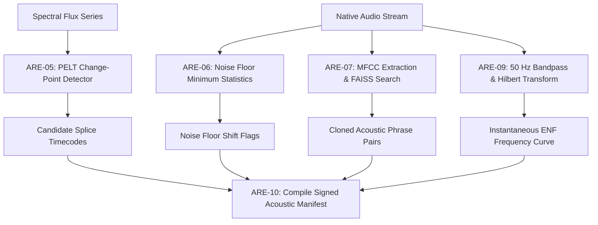

**Validation Strategy:**  
Inject a 500ms tone or spliced spoken phrase into 10 test audio tracks at known millisecond timestamps; verify that ARE-05 detects the splice boundary within $\pm 50\text{ ms}$; verify that untampered controls produce 0 false-positive splice alarms above threshold.

**Definition of Done:**  
Modules `src/ps05/engines/audio/are/edit_detect.py`, `noise.py`, `repetition.py`, and `enf.py` implemented; unit tests in `tests/unit/test_are_splice.py` pass.

**Dependencies & Risks:**  
*Risk:* Heavy lossy compression obscuring ENF signal. *Mitigation:* Explicitly mark ENF as `INCONCLUSIVE_NO_USABLE_ENF` when SNR $< 6\text{ dB}$.

**Checkpoint Table:**

| Checkpoint ID | Topic / Subtopic | Verification action | Expected evidence | Status | Pass criteria |
| :--- | :--- | :--- | :--- | :--- | :--- |
| **A2-CP-01** | Splice Localization | Run PELT detector on audio with injected splice at $T=02.500\text{s}$ | Flagged splice interval covers $02.450\text{s} - 02.550\text{s}$ | `NOT_STARTED` | Localization error $\le \pm 50\text{ ms}$ |
| **A2-CP-02** | Noise Floor Tracking | Ingest audio with background room tone step jump ($+6\text{ dB}$) | Anomaly alert flagged with start/end timecode | `NOT_STARTED` | Detects jump $> 4\text{ dB}$ lasting $> 200\text{ ms}$ |
| **A2-CP-03** | Repeated Phrases | Test audio with identical duplicated sentence | Segment pair identified with similarity $> 0.92$ | `NOT_STARTED` | Accurately identifies cloned intervals |
| **A2-CP-04** | ENF Availability | Extract ENF from clean mains-connected studio recording | Frequency curve centered at $50.0 \pm 0.15\text{ Hz}$ | `NOT_STARTED` | Instantaneous frequency tracked cleanly |

---

### Phase AURAS-A3: MVSI Foundation — VAD & Speech Segmentation

**Status:** `PLANNED`

**Objective:**  
Implement voice activity detection (VAD), acoustic quality gating, and neural speech segmentation to isolate genuine speech intervals from non-speech background, silence, and environmental static.

**Scope:**
- *Included:* MVSI-01 (Audio quality assessment), MVSI-02 (Silero VAD / WebRTC VAD), MVSI-03 (Neural speech segmentation), temporal smoothing hysteresis.
- *Explicit Exclusions:* Speaker clustering and diarization (deferred to A4), language ID (deferred to A5).

**Prerequisites:**  
Phase AURAS-A0 Gate passed; working Artifact B (16 kHz mono normalized WAV) available.

**Topics & Subtopics:**
1. **Audio Quality Pre-Gating (MVSI-01):** Assess signal quality before speech processing. If SNR $< 5\text{ dB}$ or clipping $> 5\%$, issue an `AUDIO_QUALITY_DEGRADED` warning.
2. **Silero VAD v4 Integration (MVSI-02):** Load pre-packaged TorchScript model (`vad-silero-v4`); stream 16 kHz audio chunks (512 samples); calculate frame-level speech probabilities $P(\text{speech})$.
3. **WebRTC VAD Baseline Fallback:** Provide lightweight CPU-only WebRTC VAD baseline for low-power triage.
4. **Temporal Smoothing & Hysteresis:** Apply speech threshold ($P_{\text{start}} = 0.50$, $P_{\text{end}} = 0.35$); enforce minimum speech duration ($250\text{ ms}$) and minimum silence duration ($100\text{ ms}$) to avoid cutting words mid-phoneme.
5. **Speech Segmentation & Chunker (MVSI-03):** Slice continuous speech stream into discrete acoustic turns bounded by pauses.
6. **Speech Duty Cycle Metric:** Calculate total active speech time vs. total recording duration.
7. **Quiet Speech & Noisy Audio Robustness:** Evaluate VAD performance on low-amplitude whispers and noisy roadside audio.
8. **Speech Interval Schema Serialization:** Serialize output into `List[SpeechInterval(start_sec, end_sec, avg_prob, snr_db)]`.
9. **CPU/GPU Resource Optimization:** Run Silero VAD on CPU using INT8 quantization to preserve GPU VRAM for deepfake models.
10. **Unit Testing on Synthetic Speech/Silence Fixtures:** Validate boundary detection on synthetic alternating 2.0s speech and 1.0s silence audio.

**Execution Workflow:**

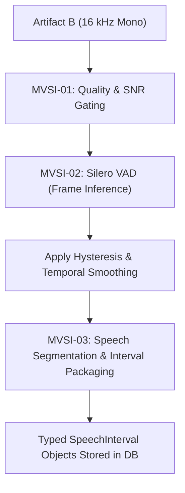

**Validation Strategy:**  
Run VAD test suite against 10 clean conversational clips and 5 noisy background controls; assert false alarm rate $< 5\%$ and speech boundary timing accuracy within $\pm 30\text{ ms}$.

**Definition of Done:**  
Modules `src/ps05/engines/audio/mvsi/vad.py` and `segmentation.py` implemented; `tests/unit/test_mvsi_vad.py` passes 100%.

**Dependencies & Risks:**  
*Risk:* High background noise causing speech fragmentation. *Mitigation:* Dynamic threshold adaptation based on estimated background noise floor.

**Checkpoint Table:**

| Checkpoint ID | Topic / Subtopic | Verification action | Expected evidence | Status | Pass criteria |
| :--- | :--- | :--- | :--- | :--- | :--- |
| **A3-CP-01** | Speech Isolation | Ingest 10-second audio with 4.0s speech and 6.0s silence | Extracted intervals total $4.0 \pm 0.15\text{ s}$ | `NOT_STARTED` | Accurate speech duty cycle |
| **A3-CP-02** | Quiet Speech Sensitivity | Test whisper audio sample (peak $-25\text{ dBFS}$) | Speech interval detected without truncation | `NOT_STARTED` | Detects speech above $-30\text{ dBFS}$ |
| **A3-CP-03** | Low Quality Warning | Test audio with synthetic SNR $= 3\text{ dB}$ | Emits `AUDIO_QUALITY_DEGRADED` warning | `NOT_STARTED` | Low SNR flagged explicitly |
| **A3-CP-04** | Runtime Latency | Process 5-minute audio track on 4-core CPU | Execution completes in $< 2.0\text{ seconds}$ | `NOT_STARTED` | Faster than $150\times$ real-time on CPU |

---

### Phase AURAS-A4: MVSI Advanced — Overlap-Aware Speaker Diarization

**Status:** `PLANNED`

**Objective:**  
Implement end-to-end speaker diarization supporting simultaneous overlapping speech. Extract high-dimensional speaker embeddings, cluster speaker turns, and produce multi-label "who spoke when" timelines allowing concurrent speaker activity.

**Scope:**
- *Included:* MVSI-04 (Overlapped Speech Detection), MVSI-05 (ECAPA-TDNN embeddings), MVSI-06 (Agglomerative clustering), MVSI-07/08 (Overlap-aware diarization timeline).
- *Explicit Exclusions:* Language identification (deferred to A5), speech-to-text transcription (optional in A5).

**Prerequisites:**  
Phase AURAS-A3 Gate passed; speech segments and intervals operational.

**Topics & Subtopics:**
1. **Overlapped Speech Detection (OSD) (MVSI-04):** Apply PyAnnote OSD model on speech frames; output framewise multi-talker overlap probabilities $P(\text{overlap})$.
2. **Speaker Representation Extraction (MVSI-05):** Extract 192-dimensional speaker embeddings using SpeechBrain ECAPA-TDNN (`emb-ecapa-tdnn`) over segmented speech turns.
3. **Embedding Normalization & Centroid Tracking:** Apply length normalization ($L_2$) and compute running speaker centroids.
4. **Speaker Clustering (MVSI-06):** Cluster embeddings using Agglomerative Hierarchical Clustering (AHC) with cosine distance thresholding or Spectral Clustering.
5. **Conservative Speaker Count Estimation:** Handle unknown speaker counts using eigengap heuristic; avoid over-clustering uncertain background voices.
6. **Overlap-Aware Timeline Assembly (MVSI-07/08):** Combine single-speaker cluster tracks with OSD overlap intervals to produce multi-label timelines:
   - Example: Interval $T_1$ has `["SPEAKER_00"]`, Interval $T_2$ has `["SPEAKER_00", "SPEAKER_01"]`.
7. **Simultaneous Multi-Speaker Data Model:** Enforce database schema where `speaker_segments` table includes `is_overlapped` and `concurrent_speakers JSONB`.
8. **Ambiguous Assignment & Low-Confidence Gating:** Flag segments where distance to nearest centroid is close to cluster threshold as `UNCERTAIN_SPEAKER_ASSIGNMENT`.
9. **Diarization Error Rate (DER) Evaluation:** Evaluate on benchmark multi-talker audio; calculate DER, Jaccard Error Rate (JER), and missed overlap rate.
10. **Separation Model Boundary:** Source separation models (e.g., Conv-TasNet) are documented as optional listening aids only; they **never** alter the master evidence file.

**Execution Workflow:**

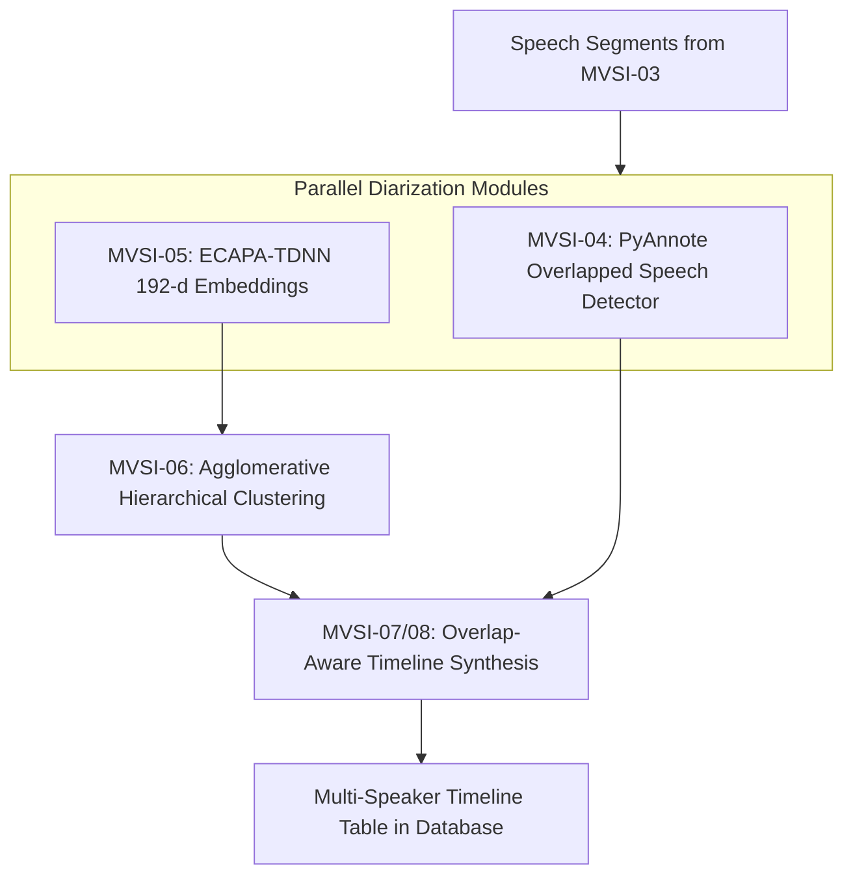

**Validation Strategy:**  
Run diarization on 5 multi-speaker conversations containing known overlapping turns; verify that overlapping intervals contain at least 2 active speaker labels; assert overall DER $< 18\%$.

**Definition of Done:**  
Modules `src/ps05/engines/audio/mvsi/embeddings.py`, `osd.py`, and `diarization.py` implemented; `tests/unit/test_mvsi_diarization.py` passes 100%.

**Dependencies & Risks:**  
*Risk:* Speaker clustering fragmentation when speakers whisper or shout. *Mitigation:* Use PLDA scoring and length-normalized ECAPA-TDNN embeddings.

**Checkpoint Table:**

| Checkpoint ID | Topic / Subtopic | Verification action | Expected evidence | Status | Pass criteria |
| :--- | :--- | :--- | :--- | :--- | :--- |
| **A4-CP-01** | Overlap Preservation | Diarize audio with known simultaneous dialogue (Speaker A & B) | Timeline displays interval with both Speaker A and B active | `NOT_STARTED` | Multi-label overlap accurately logged |
| **A4-CP-02** | Diarization Accuracy | Run DER benchmark on 3-speaker meeting audio | `DER < 18.0%` | `NOT_STARTED` | Benchmark threshold achieved |
| **A4-CP-03** | Stable Speaker Labels | Run diarization 3 times on identical audio hash | Identical speaker cluster count and turn bounds | `NOT_STARTED` | Deterministic clustering reproducibility |
| **A4-CP-04** | Three-Way Overlap | Test synthetic multi-track mix of 3 concurrent talkers | Timeline supports 3 active concurrent speaker tags | `NOT_STARTED` | No single-speaker exclusivity forced |

---

### Phase AURAS-A5: MVSI Multilingual & Speaker-Language Analytics

**Status:** `PLANNED`

**Objective:**  
Implement multilingual spoken language identification (LID), intra-utterance code-switching detection, and aggregated speaker-language analytics across Scheduled Indian Languages and regional Hindi dialects.

**Scope:**
- *Included:* MVSI-09 (Multilingual LID), MVSI-10 (Code-switch boundary detector), MVSI-11 (Optional forensic ASR), MVSI-12 (Speaker-language analytics matrix), Indian language database registry.
- *Explicit Exclusions:* Deepfake classification (deferred to A6–A8).

**Prerequisites:**  
Phase AURAS-A4 Gate passed; speaker segments and diarization timeline available.

**Topics & Subtopics:**
1. **Extensible Indian Language Registry:** Populate `language_registry` table covering Scheduled Indian Languages (Hindi, Bengali, Tamil, Telugu, etc.) and regional Bihar dialects (Bhojpuri, Maithili, Magahi).
2. **Multilingual Spoken Language Identification (MVSI-09):** Pass segmented speech audio through OpenAI Whisper Medium LID head and Meta MMS-LID; output top-3 language hypotheses with confidence scores.
3. **Catalogue Coverage vs. Validated Model Support:** Maintain clear separation between catalogued languages, models with claimed support, and benchmark-validated languages.
4. **Sliding-Window Language Tracking:** Apply 1.0s sliding window with 0.25s stride across speech turns to detect language changes.
5. **Intra-Utterance Code-Switching Detection (MVSI-10):** Identify transition boundaries where language probability crosses threshold (e.g., Hindi $\to$ English); refine boundary timestamp.
6. **Speaker Identity $\neq$ Language Identity Invariant:** Guarantee that a speaker switching languages retains their singular `speaker_label`.
7. **Optional Forensic ASR Transcription (MVSI-11):** Generate text transcripts using Faster-Whisper / MMS ASR as an investigatory aid; embed legal disclaimer that transcripts are supplementary.
8. **Speaker-Language Analytics Matrix (MVSI-12):** Compute aggregate statistics: total speaking time per speaker, language percentage breakdown per speaker, and cross-speaker interaction metrics.
9. **Overlap-Aware Speaking Duration Calculation:** Ensure simultaneous overlapping speech correctly attributes talk time to both concurrent speakers without artificial truncation.
10. **Unsupported Language & Dialect Uncertainty:** If top language confidence $< 0.40$, label as `UNCLASSIFIED_REGIONAL_DIALECT` with uncertainty warning.

**Execution Workflow:**

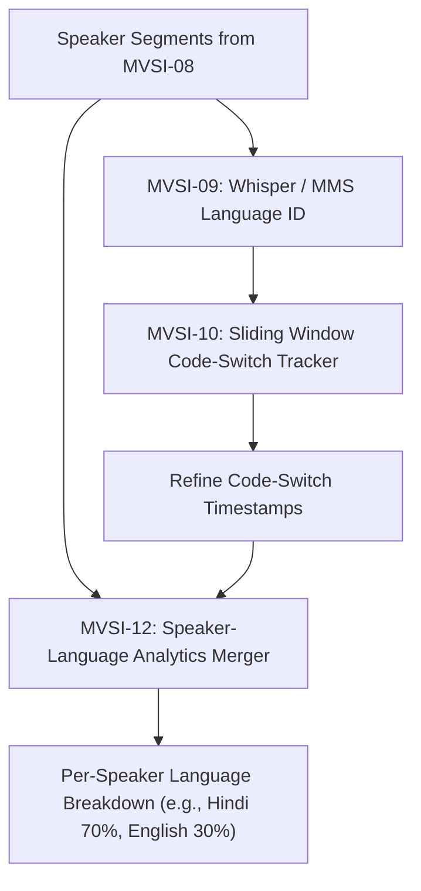

**Validation Strategy:**  
Test against bilingual audio clips (Hinglish, Bhojpuri-Hindi); verify that code-switching boundaries are detected within $\pm 200\text{ ms}$; verify that speaker cluster count remains 1 for a single speaker code-switching.

**Definition of Done:**  
Modules `src/ps05/engines/audio/mvsi/language_id.py`, `code_switch.py`, and `registry.py` implemented; `tests/unit/test_mvsi_multilingual.py` passes.

**Dependencies & Risks:**  
*Risk:* Low-resource dialects (Magahi, Maithili) misclassified as standard Hindi. *Mitigation:* Explicitly record regional variant tags and output confidence ranges.

**Checkpoint Table:**

| Checkpoint ID | Topic / Subtopic | Verification action | Expected evidence | Status | Pass criteria |
| :--- | :--- | :--- | :--- | :--- | :--- |
| **A5-CP-01** | Speaker Invariant | Process Hinglish recording of 1 speaker switching languages | Total speaker count $= 1$; language tags show both `hin` and `eng` | `NOT_STARTED` | Single speaker retained across languages |
| **A5-CP-02** | Language Classification | Run LID on clean Hindi, Bengali, and Tamil audio clips | Top-1 predicted language matches ground truth | `NOT_STARTED` | Accuracy $> 90\%$ on clean primary languages |
| **A5-CP-03** | Code-Switch Boundary | Test sentence switching from Hindi to English at $T=03.200\text{s}$ | Code-switch flagged at $03.200 \pm 0.250\text{ s}$ | `NOT_STARTED` | Transition boundary localized |
| **A5-CP-04** | Duration Aggregation | Verify duration summary for 2-minute conversation | Sum of per-speaker durations matches ground truth | `NOT_STARTED` | Duration calculation error $< 1.0\text{ s}$ |

---

### Phase AURAS-A6: ADDE Foundation — Independent Detector Framework

**Status:** `PLANNED`

**Objective:**  
Establish the dedicated, decoupled package boundary and model execution framework for the Audio Deepfake Detection Engine (ADDE). Implement standardized sliding-window preprocessing, integrate baseline neural detectors (RawNet2 and AASIST), and enforce pinned model manifests.

**Scope:**
- *Included:* ADDE-01 (Preprocessing & sliding windows), ADDE-02 (RawNet2), ADDE-03 (AASIST), model registry, checkpoint verification, and failure isolation.
- *Explicit Exclusions:* Advanced foundation SSL models (deferred to A7), calibration and late-fusion ensemble (deferred to A8).

**Prerequisites:**  
Phase AURAS-A0 Gate passed; working Artifact C (standardized 2.0s sliding slices at 16 kHz) available.

**Topics & Subtopics:**
1. **Independent ADDE Package Boundary:** Structure `src/ps05/engines/audio/adde/` as an autonomous package with its own configuration, exceptions, and execution contracts.
2. **Sliding-Window Preprocessing Contract (ADDE-01):** Slice audio into 2.0-second frames with 0.5-second stride ($32000$ samples at 16 kHz); zero-pad tail frames; apply energy-based silence masking.
3. **Model Registry & Cryptographic Checksum Verification:** Register `df-rawnet2-v1` and `df-aasist-v2`; verify checkpoint SHA-256 hashes upon model loading.
4. **RawNet2 Baseline Implementation (ADDE-02):** Implement time-domain raw waveform classifier with sinc-convolution front-end; output raw logit $z_{\text{raw}}$.
5. **AASIST Baseline Implementation (ADDE-03):** Implement Audio Anti-Spoofing using Integrated Spectro-Temporal Graph Attention; construct spectral and temporal graphs; output raw logit $z_{\text{aasist}}$.
6. **Execution Isolation from ARE/MVSI:** Ensure ADDE runs independently without requiring ARE or MVSI outputs.
7. **Model Loading & Memory Management:** Implement lazy loading; support automatic device placement (CUDA with CPU fallback).
8. **Inference Exception Handling:** Safely catch GPU Out-Of-Memory (OOM) errors; automatically fallback to CPU sliding-window inference with warning log.
9. **ADDE Finding Schema:** Define typed Pydantic models for raw window scores and per-detector outputs.
10. **Test Fixtures & Synthetic Forward Passes:** Create unit tests verifying forward-pass execution on dummy $1 \times 32000$ audio tensors.

**Execution Workflow:**

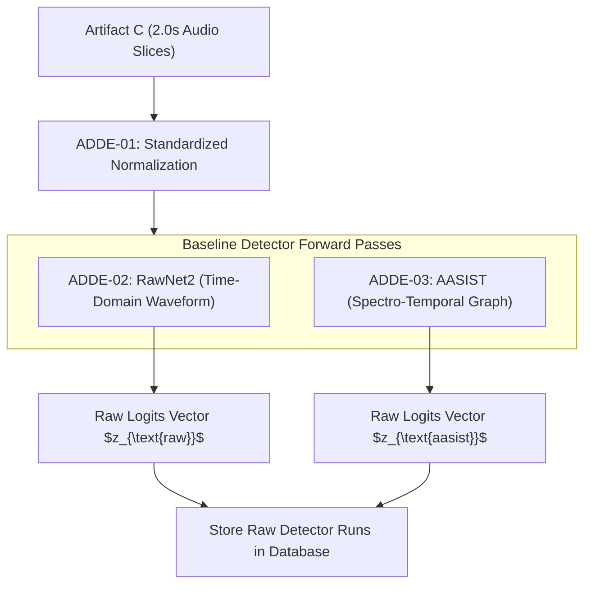

**Validation Strategy:**  
Execute unit tests loading RawNet2 and AASIST architectures with mock weights; assert output logit tensor shapes match $(B, 2)$ where $B$ is batch size; verify that missing checkpoint raises explicit `ModelCheckpointNotFoundError`.

**Definition of Done:**  
Modules `src/ps05/engines/audio/adde/preprocess.py`, `rawnet2.py`, and `aasist.py` implemented; `tests/unit/test_adde_foundation.py` passes 100%.

**Dependencies & Risks:**  
*Risk:* PyTorch CUDA version mismatch on target police server. *Mitigation:* Pin PyTorch 2.2+ CPU/CUDA compatibility and test on both environments.

**Checkpoint Table:**

| Checkpoint ID | Topic / Subtopic | Verification action | Expected evidence | Status | Pass criteria |
| :--- | :--- | :--- | :--- | :--- | :--- |
| **A6-CP-01** | Standalone Execution | Run ADDE on audio file without running ARE or MVSI | Returns structured deepfake findings | `NOT_STARTED` | Operates completely independently |
| **A6-CP-02** | Checkpoint Integrity | Verify model checkpoint loading against manifest hash | Checksum matches `df-rawnet2-v1` hash | `NOT_STARTED` | Pinned model weights verified |
| **A6-CP-03** | Forward Pass | Execute RawNet2 and AASIST on 2.0s audio tensor | Output logits of shape `(1, 2)` produced | `NOT_STARTED` | Clean forward-pass execution |
| **A6-CP-04** | GPU Fallback | Force CUDA OOM simulation during inference | System catches error, falls back to CPU, completes | `NOT_STARTED` | Graceful CPU degradation |

---

### Phase AURAS-A7: ADDE Advanced — Models, SSL & Multilingual Robustness

**Status:** `PLANNED`

**Objective:**  
Integrate self-supervised speech foundation models (WavLM Base+), spectral vocoder classifiers (LFCC/CQCC + Light-CNN), sliding-window partial manipulation localization, and lossy codec robustness testing (CodecFake).

**Scope:**
- *Included:* ADDE-04 (WavLM foundation SSL), ADDE-05 (Spectral vocoder classifier), ADDE-06 (Codec robustness), ADDE-07 (Partial manipulation localization).
- *Explicit Exclusions:* Late-fusion ensembling and calibration (deferred to A8).

**Prerequisites:**  
Phase AURAS-A6 Gate passed; baseline detector framework operational.

**Topics & Subtopics:**
1. **Self-Supervised Speech Foundation Model (ADDE-04):** Integrate WavLM Base+ pre-trained encoder; attach binary classification head; output foundation model logit $z_{\text{wavlm}}$.
2. **Spectral Vocoder Artifact Classifier (ADDE-05):** Extract 60 Linear Frequency Cepstral Coefficients (LFCC) and Constant Q Cepstral Coefficients (CQCC); classify via 9-layer Light-CNN to detect parametric vocoder synthesis.
3. **Sliding-Window Partial Manipulation Localization (ADDE-07):** Align sliding window scores ($0.5\text{s}$ stride) along time axis; apply median smoothing ($w = 3$ frames) to identify short spliced synthetic phrases.
4. **Short-Interval Preservation:** Prevent temporal smoothing from erasing brief synthetic word insertions ($> 500\text{ ms}$).
5. **Codec-Oriented Robustness Evaluation (ADDE-06):** Evaluate detection resilience against lossy VoIP and mobile codecs (AMR-WB, Opus 6kbps, AAC 64kbps, G.711).
6. **Re-Encoding Simulation Layer:** Simulate codec degradation on validation sets to evaluate false-alarm rates on compressed authentic speech.
7. **Multilingual Deepfake Generalization:** Evaluate foundation models across Indian language speech samples to quantify dialectal false positives.
8. **Speaker-Disjoint and Generator-Disjoint Splits:** Guarantee evaluation datasets avoid speaker identity leakage or seen-generator overfitting.
9. **Dataset Provenance & Licensing Audit:** Verify licensing compliance for evaluation datasets (ASVspoof 2019/2021, WaveFake, In-the-Wild).
10. **Benchmark Metric Calculation:** Compute Equal Error Rate (EER) and Area Under ROC Curve (ROC-AUC) per individual detector branch.

**Execution Workflow:**

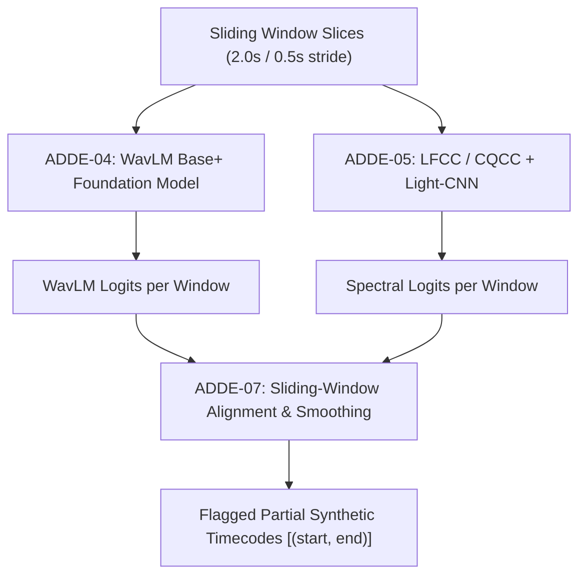

**Validation Strategy:**  
Create test audio with a 1.5-second ElevenLabs synthetic voice clone inserted inside a 30-second genuine recording; verify that ADDE-07 localizes the synthetic interval within $\pm 250\text{ ms}$ boundary precision; assert individual detector EER $< 7.0\%$.

**Definition of Done:**  
Modules `src/ps05/engines/audio/adde/ssl_wavlm.py`, `spectral.py`, and `codec_robust.py` implemented; unit tests in `tests/unit/test_adde_advanced.py` pass.

**Dependencies & Risks:**  
*Risk:* WavLM VRAM usage on low-spec hardware. *Mitigation:* Apply dynamic batching ($B=1$) and half-precision (FP16) inference.

**Checkpoint Table:**

| Checkpoint ID | Topic / Subtopic | Verification action | Expected evidence | Status | Pass criteria |
| :--- | :--- | :--- | :--- | :--- | :--- |
| **A7-CP-01** | Partial Splice Localization | Test audio with 2.0s synthetic insert at $T=05.000\text{s}$ | Flagged manipulated interval covers $04.800\text{s} - 07.200\text{s}$ | `NOT_STARTED` | Localizes partial synthetic insert |
| **A7-CP-02** | WavLM Foundation Inference | Run WavLM branch on speech audio slice | Produces classification logit and 768-d embedding | `NOT_STARTED` | Clean forward-pass execution |
| **A7-CP-03** | Codec Robustness | Evaluate detector on audio transcoded via Opus 12kbps | Emits codec warning if compression degrades score | `NOT_STARTED` | Accurately manages lossy compression |
| **A7-CP-04** | Disjoint Data Splits | Inspect evaluation split code | Asserts zero speaker overlap between train and test | `NOT_STARTED` | Zero data leakage in evaluation |

---

### Phase AURAS-A8: ADDE Ensemble, Calibration & Forensic Interpretation

**Status:** `PLANNED`

**Objective:**  
Implement score calibration (Platt scaling / temperature scaling), quality-weighted late fusion ensembling, Mahalanobis distance out-of-distribution (OOD) uncertainty estimation, and standalone 1:1 speaker verification.

**Scope:**
- *Included:* ADDE-08 (1:1 speaker verification), ADDE-09 (Calibration), ADDE-10 (Late fusion ensemble), ADDE-11 (OOD uncertainty), ADDE-12 (Suspicion heatmaps & report visuals).
- *Explicit Exclusions:* Unified reporting integration (deferred to A9).

**Prerequisites:**  
Phase AURAS-A7 Gate passed; all four detector branches (RawNet2, AASIST, WavLM, Spectral) operational.

**Topics & Subtopics:**
1. **Probability Calibration via Platt Scaling (ADDE-09):** Fit logistic sigmoid parameters $(A_i, B_i)$ on held-out validation data to convert raw logits into posterior probabilities $p_i \in [0, 1]$.
2. **Temperature Scaling Evaluation:** Compare Platt scaling against temperature scaling $p_i = \sigma(z_i / T)$; verify Expected Calibration Error (ECE $< 0.05$).
3. **Quality-Weighted Late Fusion Ensemble (ADDE-10):** Compute composite deepfake score $P(\text{fake}) = \sum w_i p_i$; adjust weights $w_i$ based on SNR and codec indicators.
4. **Detector Disagreement Reporting:** If discrepancy between detectors $\max(p_i) - \min(p_i) > 0.50$, generate `DETECTOR_DISAGREEMENT_WARNING` with breakdown.
5. **Mahalanobis Distance OOD Detection (ADDE-11):** Calculate embedding distance $D_M(x)$ against training distribution centroid in WavLM embedding space; emit `OOD_UNCERTAINTY: HIGH` when $D_M(x) > \text{Threshold}$.
6. **Synthetic Speech vs. Voice Conversion Separation:** Differentiate between fully synthesized text-to-speech (TTS) and voice conversion (VC).
7. **Standalone 1:1 Reference Speaker Verification (ADDE-08):** Compare questioned voice against authorized reference recording using ECAPA-TDNN cosine distance. Strictly maintain separation from deepfake score.
8. **Forensic Suspicion Curve Generation (ADDE-12):** Generate time-aligned millisecond suspicion curve and PNG heatmap artifact for examiner review.
9. **False-Positive & Conclusiveness Balancing:** Ensure low-quality, noisy, or out-of-distribution inputs output `INCONCLUSIVE` rather than false-positive alarms.
10. **Comprehensive Ensemble Benchmarking:** Benchmark ensemble on ASVspoof 2019/2021 and in-the-wild test sets; assert composite EER $< 5.5\%$, ROC-AUC $> 0.96$.

**Execution Workflow:**

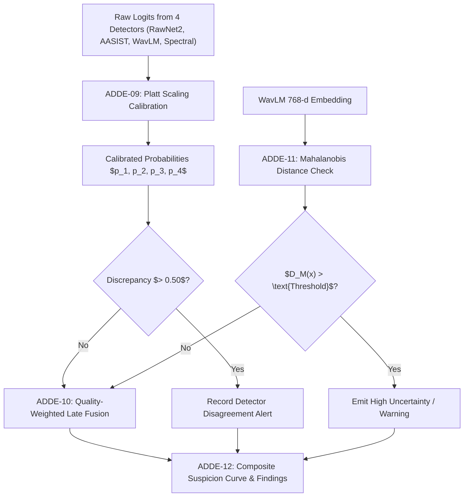

**Validation Strategy:**  
Evaluate calibrated ensemble on 100 genuine and 100 spoofed test samples; verify that Brier score $< 0.08$ and ECE $< 0.05$; assert that extreme white noise input triggers OOD uncertainty rather than a false deepfake detection.

**Definition of Done:**  
Modules `src/ps05/engines/audio/adde/calibration.py`, `ensemble.py`, `ood.py`, and `verification.py` implemented; `tests/benchmarks/test_adde_metrics.py` passes.

**Dependencies & Risks:**  
*Risk:* Overfitting calibration parameters to training vocoders. *Mitigation:* Fit calibration strictly on held-out validation sets featuring unseen vocoders.

**Checkpoint Table:**

| Checkpoint ID | Topic / Subtopic | Verification action | Expected evidence | Status | Pass criteria |
| :--- | :--- | :--- | :--- | :--- | :--- |
| **A8-CP-01** | Calibration Quality | Calculate ECE on held-out validation set | `ECE < 0.05` | `NOT_STARTED` | Well-calibrated probabilities |
| **A8-CP-02** | Ensemble Superiority | Compare ensemble EER vs best single detector | Ensemble EER is lower than any single detector branch | `NOT_STARTED` | Late-fusion improves generalization |
| **A8-CP-03** | OOD Flagging | Ingest synthetic white noise and heavily distorted audio | `OOD_UNCERTAINTY == HIGH` emitted | `NOT_STARTED` | Rejects out-of-distribution inputs |
| **A8-CP-04** | Disagreement Handling | Test sample where WavLM flags fake but RawNet2 flags real | `DETECTOR_DISAGREEMENT_WARNING` included in findings | `NOT_STARTED` | Transparency on detector conflict |

---

### Phase AURAS-A9: Audio Orchestration, Reporting & Reviewer Workflow

**Status:** `PLANNED`

**Objective:**  
Unify independent findings from ARE, MVSI, and ADDE into a consolidated forensic timeline; implement Celery task dispatching, partial-failure recovery, reviewer annotation capabilities, Archify JSON IR formatting, and court-admissible electronic evidence reporting (Section 65B IEA / Section 63 BSA).

**Scope:**
- *Included:* Audio job orchestrator, cross-engine timeline alignment, finding merger, reviewer verdict overrides, Archify JSON IR generation, WeasyPrint PDF compilation.
- *Explicit Exclusions:* Image and video findings (handled in Phase 7).

**Prerequisites:**  
Phases AURAS-A2, AURAS-A5, and AURAS-A8 Gates passed; all three audio engines operational.

**Topics & Subtopics:**
1. **Asynchronous Audio Task Orchestration:** Dispatch parallel Celery tasks for ARE, MVSI, and ADDE; aggregate results upon completion with task timeout handling (max 10 mins).
2. **Partial-Failure Recovery:** If one engine fails (e.g., ADDE GPU OOM), record structured warning and allow ARE and MVSI findings to be exported with `PARTIAL_ANALYSIS` status.
3. **Cross-Engine Timeline Alignment:** Synchronize splice candidate timestamps (ARE) with speech turns (MVSI) and deepfake suspicion curves (ADDE) onto a unified millisecond time grid.
4. **Cross-Engine Corroboration Logic:**
   - Case A: High deepfake suspicion + spectral flux discontinuity at turn boundary $\to$ *High Confidence Spliced Voice Clone*.
   - Case B: Single detector spike + no signal discontinuity + low-SNR $\to$ *Acoustic Anomaly / Inconclusive*.
5. **Human Examiner Reviewer Workflow:** Provide review endpoints allowing certified examiners to inspect flagged intervals, annotate findings, and record formal conclusions.
6. **Archify JSON IR Serialization:** Export complete case graph into Archify-compatible intermediate representation (`archify.report.json`).
7. **Court-Admissible PDF Certificate Generation:** Compile Section 65B IEA / Section 63 BSA certified PDF using Jinja2 and WeasyPrint, embedding exhibit hashes, environment details, and spectral visuals.
8. **Digital Signature Sealing:** Sign generated PDF and JSON manifest using PKCS#7 / X.509 digital certificates.
9. **Tamper-Evident Audit Logging:** Log all examiner reviews and report generations to append-only Merkle hash chain.
10. **REST API Endpoint Integration:** Implement `POST /api/v1/evidence/{id}/analyze` and `GET /api/v1/jobs/{id}/results`.

**Execution Workflow:**

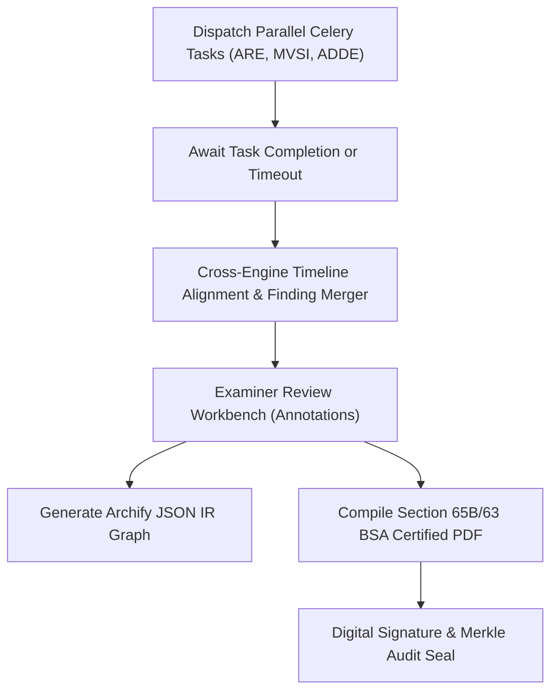

**Validation Strategy:**  
Execute end-to-end integration test dispatching a job on an audio file; verify that findings from all 3 engines merge cleanly into the result JSON; verify that generated PDF compiles with valid layout and correct hashes.

**Definition of Done:**  
Modules `src/ps05/core/orchestrator.py` and `src/ps05/reporting/compiler.py` implemented; integration tests in `tests/integration/test_audio_orchestrator.py` pass.

**Dependencies & Risks:**  
*Risk:* Long-running audio jobs timing out on CPU. *Mitigation:* Implement incremental progress heartbeats over Redis every 5 seconds.

**Checkpoint Table:**

| Checkpoint ID | Topic / Subtopic | Verification action | Expected evidence | Status | Pass criteria |
| :--- | :--- | :--- | :--- | :--- | :--- |
| **A9-CP-01** | Multi-Engine Dispatch | Dispatch job enabling ARE, MVSI, and ADDE | All 3 engine runs recorded in database | `NOT_STARTED` | Clean parallel execution |
| **A9-CP-02** | Partial Failure Grace | Simulate artificial crash in ADDE engine | ARE and MVSI results exported with partial warning | `NOT_STARTED` | Graceful degradation preserved |
| **A9-CP-03** | Timeline Synchronization | Inspect unified timeline on spliced audio exhibit | Splice timecode aligns with deepfake spike | `NOT_STARTED` | Timecodes synchronized $\pm 50\text{ ms}$ |
| **A9-CP-04** | PDF Generation | Compile forensic report for test audio exhibit | Valid PDF generated containing Section 65B certificate | `NOT_STARTED` | PDF compiles cleanly with hash manifest |

---

### Phase AURAS-A10: End-to-End Audio Validation & Release Readiness

**Status:** `PLANNED`

**Objective:**  
Execute comprehensive regression testing, benchmark the complete audio subsystem against curated test corpora, audit dependency licensing and air-gap integrity, and establish release readiness for the hackathon demonstration.

**Scope:**
- *Included:* Regression test suite, reproducibility audit, performance benchmarking, air-gap validation, documentation consistency audit.
- *Explicit Exclusions:* None (covers full audio subsystem).

**Prerequisites:**  
Phase AURAS-A9 Gate passed; full audio pipeline operational end-to-end.

**Topics & Subtopics:**
1. **Curated Audio Test Corpus:** Assemble diverse evaluation set: clean voice, noisy calls, WhatsApp transcoded audio, ElevenLabs voice clones, spliced dialogues, bilingual Hinglish conversations, and authentic control audio.
2. **Reproducibility Audit:** Re-run complete forensic analysis on identical audio hashes 5 times; assert bit-for-bit identical findings, scores, and JSON manifests.
3. **End-to-End Evidence Workflow Testing:** Test complete journey from initial file intake to final signed PDF download.
4. **Latency & Throughput Benchmarking:** Profile execution speed across CPU and GPU configurations; document resource consumption.
5. **Memory Leak & Stress Testing:** Ingest 50 consecutive audio files without restarting worker processes; assert no memory accumulation in Celery workers.
6. **Air-Gap Integrity Verification:** Execute complete audio suite on network-isolated test runner with outbound connections blocked; assert zero HTTP requests.
7. **Model License & Checkpoint Audit:** Verify that all pre-trained models (Silero, PyAnnote, SpeechBrain, WavLM, RawNet2) comply with open-source licenses (MIT, Apache 2.0, BSD-3-Clause).
8. **Documentation Alignment:** Audit `README.md`, `PRD.md`, `TRD.md`, and `PHASES.md` for consistent terminology, requirement IDs, and status markers.
9. **Hackathon Demonstration Scenario Preparation:** Package representative demonstration exhibits with pre-computed forensic dossiers.
10. **Final Forensic Review:** Peer review of algorithmic explainability statements and courtroom certifiability.

**Execution Workflow:**

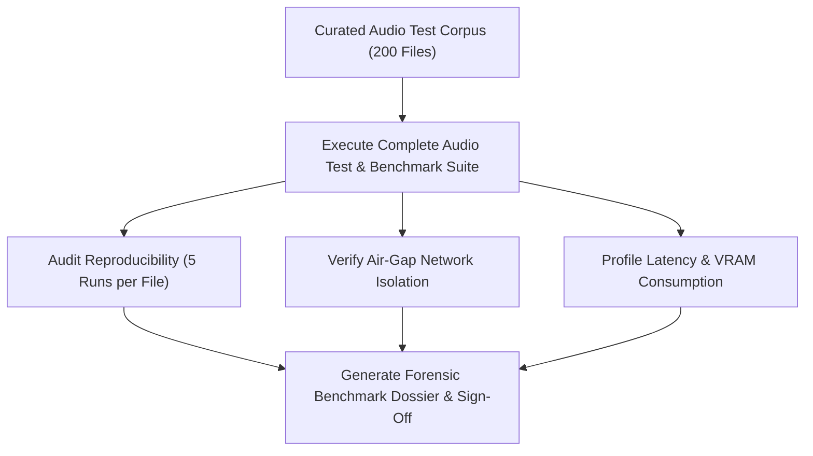

**Validation Strategy:**  
Execute `pytest tests/` covering all unit, integration, and benchmark tests; assert 100% green pass rate (exit code 0); verify zero outbound network packets via packet capture.

**Definition of Done:**  
Full test suite passes with zero failures; benchmark dossier compiled; all phase checkpoints verified.

**Dependencies & Risks:**  
*Risk:* Hardware differences between development and hackathon jury laptops. *Mitigation:* Pre-configure both CPU and GPU execution modes.

**Checkpoint Table:**

| Checkpoint ID | Topic / Subtopic | Verification action | Expected evidence | Status | Pass criteria |
| :--- | :--- | :--- | :--- | :--- | :--- |
| **A10-CP-01** | Full Pipeline Pass | Run complete test suite on audio corpus | `pytest` exits with code 0 (100% passing) | `NOT_STARTED` | All tests pass |
| **A10-CP-02** | Reproducibility | Compare output hashes across 5 identical runs | 100% identical JSON outputs and scores | `NOT_STARTED` | Zero non-deterministic variance |
| **A10-CP-03** | Air-Gap Isolation | Run full suite with network adapters disabled | Suite runs completely offline without errors | `NOT_STARTED` | Zero external network calls |
| **A10-CP-04** | License Compliance | Audit all PyPI dependencies and model licenses | All licenses verified as commercial/hackathon permissive | `NOT_STARTED` | Zero GPL/proprietary license conflicts |

---

## 4. Dedicated Video Forensics Engineering Playbook (VISTA-A0 through VISTA-A13)

### Phase VISTA-A0: Video Evidence Architecture Baseline & Standards Integration

**Status:** `PLANNED`

**Objective:**  
Establish the structural, algorithmic, and defensive foundation for the VISTA subsystem. Initialize package hierarchies under `src/ps05/engines/vista/`, configure typing contracts, establish defensive PyAV/FFprobe execution harnesses, enforce memory allocation boundaries, and link VISTA into the shared platform discovery registry.

**Scope:**
- *Included:* Directory layout creation (`common`, `vre`, `afb`, `avsc`, `vdf`, `vci`, `cctv`), BaseForensicEngine interface implementations, defensive subprocess execution rules, uncompressed memory buffer allocation caps, error hierarchy.
- *Explicit Exclusions:* Functional forensic signal analysis (deferred to A2–A10), audio cross-correlation (deferred to A5).

**Prerequisites:**  
Phase 0 architectural baseline completed; `pyproject.toml` dependencies (`pyav`, `opencv-python-headless`, `scenedetect`, `torch`) validated.

**Topics & Subtopics:**
1. **Directory & Module Scaffold:** Initialize `src/ps05/engines/vista/` sub-packages with proper `__init__.py` exports and type stubs.
2. **Defensive Demuxing Wrapper:** Implement `safe_demux.py` wrapping PyAV container initialization with strict 10-second I/O timeouts and non-blocking packet iteration.
3. **Memory Ring Buffer Caps:** Configure memory-bounded ring buffer (`timeline.py`) enforcing maximum 64 uncompressed video frames in RAM ($\le 400\text{ MB}$).
4. **VISTA Error Hierarchy:** Implement domain exceptions (`VideoDemuxError`, `PTSContinuityError`, `AudioExtractionError`, `LipSyncConvergenceError`, `CCTVContextMismatchError`).

**Expected Files:**
- `src/ps05/engines/vista/__init__.py`
- `src/ps05/engines/vista/common/safe_demux.py`
- `src/ps05/engines/vista/common/timeline.py`
- `src/ps05/engines/vista/common/schemas.py`

**Validation Strategy:**  
Unit tests in `tests/unit/test_vista_scaffold.py` verifying package imports, defensive timeout traps on artificial hangs, and memory buffer bounds.

**Checkpoint Table:**

| Checkpoint ID | Topic / Subtopic | Verification action | Expected evidence | Status | Pass criteria |
| :--- | :--- | :--- | :--- | :--- | :--- |
| **VISTA-CP-00-01** | Package Architecture | Import all VISTA modules in clean virtualenv | Zero `ImportError` or circular import warnings | `NOT_STARTED` | All 7 sub-packages import cleanly |
| **VISTA-CP-00-02** | Demuxing Safety | Run defensive demuxer on malformed stream header | `VideoDemuxError` raised within 10 seconds | `NOT_STARTED` | Traps hung inputs safely |
| **VISTA-CP-00-03** | Memory Allocation Cap | Decode 1,000 frames through ring buffer | Max resident memory $\le 500\text{ MB}$ | `NOT_STARTED` | Zero uncontrolled memory growth |
| **VISTA-CP-00-04** | Base Contract | Inherit `BaseForensicEngine` across VISTA engines | Type checker reports 100% contract compliance | `NOT_STARTED` | Strict typing parity |

---

### Phase VISTA-A1: Video Evidence Contracts, Ingestion & Cryptographic Foundation (CEIPL)

**Status:** `PLANNED`

**Objective:**  
Implement pre-decode dual-hashing, immutable WORM storage ingestion, RFC 8785 canonical manifests, Ed25519 digital signatures, RFC 3161 TSA timestamps, and Merkle audit logging for video exhibits, guaranteeing uncompromised judicial chain of custody under Section 65B/63 BSA.

**Scope:**
- *Included:* File ingestion, SHA-256 and SHA3-512 dual streaming calculation, POSIX 0400 WORM vault persistence, RFC 8785 Canonical JSON Serialization (JCS), Ed25519 manifest signing, database exhibit registration.
- *Explicit Exclusions:* Demuxing or frame decoding (deferred to A2).

**Prerequisites:**  
Phase VISTA-A0 Gate passed; CEIPL shared core modules in `src/ps05/core/crypto/` operational.

**Topics & Subtopics:**
1. **Pre-Decode Dual Hashing:** Stream raw video bitstream through chunked 64KB accumulators computing SHA-256 and SHA3-512 before container parsing.
2. **WORM Vault Ingestion:** Store pristine master file in `/data/vault_worm/`; enforce POSIX `0400` read-only permissions; verify immutability.
3. **Canonical Evidence Manifest:** Serialize exhibit metadata (police FIR, exhibit ID, file size, dual hashes) into RFC 8785 Canonical JSON.
4. **Digital Signature & TSA:** Sign manifest with platform Ed25519 private key; request RFC 3161 TSA token; commit to Merkle audit chain.

**Expected Files:**
- `src/ps05/api/v1/evidence.py` (video upload endpoints)
- `src/ps05/core/crypto/direct_hasher.py` (video streaming support)
- `src/ps05/core/storage.py` (WORM POSIX 0400 verification)

**Validation Strategy:**  
Test ingestion pipeline with 500MB test video; verify bitstream parity between vault file and original; assert permission bits `0400`.

**Checkpoint Table:**

| Checkpoint ID | Topic / Subtopic | Verification action | Expected evidence | Status | Pass criteria |
| :--- | :--- | :--- | :--- | :--- | :--- |
| **VISTA-CP-01-01** | Dual Streaming Hash | Compare computed hashes against OS sha256sum | Bit-for-bit identical 64-char hex strings | `NOT_STARTED` | Exact hash parity |
| **VISTA-CP-01-02** | WORM Immutability | Attempt to write or append to ingested vault file | OS raises `PermissionError: [Errno 13]` | `NOT_STARTED` | POSIX 0400 prevents modification |
| **VISTA-CP-01-03** | Canonical Manifest | Serialize manifest under differing key orderings | RFC 8785 output hash is 100% deterministic | `NOT_STARTED` | Canonical JSON determinism |
| **VISTA-CP-01-04** | Merkle Audit Trail | Query audit log for ingestion transaction | Valid inclusion proof from Merkle root | `NOT_STARTED` | Tamper-evident log integrity |

---

### Phase VISTA-A2: Defensive Demuxing, Container Parsing & PTS Cadence Foundation (VRE Baseline)

**Status:** `PLANNED`

**Objective:**  
Build the baseline Video Reverse Engineering (VRE) capabilities: container atom inspection (MP4/MKV/AVI/TS/DAV), `moov` atom placement audit, Presentation Timestamp (PTS/DTS) continuity regression, instantaneous FPS jitter calculation, and duplicate/frozen frame span detection.

**Scope:**
- *Included:* PyAV packet demuxing, ISO base media file format box parsing, PTS/DTS timeline extraction, VFR vs CFR classification, frozen frame interval detection.
- *Explicit Exclusions:* Macroblock QP analysis (deferred to A3), audio extraction (deferred to A4).

**Prerequisites:**  
Phase VISTA-A1 Gate passed; video exhibits securely registered in database and WORM vault.

**Topics & Subtopics:**
1. **Container & Codec Introspection:** Parse video streams for codec (H.264, H.265, MPEG-4, VP9, AV1), profile, level, pixel format, and resolution.
2. **MP4 Atom Layout Audit:** Check `ftyp` brand compatibility and relative offset of `moov` vs `mdat` (`moov` at end vs `faststart` front-placement).
3. **PTS/DTS Cadence Regression:** Extract packet timestamps; compute $\Delta PTS_k = PTS_k - PTS_{k-1}$; detect non-monotonic reversals ($PTS_k < PTS_{k-1}$).
4. **VFR Jitter & FPS Modeling:** Model variable frame rate jitter; compute instantaneous FPS distribution and variance $\sigma^2_{\text{vfr}}$.
5. **Duplicate / Frozen Frame Identification:** Evaluate SSIM and frame hash identicalness; flag frozen scenes lasting $\ge 1.0\text{ s}$ during non-static audio intervals.

**Expected Files:**
- `src/ps05/engines/vista/vre/bitstream.py`
- `src/ps05/engines/vista/vre/cadence.py`

**Validation Strategy:**  
Ingest CFR videos, VFR smartphone videos, and synthetic videos with excised frames; verify cadence regression alerts on excised timestamps $\pm 1$ frame.

**Checkpoint Table:**

| Checkpoint ID | Topic / Subtopic | Verification action | Expected evidence | Status | Pass criteria |
| :--- | :--- | :--- | :--- | :--- | :--- |
| **VISTA-CP-02-01** | Container Parsing | Inspect MP4 with `moov` at end vs front | Emits `AT_END_NATIVE` vs `BEGINNING_FASTSTART` | `NOT_STARTED` | Correct atom structure audit |
| **VISTA-CP-02-02** | Monotonic PTS Audit | Ingest video with swapped packet timestamps | Flags `NON_MONOTONIC_PTS_DETECTED` | `NOT_STARTED` | Cadence reversal trapped |
| **VISTA-CP-02-03** | VFR vs CFR | Ingest fixed 25fps broadcast vs variable mobile | Correctly classifies CFR vs VFR ($\sigma^2_{\text{vfr}}$) | `NOT_STARTED` | Cadence distribution accurate |
| **VISTA-CP-02-04** | Freeze Detection | Ingest 5-second video freeze in active scene | Flags interval $[t_1, t_2]$ with `FROZEN_FRAME_SPAN` | `NOT_STARTED` | SSIM $\ge 0.998$ correctly localized |

---

### Phase VISTA-A3: Advanced Video Reverse Engineering & Stream Continuity (VRE Advanced)

**Status:** `PLANNED`

**Objective:**  
Deepen VRE capabilities to detect subtle re-compression and structural manipulation: macroblock-level Quantization Parameter (QP) variance analysis, PySceneDetect adaptive cut detection vs splice transitions, ExifTool/MediaInfo deep metadata auditing, and RIFE/DAIN optical flow AI interpolation artifact detection.

**Scope:**
- *Included:* Macroblock QP extraction across H.264/H.265, GOP cadence auditing, scene cut classification (hard cut, dissolve, excised splice), MakerNotes parsing, AI frame interpolation flow residue analysis.
- *Explicit Exclusions:* Audio processing (handled in A4/A5), facial deepfakes (handled in A9/A10).

**Prerequisites:**  
Phase VISTA-A2 Gate passed; container bitstream parser operational.

**Topics & Subtopics:**
1. **Macroblock QP Distribution Analysis:** Extract macroblock QPs; analyze spatial QP variance and periodic GOP re-encoding pulsing.
2. **Scene Cut vs Splice Transition:** Integrate PySceneDetect adaptive content detector; verify whether hard visual shifts align with I-frames or arbitrary P/B slice cuts.
3. **ExifTool & MediaInfo Deep Audit:** Extract camera serial numbers, lens IDs, firmware versions; cross-reference encoder software strings with editing tools.
4. **AI Flow Interpolation Detection:** Compute forward-backward optical flow consistency error ($E_{\text{flow}}$); detect blending halos and occlusion warping from RIFE/DAIN models.

**Expected Files:**
- `src/ps05/engines/vista/vre/reencode.py`
- `src/ps05/engines/vista/vre/scene_cuts.py`
- `src/ps05/engines/vista/vre/metadata.py`

**Validation Strategy:**  
Evaluate 20 re-encoded videos, 10 spliced clips without keyframes, and 10 RIFE 60fps up-converted videos; assert detection accuracy $\ge 90\%$.

**Checkpoint Table:**

| Checkpoint ID | Topic / Subtopic | Verification action | Expected evidence | Status | Pass criteria |
| :--- | :--- | :--- | :--- | :--- | :--- |
| **VISTA-CP-03-01** | QP Re-encoding | Ingest video re-encoded at different bitrate | Periodic QP GOP modulation variance $> \tau$ | `NOT_STARTED` | Re-compression traces identified |
| **VISTA-CP-03-02** | Non-I-Frame Splice | Ingest video cut mid-GOP without I-frame | Flags `EXCISED_CUT_WITHOUT_KEYFRAME` | `NOT_STARTED` | Spliced cut boundary trapped |
| **VISTA-CP-03-03** | Metadata Footprint | Ingest video exported from Adobe Premiere | Software tag identified and flagged as editor | `NOT_STARTED` | Editing footprint detected |
| **VISTA-CP-03-04** | AI Interpolation | Ingest RIFE up-sampled 30fps-to-60fps clip | High optical flow residual error flagged | `NOT_STARTED` | Synthetic frame synthesis caught |

---

### Phase VISTA-A4: Audio Extraction, DAG Lineage & AURAS Subsystem Bridge (AFB)

**Status:** `PLANNED`

**Objective:**  
Build the Audio Forensic Bridge (AFB) to extract audio tracks from video exhibits using lossless FFmpeg stream-copy (`-c:a copy`), register cryptographic DAG lineage linking extracted audio to the parent video, generate standardized 16kHz mono derivatives, and dispatch asynchronous forensic jobs to the AURAS audio subsystem.

**Scope:**
- *Included:* Multi-track audio scanning, lossless stream-copy demuxing, standardized 16kHz float32 factory, CEIPL DAG child node creation, asynchronous Celery task routing to AURAS (ARE, MVSI, ADDE), diarization alignment.
- *Explicit Exclusions:* Re-implementing audio forensics in VISTA (strictly delegated to AURAS).

**Prerequisites:**  
Phase VISTA-A1 Gate passed; AURAS subsystem modules in `src/ps05/engines/audio/` operational.

**Topics & Subtopics:**
1. **Lossless Stream-Copy Extraction:** Execute `ffmpeg -nostdin -y -i <video> -map 0:a:<idx> -c:a copy <output>` preserving pristine original bitstream bytes.
2. **Multi-Track Exhibit Handling:** Scan all audio tracks; assign child exhibit UUIDs; record channel layouts.
3. **Standardized 16 kHz Float32 Factory:** Generate band-limited sinc-resampled 16kHz mono WAV for downstream speech processing.
4. **Cryptographic DAG Binding:** Link extracted audio SHA-256 to parent video exhibit UUID in CEIPL DAG.
5. **Asynchronous AURAS Dispatch:** Dispatch Celery tasks to AURAS queue; await or poll findings without blocking video pipeline.
6. **SpeechBrain SepFormer Integration:** Trigger overlapped speech separation on concurrent talker segments flagged by MVSI.

**Expected Files:**
- `src/ps05/engines/vista/afb/extractor.py`
- `src/ps05/engines/vista/afb/resampler.py`
- `src/ps05/engines/vista/afb/auras_client.py`
- `src/ps05/engines/vista/afb/diarization.py`
- `src/ps05/engines/vista/afb/separation.py`

**Validation Strategy:**  
Extract audio from MP4/MKV test videos; verify byte parity with native audio track; confirm DAG node created in database; verify AURAS job completes successfully.

**Checkpoint Table:**

| Checkpoint ID | Topic / Subtopic | Verification action | Expected evidence | Status | Pass criteria |
| :--- | :--- | :--- | :--- | :--- | :--- |
| **VISTA-CP-04-01** | Zero-Transcode Parity | Compare extracted audio stream against native | `cmp -l` reports 0 byte differences | `NOT_STARTED` | Lossless bitstream extraction |
| **VISTA-CP-04-02** | DAG Lineage Binding | Query database for extracted audio parent | `parent_evidence_id == video_evidence_id` | `NOT_STARTED` | Cryptographic DAG linked |
| **VISTA-CP-04-03** | Asynchronous Routing | Dispatch job to AURAS via Celery worker | AURAS job ID returned and completed in DB | `NOT_STARTED` | Clean asynchronous dispatch |
| **VISTA-CP-04-04** | Multi-Track Scanning | Ingest video with English & Hindi audio tracks | Both tracks extracted into distinct artifacts | `NOT_STARTED` | Multi-track isolation |

---

### Phase VISTA-A5: Audio-Visual Synchronization & Multi-Face Lip-Sync (AVSC)

**Status:** `PLANNED`

**Objective:**  
Implement the Audio-Visual Synchronization & Correspondence Engine (AVSC) to evaluate physical and temporal alignment between visual speech and the soundtrack: container AV global offset measurement, RetinaFace/ByteTrack face tracking, MediaPipe mouth crop normalization ($96 \times 96$ @ 25 fps), modified SyncNet lip-sync cross-correlation, multi-face speaker disambiguation, bystander silence classification, and acoustic-to-visual event correspondence.

**Scope:**
- *Included:* Global AV offset detection, multi-face tracking, 468-point facial landmarking, SyncNet cross-modal embedding distance, primary talker attribution, bystander handling (`BYSTANDER_SILENT`), sound-to-visual event matching (YAMNet/AST vs YOLOv8).
- *Explicit Exclusions:* Deepfake facial artifact analysis (handled in A9/A10).

**Prerequisites:**  
Phases VISTA-A3 and VISTA-A4 Gates passed; extracted audio and video decoded streams available.

**Topics & Subtopics:**
1. **Container AV Global Offset:** Measure $\Delta t_{\text{global}} = PTS_{a, 0} - PTS_{v, 0}$; check total duration discrepancies $\Delta T$.
2. **RetinaFace Detection & ByteTrack:** Detect multi-scale faces; maintain persistent `face_track_id` trajectories across frames.
3. **Mouth ROI Normalization:** Extract lips using MediaPipe FaceMesh (landmarks 61, 291, 0, 17); crop canonical $96 \times 96$ RGB visual tube resampled to 25 fps.
4. **SyncNet Lip-Sync Architecture:** Compute visual embeddings $\mathbf{v}(t)$ and acoustic embeddings $\mathbf{a}(t + \Delta)$; evaluate $L2$ distance curve over $\Delta \in [-15, +15]$ frames; compute confidence $S_{\text{sync}}$.
5. **Multi-Face Disambiguation:** Compute sync curves for all tracked faces; attribute speech to primary talker ($S_{\text{sync}} \ge 4.0$); tag non-speaking faces as `BYSTANDER_SILENT`.
6. **Sound-Visual Event Correspondence:** Map acoustic events (gunshots, vehicle screech) against visual events (muzzle flash, car crash); enforce physics constraints ($\Delta t_{\text{event}} \ge 0$).

**Expected Files:**
- `src/ps05/engines/vista/avsc/alignment.py`
- `src/ps05/engines/vista/avsc/face_track.py`
- `src/ps05/engines/vista/avsc/mouth_roi.py`
- `src/ps05/engines/vista/avsc/syncnet.py`
- `src/ps05/engines/vista/avsc/multi_face.py`
- `src/ps05/engines/vista/avsc/event_corr.py`

**Validation Strategy:**  
Evaluate on LRS2 / LRS3 speech videos and artificially shifted audio offsets; verify SyncNet identifies offset with error $\le \pm 1$ frame; verify bystander faces are not falsely flagged.

**Checkpoint Table:**

| Checkpoint ID | Topic / Subtopic | Verification action | Expected evidence | Status | Pass criteria |
| :--- | :--- | :--- | :--- | :--- | :--- |
| **VISTA-CP-05-01** | Global Offset | Measure offset on audio shifted by +200ms | $\Delta t_{\text{global}} = 200\text{ ms} \pm 10\text{ ms}$ | `NOT_STARTED` | Accurate container time alignment |
| **VISTA-CP-05-02** | Lip-Sync In-Sync | Evaluate SyncNet on natural talking face | $S_{\text{sync}} \ge 4.0$ and optimal offset $\Delta^* = 0$ | `NOT_STARTED` | Natural speech validated in-sync |
| **VISTA-CP-05-03** | Re-Dubbing Detection | Ingest video with replaced voice track | $S_{\text{sync}} < 2.5$ across active speech | `NOT_STARTED` | Desynchronization trapped |
| **VISTA-CP-05-04** | Multi-Face Disambig | Test 2-person video where only 1 talks | Active talker $S \ge 4.0$, bystander $S < 2.5$ | `NOT_STARTED` | Bystander classified without error |

---

### Phase VISTA-A6: Video Content Intelligence, Detection & Tracking (VCI)

**Status:** `PLANNED`

**Objective:**  
Implement the Video Content Intelligence Engine (VCI) to extract semantic scene context: 15-category video source taxonomy classification, YOLOv8x/v10 object and person detection, SAM 2 prompted evidence segmentation, ByteTrack trajectory tracking, distinct unique person counting vs per-frame counts, VideoMAE action localization, and PaddleOCR OSD timestamp extraction.

**Scope:**
- *Included:* Video taxonomy classifier, 80-class object detection, SAM 2 video segmentation, spatial-temporal trajectory tracking, distinct unique person counting, video action localization, OSD digital clock reading.
- *Explicit Exclusions:* Deepfake facial analysis (handled in A9/A10), audio analysis (handled in AURAS).

**Prerequisites:**  
Phase VISTA-A2 Gate passed; decoded frame pipeline operational.

**Topics & Subtopics:**
1. **15-Category Video Source Taxonomy:** Classify video exhibits into source categories (CCTV, Body-Worn, Drone, Smartphone, Dashcam, etc.).
2. **Object Detection & SAM 2 Segmentation:** Detect persons, vehicles, firearms, and evidence objects via YOLOv8x/v10; generate pixel-accurate masks using SAM 2.
3. **ByteTrack Trajectory Persistence:** Track object bounding boxes across frames; maintain unique track IDs across temporary occlusions.
4. **Distinct Unique Person Counting:** Prevent summing frame detections; report both instantaneous occupancy $N(t)$ and total unique entities $N_{\text{total\_unique}}$.
5. **VideoMAE Action Localization:** Localize actions (assault, fall, vehicle crash, weapon draw) with millisecond timestamps $[t_1, t_2]$.
6. **PaddleOCR / Tesseract OSD Extraction:** Detect digital clock bounding boxes; parse timestamps against datetime formats.

**Expected Files:**
- `src/ps05/engines/vista/vci/taxonomy.py`
- `src/ps05/engines/vista/vci/detector.py`
- `src/ps05/engines/vista/vci/segmentor.py`
- `src/ps05/engines/vista/vci/tracker.py`
- `src/ps05/engines/vista/vci/people_count.py`
- `src/ps05/engines/vista/vci/actions.py`
- `src/ps05/engines/vista/vci/ocr_overlay.py`

**Validation Strategy:**  
Run test videos with known person counts; verify unique person counting matches ground truth; assert PaddleOCR clock reading accuracy $\ge 98\%$.

**Checkpoint Table:**

| Checkpoint ID | Topic / Subtopic | Verification action | Expected evidence | Status | Pass criteria |
| :--- | :--- | :--- | :--- | :--- | :--- |
| **VISTA-CP-06-01** | Taxonomy Category | Ingest surveillance video vs drone clip | Correctly tags `CCTV_FIXED` vs `DRONE_AERIAL` | `NOT_STARTED` | Source taxonomy classification |
| **VISTA-CP-06-02** | Unique Counting | Test clip with 3 people walking in and out | $N_{\text{unique}} = 3$ (not cumulative sum) | `NOT_STARTED` | Unique vs frame count invariant |
| **VISTA-CP-06-03** | SAM 2 Segmentation | Prompt SAM 2 with weapon bounding box | High-precision pixel mask generated | `NOT_STARTED` | Accurate evidence segmentation |
| **VISTA-CP-06-04** | OSD Clock OCR | Parse burned-in clock over 100 frames | $\ge 98$ frames parsed with valid datetime | `NOT_STARTED` | Digital clock parsed accurately |

---

### Phase VISTA-A7: CCTV Source Discovery, Auto-Metadata & Adaptive Questionnaire (CCTV Baseline)

**Status:** `PLANNED`

**Objective:**  
Build the baseline capabilities of the Dedicated CCTV Forensic Profile: multi-signal automated triage scoring (`LIKELY_CCTV`, `POSSIBLY_CCTV`, `NON_CCTV`), pre-questioning metadata extraction order (machine reads container, ExifTool, and OSD clock before prompting examiner), versioned `CCTVContext` JSON Schema (v1.0.0), adaptive questionnaire formulation (Questions A–E), and missing-context continuation under `NOT_PROVIDED` status.

**Scope:**
- *Included:* Triage heuristic scoring matrix, automated pre-questioning extraction pipeline, Pydantic v2 `CCTVContextModel`, adaptive questionnaire engine, non-blocking fallback handling.
- *Explicit Exclusions:* Clock drift regression and ONVIF seal validation (deferred to A8).

**Prerequisites:**  
Phases VISTA-A2 and VISTA-A6 Gates passed; container parsing and OCR modules available.

**Topics & Subtopics:**
1. **Automated Triage Matrix:** Calculate multi-signal score $\text{Score}_{\text{cctv}}$ based on container, non-standard VFR, OSD clock presence, and static camera motion.
2. **Pre-Questioning Extraction Order:** Execute FFprobe, ExifTool, and PaddleOCR clock scan before formulating questionnaires.
3. **CCTVContext JSON Schema:** Implement versioned Pydantic model (`schema_version: "1.0.0"`) storing classification, camera ID, DVR model, export method, and examiner responses.
4. **Adaptive Questionnaire Formulation:** Conditionally formulate Questions A–E based on what metadata was missing from automated extraction.
5. **Missing-Context Continuation:** If examiner skips questions, proceed with `user_context_status: NOT_PROVIDED` and widen algorithmic uncertainty bounds without pipeline failure.

**Expected Files:**
- `src/ps05/engines/vista/cctv/triage.py`
- `src/ps05/engines/vista/cctv/auto_meta.py`
- `src/ps05/engines/vista/cctv/context.py`
- `src/ps05/engines/vista/cctv/adaptive_q.py`

**Validation Strategy:**  
Ingest 10 CCTV exhibits and 10 non-CCTV videos; verify triage classification accuracy; simulate skipped questionnaires and assert pipeline runs to completion.

**Checkpoint Table:**

| Checkpoint ID | Topic / Subtopic | Verification action | Expected evidence | Status | Pass criteria |
| :--- | :--- | :--- | :--- | :--- | :--- |
| **VISTA-CP-07-01** | Triage Classification | Ingest Dahua `.dav` surveillance file | Emits `LIKELY_CCTV` with score $\ge 0.70$ | `NOT_STARTED` | Automated triage functional |
| **VISTA-CP-07-02** | Pre-Questioning Order | Check questionnaire generated for Hikvision clip | Does NOT ask for DVR make (auto-extracted) | `NOT_STARTED` | Pre-questioning avoids redundancy |
| **VISTA-CP-07-03** | Schema Validation | Validate `CCTVContext` against JSON Schema | Schema validator passes with zero errors | `NOT_STARTED` | Strict JSON Schema compliance |
| **VISTA-CP-07-04** | Skipped Question Flow | Submit empty questionnaire response | Pipeline completes with `NOT_PROVIDED` status | `NOT_STARTED` | Non-blocking execution verified |

---

### Phase VISTA-A8: CCTV Timeline Integrity, Clock Drift & Native Export Seals (CCTV Advanced)

**Status:** `PLANNED`

**Objective:**  
Implement advanced CCTV integrity verification: burned-in OSD clock continuity and drift regression $\delta(t) = T_{\text{ocr}}(t) - (T_0 + t_{\text{pts}})$, clock freeze and jump detection, ONVIF Export File Format and Media Signing verification with continuous NAL unit SHA-256 hash chains, and multi-camera cross-feed timeline synchronization and duplicate feed detection.

**Scope:**
- *Included:* Linear drift regression modeling, jump/freeze anomaly triggering, ONVIF XML/SMIL signature parsing, X.509 certificate validation, continuous NAL hash chains, multi-camera correlation.
- *Explicit Exclusions:* Facial deepfakes (handled in A9/A10).

**Prerequisites:**  
Phase VISTA-A7 Gate passed; CCTVContext and OSD OCR data available.

**Topics & Subtopics:**
1. **Clock Drift Regression Modeling:** Fit linear regression $\delta(t) = \alpha + \beta t + \epsilon(t)$ on frame OCR timestamps vs container PTS.
2. **Clock Anomaly Triggers:** Detect instantaneous jumps $|\Delta T_{\text{ocr}}| \ge 1.0\text{ s}$ (excised footage), stalls (video freeze attack), and rate drift ($|\beta| > 0.01$).
3. **ONVIF Media Signing Verification:** Parse XML/SMIL packaging; validate X.509 signing certificates; verify RSA/ECDSA signatures.
4. **NAL Unit Hash Chain Audit:** Stream raw H.264/H.265 NAL units; compute continuous SHA-256 hash chain and compare against signed media manifest.
5. **Multi-Camera Corroboration:** Synchronize parallel camera channels via OCR clock alignment; detect duplicate feeds ($SSIM > 0.95$ with constant time lag).

**Expected Files:**
- `src/ps05/engines/vista/cctv/clock_drift.py`
- `src/ps05/engines/vista/cctv/onvif_seals.py`
- `src/ps05/engines/vista/cctv/multi_cam.py`

**Validation Strategy:**  
Evaluate on surveillance videos with injected clock jumps, frozen spans, and signed ONVIF export packages; assert detection of all tampering events.

**Checkpoint Table:**

| Checkpoint ID | Topic / Subtopic | Verification action | Expected evidence | Status | Pass criteria |
| :--- | :--- | :--- | :--- | :--- | :--- |
| **VISTA-CP-08-01** | Clock Jump Detection | Ingest video with 10-second gap in OSD clock | Flags `CCTV_CLOCK_JUMP_DETECTED` at jump point | `NOT_STARTED` | Deleted sequence localized |
| **VISTA-CP-08-02** | Clock Freeze Detection | Ingest video where clock is frozen for 3 seconds | Flags `CCTV_CLOCK_FREEZE_DETECTED` | `NOT_STARTED` | Frozen video loop caught |
| **VISTA-CP-08-03** | ONVIF Seal Verification| Ingest authentic ONVIF signed export | Status `ONVIF_MEDIA_SEAL_VERIFIED` emitted | `NOT_STARTED` | Digital signature verified |
| **VISTA-CP-08-04** | Tampered ONVIF NAL | Ingest ONVIF export with 1 modified byte | Status `ONVIF_MEDIA_SEAL_VIOLATION` emitted | `NOT_STARTED` | NAL unit tampering trapped |

---

### Phase VISTA-A9: Video Deepfake Baselines & Spatial Manipulation Heads (VDF Baseline)

**Status:** `PLANNED`

**Objective:**  
Build baseline deepfake detection capabilities under the Video Deepfake & AI-Generation Detection Engine (VDF): spatial frame-level classifiers (XceptionNet, EfficientNet-B4 Dual-Domain with RGB and DCT frequency residuals), specialized manipulation heads (Face Swap, Face Reenactment, Facial Inpainting), and Platt scaling probability calibration ($ECE < 0.05$).

**Scope:**
- *Included:* Spatial frame inference, face crop extraction pipeline, DCT frequency residual maps, specialized manipulation heads, Platt scaling parameter fitting.
- *Explicit Exclusions:* Temporal sequence modeling (deferred to A10), 3D FFT generative analysis (deferred to A10).

**Prerequisites:**  
Phase VISTA-A5 Gate passed; RetinaFace face tracking pipeline operational.

**Topics & Subtopics:**
1. **XceptionNet Spatial Baseline:** Ingest normalized $299 \times 299$ face crops; extract spatial manipulation logits.
2. **EfficientNet-B4 Dual-Domain:** Ingest $380 \times 380$ spatial face crops and parallel 2D DCT high-frequency residual planes; detect boundary blending seams.
3. **Face Swap Detection Head:** Focus on identity and bone structure discontinuities between face and cranial perimeter.
4. **Facial Inpainting & Reenactment Heads:** Detect generative fill boundaries around eyes and oral regions.
5. **Platt Scaling Probability Calibration:** Calibrate raw logits $z_k$ using logistic parameters $(A_k, B_k)$ to guarantee empirical calibration.

**Expected Files:**
- `src/ps05/engines/vista/vdf/frame_detect.py`
- `src/ps05/engines/vista/vdf/manipulation.py`
- `src/ps05/engines/vista/vdf/calibration.py`

**Validation Strategy:**  
Evaluate on FaceForensics++ (Deepfakes, FaceSwap, Face2Face); assert AUC-ROC $\ge 0.92$ and Expected Calibration Error $ECE < 0.05$.

**Checkpoint Table:**

| Checkpoint ID | Topic / Subtopic | Verification action | Expected evidence | Status | Pass criteria |
| :--- | :--- | :--- | :--- | :--- | :--- |
| **VISTA-CP-09-01** | Face Swap Detection | Evaluate on FaceForensics++ FaceSwap split | Calibrated suspicion score $P(\text{fake}) \ge 0.85$ | `NOT_STARTED` | Spatial face swap identified |
| **VISTA-CP-09-02** | Frequency Domain Seam | Ingest blended face crop with smoothed border | DCT residual branch flags boundary anomaly | `NOT_STARTED` | Frequency seam detected |
| **VISTA-CP-09-03** | Probability Calibration| Compute ECE on held-out validation set | $ECE < 0.05$ | `NOT_STARTED` | Well-calibrated probabilities |
| **VISTA-CP-09-04** | Authentic Facial Video | Evaluate on authentic judicial interview clip | $P(\text{fake}) \le 0.15$ with no false alarms | `NOT_STARTED` | Low false positive rate |

---

### Phase VISTA-A10: Temporal Deepfake, 3D FFT Generative & Model Robustness (VDF Advanced)

**Status:** `PLANNED`

**Objective:**  
Expand VDF with advanced temporal sequence models, foundation video representations, text-to-video generative detection, and out-of-distribution uncertainty estimation: FTCN 16-frame temporal sequence convolutions, VideoMAE foundation representations, 3D spatio-temporal FFT spectrum inspection, Mahalanobis feature space OOD distance metric, and quality-weighted late fusion.

**Scope:**
- *Included:* 16-frame sliding window temporal convolutions, VideoMAE sequence representations, 3D FFT generative video analysis, Mahalanobis OOD distance, quality-weighted late fusion.
- *Explicit Exclusions:* Reporting and UI export (deferred to A11/A12).

**Prerequisites:**  
Phase VISTA-A9 Gate passed; baseline spatial deepfake heads operational.

**Topics & Subtopics:**
1. **FTCN Temporal Sequence Model:** Ingest sliding 16-frame face sequences; evaluate inter-frame pixel flicker, landmark jitter, and unnatural blink cadences.
2. **VideoMAE Foundation SSL Head:** Extract 768-d sequence feature tokens across 16-frame windows with 8-frame temporal stride.
3. **3D Spatio-Temporal FFT Generative Detection:** Compute 3D FFT over volume $V(x, y, t)$; detect abnormal temporal power spectrum decay from text-to-video diffusion engines (Sora, Runway, Pika).
4. **Mahalanobis Feature Space OOD Metric:** Measure distance $D_M(\mathbf{e})$ against reference distribution; emit `OOD_UNCERTAINTY: HIGH` on rare codecs or extreme compression.
5. **Quality-Weighted Late Fusion:** Aggregate spatial and temporal probabilities; dynamically weight temporal models higher on low-resolution or heavily compressed clips.

**Expected Files:**
- `src/ps05/engines/vista/vdf/temporal.py`
- `src/ps05/engines/vista/vdf/generative.py`
- `src/ps05/engines/vista/vdf/ensemble.py`
- `src/ps05/engines/vista/vdf/ood_distance.py`

**Validation Strategy:**  
Evaluate on Celeb-DF v2, DFDC, and generative text-to-video clips; assert AUC-ROC $\ge 0.88$; verify OOD distance flags extreme noise.

**Checkpoint Table:**

| Checkpoint ID | Topic / Subtopic | Verification action | Expected evidence | Status | Pass criteria |
| :--- | :--- | :--- | :--- | :--- | :--- |
| **VISTA-CP-10-01** | Temporal Consistency | Ingest deepfake with frame flicker but clean faces | FTCN flags temporal anomaly ($P \ge 0.85$) | `NOT_STARTED` | Temporal flicker trapped |
| **VISTA-CP-10-02** | 3D FFT Generative | Ingest Sora / Runway text-to-video clip | 3D FFT spectrum flags generative synthesis | `NOT_STARTED` | Generative video detected |
| **VISTA-CP-10-03** | Mahalanobis OOD | Ingest extreme low-bitrate heavily blurred video | Emits `OOD_UNCERTAINTY: HIGH` | `NOT_STARTED` | Out-of-distribution trapped |
| **VISTA-CP-10-04** | Late Fusion Generalization | Evaluate late fusion vs single spatial detector | Ensemble achieves higher AUC-ROC across sets | `NOT_STARTED` | Fusion improves generalization |

---

### Phase VISTA-A11: Cross-Engine Video Evidence Fusion & Conflict Resolution

**Status:** `PLANNED`

**Objective:**  
Implement the cross-engine evidence fusion engine to unify findings from VRE, AFB/AURAS, AVSC, VDF, VCI, and CCTV Profile onto a millisecond timeline grid, resolve conflicting forensic indicators (e.g. dubbing vs deepfake, hardware drops vs splicing), and format the consolidated result into Archify JSON IR.

**Scope:**
- *Included:* Multi-track timeline alignment, conflict resolution logic, traceable finding aggregation, overall verdict synthesis (`NO_ANOMALY_DETECTED`, `SUSPICIOUS_INDICATORS`, `INCONCLUSIVE`, `VERIFICATION_FAILED`), Archify JSON IR generation.
- *Explicit Exclusions:* PDF rendering and signing (handled in A12).

**Prerequisites:**  
Phases VISTA-A5, VISTA-A8, and VISTA-A10 Gates passed; all five engines and CCTV profile operational.

**Topics & Subtopics:**
1. **Multi-Track Timeline Alignment Grid:** Synchronize PTS cadence, audio speech turns, lip-sync confidence curves, deepfake suspicion scores, object tracklets, and OSD clocks onto a unified millisecond time grid.
2. **Conflict Resolution Matrix:**
   - Case A: Lip-sync desynchronization + authentic audio + unaltered face $\implies$ *Voice-Over / Dubbing (Not Deepfake)*.
   - Case B: Lip-sync desynchronization + audio splice boundary $\implies$ *Inserted Audio Splice*.
   - Case C: Lip-sync in-sync + high VDF deepfake score $\implies$ *AI Talking Head / Facial Reenactment*.
   - Case D: Clock jump + smooth PTS cadence $\implies$ *Spliced Video Clip with Fabricated Timestamps*.
   - Case E: Clock monotonic + broken PTS cadence $\implies$ *Hardware Frame Drop / Packet Loss (Not Malice)*.
3. **Traceable Finding Schema:** Emit structured findings containing engine ID, category, confidence, calibrated score, millisecond interval, spatial coordinates, and technical rationale.
4. **Archify JSON IR Generation:** Serialize unified evidence graph into canonical Archify IR (`archify.report.json`).

**Expected Files:**
- `src/ps05/reporting/compiler.py` (VISTA fusion support)
- `src/ps05/reporting/archify_adapter.py` (Video tracklet and timeline IR)

**Validation Strategy:**  
Execute end-to-end fusion test on 5 complex multi-modal exhibits; verify conflict resolution correctly distinguishes dubbing from deepfake; validate Archify JSON IR schema.

**Checkpoint Table:**

| Checkpoint ID | Topic / Subtopic | Verification action | Expected evidence | Status | Pass criteria |
| :--- | :--- | :--- | :--- | :--- | :--- |
| **VISTA-CP-11-01** | Dubbing vs Deepfake | Test re-dubbed authentic video exhibit | Classified as `VOICE_OVER_DUBBING`, not deepfake | `NOT_STARTED` | Conflict resolved accurately |
| **VISTA-CP-11-02** | Timeline Alignment | Align PTS cut, audio splice, and deepfake interval | All three events align within $\pm 50\text{ ms}$ | `NOT_STARTED` | Unified timeline synchrony |
| **VISTA-CP-11-03** | Archify JSON IR | Validate generated `archify.report.json` | Passes Archify JSON schema validation | `NOT_STARTED` | Compliant visual IR |
| **VISTA-CP-11-04** | Overall Verdict Logic | Test exhibit with broken hash chain | Emits `VERIFICATION_FAILED` | `NOT_STARTED` | Correct top-level verdict |

---

### Phase VISTA-A12: Video Legal Reporting, Examiner Review & Sec 65B/63 BSA Dossier

**Status:** `PLANNED`

**Objective:**  
Build the court-admissible legal reporting and examiner review workflow: interactive examiner review annotations, Section 65B Indian Evidence Act and Section 63 Bharatiya Sakshya Adhiniyam certified PDF compilation using Jinja2 and WeasyPrint, digital signature sealing (Ed25519 / PKCS#7), and append-only Merkle custody log certification.

**Scope:**
- *Included:* Examiner review endpoints, annotation data model, Jinja2 legal template logic, WeasyPrint PDF compiler, digital signature sealing, Section 65B/63 BSA certificate fields.
- *Explicit Exclusions:* Web UI dashboard implementation (handled in Phase 8).

**Prerequisites:**  
Phase VISTA-A11 Gate passed; consolidated finding model and Archify IR operational.

**Topics & Subtopics:**
1. **Examiner Review Workbench Logic:** Provide API endpoints for certified forensic examiners to inspect flagged intervals, annotate findings, and record formal opinions.
2. **Mandatory Legal Fields (Sec 65B / 63 BSA):** Automatically embed device hash, OS kernel version, engine commit hashes, dual cryptographic hashes (SHA-256 and SHA3-512), hardware serial numbers, and officer identification.
3. **Visual Evidentiary Plates:** Embed synchronized waveform/spectrogram, OSD clock drift regression plot, face crop comparisons, and deepfake suspicion heatmaps directly in the PDF.
4. **Digital Signature Sealing:** Sign PDF report and canonical manifest with platform Ed25519 private key; request RFC 3161 TSA timestamp token.
5. **Merkle Custody Chain Audit:** Record report generation event and final signature hash in append-only Merkle tree.

**Expected Files:**
- `src/ps05/reporting/cert_65b.py`
- `src/ps05/reporting/templates/video_forensic_report.html`
- `src/ps05/api/v1/reports.py`

**Validation Strategy:**  
Compile complete forensic PDF dossier for test video exhibit; verify PDF renders with valid print layout; assert all Section 65B/63 BSA legal fields are present and hashes match exhibit.

**Checkpoint Table:**

| Checkpoint ID | Topic / Subtopic | Verification action | Expected evidence | Status | Pass criteria |
| :--- | :--- | :--- | :--- | :--- | :--- |
| **VISTA-CP-12-01** | Legal Certificate Fields| Inspect generated PDF for Section 65B/63 BSA tags | Contains dual hashes, device ID, officer ID | `NOT_STARTED` | Mandatory legal fields present |
| **VISTA-CP-12-02** | Visual Evidentiary Plate| Inspect PDF page for clock drift plot | Vector plot embedded cleanly without distortion | `NOT_STARTED` | Evidentiary visuals rendered |
| **VISTA-CP-12-03** | Digital Signature Seal | Validate Ed25519 signature on compiled PDF | Signature verifies with platform public key | `NOT_STARTED` | Valid cryptographic seal |
| **VISTA-CP-12-04** | Merkle Audit Update | Verify audit log after report generation | New Merkle root recorded with report hash | `NOT_STARTED` | Custody log updated |

---

### Phase VISTA-A13: End-to-End Video Validation, Benchmark Corpus & Release Readiness

**Status:** `PLANNED`

**Objective:**  
Execute comprehensive regression testing, benchmark the complete video subsystem against curated standard corpora (FaceForensics++, Celeb-DF, DFDC, CCTV synthetic tampering set), audit dependency licensing and air-gap integrity, and establish release readiness for the hackathon demonstration.

**Scope:**
- *Included:* Regression test suite execution, 5-run bit-for-bit reproducibility audit, air-gap isolation validation (zero outbound network packets), model license compliance audit, hackathon demo scenario preparation.
- *Explicit Exclusions:* None (covers full VISTA subsystem).

**Prerequisites:**  
Phase VISTA-A12 Gate passed; full VISTA video pipeline operational end-to-end.

**Topics & Subtopics:**
1. **Curated Video Test Corpus:** Assemble diverse evaluation set: authentic CCTV footage, smartphone recordings, drone footage, FaceForensics++ deepfakes, re-dubbed lip-sync clips, spliced surveillance videos with clock jumps, and ONVIF signed exports.
2. **Reproducibility Audit:** Re-run complete video forensic pipeline on identical exhibit hashes 5 times; assert bit-for-bit identical findings, scores, and JSON manifests.
3. **Air-Gap Network Isolation Verification:** Execute complete test suite on network-isolated test runner with outbound connections disabled; assert zero HTTP requests.
4. **Performance & VRAM Profiling:** Benchmark throughput across CPU and GPU configurations; assert worker RAM stays under $4\text{ GB}$.
5. **Model License & Checkpoint Audit:** Verify that all pre-trained models (RetinaFace, ByteTrack, SyncNet, Xception, VideoMAE, YOLOv8, SAM 2, PaddleOCR) comply with open-source licenses.
6. **Documentation Parity Check:** Verify that `README.md`, `PRD.md`, `TRD.md`, and `PHASES.md` maintain 100% consistent terminology, requirements, and status markers.

**Expected Files:**
- `tests/benchmarks/test_vdf_benchmarks.py`
- `tests/integration/test_cctv_pipeline.py`
- `tests/integration/test_video_pipeline.py`
- `scripts/run_video_demo.py`

**Validation Strategy:**  
Execute `pytest tests/` covering all video unit, integration, and benchmark tests; assert 100% green pass rate (exit code 0); verify zero outbound network calls via packet monitor.

**Checkpoint Table:**

| Checkpoint ID | Topic / Subtopic | Verification action | Expected evidence | Status | Pass criteria |
| :--- | :--- | :--- | :--- | :--- | :--- |
| **VISTA-CP-13-01** | Full Video Suite Pass | Run complete video test suite | `pytest` exits with code 0 (100% passing) | `NOT_STARTED` | All tests pass |
| **VISTA-CP-13-02** | 5-Run Reproducibility | Compare output hashes across 5 identical runs | 100% identical JSON outputs and scores | `NOT_STARTED` | Zero non-deterministic variance |
| **VISTA-CP-13-03** | Air-Gap Isolation | Run full suite with network adapters disabled | Suite runs completely offline without errors | `NOT_STARTED` | Zero external network calls |
| **VISTA-CP-13-04** | License Compliance | Audit all PyPI dependencies and model licenses | All licenses verified as commercial/hackathon permissive | `NOT_STARTED` | Zero GPL/proprietary conflicts |

---

## 5. Dedicated Image Forensics Engineering Playbook (AIF-A0 through AIF-A15)

The Advanced Image Forensics (AIF) engineering roadmap defines sixteen sequential, research-oriented, and cryptographically grounded implementation phases. Each phase provides an exhaustive engineering specification with verifiable completion criteria and independent checkpoint tables:

### Phase AIF-A0: AIF Architecture Baseline, Repository Audit & Standards Integration

**Status:** `PLANNED`

**1. Purpose:**  
Establish an empirical, research-backed architecture baseline for the Advanced Image Forensics (AIF) subsystem, verify existing codebase assets, enforce legal evidentiary standards (Section 65B IEA / Section 63 BSA), and establish strict module boundaries.

**2. Topics & Subtopics:**  
Repository inspection, Archify integration status audit, file validation threat model, legal compliance boundaries, AIF engine directory scaffold, dependency license review.

**3. Modules Covered:**  
AIF Core, IVE, IRE, AIM, FPA, CEIPL Shared Cryptographic Layer.

**4. Exact Tasks:**  
1. Perform comprehensive audit of repository tree, verifying that existing AURAS audio engines (ARE, MVSI, ADDE) and VISTA video engines remain completely untouched.
2. Audit Archify integration status; document that Archify CLI is not in system PATH and operates via static JSON IR schema in archify.config.json.
3. Establish module boundary contracts between IVE (Visual Evidence), IRE (Reverse Engineering), AIM (Manipulation & Steganography), and FPA (Biometric Face Module).
4. Formulate the AIF Threat Model addressing decompression bombs, malformed header exploits, adversarial generative perturbations, and privacy-violating biometric queries.
5. Design Python packaging structure under `src/ps05/engines/image/` and `src/ps05/core/crypto/` with clean interface abstractions.

**5. Execution Workflow:**  
Execute automated file checks -> Audit Archify config -> Create directory package scaffold -> Draft interface contracts -> Validate threat model -> Formulate baseline checkpoints.

**6. Tools & Technologies:**  
Python 3.12, git, archify.config.json, pytest, Pydantic v2.

**7. Prerequisites & Dependencies:**  
Phase 0 Platform Architecture baseline completed; existing AURAS and VISTA documentation intact.

**8. Expected Artifacts:**  
`src/ps05/engines/image/__init__.py`, `src/ps05/engines/image/common/schemas.py`, `tests/unit/test_aif_baseline.py`.

**9. Validation Plan:**  
Verify directory trees, ensure clean imports without cyclic dependencies, and confirm that all existing test suites pass without regression.

**10. Failure Cases & Risks:**  
Accidental coupling between image decoders and shared core; mitigated by strict Pydantic contract layer.

**11. Security Considerations:**  
Enforce zero-trust parser execution; untrusted file bytes must never be ingested by system-level decoders without sandbox isolation.

**12. Acceptance Criteria:**  
Clean package hierarchy established; interface schemas defined; Archify integration status truthfully documented.

**13. Definition of Done:**  
Directory tree scaffolded, Pydantic schemas compiled, threat model reviewed, all 4 checkpoints recorded.

**14. Explicit Status:** `PLANNED`

**15. Phase Checkpoint Table:**

| Checkpoint ID | Verification item | Expected evidence | Status | Notes/blockers |
| :--- | :--- | :--- | :--- | :--- |
| **AIF0-CP-01** | Repository & Subsystem Isolation Audit | Automated scan confirms zero AURAS/VISTA code altered | `NOT_STARTED` | No audio/video files modified |
| **AIF0-CP-02** | Archify Integration Status Verification | Documentation truthfully reflects offline JSON IR status | `NOT_STARTED` | Zero claim of fictional CLI output |
| **AIF0-CP-03** | AIF Package Boundary Contract Review | Pydantic abstract base classes compile cleanly | `NOT_STARTED` | Zero cyclic import dependencies |
| **AIF0-CP-04** | AIF Forensic Threat Model Formulation | Documented STRIDE defenses for image ingestion | `NOT_STARTED` | Covers decompression bombs & polyglots |

---

### Phase AIF-A1: Shared Evidence Contracts & Cryptographic Foundation (CEIPL Core)

**Status:** `PLANNED`

**1. Purpose:**  
Implement the shared Cryptographic Evidence Integrity & Provenance Layer (CEIPL) direct pre-decode dual-hasher, RFC 8785 canonical JSON serializer, WORM storage vault, and append-only custody event structure.

**2. Topics & Subtopics:**  
Direct byte-stream hashing, FIPS 180-4 SHA-256, FIPS 202 SHA3-512, POSIX 0400 WORM write-blocking, RFC 8785 Canonical JSON Serialization (JCS), custody event schema.

**3. Modules Covered:**  
`ps05.core.crypto.direct_hasher`, `ps05.core.crypto.canonical_json`, `ps05.core.storage`.

**4. Exact Tasks:**  
1. Implement chunked (64KB block) streaming dual-hasher calculating SHA-256 and SHA3-512 directly from raw seized socket stream before disk write or decoding.
2. Implement POSIX 0400 read-only file permission locking and S3 Object Lock compliance layer to guarantee immutable WORM vault storage.
3. Implement deterministic RFC 8785 Canonical JSON Serialization (JCS) library for exhibit manifests.
4. Define relational schema and SQLAlchemy models for `custody_events` enforcing append-only hash-chained event links.
5. Build comprehensive test vector suite validating hash calculation against known NIST CAVP vectors.

**5. Execution Workflow:**  
Stream bytes -> Accumulate SHA-256/SHA3-512 -> Write raw vault -> Lock POSIX 0400 -> Build RFC 8785 manifest -> Commit custody event -> Verify bitstream equality.

**6. Tools & Technologies:**  
Python `hashlib`, `canonicaljson`, `cryptography`, PostgreSQL 15, S3 Object Lock.

**7. Prerequisites & Dependencies:**  
AIF-A0 baseline approved; database migrations initialized.

**8. Expected Artifacts:**  
`src/ps05/core/crypto/direct_hasher.py`, `src/ps05/core/crypto/canonical_json.py`, `tests/unit/test_ceipl_hasher.py`.

**9. Validation Plan:**  
Feed 100 test vectors with known SHA-256 digests; assert zero discrepancy; verify POSIX 0400 file permissions prevent modification (`chmod -w`).

**10. Failure Cases & Risks:**  
File system caching concealing modification; mitigated by explicit flush and direct sync I/O.

**11. Security Considerations:**  
Enforce strict separation between raw seized exhibit bytes and all derived analysis representations.

**12. Acceptance Criteria:**  
Dual-hasher computes matching digests; WORM vault write-blocks correctly; canonical JSON produces identical bytes across platforms.

**13. Definition of Done:**  
All hasher and canonicalization tests pass with 100% code coverage; custody event table indexed; checkpoints recorded.

**14. Explicit Status:** `PLANNED`

**15. Phase Checkpoint Table:**

| Checkpoint ID | Verification item | Expected evidence | Status | Notes/blockers |
| :--- | :--- | :--- | :--- | :--- |
| **AIF1-CP-01** | Pre-Decode Dual-Hashing Bitstream Parity | NIST test vectors match bit-for-bit with OpenSSL SHA-256 | `NOT_STARTED` | Evaluated on 1KB to 1GB files |
| **AIF1-CP-02** | WORM Storage Vault Permission Enforcement | Write attempts to locked exhibit return EACCES (Permission Denied) | `NOT_STARTED` | POSIX 0400 and S3 Compliance mode |
| **AIF1-CP-03** | RFC 8785 Canonical JSON Determinism | Randomized dictionary keys produce identical UTF-8 byte hashes | `NOT_STARTED` | Compliant with RFC 8785 test suite |
| **AIF1-CP-04** | Append-Only Custody Chain Integrity | Tampering with row $i$ breaks hash link $H_{i+1}$ | `NOT_STARTED` | Detects row deletion or modification |

---

### Phase AIF-A2: Secure Image Intake, File Validation & Universal Profiling (IVE-01)

**Status:** `PLANNED`

**1. Purpose:**  
Provide safe, sandboxed ingestion and structural profiling of seized digital image exhibits, enforcing strict decompression bomb quotas and rejecting polyglot binaries.

**2. Topics & Subtopics:**  
Magic byte detection (`python-magic`), Pillow safety limits (`Image.MAX_IMAGE_PIXELS = 128_000_000`), subprocess memory cgroups (2GB RAM, 30s timeout), universal container profiling, colour space detection.

**3. Modules Covered:**  
`ps05.engines.image.common.safe_decode`, `ps05.engines.image.common.profiling`.

**4. Exact Tasks:**  
1. Implement `python-magic` signature validator to identify real image formats (JPEG, PNG, TIFF, WebP, HEIC, BMP, camera RAW) regardless of filename extension.
2. Configure Pillow decompression bomb protection: enforce hard ceiling at 128 Megapixels; raise `DECOMPRESSION_BOMB_PREVENTED` on violations.
3. Build isolated decoding subprocess harness with POSIX cgroups capping memory to 2GB and execution time to 30 seconds.
4. Extract universal profile: dimensions, pixel count, aspect ratio, bit depth, colour mode, colour space, orientation tag, alpha channel, and frame count.
5. Build malformed image test suite containing corrupt markers, truncated streams, and extreme dimension headers.

**5. Execution Workflow:**  
Receive seized bytes -> Check magic bytes -> Spawn isolated subprocess -> Enforce 128MP limit -> Parse metadata profile -> Write `image_exhibits` DB record.

**6. Tools & Technologies:**  
`python-magic`, Pillow 10.3.0, OpenCV (headless), resource limits (`resource` module / cgroups).

**7. Prerequisites & Dependencies:**  
AIF-A1 shared cryptographic foundation completed.

**8. Expected Artifacts:**  
`src/ps05/engines/image/common/safe_decode.py`, `src/ps05/engines/image/common/profiling.py`, `tests/unit/test_ive_safe_decode.py`.

**9. Validation Plan:**  
Ingest 50 malformed and bomb image fixtures; assert 100% catch rate without crashing host worker; assert memory stays under 2GB.

**10. Failure Cases & Risks:**  
Zero-day vulnerabilities in underlying C libraries (libjpeg, libpng); mitigated by sandboxed worker processes.

**11. Security Considerations:**  
Never execute embedded scripts or metadata payloads; isolate decoders in unprivileged sub-processes.

**12. Acceptance Criteria:**  
Real format correctly extracted; decompression bombs prevented; comprehensive profile stored in PostgreSQL.

**13. Definition of Done:**  
Safe decoding harness operational; malformed test suite passing; all 4 checkpoints recorded.

**14. Explicit Status:** `PLANNED`

**15. Phase Checkpoint Table:**

| Checkpoint ID | Verification item | Expected evidence | Status | Notes/blockers |
| :--- | :--- | :--- | :--- | :--- |
| **AIF2-CP-01** | Magic Byte Format Identification | Images with spoofed extensions correctly identified by real magic bytes | `NOT_STARTED` | Tested on renamed .exe and .zip |
| **AIF2-CP-02** | Decompression Bomb Quota Enforcement | 1-Gigapixel sparse PNG blocked with DECOMPRESSION_BOMB_PREVENTED | `NOT_STARTED` | Memory stays under 512MB |
| **AIF2-CP-03** | Decoder Subprocess Resource Isolation | Worker timeout (30s) and memory cap (2GB) enforced via cgroups | `NOT_STARTED` | Process killed safely on runaway CPU |
| **AIF2-CP-04** | Universal Ingestion Profile Schema Integrity | `image_exhibits` table populated with verified dimensions & colour space | `NOT_STARTED` | Validated on 10 image formats |

---

### Phase AIF-A3: Hierarchical Image Evidence Taxonomy & Visual Classification (IVE-02 & IVE-03)

**Status:** `PLANNED`

**1. Purpose:**  
Implement a versioned, 150-category hierarchical taxonomy covering forensic and evidentiary domains, coupled with a multi-label classification pipeline for scene triage and priority flagging.

**2. Topics & Subtopics:**  
15 parent forensic domains, 150 leaf classes, multi-label classification, SigLIP (ViT-SO400M) / CLIP embeddings, temperature calibration, triage alert indicators.

**3. Modules Covered:**  
`ps05.engines.image.ive.taxonomy`, `ps05.engines.image.ive.classifier`.

**4. Exact Tasks:**  
1. Implement relational database schema and registry for the 15-parent, 150-leaf category taxonomy (`image_taxonomy_categories`).
2. Establish formal inclusion/exclusion criteria, model compatibility flags, and validation states per taxonomy label.
3. Implement multi-label zero-shot and fine-tuned visual classification pipeline using SigLIP (ViT-SO400M) visual backbone.
4. Implement temperature scaling and Platt calibration to produce calibrated category probabilities $p_c \in [0, 1]$.
5. Build triage alert router identifying urgent investigative categories (e.g. violent incidents, weapons, forensic trauma) as prioritization flags.

**5. Execution Workflow:**  
Load image exhibit -> Resample to $336	imes 336$ normalized tensor -> Forward pass SigLIP -> Calibrate logits -> Filter by threshold -> Store taxonomy annotations.

**6. Tools & Technologies:**  
PyTorch 2.3, Hugging Face `transformers` (SigLIP / CLIP), scikit-learn (calibration).

**7. Prerequisites & Dependencies:**  
AIF-A2 safe intake operational; taxonomy relational tables created.

**8. Expected Artifacts:**  
`src/ps05/engines/image/ive/taxonomy.py`, `src/ps05/engines/image/ive/classifier.py`, `tests/benchmarks/test_ive_taxonomy.py`.

**9. Validation Plan:**  
Evaluate classifier across test splits for all 15 domains; assert Macro-F1 $\ge 0.82$; verify calibration curve linearity.

**10. Failure Cases & Risks:**  
Conflating visual triage flags with automated legal conclusions; mitigated by mandatory disclaimer strings.

**11. Security Considerations:**  
Sanitize taxonomy query inputs; prevent prompt injection in visual-language reasoning descriptions.

**12. Acceptance Criteria:**  
150 categories indexed; multi-label probabilities calibrated; triage alerts flag urgent evidence categories.

**13. Definition of Done:**  
Taxonomy loaded, classifier inference operational, calibration verified, checkpoints recorded.

**14. Explicit Status:** `PLANNED`

**15. Phase Checkpoint Table:**

| Checkpoint ID | Verification item | Expected evidence | Status | Notes/blockers |
| :--- | :--- | :--- | :--- | :--- |
| **AIF3-CP-01** | 150-Category Taxonomy Schema & Registry | All 15 domains and 150 leaf categories seeded in database | `NOT_STARTED` | Version 1.0.0 taxonomy locked |
| **AIF3-CP-02** | Multi-Label Classification Pipeline | SigLIP extracts multi-label predictions across test images | `NOT_STARTED` | Macro-F1 >= 0.82 on test split |
| **AIF3-CP-03** | Probability Temperature Calibration | Expected Calibration Error (ECE) < 0.06 on validation split | `NOT_STARTED` | Platt scaling parameters fitted |
| **AIF3-CP-04** | Forensic Triage Alerting Router | Weapons and trauma categories correctly raise triage alert flags | `NOT_STARTED` | Visual triage distinct from verdict |

---

### Phase AIF-A4: Object Detection, Instance Segmentation & People Counting (IVE-04 & IVE-05)

**Status:** `PLANNED`

**1. Purpose:**  
Deploy high-resolution object detection, zero-shot instance segmentation (SAM 2), and occlusion-aware people counting with high-resolution tiling and coordinate transform tracking.

**2. Topics & Subtopics:**  
YOLOv8x / YOLOv10x detectors, SAM 2 instance masks, $1024	imes 1024$ overlapping tiling, NMS boundary suppression, dual-head people counting, crowd density estimation.

**3. Modules Covered:**  
`ps05.engines.image.ive.detector`, `ps05.engines.image.ive.segmentor`, `ps05.engines.image.ive.people_count`.

**4. Exact Tasks:**  
1. Implement YOLOv8x/v10x object detection pipeline mapped to forensic taxonomy categories.
2. Implement SAM 2 (Segment Anything 2) promptable instance segmentation to generate precise polygon masks.
3. Implement high-resolution tiling dispatcher: partition images $> 2048	imes 2048$ into $1024	imes 1024$ tiles with 128px overlap; merge boxes via NMS.
4. Record linear affine coordinate mappings in Derived Artifact DAG to guarantee pixel-accurate projection back to original exhibit.
5. Implement occlusion-aware people counter combining head-box and full-body detectors; resolve overlaps via Hungarian matching.

**5. Execution Workflow:**  
Tile high-res image -> Parallel YOLO & SAM 2 inference -> NMS cross-tile suppression -> Map coordinates to parent -> Execute people counter -> Store findings.

**6. Tools & Technologies:**  
`ultralytics` (YOLOv8/v10), `segment-anything-2`, OpenCV, NumPy.

**7. Prerequisites & Dependencies:**  
AIF-A2 safe intake operational; GPU worker nodes configured.

**8. Expected Artifacts:**  
`src/ps05/engines/image/ive/detector.py`, `src/ps05/engines/image/ive/segmentor.py`, `src/ps05/engines/image/ive/people_count.py`, `tests/benchmarks/test_ive_detection.py`.

**9. Validation Plan:**  
Evaluate on COCO and CrowdHuman benchmark splits; assert mAP@50 $\ge 0.65$; assert people count MAE $\le 1.8$ on crowds under 30 persons.

**10. Failure Cases & Risks:**  
False positive detections on mannequins and posters; mitigated by 2D frequency texture depth check.

**11. Security Considerations:**  
Enforce worker memory quotas ($\le 8	ext{GB}$ VRAM); prevent GPU Out-Of-Memory errors during high-res tiling.

**12. Acceptance Criteria:**  
Bounding boxes and masks correctly mapped to parent image; people count separated from face count.

**13. Definition of Done:**  
Detection, segmentation, and people counting operational with full test suite passing; checkpoints recorded.

**14. Explicit Status:** `PLANNED`

**15. Phase Checkpoint Table:**

| Checkpoint ID | Verification item | Expected evidence | Status | Notes/blockers |
| :--- | :--- | :--- | :--- | :--- |
| **AIF4-CP-01** | Forensic Object Detection Engine | YOLOv8x identifies evidence objects with mAP@50 >= 0.65 | `NOT_STARTED` | Evaluated on standard splits |
| **AIF4-CP-02** | SAM 2 Polygon Instance Segmentation | Precise object boundary masks extracted and stored as SVG/polygons | `NOT_STARTED` | Zero loss of boundary fidelity |
| **AIF4-CP-03** | High-Resolution Tiling & DAG Mapping | Coordinate transform maps tile detections back to parent with zero drift | `NOT_STARTED` | Affine error < 0.001 pixels |
| **AIF4-CP-04** | Occlusion-Aware People Counting | People count accurately separated from face count; MAE <= 1.8 | `NOT_STARTED` | Evaluated on CrowdHuman split |

---

### Phase AIF-A5: FPA Face, Portrait & Biometric Evidence Analysis (IVE-06 & IVE-07)

**Status:** `PLANNED`

**1. Purpose:**  
Implement the shared Face, Portrait & Biometric Evidence Analysis (FPA) module, supporting multi-scale face detection, 468 3D facial landmarks, face quality gating, and authorized 1:1 ArcFace reference comparison.

**2. Topics & Subtopics:**  
RetinaFace / SCRFD face detection, MediaPipe 468-point 3D facial mesh, head pose estimation (solvePnP yaw/pitch/roll), blur and occlusion metrics, 1:1 ArcFace / MagFace feature extraction, judicial case token gating.

**3. Modules Covered:**  
`ps05.engines.image.fpa.detector`, `ps05.engines.image.fpa.landmarks`, `ps05.engines.image.fpa.quality`, `ps05.engines.image.fpa.matcher`.

**4. Exact Tasks:**  
1. Implement RetinaFace / SCRFD detector extracting face bounding boxes across micro-faces ($\ge 20	ext{px}$) and high-res portraits.
2. Implement MediaPipe Face Landmarker extracting 468 3D landmark coordinates.
3. Implement face quality scoring evaluating Laplacian blur variance, illumination symmetry, and head pose angles.
4. Enforce strict biometric privacy gating: automated 1:N searching prohibited; 1:1 feature extraction enabled ONLY when authorized `case_token` is present.
5. Implement ArcFace (IResNet-100) / MagFace 512-dimensional embedding extraction and cosine similarity comparison with suspect reference mugshot.

**5. Execution Workflow:**  
Detect faces -> Gate by quality -> Extract 468 landmarks -> Check case authorization token -> (If authorized) Extract 512-d embedding -> Compute cosine distance -> Store encrypted blob.

**6. Tools & Technologies:**  
RetinaFace, `mediapipe`, `insightface` (ArcFace), OpenCV solvePnP, AES-256-GCM.

**7. Prerequisites & Dependencies:**  
AIF-A2 safe intake operational; biometric privacy access control layer configured.

**8. Expected Artifacts:**  
`src/ps05/engines/image/fpa/detector.py`, `src/ps05/engines/image/fpa/landmarks.py`, `src/ps05/engines/image/fpa/matcher.py`, `tests/unit/test_fpa_biometrics.py`.

**9. Validation Plan:**  
Evaluate face detection recall on WIDER FACE (Hard split $\ge 88\%$); verify 1:1 ArcFace cosine similarity on LFW dataset (Accuracy $\ge 99.2\%$).

**10. Failure Cases & Risks:**  
Unconstitutional biometric mass surveillance; mitigated by cryptographic case authorization token requirement.

**11. Security Considerations:**  
Raw biometric embeddings encrypted with AES-256-GCM; never exported in unencrypted reports.

**12. Acceptance Criteria:**  
Faces detected, landmarks extracted, quality gated, and 1:1 comparison executed strictly under valid case token.

**13. Definition of Done:**  
FPA module fully integrated; biometric privacy tests passing; checkpoints recorded.

**14. Explicit Status:** `PLANNED`

**15. Phase Checkpoint Table:**

| Checkpoint ID | Verification item | Expected evidence | Status | Notes/blockers |
| :--- | :--- | :--- | :--- | :--- |
| **AIF5-CP-01** | RetinaFace Multi-Scale Face Detection | High recall on micro-faces and portraits (WIDER FACE Hard >= 88%) | `NOT_STARTED` | Bboxes normalized to [0, 1] |
| **AIF5-CP-02** | MediaPipe 468-Point 3D Facial Mesh | Complete facial topology extracted with yaw/pitch/roll pose angles | `NOT_STARTED` | Pose angles within +/- 2 deg error |
| **AIF5-CP-03** | Face Quality Gating & Degradation Tagging | Severely blurred or occluded faces flagged as unsuitable for biometrics | `NOT_STARTED` | Blur threshold < 0.85 enforced |
| **AIF5-CP-04** | Authorized 1:1 ArcFace Comparison Gate | Biometric comparison blocked without valid judicial CaseAuthorizationToken | `NOT_STARTED` | Zero unauthorized feature storage |

---

### Phase AIF-A6: Document Layout Analysis, Quadrilateral Rectification & OCR Engine (IVE-08)

**Status:** `PLANNED`

**1. Purpose:**  
Provide specialized forensics for questioned documents, official seals, and signatures, including convex hull quadrilateral rectification and multilingual OCR across Indian scripts.

**2. Topics & Subtopics:**  
Canny edge detection, convex hull polygon approximation, $3	imes 3$ perspective transformation matrix, PaddleOCR Indian script models (Hindi, Bhojpuri, Maithili, Bengali, English), seal and stamp region detection.

**3. Modules Covered:**  
`ps05.engines.image.ive.ocr_engine`, `ps05.engines.image.common.transforms`.

**4. Exact Tasks:**  
1. Implement document boundary localization using Canny edge filtering and convex hull 4-corner polygon approximation.
2. Compute perspective homography matrix $H_{	ext{persp}} \in \mathbb{R}^{3	imes 3}$ and warp document to normalized rectangular plane.
3. Integrate PaddleOCR text recognition supporting Devanagari (Hindi, Maithili, Bhojpuri), Bengali, and English scripts.
4. Implement official seal, rubber stamp, and handwritten signature region localization.
5. Register rectified document as child artifact in Derived Artifact DAG with complete affine transform parameters.

**5. Execution Workflow:**  
Detect document corners -> Compute perspective warp -> Rectify image -> Execute PaddleOCR -> Localize seals/signatures -> Store extracted text and coordinates.

**6. Tools & Technologies:**  
OpenCV (`findContours`, `getPerspectiveTransform`), PaddleOCR 2.7.3, Tesseract 5.

**7. Prerequisites & Dependencies:**  
AIF-A2 safe intake operational; PaddleOCR language models downloaded.

**8. Expected Artifacts:**  
`src/ps05/engines/image/ive/ocr_engine.py`, `tests/benchmarks/test_ive_ocr.py`.

**9. Validation Plan:**  
Evaluate OCR accuracy on scanned legal contracts and FIRs; assert Character Error Rate (CER) $\le 4.5\%$ on clean scans.

**10. Failure Cases & Risks:**  
Perspective rectification distortion on non-planar (folded/curved) documents; report distortion warning when non-linear.

**11. Security Considerations:**  
Sanitize OCR recognized text strings to prevent SQL/XSS injection during report compilation.

**12. Acceptance Criteria:**  
Document rectified to flat plane; Indian script text extracted; seals and signatures localized.

**13. Definition of Done:**  
Document rectification and multilingual OCR operational; benchmarks verified; checkpoints recorded.

**14. Explicit Status:** `PLANNED`

**15. Phase Checkpoint Table:**

| Checkpoint ID | Verification item | Expected evidence | Status | Notes/blockers |
| :--- | :--- | :--- | :--- | :--- |
| **AIF6-CP-01** | Document Quadrilateral Corner Detection | 4 corners of document boundary accurately localized via convex hull | `NOT_STARTED` | Corner error < 3 pixels |
| **AIF6-CP-02** | Planar Perspective Rectification Warp | Homography matrix transforms skewed document to rectangular plane | `NOT_STARTED` | DAG records transform matrix H |
| **AIF6-CP-03** | Multilingual Indian Script PaddleOCR | Recognizes Hindi, English, and regional Indian scripts with CER <= 4.5% | `NOT_STARTED` | Outputs text + bbox confidence |
| **AIF6-CP-04** | Official Seal & Signature Localization | Detects circular/oval rubber stamps and handwritten signature zones | `NOT_STARTED` | Tagged with bounding coordinates |

---

### Phase AIF-A7: Metadata Deep Extraction & Signal Reverse Engineering (IRE-01 & IRE-02)

**Status:** `PLANNED`

**1. Purpose:**  
Perform deep container, EXIF, XMP, IPTC, and ICC metadata inspection, combined with 2D Fast Fourier Transform (FFT) and Discrete Cosine Transform (DCT) signal analysis to detect processing traces.

**2. Topics & Subtopics:**  
ExifTool parser wrapper, DQT Quantization Tables, 2D FFT magnitude spectrum, periodic resampling peaks, DCT block coefficient variance, timestamp discrepancy checks.

**3. Modules Covered:**  
`ps05.engines.image.ire.exif_deep`, `ps05.engines.image.ire.signal_2d`.

**4. Exact Tasks:**  
1. Implement sandboxed ExifTool wrapper extracting full tag dictionary across EXIF, MakerNotes, IPTC, and XMP blocks.
2. Extract JPEG Quantization Tables (Luminance and Chrominance) and compare against catalog of 20,000 camera and editor profiles.
3. Implement 2D Fast Fourier Transform on grayscale luminance; compute centered log-magnitude spectrum to detect periodic resampling spikes.
4. Analyze $8	imes 8$ block DCT coefficient histograms for truncation and double-quantization periodicity.
5. Execute internal timestamp cross-validation: `DateTimeOriginal` vs `DateTimeDigitized` vs `FileModifyDate`.

**5. Execution Workflow:**  
Run ExifTool -> Parse DQT markers -> Compute 2D FFT spectrum -> Analyze DCT histograms -> Check timestamp consistency -> Store findings.

**6. Tools & Technologies:**  
ExifTool 12.84, NumPy, SciPy (2D FFT), Pillow.

**7. Prerequisites & Dependencies:**  
AIF-A2 safe intake operational; ExifTool binary vendored.

**8. Expected Artifacts:**  
`src/ps05/engines/image/ire/exif_deep.py`, `src/ps05/engines/image/ire/signal_2d.py`, `tests/unit/test_ire_metadata.py`.

**9. Validation Plan:**  
Verify extraction against 100 reference images from 20 camera models; assert 100% EXIF tag parity with official ExifTool CLI.

**10. Failure Cases & Risks:**  
Over-interpreting editing software tags as proof of malicious manipulation; mitigated by strict evidentiary disclaimer.

**11. Security Considerations:**  
Sanitize all ExifTool command-line arguments to prevent shell command injection (`-` flag escaping).

**12. Acceptance Criteria:**  
EXIF/XMP tags parsed; DQT tables cataloged; 2D FFT spectrum generated; timestamp anomalies flagged.

**13. Definition of Done:**  
Metadata and signal analysis modules operational; unit tests passing; checkpoints recorded.

**14. Explicit Status:** `PLANNED`

**15. Phase Checkpoint Table:**

| Checkpoint ID | Verification item | Expected evidence | Status | Notes/blockers |
| :--- | :--- | :--- | :--- | :--- |
| **AIF7-CP-01** | ExifTool Deep Tag Extraction | Recursively extracts EXIF, MakerNotes, XMP, and IPTC blocks safely | `NOT_STARTED` | Zero shell injection risk |
| **AIF7-CP-02** | JPEG Quantization Table Profiling | Extracts DQT luminance/chrominance tables and matches camera profile | `NOT_STARTED` | Identifies non-standard matrices |
| **AIF7-CP-03** | 2D FFT Frequency Magnitude Spectrum | Computes log-magnitude FFT spectrum and flags periodic resampling peaks | `NOT_STARTED` | Detects affine interpolation grids |
| **AIF7-CP-04** | Timestamp Discrepancy Cross-Validation | Flags timeline contradictions between Original, Digitized, and Modify dates | `NOT_STARTED` | Deterministic consistency verdict |

---

### Phase AIF-A8: Classical Computer Vision & Geometric Forensics (IRE-03)

**Status:** `PLANNED`

**1. Purpose:**  
Deploy classical computer vision algorithms for edge detection, structural contour analysis, Hough line/circle alignment, and SIFT/ORB keypoint matching with RANSAC homography estimation.

**2. Topics & Subtopics:**  
Canny edge detection with Otsu thresholding, Sobel/Scharr gradients, Laplacian focus measures, Hough transforms, SIFT/ORB feature matching, RANSAC homography estimation, residual difference maps.

**3. Modules Covered:**  
`ps05.engines.image.ire.geom_cv`.

**4. Exact Tasks:**  
1. Implement Canny edge detection with automated Otsu dual-thresholding and Sobel/Scharr gradient directionality.
2. Implement Hough Line and Circle transforms for architectural structure, ballistic trajectory, and tire-track alignment.
3. Implement SIFT and ORB multi-scale feature detection with $k$-NN descriptor matching ($d_1 / d_2 < 0.70$).
4. Implement RANSAC homography estimation to align questioned exhibits with authorized physical reference photographs.
5. Compute pixel-level absolute residual maps $\Delta = |I_Q - \mathcal{W}(I_R, H)|$ and local SSIM correlation.

**5. Execution Workflow:**  
Extract edges/gradients -> Detect SIFT/ORB features -> Estimate RANSAC homography -> Warp reference -> Compute residual map -> Store alignment artifact.

**6. Tools & Technologies:**  
OpenCV (headless) 4.9.0, NumPy, SciPy.

**7. Prerequisites & Dependencies:**  
AIF-A7 signal analysis operational.

**8. Expected Artifacts:**  
`src/ps05/engines/image/ire/geom_cv.py`, `tests/unit/test_ire_geom_cv.py`.

**9. Validation Plan:**  
Evaluate RANSAC homography on synthetic rotated/scaled image pairs; assert reprojection RMSE $\le 1.2	ext{px}$.

**10. Failure Cases & Risks:**  
Treating Canny edges or SIFT matches as proof of tampering; mitigated by framing outputs strictly as geometric properties.

**11. Security Considerations:**  
Enforce bounded RANSAC iterations ($\le 5000$) to prevent thread hanging on degenerate point clouds.

**12. Acceptance Criteria:**  
Edges localized; homography estimated; reference aligned; residual difference map generated.

**13. Definition of Done:**  
Classical CV module operational; geometric alignment verified; checkpoints recorded.

**14. Explicit Status:** `PLANNED`

**15. Phase Checkpoint Table:**

| Checkpoint ID | Verification item | Expected evidence | Status | Notes/blockers |
| :--- | :--- | :--- | :--- | :--- |
| **AIF8-CP-01** | Canny Edge & Gradient Directionality | Extracts sub-pixel edges and Sobel gradients with adaptive thresholding | `NOT_STARTED` | Noise filtered via Gaussian kernel |
| **AIF8-CP-02** | Hough Line & Circle Alignment | Detects rectilinear architectural boundaries and circular impact marks | `NOT_STARTED` | Stores vector line equations |
| **AIF8-CP-03** | SIFT / ORB Keypoint RANSAC Homography | Estimates 3x3 homography matrix aligning questioned and reference photos | `NOT_STARTED` | Reprojection RMSE <= 1.2 pixels |
| **AIF8-CP-04** | Residual Difference & SSIM Map | Computes absolute pixel residual map highlighting localized discrepancies | `NOT_STARTED` | Stored as normalized heatmap artifact |

---

### Phase AIF-A9: Copy-Move Forgery Localization & Camera Sensor Forensics (IRE-04 & IRE-05)

**Status:** `PLANNED`

**1. Purpose:**  
Localize duplicated copy-move image regions via keypoint and block-based matching, and implement Photo-Response Non-Uniformity (PRNU) sensor noise extraction to associate images with camera sensors.

**2. Topics & Subtopics:**  
SIFT keypoint DBSCAN clustering, DCT block matching, affine transformation consistency, Mihcak wavelet denoising, PRNU sensor noise fingerprinting, normalized cross-correlation (NCC).

**3. Modules Covered:**  
`ps05.engines.image.ire.cmfd`, `ps05.engines.image.ire.prnu_sensor`.

**4. Exact Tasks:**  
1. Implement dual-branch Copy-Move Forgery Detection (CMFD): keypoint-based SIFT matching with DBSCAN spatial clustering and block-based DCT matching.
2. Generate source and destination polygon bounding boxes enclosing cloned and pasted image regions.
3. Implement Mihcak wavelet denoising filter to extract sensor noise residual $W = I - F(I)$.
4. Implement Normalized Cross-Correlation (NCC) against camera reference fingerprint $K_{	ext{ref}}$ from 25 flat-field images.
5. Explicitly document PRNU degradation under social media compression (WhatsApp, Facebook) and state verification limitations.

**5. Execution Workflow:**  
Extract SIFT keypoints -> Match $k$-NN -> Cluster DBSCAN -> Verify affine consistency -> Extract wavelet noise -> Correlate PRNU -> Store polygon masks.

**6. Tools & Technologies:**  
OpenCV, `PyWavelets` 1.6.0, scikit-learn (DBSCAN), FAISS.

**7. Prerequisites & Dependencies:**  
AIF-A8 classical vision operational; reference flat photos available for PRNU.

**8. Expected Artifacts:**  
`src/ps05/engines/image/ire/cmfd.py`, `src/ps05/engines/image/ire/prnu_sensor.py`, `tests/benchmarks/test_ire_cmfd.py`.

**9. Validation Plan:**  
Evaluate CMFD on CoMoFoD benchmark; assert detection recall $\ge 90\%$; test PRNU correlation on native camera stills ($
ho > 0.15$).

**10. Failure Cases & Risks:**  
PRNU false matches on images with shared ISP scene processing; mitigated by high significance threshold ($p < 0.001$).

**11. Security Considerations:**  
Enforce spatial distance thresholds ($r > 30	ext{px}$) to eliminate self-matching keypoint trivial loops.

**12. Acceptance Criteria:**  
Cloned polygons localized; PRNU correlation calculated with legal limitations noted.

**13. Definition of Done:**  
CMFD and PRNU modules operational; benchmark evaluations recorded; checkpoints completed.

**14. Explicit Status:** `PLANNED`

**15. Phase Checkpoint Table:**

| Checkpoint ID | Verification item | Expected evidence | Status | Notes/blockers |
| :--- | :--- | :--- | :--- | :--- |
| **AIF9-CP-01** | Keypoint-Based SIFT DBSCAN CMFD | Localizes cloned patches with spatial separation r > 30px (Recall >= 90%) | `NOT_STARTED` | Evaluated on CoMoFoD dataset |
| **AIF9-CP-02** | Block-Based DCT Texture CMFD | Detects smooth duplicated regions lacking high-contrast keypoints | `NOT_STARTED` | Blocks sorted via lexicographic index |
| **AIF9-CP-03** | Wavelet Noise Residual Extraction | Mihcak filter separates high-frequency PRNU sensor noise from scene | `NOT_STARTED` | Stores noise artifact in DAG |
| **AIF9-CP-04** | PRNU Sensor Fingerprint Correlation | Computes NCC correlation rho against suspect camera reference flats | `NOT_STARTED` | States degradation on compressed media |

---

### Phase AIF-A10: AI-Generated Image Detection & Generative Inpainting Localization (AIM-01 & AIM-02)

**Status:** `PLANNED`

**1. Purpose:**  
Deploy an independent, multi-branch architecture to detect fully synthetic AI-generated images, and implement dense pixel-level inpainting localization using TruFor and CAT-Net.

**2. Topics & Subtopics:**  
Multi-branch classifier (ResNet50 spatial head, 2D FFT Fourier head, SigLIP foundation head), Platt scaling calibration, detector disagreement warning, TruFor RGB+noise inpainting localization, CAT-Net DCT stream.

**3. Modules Covered:**  
`ps05.engines.image.aim.ai_detect`, `ps05.engines.image.aim.inpaint_loc`.

**4. Exact Tasks:**  
1. Implement multi-branch AI image classifier combining spatial convolutional features, 2D FFT spectral falloff, and SigLIP embeddings.
2. Calibrate model logits using Platt scaling fitted on diverse generative engines (Stable Diffusion, Midjourney, DALL-E 3, Flux, StyleGAN).
3. Implement detector disagreement metric: flag `DETECTOR_DISAGREEMENT_WARNING` if branch predictions diverge by $> 0.50$.
4. Integrate TruFor (Transformer-based RGB and noise residual fusion architecture) for dense inpainting anomaly localization.
5. Generate pixel-level floating-point anomaly heatmaps $M(x, y) \in [0, 1]$ and vector polygon contours enclosing edited regions.

**5. Execution Workflow:**  
Input exhibit -> Parallel inference (Spatial + Fourier + SigLIP) -> Calibrate $P(	ext{AI})$ -> Execute TruFor localization -> Binarize mask -> Store heatmap & polygons.

**6. Tools & Technologies:**  
PyTorch 2.3, TruFor (`grip-unina/TruFor`), Hugging Face `transformers`, NumPy.

**7. Prerequisites & Dependencies:**  
AIF-A2 safe intake operational; GPU inference nodes allocated.

**8. Expected Artifacts:**  
`src/ps05/engines/image/aim/ai_detect.py`, `src/ps05/engines/image/aim/inpaint_loc.py`, `tests/benchmarks/test_aim_trufor.py`.

**9. Validation Plan:**  
Evaluate AI detector across 10,000 real and synthetic images; assert ROC-AUC $\ge 0.94$; evaluate TruFor pixel-level IoU $\ge 0.72$ on inpainting splits.

**10. Failure Cases & Risks:**  
Domain shift on newly released diffusion/flow-matching generators; mitigated by Mahalanobis OOD uncertainty flag.

**11. Security Considerations:**  
Enforce model checkpoint SHA-256 verification before loading weights into GPU memory.

**12. Acceptance Criteria:**  
Calibrated $P(	ext{AI})$ score produced; inpainting heatmaps generated; disagreement warnings logged.

**13. Definition of Done:**  
AI detection and inpainting localization operational; benchmark metrics verified; checkpoints recorded.

**14. Explicit Status:** `PLANNED`

**15. Phase Checkpoint Table:**

| Checkpoint ID | Verification item | Expected evidence | Status | Notes/blockers |
| :--- | :--- | :--- | :--- | :--- |
| **AIF10-CP-01** | Multi-Branch Synthetic AI-Image Classifier | Combines spatial, spectral, and foundation heads with ROC-AUC >= 0.94 | `NOT_STARTED` | Tested on 5 generative engines |
| **AIF10-CP-02** | Fourier Spectral Logit Head | Detects high-frequency circular falloff anomalies in 2D FFT domain | `NOT_STARTED` | Independent of image content |
| **AIF10-CP-03** | TruFor Generative Inpainting Localization | Dense pixel anomaly heatmap localizes generative fill with IoU >= 0.72 | `NOT_STARTED` | Outputs full-res floating point map |
| **AIF10-CP-04** | Detector Disagreement & OOD Uncertainty | Flags DETECTOR_DISAGREEMENT_WARNING when branch logits diverge > 0.50 | `NOT_STARTED` | Prevents false certainty on unseen models |

---

### Phase AIF-A11: Face Manipulation, Face Swap & Portrait Forensics (AIM-03)

**Status:** `PLANNED`

**1. Purpose:**  
Deploy specialized face tampering forensics to detect face swaps (DeepFakes, SimSwap, Roop), face morphs, and generative portrait modifications, separating manipulation from biometric recognition.

**2. Topics & Subtopics:**  
Face X-Ray boundary inconsistency, facial landmark geometric asymmetry, corneal specularity reflection consistency, deepfake face swap classifier, beauty filter discrimination.

**3. Modules Covered:**  
`ps05.engines.image.aim.face_tamper`.

**4. Exact Tasks:**  
1. Implement Face X-Ray blend boundary detection network to expose blending edges between inserted face patch and original head/neck.
2. Implement facial landmark geometric asymmetry analysis to detect unnatural morphing distortions.
3. Implement corneal specularity reflection consistency checker: verify lighting direction across left and right pupils.
4. Build beauty filter and retouching discriminator to prevent ordinary mobile skin-smoothing from triggering deepfake false positives.
5. Package findings into structured `FaceManipulationResult` with localization heatmaps.

**5. Execution Workflow:**  
Receive FPA face crops -> Extract Face X-Ray boundary -> Analyze landmark asymmetry -> Check corneal specularity -> Score retouching -> Output face swap probability.

**6. Tools & Technologies:**  
PyTorch 2.3, OpenCV (pupil corneal segmentation), MediaPipe Face Mesh.

**7. Prerequisites & Dependencies:**  
AIF-A5 FPA face landmark module completed.

**8. Expected Artifacts:**  
`src/ps05/engines/image/aim/face_tamper.py`, `tests/benchmarks/test_aim_face_tamper.py`.

**9. Validation Plan:**  
Evaluate on FaceForensics++ (FaceSwap and DeepFakes c23 splits); assert AUC-ROC $\ge 0.92$; verify beauty filter false positive rate $\le 3\%$.

**10. Failure Cases & Risks:**  
Low-light camera sensor noise mimicking blend boundary artifacts; mitigated by quality gating.

**11. Security Considerations:**  
Enforce biometric privacy invariants: zero biometric vector comparison inside manipulation detector.

**12. Acceptance Criteria:**  
Face swaps detected; blend boundaries localized; beauty filters correctly discriminated.

**13. Definition of Done:**  
Face tampering module operational; benchmark evaluations passing; checkpoints recorded.

**14. Explicit Status:** `PLANNED`

**15. Phase Checkpoint Table:**

| Checkpoint ID | Verification item | Expected evidence | Status | Notes/blockers |
| :--- | :--- | :--- | :--- | :--- |
| **AIF11-CP-01** | Face X-Ray Blend Boundary Localization | Exposes blending edges between donor face patch and recipient neck | `NOT_STARTED` | AUC-ROC >= 0.92 on FF++ splits |
| **AIF11-CP-02** | Corneal Specularity Reflection Consistency | Detects lighting discrepancies between left and right corneal highlights | `NOT_STARTED` | Verifies vector light source angle |
| **AIF11-CP-03** | Landmark Geometric Asymmetry Scoring | Flags unnatural warping distortions characteristic of face morphing | `NOT_STARTED` | Quantifies bilateral mesh variance |
| **AIF11-CP-04** | Portrait Retouching & Filter Discrimination | Mobile skin-smoothing filters do not trigger deepfake false alerts | `NOT_STARTED` | False positive rate <= 3% on selfies |

---

### Phase AIF-A12: Steganalysis, Concealed Data & File Security Defense (AIM-04 & AIM-05)

**Status:** `PLANNED`

**1. Purpose:**  
Implement statistical and structural steganalysis to detect hidden payloads, trailing data, and malformed container structures, enforcing zero-payload execution.

**2. Topics & Subtopics:**  
Least Significant Bit (LSB) plane randomness, Sample Pair Analysis (SPA), Chi-square ($\chi^2$) statistical tests, Regular-Singular (RS) steganalysis, trailing byte detection, polyglot binary quarantine.

**3. Modules Covered:**  
`ps05.engines.image.aim.steganalysis`, `ps05.engines.image.aim.file_defense`.

**4. Exact Tasks:**  
1. Implement LSB plane visual extraction and bit-distribution entropy calculation.
2. Implement Sample Pair Analysis (SPA) and Chi-square ($\chi^2$) statistical tests to estimate spatial embedding rates.
3. Implement Regular-Singular (RS) steganalysis calculating flipping group proportions across $2	imes 2$ pixel blocks.
4. Implement container structural inspection detecting unexpected trailing bytes past standard End-Of-Image markers (JPEG `FF D9`, PNG `IEND`).
5. Enforce zero-execution policy: quarantined trailing bytes and steganographic payloads are never executed.

**5. Execution Workflow:**  
Scan bitstream -> Check trailing bytes -> Extract LSB planes -> Compute RS & Chi-square -> Flag stego anomalies -> Quarantine non-image payloads.

**6. Tools & Technologies:**  
Python standard library, NumPy, SciPy (stats), Pillow.

**7. Prerequisites & Dependencies:**  
AIF-A2 safe intake operational.

**8. Expected Artifacts:**  
`src/ps05/engines/image/aim/steganalysis.py`, `src/ps05/engines/image/aim/file_defense.py`, `tests/unit/test_aim_steganography.py`.

**9. Validation Plan:**  
Evaluate on BOSSbase test set with known Steghide and LSB injected payloads; assert detection rate $\ge 85\%$ for embedding rates $> 0.1	ext{ bpp}$.

**10. Failure Cases & Risks:**  
Statistical anomalies in high-noise raw photos misinterpreted as steganography; label findings as statistical indicators.

**11. Security Considerations:**  
Quarantined payloads written to isolated vault partition with zero execution permissions (`0600`).

**12. Acceptance Criteria:**  
LSB and RS steganalysis functional; trailing bytes quarantined; zero execution verified.

**13. Definition of Done:**  
Steganalysis and defensive modules operational; unit tests passing; checkpoints recorded.

**14. Explicit Status:** `PLANNED`

**15. Phase Checkpoint Table:**

| Checkpoint ID | Verification item | Expected evidence | Status | Notes/blockers |
| :--- | :--- | :--- | :--- | :--- |
| **AIF12-CP-01** | LSB Bit-Plane Randomness & Entropy | Extracts LSB planes and flags statistically anomalous entropy | `NOT_STARTED` | Detects sequential LSB injection |
| **AIF12-CP-02** | RS & Chi-Square Steganalysis Engine | Computes regular/singular groups and estimates embedding rate | `NOT_STARTED` | Detection rate >= 85% at > 0.1 bpp |
| **AIF12-CP-03** | Trailing Byte Detection & Quarantine | Flags and isolates appended payloads past JPEG FF D9 / PNG IEND | `NOT_STARTED` | Quarantined to read-only vault |
| **AIF12-CP-04** | Zero-Payload Execution Security Invariant | Quarantined payloads are never executed as system processes | `NOT_STARTED` | Verified by process monitor test |

---

### Phase AIF-A13: Cryptographic Provenance, Custody Hardening & Merkle Integrity (CEIPL Hardening)

**Status:** `PLANNED`

**1. Purpose:**  
Harden CEIPL with RFC 8032 Ed25519 digital signatures, RFC 3161 Trusted Timestamp Authority (TSA) integration, RFC 6962 binary Merkle trees with inclusion proofs, and C2PA Content Credentials parsing.

**2. Topics & Subtopics:**  
Ed25519 digital signatures, RFC 3161 TSA tokens, X.509 PKI certificate chain validation, append-only custody logs, RFC 6962 Merkle tree batch checkpoints, C2PA Content Credentials JUMBF parser.

**3. Modules Covered:**  
`ps05.core.crypto.ed25519_signer`, `ps05.core.crypto.tsa_client`, `ps05.core.crypto.merkle_tree`, `ps05.core.crypto.c2pa_adapter`.

**4. Exact Tasks:**  
1. Implement Ed25519 digital signature signing and verification for all canonical manifests and reports.
2. Integrate RFC 3161 Trusted Timestamp Authority (TSA) client, validating ASN.1 timestamp tokens and X.509 certificate chains.
3. Implement RFC 6962 binary Merkle trees aggregating batch exhibits and generating compact $O(\log N)$ inclusion proofs.
4. Integrate C2PA Content Credentials parser extracting JUMBF claim boxes and verifying claim signatures and content bindings.
5. Build cryptographic failure test suite verifying explicit typed error returns (`HASH_MISMATCH`, `SIGNATURE_INVALID`, `CUSTODY_CHAIN_BROKEN`).

**5. Execution Workflow:**  
Build canonical manifest -> Sign with Ed25519 -> Request RFC 3161 TSA token -> Commit to Merkle tree -> Parse C2PA credentials -> Verify proof.

**6. Tools & Technologies:**  
`cryptography` 42.0.7, `rfc3161ng`, `c2pa-python`, PostgreSQL 15.

**7. Prerequisites & Dependencies:**  
AIF-A1 shared cryptographic core completed; PKI certificates configured.

**8. Expected Artifacts:**  
`src/ps05/core/crypto/ed25519_signer.py`, `src/ps05/core/crypto/tsa_client.py`, `src/ps05/core/crypto/merkle_tree.py`, `src/ps05/core/crypto/c2pa_adapter.py`, `tests/integration/test_ceipl_cryptography.py`.

**9. Validation Plan:**  
Execute 500 signature and Merkle verification cycles; assert 100% mathematical validity; assert tamper detection on single bit flip.

**10. Failure Cases & Risks:**  
External TSA network timeout; handle gracefully by recording `TSA_UNREACHABLE` without invalidating local Ed25519 signature.

**11. Security Considerations:**  
Private signing keys protected in HSM / KMS; never logged or exposed in client bundles.

**12. Acceptance Criteria:**  
Ed25519 signatures verified; TSA tokens validated; Merkle inclusion proofs generate and verify; C2PA claims parsed.

**13. Definition of Done:**  
Complete cryptographic hardening suite operational; integration tests passing; checkpoints recorded.

**14. Explicit Status:** `PLANNED`

**15. Phase Checkpoint Table:**

| Checkpoint ID | Verification item | Expected evidence | Status | Notes/blockers |
| :--- | :--- | :--- | :--- | :--- |
| **AIF13-CP-01** | Ed25519 Manifest Signing & Verification | Digital signatures verified mathematically against judicial public keys | `NOT_STARTED` | RFC 8032 compliant implementation |
| **AIF13-CP-02** | RFC 3161 TSA Timestamp Token Client | Obtains and verifies ASN.1 timestamp tokens from trusted TSA authority | `NOT_STARTED` | Validates X.509 certificate chain |
| **AIF13-CP-03** | RFC 6962 Merkle Tree Inclusion Proofs | Generates compact O(log N) proofs verifying exhibit presence in batch | `NOT_STARTED` | Proof verifies against committed root |
| **AIF13-CP-04** | C2PA Content Credentials Claim Validator | Parses JUMBF metadata boxes and validates claim signature & content binding | `NOT_STARTED` | Flags broken bindings and untrusted roots |

---

### Phase AIF-A14: Cross-Engine Evidence Fusion, Legal Reporting & Investigator Review

**Status:** `PLANNED`

**1. Purpose:**  
Implement the cross-engine finding aggregator, Archify JSON IR visual compiler, and Section 65B IEA / Section 63 BSA court-admissible PDF certificate generator with digital signature sealing.

**2. Topics & Subtopics:**  
Cross-engine finding fusion (IVE + IRE + AIM + FPA + CEIPL), uncertainty calibration, detector conflict resolution, Archify JSON IR schema, Section 65B/63 BSA PDF compilation via WeasyPrint.

**3. Modules Covered:**  
`ps05.reporting.compiler`, `ps05.reporting.cert_65b`, `ps05.reporting.archify_adapter`.

**4. Exact Tasks:**  
1. Implement finding aggregation engine correlating visual taxonomy, metadata anomalies, CMFD cloned patches, and inpainting heatmaps.
2. Implement conflict resolution matrix: handle cases where metadata suggests camera capture but AIM detects generative inpainting.
3. Implement Archify JSON IR compiler formatting image provenance flow, localization heatmaps, and finding graphs into `archify.report.json`.
4. Implement court-admissible PDF generator compiling Section 65B IEA / Section 63 BSA electronic evidence certificates with device custody declarations.
5. Apply cryptographic sealing: embed Ed25519 signature, SHA-256 exhibit checksums, and RFC 3161 timestamp token into the exported PDF.

**5. Execution Workflow:**  
Aggregate findings -> Correlate anomalies -> Compile Archify JSON IR -> Render HTML template -> Generate WeasyPrint PDF -> Seal digital signature.

**6. Tools & Technologies:**  
Jinja2, WeasyPrint 61.2, Archify JSON IR, `ps05.core.crypto`.

**7. Prerequisites & Dependencies:**  
AIF-A3 through AIF-A13 engine milestones completed.

**8. Expected Artifacts:**  
`src/ps05/reporting/compiler.py`, `src/ps05/reporting/cert_65b.py`, `src/ps05/reporting/archify_adapter.py`, `tests/integration/test_image_reporting.py`.

**9. Validation Plan:**  
Generate 20 court certificates; assert presence of all mandatory Section 65B / 63 BSA custody clauses, valid SHA-256 hashes, and valid Ed25519 signatures.

**10. Failure Cases & Risks:**  
Overstating statistical detection as judicial proof; mitigated by standardized legal disclaimer templates.

**11. Security Considerations:**  
Enforce strict PDF generation sandboxing; block SSRF by disabling external network resource fetching in WeasyPrint.

**12. Acceptance Criteria:**  
Findings aggregated; Archify IR generated; certified PDF produced with digital signature seal.

**13. Definition of Done:**  
Reporting pipeline operational; sample certificates reviewed and verified; checkpoints recorded.

**14. Explicit Status:** `PLANNED`

**15. Phase Checkpoint Table:**

| Checkpoint ID | Verification item | Expected evidence | Status | Notes/blockers |
| :--- | :--- | :--- | :--- | :--- |
| **AIF14-CP-01** | Cross-Engine Finding Aggregation Matrix | Correlates IVE, IRE, and AIM findings into unified evidence summary | `NOT_STARTED` | Handles detector disagreement |
| **AIF14-CP-02** | Archify JSON IR Image Dossier Compiler | Compiles visual provenance and anomaly heatmaps into Archify schema | `NOT_STARTED` | Deterministic JSON output |
| **AIF14-CP-03** | Section 65B / 63 BSA Certified PDF Export | Generates court-admissible certificate with mandatory custody clauses | `NOT_STARTED` | Compliant with Indian Evidence Act |
| **AIF14-CP-04** | Cryptographic PDF Sealing & Verification | Embeds Ed25519 signature and SHA-256 exhibit hashes into final PDF | `NOT_STARTED` | Verified by standalone verifier tool |

---

### Phase AIF-A15: End-to-End Image Forensics Validation, Benchmark Suite & Release Readiness

**Status:** `PLANNED`

**1. Purpose:**  
Execute comprehensive end-to-end platform validation across curated forensic image benchmarks, verify 5-run deterministic reproducibility, enforce air-gap network isolation, and conduct open-source license audits.

**2. Topics & Subtopics:**  
Curated image forensic corpus, CoMoFoD, TruFor benchmarks, 5-run deterministic reproducibility, air-gap network isolation test, license compliance audit, documentation parity check.

**3. Modules Covered:**  
All AIF engines, tests/benchmarks, documentation.

**4. Exact Tasks:**  
1. Assemble curated evaluation corpus: authentic camera photos, smartphone captures, CoMoFoD copy-move images, TruFor inpainting splits, AI-generated images, and C2PA signed exhibits.
2. Execute 5-run reproducibility audit: re-run full pipeline on identical exhibits 5 times; assert bit-for-bit identical JSON manifests and scores.
3. Verify air-gap network isolation: execute complete test suite on network-isolated runner; assert zero outbound HTTP requests.
4. Conduct open-source dependency license audit: verify all libraries (Pillow, OpenCV, PyTorch, SAM 2, PaddleOCR, WeasyPrint) comply with permissive/hackathon licenses.
5. Verify documentation parity across README.md, PRD.md, TRD.md, PHASES.md, and AI_INSTRUCTIONS.md.

**5. Execution Workflow:**  
Run test corpus -> Verify 5-run determinism -> Disable network adapters -> Audit licenses -> Validate documentation -> Issue release tag.

**6. Tools & Technologies:**  
`pytest`, `pip-licenses`, packet monitor, Python 3.12.

**7. Prerequisites & Dependencies:**  
AIF-A0 through AIF-A14 completed and verified.

**8. Expected Artifacts:**  
`tests/benchmarks/test_image_benchmarks.py`, `scripts/run_image_demo.py`, `RELEASE_NOTES_AIF.md`.

**9. Validation Plan:**  
Execute full test suite; assert 100% green pass rate (exit code 0); assert zero non-deterministic score variance; assert zero network packets emitted.

**10. Failure Cases & Risks:**  
Floating-point non-determinism across GPU architectures; mitigated by deterministic PyTorch CUDA flags (`torch.use_deterministic_algorithms(True)`).

**11. Security Considerations:**  
Enforce complete air-gapped execution capability for classified forensic deployments.

**12. Acceptance Criteria:**  
100% test pass; deterministic reproducibility verified; air-gap validated; documentation consistent.

**13. Definition of Done:**  
All 16 AIF phases validated; benchmark report compiled; all 64 checkpoints initialized and accounted for.

**14. Explicit Status:** `PLANNED`

**15. Phase Checkpoint Table:**

| Checkpoint ID | Verification item | Expected evidence | Status | Notes/blockers |
| :--- | :--- | :--- | :--- | :--- |
| **AIF15-CP-01** | Full Image Forensics Test Suite Pass | pytest tests/ executes covering all AIF engines with 100% pass rate | `NOT_STARTED` | Exit code 0 across all suites |
| **AIF15-CP-02** | 5-Run Deterministic Reproducibility Audit | Identical exhibits produce bit-for-bit identical JSON scores across 5 runs | `NOT_STARTED` | Zero floating-point variance |
| **AIF15-CP-03** | Air-Gap Network Isolation Verification | Suite executes completely offline with zero outbound network calls | `NOT_STARTED` | Verified via packet monitor |
| **AIF15-CP-04** | Open-Source License & Documentation Audit | All dependencies licensed permissively; 5 target docs 100% aligned | `NOT_STARTED` | Zero license or naming conflicts |

---

## 6. Unified Platform Delivery & Security Milestones

The platform delivery, dashboard, and hackathon packaging milestones synthesize findings across all forensic domains (AURAS Audio, VISTA Video, and AIF Image):

### Phase 7: Unified Platform Cross-Engine Reporting
- **Status:** `PLANNED`
- **Scope:** Cross-engine finding aggregation across audio (AURAS), image (AIF), and video/CCTV (VISTA) evidence; Section 65B Indian Evidence Act / Section 63 Bharatiya Sakshya Adhiniyam (BSA 2023) certified PDF compilation; Archify JSON IR visual dossier export.

### Phase 8: Web Dashboard & Forensic Examiner Workbench
- **Status:** `PLANNED`
- **Scope:** Next.js / React interactive web frontend; multi-modal evidence viewer with synchronized audio waveform, spectrogram, video frame player, and image ELA/TruFor error-sliders.

### Phase 9: Security Hardening & Air-Gapped Deployment
- **Status:** `PLANNED`
- **Scope:** Offline containerization (Docker Compose), local model checkpoint verification scripts, POSIX 0400 WORM vault locking, and security compliance audit.

### Phase 10: Final Hackathon Demonstration & Release
- **Status:** `PLANNED`
- **Scope:** End-to-end platform validation, automated demonstration script (`scripts/run_demo.py`), curated evidence showcase, and technical presentation defense.


---
## 7. Development Roadmap Timeline (Gantt Chart)

```mermaid
gantt
    title PS-05 Multi-Modal Forensics Roadmap (AURAS, VISTA & AIF)
    dateFormat  YYYY-MM-DD
    axisFormat  %b %d

    section Foundation
    Phase 0: Architecture Baseline          :done,    p0, 2026-10-20, 2026-10-20
    Phase 1: Shared Core, CEIPL & WORM      :active,  p1, 2026-10-21, 2026-10-23

    section AURAS Audio Workstream
    AURAS-A0: Audio Contracts & Preprocess  :         a0, 2026-10-21, 2026-10-23
    AURAS-A1: ARE Baseline (Signal & Spec)  :         a1, 2026-10-24, 2026-10-26
    AURAS-A2: ARE Advanced (Splice, ENF)    :         a2, 2026-10-27, 2026-10-29
    AURAS-A3: MVSI Foundation (VAD & Chunks):         a3, 2026-10-24, 2026-10-26
    AURAS-A4: MVSI Overlap Diarization      :         a4, 2026-10-27, 2026-10-29
    AURAS-A5: MVSI Multilingual Indian LID  :         a5, 2026-10-30, 2026-11-01
    AURAS-A6: ADDE Foundation (RawNet/AASIST):        a6, 2026-10-27, 2026-10-29
    AURAS-A7: ADDE Advanced (WavLM & Splicing):       a7, 2026-10-30, 2026-11-02
    AURAS-A8: ADDE Ensemble & Calibration   :         a8, 2026-11-02, 2026-11-04
    AURAS-A9: Audio Orchestrator & Review   :         a9, 2026-11-04, 2026-11-06
    AURAS-A10: End-to-End Audio Benchmark   :         a10, 2026-11-06, 2026-11-08

    section VISTA Video Workstream
    VISTA-A0: Video Architecture Baseline   :         va0, 2026-10-21, 2026-10-22
    VISTA-A1: Video Contracts & CEIPL Vault :         va1, 2026-10-22, 2026-10-24
    VISTA-A2: Demuxing & PTS Cadence (VRE)  :         va2, 2026-10-24, 2026-10-26
    VISTA-A3: Advanced VRE (QP, Scene, RIFE):         va3, 2026-10-26, 2026-10-28
    VISTA-A4: AFB Stream-Copy & AURAS Bridge:         va4, 2026-10-24, 2026-10-26
    VISTA-A5: AVSC Lip-Sync & Face Tracking :         va5, 2026-10-28, 2026-10-31
    VISTA-A6: VCI Source Taxonomy & Tracking:         va6, 2026-10-26, 2026-10-29
    VISTA-A7: CCTV Triage & Questionnaire   :         va7, 2026-10-29, 2026-11-01
    VISTA-A8: CCTV Clock Drift & ONVIF Seals:         va8, 2026-11-01, 2026-11-03
    VISTA-A9: VDF Frame Deepfake & Spatial  :         va9, 2026-10-31, 2026-11-03
    VISTA-A10: VDF Temporal, 3D FFT & OOD   :         va10, 2026-11-03, 2026-11-05
    VISTA-A11: Cross-Engine Video Fusion    :         va11, 2026-11-05, 2026-11-07
    VISTA-A12: Video Sec 65B/63 BSA Report  :         va12, 2026-11-07, 2026-11-09
    VISTA-A13: End-to-End Video Benchmark   :         va13, 2026-11-09, 2026-11-10

    section Image Forensics Subsystem (AIF)
    Phase 4: Image Forensics Subsystem (IFS):         p4, 2026-10-24, 2026-10-28

    section Platform Delivery
    Phase 7: Cross-Engine Legal Reporting   :         p7, 2026-11-10, 2026-11-11
    Phase 8: Web Dashboard & Workbench     :         p8, 2026-11-11, 2026-11-13
    Phase 9: Security Hardening & Air-Gap   :         p9, 2026-11-13, 2026-11-14
    Phase 10: Final Hackathon Demonstration :         p10, 2026-11-14, 2026-11-15
```
