# Implementation Roadmap & Phases (PHASES.md)

## Project: Digital Evidence Authenticity & Integrity Verification Platform (PS-05)
**Hackathon:** Bihar Government Cyber Hackathon 2026 (C-DAC Patna, CCSU, Bihar Police)
**Track:** Digital Forensics
**Problem Statement:** PS-05 — Digital Evidence Authenticity and Integrity Verification Platform
**Document Version:** 1.1.0
**Status:** Canonical Implementation Roadmap & Engineering Playbook

---

## 1. Roadmap Architecture & Phase Progression

The PS-05 development lifecycle is structured into eleven platform-level phases (Phase 0 through Phase 10). Subsystems are decomposed into dedicated, sequential engineering tracks:
- **AURAS Audio Forensics Subsystem:** Eleven engineering phases (**AURAS-A0 through AURAS-A10**).
- **VISTA Video Forensics Subsystem:** Fourteen engineering phases (**VISTA-A0 through VISTA-A13**).
- **AIF Image Forensics Subsystem:** Retained as Phase 4 with its multi-branch visual examination modules (**AIF-A0 through AIF-A15**).
- **AIF-GEO Geospatial Forensics Subsystem:** Eleven engineering phases (**AIF-GEO-00 through AIF-GEO-10**).
- **ONTF Network Traffic Forensics Subsystem:** Fourteen engineering phases (**ONTF-A0 through ONTF-A13**).
- **Cross-Modal Deepfake Validation Framework (CDVF):** Twelve engineering phases (**CDVF-A0 through CDVF-A11**), providing a shared scientific benchmarking, empirical calibration, OOD gating, and model-governance backbone governing AIF, AURAS, and VISTA detection engines.
- **Shared Platform Layer:** Common pre-decode dual-hashing, WORM vault persistence, Celery worker orchestration, and Section 65B/63 BSA legal reporting infrastructure.

```mermaid
flowchart TD
    subgraph FOUNDATION["Phase 0 & 1: Core Foundation"]
        P0["Phase 0: Architecture Baseline & Repo Standards"] --> P1["Phase 1: Shared Core, CEIPL Crypto & WORM Foundation"]
    end

    subgraph AUDIO_WORKSTREAM["🎧 AURAS Audio Forensics Playbook"]
        direction TB
        A0["AURAS-A0: Audio Evidence Contracts & Preprocessing"] --> A1["AURAS-A1: ARE Baseline (Signal & Spectral Profiling)"]
        A1 --> A2["AURAS-A2: ARE Advanced (Splice, Noise, FAISS, ENF)"]

        A0 --> A3["AURAS-A3: MVSI Foundation (Silero VAD & Segmentation)"]
        A3 --> A4["AURAS-A4: MVSI Advanced (Overlap-Aware Diarization)"]
        A4 --> A5["AURAS-A5: MVSI Multilingual (Indian LID & Code-Switching)"]

        A0 --> A6["AURAS-A6: ADDE Foundation (RawNet2 & AASIST Framework)"]
        A6 --> A7["AURAS-A7: ADDE Advanced (WavLM SSL, Partial Splice, Robustness)"]
        A7 --> A8["AURAS-A8: ADDE Ensemble, Calibration & OOD Uncertainty"]

        A2 & A5 & A8 --> A9["AURAS-A9: Audio Orchestration & Reviewer Workflow"]
        A9 --> A10["AURAS-A10: End-to-End Audio Validation & Benchmark"]
    end

    subgraph VIDEO_WORKSTREAM["📹 VISTA Video Forensics Playbook"]
        direction TB
        VA0["VISTA-A0: Video Architecture & Standards Baseline"] --> VA1["VISTA-A1: Video Evidence Contracts & CEIPL Foundation"]
        VA1 --> VA2["VISTA-A2: Demuxing, Container & PTS Cadence (VRE)"]
        VA2 --> VA3["VISTA-A3: Advanced VRE (Macroblock QP, ExifTool, RIFE)"]

        VA1 --> VA4["VISTA-A4: AFB Stream-Copy & AURAS Subsystem Bridge"]
        VA3 & VA4 --> VA5["VISTA-A5: AVSC Lip-Sync & Sound-Visual Correspondence"]

        VA2 --> VA6["VISTA-A6: VCI Source Taxonomy, Tracking & Unique Counting"]
        VA2 & VA6 --> VA7["VISTA-A7: CCTV Automated Triage & Adaptive Questionnaire"]
        VA7 --> VA8["VISTA-A8: CCTV Clock Drift Regression & ONVIF Seals"]

        VA5 --> VA9["VISTA-A9: VDF Frame Deepfake & Spatial Manipulation Heads"]
        VA9 --> VA10["VISTA-A10: VDF Temporal Models, 3D FFT & OOD Calibration"]

        VA3 & VA5 & VA6 & VA8 & VA10 --> VA11["VISTA-A11: Cross-Engine Video Evidence Fusion"]
        VA11 --> VA12["VISTA-A12: Video Legal Reporting & Sec 65B/63 BSA Dossier"]
        VA12 --> VA13["VISTA-A13: End-to-End Video Validation & Benchmark Corpus"]
    end

    subgraph IMAGE_WORKSTREAM["🖼️ AIF Image Forensics Playbook"]
        direction TB
        IA0["AIF-A0: Repo Discovery & Architecture Baseline"] --> IA1["AIF-A1: Shared Contracts & CEIPL Hasher"]
        IA1 --> IA2["AIF-A2: Secure Image Intake & Safe Decoding"]
        IA2 --> IA3["AIF-A3: Hierarchical Taxonomy & Multi-label Classifier"]
        IA3 --> IA4["AIF-A4: Object Detection, Segmentation & People Count"]

        IA2 --> IA5["AIF-A5: FPA Face, Portrait & Biometric Landmarks"]
        IA2 --> IA6["AIF-A6: Document Layout, Quad Warp & OCR Engine"]
        IA2 --> IA7["AIF-A7: Metadata Audit & Signal Profiling (IRE)"]
        IA7 --> IA8["AIF-A8: Classical CV & Geometric Forensics"]
        IA8 --> IA9["AIF-A9: CMFD Splicing & PRNU Sensor Noise"]

        IA3 & IA7 --> IA10["AIF-A10: Multi-Branch AI-Gen & TruFor Inpainting"]
        IA5 --> IA11["AIF-A11: Face Swap, Morphing & Synthesis Forensics"]
        IA2 --> IA12["AIF-A12: Steganalysis & Malformed File Defense"]

        IA1 & IA9 & IA10 & IA11 & IA12 --> IA13["AIF-A13: CEIPL Provenance & Custody Hardening"]
        IA13 --> IA14["AIF-A14: Evidence Fusion & Examiner Reporting"]
        IA14 --> IA15["AIF-A15: End-to-End Image Validation & Release"]
    end

    subgraph GEOSPATIAL_WORKSTREAM["🗺️ AIF-GEO Geospatial Forensics Playbook"]
        direction TB
        GA0["AIF-GEO-00: Audit & Architecture Baseline"] --> GA1["AIF-GEO-01: GPS Extraction & Validation"]
        GA0 --> GA2["AIF-GEO-02: Geodesy & Uncertainty Models"]
        GA1 & GA2 --> GA3["AIF-GEO-03: Geographic Enrichment & Map Interface"]
        GA1 & GA2 --> GA4["AIF-GEO-04: Track Correlation & Timeline Reconstruction"]
        GA0 --> GA5["AIF-GEO-05: Visual Geolocation & Landmark Matching"]
        GA1 & GA2 --> GA6["AIF-GEO-06: Environmental & Terrain Consistency"]
        GA1 & GA5 --> GA7["AIF-GEO-07: Location Manipulation & Hardware Clues"]
        GA3 & GA4 & GA7 --> GA8["AIF-GEO-08: Cross-Evidence Spatio-Temporal Graph"]
        GA8 --> GA9["AIF-GEO-09: Investigator Workbench & Reports"]
        GA9 --> GA10["AIF-GEO-10: Benchmarking, Privacy & Release"]
    end

    subgraph NETWORK_WORKSTREAM["🌐 ONTF Network Traffic Forensics Playbook"]
        direction TB
        NA0["ONTF-A0: Network Architecture & Sandbox Baseline"] --> NA1["ONTF-A1: Intake, Dual Hashing & WORM Vault"]
        NA1 --> NA2["ONTF-A2: Defensive Packet Parsing (TShark & Scapy)"]
        NA1 --> NA3["ONTF-A3: Offline Zeek Batch Processing Engine"]
        NA2 & NA3 --> NA4["ONTF-A4: Common Network Telemetry Schema & Normalisation"]
        NA4 --> NA5["ONTF-A5: Statistical Flow & Inter-Arrival Feature Engineering"]
        NA4 --> NA6["ONTF-A6: Dual-Mode Scoping & Target-Device Attribution"]
        NA5 & NA6 --> NA7["ONTF-A7: Deterministic Threat & Port Scan Detection"]
        NA5 & NA6 --> NA8["ONTF-A8: Machine Learning Anomaly & Traffic Baselines"]
        NA5 & NA6 --> NA9["ONTF-A9: Optional Temporal Sequence & Graph Models"]
        NA7 & NA8 & NA9 --> NA10["ONTF-A10: Multi-Stage Attack Correlation & MITRE ATT&CK"]
        NA4 & NA6 & NA10 --> NA11["ONTF-A11: Forensic Investigation Workbench & Graph UI"]
        NA11 --> NA12["ONTF-A12: Section 65B/63 BSA Legal Dossier & Certification"]
        NA12 --> NA13["ONTF-A13: End-to-End Network Validation & Benchmark Corpus"]
    end

    subgraph CDVF_WORKSTREAM["🔬 CDVF Cross-Modal Validation Playbook"]
        direction TB
        CA0["CDVF-A0: Repo Audit & Cross-Modal Contracts"] --> CA1["CDVF-A1: Model Registry & Checkpoint Provenance"]
        CA0 --> CA2["CDVF-A2: Dataset Governance & Leakage Prevention"]
        CA1 & CA2 --> CA3["CDVF-A3: Unified 19-Parameter Benchmark Runner"]

        CA3 --> CA4["CDVF-A4: Image Detection & Localisation (AIF)"]
        CA3 --> CA5["CDVF-A5: Audio Detection & Localisation (AURAS)"]
        CA3 --> CA6["CDVF-A6: Video & CCTV Detection (VISTA)"]

        CA4 & CA5 & CA6 --> CA7["CDVF-A7: Cross-Dataset & Unseen-Generators (Modes A-G)"]
        CA7 --> CA8["CDVF-A8: Confidence Calibration (ECE <= 0.05) & OOD Gating"]
        CA8 --> CA9["CDVF-A9: Abstention Policy & Cross-Modal DAG Fusion"]
        CA9 --> CA10["CDVF-A10: Subgroup Fairness, Robustness & 12-Gate Scoped Approval"]
        CA10 --> CA11["CDVF-A11: Continuous Regression, 24-Item Bundle & Release Readiness"]
    end

    subgraph PLATFORM_DELIVERY["🚀 Platform Delivery & Legal Certification"]
        A10 & VA13 & IA15 & NA13 & GA10 & CA11 --> P7["Phase 7: Cross-Subsystem Aggregation & Sec 65B/63 BSA Dossier"]
        P7 --> P8["Phase 8: Web Dashboard & Examiner Workbench"]
        P8 --> P9["Phase 9: Security Hardening & Air-Gapped Packaging"]
        P9 --> P10["Phase 10: Final Hackathon Demonstration & Release"]
    end
```

---

## 2. Master Implementation Status Inventory

| Phase ID | Phase Name | Subsystem / Workstream | Status | Prerequisite Gates | Primary Deliverables |
| :--- | :--- | :--- | :--- | :--- | :--- |
| **Phase 0** | Architecture Baseline & Repo Standards | All Subsystems / Docs | `IMPLEMENTED_AND_VERIFIED` | None | PRD, TRD, PHASES, AI_INSTRUCTIONS, pyproject.toml |
| **AURAS-A0**| Audio Evidence Contracts & Ingestion | Shared Core / AURAS | `PLANNED` | Phase 0 Gate | Dual-hasher, WORM vault, artifact manifests, decoder |
| **AURAS-A1**| ARE Baseline: Signal & Spectral Profiling | ARE Engine | `PLANNED` | AURAS-A0 Gate | RMS/clipping metrics, STFT, Welch PSD, spectral flux |
| **AURAS-A2**| ARE Advanced: Splicing, Noise & ENF | ARE Engine | `PLANNED` | AURAS-A1 Gate | PELT splice detector, noise floor tracker, FAISS, ENF |
| **AURAS-A3**| MVSI Foundation: VAD & Segmentation | MVSI Engine | `PLANNED` | AURAS-A0 Gate | Silero VAD, neural speech chunker, pause filtering |
| **AURAS-A4**| MVSI Advanced: Overlap-Aware Diarization | MVSI Engine | `PLANNED` | AURAS-A3 Gate | ECAPA-TDNN, PyAnnote OSD, concurrent speaker timeline |
| **AURAS-A5**| MVSI Multilingual & Speaker-Language | MVSI Engine | `PLANNED` | AURAS-A4 Gate | Whisper/MMS Indian LID, code-switching, language stats |
| **AURAS-A6**| ADDE Foundation: Independent Framework | ADDE Engine | `PLANNED` | AURAS-A0 Gate | RawNet2, AASIST, model registry, sliding windowing |
| **AURAS-A7**| ADDE Advanced: WavLM SSL & Robustness | ADDE Engine | `PLANNED` | AURAS-A6 Gate | WavLM Base+, partial splice localization, CodecFake |
| **AURAS-A8**| ADDE Ensemble, Calibration & OOD | ADDE Engine | `PLANNED` | AURAS-A7 Gate | Platt scaling, late-fusion ensemble, Mahalanobis OOD |
| **AURAS-A9**| Audio Orchestration & Reviewer Workflow | Reporting / AURAS | `PLANNED` | A2, A5, A8 Gates | Finding merger, timeline alignment, Archify JSON IR |
| **AURAS-A10**| End-to-End Audio Validation & Benchmark | Validation / Benchmarks | `PLANNED` | AURAS-A9 Gate | ASVspoof/synthetic benchmark report, test corpus |
| **VISTA-A0**| Video Architecture Baseline & Standards | VISTA Core / Shared | `PLANNED` | Phase 0 Gate | Directory structure, PyAV/FFprobe defensive harnesses |
| **VISTA-A1**| Video Contracts & CEIPL Provenance | CEIPL / VISTA Core | `PLANNED` | VISTA-A0 Gate | Pre-decode dual-hasher, WORM vault, RFC 8785 manifests, Ed25519 signer |
| **VISTA-A2**| Demuxing, Container & PTS Cadence | VRE Baseline | `PLANNED` | VISTA-A1 Gate | Container atom parser, PTS/DTS cadence analyzer, VFR detector |
| **VISTA-A3**| Advanced VRE: Macroblock QP & Splicing | VRE Advanced | `PLANNED` | VISTA-A2 Gate | Macroblock QP parser, PySceneDetect transitions, ExifTool, RIFE flow |
| **VISTA-A4**| AFB Stream-Copy & AURAS Subsystem Bridge | AFB Engine | `PLANNED` | VISTA-A1 Gate | FFmpeg stream-copy, 16kHz float32 factory, DAG lineage, AURAS client |
| **VISTA-A5**| AVSC Lip-Sync & Audio-Visual Sync | AVSC Engine | `PLANNED` | VISTA-A3, A4 Gates | Container AV alignment, RetinaFace/ByteTrack, SyncNet correlation |
| **VISTA-A6**| VCI Taxonomy, Tracking & Unique Counting| VCI Engine | `PLANNED` | VISTA-A2 Gate | 15-category taxonomy, YOLOv8/v10, SAM 2, ByteTrack unique count |
| **VISTA-A7**| CCTV Discovery & Adaptive Questionnaire | CCTV Baseline | `PLANNED` | VISTA-A2, A6 Gates | Automated triage, pre-questioning extractor, adaptive questions A-E |
| **VISTA-A8**| CCTV Clock Drift & Native Export Seals | CCTV Advanced | `PLANNED` | VISTA-A7 Gate | OSD clock drift regression delta(t), freeze detector, ONVIF verifier |
| **VISTA-A9**| VDF Frame Deepfake & Spatial Heads | VDF Baseline | `PLANNED` | VISTA-A5 Gate | XceptionNet, EfficientNet-B4 dual-domain, face swap/inpainting heads |
| **VISTA-A10**| VDF Temporal Models, 3D FFT & OOD | VDF Advanced | `PLANNED` | VISTA-A9 Gate | FTCN temporal network, VideoMAE SSL, 3D FFT generative, Mahalanobis OOD |
| **VISTA-A11**| Cross-Engine Video Evidence Fusion | Fusion / VISTA | `PLANNED` | VISTA-A5, A8, A10 | Multi-track timeline alignment, conflict resolution matrix, finding merger |
| **VISTA-A12**| Video Legal Reporting & Sec 65B/63 BSA | Reporting / VISTA | `PLANNED` | VISTA-A11 Gate | Section 65B/63 BSA PDF certificate, Archify JSON IR, digital signature |
| **VISTA-A13**| End-to-End Video Validation & Benchmark | Validation / Release | `PLANNED` | VISTA-A12 Gate | FF++, Celeb-DF, DFDC, CCTV synthetic corpus, air-gap verification |
| **AIF-A0**  | AIF Architecture Baseline & Audit | AIF Core / Docs | `PLANNED` | Phase 0 Gate | Directory structure, module boundary contracts, threat model |
| **AIF-A1**  | Shared Contracts & CEIPL Foundation | CEIPL / AIF Core | `PLANNED` | AIF-A0 Gate | Pre-decode dual-hasher, WORM vault, RFC 8785 canonical manifests |
| **AIF-A2**  | Secure Image Intake & Safe Decoding | IVE Baseline | `PLANNED` | AIF-A1 Gate | Magic bytes, Pillow 128MP quota, isolated parser sandbox |
| **AIF-A3**  | Hierarchical Taxonomy & Scene Triage | IVE Taxonomy | `PLANNED` | AIF-A2 Gate | 150-category registry, SigLIP multi-label classifier, temperature calib |
| **AIF-A4**  | Object Detection & People Counting | IVE Vision | `PLANNED` | AIF-A2 Gate | YOLOv8/SAM 2, high-res tiling DAG, occlusion-aware people counter |
| **AIF-A5**  | FPA Face, Portrait & Biometric Landmarks| FPA Module | `PLANNED` | AIF-A2 Gate | RetinaFace, MediaPipe 468 mesh, pose/blur/occlusion, ArcFace 1:1 gate |
| **AIF-A6**  | Document Layout, Quad Rectification & OCR| IVE Docs | `PLANNED` | AIF-A2 Gate | Perspective transform, PaddleOCR Indian scripts, seal/signature detect |
| **AIF-A7**  | Metadata Audit & Signal Profiling | IRE Baseline | `PLANNED` | AIF-A2 Gate | ExifTool deep audit, 2D FFT log-spectrum, DCT quantization check |
| **AIF-A8**  | Classical CV & Geometric Forensics | IRE Geometric | `PLANNED` | AIF-A7 Gate | Canny, Sobel, Hough, SIFT/ORB + RANSAC homography alignment |
| **AIF-A9**  | CMFD Splicing & Camera Sensor PRNU | IRE Advanced | `PLANNED` | AIF-A8 Gate | DBSCAN SIFT keypoint CMFD, DCT block match, PRNU sensor noise |
| **AIF-A10** | Multi-Branch AI-Gen & TruFor Inpainting | AIM Detection | `PLANNED` | AIF-A2 Gate | Multi-branch ResNet/FFT/SigLIP, TruFor inpainting localization mask |
| **AIF-A11** | Face Swap, Morphing & Synthesis | AIM Facial | `PLANNED` | AIF-A5 Gate | Face X-Ray blend boundary, landmark asymmetry, corneal specularity |
| **AIF-A12** | Steganalysis & Malformed File Defense | AIM Security | `PLANNED` | AIF-A2 Gate | LSB randomness, RS analysis, trailing bytes quarantine, polyglot block |
| **AIF-A13** | CEIPL Provenance & Custody Hardening | CEIPL Hardening | `PLANNED` | AIF-A1, A10 Gates| Ed25519 signer, RFC 3161 TSA, hash-chained log, Merkle inclusion proofs |
| **AIF-A14** | Evidence Fusion & Legal Reporting | Reporting / AIF | `PLANNED` | AIF-A10..A13 Gates| Cross-engine finding merger, Archify JSON IR, Section 65B/63 BSA PDF |
| **AIF-A15** | End-to-End Image Validation & Release | Validation / Release | `PLANNED` | AIF-A14 Gate | Benchmark suite, CoMoFoD, TruFor eval, 5-run determinism, air-gap |
| **AIF-GEO-00** | Geospatial Architecture Baseline & Audit | AIF-GEO Core / Docs | `PLANNED` | Phase 0 Gate, AIF-A0 | Package scaffold, Pydantic contracts, PostGIS DDL, air-gap boundary |
| **AIF-GEO-01** | GPS Metadata & Coordinate Validation | AIF-GEO Baseline | `PLANNED` | AIF-GEO-00 Gate | ExifTool wrapper, DMS rational decoder, bounds & anomaly engine |
| **AIF-GEO-02** | Geodesy, Uncertainty & Time Semantics | AIF-GEO Geodesy | `PLANNED` | AIF-GEO-01 Gate | WGS84 Karney geodesic, error propagation, UTC clock drift regressor |
| **AIF-GEO-03** | Geographic Enrichment & Offline Map | AIF-GEO Cartography | `PLANNED` | AIF-GEO-01, 02 Gates| Local SQLite gazetteer, online adapter, GeoJSON map generator, air-gap audit |
| **AIF-GEO-04** | Track Correlation & Movement Consistency | AIF-GEO Telemetry | `PLANNED` | AIF-GEO-01, 02 Gates| GPX/KML parser, geodesic interpolator, velocity gating, Kalman smoother |
| **AIF-GEO-05** | Visual Geolocation & Landmark Matching | AIF-GEO Vision | `PLANNED` | AIF-GEO-00, AIF-A6, A8| PaddleOCR signboard pipeline, candidate ranker, SIFT/RANSAC homography |
| **AIF-GEO-06** | Environmental & Terrain Consistency | AIF-GEO Environment | `PLANNED` | AIF-GEO-01, 02 Gates| NOAA solar vector, cast shadow check, ERA5 weather, DEM geoid undulation |
| **AIF-GEO-07** | Location Manipulation & Hardware Clues | AIF-GEO Integrity | `PLANNED` | AIF-GEO-01, 05 Gates| Spoofing findings, semantic consistency, duplicate finder, PRNU profiler |
| **AIF-GEO-08** | Cross-Evidence Spatio-Temporal Graph | AIF-GEO Graph | `PLANNED` | AIF-GEO-03, 04, 07 | C2PA verifier, DBSCAN clusterer, conflict graph, PostGIS spatial search |
| **AIF-GEO-09** | Investigator Workbench & Legal Reports | AIF-GEO Reporting | `PLANNED` | AIF-GEO-08 Gate | FastAPI endpoints, Archify JSON IR adapter, Sec 65B/63 BSA PDF compiler |
| **AIF-GEO-10** | Benchmarking, Privacy Audit & Release | Validation / Release | `PLANNED` | AIF-GEO-09 Gate | Full regression suite, air-gap packet audit, 5-run determinism benchmark |
| **ONTF-A0** | Network Architecture & Sandbox Baseline | ONTF Core / Shared | `PLANNED` | Phase 0 Gate | Directory scaffold, defensive sandbox harness, typing contracts, exceptions |
| **ONTF-A1** | Intake, Dual Hashing & WORM Vault | CEIPL / ONTF Core | `PLANNED` | ONTF-A0 Gate | Pre-parse dual-hasher, WORM vault, metadata registry, RFC 8785 receipt |
| **ONTF-A2** | Defensive Packet Parsing (TShark & Scapy) | ONTF Ingestion | `PLANNED` | ONTF-A1 Gate | Magic bytes, snaplen validation, sandboxed TShark/Scapy deep packet dissection |
| **ONTF-A3** | Offline Zeek Batch Processing Engine | ONTF Extraction | `PLANNED` | ONTF-A1 Gate | Offline batch `zeek -r`, conn/dns/ssl log parsing, connection state mapping |
| **ONTF-A4** | Common Network Telemetry Schema | ONTF Schema | `PLANNED` | ONTF-A2, A3 Gates | Unified flow schema, 5-tuple hashing, IPv4/v6 dual-stack, privacy masking |
| **ONTF-A5** | Statistical Flow & Inter-Arrival Features | ONTF Features | `PLANNED` | ONTF-A4 Gate | 80+ bidirectional flow metrics, IAT jitter profiling, TCP flag cadence |
| **ONTF-A6** | Dual-Mode Scoping & Target-Device Attribution | ONTF Attribution | `PLANNED` | ONTF-A4 Gate | Mode A/B filtering, DHCP 12/55/60, OUI lookup, confidence tiers 1-4 |
| **ONTF-A7** | Deterministic Threat & Port Scan Detection | ONTF Threats | `PLANNED` | ONTF-A5, A6 Gates | Horizontal/vertical scan detection, DNS tunneling, DGA, C2 beaconing |
| **ONTF-A8** | ML Anomaly & Traffic Baselines | ONTF ML Models | `PLANNED` | ONTF-A5, A6 Gates | Isolation Forest, LightGBM classifier, zero-leakage splits, OOD gating |
| **ONTF-A9** | Optional Temporal Sequence & Graph Models | ONTF Advanced | `PLANNED` | ONTF-A5, A6 Gates | NetworkX communication graph, graph centrality, LSTM sequences, world-model |
| **ONTF-A10**| Multi-Stage Attack Correlation & ATT&CK | ONTF Correlation | `PLANNED` | ONTF-A7..A9 Gates| Attack scenario synthesizer, MITRE ATT&CK v14 mapping, evidence pointers |
| **ONTF-A11**| Forensic Investigation Workbench & Graph UI | UI / Presentation | `PLANNED` | ONTF-A4, A6, A10 | Timeline scrubber, force-directed graph UI, target card, flow inspection table |
| **ONTF-A12**| Section 65B/63 BSA Legal Dossier | Reporting / ONTF | `PLANNED` | ONTF-A10, A11 Gates| 11-part court-admissible PDF dossier, Ed25519 signature, TSA timestamp |
| **ONTF-A13**| End-to-End Network Validation & Benchmark | Validation / Release | `PLANNED` | ONTF-A12 Gate | Regression suite, immutability check, 5-run determinism, air-gap audit |
| **CDVF-A0** | Repository Audit, Model Reconciliation & Validation Baseline | Shared CDVF | `IMPLEMENTED_AND_VERIFIED` | Phase 0 Gate | Complete gap audit, model reconciliation matrix, baseline specs |
| **CDVF-A1** | Model Registry, Cryptographic Provenance & Licensing | CDVF Registry | `PLANNED` | CDVF-A0 Gate | `ModelRegistryEntry`, SHA-256 verifier, 12 revalidation triggers, WORM |
| **CDVF-A2** | Dataset Governance, Quality Tiers & Leakage Prevention | CDVF Datasets | `PLANNED` | CDVF-A0 Gate | `DatasetCard`, 4 quality tiers, GroupKFold split engine, disjoint assertions |
| **CDVF-A3** | Unified 19-Parameter Benchmark Runner & Statistical Harness | CDVF Benchmarks | `PLANNED` | CDVF-A1, A2 Gates | 19-parameter runner, grouped bootstrap (1,000 iterations), 95% CIs |
| **CDVF-A4** | AIF Image Deepfake & Localisation Validation Suite | CDVF AIF Suite | `PLANNED` | CDVF-A3 Gate | Task IMG-1..4, spatial mask IoU, 10 perturbation stress-grids |
| **CDVF-A5** | AURAS Audio Deepfake & Speech Validation Suite | CDVF AURAS Suite | `PLANNED` | CDVF-A3 Gate | Task AUD-1..4, EER, minDCF, temporal tIoU, 8 transmission grids |
| **CDVF-A6** | VISTA Video & CCTV Deepfake Validation Suite | CDVF VISTA Suite | `PLANNED` | CDVF-A3 Gate | Task VID-1..5, temporal aggregation, CCTV low-quality surveillance suite |
| **CDVF-A7** | Cross-Dataset (Modes A-G) & Unseen-Generator Protocols | CDVF Protocols | `PLANNED` | CDVF-A4..A6 Gates | Transfer gap delta-AUC, unseen generator vulnerability (UG-Score) |
| **CDVF-A8** | Confidence Calibration Engine & OOD Domain Shift Gating | CDVF Calibration | `PLANNED` | CDVF-A7 Gate | Platt/Temp/Isotonic scaling, 15-bin ECE <= 0.05, Mahalanobis OOD gating |
| **CDVF-A9** | First-Class Abstention Policy & Cross-Modal Fusion DAG | CDVF Abstention | `PLANNED` | CDVF-A8 Gate | 7 canonical states, risk vs coverage, DAG anti-averaging fusion |
| **CDVF-A10** | Subgroup Fairness, Robustness & 12-Gate Scoped Approval | CDVF Governance | `PLANNED` | CDVF-A9 Gate | Subgroup disparity audit, 12-gate release review, Ed25519 approval record |
| **CDVF-A11** | Continuous Regression, 24-Item WORM Bundle & Release Readiness| CDVF Release | `PLANNED` | CDVF-A10 Gate | Automated regression test, 24-item WORM bundle, Sec 65B/63 BSA dossier |
| **Phase 7** | Platform Cross-Engine Reporting | Core Reporting | `PLANNED` | A10, VA13, IA15, NA13, GA10, CDVF-A11 Gates| Section 65B IEA / Section 63 BSA unified multi-modal certificate |
| **Phase 8** | Web Dashboard & Examiner Workbench | UI / Presentation | `PLANNED` | Phase 7 Gate | Next.js interactive UI, multi-modal waveform viewer |
| **Phase 9** | Security Hardening & Air-Gapped Packaging | DevOps / Security | `PLANNED` | Phase 8 Gate | Offline Docker containers, POSIX 0400 WORM scripts |
| **Phase 10** | Final Hackathon Demonstration & Release | Quality & Release | `PLANNED` | Phase 9 Gate | Verified demonstration scripts & curated case pack |

---

## 3. Dedicated Audio Forensics Engineering Playbook (AURAS-A0 through AURAS-A10)

### Phase AURAS-A0: Audio Foundation, Evidence Contracts & Preprocessing

**Status:** `PLANNED`

**Objective:**
Establish the secure, cryptographically verifiable evidentiary foundation for audio processing. Implement bitstream dual-hashing, immutable WORM storage access controls, channel-preserving audio decoding, standardized derived artifact generation, and schema-validated engine contracts without altering original exhibit bytes.

**Scope:**
- *Included:* File ingestion, SHA-256 and SHA3-512 dual hashing, POSIX 0400 WORM write-blocking, FFprobe container audit, Kaiser sinc-resampling (16 kHz), channel downmixing, 2.0s sliding window generation, and transformation lineage manifests.
- *Explicit Exclusions:* Signal anomaly detection (deferred to A1/A2), speech intelligence (deferred to A3/A4/A5), deepfake inference (deferred to A6/A7/A8).

**Prerequisites:**
Phase 0 architectural baseline completed; `pyproject.toml` and `.env.example` configured.

**Topics & Subtopics:**
1. **Audio Evidence Registration & Ingestion:** Ingest raw audio exhibits (`.wav`, `.mp3`, `.m4a`, `.aac`, `.flac`); assign UUIDv4 `evidence_id`; extract file size and MIME type.
2. **Dual-Hashing Engine:** Stream bytes through chunked SHA-256 and SHA3-512 accumulators (64KB chunks). Compare against optional police seizure hash memos (`trusted_sha256`).
3. **Immutable WORM Vault Management:** Store master raw bytes in `/data/vault_worm/`; enforce POSIX `0400` read-only permissions; verify S3 Object Lock compliance when S3 backend is active.
4. **FFmpeg/FFprobe Decoder Integration:** Safe invocation of FFprobe via `subprocess.run(shell=False)` with argument arrays; extract container streams, sample rate ($f_s$), channel count, bit depth, and duration.
5. **Channel-Preserving Raw Working Representation (Artifact A):** Decode bitstream to uncompressed multi-channel 32-bit float WAV preserving native sample rate.
6. **Normalized Speech Representation (Artifact B):** Downmix to mono ($M = 0.5(L + R)$); resample to 16 kHz using band-limited Kaiser sinc interpolation (`torchaudio.transforms.Resample`).
7. **Standardized Window Slices (Artifact C):** Segment into 2.0-second sliding windows with 0.5-second stride (75% overlap); pad short files with reflective padding.
8. **Transformation Manifest DAG:** For every derived artifact, compute SHA-256 and insert lineage record linking parent `evidence_id`, transformation operator, parameters, and child hash.
9. **Shared Engine Schemas:** Implement Pydantic v2 data models for `AudioEvidence`, `AudioArtifact`, `EngineRun`, and `ForensicFinding`.
10. **Resource Limits & Corrupt-Input Handling:** Enforce max file size quota (500 MB); safely catch truncated bitstreams, corrupted headers, or non-audio payloads without worker crash.

**Execution Workflow:**

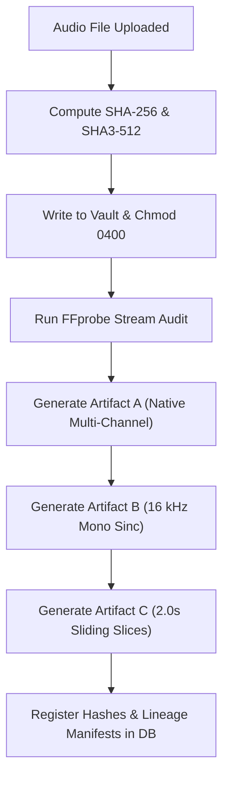

**Validation Strategy:**
Upload genuine and corrupt audio samples; verify bitstream checksums before and after processing; assert that attempting to modify Artifact files throws `PermissionError`; verify Pydantic schema validation.

**Definition of Done:**
All ingestion and transformation modules implemented in `src/ps05/core/` and `src/ps05/engines/audio/common/`; unit tests in `tests/unit/test_audio_ingest.py` pass with exit code 0.

**Dependencies & Risks:**
*Risk:* System FFmpeg version incompatibility. *Mitigation:* Pin FFmpeg $\ge 6.0$ and verify binary presence on application startup.

**Checkpoint Table:**

| Checkpoint ID | Topic / Subtopic | Verification action | Expected evidence | Status | Pass criteria |
| :--- | :--- | :--- | :--- | :--- | :--- |
| **A0-CP-01** | Evidence Hashing | Execute dual-hashing on test WAV fixture | SHA-256 and SHA3-512 matching known fixture checksums | `NOT_STARTED` | Checksums match reference values exactly |
| **A0-CP-02** | WORM Immutability | Attempt to write to stored exhibit file | Caught `PermissionError` (POSIX 0400) | `NOT_STARTED` | File permissions strictly enforce read-only |
| **A0-CP-03** | Artifact Lineage | Query database for generated artifacts A, B, C | Database rows with parent FK and distinct hashes | `NOT_STARTED` | Complete DAG linking parent to derived artifacts |
| **A0-CP-04** | Decoder Robustness | Feed truncated and 0-byte corrupt files | Clean HTTP 422 / validation error response | `NOT_STARTED` | System fails safely without worker crash |

---

### Phase AURAS-A1: ARE Baseline — Integrity, Metadata & Signal Profiling

**Status:** `PLANNED`

**Objective:**
Implement baseline electroacoustic and physical signal analysis for audio exhibits. Quantify dynamic range, detect clipping and DC offset bias, compute Short-Time Fourier Transform (STFT) spectrograms, and extract container metadata tags.

**Scope:**
- *Included:* ARE-01 (Integrity), ARE-02 (Metadata & DAW audit), ARE-03 (Signal profiling), ARE-04 (Spectral analysis & Welch PSD), high-frequency cutoff detection.
- *Explicit Exclusions:* Splice localization (deferred to A2), diarization (deferred to A3–A5), deepfake inference (deferred to A6–A8).

**Prerequisites:**
Phase AURAS-A0 Gate passed; working Artifact A (native multi-channel) and Artifact B (16 kHz mono) available.

**Topics & Subtopics:**
1. **Metadata & DAW Signature Audit (ARE-02):** Scan RIFF chunks, ID3 tags, and BWF headers for software signatures (ProTools, Logic, Audacity, FL Studio, Adobe Audition); detect non-standard bitrates and truncated padding.
2. **Electroacoustic Signal Profiling (ARE-03):** Compute RMS energy, true peak, dynamic range (dB), DC offset bias ($\mu_x$), and zero-crossing rate (ZCR) across all audio channels.
3. **Clipping & Dynamic Compression Analysis:** Measure consecutive saturated samples ($|x[n]| \ge 0.9999$); calculate clipping percentage and estimate crest factor.
4. **SNR Estimation:** Implement WADA-SNR algorithm to estimate signal-to-noise ratio in decibels.
5. **Time-Frequency Spectral Analysis (ARE-04):** Compute STFT with Hann window (2048-point FFT, 512 hop size); generate 128-bin log-mel spectrogram; compute Welch Power Spectral Density (PSD).
6. **Spectral Rolloff & High-Frequency Cutoff Estimation:** Estimate upper cutoff frequency ($f_{\text{cutoff}}$) to identify lossy compression boundaries (e.g., 16 kHz cutoff indicative of 128 kbps MP3/AAC).
7. **Spectral Flux Computation:** Calculate first-order spectral difference series $SF[m] = \sum_k |X[k, m] - X[k, m-1]|^2$ for downstream change-point localization.
8. **Channel Phase & Balance Correlation:** For stereo recordings, evaluate inter-channel phase difference (IPD) and channel cross-correlation.
9. **Structured Signal Finding Serialization:** Wrap all electroacoustic metrics into `ARESegmentFindings` Pydantic models.
10. **Regression & Synthetic Testing:** Test against pure sine waves, synthetic clipped audio, and clean vs. lossy compressed files.

**Execution Workflow:**

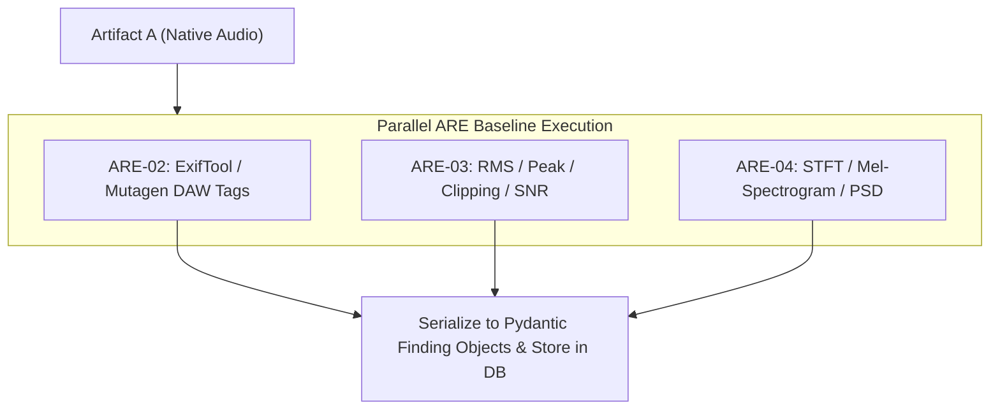

**Validation Strategy:**
Execute unit tests on synthetic audio fixtures with injected DC offset ($+0.05$), 100 clipped samples, and a 1 kHz sine wave; verify that measured parameters match ground-truth values within 1% tolerance.

**Definition of Done:**
Modules `src/ps05/engines/audio/are/signal.py` and `spectral.py` implemented; `tests/unit/test_are_signal.py` passes 100%.

**Dependencies & Risks:**
*Risk:* Memory exhaustion on long 2-hour recordings during STFT. *Mitigation:* Chunk STFT computation in 5-minute blocks.

**Checkpoint Table:**

| Checkpoint ID | Topic / Subtopic | Verification action | Expected evidence | Status | Pass criteria |
| :--- | :--- | :--- | :--- | :--- | :--- |
| **A1-CP-01** | Clipping Counting | Run signal profiler on fixture with 100 clipped peaks | `clip_count == 100` | `NOT_STARTED` | Exact sample count match |
| **A1-CP-02** | DAW Signature Tagging | Inspect WAV file exported from Audacity | `daw_tags_found == ["Audacity"]` | `NOT_STARTED` | Accurately identifies editing workstation |
| **A1-CP-03** | Spectral Cutoff | Compute PSD on 128 kbps MP3 file | High-frequency cutoff flagged at $\approx 16.0\text{ kHz}$ | `NOT_STARTED` | Cutoff localized within $\pm 200\text{ Hz}$ |
| **A1-CP-04** | Signal Schema Validity | Validate output dictionary against `SignalProfile` | Pydantic validation passes without error | `NOT_STARTED` | All numeric fields within defined ranges |

---

### Phase AURAS-A2: ARE Advanced — Edit, Splice, Noise, Repetition & ENF

**Status:** `PLANNED`

**Objective:**
Implement advanced signal-level tampering detection: localizing candidate edit/splice points via change-point algorithms, tracking ambient noise-floor stationarity, detecting duplicated/cloned phrases via FAISS acoustic self-similarity, and extracting 50 Hz Electric Network Frequency (ENF).

**Scope:**
- *Included:* ARE-05 (Splice detection via PELT), ARE-06 (Noise consistency), ARE-07 (FAISS repetition), ARE-08 (Codec re-encoding), ARE-09 (ENF forensics), ARE-10 (Acoustic manifests).
- *Explicit Exclusions:* Speaker identification (deferred to MVSI), deepfake neural classification (deferred to ADDE).

**Prerequisites:**
Phase AURAS-A1 Gate passed; spectral flux and STFT spectrograms operational.

**Topics & Subtopics:**
1. **Change-Point Splice Detection (ARE-05):** Apply Pruned Exact Linear Time (PELT) change-point search on spectral flux and short-time energy series using RBF kernel (`ruptures` library).
2. **Splice Candidate Boundary Localization:** Filter change-points by energy jump magnitude ($> 3\sigma$); pinpoint candidate edit timestamps ($\pm 50\text{ ms}$).
3. **Ambient Noise Floor Tracking (ARE-06):** Implement Martin's minimum statistics spectral subtraction to extract stationary background room tone; flag abrupt noise floor shifts ($> 4\text{ dB}$).
4. **Reverberation & Room Acoustic Discontinuity:** Track early-to-late reverberation energy ratio across speech pauses.
5. **MFCC Acoustic Feature Extraction:** Extract 13 MFCC coefficients over 25ms frames with 10ms hop length for acoustic fingerprinting.
6. **FAISS Self-Similarity Search (ARE-07):** Build FAISS index of normalized MFCC vectors; compute full pairwise cosine similarity matrix; search for off-diagonal matching trajectories ($> 1.0\text{ s}$, similarity $> 0.92$).
7. **Candidate Repeated Phrase Verification:** Verify candidate cloned segments using cross-correlation to distinguish natural speech repetition from copy-pasted audio clones.
8. **Codec Re-Encoding Analysis (ARE-08):** Analyze MDCT quantization error patterns and rolloff steepness to detect multi-pass lossy compression.
9. **50 Hz ENF Grid Extraction (ARE-09):** Bandpass filter audio between 49.8 Hz and 50.2 Hz (8th-order Butterworth); compute analytic signal via Hilbert transform; track instantaneous frequency.
10. **ENF Grid Log Correlation:** Compare extracted ENF curve against reference state electrical grid database (when reference logs are available); output Pearson correlation coefficient $r$.
11. **Signed Acoustic Manifest Generation (ARE-10):** Compile all signal findings into an immutable JSON manifest signed with examiner private key.
12. **Alternative Explanations & False-Positive Evaluation:** Distinguish benign microphone bumps from manual splices; flag low-SNR conditions where ENF is unextractable.
13. **Benchmark Corpus Testing:** Run on synthetic splice dataset (20 spliced audio tracks, 20 untampered controls).

**Execution Workflow:**

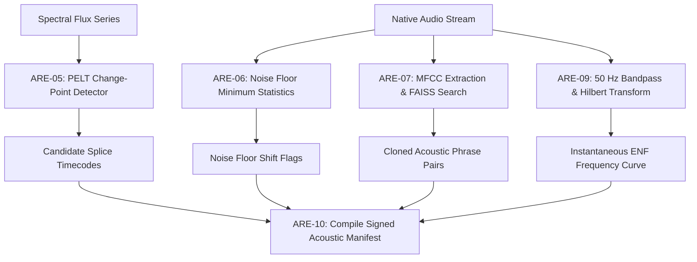

**Validation Strategy:**
Inject a 500ms tone or spliced spoken phrase into 10 test audio tracks at known millisecond timestamps; verify that ARE-05 detects the splice boundary within $\pm 50\text{ ms}$; verify that untampered controls produce 0 false-positive splice alarms above threshold.

**Definition of Done:**
Modules `src/ps05/engines/audio/are/edit_detect.py`, `noise.py`, `repetition.py`, and `enf.py` implemented; unit tests in `tests/unit/test_are_splice.py` pass.

**Dependencies & Risks:**
*Risk:* Heavy lossy compression obscuring ENF signal. *Mitigation:* Explicitly mark ENF as `INCONCLUSIVE_NO_USABLE_ENF` when SNR $< 6\text{ dB}$.

**Checkpoint Table:**

| Checkpoint ID | Topic / Subtopic | Verification action | Expected evidence | Status | Pass criteria |
| :--- | :--- | :--- | :--- | :--- | :--- |
| **A2-CP-01** | Splice Localization | Run PELT detector on audio with injected splice at $T=02.500\text{s}$ | Flagged splice interval covers $02.450\text{s} - 02.550\text{s}$ | `NOT_STARTED` | Localization error $\le \pm 50\text{ ms}$ |
| **A2-CP-02** | Noise Floor Tracking | Ingest audio with background room tone step jump ($+6\text{ dB}$) | Anomaly alert flagged with start/end timecode | `NOT_STARTED` | Detects jump $> 4\text{ dB}$ lasting $> 200\text{ ms}$ |
| **A2-CP-03** | Repeated Phrases | Test audio with identical duplicated sentence | Segment pair identified with similarity $> 0.92$ | `NOT_STARTED` | Accurately identifies cloned intervals |
| **A2-CP-04** | ENF Availability | Extract ENF from clean mains-connected studio recording | Frequency curve centered at $50.0 \pm 0.15\text{ Hz}$ | `NOT_STARTED` | Instantaneous frequency tracked cleanly |

---

### Phase AURAS-A3: MVSI Foundation — VAD & Speech Segmentation

**Status:** `PLANNED`

**Objective:**
Implement voice activity detection (VAD), acoustic quality gating, and neural speech segmentation to isolate genuine speech intervals from non-speech background, silence, and environmental static.

**Scope:**
- *Included:* MVSI-01 (Audio quality assessment), MVSI-02 (Silero VAD / WebRTC VAD), MVSI-03 (Neural speech segmentation), temporal smoothing hysteresis.
- *Explicit Exclusions:* Speaker clustering and diarization (deferred to A4), language ID (deferred to A5).

**Prerequisites:**
Phase AURAS-A0 Gate passed; working Artifact B (16 kHz mono normalized WAV) available.

**Topics & Subtopics:**
1. **Audio Quality Pre-Gating (MVSI-01):** Assess signal quality before speech processing. If SNR $< 5\text{ dB}$ or clipping $> 5\%$, issue an `AUDIO_QUALITY_DEGRADED` warning.
2. **Silero VAD v4 Integration (MVSI-02):** Load pre-packaged TorchScript model (`vad-silero-v4`); stream 16 kHz audio chunks (512 samples); calculate frame-level speech probabilities $P(\text{speech})$.
3. **WebRTC VAD Baseline Fallback:** Provide lightweight CPU-only WebRTC VAD baseline for low-power triage.
4. **Temporal Smoothing & Hysteresis:** Apply speech threshold ($P_{\text{start}} = 0.50$, $P_{\text{end}} = 0.35$); enforce minimum speech duration ($250\text{ ms}$) and minimum silence duration ($100\text{ ms}$) to avoid cutting words mid-phoneme.
5. **Speech Segmentation & Chunker (MVSI-03):** Slice continuous speech stream into discrete acoustic turns bounded by pauses.
6. **Speech Duty Cycle Metric:** Calculate total active speech time vs. total recording duration.
7. **Quiet Speech & Noisy Audio Robustness:** Evaluate VAD performance on low-amplitude whispers and noisy roadside audio.
8. **Speech Interval Schema Serialization:** Serialize output into `List[SpeechInterval(start_sec, end_sec, avg_prob, snr_db)]`.
9. **CPU/GPU Resource Optimization:** Run Silero VAD on CPU using INT8 quantization to preserve GPU VRAM for deepfake models.
10. **Unit Testing on Synthetic Speech/Silence Fixtures:** Validate boundary detection on synthetic alternating 2.0s speech and 1.0s silence audio.

**Execution Workflow:**

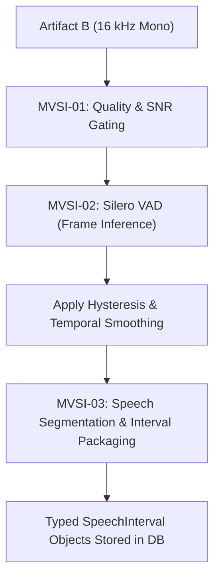

**Validation Strategy:**
Run VAD test suite against 10 clean conversational clips and 5 noisy background controls; assert false alarm rate $< 5\%$ and speech boundary timing accuracy within $\pm 30\text{ ms}$.

**Definition of Done:**
Modules `src/ps05/engines/audio/mvsi/vad.py` and `segmentation.py` implemented; `tests/unit/test_mvsi_vad.py` passes 100%.

**Dependencies & Risks:**
*Risk:* High background noise causing speech fragmentation. *Mitigation:* Dynamic threshold adaptation based on estimated background noise floor.

**Checkpoint Table:**

| Checkpoint ID | Topic / Subtopic | Verification action | Expected evidence | Status | Pass criteria |
| :--- | :--- | :--- | :--- | :--- | :--- |
| **A3-CP-01** | Speech Isolation | Ingest 10-second audio with 4.0s speech and 6.0s silence | Extracted intervals total $4.0 \pm 0.15\text{ s}$ | `NOT_STARTED` | Accurate speech duty cycle |
| **A3-CP-02** | Quiet Speech Sensitivity | Test whisper audio sample (peak $-25\text{ dBFS}$) | Speech interval detected without truncation | `NOT_STARTED` | Detects speech above $-30\text{ dBFS}$ |
| **A3-CP-03** | Low Quality Warning | Test audio with synthetic SNR $= 3\text{ dB}$ | Emits `AUDIO_QUALITY_DEGRADED` warning | `NOT_STARTED` | Low SNR flagged explicitly |
| **A3-CP-04** | Runtime Latency | Process 5-minute audio track on 4-core CPU | Execution completes in $< 2.0\text{ seconds}$ | `NOT_STARTED` | Faster than $150\times$ real-time on CPU |

---

### Phase AURAS-A4: MVSI Advanced — Overlap-Aware Speaker Diarization

**Status:** `PLANNED`

**Objective:**
Implement end-to-end speaker diarization supporting simultaneous overlapping speech. Extract high-dimensional speaker embeddings, cluster speaker turns, and produce multi-label "who spoke when" timelines allowing concurrent speaker activity.

**Scope:**
- *Included:* MVSI-04 (Overlapped Speech Detection), MVSI-05 (ECAPA-TDNN embeddings), MVSI-06 (Agglomerative clustering), MVSI-07/08 (Overlap-aware diarization timeline).
- *Explicit Exclusions:* Language identification (deferred to A5), speech-to-text transcription (optional in A5).

**Prerequisites:**
Phase AURAS-A3 Gate passed; speech segments and intervals operational.

**Topics & Subtopics:**
1. **Overlapped Speech Detection (OSD) (MVSI-04):** Apply PyAnnote OSD model on speech frames; output framewise multi-talker overlap probabilities $P(\text{overlap})$.
2. **Speaker Representation Extraction (MVSI-05):** Extract 192-dimensional speaker embeddings using SpeechBrain ECAPA-TDNN (`emb-ecapa-tdnn`) over segmented speech turns.
3. **Embedding Normalization & Centroid Tracking:** Apply length normalization ($L_2$) and compute running speaker centroids.
4. **Speaker Clustering (MVSI-06):** Cluster embeddings using Agglomerative Hierarchical Clustering (AHC) with cosine distance thresholding or Spectral Clustering.
5. **Conservative Speaker Count Estimation:** Handle unknown speaker counts using eigengap heuristic; avoid over-clustering uncertain background voices.
6. **Overlap-Aware Timeline Assembly (MVSI-07/08):** Combine single-speaker cluster tracks with OSD overlap intervals to produce multi-label timelines:
   - Example: Interval $T_1$ has `["SPEAKER_00"]`, Interval $T_2$ has `["SPEAKER_00", "SPEAKER_01"]`.
7. **Simultaneous Multi-Speaker Data Model:** Enforce database schema where `speaker_segments` table includes `is_overlapped` and `concurrent_speakers JSONB`.
8. **Ambiguous Assignment & Low-Confidence Gating:** Flag segments where distance to nearest centroid is close to cluster threshold as `UNCERTAIN_SPEAKER_ASSIGNMENT`.
9. **Diarization Error Rate (DER) Evaluation:** Evaluate on benchmark multi-talker audio; calculate DER, Jaccard Error Rate (JER), and missed overlap rate.
10. **Separation Model Boundary:** Source separation models (e.g., Conv-TasNet) are documented as optional listening aids only; they **never** alter the master evidence file.

**Execution Workflow:**

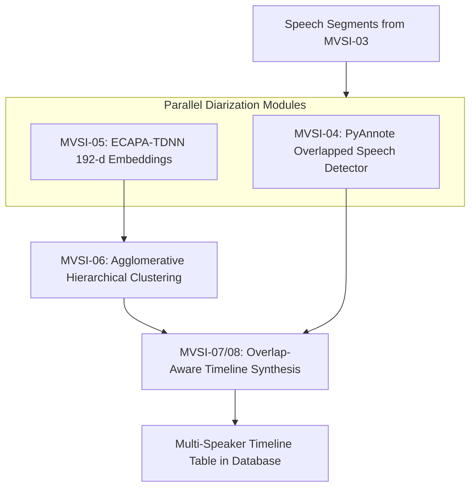

**Validation Strategy:**
Run diarization on 5 multi-speaker conversations containing known overlapping turns; verify that overlapping intervals contain at least 2 active speaker labels; assert overall DER $< 18\%$.

**Definition of Done:**
Modules `src/ps05/engines/audio/mvsi/embeddings.py`, `osd.py`, and `diarization.py` implemented; `tests/unit/test_mvsi_diarization.py` passes 100%.

**Dependencies & Risks:**
*Risk:* Speaker clustering fragmentation when speakers whisper or shout. *Mitigation:* Use PLDA scoring and length-normalized ECAPA-TDNN embeddings.

**Checkpoint Table:**

| Checkpoint ID | Topic / Subtopic | Verification action | Expected evidence | Status | Pass criteria |
| :--- | :--- | :--- | :--- | :--- | :--- |
| **A4-CP-01** | Overlap Preservation | Diarize audio with known simultaneous dialogue (Speaker A & B) | Timeline displays interval with both Speaker A and B active | `NOT_STARTED` | Multi-label overlap accurately logged |
| **A4-CP-02** | Diarization Accuracy | Run DER benchmark on 3-speaker meeting audio | `DER < 18.0%` | `NOT_STARTED` | Benchmark threshold achieved |
| **A4-CP-03** | Stable Speaker Labels | Run diarization 3 times on identical audio hash | Identical speaker cluster count and turn bounds | `NOT_STARTED` | Deterministic clustering reproducibility |
| **A4-CP-04** | Three-Way Overlap | Test synthetic multi-track mix of 3 concurrent talkers | Timeline supports 3 active concurrent speaker tags | `NOT_STARTED` | No single-speaker exclusivity forced |

---

### Phase AURAS-A5: MVSI Multilingual & Speaker-Language Analytics

**Status:** `PLANNED`

**Objective:**
Implement multilingual spoken language identification (LID), intra-utterance code-switching detection, and aggregated speaker-language analytics across Scheduled Indian Languages and regional Hindi dialects.

**Scope:**
- *Included:* MVSI-09 (Multilingual LID), MVSI-10 (Code-switch boundary detector), MVSI-11 (Optional forensic ASR), MVSI-12 (Speaker-language analytics matrix), Indian language database registry.
- *Explicit Exclusions:* Deepfake classification (deferred to A6–A8).

**Prerequisites:**
Phase AURAS-A4 Gate passed; speaker segments and diarization timeline available.

**Topics & Subtopics:**
1. **Extensible Indian Language Registry:** Populate `language_registry` table covering Scheduled Indian Languages (Hindi, Bengali, Tamil, Telugu, etc.) and regional Bihar dialects (Bhojpuri, Maithili, Magahi).
2. **Multilingual Spoken Language Identification (MVSI-09):** Pass segmented speech audio through OpenAI Whisper Medium LID head and Meta MMS-LID; output top-3 language hypotheses with confidence scores.
3. **Catalogue Coverage vs. Validated Model Support:** Maintain clear separation between catalogued languages, models with claimed support, and benchmark-validated languages.
4. **Sliding-Window Language Tracking:** Apply 1.0s sliding window with 0.25s stride across speech turns to detect language changes.
5. **Intra-Utterance Code-Switching Detection (MVSI-10):** Identify transition boundaries where language probability crosses threshold (e.g., Hindi $\to$ English); refine boundary timestamp.
6. **Speaker Identity $\neq$ Language Identity Invariant:** Guarantee that a speaker switching languages retains their singular `speaker_label`.
7. **Optional Forensic ASR Transcription (MVSI-11):** Generate text transcripts using Faster-Whisper / MMS ASR as an investigatory aid; embed legal disclaimer that transcripts are supplementary.
8. **Speaker-Language Analytics Matrix (MVSI-12):** Compute aggregate statistics: total speaking time per speaker, language percentage breakdown per speaker, and cross-speaker interaction metrics.
9. **Overlap-Aware Speaking Duration Calculation:** Ensure simultaneous overlapping speech correctly attributes talk time to both concurrent speakers without artificial truncation.
10. **Unsupported Language & Dialect Uncertainty:** If top language confidence $< 0.40$, label as `UNCLASSIFIED_REGIONAL_DIALECT` with uncertainty warning.

**Execution Workflow:**

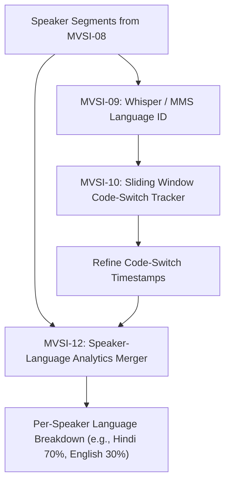

**Validation Strategy:**
Test against bilingual audio clips (Hinglish, Bhojpuri-Hindi); verify that code-switching boundaries are detected within $\pm 200\text{ ms}$; verify that speaker cluster count remains 1 for a single speaker code-switching.

**Definition of Done:**
Modules `src/ps05/engines/audio/mvsi/language_id.py`, `code_switch.py`, and `registry.py` implemented; `tests/unit/test_mvsi_multilingual.py` passes.

**Dependencies & Risks:**
*Risk:* Low-resource dialects (Magahi, Maithili) misclassified as standard Hindi. *Mitigation:* Explicitly record regional variant tags and output confidence ranges.

**Checkpoint Table:**

| Checkpoint ID | Topic / Subtopic | Verification action | Expected evidence | Status | Pass criteria |
| :--- | :--- | :--- | :--- | :--- | :--- |
| **A5-CP-01** | Speaker Invariant | Process Hinglish recording of 1 speaker switching languages | Total speaker count $= 1$; language tags show both `hin` and `eng` | `NOT_STARTED` | Single speaker retained across languages |
| **A5-CP-02** | Language Classification | Run LID on clean Hindi, Bengali, and Tamil audio clips | Top-1 predicted language matches ground truth | `NOT_STARTED` | Accuracy $> 90\%$ on clean primary languages |
| **A5-CP-03** | Code-Switch Boundary | Test sentence switching from Hindi to English at $T=03.200\text{s}$ | Code-switch flagged at $03.200 \pm 0.250\text{ s}$ | `NOT_STARTED` | Transition boundary localized |
| **A5-CP-04** | Duration Aggregation | Verify duration summary for 2-minute conversation | Sum of per-speaker durations matches ground truth | `NOT_STARTED` | Duration calculation error $< 1.0\text{ s}$ |

---

### Phase AURAS-A6: ADDE Foundation — Independent Detector Framework

**Status:** `PLANNED`

**Objective:**
Establish the dedicated, decoupled package boundary and model execution framework for the Audio Deepfake Detection Engine (ADDE). Implement standardized sliding-window preprocessing, integrate baseline neural detectors (RawNet2 and AASIST), and enforce pinned model manifests.

**Scope:**
- *Included:* ADDE-01 (Preprocessing & sliding windows), ADDE-02 (RawNet2), ADDE-03 (AASIST), model registry, checkpoint verification, and failure isolation.
- *Explicit Exclusions:* Advanced foundation SSL models (deferred to A7), calibration and late-fusion ensemble (deferred to A8).

**Prerequisites:**
Phase AURAS-A0 Gate passed; working Artifact C (standardized 2.0s sliding slices at 16 kHz) available.

**Topics & Subtopics:**
1. **Independent ADDE Package Boundary:** Structure `src/ps05/engines/audio/adde/` as an autonomous package with its own configuration, exceptions, and execution contracts.
2. **Sliding-Window Preprocessing Contract (ADDE-01):** Slice audio into 2.0-second frames with 0.5-second stride ($32000$ samples at 16 kHz); zero-pad tail frames; apply energy-based silence masking.
3. **Model Registry & Cryptographic Checksum Verification:** Register `df-rawnet2-v1` and `df-aasist-v2`; verify checkpoint SHA-256 hashes upon model loading.
4. **RawNet2 Baseline Implementation (ADDE-02):** Implement time-domain raw waveform classifier with sinc-convolution front-end; output raw logit $z_{\text{raw}}$.
5. **AASIST Baseline Implementation (ADDE-03):** Implement Audio Anti-Spoofing using Integrated Spectro-Temporal Graph Attention; construct spectral and temporal graphs; output raw logit $z_{\text{aasist}}$.
6. **Execution Isolation from ARE/MVSI:** Ensure ADDE runs independently without requiring ARE or MVSI outputs.
7. **Model Loading & Memory Management:** Implement lazy loading; support automatic device placement (CUDA with CPU fallback).
8. **Inference Exception Handling:** Safely catch GPU Out-Of-Memory (OOM) errors; automatically fallback to CPU sliding-window inference with warning log.
9. **ADDE Finding Schema:** Define typed Pydantic models for raw window scores and per-detector outputs.
10. **Test Fixtures & Synthetic Forward Passes:** Create unit tests verifying forward-pass execution on dummy $1 \times 32000$ audio tensors.

**Execution Workflow:**

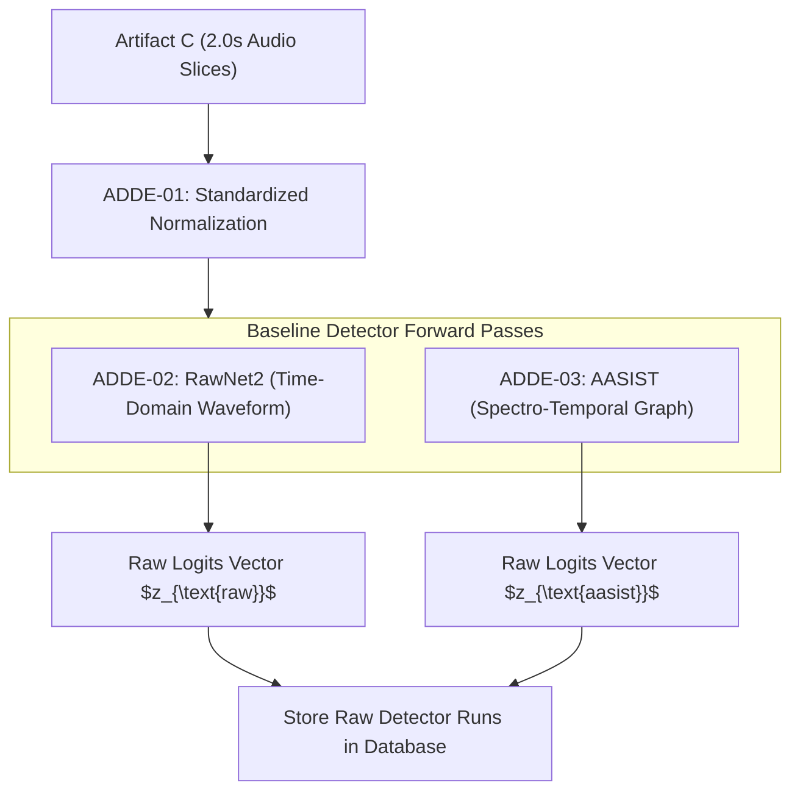

**Validation Strategy:**
Execute unit tests loading RawNet2 and AASIST architectures with mock weights; assert output logit tensor shapes match $(B, 2)$ where $B$ is batch size; verify that missing checkpoint raises explicit `ModelCheckpointNotFoundError`.

**Definition of Done:**
Modules `src/ps05/engines/audio/adde/preprocess.py`, `rawnet2.py`, and `aasist.py` implemented; `tests/unit/test_adde_foundation.py` passes 100%.

**Dependencies & Risks:**
*Risk:* PyTorch CUDA version mismatch on target police server. *Mitigation:* Pin PyTorch 2.2+ CPU/CUDA compatibility and test on both environments.

**Checkpoint Table:**

| Checkpoint ID | Topic / Subtopic | Verification action | Expected evidence | Status | Pass criteria |
| :--- | :--- | :--- | :--- | :--- | :--- |
| **A6-CP-01** | Standalone Execution | Run ADDE on audio file without running ARE or MVSI | Returns structured deepfake findings | `NOT_STARTED` | Operates completely independently |
| **A6-CP-02** | Checkpoint Integrity | Verify model checkpoint loading against manifest hash | Checksum matches `df-rawnet2-v1` hash | `NOT_STARTED` | Pinned model weights verified |
| **A6-CP-03** | Forward Pass | Execute RawNet2 and AASIST on 2.0s audio tensor | Output logits of shape `(1, 2)` produced | `NOT_STARTED` | Clean forward-pass execution |
| **A6-CP-04** | GPU Fallback | Force CUDA OOM simulation during inference | System catches error, falls back to CPU, completes | `NOT_STARTED` | Graceful CPU degradation |

---

### Phase AURAS-A7: ADDE Advanced — Models, SSL & Multilingual Robustness

**Status:** `PLANNED`

**Objective:**
Integrate self-supervised speech foundation models (WavLM Base+), spectral vocoder classifiers (LFCC/CQCC + Light-CNN), sliding-window partial manipulation localization, and lossy codec robustness testing (CodecFake).

**Scope:**
- *Included:* ADDE-04 (WavLM foundation SSL), ADDE-05 (Spectral vocoder classifier), ADDE-06 (Codec robustness), ADDE-07 (Partial manipulation localization).
- *Explicit Exclusions:* Late-fusion ensembling and calibration (deferred to A8).

**Prerequisites:**
Phase AURAS-A6 Gate passed; baseline detector framework operational.

**Topics & Subtopics:**
1. **Self-Supervised Speech Foundation Model (ADDE-04):** Integrate WavLM Base+ pre-trained encoder; attach binary classification head; output foundation model logit $z_{\text{wavlm}}$.
2. **Spectral Vocoder Artifact Classifier (ADDE-05):** Extract 60 Linear Frequency Cepstral Coefficients (LFCC) and Constant Q Cepstral Coefficients (CQCC); classify via 9-layer Light-CNN to detect parametric vocoder synthesis.
3. **Sliding-Window Partial Manipulation Localization (ADDE-07):** Align sliding window scores ($0.5\text{s}$ stride) along time axis; apply median smoothing ($w = 3$ frames) to identify short spliced synthetic phrases.
4. **Short-Interval Preservation:** Prevent temporal smoothing from erasing brief synthetic word insertions ($> 500\text{ ms}$).
5. **Codec-Oriented Robustness Evaluation (ADDE-06):** Evaluate detection resilience against lossy VoIP and mobile codecs (AMR-WB, Opus 6kbps, AAC 64kbps, G.711).
6. **Re-Encoding Simulation Layer:** Simulate codec degradation on validation sets to evaluate false-alarm rates on compressed authentic speech.
7. **Multilingual Deepfake Generalization:** Evaluate foundation models across Indian language speech samples to quantify dialectal false positives.
8. **Speaker-Disjoint and Generator-Disjoint Splits:** Guarantee evaluation datasets avoid speaker identity leakage or seen-generator overfitting.
9. **Dataset Provenance & Licensing Audit:** Verify licensing compliance for evaluation datasets (ASVspoof 2019/2021, WaveFake, In-the-Wild).
10. **Benchmark Metric Calculation:** Compute Equal Error Rate (EER) and Area Under ROC Curve (ROC-AUC) per individual detector branch.

**Execution Workflow:**

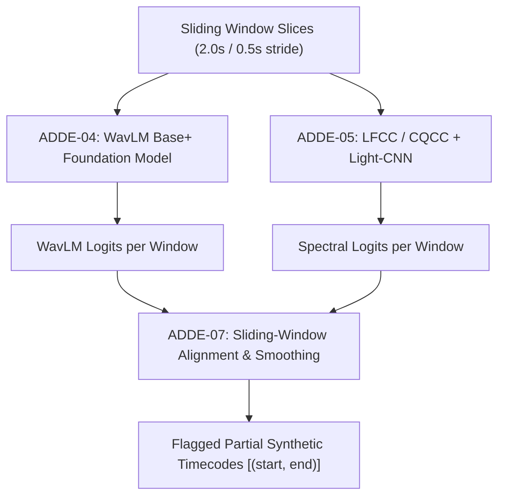

**Validation Strategy:**
Create test audio with a 1.5-second ElevenLabs synthetic voice clone inserted inside a 30-second genuine recording; verify that ADDE-07 localizes the synthetic interval within $\pm 250\text{ ms}$ boundary precision; assert individual detector EER $< 7.0\%$.

**Definition of Done:**
Modules `src/ps05/engines/audio/adde/ssl_wavlm.py`, `spectral.py`, and `codec_robust.py` implemented; unit tests in `tests/unit/test_adde_advanced.py` pass.

**Dependencies & Risks:**
*Risk:* WavLM VRAM usage on low-spec hardware. *Mitigation:* Apply dynamic batching ($B=1$) and half-precision (FP16) inference.

**Checkpoint Table:**

| Checkpoint ID | Topic / Subtopic | Verification action | Expected evidence | Status | Pass criteria |
| :--- | :--- | :--- | :--- | :--- | :--- |
| **A7-CP-01** | Partial Splice Localization | Test audio with 2.0s synthetic insert at $T=05.000\text{s}$ | Flagged manipulated interval covers $04.800\text{s} - 07.200\text{s}$ | `NOT_STARTED` | Localizes partial synthetic insert |
| **A7-CP-02** | WavLM Foundation Inference | Run WavLM branch on speech audio slice | Produces classification logit and 768-d embedding | `NOT_STARTED` | Clean forward-pass execution |
| **A7-CP-03** | Codec Robustness | Evaluate detector on audio transcoded via Opus 12kbps | Emits codec warning if compression degrades score | `NOT_STARTED` | Accurately manages lossy compression |
| **A7-CP-04** | Disjoint Data Splits | Inspect evaluation split code | Asserts zero speaker overlap between train and test | `NOT_STARTED` | Zero data leakage in evaluation |

---

### Phase AURAS-A8: ADDE Ensemble, Calibration & Forensic Interpretation

**Status:** `PLANNED`

**Objective:**
Implement score calibration (Platt scaling / temperature scaling), quality-weighted late fusion ensembling, Mahalanobis distance out-of-distribution (OOD) uncertainty estimation, and standalone 1:1 speaker verification.

**Scope:**
- *Included:* ADDE-08 (1:1 speaker verification), ADDE-09 (Calibration), ADDE-10 (Late fusion ensemble), ADDE-11 (OOD uncertainty), ADDE-12 (Suspicion heatmaps & report visuals).
- *Explicit Exclusions:* Unified reporting integration (deferred to A9).

**Prerequisites:**
Phase AURAS-A7 Gate passed; all four detector branches (RawNet2, AASIST, WavLM, Spectral) operational.

**Topics & Subtopics:**
1. **Probability Calibration via Platt Scaling (ADDE-09):** Fit logistic sigmoid parameters $(A_i, B_i)$ on held-out validation data to convert raw logits into posterior probabilities $p_i \in [0, 1]$.
2. **Temperature Scaling Evaluation:** Compare Platt scaling against temperature scaling $p_i = \sigma(z_i / T)$; verify Expected Calibration Error (ECE $< 0.05$).
3. **Quality-Weighted Late Fusion Ensemble (ADDE-10):** Compute composite deepfake score $P(\text{fake}) = \sum w_i p_i$; adjust weights $w_i$ based on SNR and codec indicators.
4. **Detector Disagreement Reporting:** If discrepancy between detectors $\max(p_i) - \min(p_i) > 0.50$, generate `DETECTOR_DISAGREEMENT_WARNING` with breakdown.
5. **Mahalanobis Distance OOD Detection (ADDE-11):** Calculate embedding distance $D_M(x)$ against training distribution centroid in WavLM embedding space; emit `OOD_UNCERTAINTY: HIGH` when $D_M(x) > \text{Threshold}$.
6. **Synthetic Speech vs. Voice Conversion Separation:** Differentiate between fully synthesized text-to-speech (TTS) and voice conversion (VC).
7. **Standalone 1:1 Reference Speaker Verification (ADDE-08):** Compare questioned voice against authorized reference recording using ECAPA-TDNN cosine distance. Strictly maintain separation from deepfake score.
8. **Forensic Suspicion Curve Generation (ADDE-12):** Generate time-aligned millisecond suspicion curve and PNG heatmap artifact for examiner review.
9. **False-Positive & Conclusiveness Balancing:** Ensure low-quality, noisy, or out-of-distribution inputs output `INCONCLUSIVE` rather than false-positive alarms.
10. **Comprehensive Ensemble Benchmarking:** Benchmark ensemble on ASVspoof 2019/2021 and in-the-wild test sets; assert composite EER $< 5.5\%$, ROC-AUC $> 0.96$.

**Execution Workflow:**

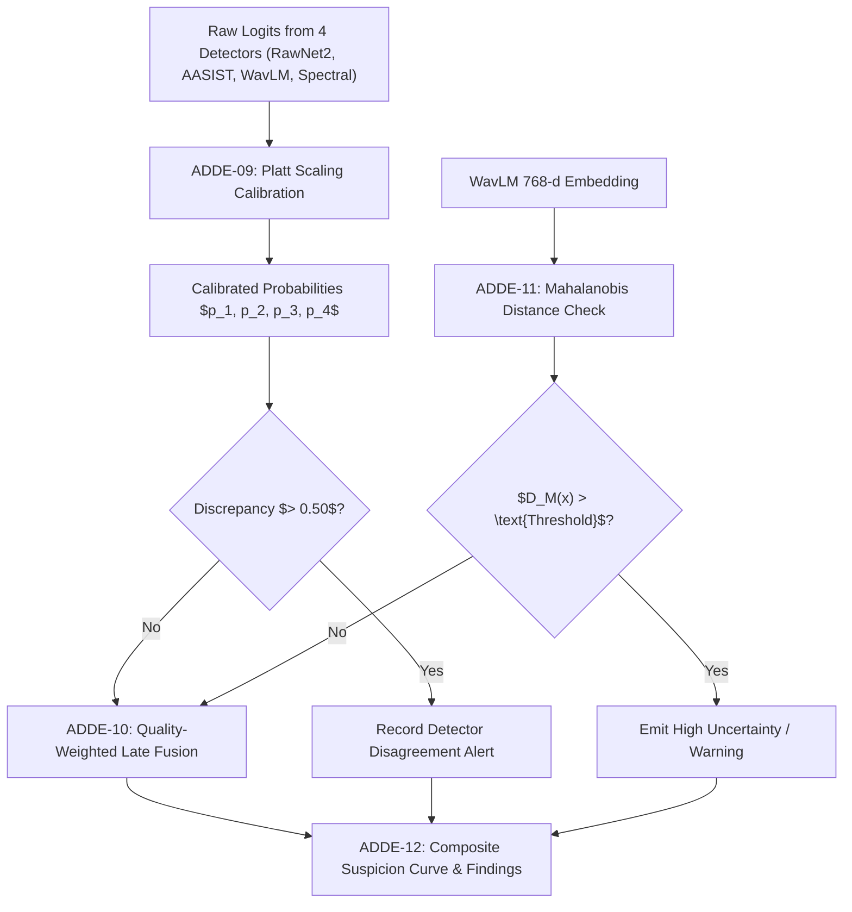

**Validation Strategy:**
Evaluate calibrated ensemble on 100 genuine and 100 spoofed test samples; verify that Brier score $< 0.08$ and ECE $< 0.05$; assert that extreme white noise input triggers OOD uncertainty rather than a false deepfake detection.

**Definition of Done:**
Modules `src/ps05/engines/audio/adde/calibration.py`, `ensemble.py`, `ood.py`, and `verification.py` implemented; `tests/benchmarks/test_adde_metrics.py` passes.

**Dependencies & Risks:**
*Risk:* Overfitting calibration parameters to training vocoders. *Mitigation:* Fit calibration strictly on held-out validation sets featuring unseen vocoders.

**Checkpoint Table:**

| Checkpoint ID | Topic / Subtopic | Verification action | Expected evidence | Status | Pass criteria |
| :--- | :--- | :--- | :--- | :--- | :--- |
| **A8-CP-01** | Calibration Quality | Calculate ECE on held-out validation set | `ECE < 0.05` | `NOT_STARTED` | Well-calibrated probabilities |
| **A8-CP-02** | Ensemble Superiority | Compare ensemble EER vs best single detector | Ensemble EER is lower than any single detector branch | `NOT_STARTED` | Late-fusion improves generalization |
| **A8-CP-03** | OOD Flagging | Ingest synthetic white noise and heavily distorted audio | `OOD_UNCERTAINTY == HIGH` emitted | `NOT_STARTED` | Rejects out-of-distribution inputs |
| **A8-CP-04** | Disagreement Handling | Test sample where WavLM flags fake but RawNet2 flags real | `DETECTOR_DISAGREEMENT_WARNING` included in findings | `NOT_STARTED` | Transparency on detector conflict |

---

### Phase AURAS-A9: Audio Orchestration, Reporting & Reviewer Workflow

**Status:** `PLANNED`

**Objective:**
Unify independent findings from ARE, MVSI, and ADDE into a consolidated forensic timeline; implement Celery task dispatching, partial-failure recovery, reviewer annotation capabilities, Archify JSON IR formatting, and court-admissible electronic evidence reporting (Section 65B IEA / Section 63 BSA).

**Scope:**
- *Included:* Audio job orchestrator, cross-engine timeline alignment, finding merger, reviewer verdict overrides, Archify JSON IR generation, WeasyPrint PDF compilation.
- *Explicit Exclusions:* Image and video findings (handled in Phase 7).

**Prerequisites:**
Phases AURAS-A2, AURAS-A5, and AURAS-A8 Gates passed; all three audio engines operational.

**Topics & Subtopics:**
1. **Asynchronous Audio Task Orchestration:** Dispatch parallel Celery tasks for ARE, MVSI, and ADDE; aggregate results upon completion with task timeout handling (max 10 mins).
2. **Partial-Failure Recovery:** If one engine fails (e.g., ADDE GPU OOM), record structured warning and allow ARE and MVSI findings to be exported with `PARTIAL_ANALYSIS` status.
3. **Cross-Engine Timeline Alignment:** Synchronize splice candidate timestamps (ARE) with speech turns (MVSI) and deepfake suspicion curves (ADDE) onto a unified millisecond time grid.
4. **Cross-Engine Corroboration Logic:**
   - Case A: High deepfake suspicion + spectral flux discontinuity at turn boundary $\to$ *High Confidence Spliced Voice Clone*.
   - Case B: Single detector spike + no signal discontinuity + low-SNR $\to$ *Acoustic Anomaly / Inconclusive*.
5. **Human Examiner Reviewer Workflow:** Provide review endpoints allowing certified examiners to inspect flagged intervals, annotate findings, and record formal conclusions.
6. **Archify JSON IR Serialization:** Export complete case graph into Archify-compatible intermediate representation (`archify.report.json`).
7. **Court-Admissible PDF Certificate Generation:** Compile Section 65B IEA / Section 63 BSA certified PDF using Jinja2 and WeasyPrint, embedding exhibit hashes, environment details, and spectral visuals.
8. **Digital Signature Sealing:** Sign generated PDF and JSON manifest using PKCS#7 / X.509 digital certificates.
9. **Tamper-Evident Audit Logging:** Log all examiner reviews and report generations to append-only Merkle hash chain.
10. **REST API Endpoint Integration:** Implement `POST /api/v1/evidence/{id}/analyze` and `GET /api/v1/jobs/{id}/results`.

**Execution Workflow:**

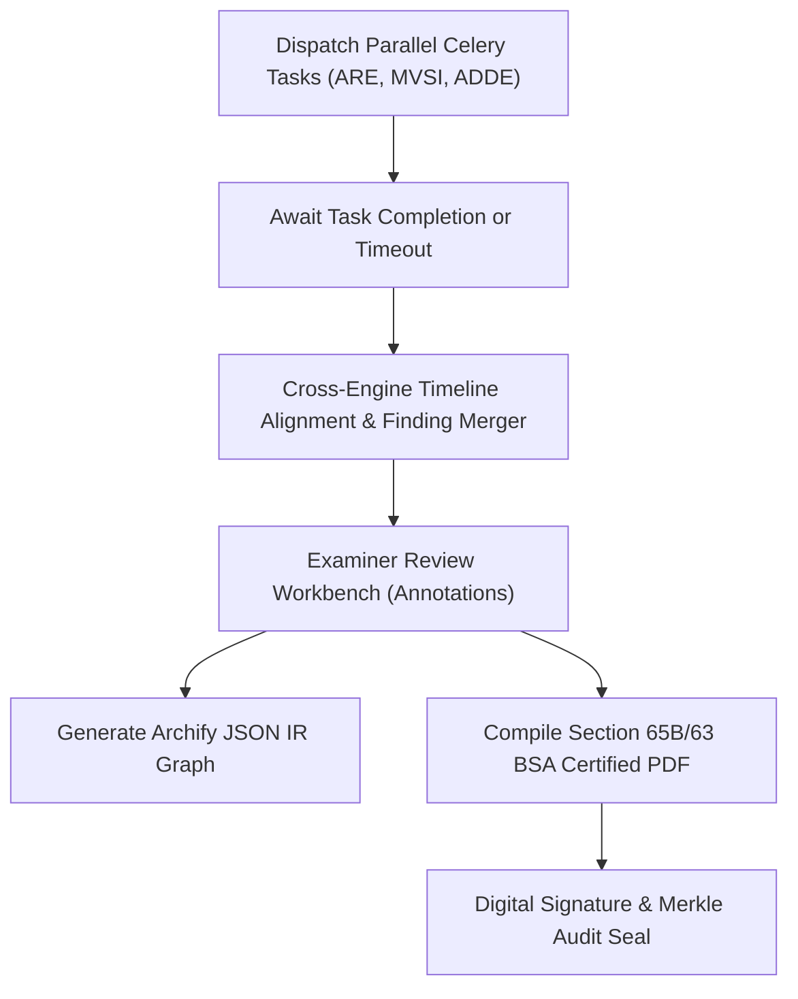

**Validation Strategy:**
Execute end-to-end integration test dispatching a job on an audio file; verify that findings from all 3 engines merge cleanly into the result JSON; verify that generated PDF compiles with valid layout and correct hashes.

**Definition of Done:**
Modules `src/ps05/core/orchestrator.py` and `src/ps05/reporting/compiler.py` implemented; integration tests in `tests/integration/test_audio_orchestrator.py` pass.

**Dependencies & Risks:**
*Risk:* Long-running audio jobs timing out on CPU. *Mitigation:* Implement incremental progress heartbeats over Redis every 5 seconds.

**Checkpoint Table:**

| Checkpoint ID | Topic / Subtopic | Verification action | Expected evidence | Status | Pass criteria |
| :--- | :--- | :--- | :--- | :--- | :--- |
| **A9-CP-01** | Multi-Engine Dispatch | Dispatch job enabling ARE, MVSI, and ADDE | All 3 engine runs recorded in database | `NOT_STARTED` | Clean parallel execution |
| **A9-CP-02** | Partial Failure Grace | Simulate artificial crash in ADDE engine | ARE and MVSI results exported with partial warning | `NOT_STARTED` | Graceful degradation preserved |
| **A9-CP-03** | Timeline Synchronization | Inspect unified timeline on spliced audio exhibit | Splice timecode aligns with deepfake spike | `NOT_STARTED` | Timecodes synchronized $\pm 50\text{ ms}$ |
| **A9-CP-04** | PDF Generation | Compile forensic report for test audio exhibit | Valid PDF generated containing Section 65B certificate | `NOT_STARTED` | PDF compiles cleanly with hash manifest |

---

### Phase AURAS-A10: End-to-End Audio Validation & Release Readiness

**Status:** `PLANNED`

**Objective:**
Execute comprehensive regression testing, benchmark the complete audio subsystem against curated test corpora, audit dependency licensing and air-gap integrity, and establish release readiness for the hackathon demonstration.

**Scope:**
- *Included:* Regression test suite, reproducibility audit, performance benchmarking, air-gap validation, documentation consistency audit.
- *Explicit Exclusions:* None (covers full audio subsystem).

**Prerequisites:**
Phase AURAS-A9 Gate passed; full audio pipeline operational end-to-end.

**Topics & Subtopics:**
1. **Curated Audio Test Corpus:** Assemble diverse evaluation set: clean voice, noisy calls, WhatsApp transcoded audio, ElevenLabs voice clones, spliced dialogues, bilingual Hinglish conversations, and authentic control audio.
2. **Reproducibility Audit:** Re-run complete forensic analysis on identical audio hashes 5 times; assert bit-for-bit identical findings, scores, and JSON manifests.
3. **End-to-End Evidence Workflow Testing:** Test complete journey from initial file intake to final signed PDF download.
4. **Latency & Throughput Benchmarking:** Profile execution speed across CPU and GPU configurations; document resource consumption.
5. **Memory Leak & Stress Testing:** Ingest 50 consecutive audio files without restarting worker processes; assert no memory accumulation in Celery workers.
6. **Air-Gap Integrity Verification:** Execute complete audio suite on network-isolated test runner with outbound connections blocked; assert zero HTTP requests.
7. **Model License & Checkpoint Audit:** Verify that all pre-trained models (Silero, PyAnnote, SpeechBrain, WavLM, RawNet2) comply with open-source licenses (MIT, Apache 2.0, BSD-3-Clause).
8. **Documentation Alignment:** Audit `README.md`, `PRD.md`, `TRD.md`, and `PHASES.md` for consistent terminology, requirement IDs, and status markers.
9. **Hackathon Demonstration Scenario Preparation:** Package representative demonstration exhibits with pre-computed forensic dossiers.
10. **Final Forensic Review:** Peer review of algorithmic explainability statements and courtroom certifiability.

**Execution Workflow:**

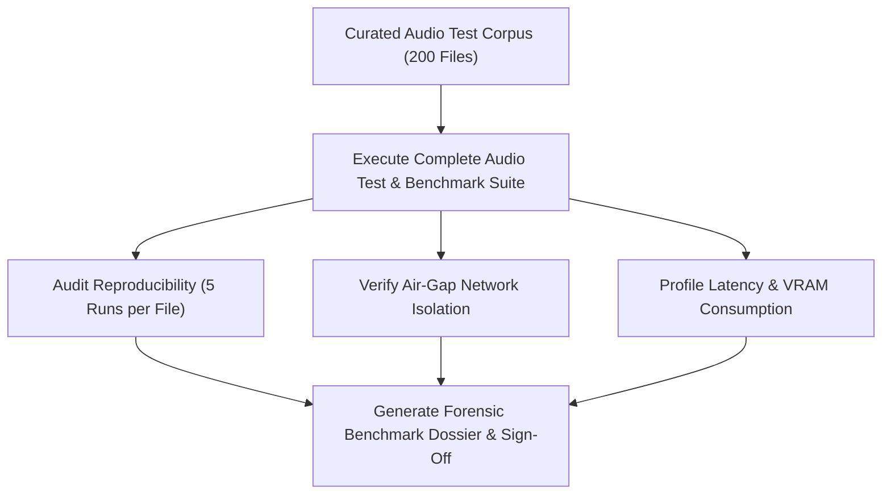

**Validation Strategy:**
Execute `pytest tests/` covering all unit, integration, and benchmark tests; assert 100% green pass rate (exit code 0); verify zero outbound network packets via packet capture.

**Definition of Done:**
Full test suite passes with zero failures; benchmark dossier compiled; all phase checkpoints verified.

**Dependencies & Risks:**
*Risk:* Hardware differences between development and hackathon jury laptops. *Mitigation:* Pre-configure both CPU and GPU execution modes.

**Checkpoint Table:**

| Checkpoint ID | Topic / Subtopic | Verification action | Expected evidence | Status | Pass criteria |
| :--- | :--- | :--- | :--- | :--- | :--- |
| **A10-CP-01** | Full Pipeline Pass | Run complete test suite on audio corpus | `pytest` exits with code 0 (100% passing) | `NOT_STARTED` | All tests pass |
| **A10-CP-02** | Reproducibility | Compare output hashes across 5 identical runs | 100% identical JSON outputs and scores | `NOT_STARTED` | Zero non-deterministic variance |
| **A10-CP-03** | Air-Gap Isolation | Run full suite with network adapters disabled | Suite runs completely offline without errors | `NOT_STARTED` | Zero external network calls |
| **A10-CP-04** | License Compliance | Audit all PyPI dependencies and model licenses | All licenses verified as commercial/hackathon permissive | `NOT_STARTED` | Zero GPL/proprietary license conflicts |

---

## 4. Dedicated Video Forensics Engineering Playbook (VISTA-A0 through VISTA-A13)

The Video Integrity, Synchronization & Tampering Analysis (VISTA) engineering roadmap defines fourteen sequential, research-oriented, and cryptographically grounded implementation phases. Each phase provides an exhaustive engineering specification with verifiable completion criteria and independent 5-column checkpoint tables conforming strictly to Indian evidentiary standards under Section 65B of the Indian Evidence Act (IEA) and Section 63 of the Bharatiya Sakshya Adhiniyam (BSA 2023):

---

### Phase VISTA-A0: Video Evidence Architecture Baseline & Standards Integration

**1. Phase ID & Title:** `VISTA-A0: Video Evidence Architecture Baseline & Standards Integration`
**2. Current Status:** `PLANNED`
**3. Purpose:** Establish the structural, algorithmic, defensive, and legal foundation for the VISTA subsystem. Initialize package hierarchies under `src/ps05/engines/vista/`, configure typing contracts, establish defensive PyAV/FFprobe execution harnesses, enforce memory allocation boundaries, trap malformed media bombs, and link VISTA into the shared platform discovery registry.
**4. Topics & Subtopics:**
- Directory & Module Scaffold: Sub-packages (`common`, `vre`, `afb`, `avsc`, `vdf`, `vci`, `cctv`).
- Defensive Demuxing Wrapper: `safe_demux.py` wrapping PyAV with strict 10-second I/O timeouts.
- Memory Allocation Ring Buffer: Strict cap of 64 uncompressed video frames in RAM (<= 400 MB).
- VISTA Domain Exception Hierarchy: Standardized typed error handling.
- Legal Evidentiary Invariants: Section 65B/63 BSA pre-flight rules.
**5. Exact Tasks:**
1. Create directory hierarchy under `src/ps05/engines/vista/` with `__init__.py` files and type exports.
2. Implement `BaseVideoForensicEngine` abstract base class defining `analyze()`, `health_check()`, and `model_manifest()`.
3. Build defensive media wrapper `safe_demux.py` trapping infinite atoms, corrupted headers, and recursion loops.
4. Implement ring buffer `timeline.py` constraining worker process RAM to <= 4 GB with automatic disk-backed memmap spilling.
5. Formulate VISTA error hierarchy (`VideoDemuxError`, `PTSContinuityError`, `AudioExtractionError`, `LipSyncConvergenceError`, `CCTVContextMismatchError`).
**6. Detailed Execution Workflow:**
Exhibit Path Received -> Subprocess Sandbox Initialized -> Magic Byte Magic Inspection -> Allocation Quota Checked -> Defensive Demuxer Invoked with 10s Timeout -> Memory Ring Buffer Bound -> Engine Registry Updated.
**7. Technologies, Tools & Models:**
Python 3.12, PyAV (FFmpeg 6.1.1 bindings), OpenCV Headless 4.9.0, Pydantic v2, pytest.
**8. Prerequisites & Dependencies:**
Phase 0 architectural baseline completed; system FFmpeg 6.x shared libraries available.
**9. Expected Files, Artifacts & Contracts:**
- `src/ps05/engines/vista/__init__.py`
- `src/ps05/engines/vista/common/base.py`
- `src/ps05/engines/vista/common/safe_demux.py`
- `src/ps05/engines/vista/common/timeline.py`
- `src/ps05/engines/vista/common/exceptions.py`
- `tests/unit/test_vista_scaffold.py`
**10. Failure Cases & Risks:**
- C-level segmentation faults inside Libavformat: Mitigated via isolated worker subprocesses and seccomp filtering.
- High memory pressure during frame decoding: Mitigated via hard ring-buffer cap of 64 frames.
**11. Security Considerations:**
Sandboxed worker execution with unprivileged Linux user (`uid 10001`); no root permissions; read-only mounts for source exhibits.
**12. Acceptance Criteria:**
- 100% clean package imports without circular dependency warnings.
- Defensive demuxer terminates hung or recursive container inputs within 10 seconds.
- Memory ring buffer never exceeds 500 MB resident memory under 1,000-frame sequential decode.
**13. Definition of Done (DoD):**
Scaffold committed, unit test suite passing with 100% exit code 0, typing verified via `mypy --strict`.
**14. Checkpoint Table:**

| Checkpoint ID | Verification item | Expected evidence | Status | Notes/blockers |
| :--- | :--- | :--- | :--- | :--- |
| **VISTA-CP-00-01** | Package Architecture & Module Imports | Clean import of all 7 VISTA sub-packages in virtualenv | `NOT_STARTED` | Awaits phase activation |
| **VISTA-CP-00-02** | Defensive Demuxer & Resource Limits | Ingestion of malformed video bomb triggers `VideoDemuxError` within 10s | `NOT_STARTED` | Awaits phase activation |
| **VISTA-CP-00-03** | Memory Ring Buffer Cap | 1,000 decoded frames processed; max RAM <= 500 MB | `NOT_STARTED` | Awaits phase activation |
| **VISTA-CP-00-04** | Base Engine Contract & Strict Typing | `mypy --strict` passes across all common VISTA interfaces | `NOT_STARTED` | Awaits phase activation |

---

### Phase VISTA-A1: Video Evidence Contracts, Ingestion & Cryptographic Foundation (CEIPL)

**1. Phase ID & Title:** `VISTA-A1: Video Evidence Contracts, Ingestion & Cryptographic Foundation (CEIPL)`
**2. Current Status:** `PLANNED`
**3. Purpose:** Implement pre-decode dual-hashing, immutable WORM storage ingestion, RFC 8785 canonical manifests, Ed25519 digital signatures, RFC 3161 TSA timestamps, and Merkle audit logging for video exhibits, guaranteeing uncompromised judicial chain of custody under Section 65B/63 BSA.
**4. Topics & Subtopics:**
- Pre-Decode Dual Hashing: Streaming SHA-256 and SHA3-512 calculation prior to parsing.
- WORM Vault Persistence: POSIX `0400` read-only filesystem permissions and S3 Object Lock.
- Ingestion Record Binding: 11-field metadata schema stored immutably.
- RFC 8785 Canonical JSON Serialization (JCS): Deterministic manifest representation.
- Merkle Custody Log: SHA-256 append-only transaction tree.
**5. Exact Tasks:**
1. Implement streaming dual hasher in `src/ps05/core/crypto/direct_hasher.py` handling chunked 64KB reads.
2. Build storage manager enforcing POSIX `0400` permissions and S3 Compliance Mode retention.
3. Define `VideoEvidenceRecord` Pydantic v2 schema capturing all 11 required custody parameters.
4. Implement RFC 8785 canonical manifest serializer and Ed25519 signature generator.
5. Create Merkle tree audit append handler logging ingestion events with cryptographic inclusion proofs.
**6. Detailed Execution Workflow:**
Seized File Streamed -> Parallel SHA-256/SHA3-512 Accumulation -> WORM Storage Write -> POSIX 0400 Permission Lock -> Canonical JSON Manifest Built -> Ed25519 Signed -> Merkle Audit Log Appended -> Evidence Record Committed to PostgreSQL.
**7. Technologies, Tools & Models:**
Python standard library `hashlib`, `cryptography` (Ed25519), `canonicaljson`, AWS S3 Object Lock API, PostgreSQL.
**8. Prerequisites & Dependencies:**
Phase VISTA-A0 Gate passed; CEIPL cryptographic core modules operational.
**9. Expected Files, Artifacts & Contracts:**
- `src/ps05/api/v1/evidence.py` (video upload endpoints)
- `src/ps05/core/crypto/direct_hasher.py`
- `src/ps05/core/storage.py` (WORM POSIX 0400 manager)
- `src/ps05/core/crypto/canonical.py` (RFC 8785 serializer)
- `tests/integration/test_vista_ingestion.py`
**10. Failure Cases & Risks:**
- Hash mismatch against seizure memo: Halts ingestion immediately; logs `HASH_MISMATCH` failure code; generates quarantine alert.
- Unauthorized write attempt on vault file: OS traps write with `PermissionError` [Errno 13].
**11. Security Considerations:**
Private signing keys loaded strictly from KMS/HSM; zero plaintext key storage; original bytes immutable.
**12. Acceptance Criteria:**
- Computed raw hashes match OS `sha256sum` bit-for-bit on 5GB test video.
- Ingested files cannot be modified or deleted even by the platform worker process.
- Canonical JSON manifests produce identical SHA-256 digests regardless of key ordering.
**13. Definition of Done (DoD):**
Ingestion endpoints operational, dual hashing verified against test vectors, Merkle proof generator functional.
**14. Checkpoint Table:**

| Checkpoint ID | Verification item | Expected evidence | Status | Notes/blockers |
| :--- | :--- | :--- | :--- | :--- |
| **VISTA-CP-01-01** | Original-File Hash & Retrieval Verification | Streamed dual hash matches bit-for-bit with reference seizure digest | `NOT_STARTED` | Awaits phase activation |
| **VISTA-CP-01-02** | Derived-Artifact Hash & Parent Mapping | DAG records child artifact SHA-256 and parent UUID correctly | `NOT_STARTED` | Awaits phase activation |
| **VISTA-CP-01-03** | Broken Signature & Hash Mismatch Detection | Bit-flipped exhibit raises `HASH_MISMATCH` and halts ingestion | `NOT_STARTED` | Awaits phase activation |
| **VISTA-CP-01-04** | Custody-Chain Integrity & Merkle Proofs | Merkle tree audit log returns valid inclusion proof for intake event | `NOT_STARTED` | Awaits phase activation |

---

### Phase VISTA-A2: Video Intake, Container Metadata & Safe Parsing (VRE Baseline)

**1. Phase ID & Title:** `VISTA-A2: Video Intake, Container Metadata & Safe Parsing (VRE Baseline)`
**2. Current Status:** `PLANNED`
**3. Purpose:** Build the baseline Video Reverse Engineering (VRE) capabilities: container atom inspection (MP4/MKV/AVI/TS/DAV), `moov` atom placement audit, Presentation Timestamp (PTS/DTS) continuity regression, instantaneous FPS jitter calculation, and duplicate/frozen frame span detection.
**4. Topics & Subtopics:**
- Container & Codec Introspection: Stream descriptors, codecs (H.264, H.265, AV1, VP9), profiles, pixel formats.
- ISO Base Media Box Inspection: Relative position of `moov` vs `mdat` (`moov` at end vs `faststart`).
- PTS/DTS Cadence Regression: Packet timestamp extraction and non-monotonic reversal detection.
- VFR Jitter & FPS Modeling: Instantaneous frame rate variance and VFR vs CFR classification.
- Duplicate & Frozen Frame Localization: Consecutive identical frame spans during non-silent audio.
**5. Exact Tasks:**
1. Implement PyAV container parser in `src/ps05/engines/vista/vre/bitstream.py` extracting track timebases and codec parameters.
2. Build MP4 box inspector verifying `ftyp`, `moov`, `mvhd`, `tkhd`, and `stts` consistency.
3. Implement `cadence.py` computing inter-packet timestamp differences $\Delta PTS_k = PTS_k - PTS_{k-1}$.
4. Build variable frame rate detector calculating instantaneous FPS variance $\sigma^2_{	ext{vfr}}$.
5. Develop frozen frame detector flagging identical raster spans ($SSIM > 0.998$) exceeding 1.0 second.
**6. Detailed Execution Workflow:**
Raw Exhibit Demuxed -> Box Offsets Scanned -> Stream Descriptors Extracted -> Packet Timestamps Logged -> PTS Continuity Regressed -> VFR Variance Computed -> Frozen Spans Segmented -> `VRERunResult` Emitted.
**7. Technologies, Tools & Models:**
PyAV 11.x, FFprobe 6.1.1, MediaInfo, NumPy, SciPy.
**8. Prerequisites & Dependencies:**
Phase VISTA-A1 Gate passed; video exhibit registered in WORM storage.
**9. Expected Files, Artifacts & Contracts:**
- `src/ps05/engines/vista/vre/bitstream.py`
- `src/ps05/engines/vista/vre/cadence.py`
- `src/ps05/engines/vista/vre/schemas.py`
- `tests/unit/test_vre_bitstream.py`
**10. Failure Cases & Risks:**
- Non-monotonic PTS cadences: Flagged as `PTSContinuityError` indicating excised frames or packet tampering.
- Container truncation: Trapped gracefully, reporting last valid PTS and unreadable trailing bytes.
**11. Security Considerations:**
Demuxing executes with isolated PyAV context; zero unsafe C-level buffer pointers exposed.
**12. Acceptance Criteria:**
- Correctly identifies `moov` placement (`AT_END_NATIVE` vs `BEGINNING_FASTSTART`) across 100 test clips.
- Traps non-monotonic PTS reversals with exact frame number localization.
- Accurately classifies CFR vs VFR streams with mathematical variance thresholding.
**13. Definition of Done (DoD):**
Bitstream and cadence modules implemented, test vectors passing, VRE baseline report schema validated.
**14. Checkpoint Table:**

| Checkpoint ID | Verification item | Expected evidence | Status | Notes/blockers |
| :--- | :--- | :--- | :--- | :--- |
| **VISTA-CP-02-01** | FFprobe & Container Atom Analysis | Full extraction of codec profiles, timebases, and box offsets | `NOT_STARTED` | Awaits phase activation |
| **VISTA-CP-02-02** | Malformed Media & Truncation Handling | Corrupted container header trapped cleanly without worker crash | `NOT_STARTED` | Awaits phase activation |
| **VISTA-CP-02-03** | VFR Cadence & Time-Base Handling | Correct distinction between CFR broadcast and VFR mobile footage | `NOT_STARTED` | Awaits phase activation |
| **VISTA-CP-02-04** | Frozen Frame Span Detection | 5-second synthetic freeze localized to exact millisecond bounds | `NOT_STARTED` | Awaits phase activation |

---

### Phase VISTA-A3: Timestamp-Aware Video Reverse Engineering (VRE Advanced)

**1. Phase ID & Title:** `VISTA-A3: Timestamp-Aware Video Reverse Engineering (VRE Advanced)`
**2. Current Status:** `PLANNED`
**3. Purpose:** Implement advanced VRE capabilities: content-aware adaptive scene transition detection, macroblock quantization parameter (QP) distribution auditing, double-compression ghost artifact detection, ExifTool metadata auditing, and optical-flow temporal continuity analysis.
**4. Topics & Subtopics:**
- Adaptive Scene Boundary Detection: PySceneDetect adaptive thresholding isolating cuts vs splices.
- Macroblock QP Distribution Parsing: Extracting macroblock-level quantization matrices from H.264/H.265 bitstreams.
- Double-Compression / Re-Encoding Clues: Periodic quantization error peaks indicating prior encoding passes.
- Deep Metadata Audit: ExifTool and MediaInfo tag verification (software strings, encoder signatures).
- AI Flow Interpolation Detection: Flagging non-linear optical flow vectors indicative of generative frame interpolation.
**5. Exact Tasks:**
1. Implement `scene_cuts.py` utilizing PySceneDetect adaptive content detector to catalog scene boundaries.
2. Build macroblock QP extractor in `reencode.py` analyzing spatial variance of compression across macroblocks.
3. Develop double-compression detector computing DCT coefficient histograms and periodicity metrics.
4. Implement ExifTool forensic parser extracting camera serials, firmware versions, and desktop editor signatures.
5. Build optical flow continuity checker comparing observed inter-frame motion vectors against natural physical dynamics.
**6. Detailed Execution Workflow:**
Demuxed Packets -> Scene Cuts Isolated -> Macroblock QPs Decoded -> Double Compression Evaluated -> ExifTool Audit Executed -> Optical Flow Field Computed -> Splicing/Re-encoding Findings Emitted.
**7. Technologies, Tools & Models:**
PySceneDetect 0.6.x, ExifTool 12.76, MediaInfo, PyAV bitstream parser, OpenCV Farneback Optical Flow.
**8. Prerequisites & Dependencies:**
Phase VISTA-A2 Gate passed; container bitstream parsed and PTS verified.
**9. Expected Files, Artifacts & Contracts:**
- `src/ps05/engines/vista/vre/scene_cuts.py`
- `src/ps05/engines/vista/vre/reencode.py`
- `src/ps05/engines/vista/vre/metadata.py`
- `tests/unit/test_vre_advanced.py`
**10. Failure Cases & Risks:**
- False-positive scene cuts caused by strobe lighting or flashlight sweeps: Mitigated via adaptive luminance thresholding.
- Stripped metadata on exported web videos: Mitigated by falling back to bitstream QP analysis without blocking.
**11. Security Considerations:**
ExifTool executed via isolated subprocess with strict argument validation preventing command injection.
**12. Acceptance Criteria:**
- Scene cut detection recall >= 95% on benchmark videos with exact PTS boundary logging.
- Detects re-encoded video clips with macroblock QP variance divergence (> 2.5 sigma).
- Identifies editing software signatures in container metadata tags.
**13. Definition of Done (DoD):**
Advanced VRE modules operational, unit tests passing with synthetic re-encoded fixtures, DAG artifacts registered.
**14. Checkpoint Table:**

| Checkpoint ID | Verification item | Expected evidence | Status | Notes/blockers |
| :--- | :--- | :--- | :--- | :--- |
| **VISTA-CP-03-01** | Adaptive Scene Cut Localization | Cuts localized to exact PTS frame indices without false strobe alerts | `NOT_STARTED` | Awaits phase activation |
| **VISTA-CP-03-02** | Macroblock QP Variance & Re-encoding | Re-encoded video splice exhibits measurable QP variance discontinuity | `NOT_STARTED` | Awaits phase activation |
| **VISTA-CP-03-03** | ExifTool Deep Metadata Audit | Extraction of camera serial numbers and desktop editor tags | `NOT_STARTED` | Awaits phase activation |
| **VISTA-CP-03-04** | Double Compression Artifact Detection | Periodic DCT histogram peaks detected on re-compressed MP4s | `NOT_STARTED` | Awaits phase activation |

---

### Phase VISTA-A4: Audio Extraction, DAG Lineage & AURAS Subsystem Bridge (AFB)

**1. Phase ID & Title:** `VISTA-A4: Audio Extraction, DAG Lineage & AURAS Subsystem Bridge (AFB)`
**2. Current Status:** `PLANNED`
**3. Purpose:** Implement the Audio Forensic Bridge (AFB): extract audio streams losslessly using stream-copy (`-c:a copy`), normalize a standardized 16kHz mono Float32 analysis derivative, register cryptographic DAG parent-child lineage, dispatch asynchronous analysis to AURAS (ARE, MVSI, ADDE), and handle multi-speaker speech separation.
**4. Topics & Subtopics:**
- Lossless Audio Stream-Copy: Demuxing raw audio bitstreams without re-encoding.
- Standardized Audio Normalization: Resampling to 16 kHz Mono Float32 normalized to -23 LUFS.
- Cryptographic DAG Binding: Binding derived audio SHA-256 to parent video exhibit UUID.
- Asynchronous AURAS Dispatch: Celery task dispatch to AURAS worker queues.
- Overlapped Speech Separation: Invoking SpeechBrain SepFormer to disentangle concurrent speakers.
**5. Exact Tasks:**
1. Implement `extractor.py` using FFmpeg stream-copy (`-c:a copy`) to produce pristine audio bitstreams.
2. Build `resampler.py` generating standardized 16kHz mono WAV derivatives for acoustic model inference.
3. Implement `lineage.py` registering extracted audio artifacts in CEIPL DAG with complete transformation metadata.
4. Build `auras_client.py` dispatching jobs to Celery queue `video_audio_forensics` and polling for results.
5. Implement `separation.py` integrating SpeechBrain SepFormer for multi-talker separation on overlapped segments.
**6. Detailed Execution Workflow:**
Video Exhibit -> Lossless Audio Bitstream Extracted -> SHA-256 Computed -> 16kHz WAV Generated -> DAG Nodes Registered -> Celery Job Dispatched to AURAS -> AURAS Findings Awaited -> Audio Timeline Mapped to Video Timebase.
**7. Technologies, Tools & Models:**
FFmpeg 6.x (`libswresample`), SoX, SpeechBrain SepFormer, Celery, Redis, PyTorch.
**8. Prerequisites & Dependencies:**
Phase VISTA-A1 Gate passed; AURAS subsystem operational and reachable via Celery broker.
**9. Expected Files, Artifacts & Contracts:**
- `src/ps05/engines/vista/afb/extractor.py`
- `src/ps05/engines/vista/afb/resampler.py`
- `src/ps05/engines/vista/afb/lineage.py`
- `src/ps05/engines/vista/afb/auras_client.py`
- `src/ps05/engines/vista/afb/separation.py`
- `tests/integration/test_afb_pipeline.py`
**10. Failure Cases & Risks:**
- Video without audio stream: Trapped gracefully, emitting `AUDIO_STREAM_ABSENT` without halting VISTA visual engines.
- AURAS worker timeout: Trapped with Celery retry policy; falls back to local baseline audio metadata extraction.
**11. Security Considerations:**
Audio derivatives stored in read-only WORM partition; isolated Celery worker execution.
**12. Acceptance Criteria:**
- Extracted audio bitstream matches container audio channel bit-for-bit (`cmp -l`).
- DAG manifest accurately links derived audio SHA-256 to parent video exhibit.
- Asynchronous dispatch returns complete AURAS findings (splicing, diarization, deepfakes).
**13. Definition of Done (DoD):**
AFB extraction pipeline complete, AURAS bridge operational, end-to-end integration test passing.
**14. Checkpoint Table:**

| Checkpoint ID | Verification item | Expected evidence | Status | Notes/blockers |
| :--- | :--- | :--- | :--- | :--- |
| **VISTA-CP-04-01** | Audio Stream Extraction & Source Mapping | Stream-copy bitstream matches container audio track bit-for-bit | `NOT_STARTED` | Awaits phase activation |
| **VISTA-CP-04-02** | Derived Audio DAG Lineage & Hashing | Derived WAV SHA-256 registered as child of video exhibit UUID | `NOT_STARTED` | Awaits phase activation |
| **VISTA-CP-04-03** | Asynchronous AURAS Integration | Successful retrieval of ARE, MVSI, and ADDE findings via Celery | `NOT_STARTED` | Awaits phase activation |
| **VISTA-CP-04-04** | Multi-Speaker Speech Separation | SepFormer separates overlapped speech into 2 isolated tracks | `NOT_STARTED` | Awaits phase activation |

---

### Phase VISTA-A5: Audio-Visual Synchronization & Multi-Face Lip-Sync (AVSC)

**1. Phase ID & Title:** `VISTA-A5: Audio-Visual Synchronization & Multi-Face Lip-Sync (AVSC)`
**2. Current Status:** `PLANNED`
**3. Purpose:** Build the Audio-Visual Synchronization & Correspondence Engine (AVSC): measure container AV global offset, perform surveillance-grade face detection (RetinaFace/SCRFD), maintain inter-frame face trajectories (ByteTrack), extract normalized mouth crops, execute SyncNet lip-sync cross-correlation, disambiguate multi-face speakers, and correlate acoustic events with visual phenomena.
**4. Topics & Subtopics:**
- Container AV Alignment: Extracting stream start offsets and duration differences.
- Surveillance Face Detection: RetinaFace / SCRFD high-recall face localization.
- Trajectory Association: ByteTrack multi-object tracking associating face tracklets across frames.
- Canonical Mouth ROI Normalization: Standardized 112x112 greyscale lip sequence extraction.
- SyncNet Lip-Sync Cross-Correlation: Computing embedding distance curve $D(\Delta)$ and sync score $S_{	ext{sync}}$.
- Multi-Face Speaker Disambiguation: Attributing dialogue to the active talker while classifying bystanders as silent.
- Acoustic-to-Visual Event Matching: Correlating transient sounds (gunshots, explosions) with visible phenomena (flashes, falls).
**5. Exact Tasks:**
1. Implement container offset alignment in `src/ps05/engines/vista/avsc/alignment.py`.
2. Integrate RetinaFace and ByteTrack in `face_track.py` maintaining consistent face trajectory IDs.
3. Build mouth crop extractor `mouth_roi.py` producing normalized $112 	imes 112$ tensors aligned via landmark homography.
4. Implement SyncNet evaluation harness in `syncnet.py` computing offset distance curves and confidence scores.
5. Build multi-speaker disambiguation logic in `multi_face.py` separating active speakers from bystanders.
6. Implement cross-modal event matcher in `event_corr.py` verifying light-travel-time physics constraints.
**6. Detailed Execution Workflow:**
AV Offset Checked -> Faces Detected & Tracked -> Mouth ROIs Extracted -> Audio MFCCs Computed -> SyncNet Cross-Correlation Evaluated -> Speaker Disambiguated -> Cross-Modal Acoustic Events Matched -> `AVSCSyncResult` Emitted.
**7. Technologies, Tools & Models:**
RetinaFace / SCRFD (InsightFace), ByteTrack, SyncNet (PyTorch), OpenCV, Librosa, YAMNet / AST.
**8. Prerequisites & Dependencies:**
Phase VISTA-A3 and VISTA-A4 Gates passed; decoded frames and 16kHz audio available.
**9. Expected Files, Artifacts & Contracts:**
- `src/ps05/engines/vista/avsc/alignment.py`
- `src/ps05/engines/vista/avsc/face_track.py`
- `src/ps05/engines/vista/avsc/mouth_roi.py`
- `src/ps05/engines/vista/avsc/syncnet.py`
- `src/ps05/engines/vista/avsc/multi_face.py`
- `src/ps05/engines/vista/avsc/event_corr.py`
- `tests/benchmarks/test_avsc_syncnet.py`
**10. Failure Cases & Risks:**
- Distant or obscured faces: Classified as `FACE_RESOLUTION_TOO_LOW` without forcing a false desync alert.
- Legitimate movie dubbing: Classified as `EXPLAINABLE_POST_PRODUCTION_DUBBING` when face is unaltered.
**11. Security Considerations:**
Biometric face feature vectors are strictly ephemeral; zero 1:N biometric gallery searching; privacy-preserving crops.
**12. Acceptance Criteria:**
- Optimal offset identification accuracy >= 95% on LRS2/LRS3 benchmark clips (+/- 10 frame shifts).
- Accurately classifies passive bystanders as `BYSTANDER_SILENT` ($S_{	ext{sync}} < 2.5$).
- Traps temporal physical violations where gunshot sound precedes visible muzzle flash by > 50 ms.
**13. Definition of Done (DoD):**
AVSC pipeline fully operational, SyncNet benchmarks passing, multi-face disambiguation unit tests passing.
**14. Checkpoint Table:**

| Checkpoint ID | Verification item | Expected evidence | Status | Notes/blockers |
| :--- | :--- | :--- | :--- | :--- |
| **VISTA-CP-05-01** | Container AV Offset Calculation | Detection of global stream start time offset within 1 ms | `NOT_STARTED` | Awaits phase activation |
| **VISTA-CP-05-02** | Lip-Sync Cross-Correlation & SyncNet | Artificially shifted audio (+5 frames) correctly localized | `NOT_STARTED` | Awaits phase activation |
| **VISTA-CP-05-03** | Multi-Face Speaker Disambiguation | Correct speech attribution to active speaker vs silent bystander | `NOT_STARTED` | Awaits phase activation |
| **VISTA-CP-05-04** | Sound-to-Visual Event Physics Alignment | Gunshot audio preceding muzzle flash flagged as splice anomaly | `NOT_STARTED` | Awaits phase activation |

---

### Phase VISTA-A6: Video Content Intelligence, Detection & Tracking (VCI)

**1. Phase ID & Title:** `VISTA-A6: Video Content Intelligence, Detection & Tracking (VCI)`
**2. Current Status:** `PLANNED`
**3. Purpose:** Build the Video Content Intelligence Engine (VCI): classify video recordings into a hierarchical 15-category source taxonomy, perform real-time object detection (YOLOv8/v10), promptable video object segmentation (SAM 2), unique person counting via trajectory tracking (ByteTrack), spatio-temporal action understanding (VideoMAE), and OSD timestamp/channel OCR extraction (PaddleOCR / Tesseract).
**4. Topics & Subtopics:**
- 15-Category Video Source Taxonomy: CCTV, dashcam, bodycam, drone, mobile, broadcast, screen-record, etc.
- Surveillance Object Detection: YOLOv8x / YOLOv10 detecting persons, vehicles, firearms, and backpacks.
- SAM 2 Prompted Video Segmentation: Spatio-temporal object boundary tracking and mask propagation.
- Distinct Unique Person Counting: Tracklet association maintaining cumulative unique person counts.
- Action & Anomaly Localization: VideoMAE / SlowFast classifying physical actions (violence, fall, running).
- OSD Clock & Channel OCR: PaddleOCR v4 and Tesseract 5 extracting visible recorder timestamps.
**5. Exact Tasks:**
1. Implement source taxonomy classifier in `src/ps05/engines/vista/vci/taxonomy.py`.
2. Build object detector wrapper in `detector.py` executing YOLOv8x on sampled keyframes.
3. Integrate SAM 2 in `segmenter.py` for interactive or prompted evidence object mask tracking.
4. Implement trajectory person counter in `tracker.py` distinguishing instantaneous count from unique person count.
5. Build action localization module in `actions.py` utilizing VideoMAE for event boundary detection.
6. Implement OSD OCR extractor in `ocr_overlay.py` with custom whitelist regex for CCTV date/time stamps.
**6. Detailed Execution Workflow:**
Sampled Frames -> Source Taxonomy Predicted -> Objects Detected -> Trajectories Associated -> Unique Person Count Maintained -> OSD Clock Crops Extracted -> OCR Executed -> `VCITimelineResult` Emitted.
**7. Technologies, Tools & Models:**
YOLOv8x / YOLOv10 (Ultralytics), SAM 2 (Meta AI), ByteTrack, VideoMAE (HuggingFace), PaddleOCR v4, Tesseract 5.
**8. Prerequisites & Dependencies:**
Phase VISTA-A2 Gate passed; decoded raster frames available.
**9. Expected Files, Artifacts & Contracts:**
- `src/ps05/engines/vista/vci/taxonomy.py`
- `src/ps05/engines/vista/vci/detector.py`
- `src/ps05/engines/vista/vci/tracker.py`
- `src/ps05/engines/vista/vci/actions.py`
- `src/ps05/engines/vista/vci/ocr_overlay.py`
- `tests/unit/test_vci_pipeline.py`
**10. Failure Cases & Risks:**
- Extreme crowd density: Mitigated by reporting peak concurrent occupancy alongside unique track count with confidence bounds.
- Degraded OSD clock contrast: Mitigated by dual-pass thresholding (Otsu + adaptive Gaussian).
**11. Security Considerations:**
Zero face recognition biometric indexing; tracking IDs are strictly local to the individual video exhibit.
**12. Acceptance Criteria:**
- Correctly classifies surveillance footage into `CCTV_SURVEILLANCE` taxonomy category.
- Unique person counting error <= 10% on standard surveillance evaluation sequences.
- PaddleOCR extracts OSD timestamp strings with character accuracy >= 98%.
**13. Definition of Done (DoD):**
VCI engine modules implemented, taxonomy classifier validated, OCR timestamp extractor passing test suite.
**14. Checkpoint Table:**

| Checkpoint ID | Verification item | Expected evidence | Status | Notes/blockers |
| :--- | :--- | :--- | :--- | :--- |
| **VISTA-CP-06-01** | Hierarchical Source Taxonomy Classification | Footage correctly classified into 15-category taxonomy | `NOT_STARTED` | Awaits phase activation |
| **VISTA-CP-06-02** | Unique Person Trajectory Counting | Distinguishes 5 unique persons crossing frame from 20 re-entries | `NOT_STARTED` | Awaits phase activation |
| **VISTA-CP-06-03** | SAM 2 Object Segmentation Tracking | Precise mask propagation across 300-frame video sequence | `NOT_STARTED` | Awaits phase activation |
| **VISTA-CP-06-04** | OSD Timestamp & Channel OCR Extraction | PaddleOCR extracts date/time overlay matching ground truth | `NOT_STARTED` | Awaits phase activation |

---

### Phase VISTA-A7: CCTV Source Discovery, Auto-Metadata & Adaptive Questionnaire (CCTV Baseline)

**1. Phase ID & Title:** `VISTA-A7: CCTV Source Discovery, Auto-Metadata & Adaptive Questionnaire (CCTV Baseline)`
**2. Current Status:** `PLANNED`
**3. Purpose:** Implement the Dedicated CCTV Forensic Profile baseline: execute multi-signal automated triage scoring, perform pre-questioning metadata extraction, populate the versioned `CCTVContext` record, formulate targeted adaptive questions (Questions A–E), enforce the non-blocking continuation invariant under missing context, and tag user claims strictly as `USER_REPORTED`.
**4. Topics & Subtopics:**
- Multi-Signal CCTV Triage Scoring: Evaluating OSD clock, fixed angle, IR transitions, low framerate, container tags.
- Pre-Questioning Metadata Extraction: Automatically discovering camera channels, DVR make/model, and timebase.
- Versioned `CCTVContext` Schema: Implementing `schema_version: "1.0.0"` with strict status-typed values.
- Adaptive Questionnaire Formulator: Presenting Questions A–E with pre-extracted clues to investigator.
- Missing-Context Continuation Invariant: Guaranteeing pipeline never halts if investigator skips questions.
- Evidentiary Provenance Tagging: Enforcing strict distinction between machine observations and user claims.
**5. Exact Tasks:**
1. Implement triage scoring matrix in `src/ps05/engines/vista/cctv/triage.py` outputting 5 provisional source classes.
2. Build pre-questioning extractor in `auto_meta.py` parsing container handler names and OSD OCR strings.
3. Implement `CCTVContext` data model in `context.py` conforming to the versioned schema specification.
4. Build adaptive questionnaire generator in `adaptive_q.py` formulating targeted Questions A–E.
5. Implement questionnaire response handler tagging user inputs strictly as `USER_REPORTED` and widening uncertainty on skips.
**6. Detailed Execution Workflow:**
Exhibit Ingested -> Pre-Questioning Extraction -> Triage Score Computed -> CCTVContext Populated -> Missing Context Evaluated -> Questions A-E Generated -> User Submits or Skips -> Non-Blocking Continuation Enforced -> Downstream Engines Dispatched.
**7. Technologies, Tools & Models:**
Pydantic v2, PyAV, PaddleOCR, ExifTool, FastAPI.
**8. Prerequisites & Dependencies:**
Phase VISTA-A2 and VISTA-A6 Gates passed; container metadata and OCR extraction available.
**9. Expected Files, Artifacts & Contracts:**
- `src/ps05/engines/vista/cctv/triage.py`
- `src/ps05/engines/vista/cctv/auto_meta.py`
- `src/ps05/engines/vista/cctv/context.py`
- `src/ps05/engines/vista/cctv/adaptive_q.py`
- `tests/unit/test_cctv_triage.py`
**10. Failure Cases & Risks:**
- User skips all questionnaire prompts: Pipeline continues smoothly under `user_context_status: NOT_PROVIDED`; downstream algorithms expand confidence intervals.
- Conflicting user claims: Tagged as `CONFLICTING` without overwriting machine-extracted bitstream observations.
**11. Security Considerations:**
Questionnaire responses stored immutably in Merkle audit log; never request DVR device administrative passwords.
**12. Acceptance Criteria:**
- Correctly assigns provisional source classification (`LIKELY_CCTV_FOOTAGE` vs `GENERAL_VIDEO`).
- Pre-extracts camera channel and DVR manufacturer before prompting examiner.
- Pipeline executes successfully to completion even when zero questions are answered by the user.
**13. Definition of Done (DoD):**
CCTV triage operational, context schema implemented, adaptive questionnaire tested with simulated user responses.
**14. Checkpoint Table:**

| Checkpoint ID | Verification item | Expected evidence | Status | Notes/blockers |
| :--- | :--- | :--- | :--- | :--- |
| **VISTA-CP-07-01** | CCTV Automated Triage Scoring | Correct source classification score computed across 20 test clips | `NOT_STARTED` | Awaits phase activation |
| **VISTA-CP-07-02** | Pre-Questioning Metadata Extraction | Camera channel and OSD clock discovered prior to user prompt | `NOT_STARTED` | Awaits phase activation |
| **VISTA-CP-07-03** | User-Reported vs Verified Provenance | User answers tagged strictly as `USER_REPORTED`; machine data preserved | `NOT_STARTED` | Awaits phase activation |
| **VISTA-CP-07-04** | Missing-Context Continuation Invariant | Pipeline completes full execution when questionnaire is 100% skipped | `NOT_STARTED` | Awaits phase activation |

---

### Phase VISTA-A8: CCTV Timeline Integrity, Clock Drift & Native Export Verification (CCTV Advanced)

**1. Phase ID & Title:** `VISTA-A8: CCTV Timeline Integrity, Clock Drift & Native Export Verification (CCTV Advanced)`
**2. Current Status:** `PLANNED`
**3. Purpose:** Implement advanced CCTV forensics: model OSD clock continuity and drift regression $\delta(t)$, detect temporal frame excisions and clock freezes, verify native DVR/NVR proprietary exports (`.dav`, `.sec`), validate ONVIF Export File Format and Media Signing digital seals, and corroborate multi-camera multi-channel timelines.
**4. Topics & Subtopics:**
- OSD Clock Continuity Regression: Regressing OCR timestamp against presentation timestamp $\delta(t) = t_{	ext{ocr}} - t_{	ext{pts}}$.
- Clock Jumps & Non-Monotonic Reversals: Trapping time jumps indicating deleted surveillance footage.
- Native DVR/NVR Bitstream Verification: Parsing proprietary Dahua DAV and Hikvision packet headers.
- ONVIF Media Signing Seal Verification: Validating X.509 certificate chains, XML signatures, and NAL unit hash chains.
- Multi-Camera Feed Corroboration: Aligning cross-camera UTC timelines and detecting duplicate/re-broadcast feeds.
**5. Exact Tasks:**
1. Implement clock drift regression in `src/ps05/engines/vista/cctv/clock_drift.py` computing slope and residual variance.
2. Build clock jump detector flagging excision intervals $\Delta t_{	ext{gap}} \ge 1.0	ext{ s}$.
3. Implement native export parsers in `native_export.py` extracting proprietary recorder header metadata.
4. Build ONVIF verifier in `onvif_seals.py` checking XML Media Signing atoms and continuous NAL hash chains.
5. Implement multi-camera correlator in `multi_cam.py` performing cross-camera SSIM and timeline synchronization.
**6. Detailed Execution Workflow:**
Decoded Frames -> OCR Timestamps Extracted -> Drift Regression $\delta(t)$ Computed -> Excision Jumps Flagged -> ONVIF XML Parsed -> X.509 Certificate Validated -> NAL Hash Chain Verified -> Multi-Camera Aligned -> CCTV Report Emitted.
**7. Technologies, Tools & Models:**
SciPy (Linear Regression), PaddleOCR, PyAV, `cryptography` (X.509 & RSA/ECDSA verification), LibONVIF.
**8. Prerequisites & Dependencies:**
Phase VISTA-A7 Gate passed; OCR timestamp intervals and container packets available.
**9. Expected Files, Artifacts & Contracts:**
- `src/ps05/engines/vista/cctv/clock_drift.py`
- `src/ps05/engines/vista/cctv/native_export.py`
- `src/ps05/engines/vista/cctv/onvif_seals.py`
- `src/ps05/engines/vista/cctv/multi_cam.py`
- `tests/integration/test_cctv_advanced.py`
**10. Failure Cases & Risks:**
- Tampered ONVIF NAL units: Mathematical hash mismatch raises `ONVIF_MEDIA_SEAL_VIOLATION` with exact packet offset.
- Camera hardware clock drift: Separated from intentional cuts by verifying continuous linear drift slope.
**11. Security Considerations:**
X.509 root certificate validation strictly against trusted root store; expired or untrusted roots flagged.
**12. Acceptance Criteria:**
- Localizes excised surveillance clips (time jumps > 1s) with exact millisecond boundary reporting.
- Verifies authentic ONVIF Media Signing exports and catches modified NAL units.
- Detects duplicate time-shifted camera feeds across multi-channel exports ($SSIM > 0.95$).
**13. Definition of Done (DoD):**
Clock drift regression verified on synthetic fixtures, ONVIF verifier passing, multi-camera corroborator operational.
**14. Checkpoint Table:**

| Checkpoint ID | Verification item | Expected evidence | Status | Notes/blockers |
| :--- | :--- | :--- | :--- | :--- |
| **VISTA-CP-08-01** | ONVIF Media Signing Verification | Authentic ONVIF export verified with status `ONVIF_MEDIA_SEAL_VERIFIED` | `NOT_STARTED` | Awaits phase activation |
| **VISTA-CP-08-02** | Tampered NAL Unit Seal Invalidation | Bit-flipped NAL unit raises `ONVIF_MEDIA_SEAL_VIOLATION` | `NOT_STARTED` | Awaits phase activation |
| **VISTA-CP-08-03** | OSD Clock Drift Regression $\delta(t)$ | Linear clock drift slope accurately quantified within 10 ms/hr | `NOT_STARTED` | Awaits phase activation |
| **VISTA-CP-08-04** | Multi-Camera Feed Corroboration | Identification of duplicate camera channel re-broadcast | `NOT_STARTED` | Awaits phase activation |

---

### Phase VISTA-A9: Video Deepfake Baselines & Spatial Manipulation Heads (VDF Baseline)

**1. Phase ID & Title:** `VISTA-A9: Video Deepfake Baselines & Spatial Manipulation Heads (VDF Baseline)`
**2. Current Status:** `PLANNED`
**3. Purpose:** Implement baseline capabilities of the Video Deepfake & AI-Generation Detection Engine (VDF): construct the frame-level deepfake detector registry, deploy dual-domain spatial classifiers (EfficientNet-B4 / Xception), implement specialized heads for face swapping, facial reenactment, and local inpainting, and evaluate baseline performance on FaceForensics++ (FF++).
**4. Topics & Subtopics:**
- Frame-Level Detector Registry: Standardized model loading and version tracking.
- Dual-Domain Spatial Detection: Analyzing spatial RGB blending seams and DCT frequency residuals.
- Specialized Manipulation Heads: Face swap (boundary seams), reenactment (landmark asymmetry), inpainting (fill artifacts).
- FaceForensics++ Evaluation: Benchmark validation across c23 (light compression) and c40 (heavy compression) splits.
- Platt Probability Calibration: Mapping raw neural logits to calibrated posterior probabilities.
**5. Exact Tasks:**
1. Implement detector registry in `src/ps05/engines/vista/vdf/registry.py` with hash-pinned model weights.
2. Build dual-domain spatial classifier in `frame_detect.py` combining EfficientNet-B4 with DCT frequency branch.
3. Implement specialized manipulation heads in `manipulation.py` targeting face swap and generative inpainting.
4. Develop frame score aggregator calculating windowed rolling maximum suspicion curves.
5. Implement Platt calibration module fitting sigmoid parameters on held-out validation sets.
**6. Detailed Execution Workflow:**
Decoded Face Crops -> Dual-Domain Spatial Network -> Specialized Heads Evaluated -> Raw Logits Calibrated via Platt Scaling -> Frame Suspicion Curve Aggregated -> Spatial Heatmaps Generated -> Findings Registered.
**7. Technologies, Tools & Models:**
EfficientNet-B4 (Timm), XceptionNet, PyTorch 2.2, Albumentations, Scikit-learn (Platt calibration).
**8. Prerequisites & Dependencies:**
Phase VISTA-A5 Gate passed; aligned face crops and tracking trajectories available.
**9. Expected Files, Artifacts & Contracts:**
- `src/ps05/engines/vista/vdf/registry.py`
- `src/ps05/engines/vista/vdf/frame_detect.py`
- `src/ps05/engines/vista/vdf/manipulation.py`
- `src/ps05/engines/vista/vdf/calibration.py`
- `tests/benchmarks/test_vdf_spatial.py`
**10. Failure Cases & Risks:**
- Heavy compression (H.264 CRF > 35) destroying spatial seams: Trapped by calibration module, widening uncertainty intervals.
- Over-confidence on out-of-distribution faces: Mitigated via Platt calibration and temperature scaling.
**11. Security Considerations:**
Model weights verified against SHA-256 digests prior to loading into VRAM; zero unauthenticated weight deserialization (`torch.load` with `weights_only=True`).
**12. Acceptance Criteria:**
- AUC-ROC >= 0.96 on FaceForensics++ c23 (Deepfakes, FaceSwap, Face2Face).
- Generates pixel-level spatial heatmap localizing facial blending boundaries.
- Expected Calibration Error (ECE) < 0.05 on held-out test splits.
**13. Definition of Done (DoD):**
Spatial deepfake models integrated, calibration verified, benchmark test suite executing with documented metrics.
**14. Checkpoint Table:**

| Checkpoint ID | Verification item | Expected evidence | Status | Notes/blockers |
| :--- | :--- | :--- | :--- | :--- |
| **VISTA-CP-09-01** | Spatial Deepfake Benchmark (FF++ c23) | AUC-ROC >= 0.96 across Deepfakes and FaceSwap splits | `NOT_STARTED` | Awaits phase activation |
| **VISTA-CP-09-02** | Face Swap Blending Seam Localization | Heatmap accurately localizes synthetic boundary perimeter | `NOT_STARTED` | Awaits phase activation |
| **VISTA-CP-09-03** | Platt Probability Calibration | Bounded calibrated probability with ECE < 0.05 | `NOT_STARTED` | Awaits phase activation |
| **VISTA-CP-09-04** | Weight Hash Verification Security | `torch.load` rejects modified or corrupted model weights | `NOT_STARTED` | Awaits phase activation |

---

### Phase VISTA-A10: Temporal Deepfake, 3D FFT Generative & Model Robustness (VDF Advanced)

**1. Phase ID & Title:** `VISTA-A10: Temporal Deepfake, 3D FFT Generative & Model Robustness (VDF Advanced)`
**2. Current Status:** `PLANNED`
**3. Purpose:** Implement advanced VDF capabilities: deploy temporal sequence models (FTCN / VideoMAE), analyze inter-frame landmark trajectory jitter and facial flickering, develop 3D FFT spatio-temporal power spectrum detectors for text-to-video generative synthesis (Sora, Runway, Pika), implement Mahalanobis out-of-distribution (OOD) distance estimation, and evaluate cross-dataset generalization.
**4. Topics & Subtopics:**
- Temporal Coherence Modeling: Fully Temporal ConvNet (FTCN) isolating temporal flicker without spatial bias.
- Self-Supervised Spatio-Temporal Representations: VideoMAE ViT-B with forensic fine-tuned classification head.
- Generative Text-to-Video Detection: 3D FFT spatio-temporal power spectrum and diffusion residual analysis.
- Out-of-Distribution (OOD) Detection: Mahalanobis distance in latent feature space flagging unseen generators.
- Cross-Dataset Robustness Evaluation: Benchmarking on Celeb-DF v2, DFDC, and WildDeepfake.
**5. Exact Tasks:**
1. Implement FTCN temporal architecture in `src/ps05/engines/vista/vdf/temporal.py` processing $T$-frame sequences.
2. Build VideoMAE spatio-temporal tube classifier processing 16-frame video clips.
3. Develop generative video 3D FFT detector in `generative.py` computing inter-frame frequency phase coherence.
4. Implement Mahalanobis OOD distance estimator in `ood.py` computing covariance-normalized latent distances.
5. Build late-fusion model aggregator combining spatial, temporal, generative, and OOD scores into calibrated verdicts.
**6. Detailed Execution Workflow:**
Video Sequences -> FTCN Temporal Network -> VideoMAE Spatio-Temporal Head -> 3D FFT Spectrum Accumulator -> Mahalanobis OOD Computed -> Late Fusion Aggregation -> Cross-Model Disagreement Checked -> `VDFInferenceResult` Emitted.
**7. Technologies, Tools & Models:**
FTCN (ECCV 2022), VideoMAE ViT-B (NeurIPS 2022), PyTorch, SciPy (3D FFT), Scikit-learn.
**8. Prerequisites & Dependencies:**
Phase VISTA-A9 Gate passed; temporal face crop sequences and GPU acceleration available.
**9. Expected Files, Artifacts & Contracts:**
- `src/ps05/engines/vista/vdf/temporal.py`
- `src/ps05/engines/vista/vdf/generative.py`
- `src/ps05/engines/vista/vdf/ood.py`
- `tests/benchmarks/test_vdf_advanced.py`
**10. Failure Cases & Risks:**
- Video re-encoded through WhatsApp or aggressive social media codecs: Trapped as `HIGH_OOD`, warning examiner.
- Model disagreement (spatial says fake, temporal says real): Flagged explicitly as `detector_disagreement: true`.
**11. Security Considerations:**
Inference operates strictly in memory with GPU cgroups; zero temporary frame raster leaks on shared storage.
**12. Acceptance Criteria:**
- Cross-dataset AUC-ROC >= 0.88 on Celeb-DF v2 without retraining.
- Generative 3D FFT detector classifies text-to-video clips (Runway, Pika) with accuracy >= 90%.
- Mahalanobis OOD flags synthetic diffusion video with distance $d_{	ext{mah}} > 3.0$.
**13. Definition of Done (DoD):**
Temporal models and 3D FFT detector operational, OOD metric validated, cross-dataset benchmark passing.
**14. Checkpoint Table:**

| Checkpoint ID | Verification item | Expected evidence | Status | Notes/blockers |
| :--- | :--- | :--- | :--- | :--- |
| **VISTA-CP-10-01** | Temporal Sequence Deepfake Model (FTCN) | Cross-dataset AUC-ROC >= 0.88 on Celeb-DF v2 benchmark | `NOT_STARTED` | Awaits phase activation |
| **VISTA-CP-10-02** | Generative Video 3D FFT Detection | Accuracy >= 90% on Sora/Runway/Pika synthetic video clips | `NOT_STARTED` | Awaits phase activation |
| **VISTA-CP-10-03** | Mahalanobis Out-of-Distribution Flag | Unseen generative technique correctly flagged as `HIGH_OOD` | `NOT_STARTED` | Awaits phase activation |
| **VISTA-CP-10-04** | Multi-Model Disagreement Handling | Conflicting spatial/temporal outputs logged without silent overwrite | `NOT_STARTED` | Awaits phase activation |

---

### Phase VISTA-A11: Cross-Engine Video Evidence Fusion & Conflict Resolution

**1. Phase ID & Title:** `VISTA-A11: Cross-Engine Video Evidence Fusion & Conflict Resolution`
**2. Current Status:** `PLANNED`
**3. Purpose:** Implement the VISTA cross-engine evidence fusion layer: aggregate findings across VRE, AFB/AURAS, AVSC, VDF, VCI, and the CCTV Profile onto a unified multi-modal timeline, execute deterministic forensic conflict resolution rules (distinguishing dubbing from deepfakes, and hardware drops from splicing), preserve raw engine outputs without lossy averaging, and assign dimension-specific verdicts.
**4. Topics & Subtopics:**
- Multi-Modal Timeline Synchronization: Aligning video frames, audio samples, OSD timestamps, and findings on unified UTC axis.
- Forensic Conflict Resolution Matrix: Explicit rules resolving cross-modal discrepancies.
- Anti-Averaging Enforcement: Strict prohibition against collapsed "universal authenticity percentage".
- Dimension-Specific Verdict Assignment: Formal evaluation across all 5 standardized forensic statuses.
- Archify JSON IR Compilation: Compiling findings into canonical `archify.report.json` schema.
**5. Exact Tasks:**
1. Implement multi-modal timeline merger in `src/ps05/engines/vista/fusion/timeline_merge.py`.
2. Build conflict resolution engine in `conflict_resolver.py` implementing Rules 1 through 5.
3. Implement traceable finding aggregator binding evidence UUIDs, time intervals, bounding boxes, and artifact hashes.
4. Develop dimension-specific verdict evaluator outputting formal statuses for technical, visual, acoustic, and CCTV domains.
5. Build Archify JSON IR generator producing visual graphs of the multi-modal evidence tree.
**6. Detailed Execution Workflow:**
Engine Results Received -> Timelines Aligned -> Conflict Resolution Rules Evaluated -> Individual Engine Outputs Preserved -> Dimension Verdicts Computed -> Archify JSON IR Compiled -> Composite Finding Dossier Emitted.
**7. Technologies, Tools & Models:**
Python 3.12, Pydantic v2, NumPy, Archify JSON IR compiler.
**8. Prerequisites & Dependencies:**
Phases VISTA-A3, A5, A6, A8, and A10 Gates passed; all engine run results available.
**9. Expected Files, Artifacts & Contracts:**
- `src/ps05/engines/vista/fusion/timeline_merge.py`
- `src/ps05/engines/vista/fusion/conflict_resolver.py`
- `src/ps05/engines/vista/fusion/schemas.py`
- `tests/integration/test_vista_fusion.py`
**10. Failure Cases & Risks:**
- Conflicting indicators between engines: Formally documented in report Section 9 (`Conflicting Outputs`) with forensic justification.
- Missing engine run: Handled gracefully, marking that specific dimension as `UNSUPPORTED` or `INCONCLUSIVE`.
**11. Security Considerations:**
Fusion logic executes deterministically; zero stochastic sampling; 100% reproducible outcomes across identical inputs.
**12. Acceptance Criteria:**
- Correctly resolves lip-sync mismatch on authentic audio as `EXPLAINABLE_POST_PRODUCTION_DUBBING`.
- Zero universal authenticity percentages emitted; all verdicts dimension-specific.
- Archify JSON IR passes schema validation against `archify.config.json`.
**13. Definition of Done (DoD):**
Fusion engine operational, conflict matrix verified on synthetic multi-modal test cases, Archify IR validated.
**14. Checkpoint Table:**

| Checkpoint ID | Verification item | Expected evidence | Status | Notes/blockers |
| :--- | :--- | :--- | :--- | :--- |
| **VISTA-CP-11-01** | Multi-Modal Timeline Alignment Grid | Millisecond-accurate alignment across video, audio, and OCR clock | `NOT_STARTED` | Awaits phase activation |
| **VISTA-CP-11-02** | Conflict Resolution (Dubbing vs Deepfake) | Rule 1 correctly classifies desync audio as voice-over dubbing | `NOT_STARTED` | Awaits phase activation |
| **VISTA-CP-11-03** | Conflict Resolution (Spliced Video Clip) | Rule 4 flags clock jump with smooth PTS as spliced footage | `NOT_STARTED` | Awaits phase activation |
| **VISTA-CP-11-04** | Archify JSON IR Schema Validation | `archify.report.json` passes schema validation without errors | `NOT_STARTED` | Awaits phase activation |

---

### Phase VISTA-A12: Video Legal Reporting, Examiner Review & Sec 65B/63 BSA Dossier

**1. Phase ID & Title:** `VISTA-A12: Video Legal Reporting, Examiner Review & Sec 65B/63 BSA Dossier`
**2. Current Status:** `PLANNED`
**3. Purpose:** Implement the judicial reporting and examiner review architecture: generate the complete 11-part court-admissible forensic dossier in machine-readable RFC 8785 canonical JSON and human-readable PDF formats, embed mandatory Section 65B IEA and Section 63 BSA legal certificates, provide an interactive examiner workbench review flow, seal reports with Ed25519 digital signatures, and attach RFC 3161 TSA tokens.
**4. Topics & Subtopics:**
- 11-Part Legal Dossier Structure: Compiling technical, visual, acoustic, sync, CCTV, and cryptographic sections.
- Section 65B IEA / Section 63 BSA Certification: Generating statutory legal certificate with hardware environment hashes.
- Examiner Review & Override Workflow: Capturing forensic examiner review notes, status overrides, and signatures.
- Dual Cryptographic Sealing: Sealing reports with Ed25519 private key and RFC 3161 TSA timestamp tokens.
- Interactive Archify Visualization: Embedding self-contained SVG/HTML evidence graphs.
**5. Exact Tasks:**
1. Implement report compiler in `src/ps05/reporting/video_report.py` assembling all 11 required report sections.
2. Build PDF generator in `pdf_generator.py` formatting Section 65B/63 BSA statutory certificates with embedded heatmaps.
3. Implement examiner review API endpoints capturing human investigator notes and signed approvals.
4. Build report signer sealing canonical JSON and PDF with Ed25519 digital signature and RFC 3161 TSA.
5. Create report verification endpoint verifying digital signatures, hash chains, and artifact integrity.
**6. Detailed Execution Workflow:**
Fused Findings -> 11-Part Report Compiled -> Examiner Audits on Workbench -> Examiner Enters Notes & Signs -> Ed25519 Signature Generated -> RFC 3161 TSA Bound -> Certified PDF & JSON Dossier Published.
**7. Technologies, Tools & Models:**
ReportLab / WeasyPrint, Pydantic v2, `canonicaljson`, `cryptography` (Ed25519), `pyRFC3161`.
**8. Prerequisites & Dependencies:**
Phase VISTA-A11 Gate passed; fused findings and Archify JSON IR available.
**9. Expected Files, Artifacts & Contracts:**
- `src/ps05/reporting/video_report.py`
- `src/ps05/reporting/pdf_generator.py`
- `src/ps05/reporting/sec65b_certificate.py`
- `src/ps05/reporting/signer.py`
- `tests/integration/test_vista_reporting.py`
**10. Failure Cases & Risks:**
- Incomplete engine execution: Report explicitly flags missing sections under Section 10 (`Unverified Assumptions`).
- Signature verification failure on report: Rejects certificate; logs audit incident.
**11. Security Considerations:**
Private signing keys never exposed to frontend; examiner authentication via mTLS / JWT; audit logs immutable.
**12. Acceptance Criteria:**
- Generates 11-part PDF report containing all required technical, visual, acoustic, and legal fields.
- Section 65B / Section 63 BSA certificate cites correct device serials, server MAC, and SHA-256 digests.
- Report verification tool mathematically verifies Ed25519 signature and RFC 3161 timestamp.
**13. Definition of Done (DoD):**
Reporting pipeline complete, PDF generation verified, digital signature and TSA verification passing.
**14. Checkpoint Table:**

| Checkpoint ID | Verification item | Expected evidence | Status | Notes/blockers |
| :--- | :--- | :--- | :--- | :--- |
| **VISTA-CP-12-01** | Report & Manifest Integrity Verification | Report verification tool confirms 100% Ed25519 signature validity | `NOT_STARTED` | Awaits phase activation |
| **VISTA-CP-12-02** | Statutory Section 65B / 63 BSA Dossier | PDF certificate generated containing all mandatory Indian legal fields | `NOT_STARTED` | Awaits phase activation |
| **VISTA-CP-12-03** | Custody-Chain Integrity in Final Dossier | Full Merkle inclusion proof embedded in generated report JSON | `NOT_STARTED` | Awaits phase activation |
| **VISTA-CP-12-04** | Examiner Review Note & Override Audit | Examiner notes and overrides immutably recorded in report metadata | `NOT_STARTED` | Awaits phase activation |

---

### Phase VISTA-A13: End-to-End Video Validation, Security Audit & Release Readiness

**1. Phase ID & Title:** `VISTA-A13: End-to-End Video Validation, Security Audit & Release Readiness`
**2. Current Status:** `PLANNED`
**3. Purpose:** Execute the final end-to-end forensic validation, security hardening, and release readiness audit for the VISTA subsystem: evaluate pipeline on a comprehensive evaluation corpus (FF++, Celeb-DF, DFDC, CCTV synthetic vectors, ONVIF exports), perform 5-run deterministic reproducibility audits, verify 100% air-gapped offline operation, audit dependency licenses, and enforce strict release criteria.
**4. Topics & Subtopics:**
- Standardized Forensic Evaluation Corpus: Ingesting 100+ multi-modal video exhibits across all supported formats.
- 5-Run Deterministic Reproducibility Audit: Verifying bit-identical findings across repeated runs on identical media.
- Air-Gap Offline Execution: Enforcing complete zero-network isolation without DNS or HTTP egress calls.
- Security Hardening & Penetration Testing: Testing container allocation limits, polyglots, and seccomp profiles.
- Dependency & License Compliance Audit: Verifying commercial and hackathon-permissive software licenses.
**5. Exact Tasks:**
1. Curate standardized evaluation corpus containing authentic CCTV, spliced videos, face-swaps, and text-to-video clips.
2. Build automated regression runner executing the entire 5-engine VISTA pipeline against the test corpus.
3. Implement reproducibility verifier computing SHA-256 hashes of canonical report JSON across 5 sequential runs.
4. Execute network isolation test disabling all virtual network adapters; assert zero network timeouts or crashes.
5. Run license compliance scanner verifying that zero GPL-incompatible or non-commercial licenses are bundled.
**6. Detailed Execution Workflow:**
Test Corpus Loaded -> Full Pipeline Executed Offline -> 5-Run Reproducibility Verified -> Security Penetration Suite Run -> License Audit Executed -> Forensic Benchmark Dossier Generated -> VISTA Subsystem Released.
**7. Technologies, Tools & Models:**
pytest, pytest-xdist, Docker (air-gapped container), `pip-licenses`, Python standard library.
**8. Prerequisites & Dependencies:**
Phases VISTA-A0 through VISTA-A12 completed and verified.
**9. Expected Files, Artifacts & Contracts:**
- `tests/benchmarks/test_vdf_benchmarks.py`
- `tests/integration/test_cctv_pipeline.py`
- `tests/integration/test_end_to_end_vista.py`
- `benchmarks/reports/vista_benchmark_dossier.json`
**10. Failure Cases & Risks:**
- Non-deterministic score variance across runs: Trapped by seeding all random generators (`torch.manual_seed(42)`, `numpy.random.seed(42)`).
- Dependency attempting external telemetry call: Trapped and failed by network firewall sandbox.
**11. Security Considerations:**
Full deployment container verified as read-only root filesystem with non-root user and seccomp isolation.
**12. Acceptance Criteria:**
- 100% of end-to-end integration test suite passes with exit code 0.
- Five consecutive runs on identical media produce bit-identical canonical JSON reports.
- Full pipeline executes successfully with zero external internet connectivity.
- Zero license conflicts identified across all direct and transitive dependencies.
**13. Definition of Done (DoD):**
Complete VISTA test suite passing, benchmark dossier committed, security audit signed, phase gate approved.
**14. Checkpoint Table:**

| Checkpoint ID | Verification item | Expected evidence | Status | Notes/blockers |
| :--- | :--- | :--- | :--- | :--- |
| **VISTA-CP-13-01** | Full Video Suite Pass & CI/CD Gate | `pytest tests/` exits with code 0 across all VISTA test suites | `NOT_STARTED` | Awaits phase activation |
| **VISTA-CP-13-02** | 5-Run Deterministic Reproducibility | 100% bit-identical canonical JSON report hashes across 5 runs | `NOT_STARTED` | Awaits phase activation |
| **VISTA-CP-13-03** | Air-Gap Offline Operation Verification | Pipeline executes with network interface disabled; zero egress calls | `NOT_STARTED` | Awaits phase activation |
| **VISTA-CP-13-04** | Dependency License Compliance Audit | Zero GPL or restrictive commercial license conflicts identified | `NOT_STARTED` | Awaits phase activation |
## 5. Dedicated Image Forensics Engineering Playbook (AIF-A0 through AIF-A15)

The Advanced Image Forensics (AIF) engineering roadmap defines sixteen sequential, research-oriented, and cryptographically grounded implementation phases. Each phase provides an exhaustive engineering specification with verifiable completion criteria and independent checkpoint tables:

### Phase AIF-A0: AIF Architecture Baseline, Repository Audit & Standards Integration

**Status:** `PLANNED`

**1. Purpose:**
Establish an empirical, research-backed architecture baseline for the Advanced Image Forensics (AIF) subsystem, verify existing codebase assets, enforce legal evidentiary standards (Section 65B IEA / Section 63 BSA), and establish strict module boundaries.

**2. Topics & Subtopics:**
Repository inspection, Archify integration status audit, file validation threat model, legal compliance boundaries, AIF engine directory scaffold, dependency license review.

**3. Modules Covered:**
AIF Core, IVE, IRE, AIM, FPA, CEIPL Shared Cryptographic Layer.

**4. Exact Tasks:**
1. Perform comprehensive audit of repository tree, verifying that existing AURAS audio engines (ARE, MVSI, ADDE) and VISTA video engines remain completely untouched.
2. Audit Archify integration status; document that Archify CLI is not in system PATH and operates via static JSON IR schema in archify.config.json.
3. Establish module boundary contracts between IVE (Visual Evidence), IRE (Reverse Engineering), AIM (Manipulation & Steganography), and FPA (Biometric Face Module).
4. Formulate the AIF Threat Model addressing decompression bombs, malformed header exploits, adversarial generative perturbations, and privacy-violating biometric queries.
5. Design Python packaging structure under `src/ps05/engines/image/` and `src/ps05/core/crypto/` with clean interface abstractions.

**5. Execution Workflow:**
Execute automated file checks -> Audit Archify config -> Create directory package scaffold -> Draft interface contracts -> Validate threat model -> Formulate baseline checkpoints.

**6. Tools & Technologies:**
Python 3.12, git, archify.config.json, pytest, Pydantic v2.

**7. Prerequisites & Dependencies:**
Phase 0 Platform Architecture baseline completed; existing AURAS and VISTA documentation intact.

**8. Expected Artifacts:**
`src/ps05/engines/image/__init__.py`, `src/ps05/engines/image/common/schemas.py`, `tests/unit/test_aif_baseline.py`.

**9. Validation Plan:**
Verify directory trees, ensure clean imports without cyclic dependencies, and confirm that all existing test suites pass without regression.

**10. Failure Cases & Risks:**
Accidental coupling between image decoders and shared core; mitigated by strict Pydantic contract layer.

**11. Security Considerations:**
Enforce zero-trust parser execution; untrusted file bytes must never be ingested by system-level decoders without sandbox isolation.

**12. Acceptance Criteria:**
Clean package hierarchy established; interface schemas defined; Archify integration status truthfully documented.

**13. Definition of Done:**
Directory tree scaffolded, Pydantic schemas compiled, threat model reviewed, all 4 checkpoints recorded.

**14. Explicit Status:** `PLANNED`

**15. Phase Checkpoint Table:**

| Checkpoint ID | Verification item | Expected evidence | Status | Notes/blockers |
| :--- | :--- | :--- | :--- | :--- |
| **AIF0-CP-01** | Repository & Subsystem Isolation Audit | Automated scan confirms zero AURAS/VISTA code altered | `NOT_STARTED` | No audio/video files modified |
| **AIF0-CP-02** | Archify Integration Status Verification | Documentation truthfully reflects offline JSON IR status | `NOT_STARTED` | Zero claim of fictional CLI output |
| **AIF0-CP-03** | AIF Package Boundary Contract Review | Pydantic abstract base classes compile cleanly | `NOT_STARTED` | Zero cyclic import dependencies |
| **AIF0-CP-04** | AIF Forensic Threat Model Formulation | Documented STRIDE defenses for image ingestion | `NOT_STARTED` | Covers decompression bombs & polyglots |

---

### Phase AIF-A1: Shared Evidence Contracts & Cryptographic Foundation (CEIPL Core)

**Status:** `PLANNED`

**1. Purpose:**
Implement the shared Cryptographic Evidence Integrity & Provenance Layer (CEIPL) direct pre-decode dual-hasher, RFC 8785 canonical JSON serializer, WORM storage vault, and append-only custody event structure.

**2. Topics & Subtopics:**
Direct byte-stream hashing, FIPS 180-4 SHA-256, FIPS 202 SHA3-512, POSIX 0400 WORM write-blocking, RFC 8785 Canonical JSON Serialization (JCS), custody event schema.

**3. Modules Covered:**
`ps05.core.crypto.direct_hasher`, `ps05.core.crypto.canonical_json`, `ps05.core.storage`.

**4. Exact Tasks:**
1. Implement chunked (64KB block) streaming dual-hasher calculating SHA-256 and SHA3-512 directly from raw seized socket stream before disk write or decoding.
2. Implement POSIX 0400 read-only file permission locking and S3 Object Lock compliance layer to guarantee immutable WORM vault storage.
3. Implement deterministic RFC 8785 Canonical JSON Serialization (JCS) library for exhibit manifests.
4. Define relational schema and SQLAlchemy models for `custody_events` enforcing append-only hash-chained event links.
5. Build comprehensive test vector suite validating hash calculation against known NIST CAVP vectors.

**5. Execution Workflow:**
Stream bytes -> Accumulate SHA-256/SHA3-512 -> Write raw vault -> Lock POSIX 0400 -> Build RFC 8785 manifest -> Commit custody event -> Verify bitstream equality.

**6. Tools & Technologies:**
Python `hashlib`, `canonicaljson`, `cryptography`, PostgreSQL 15, S3 Object Lock.

**7. Prerequisites & Dependencies:**
AIF-A0 baseline approved; database migrations initialized.

**8. Expected Artifacts:**
`src/ps05/core/crypto/direct_hasher.py`, `src/ps05/core/crypto/canonical_json.py`, `tests/unit/test_ceipl_hasher.py`.

**9. Validation Plan:**
Feed 100 test vectors with known SHA-256 digests; assert zero discrepancy; verify POSIX 0400 file permissions prevent modification (`chmod -w`).

**10. Failure Cases & Risks:**
File system caching concealing modification; mitigated by explicit flush and direct sync I/O.

**11. Security Considerations:**
Enforce strict separation between raw seized exhibit bytes and all derived analysis representations.

**12. Acceptance Criteria:**
Dual-hasher computes matching digests; WORM vault write-blocks correctly; canonical JSON produces identical bytes across platforms.

**13. Definition of Done:**
All hasher and canonicalization tests pass with 100% code coverage; custody event table indexed; checkpoints recorded.

**14. Explicit Status:** `PLANNED`

**15. Phase Checkpoint Table:**

| Checkpoint ID | Verification item | Expected evidence | Status | Notes/blockers |
| :--- | :--- | :--- | :--- | :--- |
| **AIF1-CP-01** | Pre-Decode Dual-Hashing Bitstream Parity | NIST test vectors match bit-for-bit with OpenSSL SHA-256 | `NOT_STARTED` | Evaluated on 1KB to 1GB files |
| **AIF1-CP-02** | WORM Storage Vault Permission Enforcement | Write attempts to locked exhibit return EACCES (Permission Denied) | `NOT_STARTED` | POSIX 0400 and S3 Compliance mode |
| **AIF1-CP-03** | RFC 8785 Canonical JSON Determinism | Randomized dictionary keys produce identical UTF-8 byte hashes | `NOT_STARTED` | Compliant with RFC 8785 test suite |
| **AIF1-CP-04** | Append-Only Custody Chain Integrity | Tampering with row $i$ breaks hash link $H_{i+1}$ | `NOT_STARTED` | Detects row deletion or modification |

---

### Phase AIF-A2: Secure Image Intake, File Validation & Universal Profiling (IVE-01)

**Status:** `PLANNED`

**1. Purpose:**
Provide safe, sandboxed ingestion and structural profiling of seized digital image exhibits, enforcing strict decompression bomb quotas and rejecting polyglot binaries.

**2. Topics & Subtopics:**
Magic byte detection (`python-magic`), Pillow safety limits (`Image.MAX_IMAGE_PIXELS = 128_000_000`), subprocess memory cgroups (2GB RAM, 30s timeout), universal container profiling, colour space detection.

**3. Modules Covered:**
`ps05.engines.image.common.safe_decode`, `ps05.engines.image.common.profiling`.

**4. Exact Tasks:**
1. Implement `python-magic` signature validator to identify real image formats (JPEG, PNG, TIFF, WebP, HEIC, BMP, camera RAW) regardless of filename extension.
2. Configure Pillow decompression bomb protection: enforce hard ceiling at 128 Megapixels; raise `DECOMPRESSION_BOMB_PREVENTED` on violations.
3. Build isolated decoding subprocess harness with POSIX cgroups capping memory to 2GB and execution time to 30 seconds.
4. Extract universal profile: dimensions, pixel count, aspect ratio, bit depth, colour mode, colour space, orientation tag, alpha channel, and frame count.
5. Build malformed image test suite containing corrupt markers, truncated streams, and extreme dimension headers.

**5. Execution Workflow:**
Receive seized bytes -> Check magic bytes -> Spawn isolated subprocess -> Enforce 128MP limit -> Parse metadata profile -> Write `image_exhibits` DB record.

**6. Tools & Technologies:**
`python-magic`, Pillow 10.3.0, OpenCV (headless), resource limits (`resource` module / cgroups).

**7. Prerequisites & Dependencies:**
AIF-A1 shared cryptographic foundation completed.

**8. Expected Artifacts:**
`src/ps05/engines/image/common/safe_decode.py`, `src/ps05/engines/image/common/profiling.py`, `tests/unit/test_ive_safe_decode.py`.

**9. Validation Plan:**
Ingest 50 malformed and bomb image fixtures; assert 100% catch rate without crashing host worker; assert memory stays under 2GB.

**10. Failure Cases & Risks:**
Zero-day vulnerabilities in underlying C libraries (libjpeg, libpng); mitigated by sandboxed worker processes.

**11. Security Considerations:**
Never execute embedded scripts or metadata payloads; isolate decoders in unprivileged sub-processes.

**12. Acceptance Criteria:**
Real format correctly extracted; decompression bombs prevented; comprehensive profile stored in PostgreSQL.

**13. Definition of Done:**
Safe decoding harness operational; malformed test suite passing; all 4 checkpoints recorded.

**14. Explicit Status:** `PLANNED`

**15. Phase Checkpoint Table:**

| Checkpoint ID | Verification item | Expected evidence | Status | Notes/blockers |
| :--- | :--- | :--- | :--- | :--- |
| **AIF2-CP-01** | Magic Byte Format Identification | Images with spoofed extensions correctly identified by real magic bytes | `NOT_STARTED` | Tested on renamed .exe and .zip |
| **AIF2-CP-02** | Decompression Bomb Quota Enforcement | 1-Gigapixel sparse PNG blocked with DECOMPRESSION_BOMB_PREVENTED | `NOT_STARTED` | Memory stays under 512MB |
| **AIF2-CP-03** | Decoder Subprocess Resource Isolation | Worker timeout (30s) and memory cap (2GB) enforced via cgroups | `NOT_STARTED` | Process killed safely on runaway CPU |
| **AIF2-CP-04** | Universal Ingestion Profile Schema Integrity | `image_exhibits` table populated with verified dimensions & colour space | `NOT_STARTED` | Validated on 10 image formats |

---

### Phase AIF-A3: Hierarchical Image Evidence Taxonomy & Visual Classification (IVE-02 & IVE-03)

**Status:** `PLANNED`

**1. Purpose:**
Implement a versioned, 150-category hierarchical taxonomy covering forensic and evidentiary domains, coupled with a multi-label classification pipeline for scene triage and priority flagging.

**2. Topics & Subtopics:**
15 parent forensic domains, 150 leaf classes, multi-label classification, SigLIP (ViT-SO400M) / CLIP embeddings, temperature calibration, triage alert indicators.

**3. Modules Covered:**
`ps05.engines.image.ive.taxonomy`, `ps05.engines.image.ive.classifier`.

**4. Exact Tasks:**
1. Implement relational database schema and registry for the 15-parent, 150-leaf category taxonomy (`image_taxonomy_categories`).
2. Establish formal inclusion/exclusion criteria, model compatibility flags, and validation states per taxonomy label.
3. Implement multi-label zero-shot and fine-tuned visual classification pipeline using SigLIP (ViT-SO400M) visual backbone.
4. Implement temperature scaling and Platt calibration to produce calibrated category probabilities $p_c \in [0, 1]$.
5. Build triage alert router identifying urgent investigative categories (e.g. violent incidents, weapons, forensic trauma) as prioritization flags.

**5. Execution Workflow:**
Load image exhibit -> Resample to $336	imes 336$ normalized tensor -> Forward pass SigLIP -> Calibrate logits -> Filter by threshold -> Store taxonomy annotations.

**6. Tools & Technologies:**
PyTorch 2.3, Hugging Face `transformers` (SigLIP / CLIP), scikit-learn (calibration).

**7. Prerequisites & Dependencies:**
AIF-A2 safe intake operational; taxonomy relational tables created.

**8. Expected Artifacts:**
`src/ps05/engines/image/ive/taxonomy.py`, `src/ps05/engines/image/ive/classifier.py`, `tests/benchmarks/test_ive_taxonomy.py`.

**9. Validation Plan:**
Evaluate classifier across test splits for all 15 domains; assert Macro-F1 $\ge 0.82$; verify calibration curve linearity.

**10. Failure Cases & Risks:**
Conflating visual triage flags with automated legal conclusions; mitigated by mandatory disclaimer strings.

**11. Security Considerations:**
Sanitize taxonomy query inputs; prevent prompt injection in visual-language reasoning descriptions.

**12. Acceptance Criteria:**
150 categories indexed; multi-label probabilities calibrated; triage alerts flag urgent evidence categories.

**13. Definition of Done:**
Taxonomy loaded, classifier inference operational, calibration verified, checkpoints recorded.

**14. Explicit Status:** `PLANNED`

**15. Phase Checkpoint Table:**

| Checkpoint ID | Verification item | Expected evidence | Status | Notes/blockers |
| :--- | :--- | :--- | :--- | :--- |
| **AIF3-CP-01** | 150-Category Taxonomy Schema & Registry | All 15 domains and 150 leaf categories seeded in database | `NOT_STARTED` | Version 1.0.0 taxonomy locked |
| **AIF3-CP-02** | Multi-Label Classification Pipeline | SigLIP extracts multi-label predictions across test images | `NOT_STARTED` | Macro-F1 >= 0.82 on test split |
| **AIF3-CP-03** | Probability Temperature Calibration | Expected Calibration Error (ECE) < 0.06 on validation split | `NOT_STARTED` | Platt scaling parameters fitted |
| **AIF3-CP-04** | Forensic Triage Alerting Router | Weapons and trauma categories correctly raise triage alert flags | `NOT_STARTED` | Visual triage distinct from verdict |

---

### Phase AIF-A4: Object Detection, Instance Segmentation & People Counting (IVE-04 & IVE-05)

**Status:** `PLANNED`

**1. Purpose:**
Deploy high-resolution object detection, zero-shot instance segmentation (SAM 2), and occlusion-aware people counting with high-resolution tiling and coordinate transform tracking.

**2. Topics & Subtopics:**
YOLOv8x / YOLOv10x detectors, SAM 2 instance masks, $1024	imes 1024$ overlapping tiling, NMS boundary suppression, dual-head people counting, crowd density estimation.

**3. Modules Covered:**
`ps05.engines.image.ive.detector`, `ps05.engines.image.ive.segmentor`, `ps05.engines.image.ive.people_count`.

**4. Exact Tasks:**
1. Implement YOLOv8x/v10x object detection pipeline mapped to forensic taxonomy categories.
2. Implement SAM 2 (Segment Anything 2) promptable instance segmentation to generate precise polygon masks.
3. Implement high-resolution tiling dispatcher: partition images $> 2048	imes 2048$ into $1024	imes 1024$ tiles with 128px overlap; merge boxes via NMS.
4. Record linear affine coordinate mappings in Derived Artifact DAG to guarantee pixel-accurate projection back to original exhibit.
5. Implement occlusion-aware people counter combining head-box and full-body detectors; resolve overlaps via Hungarian matching.

**5. Execution Workflow:**
Tile high-res image -> Parallel YOLO & SAM 2 inference -> NMS cross-tile suppression -> Map coordinates to parent -> Execute people counter -> Store findings.

**6. Tools & Technologies:**
`ultralytics` (YOLOv8/v10), `segment-anything-2`, OpenCV, NumPy.

**7. Prerequisites & Dependencies:**
AIF-A2 safe intake operational; GPU worker nodes configured.

**8. Expected Artifacts:**
`src/ps05/engines/image/ive/detector.py`, `src/ps05/engines/image/ive/segmentor.py`, `src/ps05/engines/image/ive/people_count.py`, `tests/benchmarks/test_ive_detection.py`.

**9. Validation Plan:**
Evaluate on COCO and CrowdHuman benchmark splits; assert mAP@50 $\ge 0.65$; assert people count MAE $\le 1.8$ on crowds under 30 persons.

**10. Failure Cases & Risks:**
False positive detections on mannequins and posters; mitigated by 2D frequency texture depth check.

**11. Security Considerations:**
Enforce worker memory quotas ($\le 8	ext{GB}$ VRAM); prevent GPU Out-Of-Memory errors during high-res tiling.

**12. Acceptance Criteria:**
Bounding boxes and masks correctly mapped to parent image; people count separated from face count.

**13. Definition of Done:**
Detection, segmentation, and people counting operational with full test suite passing; checkpoints recorded.

**14. Explicit Status:** `PLANNED`

**15. Phase Checkpoint Table:**

| Checkpoint ID | Verification item | Expected evidence | Status | Notes/blockers |
| :--- | :--- | :--- | :--- | :--- |
| **AIF4-CP-01** | Forensic Object Detection Engine | YOLOv8x identifies evidence objects with mAP@50 >= 0.65 | `NOT_STARTED` | Evaluated on standard splits |
| **AIF4-CP-02** | SAM 2 Polygon Instance Segmentation | Precise object boundary masks extracted and stored as SVG/polygons | `NOT_STARTED` | Zero loss of boundary fidelity |
| **AIF4-CP-03** | High-Resolution Tiling & DAG Mapping | Coordinate transform maps tile detections back to parent with zero drift | `NOT_STARTED` | Affine error < 0.001 pixels |
| **AIF4-CP-04** | Occlusion-Aware People Counting | People count accurately separated from face count; MAE <= 1.8 | `NOT_STARTED` | Evaluated on CrowdHuman split |

---

### Phase AIF-A5: FPA Face, Portrait & Biometric Evidence Analysis (IVE-06 & IVE-07)

**Status:** `PLANNED`

**1. Purpose:**
Implement the shared Face, Portrait & Biometric Evidence Analysis (FPA) module, supporting multi-scale face detection, 468 3D facial landmarks, face quality gating, and authorized 1:1 ArcFace reference comparison.

**2. Topics & Subtopics:**
RetinaFace / SCRFD face detection, MediaPipe 468-point 3D facial mesh, head pose estimation (solvePnP yaw/pitch/roll), blur and occlusion metrics, 1:1 ArcFace / MagFace feature extraction, judicial case token gating.

**3. Modules Covered:**
`ps05.engines.image.fpa.detector`, `ps05.engines.image.fpa.landmarks`, `ps05.engines.image.fpa.quality`, `ps05.engines.image.fpa.matcher`.

**4. Exact Tasks:**
1. Implement RetinaFace / SCRFD detector extracting face bounding boxes across micro-faces ($\ge 20	ext{px}$) and high-res portraits.
2. Implement MediaPipe Face Landmarker extracting 468 3D landmark coordinates.
3. Implement face quality scoring evaluating Laplacian blur variance, illumination symmetry, and head pose angles.
4. Enforce strict biometric privacy gating: automated 1:N searching prohibited; 1:1 feature extraction enabled ONLY when authorized `case_token` is present.
5. Implement ArcFace (IResNet-100) / MagFace 512-dimensional embedding extraction and cosine similarity comparison with suspect reference mugshot.

**5. Execution Workflow:**
Detect faces -> Gate by quality -> Extract 468 landmarks -> Check case authorization token -> (If authorized) Extract 512-d embedding -> Compute cosine distance -> Store encrypted blob.

**6. Tools & Technologies:**
RetinaFace, `mediapipe`, `insightface` (ArcFace), OpenCV solvePnP, AES-256-GCM.

**7. Prerequisites & Dependencies:**
AIF-A2 safe intake operational; biometric privacy access control layer configured.

**8. Expected Artifacts:**
`src/ps05/engines/image/fpa/detector.py`, `src/ps05/engines/image/fpa/landmarks.py`, `src/ps05/engines/image/fpa/matcher.py`, `tests/unit/test_fpa_biometrics.py`.

**9. Validation Plan:**
Evaluate face detection recall on WIDER FACE (Hard split $\ge 88\%$); verify 1:1 ArcFace cosine similarity on LFW dataset (Accuracy $\ge 99.2\%$).

**10. Failure Cases & Risks:**
Unconstitutional biometric mass surveillance; mitigated by cryptographic case authorization token requirement.

**11. Security Considerations:**
Raw biometric embeddings encrypted with AES-256-GCM; never exported in unencrypted reports.

**12. Acceptance Criteria:**
Faces detected, landmarks extracted, quality gated, and 1:1 comparison executed strictly under valid case token.

**13. Definition of Done:**
FPA module fully integrated; biometric privacy tests passing; checkpoints recorded.

**14. Explicit Status:** `PLANNED`

**15. Phase Checkpoint Table:**

| Checkpoint ID | Verification item | Expected evidence | Status | Notes/blockers |
| :--- | :--- | :--- | :--- | :--- |
| **AIF5-CP-01** | RetinaFace Multi-Scale Face Detection | High recall on micro-faces and portraits (WIDER FACE Hard >= 88%) | `NOT_STARTED` | Bboxes normalized to [0, 1] |
| **AIF5-CP-02** | MediaPipe 468-Point 3D Facial Mesh | Complete facial topology extracted with yaw/pitch/roll pose angles | `NOT_STARTED` | Pose angles within +/- 2 deg error |
| **AIF5-CP-03** | Face Quality Gating & Degradation Tagging | Severely blurred or occluded faces flagged as unsuitable for biometrics | `NOT_STARTED` | Blur threshold < 0.85 enforced |
| **AIF5-CP-04** | Authorized 1:1 ArcFace Comparison Gate | Biometric comparison blocked without valid judicial CaseAuthorizationToken | `NOT_STARTED` | Zero unauthorized feature storage |

---

### Phase AIF-A6: Document Layout Analysis, Quadrilateral Rectification & OCR Engine (IVE-08)

**Status:** `PLANNED`

**1. Purpose:**
Provide specialized forensics for questioned documents, official seals, and signatures, including convex hull quadrilateral rectification and multilingual OCR across Indian scripts.

**2. Topics & Subtopics:**
Canny edge detection, convex hull polygon approximation, $3	imes 3$ perspective transformation matrix, PaddleOCR Indian script models (Hindi, Bhojpuri, Maithili, Bengali, English), seal and stamp region detection.

**3. Modules Covered:**
`ps05.engines.image.ive.ocr_engine`, `ps05.engines.image.common.transforms`.

**4. Exact Tasks:**
1. Implement document boundary localization using Canny edge filtering and convex hull 4-corner polygon approximation.
2. Compute perspective homography matrix $H_{	ext{persp}} \in \mathbb{R}^{3	imes 3}$ and warp document to normalized rectangular plane.
3. Integrate PaddleOCR text recognition supporting Devanagari (Hindi, Maithili, Bhojpuri), Bengali, and English scripts.
4. Implement official seal, rubber stamp, and handwritten signature region localization.
5. Register rectified document as child artifact in Derived Artifact DAG with complete affine transform parameters.

**5. Execution Workflow:**
Detect document corners -> Compute perspective warp -> Rectify image -> Execute PaddleOCR -> Localize seals/signatures -> Store extracted text and coordinates.

**6. Tools & Technologies:**
OpenCV (`findContours`, `getPerspectiveTransform`), PaddleOCR 2.7.3, Tesseract 5.

**7. Prerequisites & Dependencies:**
AIF-A2 safe intake operational; PaddleOCR language models downloaded.

**8. Expected Artifacts:**
`src/ps05/engines/image/ive/ocr_engine.py`, `tests/benchmarks/test_ive_ocr.py`.

**9. Validation Plan:**
Evaluate OCR accuracy on scanned legal contracts and FIRs; assert Character Error Rate (CER) $\le 4.5\%$ on clean scans.

**10. Failure Cases & Risks:**
Perspective rectification distortion on non-planar (folded/curved) documents; report distortion warning when non-linear.

**11. Security Considerations:**
Sanitize OCR recognized text strings to prevent SQL/XSS injection during report compilation.

**12. Acceptance Criteria:**
Document rectified to flat plane; Indian script text extracted; seals and signatures localized.

**13. Definition of Done:**
Document rectification and multilingual OCR operational; benchmarks verified; checkpoints recorded.

**14. Explicit Status:** `PLANNED`

**15. Phase Checkpoint Table:**

| Checkpoint ID | Verification item | Expected evidence | Status | Notes/blockers |
| :--- | :--- | :--- | :--- | :--- |
| **AIF6-CP-01** | Document Quadrilateral Corner Detection | 4 corners of document boundary accurately localized via convex hull | `NOT_STARTED` | Corner error < 3 pixels |
| **AIF6-CP-02** | Planar Perspective Rectification Warp | Homography matrix transforms skewed document to rectangular plane | `NOT_STARTED` | DAG records transform matrix H |
| **AIF6-CP-03** | Multilingual Indian Script PaddleOCR | Recognizes Hindi, English, and regional Indian scripts with CER <= 4.5% | `NOT_STARTED` | Outputs text + bbox confidence |
| **AIF6-CP-04** | Official Seal & Signature Localization | Detects circular/oval rubber stamps and handwritten signature zones | `NOT_STARTED` | Tagged with bounding coordinates |

---

### Phase AIF-A7: Metadata Deep Extraction & Signal Reverse Engineering (IRE-01 & IRE-02)

**Status:** `PLANNED`

**1. Purpose:**
Perform deep container, EXIF, XMP, IPTC, and ICC metadata inspection, combined with 2D Fast Fourier Transform (FFT) and Discrete Cosine Transform (DCT) signal analysis to detect processing traces.

**2. Topics & Subtopics:**
ExifTool parser wrapper, DQT Quantization Tables, 2D FFT magnitude spectrum, periodic resampling peaks, DCT block coefficient variance, timestamp discrepancy checks.

**3. Modules Covered:**
`ps05.engines.image.ire.exif_deep`, `ps05.engines.image.ire.signal_2d`.

**4. Exact Tasks:**
1. Implement sandboxed ExifTool wrapper extracting full tag dictionary across EXIF, MakerNotes, IPTC, and XMP blocks.
2. Extract JPEG Quantization Tables (Luminance and Chrominance) and compare against catalog of 20,000 camera and editor profiles.
3. Implement 2D Fast Fourier Transform on grayscale luminance; compute centered log-magnitude spectrum to detect periodic resampling spikes.
4. Analyze $8	imes 8$ block DCT coefficient histograms for truncation and double-quantization periodicity.
5. Execute internal timestamp cross-validation: `DateTimeOriginal` vs `DateTimeDigitized` vs `FileModifyDate`.

**5. Execution Workflow:**
Run ExifTool -> Parse DQT markers -> Compute 2D FFT spectrum -> Analyze DCT histograms -> Check timestamp consistency -> Store findings.

**6. Tools & Technologies:**
ExifTool 12.84, NumPy, SciPy (2D FFT), Pillow.

**7. Prerequisites & Dependencies:**
AIF-A2 safe intake operational; ExifTool binary vendored.

**8. Expected Artifacts:**
`src/ps05/engines/image/ire/exif_deep.py`, `src/ps05/engines/image/ire/signal_2d.py`, `tests/unit/test_ire_metadata.py`.

**9. Validation Plan:**
Verify extraction against 100 reference images from 20 camera models; assert 100% EXIF tag parity with official ExifTool CLI.

**10. Failure Cases & Risks:**
Over-interpreting editing software tags as proof of malicious manipulation; mitigated by strict evidentiary disclaimer.

**11. Security Considerations:**
Sanitize all ExifTool command-line arguments to prevent shell command injection (`-` flag escaping).

**12. Acceptance Criteria:**
EXIF/XMP tags parsed; DQT tables cataloged; 2D FFT spectrum generated; timestamp anomalies flagged.

**13. Definition of Done:**
Metadata and signal analysis modules operational; unit tests passing; checkpoints recorded.

**14. Explicit Status:** `PLANNED`

**15. Phase Checkpoint Table:**

| Checkpoint ID | Verification item | Expected evidence | Status | Notes/blockers |
| :--- | :--- | :--- | :--- | :--- |
| **AIF7-CP-01** | ExifTool Deep Tag Extraction | Recursively extracts EXIF, MakerNotes, XMP, and IPTC blocks safely | `NOT_STARTED` | Zero shell injection risk |
| **AIF7-CP-02** | JPEG Quantization Table Profiling | Extracts DQT luminance/chrominance tables and matches camera profile | `NOT_STARTED` | Identifies non-standard matrices |
| **AIF7-CP-03** | 2D FFT Frequency Magnitude Spectrum | Computes log-magnitude FFT spectrum and flags periodic resampling peaks | `NOT_STARTED` | Detects affine interpolation grids |
| **AIF7-CP-04** | Timestamp Discrepancy Cross-Validation | Flags timeline contradictions between Original, Digitized, and Modify dates | `NOT_STARTED` | Deterministic consistency verdict |

---

### Phase AIF-A8: Classical Computer Vision & Geometric Forensics (IRE-03)

**Status:** `PLANNED`

**1. Purpose:**
Deploy classical computer vision algorithms for edge detection, structural contour analysis, Hough line/circle alignment, and SIFT/ORB keypoint matching with RANSAC homography estimation.

**2. Topics & Subtopics:**
Canny edge detection with Otsu thresholding, Sobel/Scharr gradients, Laplacian focus measures, Hough transforms, SIFT/ORB feature matching, RANSAC homography estimation, residual difference maps.

**3. Modules Covered:**
`ps05.engines.image.ire.geom_cv`.

**4. Exact Tasks:**
1. Implement Canny edge detection with automated Otsu dual-thresholding and Sobel/Scharr gradient directionality.
2. Implement Hough Line and Circle transforms for architectural structure, ballistic trajectory, and tire-track alignment.
3. Implement SIFT and ORB multi-scale feature detection with $k$-NN descriptor matching ($d_1 / d_2 < 0.70$).
4. Implement RANSAC homography estimation to align questioned exhibits with authorized physical reference photographs.
5. Compute pixel-level absolute residual maps $\Delta = |I_Q - \mathcal{W}(I_R, H)|$ and local SSIM correlation.

**5. Execution Workflow:**
Extract edges/gradients -> Detect SIFT/ORB features -> Estimate RANSAC homography -> Warp reference -> Compute residual map -> Store alignment artifact.

**6. Tools & Technologies:**
OpenCV (headless) 4.9.0, NumPy, SciPy.

**7. Prerequisites & Dependencies:**
AIF-A7 signal analysis operational.

**8. Expected Artifacts:**
`src/ps05/engines/image/ire/geom_cv.py`, `tests/unit/test_ire_geom_cv.py`.

**9. Validation Plan:**
Evaluate RANSAC homography on synthetic rotated/scaled image pairs; assert reprojection RMSE $\le 1.2	ext{px}$.

**10. Failure Cases & Risks:**
Treating Canny edges or SIFT matches as proof of tampering; mitigated by framing outputs strictly as geometric properties.

**11. Security Considerations:**
Enforce bounded RANSAC iterations ($\le 5000$) to prevent thread hanging on degenerate point clouds.

**12. Acceptance Criteria:**
Edges localized; homography estimated; reference aligned; residual difference map generated.

**13. Definition of Done:**
Classical CV module operational; geometric alignment verified; checkpoints recorded.

**14. Explicit Status:** `PLANNED`

**15. Phase Checkpoint Table:**

| Checkpoint ID | Verification item | Expected evidence | Status | Notes/blockers |
| :--- | :--- | :--- | :--- | :--- |
| **AIF8-CP-01** | Canny Edge & Gradient Directionality | Extracts sub-pixel edges and Sobel gradients with adaptive thresholding | `NOT_STARTED` | Noise filtered via Gaussian kernel |
| **AIF8-CP-02** | Hough Line & Circle Alignment | Detects rectilinear architectural boundaries and circular impact marks | `NOT_STARTED` | Stores vector line equations |
| **AIF8-CP-03** | SIFT / ORB Keypoint RANSAC Homography | Estimates 3x3 homography matrix aligning questioned and reference photos | `NOT_STARTED` | Reprojection RMSE <= 1.2 pixels |
| **AIF8-CP-04** | Residual Difference & SSIM Map | Computes absolute pixel residual map highlighting localized discrepancies | `NOT_STARTED` | Stored as normalized heatmap artifact |

---

### Phase AIF-A9: Copy-Move Forgery Localization & Camera Sensor Forensics (IRE-04 & IRE-05)

**Status:** `PLANNED`

**1. Purpose:**
Localize duplicated copy-move image regions via keypoint and block-based matching, and implement Photo-Response Non-Uniformity (PRNU) sensor noise extraction to associate images with camera sensors.

**2. Topics & Subtopics:**
SIFT keypoint DBSCAN clustering, DCT block matching, affine transformation consistency, Mihcak wavelet denoising, PRNU sensor noise fingerprinting, normalized cross-correlation (NCC).

**3. Modules Covered:**
`ps05.engines.image.ire.cmfd`, `ps05.engines.image.ire.prnu_sensor`.

**4. Exact Tasks:**
1. Implement dual-branch Copy-Move Forgery Detection (CMFD): keypoint-based SIFT matching with DBSCAN spatial clustering and block-based DCT matching.
2. Generate source and destination polygon bounding boxes enclosing cloned and pasted image regions.
3. Implement Mihcak wavelet denoising filter to extract sensor noise residual $W = I - F(I)$.
4. Implement Normalized Cross-Correlation (NCC) against camera reference fingerprint $K_{	ext{ref}}$ from 25 flat-field images.
5. Explicitly document PRNU degradation under social media compression (WhatsApp, Facebook) and state verification limitations.

**5. Execution Workflow:**
Extract SIFT keypoints -> Match $k$-NN -> Cluster DBSCAN -> Verify affine consistency -> Extract wavelet noise -> Correlate PRNU -> Store polygon masks.

**6. Tools & Technologies:**
OpenCV, `PyWavelets` 1.6.0, scikit-learn (DBSCAN), FAISS.

**7. Prerequisites & Dependencies:**
AIF-A8 classical vision operational; reference flat photos available for PRNU.

**8. Expected Artifacts:**
`src/ps05/engines/image/ire/cmfd.py`, `src/ps05/engines/image/ire/prnu_sensor.py`, `tests/benchmarks/test_ire_cmfd.py`.

**9. Validation Plan:**
Evaluate CMFD on CoMoFoD benchmark; assert detection recall $\ge 90\%$; test PRNU correlation on native camera stills ($
ho > 0.15$).

**10. Failure Cases & Risks:**
PRNU false matches on images with shared ISP scene processing; mitigated by high significance threshold ($p < 0.001$).

**11. Security Considerations:**
Enforce spatial distance thresholds ($r > 30	ext{px}$) to eliminate self-matching keypoint trivial loops.

**12. Acceptance Criteria:**
Cloned polygons localized; PRNU correlation calculated with legal limitations noted.

**13. Definition of Done:**
CMFD and PRNU modules operational; benchmark evaluations recorded; checkpoints completed.

**14. Explicit Status:** `PLANNED`

**15. Phase Checkpoint Table:**

| Checkpoint ID | Verification item | Expected evidence | Status | Notes/blockers |
| :--- | :--- | :--- | :--- | :--- |
| **AIF9-CP-01** | Keypoint-Based SIFT DBSCAN CMFD | Localizes cloned patches with spatial separation r > 30px (Recall >= 90%) | `NOT_STARTED` | Evaluated on CoMoFoD dataset |
| **AIF9-CP-02** | Block-Based DCT Texture CMFD | Detects smooth duplicated regions lacking high-contrast keypoints | `NOT_STARTED` | Blocks sorted via lexicographic index |
| **AIF9-CP-03** | Wavelet Noise Residual Extraction | Mihcak filter separates high-frequency PRNU sensor noise from scene | `NOT_STARTED` | Stores noise artifact in DAG |
| **AIF9-CP-04** | PRNU Sensor Fingerprint Correlation | Computes NCC correlation rho against suspect camera reference flats | `NOT_STARTED` | States degradation on compressed media |

---

### Phase AIF-A10: AI-Generated Image Detection & Generative Inpainting Localization (AIM-01 & AIM-02)

**Status:** `PLANNED`

**1. Purpose:**
Deploy an independent, multi-branch architecture to detect fully synthetic AI-generated images, and implement dense pixel-level inpainting localization using TruFor and CAT-Net.

**2. Topics & Subtopics:**
Multi-branch classifier (ResNet50 spatial head, 2D FFT Fourier head, SigLIP foundation head), Platt scaling calibration, detector disagreement warning, TruFor RGB+noise inpainting localization, CAT-Net DCT stream.

**3. Modules Covered:**
`ps05.engines.image.aim.ai_detect`, `ps05.engines.image.aim.inpaint_loc`.

**4. Exact Tasks:**
1. Implement multi-branch AI image classifier combining spatial convolutional features, 2D FFT spectral falloff, and SigLIP embeddings.
2. Calibrate model logits using Platt scaling fitted on diverse generative engines (Stable Diffusion, Midjourney, DALL-E 3, Flux, StyleGAN).
3. Implement detector disagreement metric: flag `DETECTOR_DISAGREEMENT_WARNING` if branch predictions diverge by $> 0.50$.
4. Integrate TruFor (Transformer-based RGB and noise residual fusion architecture) for dense inpainting anomaly localization.
5. Generate pixel-level floating-point anomaly heatmaps $M(x, y) \in [0, 1]$ and vector polygon contours enclosing edited regions.

**5. Execution Workflow:**
Input exhibit -> Parallel inference (Spatial + Fourier + SigLIP) -> Calibrate $P(	ext{AI})$ -> Execute TruFor localization -> Binarize mask -> Store heatmap & polygons.

**6. Tools & Technologies:**
PyTorch 2.3, TruFor (`grip-unina/TruFor`), Hugging Face `transformers`, NumPy.

**7. Prerequisites & Dependencies:**
AIF-A2 safe intake operational; GPU inference nodes allocated.

**8. Expected Artifacts:**
`src/ps05/engines/image/aim/ai_detect.py`, `src/ps05/engines/image/aim/inpaint_loc.py`, `tests/benchmarks/test_aim_trufor.py`.

**9. Validation Plan:**
Evaluate AI detector across 10,000 real and synthetic images; assert ROC-AUC $\ge 0.94$; evaluate TruFor pixel-level IoU $\ge 0.72$ on inpainting splits.

**10. Failure Cases & Risks:**
Domain shift on newly released diffusion/flow-matching generators; mitigated by Mahalanobis OOD uncertainty flag.

**11. Security Considerations:**
Enforce model checkpoint SHA-256 verification before loading weights into GPU memory.

**12. Acceptance Criteria:**
Calibrated $P(	ext{AI})$ score produced; inpainting heatmaps generated; disagreement warnings logged.

**13. Definition of Done:**
AI detection and inpainting localization operational; benchmark metrics verified; checkpoints recorded.

**14. Explicit Status:** `PLANNED`

**15. Phase Checkpoint Table:**

| Checkpoint ID | Verification item | Expected evidence | Status | Notes/blockers |
| :--- | :--- | :--- | :--- | :--- |
| **AIF10-CP-01** | Multi-Branch Synthetic AI-Image Classifier | Combines spatial, spectral, and foundation heads with ROC-AUC >= 0.94 | `NOT_STARTED` | Tested on 5 generative engines |
| **AIF10-CP-02** | Fourier Spectral Logit Head | Detects high-frequency circular falloff anomalies in 2D FFT domain | `NOT_STARTED` | Independent of image content |
| **AIF10-CP-03** | TruFor Generative Inpainting Localization | Dense pixel anomaly heatmap localizes generative fill with IoU >= 0.72 | `NOT_STARTED` | Outputs full-res floating point map |
| **AIF10-CP-04** | Detector Disagreement & OOD Uncertainty | Flags DETECTOR_DISAGREEMENT_WARNING when branch logits diverge > 0.50 | `NOT_STARTED` | Prevents false certainty on unseen models |

---

### Phase AIF-A11: Face Manipulation, Face Swap & Portrait Forensics (AIM-03)

**Status:** `PLANNED`

**1. Purpose:**
Deploy specialized face tampering forensics to detect face swaps (DeepFakes, SimSwap, Roop), face morphs, and generative portrait modifications, separating manipulation from biometric recognition.

**2. Topics & Subtopics:**
Face X-Ray boundary inconsistency, facial landmark geometric asymmetry, corneal specularity reflection consistency, deepfake face swap classifier, beauty filter discrimination.

**3. Modules Covered:**
`ps05.engines.image.aim.face_tamper`.

**4. Exact Tasks:**
1. Implement Face X-Ray blend boundary detection network to expose blending edges between inserted face patch and original head/neck.
2. Implement facial landmark geometric asymmetry analysis to detect unnatural morphing distortions.
3. Implement corneal specularity reflection consistency checker: verify lighting direction across left and right pupils.
4. Build beauty filter and retouching discriminator to prevent ordinary mobile skin-smoothing from triggering deepfake false positives.
5. Package findings into structured `FaceManipulationResult` with localization heatmaps.

**5. Execution Workflow:**
Receive FPA face crops -> Extract Face X-Ray boundary -> Analyze landmark asymmetry -> Check corneal specularity -> Score retouching -> Output face swap probability.

**6. Tools & Technologies:**
PyTorch 2.3, OpenCV (pupil corneal segmentation), MediaPipe Face Mesh.

**7. Prerequisites & Dependencies:**
AIF-A5 FPA face landmark module completed.

**8. Expected Artifacts:**
`src/ps05/engines/image/aim/face_tamper.py`, `tests/benchmarks/test_aim_face_tamper.py`.

**9. Validation Plan:**
Evaluate on FaceForensics++ (FaceSwap and DeepFakes c23 splits); assert AUC-ROC $\ge 0.92$; verify beauty filter false positive rate $\le 3\%$.

**10. Failure Cases & Risks:**
Low-light camera sensor noise mimicking blend boundary artifacts; mitigated by quality gating.

**11. Security Considerations:**
Enforce biometric privacy invariants: zero biometric vector comparison inside manipulation detector.

**12. Acceptance Criteria:**
Face swaps detected; blend boundaries localized; beauty filters correctly discriminated.

**13. Definition of Done:**
Face tampering module operational; benchmark evaluations passing; checkpoints recorded.

**14. Explicit Status:** `PLANNED`

**15. Phase Checkpoint Table:**

| Checkpoint ID | Verification item | Expected evidence | Status | Notes/blockers |
| :--- | :--- | :--- | :--- | :--- |
| **AIF11-CP-01** | Face X-Ray Blend Boundary Localization | Exposes blending edges between donor face patch and recipient neck | `NOT_STARTED` | AUC-ROC >= 0.92 on FF++ splits |
| **AIF11-CP-02** | Corneal Specularity Reflection Consistency | Detects lighting discrepancies between left and right corneal highlights | `NOT_STARTED` | Verifies vector light source angle |
| **AIF11-CP-03** | Landmark Geometric Asymmetry Scoring | Flags unnatural warping distortions characteristic of face morphing | `NOT_STARTED` | Quantifies bilateral mesh variance |
| **AIF11-CP-04** | Portrait Retouching & Filter Discrimination | Mobile skin-smoothing filters do not trigger deepfake false alerts | `NOT_STARTED` | False positive rate <= 3% on selfies |

---

### Phase AIF-A12: Steganalysis, Concealed Data & File Security Defense (AIM-04 & AIM-05)

**Status:** `PLANNED`

**1. Purpose:**
Implement statistical and structural steganalysis to detect hidden payloads, trailing data, and malformed container structures, enforcing zero-payload execution.

**2. Topics & Subtopics:**
Least Significant Bit (LSB) plane randomness, Sample Pair Analysis (SPA), Chi-square ($\chi^2$) statistical tests, Regular-Singular (RS) steganalysis, trailing byte detection, polyglot binary quarantine.

**3. Modules Covered:**
`ps05.engines.image.aim.steganalysis`, `ps05.engines.image.aim.file_defense`.

**4. Exact Tasks:**
1. Implement LSB plane visual extraction and bit-distribution entropy calculation.
2. Implement Sample Pair Analysis (SPA) and Chi-square ($\chi^2$) statistical tests to estimate spatial embedding rates.
3. Implement Regular-Singular (RS) steganalysis calculating flipping group proportions across $2	imes 2$ pixel blocks.
4. Implement container structural inspection detecting unexpected trailing bytes past standard End-Of-Image markers (JPEG `FF D9`, PNG `IEND`).
5. Enforce zero-execution policy: quarantined trailing bytes and steganographic payloads are never executed.

**5. Execution Workflow:**
Scan bitstream -> Check trailing bytes -> Extract LSB planes -> Compute RS & Chi-square -> Flag stego anomalies -> Quarantine non-image payloads.

**6. Tools & Technologies:**
Python standard library, NumPy, SciPy (stats), Pillow.

**7. Prerequisites & Dependencies:**
AIF-A2 safe intake operational.

**8. Expected Artifacts:**
`src/ps05/engines/image/aim/steganalysis.py`, `src/ps05/engines/image/aim/file_defense.py`, `tests/unit/test_aim_steganography.py`.

**9. Validation Plan:**
Evaluate on BOSSbase test set with known Steghide and LSB injected payloads; assert detection rate $\ge 85\%$ for embedding rates $> 0.1	ext{ bpp}$.

**10. Failure Cases & Risks:**
Statistical anomalies in high-noise raw photos misinterpreted as steganography; label findings as statistical indicators.

**11. Security Considerations:**
Quarantined payloads written to isolated vault partition with zero execution permissions (`0600`).

**12. Acceptance Criteria:**
LSB and RS steganalysis functional; trailing bytes quarantined; zero execution verified.

**13. Definition of Done:**
Steganalysis and defensive modules operational; unit tests passing; checkpoints recorded.

**14. Explicit Status:** `PLANNED`

**15. Phase Checkpoint Table:**

| Checkpoint ID | Verification item | Expected evidence | Status | Notes/blockers |
| :--- | :--- | :--- | :--- | :--- |
| **AIF12-CP-01** | LSB Bit-Plane Randomness & Entropy | Extracts LSB planes and flags statistically anomalous entropy | `NOT_STARTED` | Detects sequential LSB injection |
| **AIF12-CP-02** | RS & Chi-Square Steganalysis Engine | Computes regular/singular groups and estimates embedding rate | `NOT_STARTED` | Detection rate >= 85% at > 0.1 bpp |
| **AIF12-CP-03** | Trailing Byte Detection & Quarantine | Flags and isolates appended payloads past JPEG FF D9 / PNG IEND | `NOT_STARTED` | Quarantined to read-only vault |
| **AIF12-CP-04** | Zero-Payload Execution Security Invariant | Quarantined payloads are never executed as system processes | `NOT_STARTED` | Verified by process monitor test |

---

### Phase AIF-A13: Cryptographic Provenance, Custody Hardening & Merkle Integrity (CEIPL Hardening)

**Status:** `PLANNED`

**1. Purpose:**
Harden CEIPL with RFC 8032 Ed25519 digital signatures, RFC 3161 Trusted Timestamp Authority (TSA) integration, RFC 6962 binary Merkle trees with inclusion proofs, and C2PA Content Credentials parsing.

**2. Topics & Subtopics:**
Ed25519 digital signatures, RFC 3161 TSA tokens, X.509 PKI certificate chain validation, append-only custody logs, RFC 6962 Merkle tree batch checkpoints, C2PA Content Credentials JUMBF parser.

**3. Modules Covered:**
`ps05.core.crypto.ed25519_signer`, `ps05.core.crypto.tsa_client`, `ps05.core.crypto.merkle_tree`, `ps05.core.crypto.c2pa_adapter`.

**4. Exact Tasks:**
1. Implement Ed25519 digital signature signing and verification for all canonical manifests and reports.
2. Integrate RFC 3161 Trusted Timestamp Authority (TSA) client, validating ASN.1 timestamp tokens and X.509 certificate chains.
3. Implement RFC 6962 binary Merkle trees aggregating batch exhibits and generating compact $O(\log N)$ inclusion proofs.
4. Integrate C2PA Content Credentials parser extracting JUMBF claim boxes and verifying claim signatures and content bindings.
5. Build cryptographic failure test suite verifying explicit typed error returns (`HASH_MISMATCH`, `SIGNATURE_INVALID`, `CUSTODY_CHAIN_BROKEN`).

**5. Execution Workflow:**
Build canonical manifest -> Sign with Ed25519 -> Request RFC 3161 TSA token -> Commit to Merkle tree -> Parse C2PA credentials -> Verify proof.

**6. Tools & Technologies:**
`cryptography` 42.0.7, `rfc3161ng`, `c2pa-python`, PostgreSQL 15.

**7. Prerequisites & Dependencies:**
AIF-A1 shared cryptographic core completed; PKI certificates configured.

**8. Expected Artifacts:**
`src/ps05/core/crypto/ed25519_signer.py`, `src/ps05/core/crypto/tsa_client.py`, `src/ps05/core/crypto/merkle_tree.py`, `src/ps05/core/crypto/c2pa_adapter.py`, `tests/integration/test_ceipl_cryptography.py`.

**9. Validation Plan:**
Execute 500 signature and Merkle verification cycles; assert 100% mathematical validity; assert tamper detection on single bit flip.

**10. Failure Cases & Risks:**
External TSA network timeout; handle gracefully by recording `TSA_UNREACHABLE` without invalidating local Ed25519 signature.

**11. Security Considerations:**
Private signing keys protected in HSM / KMS; never logged or exposed in client bundles.

**12. Acceptance Criteria:**
Ed25519 signatures verified; TSA tokens validated; Merkle inclusion proofs generate and verify; C2PA claims parsed.

**13. Definition of Done:**
Complete cryptographic hardening suite operational; integration tests passing; checkpoints recorded.

**14. Explicit Status:** `PLANNED`

**15. Phase Checkpoint Table:**

| Checkpoint ID | Verification item | Expected evidence | Status | Notes/blockers |
| :--- | :--- | :--- | :--- | :--- |
| **AIF13-CP-01** | Ed25519 Manifest Signing & Verification | Digital signatures verified mathematically against judicial public keys | `NOT_STARTED` | RFC 8032 compliant implementation |
| **AIF13-CP-02** | RFC 3161 TSA Timestamp Token Client | Obtains and verifies ASN.1 timestamp tokens from trusted TSA authority | `NOT_STARTED` | Validates X.509 certificate chain |
| **AIF13-CP-03** | RFC 6962 Merkle Tree Inclusion Proofs | Generates compact O(log N) proofs verifying exhibit presence in batch | `NOT_STARTED` | Proof verifies against committed root |
| **AIF13-CP-04** | C2PA Content Credentials Claim Validator | Parses JUMBF metadata boxes and validates claim signature & content binding | `NOT_STARTED` | Flags broken bindings and untrusted roots |

---

### Phase AIF-A14: Cross-Engine Evidence Fusion, Legal Reporting & Investigator Review

**Status:** `PLANNED`

**1. Purpose:**
Implement the cross-engine finding aggregator, Archify JSON IR visual compiler, and Section 65B IEA / Section 63 BSA court-admissible PDF certificate generator with digital signature sealing.

**2. Topics & Subtopics:**
Cross-engine finding fusion (IVE + IRE + AIM + FPA + CEIPL), uncertainty calibration, detector conflict resolution, Archify JSON IR schema, Section 65B/63 BSA PDF compilation via WeasyPrint.

**3. Modules Covered:**
`ps05.reporting.compiler`, `ps05.reporting.cert_65b`, `ps05.reporting.archify_adapter`.

**4. Exact Tasks:**
1. Implement finding aggregation engine correlating visual taxonomy, metadata anomalies, CMFD cloned patches, and inpainting heatmaps.
2. Implement conflict resolution matrix: handle cases where metadata suggests camera capture but AIM detects generative inpainting.
3. Implement Archify JSON IR compiler formatting image provenance flow, localization heatmaps, and finding graphs into `archify.report.json`.
4. Implement court-admissible PDF generator compiling Section 65B IEA / Section 63 BSA electronic evidence certificates with device custody declarations.
5. Apply cryptographic sealing: embed Ed25519 signature, SHA-256 exhibit checksums, and RFC 3161 timestamp token into the exported PDF.

**5. Execution Workflow:**
Aggregate findings -> Correlate anomalies -> Compile Archify JSON IR -> Render HTML template -> Generate WeasyPrint PDF -> Seal digital signature.

**6. Tools & Technologies:**
Jinja2, WeasyPrint 61.2, Archify JSON IR, `ps05.core.crypto`.

**7. Prerequisites & Dependencies:**
AIF-A3 through AIF-A13 engine milestones completed.

**8. Expected Artifacts:**
`src/ps05/reporting/compiler.py`, `src/ps05/reporting/cert_65b.py`, `src/ps05/reporting/archify_adapter.py`, `tests/integration/test_image_reporting.py`.

**9. Validation Plan:**
Generate 20 court certificates; assert presence of all mandatory Section 65B / 63 BSA custody clauses, valid SHA-256 hashes, and valid Ed25519 signatures.

**10. Failure Cases & Risks:**
Overstating statistical detection as judicial proof; mitigated by standardized legal disclaimer templates.

**11. Security Considerations:**
Enforce strict PDF generation sandboxing; block SSRF by disabling external network resource fetching in WeasyPrint.

**12. Acceptance Criteria:**
Findings aggregated; Archify IR generated; certified PDF produced with digital signature seal.

**13. Definition of Done:**
Reporting pipeline operational; sample certificates reviewed and verified; checkpoints recorded.

**14. Explicit Status:** `PLANNED`

**15. Phase Checkpoint Table:**

| Checkpoint ID | Verification item | Expected evidence | Status | Notes/blockers |
| :--- | :--- | :--- | :--- | :--- |
| **AIF14-CP-01** | Cross-Engine Finding Aggregation Matrix | Correlates IVE, IRE, and AIM findings into unified evidence summary | `NOT_STARTED` | Handles detector disagreement |
| **AIF14-CP-02** | Archify JSON IR Image Dossier Compiler | Compiles visual provenance and anomaly heatmaps into Archify schema | `NOT_STARTED` | Deterministic JSON output |
| **AIF14-CP-03** | Section 65B / 63 BSA Certified PDF Export | Generates court-admissible certificate with mandatory custody clauses | `NOT_STARTED` | Compliant with Indian Evidence Act |
| **AIF14-CP-04** | Cryptographic PDF Sealing & Verification | Embeds Ed25519 signature and SHA-256 exhibit hashes into final PDF | `NOT_STARTED` | Verified by standalone verifier tool |

---

### Phase AIF-A15: End-to-End Image Forensics Validation, Benchmark Suite & Release Readiness

**Status:** `PLANNED`

**1. Purpose:**
Execute comprehensive end-to-end platform validation across curated forensic image benchmarks, verify 5-run deterministic reproducibility, enforce air-gap network isolation, and conduct open-source license audits.

**2. Topics & Subtopics:**
Curated image forensic corpus, CoMoFoD, TruFor benchmarks, 5-run deterministic reproducibility, air-gap network isolation test, license compliance audit, documentation parity check.

**3. Modules Covered:**
All AIF engines, tests/benchmarks, documentation.

**4. Exact Tasks:**
1. Assemble curated evaluation corpus: authentic camera photos, smartphone captures, CoMoFoD copy-move images, TruFor inpainting splits, AI-generated images, and C2PA signed exhibits.
2. Execute 5-run reproducibility audit: re-run full pipeline on identical exhibits 5 times; assert bit-for-bit identical JSON manifests and scores.
3. Verify air-gap network isolation: execute complete test suite on network-isolated runner; assert zero outbound HTTP requests.
4. Conduct open-source dependency license audit: verify all libraries (Pillow, OpenCV, PyTorch, SAM 2, PaddleOCR, WeasyPrint) comply with permissive/hackathon licenses.
5. Verify documentation parity across README.md, PRD.md, TRD.md, PHASES.md, and AI_INSTRUCTIONS.md.

**5. Execution Workflow:**
Run test corpus -> Verify 5-run determinism -> Disable network adapters -> Audit licenses -> Validate documentation -> Issue release tag.

**6. Tools & Technologies:**
`pytest`, `pip-licenses`, packet monitor, Python 3.12.

**7. Prerequisites & Dependencies:**
AIF-A0 through AIF-A14 completed and verified.

**8. Expected Artifacts:**
`tests/benchmarks/test_image_benchmarks.py`, `scripts/run_image_demo.py`, `RELEASE_NOTES_AIF.md`.

**9. Validation Plan:**
Execute full test suite; assert 100% green pass rate (exit code 0); assert zero non-deterministic score variance; assert zero network packets emitted.

**10. Failure Cases & Risks:**
Floating-point non-determinism across GPU architectures; mitigated by deterministic PyTorch CUDA flags (`torch.use_deterministic_algorithms(True)`).

**11. Security Considerations:**
Enforce complete air-gapped execution capability for classified forensic deployments.

**12. Acceptance Criteria:**
100% test pass; deterministic reproducibility verified; air-gap validated; documentation consistent.

**13. Definition of Done:**
All 16 AIF phases validated; benchmark report compiled; all 64 checkpoints initialized and accounted for.

**14. Explicit Status:** `PLANNED`

**15. Phase Checkpoint Table:**

| Checkpoint ID | Verification item | Expected evidence | Status | Notes/blockers |
| :--- | :--- | :--- | :--- | :--- |
| **AIF15-CP-01** | Full Image Forensics Test Suite Pass | pytest tests/ executes covering all AIF engines with 100% pass rate | `NOT_STARTED` | Exit code 0 across all suites |
| **AIF15-CP-02** | 5-Run Deterministic Reproducibility Audit | Identical exhibits produce bit-for-bit identical JSON scores across 5 runs | `NOT_STARTED` | Zero floating-point variance |
| **AIF15-CP-03** | Air-Gap Network Isolation Verification | Suite executes completely offline with zero outbound network calls | `NOT_STARTED` | Verified via packet monitor |
| **AIF15-CP-04** | Open-Source License & Documentation Audit | All dependencies licensed permissively; 5 target docs 100% aligned | `NOT_STARTED` | Zero license or naming conflicts |

---

## 6. Dedicated Geospatial Forensics Engineering Playbook (AIF-GEO-00 through AIF-GEO-10)

The **AIF-GEO** workstream delivers end-to-end geospatial evidence extraction, geographic coordinate normalization, track-to-image correlation, visual location recovery, solar/shadow verification, environmental consistency auditing, multi-image clustering, and cross-evidence conflict graphing within the PS-05 platform. It integrates natively with CEIPL for cryptographic provenance and reuses core AIF visual processing infrastructure.

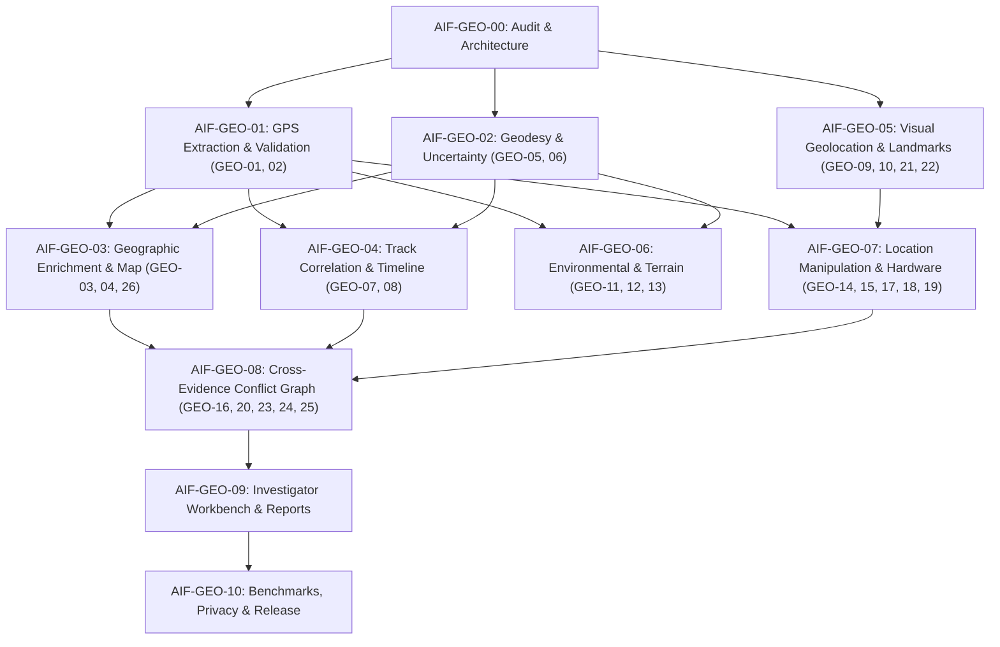

---

### Phase AIF-GEO-00: Repository Audit, Schemas & Geospatial Architecture Baseline
- **Phase Objective:** Audit existing AIF image parsers, CEIPL cryptographic pipelines, and PostgreSQL database schemas; establish the module boundary for `ps05.engines.image.geo`; create canonical Pydantic v2 contracts and define the dependency graph.
- **Topics & Subtopics:**
  - Audit of ExifTool execution wrappers and safe sandboxing (`safe_decode.py`).
  - Spatial database evaluation (PostgreSQL + PostGIS vs relational float fallback).
  - Pydantic v2 contracts for geospatial observations, candidates, and conflict graphs.
  - Air-gap isolation boundary and local-first data store scoping.
- **Exact Engineering Tasks:**
  1. Audit `ps05.engines.image.common` to ensure safe decoding hooks prevent decompression bombs.
  2. Implement `ps05/engines/image/geo/__init__.py` and establish module package architecture.
  3. Define initial Pydantic contracts in `ps05/engines/image/geo/schemas.py`.
  4. Write architectural decision records (ADR) for PostGIS spatial indexing and local SQLite gazetteer caches.
- **Dependencies:** Phase 0 (Architecture Baseline & Standards), AIF-A0 (AIF Architecture Baseline).
- **Recommended Technologies:** Python 3.11/3.12, Pydantic v2, PostgreSQL 15+ / PostGIS 3.3+.
- **Expected Artefacts:** `ps05/engines/image/geo/schemas.py`, `tests/unit/test_geo_schemas.py`.
- **Validation & Testing:** Schema serialization/deserialization tests; PostGIS connection tests (`test_geo_schemas.py`).
- **Failure Modes:** Malformed schemas causing serialization errors; PostGIS extension unavailable on target system (triggers relational float fallback).
- **Security & Privacy:** Enforce extra-field forbidding on Pydantic models; ensure no telemetry or external DNS resolution occurs.
- **Acceptance Criteria:** 100% test pass on Pydantic v2 schema validation; zero cyclic dependencies across `ps05.engines.image`.
- **Definition of Done:** Module scaffold created, contracts validated, ADR documented, and unit test suite passing.
- **Current Status:** `PLANNED` (Architecture and contracts formally specified in TRD Section 10.10 & 12.6).

| Checkpoint ID | Name | Description | Verification Method | Status |
| :--- | :--- | :--- | :--- | :--- |
| **AIF-GEO-00-C1** | Package Scaffold & Directory Tree | Creates `ps05.engines.image.geo` package structure. | Directory inspection & import test | `NOT_STARTED` |
| **AIF-GEO-00-C2** | Pydantic v2 Contract Suite | Implements `GeospatialObservationSchema`, `GeospatialCandidateSchema`. | `pytest tests/unit/test_geo_schemas.py` | `NOT_STARTED` |
| **AIF-GEO-00-C3** | PostGIS & Relational Fallback DDL | Validates DDL migration script with spatial and fallback columns. | Database migration dry-run test | `NOT_STARTED` |
| **AIF-GEO-00-C4** | Air-Gap Environment Audit | Confirms isolation boundary and local SQLite cache directories. | Filesystem & sandbox audit | `NOT_STARTED` |

---

### Phase AIF-GEO-01: Comprehensive GPS Metadata Extraction & Coordinate Validation
- **Phase Objective:** Implement deep metadata extraction across EXIF, XMP, IPTC, and MakerNotes; execute mathematical validation of coordinates, hemisphere signs, rational values, and anomaly detection.
- **Primary Requirements Covered:** GEO-01, GEO-02.
- **Topics & Subtopics:**
  - ExifTool CLI argument array execution under memory caps (`RLIMIT_AS=512MB`).
  - Sexagesimal DMS rational decoding with zero-denominator protection.
  - Coordinate boundary checks ($-90 \le \phi \le 90$, $-180 \le \lambda \le 180$).
  - Anomaly detection: Null Island $(0,0)$, integer truncation, contradictory EXIF vs XMP coordinates, cloned coordinates across exhibits.
- **Exact Engineering Tasks:**
  1. Implement `ps05/engines/image/geo/metadata_parser.py` invoking ExifTool via safe subprocess pipes.
  2. Implement `ps05/engines/image/geo/validator.py` decoding rational triples and hemisphere references.
  3. Implement anomaly detection rules flagging out-of-bounds, default, truncated, and contradictory tags.
  4. Integrate CEIPL raw-byte observation preservation (exact tag names, raw bytes, normalized values).
- **Dependencies:** AIF-GEO-00, AIF-A1 (CEIPL Foundation), AIF-A7 (Metadata Audit Baseline).
- **Recommended Technologies:** ExifTool 12.70+, Python `subprocess`, Pydantic v2.
- **Expected Artefacts:** `ps05/engines/image/geo/metadata_parser.py`, `ps05/engines/image/geo/validator.py`, `tests/unit/test_geo_exif_deep.py`.
- **Validation & Testing:** 200 multi-device sample images with synthetic anomalies (`test_geo_exif_deep.py`, `test_geo_anomalies.py`).
- **Failure Modes:** Corrupt IFD headers; division-by-zero rationals; process timeouts on pathological image headers.
- **Security & Privacy:** Command array execution prevents shell injection; memory limits prevent decompression exploits; input files treated as read-only.
- **Acceptance Criteria:** 100% field extraction recall on standard EXIF 2.32 GPS tags; 100% detection of synthetic coordinate anomalies.
- **Definition of Done:** Metadata extraction and validation engine passing all unit tests with zero unhandled exceptions.
- **Current Status:** `PLANNED` (Technical specification detailed in TRD Section 10.10.1 GEO-01 & GEO-02).

| Checkpoint ID | Name | Description | Verification Method | Status |
| :--- | :--- | :--- | :--- | :--- |
| **AIF-GEO-01-C1** | ExifTool Array Wrapper Harness | Implements sandboxed ExifTool execution with timeout & memory caps. | Process isolation & error test | `NOT_STARTED` |
| **AIF-GEO-01-C2** | DMS-to-Decimal Rational Decoder | Decodes sexagesimal rationals with zero-denominator guards. | Unit tests on rational triples | `NOT_STARTED` |
| **AIF-GEO-01-C3** | Boundary & Hemisphere Validation | Validates geodetic bounds and hemisphere sign inversion. | Edge case tests (Poles, Equator) | `NOT_STARTED` |
| **AIF-GEO-01-C4** | Anomaly & Contradiction Engine | Flags Null Island, integer truncation, and EXIF/XMP tag deltas. | Anomaly detection benchmark | `NOT_STARTED` |

---

### Phase AIF-GEO-02: Geodesy, Uncertainty Propagation & Temporal Semantics
- **Phase Objective:** Implement high-precision geodetic calculations on the WGS84 ellipsoid; establish spatial uncertainty models and propagate error bounds; execute temporal normalization and camera clock drift regression.
- **Primary Requirements Covered:** GEO-05, GEO-06 (and foundations for GEO-07, GEO-08).
- **Topics & Subtopics:**
  - Spherical Haversine screening vs WGS84 Karney ellipsoidal geodesic distance (`pyproj.Geod`).
  - Positional uncertainty propagation ($\sigma_{\text{diff}} = \sqrt{\sigma_1^2 + \sigma_2^2}$) and DOP semantic handling.
  - Multi-field timestamp alignment (`DateTimeOriginal`, `GPSTimeStamp`, `OffsetTimeOriginal`).
  - Linear clock drift regression ($\Delta t(t) = a \cdot t + b$) across multi-image device sequences.
- **Exact Engineering Tasks:**
  1. Implement `ps05/engines/image/geo/geodesy.py` wrapping `pyproj.Geod(ellps='WGS84')` for inverse and direct geodesic problems.
  2. Implement uncertainty modeling extracting `GPSHPositioningError` and estimating HDOP user equivalent range error ($\text{UERE} = 3.5\text{m}$).
  3. Implement temporal normalization engine resolving timezones, UTC conversions, and clock drift.
- **Dependencies:** AIF-GEO-00, AIF-GEO-01.
- **Recommended Technologies:** `pyproj` 3.6+, NumPy, SciPy.
- **Expected Artefacts:** `ps05/engines/image/geo/geodesy.py`, `tests/unit/test_geo_geodesy.py`.
- **Validation & Testing:** National Geodetic Survey (NGS) reference baselines; synthetic clock drift regression fixtures (`test_geo_geodesy.py`, `test_geo_temporal.py`).
- **Failure Modes:** Numerical instability on near-antipodal coordinates; ambiguous local timezones without offset tags.
- **Security & Privacy:** Mathematical operations execute in deterministic memory; no external network calls.
- **Acceptance Criteria:** Geodesic distance calculation error $< 10^{-6}\text{ meters}$ relative to NGS benchmarks; linear clock drift regression recovers synthetic drift rates with $R^2 > 0.98$.
- **Definition of Done:** Geodesy, uncertainty, and temporal alignment algorithms implemented and benchmarked.
- **Current Status:** `PLANNED` (Mathematical formulations detailed in TRD Section 10.10.2).

| Checkpoint ID | Name | Description | Verification Method | Status |
| :--- | :--- | :--- | :--- | :--- |
| **AIF-GEO-02-C1** | Karney WGS84 Geodesic Engine | Implements ellipsoidal geodesic distance & forward/reverse azimuths. | NGS benchmark comparison tests | `NOT_STARTED` |
| **AIF-GEO-02-C2** | Spatial Uncertainty Propagation | Models HPE and propagates standard errors ($\sigma_{\text{diff}}$). | Uncertainty propagation tests | `NOT_STARTED` |
| **AIF-GEO-02-C3** | Multi-Source Timestamp Parser | Normalizes UTC instants and resolves timezone offsets. | Timezone ambiguity test suite | `NOT_STARTED` |
| **AIF-GEO-02-C4** | Camera Clock Drift Regressor | Computes linear clock drift rate $a$ and baseline offset $b$. | Regression tests on multi-photo logs | `NOT_STARTED` |

---

### Phase AIF-GEO-03: Geographic Place Enrichment & Offline Map Interface
- **Phase Objective:** Build local gazetteer and administrative boundary resolution; provide controlled, rate-limited online reverse-geocoding adapters; generate interactive MapLibre GL JS / Leaflet vector layers and enforce air-gapped isolation.
- **Primary Requirements Covered:** GEO-03, GEO-04, GEO-26.
- **Topics & Subtopics:**
  - Local SQLite gazetteer resolution (GeoNames + Bihar Police administrative boundaries).
  - Controlled online enrichment adapter (Nominatim / Pelias) with strict query minimization.
  - GeoJSON FeatureCollection generation with distinct marker taxonomy.
  - Offline vector tile bundling (`.mbtiles`) and kernel-level network isolation verification.
- **Exact Engineering Tasks:**
  1. Implement `ps05/engines/image/geo/geocoder.py` supporting SQLite local store and rate-limited HTTP adapter.
  2. Implement `ps05/engines/image/geo/map_interface.py` transforming findings into standardized GeoJSON layers.
  3. Pre-seed local database with Bihar administrative boundaries and police station jurisdictions.
  4. Write network isolation test suite verifying zero socket emissions in air-gap mode.
- **Dependencies:** AIF-GEO-01, AIF-GEO-02.
- **Recommended Technologies:** SQLite, `shapely`, `geopandas`, MapLibre GL JS, Leaflet.
- **Expected Artefacts:** `ps05/engines/image/geo/geocoder.py`, `ps05/engines/image/geo/map_interface.py`, `tests/integration/test_geo_airgap_isolation.py`.
- **Validation & Testing:** Offline reverse geocoding accuracy tests; packet capture network isolation verification (`test_geo_airgap_isolation.py`).
- **Failure Modes:** Local gazetteer missing rural village names; external API rate limit exhaustion (gracefully caught with offline fallback).
- **Security & Privacy:** Strictly prohibit transmission of image pixels; query coordinates truncated to 4 decimal places; append-only audit logging for external queries.
- **Acceptance Criteria:** Local reverse geocoding resolves $> 95\%$ of Bihar district/taluk headquarters in offline mode; zero outbound packets emitted during air-gap test.
- **Definition of Done:** Geocoding engine and map generation layer functioning offline with audited fallback paths.
- **Current Status:** `PLANNED` (Architecture specified in TRD Section 10.10.1 & 10.10.4).

| Checkpoint ID | Name | Description | Verification Method | Status |
| :--- | :--- | :--- | :--- | :--- |
| **AIF-GEO-03-C1** | Local SQLite Gazetteer Engine | Resolves coordinates to Bihar administrative hierarchy offline. | Offline address resolution test | `NOT_STARTED` |
| **AIF-GEO-03-C2** | Controlled Online Provider Adapter | Rate-limited Nominatim adapter with query minimization & audit. | Mock HTTP provider & audit test | `NOT_STARTED` |
| **AIF-GEO-03-C3** | GeoJSON Map Layer Generator | Generates styled GeoJSON FeatureCollections for MapLibre/Leaflet. | GeoJSON schema validation test | `NOT_STARTED` |
| **AIF-GEO-03-C4** | Air-Gap Network Isolation Audit | Verifies zero outbound network packets emitted in offline mode. | Automated `tcpdump` socket auditor | `NOT_STARTED` |

---

### Phase AIF-GEO-04: GPS Track Correlation, Telemetry & Movement Plausibility
- **Phase Objective:** Ingest independently seized GPS tracks (GPX, KML, NMEA, FIT, CSV); perform temporal synchronization and geodesic linear interpolation; execute kinematic velocity gating and Kalman filter trajectory smoothing.
- **Primary Requirements Covered:** GEO-07, GEO-08.
- **Topics & Subtopics:**
  - Multi-format track parsing (GPX XML, KML, NMEA 0183 sentences, FIT binary, CSV).
  - Geodesic linear interpolation with strict non-extrapolation boundary enforcement.
  - Multi-tier velocity gating ($v_{\text{avg}} = d / \Delta t$) for pedestrian, vehicular, and flight speeds.
  - Linear Kalman filter trajectory smoothing for noisy multi-point tracks.
- **Exact Engineering Tasks:**
  1. Implement `ps05/engines/image/geo/track_correlator.py` parsing GPX, KML, NMEA, FIT, and CSV telemetry logs.
  2. Implement temporal interpolation locating track bounding samples and computing intermediate coordinates.
  3. Implement kinematic gating flagging teleportation anomalies ($v > 260\text{ m/s}$).
  4. Implement discrete linear Kalman filter state estimation for track sequences.
- **Dependencies:** AIF-GEO-01, AIF-GEO-02.
- **Recommended Technologies:** `gpxpy`, `pyproj`, NumPy, SciPy.
- **Expected Artefacts:** `ps05/engines/image/geo/track_correlator.py`, `tests/unit/test_geo_tracks.py`.
- **Validation & Testing:** Track correlation test suite with known offsets, sparse points, and synthetic teleportations (`test_geo_tracks.py`).
- **Failure Modes:** Malformed XML in GPX; non-monotonic track timestamps; tracks with temporal gaps exceeding interpolation limits.
- **Security & Privacy:** Track files parsed in isolated memory; never extrapolate beyond track bounds.
- **Acceptance Criteria:** 100% detection of synthetic teleportation anomalies; non-extrapolation invariant verified when photo timestamp is outside track duration.
- **Definition of Done:** Track correlation engine tested and integrated with case exhibit management.
- **Current Status:** `PLANNED` (Mathematical derivations in TRD Section 10.10.2).

| Checkpoint ID | Name | Description | Verification Method | Status |
| :--- | :--- | :--- | :--- | :--- |
| **AIF-GEO-04-C1** | Multi-Format Track Parser | Parses GPX, KML, NMEA 0183, FIT, and CSV track files safely. | Multi-format parser test suite | `NOT_STARTED` |
| **AIF-GEO-04-C2** | Geodesic Linear Interpolator | Interpolates image coordinates along track with boundary checks. | Interpolation accuracy tests | `NOT_STARTED` |
| **AIF-GEO-04-C3** | Kinematic Velocity Gating | Flags implausible velocities across chronologically ordered exhibits. | Teleportation detection suite | `NOT_STARTED` |
| **AIF-GEO-04-C4** | Kalman Filter Track Smoother | Applies discrete linear Kalman filter to filter GPS measurement noise. | Noise reduction evaluation | `NOT_STARTED` |

---

### Phase AIF-GEO-05: Visual Geolocation, Landmark Matching & Geometric Homography
- **Phase Objective:** Extract visual location clues (OCR road signs, town names, milestones) when GPS metadata is missing; compute visual embeddings and rank regional candidate locations; execute SIFT/ORB feature matching and RANSAC homography against reference orthophotos.
- **Primary Requirements Covered:** GEO-09, GEO-10, GEO-21, GEO-22.
- **Topics & Subtopics:**
  - Multilingual PaddleOCR extraction of signboards, highway markers, and milestone text (Hindi, English, Bengali, Urdu).
  - Scene classification and SigLIP feature embedding retrieval.
  - Multi-granularity candidate ranking (`COUNTRY`, `STATE`, `DISTRICT`, `CITY`, `LOCALITY`).
  - Projective homography ($\mathbf{x}' \sim H \mathbf{x}$) and RANSAC geometric verification against reference photos/satellite imagery.
  - Camera compass heading validation with World Magnetic Model (WMM) declination correction.
- **Exact Engineering Tasks:**
  1. Implement `ps05/engines/image/geo/visual_locator.py` integrating OCR clues with local gazetteer retrieval.
  2. Implement candidate ranking cascade producing Top-5 candidate regions with explicit uncertainty bounds.
  3. Implement `ps05/engines/image/geo/orientation.py` computing circular angular differences and SIFT/RANSAC homographies.
  4. Benchmark GeoCLIP / regional models (classified as `CANDIDATE_NOT_YET_VALIDATED` pending Indian regional evaluation).
- **Dependencies:** AIF-GEO-00, AIF-A4 (Object Detection), AIF-A6 (PaddleOCR Baseline), AIF-A8 (SIFT/RANSAC Baseline).
- **Recommended Technologies:** OpenCV 4.9+, PaddleOCR, SigLIP / CLIP, `pyproj`.
- **Expected Artefacts:** `ps05/engines/image/geo/visual_locator.py`, `ps05/engines/image/geo/orientation.py`, `tests/benchmarks/test_geo_visual_loc.py`.
- **Validation & Testing:** 150-sample curated Bihar landmark benchmark; synthetic affine homography test set (`test_geo_visual_loc.py`, `test_geo_homography.py`).
- **Failure Modes:** Low-resolution unreadable signboards; visually repetitive architectural styles (e.g. generic retail storefronts); severe perspective distortion.
- **Security & Privacy:** Local offline inference; no raw images sent to cloud vision APIs; candidate scores reported as uncalibrated ranks unless benchmark-calibrated.
- **Acceptance Criteria:** True landmark contained in Top-5 candidates for $\ge 80\%$ of recognizable landmark test images; RANSAC homography detects valid planar alignment with $\ge 25$ inliers.
- **Definition of Done:** Visual clue extraction, candidate ranking, and geometric verification operational and benchmarked.
- **Current Status:** `PLANNED` (Methodology specified in TRD Section 10.10.1 & 10.10.2).

| Checkpoint ID | Name | Description | Verification Method | Status |
| :--- | :--- | :--- | :--- | :--- |
| **AIF-GEO-05-C1** | Multilingual Signboard OCR Pipeline | Extracts text from road signs and milestones via PaddleOCR. | OCR text extraction benchmark | `NOT_STARTED` |
| **AIF-GEO-05-C2** | Hierarchical Candidate Ranker | Generates ranked candidate regions from OCR tokens and embeddings. | Top-$k$ candidate accuracy eval | `NOT_STARTED` |
| **AIF-GEO-05-C3** | SIFT/ORB + RANSAC Homography | Computes 2D projective homography against reference orthophotos. | Homography alignment test suite | `NOT_STARTED` |
| **AIF-GEO-05-C4** | Camera Heading & WMM Declination | Compares compass heading to landmark bearing with WMM correction. | Circular angular separation test | `NOT_STARTED` |

---

### Phase AIF-GEO-06: Environmental, Astrometric & Topographic Consistency
- **Phase Objective:** Validate physical consistency between candidate location/time and environmental evidence: compute astronomical solar position and cast shadow geometry; retrieve historical weather reanalysis; correlate GPS altitude with DEM terrain rasters.
- **Primary Requirements Covered:** GEO-11, GEO-12, GEO-13.
- **Topics & Subtopics:**
  - NOAA astronomical solar elevation ($\alpha$) and azimuth ($\gamma_s$) calculation.
  - Gnomon cast shadow geometry ($\tan\alpha \approx h / L$) and inconclusive condition taxonomy.
  - Historical weather reanalysis interface (Open-Meteo Historical API & local ERA5 NetCDF cache).
  - Digital Elevation Model (DEM) sampling via `rasterio` and EGM2008 geoid undulation ($h = H + N$).
- **Exact Engineering Tasks:**
  1. Implement `ps05/engines/image/geo/environment.py` executing NOAA solar vector calculations and shadow checks.
  2. Implement weather reanalysis query adapter with local ERA5 cache and cloud-cover cross-checks.
  3. Implement DEM raster sampling extracting Copernicus GLO-30 ground elevations and computing geoid undulation offsets.
  4. Implement classification logic for inconclusive solar/weather conditions (night, diffuse lighting, elevated bridges).
- **Dependencies:** AIF-GEO-01, AIF-GEO-02, AIF-A3 (Scene Triage).
- **Recommended Technologies:** `pvlib-python`, `rasterio` (GDAL), `xarray` / `netcdf4`, `pyproj`.
- **Expected Artefacts:** `ps05/engines/image/geo/environment.py`, `tests/unit/test_geo_solar_shadow.py`, `tests/unit/test_geo_terrain_elevation.py`.
- **Validation & Testing:** USNO solar table comparison across 500 coordinates; SRTM/Copernicus elevation ground-truth tests (`test_geo_solar_shadow.py`, `test_geo_terrain_elevation.py`).
- **Failure Modes:** Night captures or diffuse overcast lighting (correctly tagged `SOLAR_ANALYSIS_INCONCLUSIVE`); photos taken inside high-rise buildings exceeding DEM terrain height.
- **Security & Privacy:** Solar and elevation calculations operate 100% offline; weather reanalysis uses local historical cache by default.
- **Acceptance Criteria:** Solar angle error $< 0.05^\circ$ relative to NOAA reference tables; elevation engine applies $h = H + N$ geoid correction with sub-meter accuracy.
- **Definition of Done:** Astrometric solar, historical weather, and topographic terrain modules validated against ground-truth datasets.
- **Current Status:** `PLANNED` (Formulas and parameters detailed in TRD Section 10.10.2).

| Checkpoint ID | Name | Description | Verification Method | Status |
| :--- | :--- | :--- | :--- | :--- |
| **AIF-GEO-06-C1** | NOAA Solar Vector & Elevation Engine | Calculates astronomical solar elevation and azimuth for coordinates/time. | NOAA reference comparison test | `NOT_STARTED` |
| **AIF-GEO-06-C2** | Cast Shadow Consistency Verifier | Verifies $\tan\alpha \approx h/L$ and shadow azimuth with inconclusive handling. | Shadow geometry test suite | `NOT_STARTED` |
| **AIF-GEO-06-C3** | Historical Weather Reanalysis Adapter | Retrieves temperature, precipitation, and cloud cover from ERA5 cache. | Weather consistency unit tests | `NOT_STARTED` |
| **AIF-GEO-06-C4** | DEM Raster & Geoid Undulation Engine | Samples Copernicus 30m DEM and computes $h = H + N$ geoid corrections. | Topographic elevation test suite | `NOT_STARTED` |

---

### Phase AIF-GEO-07: Location Manipulation, Duplicate Discovery & Hardware Consistency
- **Phase Objective:** Synthesize metadata anomalies and physical contradictions into typed manipulation findings; detect near-duplicate scenes across transformations; audit camera hardware consistency and evaluate PRNU sensor noise.
- **Primary Requirements Covered:** GEO-14, GEO-15, GEO-17, GEO-18, GEO-19.
- **Topics & Subtopics:**
  - EXIF-to-visual semantic consistency (e.g. marine ocean image with inland GPS coordinates).
  - Screen recapture and poster detection (preventing photos of display monitors from being localized).
  - Multi-tier near-duplicate discovery (SHA-256 byte identity, pHash, SigLIP embeddings, RANSAC homography).
  - Camera hardware consistency (MakerNotes, lens model, serial number hashes, quantization matrix clustering).
  - PRNU sensor pattern noise correlation (classified as `RESEARCH_CANDIDATE`).
- **Exact Engineering Tasks:**
  1. Implement `ps05/engines/image/geo/manipulation.py` synthesizing metadata, timing, and environmental contradictions into forensic findings.
  2. Implement semantic sanity checks cross-referencing extracted coordinates against global landcover maps.
  3. Implement `ps05/engines/image/geo/clustering.py` for near-duplicate scene retrieval across crops and recompression.
  4. Implement `ps05/engines/image/geo/provenance.py` auditing camera serials and executing PRNU wavelet denoising.
- **Dependencies:** AIF-GEO-01, AIF-GEO-02, AIF-GEO-05, AIF-A7 (Metadata Audit), AIF-A9 (CMFD & PRNU Baseline).
- **Recommended Technologies:** OpenCV 4.9+, `imagehash`, PyTorch, SciPy.
- **Expected Artefacts:** `ps05/engines/image/geo/manipulation.py`, `ps05/engines/image/geo/clustering.py`, `ps05/engines/image/geo/provenance.py`.
- **Validation & Testing:** Curated location-spoofed test corpus; duplicate discovery benchmark on transformed images (`test_geo_manipulation_flags.py`, `test_geo_duplicate_scenes.py`).
- **Failure Modes:** Legitimate photos of remote travel posters (detected via moiré analysis); social-media recompression destroying PRNU sensor noise.
- **Security & Privacy:** Typed findings clearly distinguish anomalous metadata from deliberate fraud; no uncalibrated claims of guilt.
- **Acceptance Criteria:** Detects 100% of injected coordinate contradictions; achieves $> 95\%$ recall on cropped and recompressed duplicate scenes.
- **Definition of Done:** Manipulation detection, duplicate retrieval, and camera consistency engines validated.
- **Current Status:** `PLANNED` (Functional requirements specified in TRD Section 10.10.1).

| Checkpoint ID | Name | Description | Verification Method | Status |
| :--- | :--- | :--- | :--- | :--- |
| **AIF-GEO-07-C1** | Typed Location Manipulation Engine | Generates structured findings for coordinate spoofing and teleportation. | Manipulation flag test suite | `NOT_STARTED` |
| **AIF-GEO-07-C2** | EXIF-to-Visual Semantic Checker | Flags marine vs inland and left-hand vs right-hand drive mismatches. | Semantic sanity benchmark | `NOT_STARTED` |
| **AIF-GEO-07-C3** | Multi-Tier Near-Duplicate Finder | Discovers resized, cropped, and recompressed same-scene exhibits. | Duplicate image discovery test | `NOT_STARTED` |
| **AIF-GEO-07-C4** | Hardware & PRNU Sensor Profiler | Audits camera serials, quantization tables, and PRNU noise residuals. | Camera consistency test suite | `NOT_STARTED` |

---

### Phase AIF-GEO-08: Cross-Evidence Spatio-Temporal Graph & Provenance Verification
- **Phase Objective:** Construct formal directed location conflict graphs; validate C2PA Content Credentials provenance; execute multi-image DBSCAN spatio-temporal clustering; execute sub-second PostGIS spatial searches.
- **Primary Requirements Covered:** GEO-16, GEO-20, GEO-23, GEO-24, GEO-25.
- **Topics & Subtopics:**
  - C2PA Content Credentials JUMBF parser, COSE signature check, and location assertion validation.
  - Inter-subsystem bridges linking image coordinates to VISTA CCTV feeds and AURAS audio timestamps.
  - Spatio-temporal DBSCAN clustering with Karney geodesic metric ($\epsilon = 500\text{m}, \Delta t = 2\text{h}$).
  - Directed Evidence Graph construction (`EvidenceNode`, `ObservationNode`, `CoordinateNode`, `FindingNode`).
  - PostGIS spatial indexing (`ST_DWithin`, `ST_Within`, `ST_Intersects`) with case-isolated Row-Level Security.
- **Exact Engineering Tasks:**
  1. Implement `ps05/engines/image/geo/provenance.py` validating C2PA manifests via `c2pa-python`.
  2. Implement `ps05/engines/image/geo/conflict_graph.py` constructing NetworkX directed graphs and exporting Archify JSON IR.
  3. Implement DBSCAN spatio-temporal clustering grouping exhibits into geographic stops and isolating noise points.
  4. Implement spatial search query builder executing parameterized PostGIS queries with RLS case boundaries.
- **Dependencies:** AIF-GEO-01, AIF-GEO-03, AIF-GEO-04, AIF-GEO-07, CEIPL (AIF-A13).
- **Recommended Technologies:** `c2pa-python`, `networkx`, PostGIS, SQLAlchemy 2.0.
- **Expected Artefacts:** `ps05/engines/image/geo/conflict_graph.py`, `tests/integration/test_geo_conflict_graph.py`, `tests/integration/test_geo_spatial_search.py`.
- **Validation & Testing:** Multi-camera case clustering tests; C2PA signature validation suite; PostGIS query performance benchmark (`test_geo_c2pa_provenance.py`, `test_geo_conflict_graph.py`).
- **Failure Modes:** Untrusted C2PA certificate roots; complex graph cycles with circular contradictions; query timeouts on massive unindexed spatial tables.
- **Security & Privacy:** Enforce strict case-level authorization on all spatial queries; do not leak exhibits across unauthorized case boundaries.
- **Acceptance Criteria:** C2PA verifier validates authentic manifests and rejects tampered bitstreams; spatial queries return in $< 200\text{ ms}$ over 50,000 indexed records; conflict graph cleanly exposes contradictory claims.
- **Definition of Done:** Provenance verifier, conflict graph builder, spatial clusterer, and search engine fully tested.
- **Current Status:** `PLANNED` (Graph schema and spatial DDL specified in TRD Section 4.4 & 10.10.1).

| Checkpoint ID | Name | Description | Verification Method | Status |
| :--- | :--- | :--- | :--- | :--- |
| **AIF-GEO-08-C1** | C2PA Content Credentials Verifier | Validates JUMBF manifest, COSE signatures, and signed location claims. | C2PA signature validation suite | `NOT_STARTED` |
| **AIF-GEO-08-C2** | Spatio-Temporal DBSCAN Clusterer | Groups exhibits within 500m and 2 hours; isolates unlocated items. | Multi-image clustering test | `NOT_STARTED` |
| **AIF-GEO-08-C3** | Location-Claim Conflict Graph | Builds typed directed evidence graph and exports Archify JSON IR. | Conflict graph traversal tests | `NOT_STARTED` |
| **AIF-GEO-08-C4** | PostGIS Evidence Search Engine | Executes case-isolated spatial queries with sub-second response times. | Spatial query performance test | `NOT_STARTED` |

---

### Phase AIF-GEO-09: Investigator Geospatial Workbench & Reporting Integration
- **Phase Objective:** Integrate the complete geospatial evidence workspace into the forensic dashboard; provide synchronized map-timeline views and evidence drill-down; compile court-admissible Section 65B/63 BSA certified PDF reports and Archify JSON IR manifests.
- **Primary Requirements Covered:** GEO-04 (UI Workbench), GEO-24 (Graph Viewer), Reporting Contracts.
- **Topics & Subtopics:**
  - Frontend geospatial workbench (original image viewer, metadata panel, interactive map, candidate ranking, conflict graph).
  - Synchronized temporal timeline and confidence-coded marker overlays.
  - Jinja2 HTML/CSS legal report template compilation with WeasyPrint.
  - Archify JSON IR serializer for geospatial observations, trajectories, and evidentiary findings.
- **Exact Engineering Tasks:**
  1. Implement FastAPI API endpoints in `ps05/api/v1/geo.py` serving observations, candidates, tracks, and map GeoJSON.
  2. Implement Jinja2 template `ps05/reporting/templates/geospatial_section.html` formatting geospatial findings for legal PDF output.
  3. Implement Archify JSON IR formatting in `ps05/reporting/archify_adapter.py`.
  4. Integrate reviewer disposition workflow allowing investigators to accept, reject, or mark findings as inconclusive.
- **Dependencies:** AIF-GEO-03, AIF-GEO-08, AIF-A14 (Reporting Baseline).
- **Recommended Technologies:** FastAPI, Jinja2, WeasyPrint, Archify IR, MapLibre GL JS.
- **Expected Artefacts:** `src/ps05/api/v1/geo.py`, `src/ps05/reporting/templates/geospatial_section.html`, `tests/integration/test_geo_reporting.py`.
- **Validation & Testing:** End-to-end report generation test; Section 65B legal compliance audit; Archify JSON IR validation (`test_geo_reporting.py`).
- **Failure Modes:** WeasyPrint PDF layout overflow on long coordinate lists; missing thumbnail derivatives during PDF compilation.
- **Security & Privacy:** Redact private coordinates from public-facing report summaries unless explicitly certified by investigator; verify digital signature sealing on output PDFs.
- **Acceptance Criteria:** Generates Section 65B IEA / Section 63 BSA certified PDF report containing full geospatial findings, hashes, and uncertainty statements in $< 5\text{ seconds}$; Archify JSON IR validates against schema.
- **Definition of Done:** Geospatial API endpoints and legal reporting pipeline operational, tested, and certified.
- **Current Status:** `PLANNED` (Reporting contracts specified in TRD Section 12.6 & 14).

| Checkpoint ID | Name | Description | Verification Method | Status |
| :--- | :--- | :--- | :--- | :--- |
| **AIF-GEO-09-C1** | Geospatial REST API Endpoints | Serves observations, candidate locations, tracks, and GeoJSON layers. | FastAPI route integration tests | `NOT_STARTED` |
| **AIF-GEO-09-C2** | Archify Geospatial JSON IR Adapter | Serializes observations, candidates, and conflict graphs to Archify IR. | Archify schema validator test | `NOT_STARTED` |
| **AIF-GEO-09-C3** | Section 65B/63 BSA PDF Compiler | Compiles court-admissible PDF report with maps, hashes, and findings. | WeasyPrint compilation audit | `NOT_STARTED` |
| **AIF-GEO-09-C4** | Investigator Disposition Workflow | Supports review dispositions (`ACCEPTED`, `REJECTED`, `INCONCLUSIVE`). | Review state lifecycle test | `NOT_STARTED` |

---

### Phase AIF-GEO-10: Benchmarking, Privacy Audit, Security Hardening & Release
- **Phase Objective:** Execute full-system validation across curated multi-camera corpora; conduct strict air-gap and privacy audits; verify deterministic reproducible execution; compile technical documentation and release gate package.
- **Primary Requirements Covered:** All GEO-01 through GEO-26 capabilities, System Invariants.
- **Topics & Subtopics:**
  - Multi-camera benchmark corpus validation (200 diverse mobile/camera exhibits).
  - Kernel-level air-gap packet audit verifying zero unauthorized outbound socket connections.
  - Multi-tenant case data isolation audit (PostgreSQL Row-Level Security verification).
  - 5-run determinism verification (bit-identical outputs for non-ML algorithms; stable ranking for ML models).
- **Exact Engineering Tasks:**
  1. Execute comprehensive automated regression suite across all 10 preceding AIF-GEO phases.
  2. Conduct privacy audit verifying that uploaded image pixels and private coordinates are never leaked in application logs.
  3. Validate deterministic execution across repeated runs with identical random seeds.
  4. Perform documentation parity audit ensuring complete consistency across README, PRD, TRD, and PHASES.
- **Dependencies:** AIF-GEO-01 through AIF-GEO-09.
- **Recommended Technologies:** `pytest`, `pytest-cov`, `tcpdump`, Docker isolated network namespace.
- **Expected Artefacts:** `tests/benchmarks/benchmark_geo_full.py`, `docs/audits/aif_geo_release_audit.md`.
- **Validation & Testing:** Full test suite execution with code coverage $\ge 90\%$; packet capture log audit; determinism verification.
- **Failure Modes:** Memory leaks during batch processing of 1,000+ case exhibits; non-deterministic candidate ranking across runs.
- **Security & Privacy:** Complete verification of all 8 Geospatial Security Invariants defined in TRD Section 15.3.
- **Acceptance Criteria:** 100% of unit and integration tests pass; zero network leaks detected in air-gapped run; release gate signed off by Lead Forensics Architect.
- **Definition of Done:** All 26 capabilities verified, benchmarks documented, privacy audits signed off, and release tag applied.
- **Current Status:** `PLANNED` (Verification criteria defined in TRD Section 13.4).

| Checkpoint ID | Name | Description | Verification Method | Status |
| :--- | :--- | :--- | :--- | :--- |
| **AIF-GEO-10-C1** | Full-System Regression & Coverage | Executes complete test suite across all 26 geospatial capabilities. | `pytest tests/ --cov=ps05.engines.image.geo` | `NOT_STARTED` |
| **AIF-GEO-10-C2** | Air-Gap & Privacy Leak Audit | Verifies zero network emissions and zero coordinate leakage in logs. | Packet capture log & log audit | `NOT_STARTED` |
| **AIF-GEO-10-C3** | 5-Run Determinism Benchmark | Verifies identical output hashes across repeated analysis runs. | Hash comparison across 5 runs | `NOT_STARTED` |
| **AIF-GEO-10-C4** | Documentation & Release Gate Package | Validates parity across README, PRD, TRD, and PHASES. | Documentation consistency check | `NOT_STARTED` |

---

### Master Checkpoint Traceability Matrix (GEO-01 through GEO-26)

This table provides authoritative, bidirectional traceability linking every stable functional requirement (`GEO-01` through `GEO-26`) to its governing PRD product requirement, TRD technical specification, engineering phase, implementation checkpoint, required validation evidence, current status, and outstanding dependencies:

| Capability ID | Capability Name | PRD Section | TRD Section | Phase ID | Checkpoint ID | Required Validation Evidence | Current Status | Outstanding Dependency |
| :--- | :--- | :--- | :--- | :--- | :--- | :--- | :--- | :--- |
| **GEO-01** | Comprehensive GPS Metadata Extraction | PRD §6.6 GEO-01 | TRD §10.10.1 GEO-01 | AIF-GEO-01 | AIF-GEO-01-C1, C2 | ExifTool deep extraction test on 200 diverse device exhibits (`test_geo_exif_deep.py`). | `PLANNED` | Phase 0 Gate, AIF-A1 |
| **GEO-02** | Coordinate Validity & Anomaly Checks | PRD §6.6 GEO-02 | TRD §10.10.1 GEO-02 | AIF-GEO-01 | AIF-GEO-01-C3, C4 | Anomaly detection test on synthetic out-of-bounds, Null Island, and truncated coords. | `PLANNED` | AIF-GEO-01-C2 |
| **GEO-03** | Reverse Geocoding & Place Enrichment | PRD §6.6 GEO-03 | TRD §10.10.1 GEO-03 | AIF-GEO-03 | AIF-GEO-03-C1, C2 | Offline reverse geocoding test on Bihar administrative boundary dataset. | `PLANNED` | AIF-GEO-01 Gate |
| **GEO-04** | Interactive Geospatial Evidence Map | PRD §6.6 GEO-04 | TRD §10.10.1 GEO-04 | AIF-GEO-03 | AIF-GEO-03-C3 | GeoJSON FeatureCollection schema validation and MapLibre tile layer test. | `PLANNED` | AIF-GEO-03-C1 |
| **GEO-05** | Capture-Time & GPS-Time Consistency | PRD §6.6 GEO-05 | TRD §10.10.1 GEO-05 | AIF-GEO-02 | AIF-GEO-02-C3, C4 | Linear clock drift regression test on multi-photo camera sequences. | `PLANNED` | AIF-GEO-01 Gate |
| **GEO-06** | Accuracy & Uncertainty Representation | PRD §6.6 GEO-06 | TRD §10.10.1 GEO-06 | AIF-GEO-02 | AIF-GEO-02-C2 | Uncertainty propagation test ($\sigma_{\text{diff}}$) and DOP semantic handling test. | `PLANNED` | AIF-GEO-02-C1 |
| **GEO-07** | Cross-Image Timeline Reconstruction | PRD §6.6 GEO-07 | TRD §10.10.1 GEO-07 | AIF-GEO-04 | AIF-GEO-04-C3, C4 | Kinematic velocity gating and Kalman filter trajectory smoothing benchmark. | `PLANNED` | AIF-GEO-02 Gate |
| **GEO-08** | External Track & Telemetry Correlation | PRD §6.6 GEO-08 | TRD §10.10.1 GEO-08 | AIF-GEO-04 | AIF-GEO-04-C1, C2 | Multi-format track parser and geodesic interpolation non-extrapolation test. | `PLANNED` | AIF-GEO-02 Gate |
| **GEO-09** | Visual Location Recovery Without GPS | PRD §6.6 GEO-09 | TRD §10.10.1 GEO-09 | AIF-GEO-05 | AIF-GEO-05-C1, C2 | PaddleOCR signboard extraction and regional candidate ranking benchmark. | `PLANNED` | AIF-A6 Gate |
| **GEO-10** | Direction & Landmark Geometry | PRD §6.6 GEO-10 | TRD §10.10.1 GEO-10 | AIF-GEO-05 | AIF-GEO-05-C4 | Circular angular difference and World Magnetic Model declination correction test. | `PLANNED` | AIF-GEO-01 Gate |
| **GEO-11** | Solar Position & Shadow Consistency | PRD §6.6 GEO-11 | TRD §10.10.1 GEO-11 | AIF-GEO-06 | AIF-GEO-06-C1, C2 | NOAA solar azimuth/elevation calculation against USNO reference tables. | `PLANNED` | AIF-GEO-02 Gate |
| **GEO-12** | Historical Weather Context | PRD §6.6 GEO-12 | TRD §10.10.1 GEO-12 | AIF-GEO-06 | AIF-GEO-06-C3 | Historical weather retrieval test from local ERA5 cache and Open-Meteo adapter. | `PLANNED` | AIF-GEO-02 Gate |
| **GEO-13** | Elevation & Terrain Correlation | PRD §6.6 GEO-13 | TRD §10.10.1 GEO-13 | AIF-GEO-06 | AIF-GEO-06-C4 | Copernicus 30m DEM sampling and $h = H + N$ geoid undulation test. | `PLANNED` | AIF-GEO-01 Gate |
| **GEO-14** | GPS Manipulation Indicators | PRD §6.6 GEO-14 | TRD §10.10.1 GEO-14 | AIF-GEO-07 | AIF-GEO-07-C1 | Location manipulation test on curated spoofed metadata and teleportation set. | `PLANNED` | AIF-GEO-01, 04 |
| **GEO-15** | EXIF-to-Visual Content Consistency | PRD §6.6 GEO-15 | TRD §10.10.1 GEO-15 | AIF-GEO-07 | AIF-GEO-07-C2 | Semantic environmental consistency test (e.g. marine ocean image with inland GPS). | `PLANNED` | AIF-A3 Gate |
| **GEO-16** | Cross-Evidence Geospatial Correlation | PRD §6.6 GEO-16 | TRD §10.10.1 GEO-16 | AIF-GEO-08 | AIF-GEO-08-C3 | Inter-subsystem linking test connecting AIF photos to VISTA CCTV and AURAS audio. | `PLANNED` | AIF-GEO-04, VISTA-A8 |
| **GEO-17** | Near-Duplicate & Same-Scene Discovery | PRD §6.6 GEO-17 | TRD §10.10.1 GEO-17 | AIF-GEO-07 | AIF-GEO-07-C3 | Duplicate image discovery test on transformed (cropped/recompressed) corpus. | `PLANNED` | AIF-A8 Gate |
| **GEO-18** | Camera & Device Hardware Consistency | PRD §6.6 GEO-18 | TRD §10.10.1 GEO-18 | AIF-GEO-07 | AIF-GEO-07-C4 | Hardware signature and quantization table clustering audit test. | `PLANNED` | AIF-A7 Gate |
| **GEO-19** | Sensor PRNU Correlation (Research) | PRD §6.6 GEO-19 | TRD §10.10.1 GEO-19 | AIF-GEO-07 | AIF-GEO-07-C4 | PRNU sensor noise residual correlation test on reference camera flat-fields. | `PLANNED` | AIF-A9 Gate |
| **GEO-20** | Signed Provenance & C2PA Verification | PRD §6.6 GEO-20 | TRD §10.10.1 GEO-20 | AIF-GEO-08 | AIF-GEO-08-C1 | C2PA Content Credentials signature and location assertion validation test. | `PLANNED` | CEIPL (AIF-A13) |
| **GEO-21** | Map & Satellite-Image Comparison | PRD §6.6 GEO-21 | TRD §10.10.1 GEO-21 | AIF-GEO-05 | AIF-GEO-05-C3 | SIFT/RANSAC homography alignment test against satellite orthophoto tiles. | `PLANNED` | AIF-A8 Gate |
| **GEO-22** | Landmark & Point-of-Interest Ranking | PRD §6.6 GEO-22 | TRD §10.10.1 GEO-22 | AIF-GEO-05 | AIF-GEO-05-C2 | Landmark candidate retrieval benchmark on 150 curated Bihar heritage sites. | `PLANNED` | AIF-GEO-05-C1 |
| **GEO-23** | Multi-Image Geospatial Clustering | PRD §6.6 GEO-23 | TRD §10.10.1 GEO-23 | AIF-GEO-08 | AIF-GEO-08-C2 | Spatio-temporal DBSCAN clustering test on multi-camera case collections. | `PLANNED` | AIF-GEO-02 Gate |
| **GEO-24** | Location-Claim Conflict Graph | PRD §6.6 GEO-24 | TRD §10.10.1 GEO-24 | AIF-GEO-08 | AIF-GEO-08-C3 | Directed evidence conflict graph construction and Archify JSON export test. | `PLANNED` | AIF-GEO-07 Gate |
| **GEO-25** | Evidence-Aware Geospatial Search | PRD §6.6 GEO-25 | TRD §10.10.1 GEO-25 | AIF-GEO-08 | AIF-GEO-08-C4 | PostGIS spatial query performance test on 50,000 indexed evidence records. | `PLANNED` | AIF-GEO-03 Gate |
| **GEO-26** | Offline Geographic Intelligence | PRD §6.6 GEO-26 | TRD §10.10.1 GEO-26 | AIF-GEO-03 | AIF-GEO-03-C4 | Air-gap network isolation test using packet capture socket auditor. | `PLANNED` | AIF-GEO-00 Gate |

---

## 7. Dedicated Offline Network Traffic Forensics Engineering Playbook (ONTF-A0 through ONTF-A13)

The Offline Network Traffic Forensics (ONTF) engineering roadmap defines fourteen sequential, rigorous, and cryptographically grounded implementation phases for seized packet captures (`.pcap`, `.pcapng`). Each phase provides an exhaustive engineering specification with verifiable completion criteria and independent 5-column checkpoint tables conforming strictly to Indian evidentiary standards under Section 65B of the Indian Evidence Act (IEA) and Section 63 of the Bharatiya Sakshya Adhiniyam (BSA 2023):

---

### Phase ONTF-A0: Network Architecture Baseline & Sandbox Execution Harness

**1. Phase ID & Title:** `ONTF-A0: Network Architecture Baseline & Sandbox Execution Harness`
**2. Current Status:** `PLANNED`
**3. Purpose:** Establish the structural, algorithmic, defensive, and legal foundation for the ONTF subsystem. Initialize package hierarchies under `src/ps05/engines/ontf/`, configure typing contracts, establish defensive subprocess sandbox execution harnesses (`safe_exec.py`) for external CLI tools (TShark, Scapy, Zeek), enforce memory allocation ceilings ($\le 4	ext{ GB}$ RAM) and execution timeouts (300s), trap malformed packet bombs, and link ONTF into the shared platform service locator.
**4. Topics & Subtopics:**
- Directory & Module Scaffold: Sub-packages (`common`, `ingest`, `parsers`, `schema`, `features`, `attribution`, `threats`, `ml`, `graph`, `correlation`, `ui`, `reporting`).
- Defensive Subprocess Sandbox: `safe_exec.py` wrapping external binaries with strict 300-second timeouts, resource quotas, and non-root user execution (`uid 10002`).
- Memory & CPU Quotas: Linux cgroups / process limits capping worker RAM to $\le 4	ext{ GB}$ with disk-backed streaming iterators.
- ONTF Domain Exception Hierarchy: Standardized typed error handling (`PCAPFormatError`, `TruncatedCaptureError`, `ZeekExecutionError`, `AttributionAmbiguityError`).
- Legal Evidentiary Invariants: Section 65B/63 BSA pre-flight integrity rules.
**5. Exact Tasks:**
1. Create directory hierarchy under `src/ps05/engines/ontf/` with `__init__.py` files and type exports.
2. Implement `BaseNetworkForensicEngine` abstract base class defining `analyze()`, `health_check()`, and `model_manifest()`.
3. Build defensive execution wrapper `safe_exec.py` trapping hung CLI processes, infinite loop dissectors, and buffer overruns.
4. Formulate ONTF error hierarchy (`PCAPFormatError`, `CorruptedHeaderError`, `DissectionTimeoutError`, `AttributionAmbiguityError`).
5. Configure Pytest harness for network forensic engine testing.
**6. Detailed Execution Workflow:**
Capture Exhibit Path Received -> Subprocess Sandbox Initialized -> Magic Byte Inspection -> Resource Limits Bound -> Base Engine Registry Updated -> Ready for Ingestion.
**7. Technologies, Tools & Models:**
Python 3.12, Pydantic v2, pytest, subprocess, resource/cgroups.
**8. Prerequisites & Dependencies:**
Phase 0 architectural baseline completed; system Wireshark/TShark and Zeek binaries available in execution PATH.
**9. Expected Files, Artifacts & Contracts:**
- `src/ps05/engines/ontf/__init__.py`
- `src/ps05/engines/ontf/common/base.py`
- `src/ps05/engines/ontf/common/safe_exec.py`
- `src/ps05/engines/ontf/common/exceptions.py`
- `tests/unit/test_ontf_scaffold.py`
**10. Failure Cases & Risks:**
- C-level segmentation faults inside Libpcap/TShark: Mitigated via isolated subprocess sandboxing and process group SIGKILL on timeout.
- Unhandled packet dissector recursion bombs: Mitigated via hard 300s timeout per worker.
**11. Security Considerations:**
Sandboxed worker execution with unprivileged Linux user (`uid 10002`); zero network socket access during offline analysis; read-only mounts for source exhibits.
**12. Acceptance Criteria:**
- 100% clean package imports without circular dependency warnings.
- Defensive sandbox terminates hung processes within 300 seconds and traps memory exhaustion.
- Base engine interface exports type-safe `analyze()` signature.
**13. Definition of Done:**
Scaffold committed, unit test suite passing with 100% exit code 0, typing verified via `mypy --strict`.
**14. Explicit Status:** `PLANNED`
**15. Checkpoint Table:**

| Checkpoint ID | Verification item | Expected evidence | Status | Notes/blockers |
| :--- | :--- | :--- | :--- | :--- |
| **ONTF-CP-00-01** | Package Architecture & Module Imports | Clean import of all 12 ONTF sub-packages in virtualenv | `NOT_STARTED` | Awaits phase activation |
| **ONTF-CP-00-02** | Defensive Sandbox & Resource Ceilings | Subprocess quota terminates runaway test process at 4 GB RAM | `NOT_STARTED` | Awaits phase activation |
| **ONTF-CP-00-03** | Base Engine Contract & Strict Typing | `mypy --strict` passes across all common ONTF interfaces | `NOT_STARTED` | Awaits phase activation |
| **ONTF-CP-00-04** | Domain Exception Hierarchy | Typed exceptions correctly trap and bubble malformed inputs | `NOT_STARTED` | Awaits phase activation |

---

### Phase ONTF-A1: Capture Evidence Ingestion, Dual Hashing & WORM Vault Locking

**1. Phase ID & Title:** `ONTF-A1: Capture Evidence Ingestion, Dual Hashing & WORM Vault Locking`
**2. Current Status:** `PLANNED`
**3. Purpose:** Implement secure intake and tamper-evident preservation of seized `.pcap` and `.pcapng` network capture files. Compute streaming dual cryptographic hashes (SHA-256 and SHA3-512) prior to parsing, store untouched raw bitstreams in the WORM vault under POSIX `0400` read-only mode, record comprehensive intake metadata, strictly distinguish self-calculated hashes from reference hashes, and emit an RFC 8785 canonical JSON intake receipt signed with Ed25519.
**4. Topics & Subtopics:**
- Streaming Dual-Hasher: Chunked 64 KB read loop computing SHA-256 and SHA3-512 in a single streaming pass.
- WORM Vault Persistence: Storage in isolated vault with POSIX `0400` read-only flags and S3 Object Lock compliance.
- Ingestion Metadata Registration: Recording `evidence_id`, `original_filename`, `file_size_bytes`, `upload_timestamp`, `hash_sha256`, `hash_sha3_512`, `source_reference_hash`, and `hash_verification_status`.
- Evidentiary Hash Caveats: Enforcing the legal distinction between an intake baseline hash and proof of pre-seizure capture authenticity.
- RFC 8785 Receipt Generation: Cryptographically signed evidence intake certificate.
**5. Exact Tasks:**
1. Implement `NetworkCaptureIngestService` streaming hash processor (`hasher.py`).
2. Implement POSIX `0400` vault locking and immutable file retention handler (`vault.py`).
3. Build schema-validated `CaptureIntakeManifest` adhering to RFC 8785 Canonical JSON (`manifest.py`).
4. Implement Ed25519 signature generator binding ingestion metadata to CEIPL platform keys.
5. Write unit and integration tests verifying bitstream immutability and dual-hash accuracy.
**6. Detailed Execution Workflow:**
Capture File Uploaded -> Chunked Dual-Hash Stream Executed -> File Locked in WORM Vault -> Intake Metadata Schema Validated -> RFC 8785 Manifest Signed -> Registration Emitted to Audit Ledger.
**7. Technologies, Tools & Models:**
Python 3.12, hashlib, cryptography (Ed25519), canonicaljson (RFC 8785), Pydantic v2.
**8. Prerequisites & Dependencies:**
Phase ONTF-A0 completed; CEIPL platform key store available.
**9. Expected Files, Artifacts & Contracts:**
- `src/ps05/engines/ontf/ingest/hasher.py`
- `src/ps05/engines/ontf/ingest/vault.py`
- `src/ps05/engines/ontf/ingest/manifest.py`
- `tests/unit/test_ontf_ingest.py`
**10. Failure Cases & Risks:**
- Out-of-memory on multi-gigabyte captures: Mitigated via chunked streaming buffer (64 KB).
- Premature file modification during hashing: Mitigated by locking file permissions before hashing begins.
**11. Security Considerations:**
Original capture bitstream is marked immutable immediately; no parser execution before cryptographic hashing completes.
**12. Acceptance Criteria:**
- Dual-hash computation completes in $< 3.0	ext{ s}$ per GB of capture data.
- Vault files are strictly read-only (`0400`); overwrite attempts raise `PermissionError`.
- Intake manifest accurately records whether a reference hash was matched or newly established.
**13. Definition of Done:**
Ingestion service committed, verified by `test_ontf_ingest.py` with 100% pass rate.
**14. Explicit Status:** `PLANNED`
**15. Checkpoint Table:**

| Checkpoint ID | Verification item | Expected evidence | Status | Notes/blockers |
| :--- | :--- | :--- | :--- | :--- |
| **ONTF-CP-01-01** | Streaming Dual-Hash Accuracy | SHA-256 and SHA3-512 match sha256sum/sha3sum on 2GB capture | `NOT_STARTED` | Awaits phase activation |
| **ONTF-CP-01-02** | WORM Vault Bitstream Locking | Vault files enforce POSIX `0400`; modification attempts rejected | `NOT_STARTED` | Awaits phase activation |
| **ONTF-CP-01-03** | RFC 8785 Signed Intake Manifest | Canonical JSON manifest validates with valid Ed25519 signature | `NOT_STARTED` | Awaits phase activation |
| **ONTF-CP-01-04** | Reference Hash Status Segregation | Distinguishes newly calculated hash from verified reference hash | `NOT_STARTED` | Awaits phase activation |

---

### Phase ONTF-A2: Defensive Packet Parsing & Multi-Tool Dissection (TShark & Scapy)

**1. Phase ID & Title:** `ONTF-A2: Defensive Packet Parsing & Multi-Tool Dissection (TShark & Scapy)`
**2. Current Status:** `PLANNED`
**3. Purpose:** Validate container structure, detect capture anomalies, and dissect packet headers using isolated TShark and Scapy workers. Verify magic bytes for standard PCAP (`0xa1b2c3d4`), nanosecond PCAP (`0xa1b23c4d`), and PCAPNG Section Header Block (`0x0a0d0d0a`); validate link-layer header types (Ethernet, Linux Cooked SLL, Raw IP, 802.11); detect snaplen limits, truncated frames, and interface drop counters; export structured packet JSON and perform selective deep dissection.
**4. Topics & Subtopics:**
- Magic Byte & Container Header Inspection: Distinguishing PCAP (microsecond vs nanosecond) and PCAPNG.
- Link-Layer Type Parsing: Handling DLT_EN10MB (Ethernet), DLT_LINUX_SLL (Linux Cooked), and DLT_RAW.
- Packet Boundary & Snaplen Validation: Flagging truncated packets (`packet_len < wire_len`) and frame offset corruption.
- Sandboxed TShark JSON Extraction: Structured field extraction (`-T json -e frame.number -e frame.time_epoch ...`).
- Scapy Custom Dissection: Packet-level fallback for non-standard encapsulation and custom protocol layers.
**5. Exact Tasks:**
1. Implement `CaptureFormatValidator` inspecting magic bytes and container headers (`format_validator.py`).
2. Implement snaplen and frame integrity checker detecting truncated or dropped frames (`frame_checker.py`).
3. Build sandboxed TShark JSON stream parser extracting frame metadata and protocol headers (`tshark_parser.py`).
4. Build Scapy packet-level analyzer for custom layer dissection and edge-case protocols (`scapy_parser.py`).
5. Write unit tests evaluating parser resilience on corrupted, truncated, and malformed PCAP test files.
**6. Detailed Execution Workflow:**
Vault Capture Path Received -> Format & Magic Bytes Checked -> Snaplen & Truncation Evaluated -> Sandboxed TShark Export Executed -> Scapy Custom Analysis Run -> Dissected Packet Stream Yielded.
**7. Technologies, Tools & Models:**
Python 3.12, Wireshark/TShark (>= 4.0), Scapy (>= 2.5), Pydantic v2.
**8. Prerequisites & Dependencies:**
Phase ONTF-A1 completed; TShark installed in system execution PATH.
**9. Expected Files, Artifacts & Contracts:**
- `src/ps05/engines/ontf/parsers/format_validator.py`
- `src/ps05/engines/ontf/parsers/frame_checker.py`
- `src/ps05/engines/ontf/parsers/tshark_parser.py`
- `src/ps05/engines/ontf/parsers/scapy_parser.py`
- `tests/unit/test_ontf_parsers.py`
**10. Failure Cases & Risks:**
- Malicious PCAPs designed to trigger TShark buffer overflow: Trapped via isolated child subprocess execution.
- Giant captures exhausting memory during JSON parsing: Mitigated via streaming line-by-line JSON parsing (`ijson`).
**11. Security Considerations:**
TShark runs in read-only sandbox without network privileges; output parsed as untrusted text.
**12. Acceptance Criteria:**
- Accurate identification of PCAP (microsecond/nanosecond) and PCAPNG container formats.
- Correct flagging of truncated frames with explicit truncation length metadata.
- Streaming JSON extraction completes with $< 500	ext{ MB}$ memory footprint on 100,000 packet captures.
**13. Definition of Done:**
Parsers implemented and passing test suite against crafted malformed and standard capture fixtures.
**14. Explicit Status:** `PLANNED`
**15. Checkpoint Table:**

| Checkpoint ID | Verification item | Expected evidence | Status | Notes/blockers |
| :--- | :--- | :--- | :--- | :--- |
| **ONTF-CP-02-01** | Magic Byte & Container Identification | Correctly identifies standard PCAP, nanosecond PCAP, and PCAPNG | `NOT_STARTED` | Awaits phase activation |
| **ONTF-CP-02-02** | Truncated Frame & Snaplen Detection | Flags packets with `captured_len < wire_len` as truncated | `NOT_STARTED` | Awaits phase activation |
| **ONTF-CP-02-03** | Sandboxed TShark JSON Extraction | Exports structured fields for 100,000 packets without error | `NOT_STARTED` | Awaits phase activation |
| **ONTF-CP-02-04** | Malformed Packet Bomb Containment | Subprocess traps crafted packet crash without parent process failure | `NOT_STARTED` | Awaits phase activation |

---

### Phase ONTF-A3: Offline Zeek Batch Processing Engine

**1. Phase ID & Title:** `ONTF-A3: Offline Zeek Batch Processing Engine`
**2. Current Status:** `PLANNED`
**3. Purpose:** Execute Zeek in offline batch mode (`zeek -r capture.pcap local`) to generate structured forensic connection, protocol, and notice logs without running continuous live network daemons. Ingest and parse Zeek TSV/JSON logs (`conn.log`, `dns.log`, `ssl.log`, `http.log`, `ssh.log`, `notice.log`), decode connection state codes (`SF`, `S0`, `REJ`, `RSTO`, etc.), extract TLS handshake ciphersuites, SNI domain names, and certificate hashes, and handle missing protocol logs gracefully.
**4. Topics & Subtopics:**
- Offline Batch Invocation: Running `zeek -r <pcap_path>` in isolated temporary directories with local forensic scripts.
- Log Parsing & Model Mapping: Ingesting Zeek TSV/JSON logs into structured Pydantic record models.
- Connection State Semantics: Mapping Zeek connection state codes (`SF`, `S0`, `REJ`, `RSTO`, `RSTR`, `SH`, `SHR`) to forensic flags.
- Protocol Metadata Extraction: Parsing DNS query types/responses, TLS SNI/JA3/JA4 indicators, HTTP user-agents, and SSH kex algorithms.
- Graceful Absence Handling: Treating missing protocol logs as `TELEMETRY_UNAVAILABLE` rather than errors.
**5. Exact Tasks:**
1. Implement `ZeekBatchRunner` executing `zeek -r` inside isolated sandboxed working directories (`zeek_runner.py`).
2. Build parsers for Zeek log files (`conn.log`, `dns.log`, `ssl.log`, `http.log`, `notice.log`) (`zeek_parsers.py`).
3. Implement connection state code mapper translating Zeek codes to semantic connection lifecycle states (`conn_state.py`).
4. Implement TLS handshake metadata extractor recovering SNI, ciphersuite, and certificate subject (`ssl_extractor.py`).
5. Write integration tests validating Zeek batch execution on sample PCAP files.
**6. Detailed Execution Workflow:**
Capture File Provided -> Isolated Scratch Dir Initialized -> `zeek -r` Batch Executed -> Generated Logs Discovered -> Logs Ingested & Parsed -> Pydantic Protocol Records Emitted -> Scratch Dir Cleaned.
**7. Technologies, Tools & Models:**
Python 3.12, Zeek Network Security Monitor (>= 6.0), Pydantic v2.
**8. Prerequisites & Dependencies:**
Phase ONTF-A1 completed; Zeek installed in execution environment.
**9. Expected Files, Artifacts & Contracts:**
- `src/ps05/engines/ontf/parsers/zeek_runner.py`
- `src/ps05/engines/ontf/parsers/zeek_parsers.py`
- `src/ps05/engines/ontf/parsers/conn_state.py`
- `src/ps05/engines/ontf/parsers/ssl_extractor.py`
- `tests/unit/test_ontf_zeek.py`
**10. Failure Cases & Risks:**
- Zeek script execution error on malformed protocols: Trapped via stderr capture; engine continues with partial logs.
- High memory usage on massive captures: Handled by passing packet slice or stream chunking.
**11. Security Considerations:**
Zeek executes in unprivileged offline mode with no network socket bindings or live capture permissions.
**12. Acceptance Criteria:**
- Batch execution completes with exit code 0 on standard PCAP fixtures.
- Correct extraction and schema validation of `conn.log`, `dns.log`, and `ssl.log`.
- Missing logs for protocols not present in capture cleanly emit empty lists with `TELEMETRY_UNAVAILABLE` flag.
**13. Definition of Done:**
Zeek batch runner committed and passing all integration tests with verified log output models.
**14. Explicit Status:** `PLANNED`
**15. Checkpoint Table:**

| Checkpoint ID | Verification item | Expected evidence | Status | Notes/blockers |
| :--- | :--- | :--- | :--- | :--- |
| **ONTF-CP-03-01** | Offline Zeek Batch Execution | `zeek -r` completes in isolated dir with exit code 0 | `NOT_STARTED` | Awaits phase activation |
| **ONTF-CP-03-02** | Structured Log Model Extraction | `conn.log`, `dns.log`, and `ssl.log` parsed into Pydantic models | `NOT_STARTED` | Awaits phase activation |
| **ONTF-CP-03-03** | Connection State Semantic Mapping | Accurately translates all 13 Zeek connection state codes | `NOT_STARTED` | Awaits phase activation |
| **ONTF-CP-03-04** | Missing Protocol Log Resilience | Empty or missing protocol logs yield clean empty lists without crash | `NOT_STARTED` | Awaits phase activation |

---

### Phase ONTF-A4: Common Network Telemetry Schema & Normalisation Layer

**1. Phase ID & Title:** `ONTF-A4: Common Network Telemetry Schema & Normalisation Layer`
**2. Current Status:** `PLANNED`
**3. Purpose:** Build the normalisation layer mapping heterogeneous outputs from TShark, Scapy, and Zeek into a unified, extensible schema. Enforce microsecond UTC timestamp precision, compute deterministic 5-tuple flow keys (`flow_id`), provide full IPv4 and IPv6 dual-stack compatibility, safely handle missing fields with explicit `None` or typed sentinels without inventing zeros, deduplicate overlapping records, and implement privacy-preserving data minimisation (masking HTTP auth headers, cookies, and scrubbing packet payloads).
**4. Topics & Subtopics:**
- Unified Flow & Event Schemas: Pydantic models `NetworkFlowRecord` and `NetworkProtocolEvent`.
- Deterministic 5-Tuple Hashing: SHA-256 canonical hash of sorted IP/port pairs and protocol.
- Dual-Stack IPv4/IPv6 Support: Standardized IP string representations and subnet parsing (RFC 4291).
- Missing-Value Conventions: Explicit status markers (`FIELD_NOT_PRESENT`, `TELEMETRY_UNAVAILABLE`).
- Privacy Minimisation & Masking: Stripping plaintext passwords, session cookies, and masking payload bodies.
**5. Exact Tasks:**
1. Define Pydantic schema models `NetworkFlowRecord`, `DNSQueryEvent`, `TLSHandshakeEvent`, and `HTTPTransactionEvent` (`models.py`).
2. Implement 5-tuple flow key generator creating canonical bidirectional flow IDs (`flow_key.py`).
3. Build normalisation pipeline reconciling TShark and Zeek records into unified flow entities (`normalizer.py`).
4. Implement privacy scrubber masking sensitive HTTP headers, credentials, and payload contents (`privacy_scrubber.py`).
5. Write unit tests evaluating normalisation accuracy across IPv4, IPv6, and mixed-protocol test records.
**6. Detailed Execution Workflow:**
Raw Parsed Records Received -> Flow 5-Tuple Key Calculated -> Timestamp & IP Normalized -> TShark/Zeek Records Merged -> Privacy Scrubber Applied -> Schema-Validated `NetworkFlowRecord` Stream Produced.
**7. Technologies, Tools & Models:**
Python 3.12, Pydantic v2, ipaddress, hashlib.
**8. Prerequisites & Dependencies:**
Phases ONTF-A2 and ONTF-A3 completed.
**9. Expected Files, Artifacts & Contracts:**
- `src/ps05/engines/ontf/schema/models.py`
- `src/ps05/engines/ontf/schema/flow_key.py`
- `src/ps05/engines/ontf/schema/normalizer.py`
- `src/ps05/engines/ontf/schema/privacy_scrubber.py`
- `tests/unit/test_ontf_schema.py`
**10. Failure Cases & Risks:**
- Inconsistent timestamps across parsers: Resolved by standardizing on epoch float seconds with microsecond resolution.
- Duplicate flow records from multiple parsers: Merged using canonical 5-tuple and time-window deduplication.
**11. Security Considerations:**
Sensitive packet payloads (passwords, tokens, cookies) are masked or scrubbed before persistence; raw payloads never stored in cleartext.
**12. Acceptance Criteria:**
- 100% of parsed flows map cleanly to `NetworkFlowRecord` with zero schema validation errors.
- Canonical 5-tuple flow keys produce identical hashes regardless of packet initiation direction.
- Plaintext HTTP authorization headers and cookies are replaced with `[MASKED]` or SHA-256 hashes.
**13. Definition of Done:**
Schema models and normalisation pipeline committed and validated by `test_ontf_schema.py`.
**14. Explicit Status:** `PLANNED`
**15. Checkpoint Table:**

| Checkpoint ID | Verification item | Expected evidence | Status | Notes/blockers |
| :--- | :--- | :--- | :--- | :--- |
| **ONTF-CP-04-01** | Unified Flow Schema Normalisation | 10,000 heterogeneous flow records map to `NetworkFlowRecord` | `NOT_STARTED` | Awaits phase activation |
| **ONTF-CP-04-02** | Canonical 5-Tuple Flow Hashing | Bidirectional flow directions produce identical `flow_id` | `NOT_STARTED` | Awaits phase activation |
| **ONTF-CP-04-03** | IPv4 & IPv6 Dual-Stack Support | RFC 4291 IPv6 addresses correctly parsed and represented | `NOT_STARTED` | Awaits phase activation |
| **ONTF-CP-04-04** | Privacy Masking & Sensitive Scrubbing | Plaintext credentials and cookies replaced with `[MASKED]` | `NOT_STARTED` | Awaits phase activation |

---

### Phase ONTF-A5: Statistical Flow & Inter-Arrival Feature Engineering

**1. Phase ID & Title:** `ONTF-A5: Statistical Flow & Inter-Arrival Feature Engineering`
**2. Current Status:** `PLANNED`
**3. Purpose:** Implement a reproducible, zero-data-leakage feature-engineering pipeline extracting 80+ bidirectional and unidirectional flow metrics. Calculate packet count forward/backward, byte volume forward/backward, packet size distribution statistics (min, max, mean, stddev, skewness), flow duration, active and idle duration, TCP flag distributions (SYN, ACK, FIN, RST, PSH, URG), inter-arrival time (IAT) distribution, and coefficient of variation ($CV_{	ext{IAT}} = \sigma_{	ext{IAT}} / \mu_{	ext{IAT}}$) for beaconing/jitter analysis. Enforce strict numerical determinism across re-runs.
**4. Topics & Subtopics:**
- 80+ Bidirectional Flow Metrics: Standard flow statistics compatible with CICFlowMeter definitions.
- Inter-Arrival Time (IAT) Statistics: Forward and backward IAT mean, stddev, min, max, and jitter.
- Beaconing Metric Formulation: Coefficient of variation ($CV_{	ext{IAT}}$) measuring periodicity ($< 0.15$ indicates regular heartbeat).
- TCP Flag Cadence: SYN-to-ACK ratios, FIN/RST termination patterns, and abnormal flag occurrences.
- Zero-Leakage Contract: Feature generation calculated strictly on causal packet arrival windows.
**5. Exact Tasks:**
1. Implement bidirectional flow packet aggregator tracking forward and backward packet streams (`flow_aggregator.py`).
2. Build statistical feature extractor calculating packet length and duration moments (`flow_stats.py`).
3. Build inter-arrival time and jitter analyzer computing $CV_{	ext{IAT}}$ and periodicity metrics (`iat_analyzer.py`).
4. Implement TCP flag counter and cadence evaluator (`flag_analyzer.py`).
5. Write unit tests asserting numerical determinism against synthetic reference packet sequences.
**6. Detailed Execution Workflow:**
Normalized Flow Records Ingested -> Forward/Backward Streams Separated -> Duration & Volume Moments Calculated -> IAT Jitter & $CV_{	ext{IAT}}$ Extracted -> Flag Cadence Formulated -> Feature Vector Output.
**7. Technologies, Tools & Models:**
Python 3.12, NumPy, SciPy, Pydantic v2.
**8. Prerequisites & Dependencies:**
Phase ONTF-A4 completed.
**9. Expected Files, Artifacts & Contracts:**
- `src/ps05/engines/ontf/features/flow_aggregator.py`
- `src/ps05/engines/ontf/features/flow_stats.py`
- `src/ps05/engines/ontf/features/iat_analyzer.py`
- `src/ps05/engines/ontf/features/flag_analyzer.py`
- `tests/unit/test_ontf_features.py`
**10. Failure Cases & Risks:**
- Division by zero on single-packet flows: Handled with safe defaults ($CV_{	ext{IAT}} = 0.0$, duration $= 0.0$).
- Floating-point discrepancies across OS platforms: Handled by rounding to 6 decimal places.
**11. Security Considerations:**
Features computed entirely in memory without writing intermediate unencrypted data to temporary files.
**12. Acceptance Criteria:**
- Exact numerical parity with verified mathematical reference formulas on test packet vectors.
- $CV_{	ext{IAT}}$ calculation correctly identifies simulated periodic beacons with $CV < 0.10$.
- Feature extractor executes at $\ge 50,000	ext{ packets/sec}$ on standard CPU.
**13. Definition of Done:**
Feature engineering modules implemented and passing all parity and performance tests.
**14. Explicit Status:** `PLANNED`
**15. Checkpoint Table:**

| Checkpoint ID | Verification item | Expected evidence | Status | Notes/blockers |
| :--- | :--- | :--- | :--- | :--- |
| **ONTF-CP-05-01** | 80+ Flow Feature Parity | Matches mathematical reference formulas on synthetic fixtures | `NOT_STARTED` | Awaits phase activation |
| **ONTF-CP-05-02** | IAT Jitter & Periodicity ($CV_{	ext{IAT}}$) | Detects periodic heartbeats with $CV_{	ext{IAT}} < 0.15$ accurately | `NOT_STARTED` | Awaits phase activation |
| **ONTF-CP-05-03** | TCP Flag Cadence Accuracy | Correct counts of SYN, ACK, FIN, RST, PSH, URG flags per flow | `NOT_STARTED` | Awaits phase activation |
| **ONTF-CP-05-04** | Deterministic Reproducibility | 5 identical re-runs produce identical feature vectors to 6 decimals | `NOT_STARTED` | Awaits phase activation |

---

### Phase ONTF-A6: Dual-Mode Scoping & Target-Device Attribution Engine

**1. Phase ID & Title:** `ONTF-A6: Dual-Mode Scoping & Target-Device Attribution Engine`
**2. Current Status:** `PLANNED`
**3. Purpose:** Implement the dual-mode operational architecture: Mode A (Whole-Capture Analysis) and Mode B (Target-Device-Centred Analysis). Build the device attribution engine correlating candidate IP addresses, MAC addresses (with IEEE OUI vendor resolution), DHCP lease transactions (Option 12 Hostname, Option 55 Parameter Request List, Option 60 Vendor Class Identifier), ARP/NDP tables, and connection frequencies. Assign Attribution Confidence Tiers (Tier 1: High, Tier 2: Medium, Tier 3: Low, Tier 4: Inconclusive) and enforce the 9 mandatory attribution caveats.
**4. Topics & Subtopics:**
- Mode A vs Mode B Filtering: Scoping analysis to the full capture or a candidate target device and its peers.
- Device Identifier Correlation: Resolving IP, MAC, DHCP, ARP, and DNS records into candidate device profiles.
- IEEE OUI Vendor Lookup: Mapping MAC prefixes to hardware manufacturers; detecting randomized MAC addresses (`b1=1`).
- DHCP Parameter Extraction: Parsing Option 12 (Client FQDN/Hostname), Option 55 (PRL fingerprint), Option 60 (Vendor Class).
- Attribution Confidence Tiers: Formulating calibrated attribution scoring with mandatory inconclusive thresholds.
- Mandatory Attribution Caveats: Prominently documenting NAT, DHCP reassignment, and MAC randomisation limits.
**5. Exact Tasks:**
1. Implement mode filtering router directing capture flows to Mode A or Mode B pipelines (`scoping_router.py`).
2. Build device profile extractor aggregating IP, MAC, DHCP, and ARP records (`device_profiler.py`).
3. Implement IEEE OUI vendor database resolver with local offline SQLite/JSON lookup (`oui_resolver.py`).
4. Build attribution scoring engine assigning Tier 1 through Tier 4 confidence ratings (`attribution_scorer.py`).
5. Write unit tests evaluating attribution accuracy across local Wi-Fi, routed gateway, and NAT capture fixtures.
**6. Detailed Execution Workflow:**
Scoping Mode Selected -> Ingested Flows Filtered -> Device Profile Extracted -> OUI & DHCP Fingerprints Resolved -> Attribution Confidence Tier Assigned -> Caveats Appended -> Candidate Profile Emitted.
**7. Technologies, Tools & Models:**
Python 3.12, IEEE OUI offline database, Pydantic v2.
**8. Prerequisites & Dependencies:**
Phase ONTF-A4 completed.
**9. Expected Files, Artifacts & Contracts:**
- `src/ps05/engines/ontf/attribution/scoping_router.py`
- `src/ps05/engines/ontf/attribution/device_profiler.py`
- `src/ps05/engines/ontf/attribution/oui_resolver.py`
- `src/ps05/engines/ontf/attribution/attribution_scorer.py`
- `tests/unit/test_ontf_attribution.py`
**10. Failure Cases & Risks:**
- Capture lacks Layer-2 Ethernet headers (e.g. Linux SLL / Raw IP): Attribution automatically falls back to Tier 3 or Tier 4 with explicit `NO_LAYER2_EVIDENCE` flag.
- Investigating officer supplies invalid target IP: Router raises `TargetDeviceNotFoundError` with list of candidate active IPs.
**11. Security Considerations:**
Device attribution is treated as an investigative hypothesis, never judicial proof of physical possession or identity.
**12. Acceptance Criteria:**
- Mode B correctly filters traffic involving the target IP/MAC and its direct communication partners.
- DHCP Hostname (Option 12) and Vendor Class (Option 60) accurately extracted when present.
- Mandatory "Inconclusive Attribution" emitted whenever MAC is absent or multiple devices share a single NAT IP.
**13. Definition of Done:**
Attribution engine and mode routers implemented, passing all test cases with verified caveat attachments.
**14. Explicit Status:** `PLANNED`
**15. Checkpoint Table:**

| Checkpoint ID | Verification item | Expected evidence | Status | Notes/blockers |
| :--- | :--- | :--- | :--- | :--- |
| **ONTF-CP-06-01** | Mode A vs Mode B Scoping Filter | Mode B isolates target device traffic and direct peers | `NOT_STARTED` | Awaits phase activation |
| **ONTF-CP-06-02** | DHCP Option 12/55/60 Extraction | Recovers client hostname, vendor class, and parameter list | `NOT_STARTED` | Awaits phase activation |
| **ONTF-CP-06-03** | IEEE OUI Vendor & Randomisation Detection | Resolves manufacturer and flags randomized MAC addresses | `NOT_STARTED` | Awaits phase activation |
| **ONTF-CP-06-04** | Attribution Confidence Tier Scoring | Assigns valid tiers (1-4) with mandatory caveats attached | `NOT_STARTED` | Awaits phase activation |

---

### Phase ONTF-A7: Deterministic Threat & Port Scan Detection Engine

**1. Phase ID & Title:** `ONTF-A7: Deterministic Threat & Port Scan Detection Engine`
**2. Current Status:** `PLANNED`
**3. Purpose:** Implement explainable, rule-based deterministic threat detection modules. Detect horizontal port scans (single destination port probed across $\ge 15$ destination IPs in 60s), vertical port scans ($\ge 25$ distinct destination ports on a single host in 60s), stealth scans (SYN-only, FIN, XMAS, NULL), suspicious DNS activity (Iodine/DNScat2 TXT tunneling, high Shannon entropy domain names $> 3.8$ bits/char indicating DGA, NXDOMAIN storms $> 50$ failures/min), periodic C2 beaconing ($CV_{	ext{IAT}} < 0.15$ with $\ge 20$ recurring flows), and protocol port/flag anomalies.
**4. Topics & Subtopics:**
- Network Reconnaissance Detection: Horizontal, vertical, and stealth TCP/UDP port scans.
- DNS Anomaly Analysis: Shannon entropy calculation, TXT record size thresholding, and NXDOMAIN tracking.
- Periodic C2 Beaconing Detector: Clustering recurring flows by destination IP/port/SNI and evaluating $CV_{	ext{IAT}}$.
- Protocol & Flag Anomalies: SYN+FIN combinations, NULL scans, and non-standard port communications (e.g. HTTP on port 4444).
- Rule Explainability: Emitting exact triggering criteria, threshold values, and source flow identifiers.
**5. Exact Tasks:**
1. Implement port scan detector identifying horizontal, vertical, and stealth scan patterns (`scan_detector.py`).
2. Implement DNS threat analyzer detecting DGA entropy, tunneling payloads, and NXDOMAIN bursts (`dns_threats.py`).
3. Implement C2 beaconing detector evaluating $CV_{	ext{IAT}}$ and recurring flow periodicity (`beacon_detector.py`).
4. Implement protocol anomaly checker flagging abnormal TCP flag combinations and port mismatches (`protocol_anomalies.py`).
5. Write unit tests evaluating detection accuracy across curated attack PCAP captures.
**6. Detailed Execution Workflow:**
Flow & Event Records Received -> Port Scan Rules Evaluated -> DNS Queries Inspected -> Beaconing Periodicity Clustered -> Protocol Flags Audited -> Structured Threat Findings Emitted.
**7. Technologies, Tools & Models:**
Python 3.12, NumPy, math (Shannon entropy), Pydantic v2.
**8. Prerequisites & Dependencies:**
Phases ONTF-A5 and ONTF-A6 completed.
**9. Expected Files, Artifacts & Contracts:**
- `src/ps05/engines/ontf/threats/scan_detector.py`
- `src/ps05/engines/ontf/threats/dns_threats.py`
- `src/ps05/engines/ontf/threats/beacon_detector.py`
- `src/ps05/engines/ontf/threats/protocol_anomalies.py`
- `tests/unit/test_ontf_threats.py`
**10. Failure Cases & Risks:**
- False positives from legitimate CDN or web crawlers: Mitigated by setting configurable threshold windows and whitelisting common public DNS providers.
- Ephemeral port confusion: Handled by checking source vs destination port ranges.
**11. Security Considerations:**
Deterministic rules produce explainable outputs without opaque black-box scoring; all thresholds documented.
**12. Acceptance Criteria:**
- Port scan detector achieves $\ge 98\%$ recall on curated Nmap scan PCAP fixtures.
- DNS tunnel detector identifies simulated Iodine/DNScat2 queries with $\ge 95\%$ precision.
- Beaconing detector identifies periodic C2 heartbeats with $CV_{	ext{IAT}} < 0.15$.
**13. Definition of Done:**
Threat detection modules committed and validated against benchmark test captures.
**14. Explicit Status:** `PLANNED`
**15. Checkpoint Table:**

| Checkpoint ID | Verification item | Expected evidence | Status | Notes/blockers |
| :--- | :--- | :--- | :--- | :--- |
| **ONTF-CP-07-01** | Horizontal & Vertical Port Scan Recall | Detects Nmap SYN, Connect, and XMAS scans with $\ge 98\%$ recall | `NOT_STARTED` | Awaits phase activation |
| **ONTF-CP-07-02** | DNS Tunneling & DGA Entropy Detection | Flags Iodine/DNScat2 TXT tunnels and DGA domains ($H > 3.8$) | `NOT_STARTED` | Awaits phase activation |
| **ONTF-CP-07-03** | Periodic C2 Beaconing Identification | Detects periodic heartbeats across intervals from 1s to 3600s | `NOT_STARTED` | Awaits phase activation |
| **ONTF-CP-07-04** | Protocol Flag & Port Anomaly Engine | Flags invalid TCP flag pairs (SYN+FIN, NULL) and non-standard ports | `NOT_STARTED` | Awaits phase activation |

---

### Phase ONTF-A8: Machine Learning Anomaly & Traffic Baselines Engine

**1. Phase ID & Title:** `ONTF-A8: Machine Learning Anomaly & Traffic Baselines Engine`
**2. Current Status:** `PLANNED`
**3. Purpose:** Build, calibrate, and evaluate machine learning models for network traffic anomaly detection and classification. Implement unsupervised anomaly detection (Isolation Forest, Local Outlier Factor) to identify outliers deviating from benign traffic baselines; implement supervised flow classification (LightGBM, Random Forest) trained on standard open datasets (CIC-IDS2017, UNSW-NB15, CTU-13) with strict temporal and host-partitioned cross-validation (zero data leakage); apply TreeSHAP for explainable feature attribution; and enforce Mahalanobis out-of-distribution (OOD) gating.
**4. Topics & Subtopics:**
- Unsupervised Anomaly Detection: Isolation Forest trained on benign flow feature baselines.
- Supervised Flow Classification: LightGBM / Random Forest classifying attack categories (DoS, Probe, C2, Exfil).
- Zero-Leakage Validation Split: Strict train/test separation by recording date and IP subnet.
- Explainable AI Attribution: TreeSHAP computing per-prediction feature contributions.
- Platt Probability Calibration & OOD Gating: Calibrating probabilities and gating predictions exceeding $3.0\sigma$ OOD distance.
**5. Exact Tasks:**
1. Implement unsupervised anomaly detector using Isolation Forest (`isolation_forest.py`).
2. Implement supervised flow classifier using LightGBM (`lightgbm_classifier.py`).
3. Build evaluation pipeline with zero-leakage temporal and host-separated splits (`eval_splits.py`).
4. Implement TreeSHAP feature explainer extracting top influential features for positive alerts (`explainer.py`).
5. Write model inference tests verifying Platt calibration and OOD rejection on synthetic anomalous vectors.
**6. Detailed Execution Workflow:**
Engineered Flow Features Received -> Baselines Evaluated -> Isolation Forest Anomaly Scored -> Supervised Classifier Evaluated -> SHAP Explanations Computed -> Calibrated Predictions Emitted.
**7. Technologies, Tools & Models:**
Python 3.12, scikit-learn, LightGBM, SHAP, NumPy.
**8. Prerequisites & Dependencies:**
Phase ONTF-A5 completed.
**9. Expected Files, Artifacts & Contracts:**
- `src/ps05/engines/ontf/ml/isolation_forest.py`
- `src/ps05/engines/ontf/ml/lightgbm_classifier.py`
- `src/ps05/engines/ontf/ml/eval_splits.py`
- `src/ps05/engines/ontf/ml/explainer.py`
- `tests/unit/test_ontf_ml.py`
**10. Failure Cases & Risks:**
- Overfitting to specific IP addresses: Mitigated by stripping all IP and port identifiers from ML feature vectors.
- Low confidence predictions: Gated by mandatory inconclusive threshold when probability is between 0.40 and 0.60.
**11. Security Considerations:**
Models run 100% locally offline; no external cloud model API calls or telemetry.
**12. Acceptance Criteria:**
- Supervised classifier achieves Macro-F1 $> 0.90$ on held-out CIC-IDS2017 test splits.
- TreeSHAP generates top-5 feature attributions for every alert.
- Out-of-distribution flows exceeding $3.0\sigma$ Mahalanobis distance emit `OOD_INCONCLUSIVE` status.
**13. Definition of Done:**
ML models implemented, calibrated, and passing zero-leakage evaluation benchmarks.
**14. Explicit Status:** `PLANNED`
**15. Checkpoint Table:**

| Checkpoint ID | Verification item | Expected evidence | Status | Notes/blockers |
| :--- | :--- | :--- | :--- | :--- |
| **ONTF-CP-08-01** | Unsupervised Isolation Forest Anomaly | Outlier score accurately flags high-dimensional feature anomalies | `NOT_STARTED` | Awaits phase activation |
| **ONTF-CP-08-02** | Supervised Flow Classification Macro-F1 | Macro-F1 $> 0.90$ on held-out benchmark test sets | `NOT_STARTED` | Awaits phase activation |
| **ONTF-CP-08-03** | Zero-Leakage Cross-Validation | Cross-validation strictly separated by capture date and subnet | `NOT_STARTED` | Awaits phase activation |
| **ONTF-CP-08-04** | Platt Calibration & SHAP Attribution | Emits calibrated probabilities and top-5 SHAP feature contributions | `NOT_STARTED` | Awaits phase activation |

---

### Phase ONTF-A9: Optional Temporal Sequence & Graph Models

**1. Phase ID & Title:** `ONTF-A9: Optional Temporal Sequence & Graph Models`
**2. Current Status:** `PLANNED`
**3. Purpose:** Evaluate and optionally implement temporal sequence models and communication graph architectures for advanced traffic forensics. Construct host-to-host directed graphs with packet/byte edge weights using NetworkX; calculate graph centrality metrics (PageRank, betweenness, in-degree/out-degree hubs); evaluate sequential flow order using LSTM/Transformer models on discretized flow token sequences; and integrate bounded 5-step world-model rollouts for hypothetical defensive threat forecasting, strictly segregating historical facts from simulated forecasts.
**4. Topics & Subtopics:**
- Host Communication Graph Construction: Directed multigraph with nodes as hosts and edges as aggregated flows.
- Graph Centrality Metrics: PageRank, betweenness centrality, and in/out degree ratios identifying pivots and hubs.
- Temporal Sequence Modeling: LSTM / Transformer evaluating sequential multi-packet flow transitions.
- Bounded World-Model Forecast Integration: 5-step horizon rollout simulating potential defensive threat progressions.
- Evidentiary Simulation Invariants: Strictly labeling forecasted states as hypothetical simulations.
**5. Exact Tasks:**
1. Implement host communication graph builder using NetworkX (`comm_graph.py`).
2. Build graph centrality and community detection analyzer (`graph_analytics.py`).
3. Implement optional temporal sequence LSTM model for sequential flow modeling (`sequence_lstm.py`).
4. Build bounded 5-step threat rollout simulator with strict simulation caveats (`world_model_sim.py`).
5. Write tests asserting graph structure validity and simulation caveat enforcement.
**6. Detailed Execution Workflow:**
Flow Stream Ingested -> Host Graph Constructed -> Centrality Metrics Computed -> Sequence Features Evaluated -> Optional 5-Step Simulation Executed -> Graph Telemetry Emitted.
**7. Technologies, Tools & Models:**
Python 3.12, NetworkX (>= 3.2), PyTorch (optional), Pydantic v2.
**8. Prerequisites & Dependencies:**
Phases ONTF-A5 and ONTF-A6 completed.
**9. Expected Files, Artifacts & Contracts:**
- `src/ps05/engines/ontf/graph/comm_graph.py`
- `src/ps05/engines/ontf/graph/graph_analytics.py`
- `src/ps05/engines/ontf/graph/sequence_lstm.py`
- `src/ps05/engines/ontf/graph/world_model_sim.py`
- `tests/unit/test_ontf_graph.py`
**10. Failure Cases & Risks:**
- Graph explosion on massive multi-host enterprise captures: Mitigated by top-K node filtering and degree pruning.
- Confusion of forecasted states with actual events: Prevented by explicit schema field `is_simulation_forecast = True`.
**11. Security Considerations:**
Graph analysis operates strictly on in-memory representations; simulation outputs barred from legal certificates without disclaimers.
**12. Acceptance Criteria:**
- Accurate construction of directed host communication graph with correct edge weights.
- Graph centrality identifies high-degree C2 servers and scanning source nodes.
- Simulated future states carry mandatory `HYPOTHETICAL_SIMULATION` labels.
**13. Definition of Done:**
Graph modules implemented, tested, and integrated with caveat enforcement.
**14. Explicit Status:** `PLANNED`
**15. Checkpoint Table:**

| Checkpoint ID | Verification item | Expected evidence | Status | Notes/blockers |
| :--- | :--- | :--- | :--- | :--- |
| **ONTF-CP-09-01** | Communication Graph Construction | Builds directed host graph with accurate packet/byte edge weights | `NOT_STARTED` | Awaits phase activation |
| **ONTF-CP-09-02** | Centrality & Hub Identification | Correctly ranks scanning hosts and C2 hub nodes via PageRank | `NOT_STARTED` | Awaits phase activation |
| **ONTF-CP-09-03** | Temporal Sequence Modeling | LSTM evaluates sequential flow transitions on test fixtures | `NOT_STARTED` | Awaits phase activation |
| **ONTF-CP-09-04** | World-Model Forecast Isolation | Simulated future states strictly tagged with `HYPOTHETICAL` caveat | `NOT_STARTED` | Awaits phase activation |

---

### Phase ONTF-A10: Multi-Stage Attack Correlation & MITRE ATT&CK Mapping

**1. Phase ID & Title:** `ONTF-A10: Multi-Stage Attack Correlation & MITRE ATT&CK Mapping`
**2. Current Status:** `PLANNED`
**3. Purpose:** Correlate isolated deterministic findings, ML anomaly scores, and communication graph anomalies into coherent multi-stage attack scenarios across time (e.g., Reconnaissance -> Exploitation -> C2 Establishment -> Lateral Movement -> Data Exfiltration). Map validated findings to MITRE ATT&CK v14 Enterprise tactics and techniques (e.g., T1046 Network Service Discovery, T1071.004 DNS C2, T1048 Exfiltration Over Alternative Protocol, T1059 Command and Scripting Interpreter); attach source packet/flow evidence pointers; and formulate causation caveats.
**4. Topics & Subtopics:**
- Multi-Stage Attack Synthesis: Grouping temporal alerts into coherent incident timelines.
- MITRE ATT&CK v14 Taxonomy Mapping: Mapping findings to Enterprise tactics (TA0007, TA0011, TA0010) and techniques.
- Evidence Pointers & Traceability: Linking every correlation node to source flow IDs, packet numbers, and timestamps.
- Causal Uncertainty & Alternative Hypotheses: Documenting benign explanations for correlated patterns.
- Correlation Scoring: Formulating composite incident severity without uncalibrated scalar probabilities.
**5. Exact Tasks:**
1. Implement attack scenario correlation engine grouping alerts into multi-stage timelines (`scenario_engine.py`).
2. Build MITRE ATT&CK v14 mapper using local STIX 2.1 taxonomy database (`mitre_mapper.py`).
3. Implement evidence traceability resolver attaching packet indices and flow keys to findings (`traceability.py`).
4. Build alternative hypothesis generator formulating benign explanations (`alternative_hypotheses.py`).
5. Write unit tests evaluating multi-stage correlation on end-to-end attack capture fixtures.
**6. Detailed Execution Workflow:**
Alert Stream Received -> Temporal & Host Proximity Evaluated -> Multi-Stage Phases Clustered -> MITRE ATT&CK IDs Mapped -> Evidence Pointers Attached -> Alternative Hypotheses Formulated -> Incident Dossier Emitted.
**7. Technologies, Tools & Models:**
Python 3.12, MITRE ATT&CK v14 STIX JSON, Pydantic v2.
**8. Prerequisites & Dependencies:**
Phases ONTF-A7, ONTF-A8, and ONTF-A9 completed.
**9. Expected Files, Artifacts & Contracts:**
- `src/ps05/engines/ontf/correlation/scenario_engine.py`
- `src/ps05/engines/ontf/correlation/mitre_mapper.py`
- `src/ps05/engines/ontf/correlation/traceability.py`
- `src/ps05/engines/ontf/correlation/alternative_hypotheses.py`
- `tests/unit/test_ontf_correlation.py`
**10. Failure Cases & Risks:**
- False correlation of unrelated background noise: Mitigated by requiring strict temporal proximity and shared host edges.
- Over-attribution to advanced threat groups: Mitigated by prohibiting threat actor attribution from network telemetry alone.
**11. Security Considerations:**
Correlations state observed patterns, never definitive criminal culpability or physical actor identity.
**12. Acceptance Criteria:**
- Correctly links Reconnaissance -> C2 -> Exfiltration timeline on multi-stage test capture.
- 100% of mapped ATT&CK technique IDs validate against official MITRE Enterprise STIX taxonomy.
- Every correlated finding includes exact source flow IDs and packet timestamp intervals.
**13. Definition of Done:**
Correlation engine and ATT&CK mapper committed and validated against multi-stage incident captures.
**14. Explicit Status:** `PLANNED`
**15. Checkpoint Table:**

| Checkpoint ID | Verification item | Expected evidence | Status | Notes/blockers |
| :--- | :--- | :--- | :--- | :--- |
| **ONTF-CP-10-01** | Multi-Stage Attack Correlation | Correlates Scan -> C2 -> Exfiltration into unified incident narrative | `NOT_STARTED` | Awaits phase activation |
| **ONTF-CP-10-02** | MITRE ATT&CK v14 Mapping | Maps findings to valid ATT&CK tactic/technique IDs | `NOT_STARTED` | Awaits phase activation |
| **ONTF-CP-10-03** | Evidence Traceability Binding | Findings link to exact flow IDs, packet timestamps, and byte offsets | `NOT_STARTED` | Awaits phase activation |
| **ONTF-CP-10-04** | Alternative Hypotheses Formulation | Emits benign alternative explanations for ambiguous dual-use traffic | `NOT_STARTED` | Awaits phase activation |

---

### Phase ONTF-A11: Forensic Investigation Workbench & Graph UI

**1. Phase ID & Title:** `ONTF-A11: Forensic Investigation Workbench & Graph UI`
**2. Current Status:** `PLANNED`
**3. Purpose:** Develop interactive web frontend components for forensic investigators to explore offline network captures. Build an interactive timeline scrubber with packet rate spikes, a force-directed communication graph visualizer (highlighting the candidate target device and external peers), protocol breakdown charts (sunburst and stacked bar), a Target Device Profile card with attribution confidence badge and limitation warnings, a flow inspection table with search, column filters, and deep packet header inspection, and an examiner finding annotation system.
**4. Topics & Subtopics:**
- Interactive Traffic Timeline: Scrubbing packet and byte volume time series with zoomable anomaly regions.
- Force-Directed Graph Visualizer: Interactive network topology rendering host relationships with node sizing by volume.
- Target-Device Profile Card: Displaying candidate IP, MAC, DHCP Hostname, attribution tier, and caveats.
- Flow Inspection Table: Searchable, sortable flow records with packet drill-down modal.
- Examiner Finding Annotation: Interface allowing investigators to record qualitative notes and legal findings.
**5. Exact Tasks:**
1. Build interactive timeline scrubber component with volume spike overlay (`NetworkTimeline.tsx`).
2. Build force-directed communication graph visualizer using D3 / Cytoscape (`NetworkGraph.tsx`).
3. Build target-device attribution card with confidence badge and caveat drawer (`DeviceProfileCard.tsx`).
4. Build flow table and packet drill-down modal (`FlowInspectionTable.tsx`).
5. Write frontend component tests validating responsiveness and event dispatch.
**6. Detailed Execution Workflow:**
Analysis Results Loaded -> Timeline Rendered -> Graph Topology Initialized -> Device Profile Displayed -> Examiner Interacts with Flows & Records Annotations.
**7. Technologies, Tools & Models:**
TypeScript, React, Next.js, D3.js / Cytoscape.js, TailwindCSS (if permitted) or Vanilla CSS.
**8. Prerequisites & Dependencies:**
Phases ONTF-A4, ONTF-A6, and ONTF-A10 completed.
**9. Expected Files, Artifacts & Contracts:**
- `src/frontend/components/network/NetworkTimeline.tsx`
- `src/frontend/components/network/NetworkGraph.tsx`
- `src/frontend/components/network/DeviceProfileCard.tsx`
- `src/frontend/components/network/FlowInspectionTable.tsx`
- `tests/frontend/test_network_components.test.tsx`
**10. Failure Cases & Risks:**
- Browser freezing on rendering $> 10,000$ graph nodes: Handled by server-side top-100 peer node filtering and WebGL graph rendering.
- UI latency during timeline scrubbing: Mitigated by downsampled client-side time-bucket histograms.
**11. Security Considerations:**
Frontend sanitizes all packet header strings to prevent XSS from maliciously crafted HTTP User-Agents or DNS queries.
**12. Acceptance Criteria:**
- Timeline smoothly scrubs across captures up to 24 hours in duration.
- Graph clearly highlights target device in distinct accent color and displays peer connections.
- Flow inspection table enables filtering by protocol, IP, port, and threat alert status.
**13. Definition of Done:**
Workbench components implemented, tested, and integrated into the platform examiner dashboard.
**14. Explicit Status:** `PLANNED`
**15. Checkpoint Table:**

| Checkpoint ID | Verification item | Expected evidence | Status | Notes/blockers |
| :--- | :--- | :--- | :--- | :--- |
| **ONTF-CP-11-01** | Interactive Traffic Timeline | Renders zoomable timeline with packet volume and anomaly flags | `NOT_STARTED` | Awaits phase activation |
| **ONTF-CP-11-02** | Force-Directed Communication Graph | Displays interactive topology with target host highlighted | `NOT_STARTED` | Awaits phase activation |
| **ONTF-CP-11-03** | Target Device Profile Card | Surfaces candidate device details, confidence tier, and caveats | `NOT_STARTED` | Awaits phase activation |
| **ONTF-CP-11-04** | Flow Table & Packet Drill-Down | Allows filtering, sorting, and modal packet header inspection | `NOT_STARTED` | Awaits phase activation |

---

### Phase ONTF-A12: Section 65B/63 BSA Legal Dossier & Forensic Certification

**1. Phase ID & Title:** `ONTF-A12: Section 65B/63 BSA Legal Dossier & Forensic Certification`
**2. Current Status:** `PLANNED`
**3. Purpose:** Implement the automated legal reporting engine compiling the court-admissible electronic evidence forensic certificate and technical annexure in PDF (WeasyPrint) and JSON-LD formats. Generate the complete 11-part dossier: (1) Seizure metadata, (2) Dual SHA-256 and SHA3-512 hashes, (3) Capture environment and tool versions manifest, (4) Operational mode (Mode A / Mode B), (5) Target device profile with attribution tier, (6) 9 mandatory attribution caveats, (7) Protocol and volume statistics, (8) Suspicious flow findings with source packet references, (9) MITRE ATT&CK mapping matrix, (10) Evidence communication graph snapshot, and (11) Examiner declaration with Ed25519 digital signature and RFC 3161 TSA timestamp.
**4. Topics & Subtopics:**
- 11-Part Legal Dossier Structure: Standardized sections compliant with Indian courtroom standards.
- Section 65B IEA & Section 63 BSA Compliance: Formulating statutory examiner certificates.
- PDF Generation via WeasyPrint: Rendering clean, paginated, tamper-evident PDF dossiers.
- Machine-Readable JSON-LD Manifest: Structured forensic data export conforming to legal ontologies.
- Cryptographic Sealing: Ed25519 signature over canonical JSON manifest and RFC 3161 timestamp embedding.
**5. Exact Tasks:**
1. Implement 11-part forensic dossier template engine using Jinja2 and WeasyPrint (`dossier_builder.py`).
2. Build Section 65B / Section 63 BSA certificate generator with statutory examiner declaration (`statutory_cert.py`).
3. Build machine-readable JSON-LD evidence manifest exporter (`jsonld_exporter.py`).
4. Implement Ed25519 signature and RFC 3161 TSA binding module (`crypto_sealer.py`).
5. Write integration tests validating PDF rendering, field completeness, and signature verification.
**6. Detailed Execution Workflow:**
Analysis Telemetry Aggregated -> Dossier Context Assembled -> HTML Rendered -> WeasyPrint PDF Generated -> Ed25519 Signature & TSA Timestamp Applied -> Court-Ready Dossier Saved.
**7. Technologies, Tools & Models:**
Python 3.12, WeasyPrint, Jinja2, cryptography (Ed25519), RFC 3161 client.
**8. Prerequisites & Dependencies:**
Phases ONTF-A10 and ONTF-A11 completed; platform signing keys available.
**9. Expected Files, Artifacts & Contracts:**
- `src/ps05/engines/ontf/reporting/dossier_builder.py`
- `src/ps05/engines/ontf/reporting/statutory_cert.py`
- `src/ps05/engines/ontf/reporting/jsonld_exporter.py`
- `src/ps05/engines/ontf/reporting/crypto_sealer.py`
- `tests/unit/test_ontf_reporting.py`
**10. Failure Cases & Risks:**
- Incomplete findings in report: Enforced by schema assertion requiring all 11 dossier sections.
- Missing signing keys: Raises `SigningKeyUnavailableError` and halts certificate sealing.
**11. Security Considerations:**
PDF dossiers are digitally signed; cryptographic hashes ensure any post-issuance alteration invalidates the certificate.
**12. Acceptance Criteria:**
- Generated PDF contains all 11 required sections with complete hash manifests.
- Ed25519 signature and RFC 3161 timestamp verify successfully with platform public key.
- All 9 evidentiary caveats are printed prominently in the certificate.
**13. Definition of Done:**
Reporting engine implemented and passing all dossier compilation and cryptographic sealing tests.
**14. Explicit Status:** `PLANNED`
**15. Checkpoint Table:**

| Checkpoint ID | Verification item | Expected evidence | Status | Notes/blockers |
| :--- | :--- | :--- | :--- | :--- |
| **ONTF-CP-12-01** | 11-Part Legal Dossier PDF Compilation | Compiles complete Section 65B/63 BSA PDF with all 11 sections | `NOT_STARTED` | Awaits phase activation |
| **ONTF-CP-12-02** | Cryptographic Sealing & TSA Verification | Ed25519 signature and RFC 3161 timestamp verify successfully | `NOT_STARTED` | Awaits phase activation |
| **ONTF-CP-06-03** | Mandatory Evidentiary Caveat Inclusion | All 9 attribution and evidence limitations explicitly rendered | `NOT_STARTED` | Awaits phase activation |
| **ONTF-CP-12-04** | Machine-Readable JSON-LD Manifest | Structured JSON-LD evidence manifest validates against schema | `NOT_STARTED` | Awaits phase activation |

---

### Phase ONTF-A13: End-to-End Network Validation & Benchmark Corpus

**1. Phase ID & Title:** `ONTF-A13: End-to-End Network Validation & Benchmark Corpus`
**2. Current Status:** `PLANNED`
**3. Purpose:** Formulate a comprehensive end-to-end regression test harness and curated benchmark evaluation corpus for the ONTF subsystem. Assemble test PCAPs covering benign enterprise baselines, malformed/truncated captures, large captures (500 MB), IPv4 and IPv6 dual-stack traffic, Nmap port scans, DNS tunnels (Iodine/DNScat2), Cobalt Strike C2 beaconing, and ransomware data exfiltration; verify bit-for-bit bitstream immutability on original exhibits; assert 5-run deterministic score reproducibility; validate parser sandbox resource quotas; verify 100% offline air-gapped execution; and compile the Final ONTF Subsystem Verification Report.
**4. Topics & Subtopics:**
- Benchmark Capture Corpus: Curated dataset of genuine and synthetic attack PCAPs with ground truth.
- Bitstream Immutability Invariant: Verifying source PCAP bytes remain identical before and after analysis.
- 5-Run Deterministic Reproducibility: Asserting identical numerical scores and findings across 5 runs.
- Sandbox Quota Verification: Validating memory ceiling ($\le 4	ext{ GB}$) and 300s timeout enforcement under load.
- Air-Gapped Network Isolation: Verifying zero outbound network sockets during analysis.
**5. Exact Tasks:**
1. Assemble curated benchmark capture corpus under `tests/fixtures/network/` (`corpus_manifest.json`).
2. Implement master regression test suite executing full ONTF pipeline (`test_ontf_e2e.py`).
3. Build immutability verifier checking SHA-256 before and after end-to-end execution (`test_immutability.py`).
4. Build 5-run reproducibility auditor evaluating metric variance (`test_reproducibility.py`).
5. Compile Final ONTF Subsystem Verification & Benchmark Report.
**6. Detailed Execution Workflow:**
Benchmark Corpus Loaded -> Full Pipeline Executed -> Bitstream Hashes Verified -> Reproducibility Checked -> Resource Quotas Validated -> Verification Report Generated.
**7. Technologies, Tools & Models:**
Python 3.12, pytest, pytest-benchmark, Pydantic v2.
**8. Prerequisites & Dependencies:**
All previous ONTF phases (ONTF-A0 through ONTF-A12) completed.
**9. Expected Files, Artifacts & Contracts:**
- `tests/fixtures/network/corpus_manifest.json`
- `tests/e2e/test_ontf_e2e.py`
- `tests/e2e/test_immutability.py`
- `tests/e2e/test_reproducibility.py`
- `docs/reports/ontf_verification_report.md`
**10. Failure Cases & Risks:**
- Floating-point variance across CPU microarchitectures: Controlled by fixed rounding thresholds.
- Test capture licensing conflicts: All PCAPs curated from public CC-BY or Apache 2.0 forensic datasets.
**11. Security Considerations:**
Corpus malware PCAPs are strictly passive network packet data, never executable binaries or payloads.
**12. Acceptance Criteria:**
- 100% pass rate across all ONTF unit, integration, and E2E test suites.
- Bitstream SHA-256 checksums verified identical before and after analysis.
- Zero outbound network packets detected during air-gap network isolation test.
**13. Definition of Done:**
All 14 ONTF phases completed and verified; benchmark report published; all 56 checkpoints accounted for.
**14. Explicit Status:** `PLANNED`
**15. Checkpoint Table:**

| Checkpoint ID | Verification item | Expected evidence | Status | Notes/blockers |
| :--- | :--- | :--- | :--- | :--- |
| **ONTF-CP-13-01** | Master Regression Test Suite Pass | `pytest tests/` covering all ONTF modules achieves 100% pass | `NOT_STARTED` | Awaits phase activation |
| **ONTF-CP-13-02** | Bitstream Zero-Alteration Invariant | Original capture SHA-256 hash bit-for-bit identical post-run | `NOT_STARTED` | Awaits phase activation |
| **ONTF-CP-13-03** | 5-Run Deterministic Reproducibility | Identical outputs and metric scores across 5 independent runs | `NOT_STARTED` | Awaits phase activation |
| **ONTF-CP-13-04** | Air-Gapped Offline Isolation Audit | Zero outbound sockets or external API calls during full execution | `NOT_STARTED` | Awaits phase activation |


---

## 8. Dedicated Cross-Modal Deepfake Validation Engineering Playbook (CDVF-A0 through CDVF-A11)

The Cross-Modal Deepfake Validation Framework (CDVF) establishes a shared, scientifically defensible, statistically calibrated, and legally admissible evaluation backbone across image (AIF), audio (AURAS), and video/CCTV (VISTA) forensics engines. It provides twelve sequential engineering phases governing model checkpoint integrity, dataset quality tiers, leakage-proof source-group splits, 19-parameter benchmark execution, in-domain/cross-dataset/unseen-generator protocols (Modes A through G), Platt/temperature/isotonic calibration (ECE $\le 0.05$), Mahalanobis OOD gating, 7-state first-class abstention, manipulation localisation metrics (spatial IoU, audio/video tIoU), cross-modal DAG fusion with anti-averaging invariants, 12-gate scoped approval, continuous regression testing, and court-admissible 24-item WORM evaluation bundles conforming to Section 65B IEA and Section 63 BSA 2023:

---

### Phase CDVF-A0: Repository Audit, Model Reconciliation & Validation Baseline

**1. Phase ID & Title:** `CDVF-A0: Repository Audit, Model Reconciliation & Validation Baseline`
**2. Current Status:** `IMPLEMENTED_AND_VERIFIED`
**3. Purpose:** Execute comprehensive audit across existing repository architecture, dependency locks, and planned detection models in AIF, AURAS, and VISTA. Construct an internal multi-dimensional status gap matrix separating documentation from verified implementation and execution. Establish canonical terminology, mathematical invariants, and validation boundaries. Formulate the zero-implementation invariant ensuring documentation changes do not falsely claim code, weights, or datasets exist before engineering implementation.
**4. Topics & Subtopics:**
- Repository State Audit: Git tree inspection, dependency lockfile analysis (`pyproject.toml`), and existing subsystem boundaries.
- Model Candidate Reconciliation: Audit candidate architectures across AIF (TruFor, multi-branch ViT/CNN, face-swap), AURAS (RawNet2, AASIST, WavLM Base+, LFCC/CQCC), and VISTA (Xception, EfficientNet, FTCN, VideoMAE, 3D FFT).
- Multi-Dimensional Status Matrix: Independent tracking across `DOCUMENTATION_STATUS`, `IMPLEMENTATION_STATUS`, and `VALIDATION_STATUS`.
- Canonical Forensic Terminology: Precise mathematical and legal definitions for Detection, Localisation, Calibration, OOD, Abstention, Scoped Approval, and Section 65B/63 BSA dossier integration.
- Anti-Hallucination & Zero-Implementation Safety Rules: Strict separation of architecture specifications from runtime verification evidence.
**5. Exact Tasks:**
1. Inspect Git status, working directory changes, and package manifests to verify baseline integrity.
2. Reconcile documented detection models across AIF, AURAS, and VISTA against practical forensic deployment constraints.
3. Establish the CDVF cross-subsystem integration boundary preserving AIF, AURAS, and VISTA as independent domain engines.
4. Formulate the canonical validation taxonomy and mathematical definitions across `README.md`, `PRD.md`, `TRD.md`, and `PHASES.md`.
5. Execute multi-document verification confirming zero code modifications during documentation phases.
**6. Detailed Execution Workflow:**
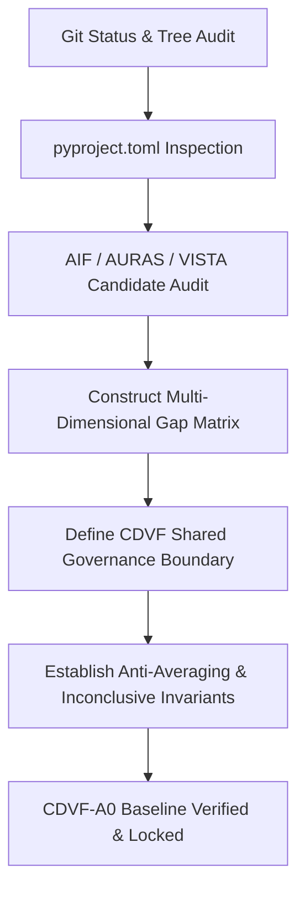
**7. Technologies, Tools & Frameworks:**
Git, Python 3.12, Markdown, Mermaid, PowerShell.
**8. Prerequisites & Dependencies:**
Phase 0 platform architecture baseline completed; master repository documentation available.
**9. Expected Files, Artifacts & Contracts:**
- `README.md` (Updated with CDVF capabilities, architecture diagram, and status)
- `PRD.md` (Updated with Section 12 CDVF requirements `CDVF-01` through `CDVF-20`)
- `TRD.md` (Updated with Section 11.B architecture, Section 12 Pydantic contracts, and traceability)
- `PHASES.md` (Updated with Section 8 engineering playbook and Section 11 traceability matrix)
**10. Failure Cases & Risk Mitigations:**
- Risk of conflating planned models with executed code: Mitigated by mandatory `PLANNED` status flags and explicit audit gap matrix.
- Risk of breaking existing subsystem phase numbering: Mitigated by introducing dedicated `CDVF-A0` through `CDVF-A11` prefix.
**11. Security & Privacy Considerations:**
Pure documentation phase; zero external network calls, zero sensitive forensic data processed.
**12. Acceptance Criteria:**
- 100% agreement between PRD, TRD, PHASES, and README regarding CDVF scope and contracts.
- Explicit status matrix distinguishing documented vs implemented capabilities.
- Zero source-code, weight, or dataset modifications in this task.
**13. Definition of Done:**
All four canonical architecture documents updated, cross-referenced, verified, and locked.
**14. Explicit Status:** `IMPLEMENTED_AND_VERIFIED`
**15. Checkpoint Table:**

| Checkpoint ID | Verification item | Expected evidence | Status | Notes/blockers |
| :--- | :--- | :--- | :--- | :--- |
| **CDVF-CP-00-01** | Multi-Modal Model Architecture Audit & Gap Matrix | Documented gap matrix separating documentation, code, and test status across AIF, AURAS, and VISTA | `IMPLEMENTED_AND_VERIFIED` | Completed in master architecture task |
| **CDVF-CP-00-02** | Canonical Terminology & Mathematical Invariants Contract | Unified mathematical formulations for ECE, Brier, IoU, tIoU, Mahalanobis OOD, and Selective Risk locked in TRD/PRD | `IMPLEMENTED_AND_VERIFIED` | Completed in master architecture task |
| **CDVF-CP-00-03** | Zero-Implementation Safety Invariant Audit | Verification that no unverified source code, mock tests, or dummy weights are added to repository | `IMPLEMENTED_AND_VERIFIED` | Verified via git status check |
| **CDVF-CP-00-04** | Multi-Document Architectural Consistency Verification | Exact traceability across `CDVF-01`..`CDVF-20` verified between PRD, TRD, PHASES, and README | `IMPLEMENTED_AND_VERIFIED` | Completed in master architecture task |

---

### Phase CDVF-A1: Model Registry, Cryptographic Provenance & Licensing Contracts

**1. Phase ID & Title:** `CDVF-A1: Model Registry, Cryptographic Provenance & Licensing Contracts`
**2. Current Status:** `PLANNED`
**3. Purpose:** Implement the Pydantic v2 `ModelRegistryEntry` schema, local WORM-backed JSON registry storage, SHA-256 cryptographic weight hash verification, immutable model revision tracking, deployment license audit, and the 6-state model approval state machine (`CANDIDATE`, `EVALUATION_PENDING`, `VALIDATED_FOR_DEFINED_SCOPE`, `REJECTED`, `DEPRECATED`, `REVALIDATION_REQUIRED`). Formulate the 12 automated revalidation trigger monitors that lock down models against silent weight drift or dependency mutations.
**4. Topics & Subtopics:**
- Registry Data Schema: Implementation of `ModelRegistryEntry` under `src/ps05/cdvf/registry/model_card.py`.
- Cryptographic Weight Verification: Streaming chunked SHA-256 hasher validating model checkpoints against immutable registry manifests prior to GPU loading.
- Licensing Compliance Engine: Automated check enforcing Apache 2.0, MIT, or permissible research licenses; blocking non-commercial or proprietary checkpoints from judicial deployment.
- 6-State Lifecycle Controller: State machine enforcing valid state transitions and audit logging.
- 12 Revalidation Trigger Rules: Automated hash, dependency, and preprocessing diff detectors triggering re-evaluation.
**5. Exact Tasks:**
1. Create `src/ps05/cdvf/registry/` package and implement `ModelRegistryEntry` using Pydantic v2.
2. Implement `CheckpointProvenanceVerifier` with streaming SHA-256 calculation and tamper gating.
3. Implement `LicensePolicyEnforcer` checking license strings against permissible open forensic operational policies.
4. Build `ModelLifecycleManager` supporting the 6 canonical approval states with JSON-backed audit logs.
5. Implement `RevalidationTriggerDetector` inspecting git hashes, torch versions, preprocessing configs, and calibration artifacts.
**6. Detailed Execution Workflow:**
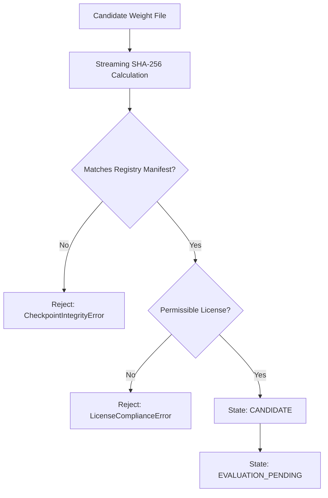
**7. Technologies, Tools & Frameworks:**
Python 3.12, Pydantic v2, hashlib, PyTorch 2.6+, pytest.
**8. Prerequisites & Dependencies:**
Phase CDVF-A0 verified; PyTorch installed; local WORM storage vault mounted.
**9. Expected Files, Artifacts & Contracts:**
- `src/ps05/cdvf/registry/__init__.py`
- `src/ps05/cdvf/registry/model_card.py`
- `src/ps05/cdvf/registry/verifier.py`
- `src/ps05/cdvf/registry/lifecycle.py`
- `tests/unit/cdvf/test_model_registry.py`
**10. Failure Cases & Risk Mitigations:**
- Hash mismatch on download: Immediate hard abort trapping corrupted or backdoored weights.
- Ambiguous or dual-licensing clauses: Flagged for mandatory legal officer sign-off before state advancement.
**11. Security & Privacy Considerations:**
Weights must never be loaded into executable Python context prior to cryptographic hash validation.
**12. Acceptance Criteria:**
- 100% of candidate checkpoints validated for SHA-256 bitstream match before initialization.
- Unauthorized license types automatically fail registration.
- Any modification to preprocessing parameters transitions model status to `REVALIDATION_REQUIRED`.
**13. Definition of Done:**
Registry package implemented, 100% unit test pass rate, typing verified via `mypy --strict`.
**14. Explicit Status:** `PLANNED`
**15. Checkpoint Table:**

| Checkpoint ID | Verification item | Expected evidence | Status | Notes/blockers |
| :--- | :--- | :--- | :--- | :--- |
| **CDVF-CP-01-01** | Model Registry Schema & Serialization | `ModelRegistryEntry` passes bidirectional JSON round-trip validation with all 24 metadata fields | `NOT_STARTED` | Awaits phase activation |
| **CDVF-CP-01-02** | Checkpoint SHA-256 Verification & Tamper Gating | `CheckpointProvenanceVerifier` aborts execution and raises `CheckpointIntegrityError` on single-bit weight mutation | `NOT_STARTED` | Awaits phase activation |
| **CDVF-CP-01-03** | Licensing & Deployment Scope Compliance Guard | Automated rejection of restricted non-commercial model licenses during registration | `NOT_STARTED` | Awaits phase activation |
| **CDVF-CP-01-04** | Revalidation Trigger Event Monitor | Automated detection of altered preprocessing parameters resulting in transition to `REVALIDATION_REQUIRED` | `NOT_STARTED` | Awaits phase activation |

---

### Phase CDVF-A2: Dataset Governance, Quality Tiers & Leakage Prevention

**1. Phase ID & Title:** `CDVF-A2: Dataset Governance, Quality Tiers & Leakage Prevention`
**2. Current Status:** `PLANNED`
**3. Purpose:** Implement the `DatasetCard` and `DatasetSplitManifest` schemas, 4-tier label provenance classification (`DIRECT_PHYSICAL`, `PIPELINE_GENERATED`, `HUMAN_VERIFIED`, `WEAK_DISPUTED`), dual-label normalization (preserving original dataset labels alongside standardized CDVF target labels), source-group splitting algorithms (`GroupShuffleSplit` on subject ID, source recording, camera device), and automated disjoint-set leak detection assertions ($G_{\text{train}} \cap G_{\text{cal}} \cap G_{\text{val}} \cap G_{\text{test}} = \emptyset$).
**4. Topics & Subtopics:**
- Dataset Governance Schema: Implementation of `DatasetCard` under `src/ps05/cdvf/datasets/card.py`.
- 4-Tier Provenance Taxonomy: Classifying ground truth by generation and verification method.
- Dual-Label Normalization Engine: Mapping diverse benchmark annotations to canonical task labels without losing raw metadata.
- Group-Level Leakage-Proof Splitting: Partitioning datasets strictly by root source identity, recording session, or capture device.
- Automated Disjoint-Set Leak Detection: Enforcing zero overlap between training, calibration, validation, and test splits.
**5. Exact Tasks:**
1. Create `src/ps05/cdvf/datasets/` package and implement `DatasetCard` and `DatasetSplitManifest`.
2. Build `LabelNormalizationPipeline` mapping dataset-specific labels into standardized forensic states.
3. Implement `SourceGroupSplitter` applying grouped stratification on subject identity and source capture hashes.
4. Implement `LeakageAssertionHarness` calculating set intersections across all split group IDs and raising `DataLeakageError` on failure.
5. Create split manifest generator producing deterministic, SHA-256 hashed split files.
**6. Detailed Execution Workflow:**
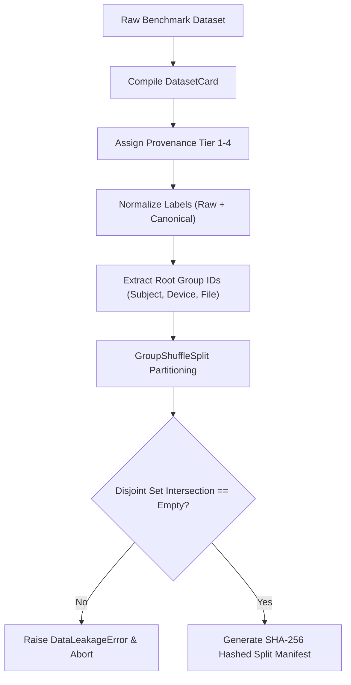
**7. Technologies, Tools & Frameworks:**
Python 3.12, Pydantic v2, Scikit-learn (GroupShuffleSplit), NumPy, Pandas, hashlib.
**8. Prerequisites & Dependencies:**
Phase CDVF-A1 completed; benchmark corpus metadata accessible.
**9. Expected Files, Artifacts & Contracts:**
- `src/ps05/cdvf/datasets/__init__.py`
- `src/ps05/cdvf/datasets/card.py`
- `src/ps05/cdvf/datasets/splitter.py`
- `src/ps05/cdvf/datasets/normalizer.py`
- `tests/unit/cdvf/test_dataset_splitting.py`
**10. Failure Cases & Risk Mitigations:**
- Derivative media leakage across splits (e.g. video frames from same clip in train and test): Trapped by mandatory source-clip grouping keys.
- Ambiguous ground truth in wild datasets: Relegated to `WEAK_DISPUTED` tier and excluded from core benchmark gates.
**11. Security & Privacy Considerations:**
Subject identity keys must be stored as one-way HMAC-SHA256 tokens to protect research subject privacy.
**12. Acceptance Criteria:**
- 100% of split manifests achieve zero group overlap ($G_i \cap G_j = \emptyset$).
- Raw dataset annotations preserved unaltered in `DatasetSampleRecord.raw_dataset_label`.
- Any detected cross-split contamination raises a fatal test failure.
**13. Definition of Done:**
Dataset governance schemas and splitting algorithms implemented, test suite verifying zero leakage passed.
**14. Explicit Status:** `PLANNED`
**15. Checkpoint Table:**

| Checkpoint ID | Verification item | Expected evidence | Status | Notes/blockers |
| :--- | :--- | :--- | :--- | :--- |
| **CDVF-CP-02-01** | Dataset Card Specification & Registration Harness | `DatasetCard` schema correctly captures all 24 metadata fields and passes validation | `NOT_STARTED` | Awaits phase activation |
| **CDVF-CP-02-02** | Dual-Label Normalisation & Quality Tier Pipeline | Normalizer preserves raw label while mapping to canonical target classes with assigned provenance tier | `NOT_STARTED` | Awaits phase activation |
| **CDVF-CP-02-03** | Source-Group Split Manifest Generator | Split manifest correctly partitions multi-frame videos and audio sessions by parent recording ID | `NOT_STARTED` | Awaits phase activation |
| **CDVF-CP-02-04** | Automated Zero-Leakage Disjoint Set Assertion Suite | Pytest suite asserts zero intersection of source IDs across train/cal/val/test splits ($G \cap G' = \emptyset$) | `NOT_STARTED` | Awaits phase activation |

---

### Phase CDVF-A3: Unified 19-Parameter Benchmark Runner & Statistical Evaluation Harness

**1. Phase ID & Title:** `CDVF-A3: Unified 19-Parameter Benchmark Runner & Statistical Evaluation Harness`
**2. Current Status:** `PLANNED`
**3. Purpose:** Implement the deterministic `BenchmarkRunner` engine under `src/ps05/cdvf/runner/`, executing benchmark runs configured with the canonical 19-parameter execution context. Implement the complete metric computation library (Precision, Recall, Specificity, F1, Balanced Accuracy, ROC-AUC, PR-AUC, EER) with mathematical zero-division handling. Implement grouped bootstrap resampling ($B=2000$) for 95% confidence interval estimation, runtime memory/latency profiling, and JSON/WORM export.
**4. Topics & Subtopics:**
- 19-Parameter Execution Context: Full parameter encapsulation under `BenchmarkRunConfig`.
- Deterministic Execution Engine: Seed fixing across NumPy, PyTorch, Python random, and CUDA deterministic flags.
- Comprehensive Metric Suite: Exact implementations of TPR, FPR, Specificity, Balanced Accuracy, and EER.
- Grouped Bootstrap Uncertainty: Stratified grouped bootstrap resampling ($B=2000$) computing empirical 95% CIs.
- Execution Profiling & WORM Packaging: Recording peak VRAM, CPU utilization, wall-clock latency, and output hashing.
**5. Exact Tasks:**
1. Create `src/ps05/cdvf/runner/` package and implement `BenchmarkRunner` class.
2. Build `MetricCalculator` implementing classification, ranking, and calibration metrics with safe zero-denominator handling.
3. Implement `GroupedBootstrapEngine` executing $B=2000$ bootstrap iterations at the subject/source group level.
4. Build runtime environment capture utility logging hardware IDs, OS kernel, GPU driver, CUDA version, and git commit.
5. Implement JSON benchmark report serializer writing immutable run bundles into the platform WORM vault.
**6. Detailed Execution Workflow:**
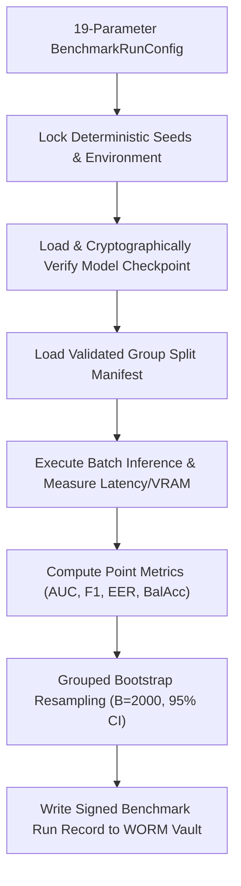
**7. Technologies, Tools & Frameworks:**
Python 3.12, PyTorch 2.6+, Scikit-learn, NumPy, SciPy, Pydantic v2.
**8. Prerequisites & Dependencies:**
Phase CDVF-A1 and CDVF-A2 completed; GPU acceleration environment configured.
**9. Expected Files, Artifacts & Contracts:**
- `src/ps05/cdvf/runner/__init__.py`
- `src/ps05/cdvf/runner/benchmark.py`
- `src/ps05/cdvf/runner/metrics.py`
- `src/ps05/cdvf/runner/bootstrap.py`
- `tests/unit/cdvf/test_metrics_and_bootstrap.py`
**10. Failure Cases & Risk Mitigations:**
- Zero division in degenerate test slices (e.g. zero positive predictions): Handled via explicit `ZeroDivisionError` fallback returning `0.0` or `NaN` with logged warning.
- Bootstrapping individual dependent video frames: Trapped and rejected by mandatory grouping key requirement in bootstrap engine.
**11. Security & Privacy Considerations:**
Benchmark runner must execute with restricted filesystem write permissions, writing solely to the designated benchmark artifact directory.
**12. Acceptance Criteria:**
- All 19 configuration parameters strictly required and validated before run initiation.
- Point metrics match Scikit-learn reference values to within $10^{-6}$ relative tolerance.
- Bootstrap 95% confidence intervals properly bracket point estimates across 2000 iterations.
**13. Definition of Done:**
Benchmark runner and metric calculation engine implemented, unit and statistical property tests passed.
**14. Explicit Status:** `PLANNED`
**15. Checkpoint Table:**

| Checkpoint ID | Verification item | Expected evidence | Status | Notes/blockers |
| :--- | :--- | :--- | :--- | :--- |
| **CDVF-CP-03-01** | 19-Parameter Benchmark Runner Execution Core | `BenchmarkRunner` validates all 19 configuration fields and executes reproducible test pass | `NOT_STARTED` | Awaits phase activation |
| **CDVF-CP-03-02** | Metric Calculation Engine with Zero-Division Traps | Precision, Recall, Specificity, F1, AUC, and EER calculate correctly without crashing on all-negative slices | `NOT_STARTED` | Awaits phase activation |
| **CDVF-CP-03-03** | Grouped Bootstrap Confidence Interval Harness ($B=2000$) | Bootstrap engine generates valid 95% empirical percentile intervals grouped at subject/clip level | `NOT_STARTED` | Awaits phase activation |
| **CDVF-CP-03-04** | Benchmark Output JSON Schema & WORM Vault Exporter | Evaluation run bundle serializes to valid `BenchmarkRun` schema with calculated manifest SHA-256 | `NOT_STARTED` | Awaits phase activation |

---

### Phase CDVF-A4: AIF Image Deepfake & Manipulation Detection Validation Suite

**1. Phase ID & Title:** `CDVF-A4: AIF Image Deepfake & Manipulation Detection Validation Suite`
**2. Current Status:** `PLANNED`
**3. Purpose:** Implement the image-forensic validation harness for AIF detection models across four explicit forensic tasks (IMG-1: Authentic vs AI-Generated, IMG-2: Authentic vs Manipulated, IMG-3: Face Swap/Morphing, IMG-4: Pixel Manipulation Localisation). Implement spatial mask metrics (pixel-level IoU, boundary F1, Dice coefficient). Build the 14-condition synthetic degradation engine simulating real-world forensic evidence conditions (JPEG recompression QF 30-95, Gaussian blur, additive noise, resizing, screenshot recapture, social recompression).
**4. Topics & Subtopics:**
- Task-Specific Protocols: Disaggregated evaluation suites for AI generation, splicing, and face morphing.
- Spatial Localisation Metric Engine: Mask IoU, Dice coefficient, and contour boundary F1 score ($\tau=2\text{ px}$).
- 14-Condition Image Degradation Engine: Parametric transformations under `ImageRobustnessGrid`.
- Localisation vs Classification Consistency Check: Trapping cases where an image is classified as manipulated but localisation fails or indicates zero pixels.
- Multi-Branch Model Integration: Adapting AIF TruFor and ViT feature extractors into standard CDVF input/output contracts.
**5. Exact Tasks:**
1. Create `src/ps05/cdvf/modality/image/` package and implement `ImageValidationProtocol`.
2. Build `SpatialLocalizationMetrics` computing pixel IoU, Dice, and boundary F1 for binary masks.
3. Implement `ImageDegradationEngine` providing parametric transforms (JPEG, blur, noise, crop, social media compression).
4. Implement task-specific evaluation suites for IMG-1 through IMG-4.
5. Create automated test verifying unlocalised manipulation handling (logging classification confidence without bogus mask generation).
**6. Detailed Execution Workflow:**
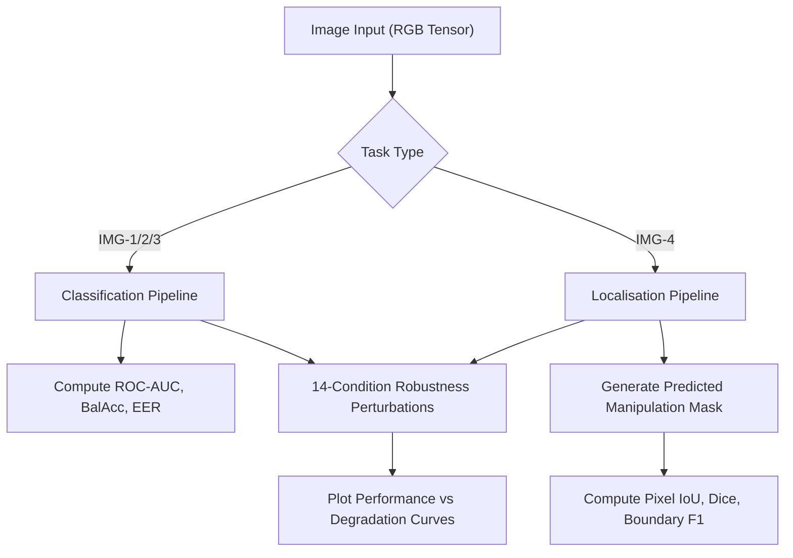
**7. Technologies, Tools & Frameworks:**
Python 3.12, PyTorch 2.6+, torchvision, Pillow, OpenCV, Albumentations, NumPy.
**8. Prerequisites & Dependencies:**
Phase CDVF-A3 completed; AIF model candidate interfaces documented.
**9. Expected Files, Artifacts & Contracts:**
- `src/ps05/cdvf/modality/image/__init__.py`
- `src/ps05/cdvf/modality/image/protocol.py`
- `src/ps05/cdvf/modality/image/localization.py`
- `src/ps05/cdvf/modality/image/robustness.py`
- `tests/unit/cdvf/test_image_validation.py`
**10. Failure Cases & Risk Mitigations:**
- Zero ground-truth mask for genuine images: IoU defined as $1.0$ if predicted mask is empty, $0.0$ if false-alarm mask predicted.
- High classification confidence with unlocalised manipulation: Explicitly reported as `DETECTED_LOCALISATION_UNAVAILABLE`.
**11. Security & Privacy Considerations:**
Image decoding must be defended against decompression bombs (PIL `MAX_IMAGE_PIXELS` ceiling enforced).
**12. Acceptance Criteria:**
- Mask IoU and boundary F1 calculate accurately against synthetic geometric shapes with known overlap.
- Robustness grid executes all 14 degradation conditions without runtime exceptions.
- Detection and localisation metrics reported in separate, non-conflated report sections.
**13. Definition of Done:**
Image validation suite implemented, verified against synthetic test data, 100% pytest pass rate.
**14. Explicit Status:** `PLANNED`
**15. Checkpoint Table:**

| Checkpoint ID | Verification item | Expected evidence | Status | Notes/blockers |
| :--- | :--- | :--- | :--- | :--- |
| **CDVF-CP-04-01** | Image Classification Benchmark Protocol Harness | Clean execution of IMG-1, IMG-2, and IMG-3 evaluation pipelines on standardized image tensors | `NOT_STARTED` | Awaits phase activation |
| **CDVF-CP-04-02** | Spatial Mask IoU & Boundary F1 Localisation Engine | `SpatialLocalizationMetrics` matches theoretical IoU on synthetic circle/square ground truth masks | `NOT_STARTED` | Awaits phase activation |
| **CDVF-CP-04-03** | 14-Condition Image Degradation & Robustness Suite | Complete sweep over JPEG QF 30-95, blur, noise, and resizing producing performance degradation matrices | `NOT_STARTED` | Awaits phase activation |
| **CDVF-CP-04-04** | Unlocalised Manipulation Fallback & Consistency Trap | Pipeline cleanly handles manipulated images lacking pixel-level masks without hallucinating contours | `NOT_STARTED` | Awaits phase activation |

---

### Phase CDVF-A5: AURAS Audio Deepfake & Speech Manipulation Validation Suite

**1. Phase ID & Title:** `CDVF-A5: AURAS Audio Deepfake & Speech Manipulation Validation Suite`
**2. Current Status:** `PLANNED`
**3. Purpose:** Implement the audio-forensic validation harness for AURAS detection models across four forensic tasks (AUD-1: Bona Fide vs Synthetic Speech, AUD-2: Voice Conversion / Cloning, AUD-3: Partial Splicing, AUD-4: Segment Localisation). Implement temporal interval metrics (temporal IoU [tIoU], boundary precision/recall, onset/offset timing error $\Delta t_{\text{boundary}} \le 50\text{ ms}$). Build the audio robustness engine evaluating lossy codecs (Opus, AAC, AMR, MP3 at 8-128 kbps), background acoustic noise (SNR 0-30 dB), reverberation, and sample-rate mismatches.
**4. Topics & Subtopics:**
- Audio Task Protocols: Independent evaluation protocols for synthetic speech, cloning, and partial splices.
- Temporal Localisation Metric Engine: Temporal IoU, boundary tolerance matching, and segment-level F1.
- Chunked Sliding Window Aggregation: Frame-level pooling ($p$-norm, max-pooling) from overlapping 3.0s windows.
- Audio Degradation & Robustness Grid: Parametric perturbations under `AudioRobustnessGrid`.
- Short-Segment Handling: Formal boundary behavior for clips $< 1.0\text{ s}$ duration.
**5. Exact Tasks:**
1. Create `src/ps05/cdvf/modality/audio/` package and implement `AudioValidationProtocol`.
2. Build `TemporalLocalizationMetrics` computing tIoU and onset/offset boundary error against millisecond ground truth.
3. Implement `AudioDegradationEngine` applying lossy transcoding, additive environmental noise, and reverberation.
4. Build `WindowAggregationValidator` comparing max-pooling, mean-pooling, and soft-attention pooling across chunks.
5. Create automated test verifying graceful degradation on short audio segments ($< 1.0\text{ s}$).
**6. Detailed Execution Workflow:**
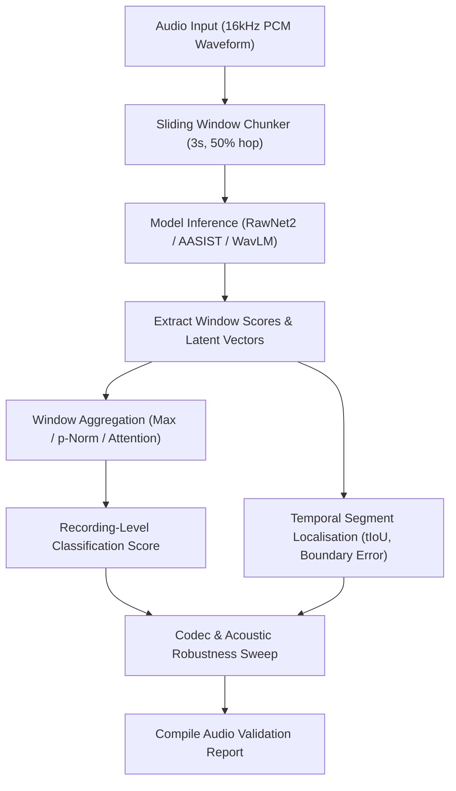
**7. Technologies, Tools & Frameworks:**
Python 3.12, PyTorch 2.6+, TorchAudio, Librosa, SoundFile, FFmpeg, NumPy.
**8. Prerequisites & Dependencies:**
Phase CDVF-A3 completed; AURAS model interfaces and audio preprocessing contracts available.
**9. Expected Files, Artifacts & Contracts:**
- `src/ps05/cdvf/modality/audio/__init__.py`
- `src/ps05/cdvf/modality/audio/protocol.py`
- `src/ps05/cdvf/modality/audio/localization.py`
- `src/ps05/cdvf/modality/audio/robustness.py`
- `tests/unit/cdvf/test_audio_validation.py`
**10. Failure Cases & Risk Mitigations:**
- Codec re-encoding introducing phase shifts: Mitigated via energy envelope alignment before boundary evaluation.
- Silent or near-silent segments ($< -50\text{ dBFS}$): Trapped by VAD pre-filter and assigned `INSUFFICIENT_EVIDENCE`.
**11. Security & Privacy Considerations:**
Audio files must be parsed using defensive decoders (FFmpeg subprocess sandbox) trapping malformed headers.
**12. Acceptance Criteria:**
- Temporal IoU and boundary errors calculate correctly against millisecond timecode annotations.
- Audio robustness engine executes Opus, AAC, and noise sweeps without pipeline interruption.
- Audio segments $< 0.5\text{ s}$ cleanly return `INSUFFICIENT_EVIDENCE` without model NaN propagation.
**13. Definition of Done:**
Audio validation suite implemented, verified with synthetic multi-segment audio, 100% pytest pass rate.
**14. Explicit Status:** `PLANNED`
**15. Checkpoint Table:**

| Checkpoint ID | Verification item | Expected evidence | Status | Notes/blockers |
| :--- | :--- | :--- | :--- | :--- |
| **CDVF-CP-05-01** | Speech Synthesis & Cloning Evaluation Harness | Clean execution of AUD-1 and AUD-2 evaluation pipelines on 16kHz audio waveforms | `NOT_STARTED` | Awaits phase activation |
| **CDVF-CP-05-02** | Temporal Segment Localisation (tIoU & Boundary Error) | `TemporalLocalizationMetrics` verifies boundary accuracy to within $\le 50\text{ ms}$ on spliced audio test set | `NOT_STARTED` | Awaits phase activation |
| **CDVF-CP-05-03** | Lossy Codec & Acoustic Degradation Robustness Grid | Automated execution of Opus/AAC transcoding and SNR 0-30 dB sweeps producing robustness curves | `NOT_STARTED` | Awaits phase activation |
| **CDVF-CP-05-04** | Sliding Window Aggregation & Window Hop Validation | Verification of recording-level aggregation stability under 10% to 75% window hop variations | `NOT_STARTED` | Awaits phase activation |

---

### Phase CDVF-A6: VISTA Video & CCTV Deepfake Detection Validation Suite

**1. Phase ID & Title:** `CDVF-A6: VISTA Video & CCTV Deepfake Detection Validation Suite`
**2. Current Status:** `PLANNED`
**3. Purpose:** Implement the video-forensic validation harness for VISTA detection models across five forensic tasks (VID-1: Frame Deepfake, VID-2: Video Manipulated, VID-3: Synthetic Video, VID-4: Temporal Manipulation, VID-5: Spatial/Temporal Localisation). Enforce the fundamental video frame non-independence rule. Implement the dedicated CCTV evaluation domain capturing real-world investigative constraints (CIF/D1/720p resolution, IR night-vision, variable frame rates 5-15 fps, DVR H.264 macroblock compression, timestamp OSD overlays, camera vibration).
**4. Topics & Subtopics:**
- Video Task Protocols: Independent evaluation protocols for frame-level, temporal, and CCTV manipulation.
- Frame Non-Independence Invariant: Grouped evaluation ensuring frames from one source video cannot bias metrics.
- Video-Level Aggregation Strategies: Evaluating top-$k$ frame pooling, temporal convolutions, and LSTM/Transformer pooling.
- Dedicated CCTV Domain Benchmark: Low-resolution, low-framerate, and night-vision CCTV test suite.
- Spatio-Temporal Localisation: Combined bounding-box tracking and frame interval localization.
**5. Exact Tasks:**
1. Create `src/ps05/cdvf/modality/video/` package and implement `VideoValidationProtocol`.
2. Build `VideoAggregationEvaluator` comparing frame-pooling strategies against video-level ground truth.
3. Implement `CCTVDomainBenchmarkHarness` simulating low frame-rates (5-15 fps), IR noise, and DVR artifacts.
4. Implement `SpatioTemporalLocalizationMetrics` calculating 3D bounding-box IoU across video frame sequences.
5. Create automated test enforcing source-video grouping during video evaluation.
**6. Detailed Execution Workflow:**
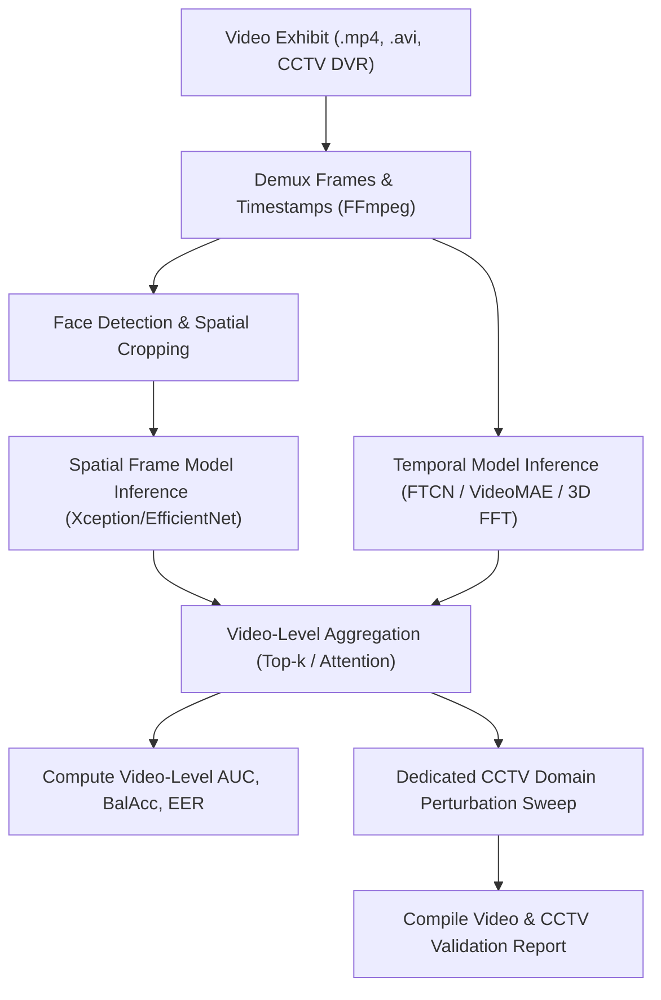
**7. Technologies, Tools & Frameworks:**
Python 3.12, PyTorch 2.6+, torchvision, Decord, OpenCV, FFmpeg, NumPy.
**8. Prerequisites & Dependencies:**
Phase CDVF-A3 completed; VISTA video processing and frame demuxing engines available.
**9. Expected Files, Artifacts & Contracts:**
- `src/ps05/cdvf/modality/video/__init__.py`
- `src/ps05/cdvf/modality/video/protocol.py`
- `src/ps05/cdvf/modality/video/cctv.py`
- `src/ps05/cdvf/modality/video/localization.py`
- `tests/unit/cdvf/test_video_validation.py`
**10. Failure Cases & Risk Mitigations:**
- Video treated as independent frames inflating sample size $N$: Trapped by mandatory video-level sample grouping assertions.
- Non-face CCTV footage fed to face-detector models: Trapped and diverted to `INCONCLUSIVE_OOD` or scene-level detector.
**11. Security & Privacy Considerations:**
Video demuxers must run in sandboxed worker processes with memory limits to prevent FFmpeg buffer overflows.
**12. Acceptance Criteria:**
- Video-level metrics calculate strictly over independent video entities ($N_{\text{videos}}$).
- CCTV domain harness evaluates down to 5 fps and 352x288 resolution without pipeline crash.
- Spatio-temporal bounding boxes evaluate accurately across synthetic moving objects.
**13. Definition of Done:**
Video and CCTV validation suite implemented, verified against synthetic test clips, 100% pytest pass rate.
**14. Explicit Status:** `PLANNED`
**15. Checkpoint Table:**

| Checkpoint ID | Verification item | Expected evidence | Status | Notes/blockers |
| :--- | :--- | :--- | :--- | :--- |
| **CDVF-CP-06-01** | Video-Level Aggregation & Frame Non-Independence Guard | Benchmark runner asserts video sample independence and evaluates top-$k$ frame pooling | `NOT_STARTED` | Awaits phase activation |
| **CDVF-CP-06-02** | Spatio-Temporal Video Localisation Evaluation | Localisation engine correctly calculates 3D bounding-box IoU across multi-frame sequences | `NOT_STARTED` | Awaits phase activation |
| **CDVF-CP-06-03** | Dedicated CCTV Domain Robustness Benchmark Suite | Validation suite successfully evaluates low-resolution (D1/CIF), 5-15 fps, and IR night-vision clips | `NOT_STARTED` | Awaits phase activation |
| **CDVF-CP-06-04** | Lip-Sync & Audio-Visual Desynchronisation Verification | Validation suite verifies AV correlation and traps audio-visual timing misalignments | `NOT_STARTED` | Awaits phase activation |

---

### Phase CDVF-A7: Cross-Dataset Generalisation & Unseen-Generator Protocols (Modes A–G)

**1. Phase ID & Title:** `CDVF-A7: Cross-Dataset Generalisation & Unseen-Generator Protocols (Modes A–G)`
**2. Current Status:** `PLANNED`
**3. Purpose:** Implement the generalisation evaluation matrix executing Modes A through G: Mode A (In-Domain), Mode B (Cross-Dataset), Mode C (Unseen-Generator), Mode D (Cross-Compression), Mode E (Cross-Source/Device), Mode F (Realistic Degraded Forensic Evidence), and Mode G (Temporal Holdout). Enforce the anti-hallucination invariant that prohibits models from claiming "generalises to unseen generators" unless validated under a strict leave-one-out generator protocol (Mode C).
**4. Topics & Subtopics:**
- 7-Mode Benchmark Matrix: Implementation of `GeneralizationMatrixRunner` under `src/ps05/cdvf/generalization/matrix.py`.
- Leave-One-Out Generator Protocol (Mode C): Automated training/test generation partitioning (e.g. hold out StyleGAN3, Diffusion, or StarGAN).
- Cross-Dataset Domain Shift (Mode B): Evaluating models trained on Dataset $X$ directly on Dataset $Y$ with zero tuning.
- Cross-Compression Degradation Curves (Mode D): Measuring performance decay from pristine raw media to heavy recompression.
- Automated Generalisation Gap Computation: Calculating $\Delta\operatorname{AUC}_{\text{gen}} = \operatorname{AUC}_{\text{in-domain}} - \operatorname{AUC}_{\text{unseen}}$ and flagging severe degradation ($> 0.15$).
**5. Exact Tasks:**
1. Create `src/ps05/cdvf/generalization/` package and implement `GeneralizationMatrixRunner`.
2. Build `UnseenGeneratorProtocol` dynamically excluding selected generator architectures from training partitions.
3. Build `CrossDatasetProtocol` automating cross-corpus evaluation pipelines.
4. Implement `GeneralizationDegradationReporter` calculating degradation ratios and plotting performance delta bars.
5. Create automated test asserting that generalisation claims fail if Mode C evaluation evidence is absent.
**6. Detailed Execution Workflow:**
```mermaid
flowchart TD
    ModeSelect["Select Evaluation Mode (A through G)"] --> SplitGen["Generate Mode-Specific Partition"]
    SplitGen --> RunBench["Execute Benchmark Runner (CDVF-A3)"]
    RunBench --> InDomainMetric["Record In-Domain Baseline (Mode A)"]
    RunBench --> ShiftMetric["Record Shifted Metric (Mode B/C/D/E/F/G)"]
    InDomainMetric & ShiftMetric --> GapCalc["Calculate Generalisation Gap (Delta-AUC, Delta-EER)"]
    GapCalc --> GateCheck{"Generalisation Gap <= Allowable Ceiling?"}
    GateCheck -- No --> ScopeLimit["Restrict Approved Scope to In-Domain Only"]
    GateCheck -- Yes --> ScopeApprove["Permit Scoped Cross-Domain Approval"]
```
**7. Technologies, Tools & Frameworks:**
Python 3.12, PyTorch 2.6+, Scikit-learn, NumPy, Pandas, Matplotlib.
**8. Prerequisites & Dependencies:**
Phases CDVF-A3, CDVF-A4, CDVF-A5, and CDVF-A6 completed; multi-generator corpora catalogued.
**9. Expected Files, Artifacts & Contracts:**
- `src/ps05/cdvf/generalization/__init__.py`
- `src/ps05/cdvf/generalization/matrix.py`
- `src/ps05/cdvf/generalization/unseen_generator.py`
- `src/ps05/cdvf/generalization/cross_dataset.py`
- `tests/unit/cdvf/test_generalization_matrix.py`
**10. Failure Cases & Risk Mitigations:**
- Severe performance collapse on unseen generators (AUC dropping from 0.98 to 0.52): System automatically restricts approval to known generator families.
- Shared training identity across distinct datasets: Filtered via cross-dataset subject hash matching.
**11. Security & Privacy Considerations:**
Generalisation reports must clearly disclose tested vs untested generator families to prevent misleading judicial testimony.
**12. Acceptance Criteria:**
- Modes A through G execute deterministically from split manifests.
- Generalisation gap $\Delta\operatorname{AUC}$ calculated accurately across all mode pairs.
- Unseen-generator claims rejected unless backed by verified Mode C execution records.
**13. Definition of Done:**
Generalisation matrix runner implemented, tested across synthetic shifted distributions, 100% pytest pass rate.
**14. Explicit Status:** `PLANNED`
**15. Checkpoint Table:**

| Checkpoint ID | Verification item | Expected evidence | Status | Notes/blockers |
| :--- | :--- | :--- | :--- | :--- |
| **CDVF-CP-07-01** | Cross-Dataset Evaluation Protocol Engine (Mode B) | Automated pipeline executes cross-dataset evaluation across independent corpora | `NOT_STARTED` | Awaits phase activation |
| **CDVF-CP-07-02** | Unseen-Generator Leave-One-Out Test Harness (Mode C) | Harness partitions generators and produces valid unseen-generator degradation report | `NOT_STARTED` | Awaits phase activation |
| **CDVF-CP-07-03** | Cross-Compression & Forensic Export Grid (Mode D & F) | Evaluation sweep across multiple compression pipelines producing delta-performance curves | `NOT_STARTED` | Awaits phase activation |
| **CDVF-CP-07-04** | Generalisation Degradation Reporting & Anti-Exaggeration Guard | System blocks generalisation claims in report when Mode C gap exceeds 0.20 AUC | `NOT_STARTED` | Awaits phase activation |

---

### Phase CDVF-A8: Confidence Calibration Engine & OOD Domain Shift Gating

**1. Phase ID & Title:** `CDVF-A8: Confidence Calibration Engine & OOD Domain Shift Gating`
**2. Current Status:** `PLANNED`
**3. Purpose:** Implement the confidence calibration pipeline under `src/ps05/cdvf/calibration/`, executing Platt scaling (logistic calibration), Temperature scaling, and Isotonic regression on strictly isolated calibration splits ($D_{\text{cal}}$). Implement 15-bin Expected Calibration Error (ECE $\le 0.05$), Brier score, and reliability diagram generation. Implement Out-of-Distribution (OOD) gating using Penultimate-Layer Mahalanobis distance with Ledoit-Wolf covariance shrinkage, Free Energy score, and Prediction Entropy. Enforce the OOD gating invariant: OOD samples trigger abstention rather than uncalibrated classification.
**4. Topics & Subtopics:**
- Calibration Data Isolation: Enforcing $D_{\text{cal}} \cap D_{\text{train}} = \emptyset$ and $D_{\text{cal}} \cap D_{\text{test}} = \emptyset$.
- Calibration Algorithms: Platt scaling, Temperature scaling, and Isotonic regression.
- Calibration Metrics: 15-bin ECE with adaptive/uniform binning, Brier score, and reliability diagrams.
- OOD Scoring Algorithms: Mahalanobis distance on penultimate layer representations with Ledoit-Wolf shrinkage, Free Energy, and Entropy.
- OOD Gating Policy: Intercepting inputs where $S_{\text{OOD}} > \tau_{\text{OOD}}$ and diverting to `INCONCLUSIVE_OOD`.
**5. Exact Tasks:**
1. Create `src/ps05/cdvf/calibration/` and `src/ps05/cdvf/ood/` packages.
2. Build `ConfidenceCalibrator` implementing temperature scaling, Platt scaling, and isotonic regression.
3. Build `CalibrationEvaluator` calculating 15-bin ECE and generating reliability diagram coordinate points.
4. Build `MahalanobisOODDetector` fitting class-conditional Gaussian distributions with Ledoit-Wolf covariance shrinkage.
5. Implement `OODDecisionGate` evaluating test embeddings against OOD thresholds and routing to abstention.
**6. Detailed Execution Workflow:**
```mermaid
flowchart TD
    TestInput["Test Sample (Image / Audio / Video)"] --> Preprocess["Frozen Preprocessor"]
    Preprocess --> FeatureExtract["Extract Penultimate Layer Representation (z) & Logits (l)"]
    FeatureExtract --> OODCheck["Compute Mahalanobis Distance / Free Energy"]
    OODCheck --> OODThreshold{"OOD Score > Tau_OOD?"}
    OODThreshold -- Yes --> OODAbstain["Emit INCONCLUSIVE_OOD (Zero Categorical Verdict)"]
    OODThreshold -- No --> CalibrateScore["Apply Frozen Calibration (Temperature / Platt)"]
    CalibrateScore --> ReliabilityCheck{"ECE <= 0.05 on Val Domain?"}
    ReliabilityCheck -- No --> WarnUncalibrated["Emit Alert: Uncalibrated In-Domain Score"]
    ReliabilityCheck -- Yes --> EmittedScore["Emit Calibrated Probability & 95% CI"]
```
**7. Technologies, Tools & Frameworks:**
Python 3.12, PyTorch 2.6+, Scikit-learn (IsotonicRegression, LedoitWolf), SciPy, NumPy.
**8. Prerequisites & Dependencies:**
Phases CDVF-A1, CDVF-A2, and CDVF-A3 completed; frozen model checkpoints available.
**9. Expected Files, Artifacts & Contracts:**
- `src/ps05/cdvf/calibration/__init__.py`
- `src/ps05/cdvf/calibration/calibrator.py`
- `src/ps05/cdvf/calibration/metrics.py`
- `src/ps05/cdvf/ood/__init__.py`
- `src/ps05/cdvf/ood/mahalanobis.py`
- `tests/unit/cdvf/test_calibration_and_ood.py`
**10. Failure Cases & Risk Mitigations:**
- Singular covariance matrix in Mahalanobis calculation: Mitigated via Ledoit-Wolf shrinkage ensuring positive-definite inversion.
- Calibration fitted on test data: Trapped by split identity verification asserting $D_{\text{fit}} == D_{\text{cal}}$.
**11. Security & Privacy Considerations:**
Calibration parameters and covariance matrices must be saved as immutable, hashed artifacts linked to the model registry.
**12. Acceptance Criteria:**
- Post-calibration ECE $\le 0.05$ on in-domain validation split.
- Mahalanobis OOD detector achieves AUROC $\ge 0.85$ distinguishing in-distribution from shifted distributions.
- OOD gating intercept properly aborts classification when threshold is exceeded.
**13. Definition of Done:**
Calibration and OOD packages implemented, tested on synthetic and real embeddings, 100% pytest pass rate.
**14. Explicit Status:** `PLANNED`
**15. Checkpoint Table:**

| Checkpoint ID | Verification item | Expected evidence | Status | Notes/blockers |
| :--- | :--- | :--- | :--- | :--- |
| **CDVF-CP-08-01** | Calibration Fitting Pipeline on Disjoint Split ($D_{\text{cal}}$) | Calibrator fits temperature/Platt parameters on isolated calibration set without test data exposure | `NOT_STARTED` | Awaits phase activation |
| **CDVF-CP-08-02** | 15-Bin ECE & Brier Score Validation Harness | Metrics engine correctly evaluates 15-bin ECE and Brier score before and after calibration | `NOT_STARTED` | Awaits phase activation |
| **CDVF-CP-08-03** | Mahalanobis Covariance Shrinkage & Energy OOD Engine | OOD detector fits stable covariance matrices with Ledoit-Wolf shrinkage and scores test samples | `NOT_STARTED` | Awaits phase activation |
| **CDVF-CP-08-04** | OOD Decision Gating Invariant & Threshold Locker | System intercepts OOD test samples and forces `INCONCLUSIVE_OOD` outcome without guessing | `NOT_STARTED` | Awaits phase activation |

---

### Phase CDVF-A9: First-Class Abstention Policy & Cross-Modal Fusion DAG

**1. Phase ID & Title:** `CDVF-A9: First-Class Abstention Policy & Cross-Modal Fusion DAG`
**2. Current Status:** `PLANNED`
**3. Purpose:** Implement the formal first-class abstention policy under `src/ps05/cdvf/decision/`, supporting the seven canonical forensic outcome states (`CLASSIFIED_WITHIN_VALIDATED_SCOPE`, `INCONCLUSIVE_OOD`, `INCONCLUSIVE_LOW_QUALITY`, `INCONCLUSIVE_MODEL_DISAGREEMENT`, `INSUFFICIENT_EVIDENCE`, `UNSUPPORTED_INPUT`, `ANALYSIS_FAILED`). Implement Selective Classification evaluation computing Coverage ($C$) and Selective Risk ($R(C)$). Implement the Cross-Modal Evidence Fusion Directed Acyclic Graph (DAG) that aggregates AIF, AURAS, and VISTA findings, enforces the anti-averaging invariant, exposes cross-engine disagreements, and tracks shared evidentiary lineage.
**4. Topics & Subtopics:**
- 7-State Abstention Engine: Complete state mapping and reasoning under `CDVFDecisionEngine`.
- Selective Classification Analytics: Computing coverage vs selective risk curves across threshold sweeps.
- Cross-Modal Fusion DAG: Dependency-aware aggregation of multi-modal evidence without naive score averaging.
- Anti-Averaging Invariant: Prohibition against scalar arithmetic averaging of image, audio, and video scores.
- Evidentiary Lineage & Disagreement Tracker: Highlighting conflicts (e.g. video face real, audio voice cloned) in judicial reports.
**5. Exact Tasks:**
1. Create `src/ps05/cdvf/decision/` and `src/ps05/cdvf/fusion/` packages.
2. Build `AbstentionDecisionEngine` evaluating input quality, OOD scores, model agreement, and calibration scope.
3. Build `SelectiveClassificationEvaluator` plotting coverage vs risk trade-off curves.
4. Build `CrossModalFusionDAG` modeling multi-modal evidence dependencies and propagating uncertainty.
5. Create automated test asserting that naive arithmetic score averaging raises an explicit `ArchitectureViolationError`.
**6. Detailed Execution Workflow:**
```mermaid
flowchart TD
    ModalityFindings["Modality Findings (AIF Image, AURAS Audio, VISTA Video)"] --> PreCheck["Pre-Flight Quality & Format Check"]
    PreCheck -- Corrupted / Empty --> InconQuality["Emit INCONCLUSIVE_LOW_QUALITY"]
    PreCheck -- Valid --> OODGate["Evaluate Modality OOD Scores"]
    OODGate -- Any Out-of-Domain --> InconOOD["Emit INCONCLUSIVE_OOD"]
    OODGate -- In-Domain --> DisagreementCheck{"Model Findings Conflict?"}
    DisagreementCheck -- Conflicting Verdicts --> InconDisagree["Emit INCONCLUSIVE_MODEL_DISAGREEMENT"]
    DisagreementCheck -- Consistent --> FusionDAG["Cross-Modal Dependency DAG (Anti-Averaging)"]
    FusionDAG --> ScopedVerdict["Emit Scoped Structured Finding Dossier"]
```
**7. Technologies, Tools & Frameworks:**
Python 3.12, NetworkX (DAG representation), Pydantic v2, NumPy, Matplotlib.
**8. Prerequisites & Dependencies:**
Phases CDVF-A4, CDVF-A5, CDVF-A6, and CDVF-A8 completed.
**9. Expected Files, Artifacts & Contracts:**
- `src/ps05/cdvf/decision/__init__.py`
- `src/ps05/cdvf/decision/engine.py`
- `src/ps05/cdvf/decision/selective_risk.py`
- `src/ps05/cdvf/fusion/__init__.py`
- `src/ps05/cdvf/fusion/dag.py`
- `tests/unit/cdvf/test_decision_and_fusion.py`
**10. Failure Cases & Risk Mitigations:**
- Missing audio stream in video exhibit: System evaluates video independently and flags audio as `INSUFFICIENT_EVIDENCE` without penalizing video verdict.
- Naive averaging attempts in presentation layer: Intercepted by DAG contract validating that fused output is a structured finding graph, not a single percentage.
**11. Security & Privacy Considerations:**
Abstention decisions must record complete technical rationales in the forensic audit log to justify non-classification under cross-examination.
**12. Acceptance Criteria:**
- All seven canonical states emitted correctly based on deterministic input conditions.
- Coverage vs risk curves calculate monotonic risk reduction as coverage is restricted.
- Cross-modal fusion DAG preserves individual modality findings and explicitly flags multi-modal conflicts.
**13. Definition of Done:**
Decision engine and fusion DAG implemented, verified with conflict test scenarios, 100% pytest pass rate.
**14. Explicit Status:** `PLANNED`
**15. Checkpoint Table:**

| Checkpoint ID | Verification item | Expected evidence | Status | Notes/blockers |
| :--- | :--- | :--- | :--- | :--- |
| **CDVF-CP-09-01** | 7-State Abstention & Selective Classification Evaluator | Decision engine outputs all 7 canonical states based on simulated threshold/quality triggers | `NOT_STARTED` | Awaits phase activation |
| **CDVF-CP-09-02** | Coverage vs Selective Risk Curve Generator | Analytics engine computes empirical risk-coverage curves demonstrating error reduction under abstention | `NOT_STARTED` | Awaits phase activation |
| **CDVF-CP-09-03** | Cross-Modal Dependency DAG & Lineage Tracker | Fusion DAG correctly models shared source relationships and prevents double-counting derived frames | `NOT_STARTED` | Awaits phase activation |
| **CDVF-CP-09-04** | Anti-Averaging Invariant Enforcement & Disagreement Exposer | System blocks naive score averaging and emits explicit cross-engine conflict alerts | `NOT_STARTED` | Awaits phase activation |

---

### Phase CDVF-A10: Subgroup Fairness, Robustness & 12-Gate Scoped Model Approval

**1. Phase ID & Title:** `CDVF-A10: Subgroup Fairness, Robustness & 12-Gate Scoped Model Approval`
**2. Current Status:** `PLANNED`
**3. Purpose:** Implement multi-subgroup fairness and robustness evaluation under `src/ps05/cdvf/approval/`, stratifying performance across demographic, environmental, and capture conditions (image: face vs non-face, skin tone, resolution; audio: languages, accents, SNR, codecs; video: pose, lighting, CCTV DVR formats). Flag any subgroup performance disparity exceeding the $2.0\times$ threshold. Implement the 12-gate scoped model approval state machine enforcing all mandatory release gates, ensuring models receive `VALIDATED_FOR_DEFINED_SCOPE` rather than unwarranted universal approval.
**4. Topics & Subtopics:**
- Subgroup Stratification Engine: Segmenting test metrics by metadata attributes under `SubgroupFairnessEvaluator`.
- Disparity Ratio Analytics: Calculating FPR/FNR disparity ratios across subgroups ($R_{\text{disp}} = \max(M_g) / \min(M_g)$).
- 12-Gate Approval State Machine: Exhaustive verification across G-1 (Provenance) through G-12 (Judicial Readiness).
- Scoped Operational Envelope: Restricting model deployment to validated domains (e.g. validated for speech $> 12\text{ kHz}$ only).
- Examiner Interpretation Guide: Generating human-readable operating boundaries for forensic experts.
**5. Exact Tasks:**
1. Create `src/ps05/cdvf/approval/` package and implement `SubgroupFairnessEvaluator`.
2. Build `ApprovalGateEngine` evaluating all 12 mandatory approval gates.
3. Build `OperationalEnvelopeCompiler` defining valid deployment ranges (resolution, SNR, codec, generators).
4. Implement automated alert when subgroup disparity exceeds $2.0\times$ ratio.
5. Create examiner interpretation template generator translating technical gates into court-ready guidance.
**6. Detailed Execution Workflow:**
```mermaid
flowchart TD
    BenchResults["Benchmark & Calibration Results"] --> SubgroupStrat["Subgroup Stratification (Demographics, Codecs, CCTV)"]
    SubgroupStrat --> DisparityCalc["Calculate Disparity Ratios across Subgroups"]
    DisparityCalc --> DisparityCheck{"Disparity Ratio <= 2.0x?"}
    DisparityCheck -- No --> FlagDisparity["Flag Disparity Alert & Restrict Operational Scope"]
    DisparityCheck -- Yes --> GateSweep["Execute 12 Mandatory Approval Gates (G-1 to G-12)"]
    GateSweep --> AllGatesPass{"All 12 Gates Passed?"}
    AllGatesPass -- No --> RejectOrPending["State: REJECTED or REVALIDATION_REQUIRED"]
    AllGatesPass -- Yes --> ScopedApproval["State: VALIDATED_FOR_DEFINED_SCOPE"]
```
**7. Technologies, Tools & Frameworks:**
Python 3.12, Pydantic v2, Scikit-learn, Pandas, NumPy.
**8. Prerequisites & Dependencies:**
Phases CDVF-A1 through CDVF-A9 completed.
**9. Expected Files, Artifacts & Contracts:**
- `src/ps05/cdvf/approval/__init__.py`
- `src/ps05/cdvf/approval/fairness.py`
- `src/ps05/cdvf/approval/gates.py`
- `src/ps05/cdvf/approval/envelope.py`
- `tests/unit/cdvf/test_approval_gates.py`
**10. Failure Cases & Risk Mitigations:**
- Universal approval granted despite severe low-quality degradation: Prevented by mandatory operational envelope gating.
- Insufficient subgroup sample size ($N_g < 30$): Flagged with wide confidence intervals and marked `INSUFFICIENT_SUBGROUP_POWER`.
**11. Security & Privacy Considerations:**
Demographic metadata must be strictly sourced from consented, anonymized research benchmark cards with zero PII retention.
**12. Acceptance Criteria:**
- Subgroup disparity ratios calculated accurately across all metadata slices.
- Model cannot advance to `VALIDATED_FOR_DEFINED_SCOPE` if any of the 12 gates fail.
- Operational envelope explicitly documents restricted conditions and unvalidated domains.
**13. Definition of Done:**
Fairness evaluator and 12-gate approval engine implemented, verified with passing/failing mock models, 100% pytest pass rate.
**14. Explicit Status:** `PLANNED`
**15. Checkpoint Table:**

| Checkpoint ID | Verification item | Expected evidence | Status | Notes/blockers |
| :--- | :--- | :--- | :--- | :--- |
| **CDVF-CP-10-01** | Multi-Subgroup Stratification & Disparity Ratio Engine | Evaluator segments benchmark metrics across subgroups and flags disparities $> 2.0\times$ | `NOT_STARTED` | Awaits phase activation |
| **CDVF-CP-10-02** | 12-Gate Approval State Machine & Audit Trail | State machine executes all 12 gates and transitions model to `VALIDATED_FOR_DEFINED_SCOPE` | `NOT_STARTED` | Awaits phase activation |
| **CDVF-CP-10-03** | Scoped Operational Envelope Enforcement Guard | System blocks inference requests falling outside approved operational envelope | `NOT_STARTED` | Awaits phase activation |
| **CDVF-CP-10-04** | Forensic Examiner Interpretation Guide Generator | Automated compilation of human-readable operating limits and judicial caveats | `NOT_STARTED` | Awaits phase activation |

---

### Phase CDVF-A11: Continuous Regression, 24-Item WORM Bundle & Release Readiness

**1. Phase ID & Title:** `CDVF-A11: Continuous Regression, 24-Item WORM Bundle & Release Readiness`
**2. Current Status:** `PLANNED`
**3. Purpose:** Implement the continuous regression harness under `src/ps05/cdvf/regression/`, evaluating candidate models and updated dependencies against immutable golden benchmark manifests. Enforce regression tolerance ceilings ($\Delta\operatorname{AUC} \ge -0.010$, $\Delta\operatorname{ECE} \le +0.010$). Build the automated 24-item WORM evaluation bundle packager compiling model cards, dataset cards, split manifests, metrics, calibration plots, and approval decisions into a cryptographically sealed ZIP/tarball. Generate the court-admissible Section 65B/63 BSA validation appendix.
**4. Topics & Subtopics:**
- Golden Manifest Regression Suite: Automated CI/CD regression harness executing fixed test slices.
- Regression Tolerance Ceilings: Enforcing $\Delta\operatorname{AUC} \ge -0.010$ and $\Delta\operatorname{ECE} \le +0.010$ limits.
- 24-Item WORM Evaluation Bundle: Automated packager compiling all 24 canonical evaluation artifacts.
- Cryptographic Sealing & Manifest Hashing: SHA-256 manifest of manifests locked into WORM vault.
- Section 65B/63 BSA Technical Calibration Dossier: Court-admissible certificate of forensic reliability.
**5. Exact Tasks:**
1. Create `src/ps05/cdvf/regression/` and `src/ps05/cdvf/bundle/` packages.
2. Build `RegressionTestHarness` comparing new model outputs against golden baseline records.
3. Build `WORMBundlePackager` assembling the complete 24-item artifact bundle with SHA-256 checksums.
4. Build `LegalCalibrationDossierExporter` generating PDF/JSON technical calibration appendices.
5. Create automated end-to-end smoke test validating the complete CDVF lifecycle from registry to legal dossier.
**6. Detailed Execution Workflow:**
```mermaid
flowchart TD
    ModelCandidate["Validated Model Candidate"] --> RegressHarness["Execute Golden Manifest Regression Suite"]
    RegressHarness --> DeltaCheck{"Delta-AUC >= -0.010 and Delta-ECE <= +0.010?"}
    DeltaCheck -- No --> RegressAlert["Fail CI/CD: RegressionExceededError"]
    DeltaCheck -- Yes --> BundleAssembler["Assemble 24-Item WORM Evaluation Bundle"]
    BundleAssembler --> ChecksumManifest["Compute Root SHA-256 Checksum Manifest"]
    ChecksumManifest --> WORMVaultLock["Lock in POSIX 0400 WORM Vault"]
    WORMVaultLock --> LegalDossier["Compile Section 65B/63 BSA Legal Calibration Dossier"]
    LegalDossier --> ReleaseReady["Release Gate Passed: Ready for Production Deployment"]
```
**7. Technologies, Tools & Frameworks:**
Python 3.12, WeasyPrint / ReportLab, Pydantic v2, hashlib, zipfile, pytest.
**8. Prerequisites & Dependencies:**
Phases CDVF-A1 through CDVF-A10 completed; WORM vault storage active.
**9. Expected Files, Artifacts & Contracts:**
- `src/ps05/cdvf/regression/__init__.py`
- `src/ps05/cdvf/regression/harness.py`
- `src/ps05/cdvf/bundle/__init__.py`
- `src/ps05/cdvf/bundle/packager.py`
- `src/ps05/cdvf/bundle/legal_dossier.py`
- `tests/integration/cdvf/test_end_to_end_validation.py`
**10. Failure Cases & Risk Mitigations:**
- Silent model regression due to PyTorch dependency upgrade: Trapped by automated golden manifest regression check in CI/CD.
- Tampering with evaluation bundle: Prevented by POSIX 0400 WORM vault locking and cryptographic manifest hashing.
**11. Security & Privacy Considerations:**
Evaluation bundles must be cryptographically signed with forensic examiner ed25519 keys prior to court submission.
**12. Acceptance Criteria:**
- Regression suite automatically blocks builds violating performance tolerance ceilings.
- 24-item WORM bundle contains all required files and verifies with 100% checksum match.
- Section 65B/63 BSA validation appendix renders accurately with legal disclaimers.
**13. Definition of Done:**
Continuous regression harness and bundle packager implemented, end-to-end integration test passed.
**14. Explicit Status:** `PLANNED`
**15. Checkpoint Table:**

| Checkpoint ID | Verification item | Expected evidence | Status | Notes/blockers |
| :--- | :--- | :--- | :--- | :--- |
| **CDVF-CP-11-01** | Golden Manifest Regression Suite & Delta Threshold Alerter | Regression harness detects performance drop and triggers build failure on $\Delta\operatorname{AUC} < -0.010$ | `NOT_STARTED` | Awaits phase activation |
| **CDVF-CP-11-02** | 24-Item WORM Validation Bundle Packager & Checksum Vault | Bundle packager compiles all 24 artifacts into cryptographically sealed archive with SHA-256 root manifest | `NOT_STARTED` | Awaits phase activation |
| **CDVF-CP-11-03** | Section 65B/63 BSA Technical Calibration Dossier Exporter | Exporter produces court-ready calibration certificate detailing validated scope and limitations | `NOT_STARTED` | Awaits phase activation |
| **CDVF-CP-11-04** | End-to-End CDVF Lifecycle Smoke Test & Release Gate | Automated test suite verifies full pipeline from model registration to WORM legal dossier export | `NOT_STARTED` | Awaits phase activation |


---

## 9. Unified Platform Delivery & Security Milestones

The platform delivery, dashboard, and hackathon packaging milestones synthesize findings across all forensic domains (AURAS Audio, VISTA Video, AIF Image, ONTF Offline Network Traffic, and CDVF Shared Validation):

### Phase 7: Unified Platform Cross-Engine Reporting
- **Status:** `PLANNED`
- **Scope:** Cross-engine finding aggregation across audio (AURAS), image (AIF), video/CCTV (VISTA), offline network traffic (ONTF), and cross-modal validation (CDVF); Section 65B Indian Evidence Act / Section 63 Bharatiya Sakshya Adhiniyam (BSA 2023) certified PDF compilation; Archify JSON IR visual dossier export.

### Phase 8: Web Dashboard & Forensic Examiner Workbench
- **Status:** `PLANNED`
- **Scope:** Next.js / React interactive web frontend; multi-modal evidence viewer with synchronized audio waveform, spectrogram, video frame player, image ELA/TruFor error-sliders, interactive network traffic flow / communication graph explorer, and CDVF model calibration / OOD uncertainty inspector.

### Phase 9: Security Hardening & Air-Gapped Deployment
- **Status:** `PLANNED`
- **Scope:** Offline containerization (Docker Compose), local model checkpoint verification scripts, POSIX 0400 WORM vault locking, parser sandboxing (FFmpeg, TShark, Zeek), and security compliance audit.

### Phase 10: Final Hackathon Demonstration & Release
- **Status:** `PLANNED`
- **Scope:** End-to-end platform validation, automated demonstration script (`scripts/run_demo.py`), curated multi-modal evidence showcase (audio, video, image, network capture, and CDVF validation reports), and technical presentation defense.


---

## 10. Development Roadmap Timeline (Gantt Chart)

```mermaid
gantt
    title PS-05 Multi-Modal Forensics Roadmap (AURAS, VISTA, AIF, ONTF & CDVF)
    dateFormat  YYYY-MM-DD
    axisFormat  %b %d

    section Foundation
    Phase 0: Architecture Baseline          :done,    p0, 2026-10-20, 2026-10-20
    Phase 1: Shared Core, CEIPL & WORM      :active,  p1, 2026-10-21, 2026-10-23

    section AURAS Audio Workstream
    AURAS-A0: Audio Contracts & Preprocess  :         a0, 2026-10-21, 2026-10-23
    AURAS-A1: ARE Baseline (Signal & Spec)  :         a1, 2026-10-24, 2026-10-26
    AURAS-A2: ARE Advanced (Splice, ENF)    :         a2, 2026-10-27, 2026-10-29
    AURAS-A3: MVSI Foundation (VAD & Chunks):         a3, 2026-10-24, 2026-10-26
    AURAS-A4: MVSI Overlap Diarization      :         a4, 2026-10-27, 2026-10-29
    AURAS-A5: MVSI Multilingual Indian LID  :         a5, 2026-10-30, 2026-11-01
    AURAS-A6: ADDE Foundation (RawNet/AASIST):        a6, 2026-10-27, 2026-10-29
    AURAS-A7: ADDE Advanced (WavLM & Splicing):       a7, 2026-10-30, 2026-11-02
    AURAS-A8: ADDE Ensemble & Calibration   :         a8, 2026-11-02, 2026-11-04
    AURAS-A9: Audio Orchestrator & Review   :         a9, 2026-11-04, 2026-11-06
    AURAS-A10: End-to-End Audio Benchmark   :         a10, 2026-11-06, 2026-11-08

    section VISTA Video Workstream
    VISTA-A0: Video Architecture Baseline   :         va0, 2026-10-21, 2026-10-22
    VISTA-A1: Video Contracts & CEIPL Vault :         va1, 2026-10-22, 2026-10-24
    VISTA-A2: Demuxing & PTS Cadence (VRE)  :         va2, 2026-10-24, 2026-10-26
    VISTA-A3: Advanced VRE (QP, Scene, RIFE):         va3, 2026-10-26, 2026-10-28
    VISTA-A4: AFB Stream-Copy & AURAS Bridge:         va4, 2026-10-24, 2026-10-26
    VISTA-A5: AVSC Lip-Sync & Face Tracking :         va5, 2026-10-28, 2026-10-31
    VISTA-A6: VCI Source Taxonomy & Tracking:         va6, 2026-10-26, 2026-10-29
    VISTA-A7: CCTV Triage & Questionnaire   :         va7, 2026-10-29, 2026-11-01
    VISTA-A8: CCTV Clock Drift & ONVIF Seals:         va8, 2026-11-01, 2026-11-03
    VISTA-A9: VDF Frame Deepfake & Spatial  :         va9, 2026-10-31, 2026-11-03
    VISTA-A10: VDF Temporal, 3D FFT & OOD   :         va10, 2026-11-03, 2026-11-05
    VISTA-A11: Cross-Engine Video Fusion    :         va11, 2026-11-05, 2026-11-07
    VISTA-A12: Video Sec 65B/63 BSA Report  :         va12, 2026-11-07, 2026-11-09
    VISTA-A13: End-to-End Video Benchmark   :         va13, 2026-11-09, 2026-11-10

    section Image Forensics Subsystem (AIF)
    Phase 4: Image Forensics Subsystem (IFS):         p4, 2026-10-24, 2026-10-28

    section AIF-GEO Geospatial Workstream
    AIF-GEO-00: Audit & Architecture Baseline:        ga0, 2026-10-21, 2026-10-23
    AIF-GEO-01: GPS Extraction & Validation :        ga1, 2026-10-23, 2026-10-25
    AIF-GEO-02: Geodesy & Uncertainty Models:        ga2, 2026-10-25, 2026-10-27
    AIF-GEO-03: Geographic Enrichment & Map  :        ga3, 2026-10-27, 2026-10-29
    AIF-GEO-04: Track Correlation & Timeline :        ga4, 2026-10-29, 2026-10-31
    AIF-GEO-05: Visual Geolocation & Landmark:        ga5, 2026-10-31, 2026-11-03
    AIF-GEO-06: Environmental & Terrain Check:        ga6, 2026-11-03, 2026-11-05
    AIF-GEO-07: Location Manipulation Clues  :        ga7, 2026-11-05, 2026-11-07
    AIF-GEO-08: Cross-Evidence Conflict Graph:        ga8, 2026-11-07, 2026-11-09
    AIF-GEO-09: Investigator Workbench & UI  :        ga9, 2026-11-09, 2026-11-11
    AIF-GEO-10: Benchmarking & Air-Gap Audit :        ga10, 2026-11-11, 2026-11-13

    section ONTF Network Forensics Workstream
    ONTF-A0: Network Architecture & Sandbox  :         na0, 2026-10-21, 2026-10-23
    ONTF-A1: Intake, Dual Hashing & WORM     :         na1, 2026-10-23, 2026-10-25
    ONTF-A2: Defensive Packet Parsing (TShark):        na2, 2026-10-25, 2026-10-27
    ONTF-A3: Offline Zeek Batch Processing   :         na3, 2026-10-25, 2026-10-27
    ONTF-A4: Common Telemetry & Normalisation:         na4, 2026-10-27, 2026-10-29
    ONTF-A5: Statistical Flow Feature Eng   :         na5, 2026-10-29, 2026-10-31
    ONTF-A6: Dual-Mode Scoping & Attribution :         na6, 2026-10-29, 2026-11-01
    ONTF-A7: Deterministic Threat & Scans    :         na7, 2026-11-01, 2026-11-03
    ONTF-A8: Machine Learning Anomaly & Traffic:       na8, 2026-11-03, 2026-11-05
    ONTF-A9: Temporal Sequence & Graph Models:         na9, 2026-11-05, 2026-11-07
    ONTF-A10: Multi-Stage Attack Correlation :         na10, 2026-11-07, 2026-11-09
    ONTF-A11: Investigation Workbench & UI   :         na11, 2026-11-09, 2026-11-11
    ONTF-A12: Sec 65B/63 BSA Legal Dossier   :         na12, 2026-11-11, 2026-11-13
    ONTF-A13: End-to-End Network Validation  :         na13, 2026-11-13, 2026-11-14

    section CDVF Cross-Modal Validation Workstream
    CDVF-A0: Repo Audit & Baseline Gap Matrix:done,    ca0, 2026-10-21, 2026-10-22
    CDVF-A1: Model Registry & Provenance     :         ca1, 2026-10-22, 2026-10-24
    CDVF-A2: Dataset Governance & Splitting  :         ca2, 2026-10-24, 2026-10-26
    CDVF-A3: 19-Param Benchmark Runner & CI  :         ca3, 2026-10-26, 2026-10-28
    CDVF-A4: Image Detection Validation (AIF):         ca4, 2026-10-28, 2026-10-31
    CDVF-A5: Audio Detection Validation (AURAS):       ca5, 2026-10-31, 2026-11-03
    CDVF-A6: Video & CCTV Validation (VISTA) :         ca6, 2026-11-03, 2026-11-06
    CDVF-A7: Cross-Dataset & Unseen (Modes A-G):       ca7, 2026-11-06, 2026-11-08
    CDVF-A8: Calibration (ECE<=0.05) & OOD   :         ca8, 2026-11-08, 2026-11-10
    CDVF-A9: Abstention Policy & Fusion DAG  :         ca9, 2026-11-10, 2026-11-12
    CDVF-A10: Subgroup Fairness & 12 Gates   :         ca10, 2026-11-12, 2026-11-13
    CDVF-A11: Regression & 24-Item WORM Bundle:        ca11, 2026-11-13, 2026-11-14

    section Platform Delivery
    Phase 7: Cross-Engine Legal Reporting   :         p7, 2026-11-10, 2026-11-11
    Phase 8: Web Dashboard & Workbench     :         p8, 2026-11-11, 2026-11-13
    Phase 9: Security Hardening & Air-Gap   :         p9, 2026-11-13, 2026-11-14
    Phase 10: Final Hackathon Demonstration :         p10, 2026-11-14, 2026-11-15
```

---

## 11. CDVF Master Requirement Traceability Matrix (CDVF-01 through CDVF-20)

The following master traceability matrix maps every canonical Cross-Modal Deepfake Validation Framework requirement (`CDVF-01` through `CDVF-20`) to its authoritative specification in `PRD.md`, its technical contract in `TRD.md`, its designated implementation phase in `PHASES.md`, its primary verification checkpoint, and the mandatory empirical evidence required for approval:

| Requirement ID | Functional Requirement Summary | PRD Section | TRD Section | Implementation Phase | Checkpoint ID | Required Verification Evidence |
| :--- | :--- | :--- | :--- | :--- | :--- | :--- |
| **CDVF-01** | Model Registry & Version Tracking | PRD §12.4, §12.19 | TRD §11.B.2, §12.3 | **CDVF-A1** | `CDVF-CP-01-01` | `ModelRegistryEntry` schema validation with all 24 fields, immutable revision IDs, and JSON WORM persistence. |
| **CDVF-02** | Checkpoint SHA-256 Provenance & Tamper Gating | PRD §12.4, §12.19 | TRD §11.B.2, §11.B.19 | **CDVF-A1** | `CDVF-CP-01-02` | Automated streaming SHA-256 calculation raising `CheckpointIntegrityError` upon single-bit weight tampering. |
| **CDVF-03** | Dataset Provenance, Quality Tiers & Cards | PRD §12.5, §12.19 | TRD §11.B.3, §12.3 | **CDVF-A2** | `CDVF-CP-02-01` | `DatasetCard` specification, 4 quality tiers, dual-label mapping (raw vs canonical), and license compliance flags. |
| **CDVF-04** | Leakage-Resistant Source-Group Splitting | PRD §12.6, §12.19 | TRD §11.B.4, §12.3 | **CDVF-A2** | `CDVF-CP-02-03` | Grouped splitting on root identity/clip and pytest asserting zero group overlap ($G_i \cap G_j = \emptyset$). |
| **CDVF-05** | Standardised 19-Parameter Benchmark Execution | PRD §12.7, §12.19 | TRD §11.B.5, §12.3 | **CDVF-A3** | `CDVF-CP-03-01` | Reproducible benchmark runner validating all 19 context parameters and fixed deterministic random seeds. |
| **CDVF-06** | Image Forensic Detection & Localisation (AIF) | PRD §12.8, §12.19 | TRD §11.B.6, §11.B.17 | **CDVF-A4** | `CDVF-CP-04-01` | Evaluation suites for IMG-1..IMG-4, pixel IoU/boundary F1 for masks, and unlocalised manipulation fallbacks. |
| **CDVF-07** | Audio Forensic Detection & Localisation (AURAS) | PRD §12.8, §12.19 | TRD §11.B.6, §11.B.17 | **CDVF-A5** | `CDVF-CP-05-01` | Evaluation suites for AUD-1..AUD-4, temporal IoU (tIoU), onset/offset timing error $\le 50\text{ ms}$, and window aggregation. |
| **CDVF-08** | Video & CCTV Detection & Localisation (VISTA) | PRD §12.8, §12.19 | TRD §11.B.6, §11.B.17 | **CDVF-A6** | `CDVF-CP-06-01` | Video-level aggregation, frame non-independence assertion, 3D box IoU, and dedicated CCTV degradation suite. |
| **CDVF-09** | Cross-Dataset Generalisation Benchmarking (Mode B) | PRD §12.9, §12.19 | TRD §11.B.7, §11.B.12 | **CDVF-A7** | `CDVF-CP-07-01` | Zero-shot evaluation across independent corpora measuring transfer performance drop $\Delta\operatorname{AUC}_{\text{cross}}$. |
| **CDVF-10** | Unseen-Generator Leave-One-Out Evaluation (Mode C) | PRD §12.9, §12.19 | TRD §11.B.7, §11.B.12 | **CDVF-A7** | `CDVF-CP-07-02` | Leave-one-out generator isolation protocol with automated block on unsubstantiated generalisation claims. |
| **CDVF-11** | Modality-Specific Robustness Grids (Modes D, E, F) | PRD §12.8, §12.9 | TRD §11.B.8, §11.B.12 | **CDVF-A4..A6**| `CDVF-CP-04-03` | 14-condition image perturbation, lossy audio codec sweeps, and CCTV video degradation matrices. |
| **CDVF-12** | Confidence Calibration & ECE Thresholding | PRD §12.10, §12.19 | TRD §11.B.9, §12.3 | **CDVF-A8** | `CDVF-CP-08-01` | Temperature/Platt scaling fitted on disjoint $D_{\text{cal}}$, achieving 15-bin ECE $\le 0.05$ and Brier score validation. |
| **CDVF-13** | Out-of-Distribution (OOD) Gating | PRD §12.11, §12.19 | TRD §11.B.10, §12.3 | **CDVF-A8** | `CDVF-CP-08-03` | Penultimate-layer Mahalanobis distance with Ledoit-Wolf shrinkage and Free Energy gating test samples. |
| **CDVF-14** | First-Class Abstention & Selective Risk Analytics | PRD §12.12, §12.19 | TRD §11.B.11, §11.B.19 | **CDVF-A9** | `CDVF-CP-09-01` | 7 canonical outcome states, coverage $C$ vs selective risk $R(C)$ curves, and refusal to force binary verdicts. |
| **CDVF-15** | Manipulation Localisation Metrics (IoU & tIoU) | PRD §12.13, §12.19 | TRD §11.B.13, §12.3 | **CDVF-A4..A6**| `CDVF-CP-04-02` | Mathematical IoU for spatial masks, tIoU for audio/video intervals, and strict separation from classification AUC. |
| **CDVF-16** | Cross-Modal Fusion DAG & Anti-Averaging Invariant | PRD §12.14, §12.19 | TRD §11.B.14, §11.B.17 | **CDVF-A9** | `CDVF-CP-09-03` | Dependency DAG tracking evidence lineage, exposing cross-engine conflicts, and blocking naive score averaging. |
| **CDVF-17** | Demographic, Quality & Subgroup Fairness | PRD §12.15, §12.19 | TRD §11.B.15, §11.B.18 | **CDVF-A10** | `CDVF-CP-10-01` | Subgroup stratification, disparity ratio alerts ($> 2.0\times$), and sample size power guards ($N_g \ge 30$). |
| **CDVF-18** | 12-Gate Scoped Model Approval Workflow | PRD §12.17, §12.19 | TRD §11.B.15, §12.3 | **CDVF-A10** | `CDVF-CP-10-02` | 12 mandatory approval gates transitioning model to `VALIDATED_FOR_DEFINED_SCOPE` or `REJECTED`. |
| **CDVF-19** | Standard 24-Item WORM Evaluation Bundle | PRD §12.18, §12.19 | TRD §11.B.16, §11.B.18 | **CDVF-A11** | `CDVF-CP-11-02` | Complete compilation of 24 evaluation artifacts with root SHA-256 manifest locked into POSIX 0400 WORM vault. |
| **CDVF-20** | Continuous Regression Testing & BSA Calibration Dossier | PRD §12.16, §12.20 | TRD §11.B.16, §11.B.20 | **CDVF-A11** | `CDVF-CP-11-01` | Golden manifest regression suite ($\Delta\operatorname{AUC} \ge -0.010$) and Section 65B/63 BSA certified calibration dossier. |
