# Implementation Roadmap & Phases (PHASES.md)

## Project: Digital Evidence Authenticity & Integrity Verification Platform (PS-05)
**Hackathon:** Bihar Government Cyber Hackathon 2026 (C-DAC Patna, CCSU, Bihar Police)  
**Track:** Digital Forensics  
**Problem Statement:** PS-05 — Digital Evidence Authenticity and Integrity Verification Platform  
**Document Version:** 1.1.0  
**Status:** Canonical Implementation Roadmap & Engineering Playbook  

---

## 1. Roadmap Architecture & Phase Progression

The PS-05 development lifecycle is structured into eleven platform-level phases (Phase 0 through Phase 10), with the **AURAS Audio Forensics Subsystem** decomposed into eleven dedicated, sequential engineering phases (**AURAS-A0 through AURAS-A10**). Non-audio subsystems (Image Forensics Subsystem and Video/CCTV Forensics Subsystem) maintain their distinct phase tracks while sharing common ingestion, WORM storage, and report generation infrastructure.

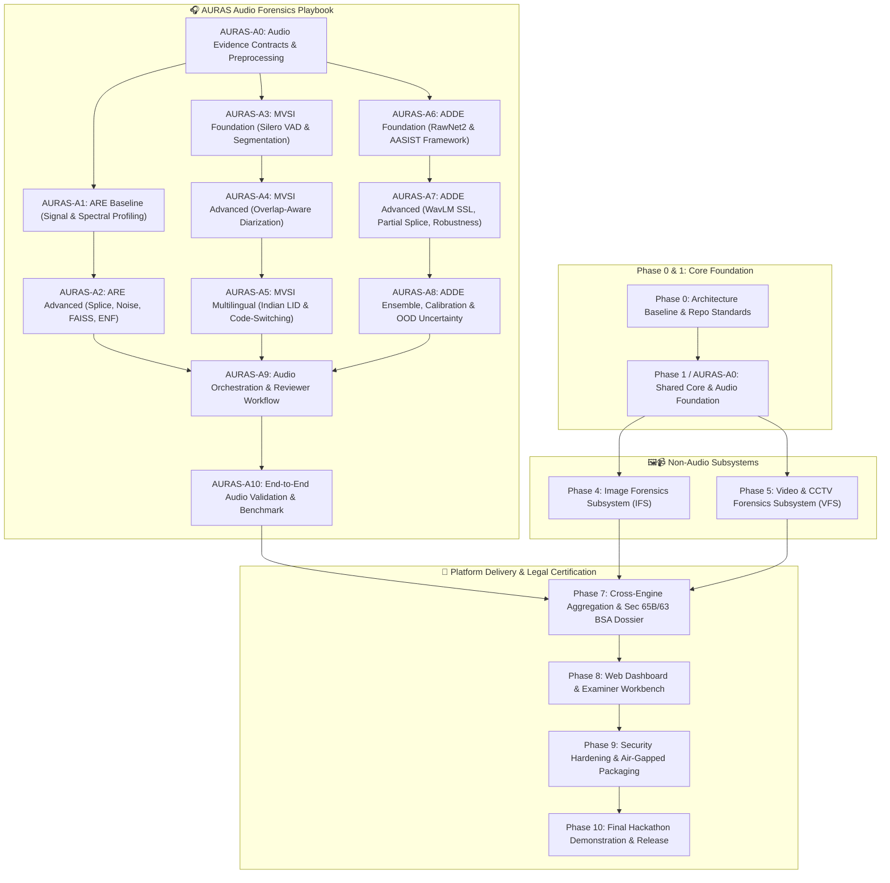

---

## 2. Master Implementation Status Inventory

| Phase ID | Phase Name | Subsystem / Workstream | Status | Prerequisite Gates | Primary Deliverables |
| :--- | :--- | :--- | :--- | :--- | :--- |
| **Phase 0** | Architecture Baseline & Repo Standards | All Subsystems / Docs | `IMPLEMENTED_AND_VERIFIED` | None | PRD, TRD, PHASES, AI_INSTRUCTIONS, pyproject.toml |
| **AURAS-A0**| Audio Evidence Contracts & Ingestion | Shared Core / AURAS | `PLANNED` | Phase 0 Gate | Dual-hasher, WORM vault, artifact manifests, decoder |
| **AURAS-A1**| ARE Baseline: Signal & Spectral Profiling | ARE Engine | `PLANNED` | AURAS-A0 Gate | RMS/clipping metrics, STFT, Welch PSD, spectral flux |
| **AURAS-A2**| ARE Advanced: Splicing, Noise & ENF | ARE Engine | `PLANNED` | AURAS-A1 Gate | PELT splice detector, noise floor tracker, FAISS, ENF |
| **AURAS-A3**| MVSI Foundation: VAD & Segmentation | MVSI Engine | `PLANNED` | AURAS-A0 Gate | Silero VAD, neural speech chunker, pause filtering |
| **AURAS-A4**| MVSI Advanced: Overlap-Aware Diarization | MVSI Engine | `PLANNED` | AURAS-A3 Gate | ECAPA-TDNN, PyAnnote OSD, concurrent speaker timeline |
| **AURAS-A5**| MVSI Multilingual & Speaker-Language | MVSI Engine | `PLANNED` | AURAS-A4 Gate | Whisper/MMS Indian LID, code-switching, language stats |
| **AURAS-A6**| ADDE Foundation: Independent Framework | ADDE Engine | `PLANNED` | AURAS-A0 Gate | RawNet2, AASIST, model registry, sliding windowing |
| **AURAS-A7**| ADDE Advanced: WavLM SSL & Robustness | ADDE Engine | `PLANNED` | AURAS-A6 Gate | WavLM Base+, partial splice localization, CodecFake |
| **AURAS-A8**| ADDE Ensemble, Calibration & OOD | ADDE Engine | `PLANNED` | AURAS-A7 Gate | Platt scaling, late-fusion ensemble, Mahalanobis OOD |
| **AURAS-A9**| Audio Orchestration & Reviewer Workflow | Reporting / AURAS | `PLANNED` | A2, A5, A8 Gates | Finding merger, timeline alignment, Archify JSON IR |
| **AURAS-A10**| End-to-End Audio Validation & Benchmark | Validation / Benchmarks | `PLANNED` | AURAS-A9 Gate | ASVspoof/synthetic benchmark report, test corpus |
| **Phase 4** | Image Forensics Subsystem (IFS) | IFS Engine | `PLANNED` | Phase 1 Gate | EXIF audit, ELA heatmaps, JPEG ghost, SIFT CMFD |
| **Phase 5** | Video & CCTV Forensics Subsystem (VFS) | VFS Engine | `PLANNED` | Phase 1 Gate | CCTV dropped frames, timestamp OCR, audio extractor |
| **Phase 7** | Platform Cross-Engine Reporting | Core Reporting | `PLANNED` | A10, P4, P5 Gates | Section 65B IEA / Section 63 BSA PDF certificate |
| **Phase 8** | Web Dashboard & Examiner Workbench | UI / Presentation | `PLANNED` | Phase 7 Gate | Next.js interactive UI, multi-modal waveform viewer |
| **Phase 9** | Security Hardening & Air-Gapped Packaging | DevOps / Security | `PLANNED` | Phase 8 Gate | Offline Docker containers, POSIX 0400 WORM scripts |
| **Phase 10** | Final Hackathon Demonstration & Release | Quality & Release | `PLANNED` | Phase 9 Gate | Verified demonstration scripts & curated case pack |

---

## 3. Dedicated Audio Forensics Engineering Playbook (AURAS-A0 through AURAS-A10)

### Phase AURAS-A0: Audio Foundation, Evidence Contracts & Preprocessing

**Status:** `PLANNED`

**Objective:**  
Establish the secure, cryptographically verifiable evidentiary foundation for audio processing. Implement bitstream dual-hashing, immutable WORM storage access controls, channel-preserving audio decoding, standardized derived artifact generation, and schema-validated engine contracts without altering original exhibit bytes.

**Scope:**
- *Included:* File ingestion, SHA-256 and SHA3-512 dual hashing, POSIX 0400 WORM write-blocking, FFprobe container audit, Kaiser sinc-resampling (16 kHz), channel downmixing, 2.0s sliding window generation, and transformation lineage manifests.
- *Explicit Exclusions:* Signal anomaly detection (deferred to A1/A2), speech intelligence (deferred to A3/A4/A5), deepfake inference (deferred to A6/A7/A8).

**Prerequisites:**  
Phase 0 architectural baseline completed; `pyproject.toml` and `.env.example` configured.

**Topics & Subtopics:**
1. **Audio Evidence Registration & Ingestion:** Ingest raw audio exhibits (`.wav`, `.mp3`, `.m4a`, `.aac`, `.flac`); assign UUIDv4 `evidence_id`; extract file size and MIME type.
2. **Dual-Hashing Engine:** Stream bytes through chunked SHA-256 and SHA3-512 accumulators (64KB chunks). Compare against optional police seizure hash memos (`trusted_sha256`).
3. **Immutable WORM Vault Management:** Store master raw bytes in `/data/vault_worm/`; enforce POSIX `0400` read-only permissions; verify S3 Object Lock compliance when S3 backend is active.
4. **FFmpeg/FFprobe Decoder Integration:** Safe invocation of FFprobe via `subprocess.run(shell=False)` with argument arrays; extract container streams, sample rate ($f_s$), channel count, bit depth, and duration.
5. **Channel-Preserving Raw Working Representation (Artifact A):** Decode bitstream to uncompressed multi-channel 32-bit float WAV preserving native sample rate.
6. **Normalized Speech Representation (Artifact B):** Downmix to mono ($M = 0.5(L + R)$); resample to 16 kHz using band-limited Kaiser sinc interpolation (`torchaudio.transforms.Resample`).
7. **Standardized Window Slices (Artifact C):** Segment into 2.0-second sliding windows with 0.5-second stride (75% overlap); pad short files with reflective padding.
8. **Transformation Manifest DAG:** For every derived artifact, compute SHA-256 and insert lineage record linking parent `evidence_id`, transformation operator, parameters, and child hash.
9. **Shared Engine Schemas:** Implement Pydantic v2 data models for `AudioEvidence`, `AudioArtifact`, `EngineRun`, and `ForensicFinding`.
10. **Resource Limits & Corrupt-Input Handling:** Enforce max file size quota (500 MB); safely catch truncated bitstreams, corrupted headers, or non-audio payloads without worker crash.

**Execution Workflow:**

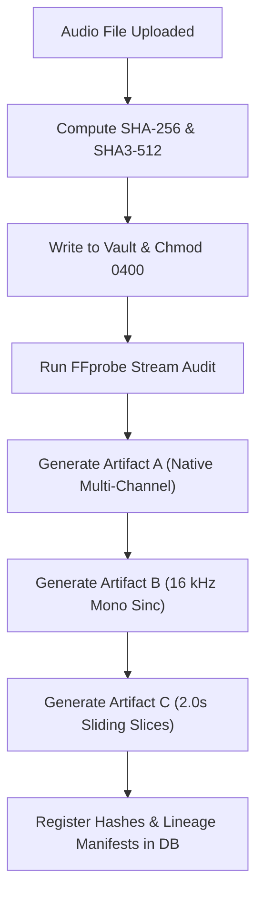

**Validation Strategy:**  
Upload genuine and corrupt audio samples; verify bitstream checksums before and after processing; assert that attempting to modify Artifact files throws `PermissionError`; verify Pydantic schema validation.

**Definition of Done:**  
All ingestion and transformation modules implemented in `src/ps05/core/` and `src/ps05/engines/audio/common/`; unit tests in `tests/unit/test_audio_ingest.py` pass with exit code 0.

**Dependencies & Risks:**  
*Risk:* System FFmpeg version incompatibility. *Mitigation:* Pin FFmpeg $\ge 6.0$ and verify binary presence on application startup.

**Checkpoint Table:**

| Checkpoint ID | Topic / Subtopic | Verification action | Expected evidence | Status | Pass criteria |
| :--- | :--- | :--- | :--- | :--- | :--- |
| **A0-CP-01** | Evidence Hashing | Execute dual-hashing on test WAV fixture | SHA-256 and SHA3-512 matching known fixture checksums | `NOT_STARTED` | Checksums match reference values exactly |
| **A0-CP-02** | WORM Immutability | Attempt to write to stored exhibit file | Caught `PermissionError` (POSIX 0400) | `NOT_STARTED` | File permissions strictly enforce read-only |
| **A0-CP-03** | Artifact Lineage | Query database for generated artifacts A, B, C | Database rows with parent FK and distinct hashes | `NOT_STARTED` | Complete DAG linking parent to derived artifacts |
| **A0-CP-04** | Decoder Robustness | Feed truncated and 0-byte corrupt files | Clean HTTP 422 / validation error response | `NOT_STARTED` | System fails safely without worker crash |

---

### Phase AURAS-A1: ARE Baseline — Integrity, Metadata & Signal Profiling

**Status:** `PLANNED`

**Objective:**  
Implement baseline electroacoustic and physical signal analysis for audio exhibits. Quantify dynamic range, detect clipping and DC offset bias, compute Short-Time Fourier Transform (STFT) spectrograms, and extract container metadata tags.

**Scope:**
- *Included:* ARE-01 (Integrity), ARE-02 (Metadata & DAW audit), ARE-03 (Signal profiling), ARE-04 (Spectral analysis & Welch PSD), high-frequency cutoff detection.
- *Explicit Exclusions:* Splice localization (deferred to A2), diarization (deferred to A3–A5), deepfake inference (deferred to A6–A8).

**Prerequisites:**  
Phase AURAS-A0 Gate passed; working Artifact A (native multi-channel) and Artifact B (16 kHz mono) available.

**Topics & Subtopics:**
1. **Metadata & DAW Signature Audit (ARE-02):** Scan RIFF chunks, ID3 tags, and BWF headers for software signatures (ProTools, Logic, Audacity, FL Studio, Adobe Audition); detect non-standard bitrates and truncated padding.
2. **Electroacoustic Signal Profiling (ARE-03):** Compute RMS energy, true peak, dynamic range (dB), DC offset bias ($\mu_x$), and zero-crossing rate (ZCR) across all audio channels.
3. **Clipping & Dynamic Compression Analysis:** Measure consecutive saturated samples ($|x[n]| \ge 0.9999$); calculate clipping percentage and estimate crest factor.
4. **SNR Estimation:** Implement WADA-SNR algorithm to estimate signal-to-noise ratio in decibels.
5. **Time-Frequency Spectral Analysis (ARE-04):** Compute STFT with Hann window (2048-point FFT, 512 hop size); generate 128-bin log-mel spectrogram; compute Welch Power Spectral Density (PSD).
6. **Spectral Rolloff & High-Frequency Cutoff Estimation:** Estimate upper cutoff frequency ($f_{\text{cutoff}}$) to identify lossy compression boundaries (e.g., 16 kHz cutoff indicative of 128 kbps MP3/AAC).
7. **Spectral Flux Computation:** Calculate first-order spectral difference series $SF[m] = \sum_k |X[k, m] - X[k, m-1]|^2$ for downstream change-point localization.
8. **Channel Phase & Balance Correlation:** For stereo recordings, evaluate inter-channel phase difference (IPD) and channel cross-correlation.
9. **Structured Signal Finding Serialization:** Wrap all electroacoustic metrics into `ARESegmentFindings` Pydantic models.
10. **Regression & Synthetic Testing:** Test against pure sine waves, synthetic clipped audio, and clean vs. lossy compressed files.

**Execution Workflow:**

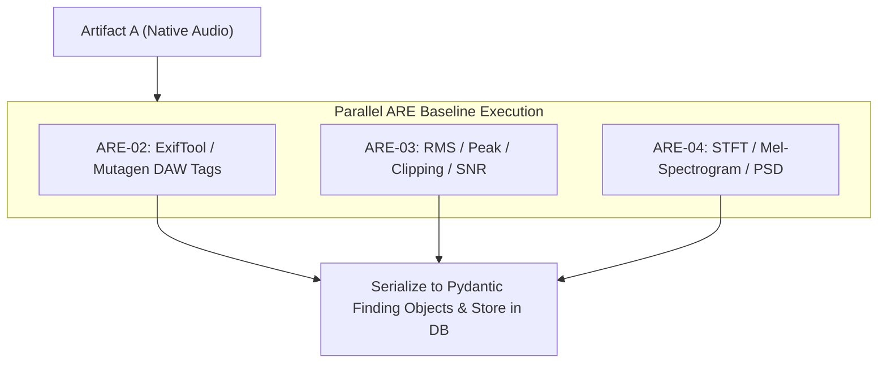

**Validation Strategy:**  
Execute unit tests on synthetic audio fixtures with injected DC offset ($+0.05$), 100 clipped samples, and a 1 kHz sine wave; verify that measured parameters match ground-truth values within 1% tolerance.

**Definition of Done:**  
Modules `src/ps05/engines/audio/are/signal.py` and `spectral.py` implemented; `tests/unit/test_are_signal.py` passes 100%.

**Dependencies & Risks:**  
*Risk:* Memory exhaustion on long 2-hour recordings during STFT. *Mitigation:* Chunk STFT computation in 5-minute blocks.

**Checkpoint Table:**

| Checkpoint ID | Topic / Subtopic | Verification action | Expected evidence | Status | Pass criteria |
| :--- | :--- | :--- | :--- | :--- | :--- |
| **A1-CP-01** | Clipping Counting | Run signal profiler on fixture with 100 clipped peaks | `clip_count == 100` | `NOT_STARTED` | Exact sample count match |
| **A1-CP-02** | DAW Signature Tagging | Inspect WAV file exported from Audacity | `daw_tags_found == ["Audacity"]` | `NOT_STARTED` | Accurately identifies editing workstation |
| **A1-CP-03** | Spectral Cutoff | Compute PSD on 128 kbps MP3 file | High-frequency cutoff flagged at $\approx 16.0\text{ kHz}$ | `NOT_STARTED` | Cutoff localized within $\pm 200\text{ Hz}$ |
| **A1-CP-04** | Signal Schema Validity | Validate output dictionary against `SignalProfile` | Pydantic validation passes without error | `NOT_STARTED` | All numeric fields within defined ranges |

---

### Phase AURAS-A2: ARE Advanced — Edit, Splice, Noise, Repetition & ENF

**Status:** `PLANNED`

**Objective:**  
Implement advanced signal-level tampering detection: localizing candidate edit/splice points via change-point algorithms, tracking ambient noise-floor stationarity, detecting duplicated/cloned phrases via FAISS acoustic self-similarity, and extracting 50 Hz Electric Network Frequency (ENF).

**Scope:**
- *Included:* ARE-05 (Splice detection via PELT), ARE-06 (Noise consistency), ARE-07 (FAISS repetition), ARE-08 (Codec re-encoding), ARE-09 (ENF forensics), ARE-10 (Acoustic manifests).
- *Explicit Exclusions:* Speaker identification (deferred to MVSI), deepfake neural classification (deferred to ADDE).

**Prerequisites:**  
Phase AURAS-A1 Gate passed; spectral flux and STFT spectrograms operational.

**Topics & Subtopics:**
1. **Change-Point Splice Detection (ARE-05):** Apply Pruned Exact Linear Time (PELT) change-point search on spectral flux and short-time energy series using RBF kernel (`ruptures` library).
2. **Splice Candidate Boundary Localization:** Filter change-points by energy jump magnitude ($> 3\sigma$); pinpoint candidate edit timestamps ($\pm 50\text{ ms}$).
3. **Ambient Noise Floor Tracking (ARE-06):** Implement Martin's minimum statistics spectral subtraction to extract stationary background room tone; flag abrupt noise floor shifts ($> 4\text{ dB}$).
4. **Reverberation & Room Acoustic Discontinuity:** Track early-to-late reverberation energy ratio across speech pauses.
5. **MFCC Acoustic Feature Extraction:** Extract 13 MFCC coefficients over 25ms frames with 10ms hop length for acoustic fingerprinting.
6. **FAISS Self-Similarity Search (ARE-07):** Build FAISS index of normalized MFCC vectors; compute full pairwise cosine similarity matrix; search for off-diagonal matching trajectories ($> 1.0\text{ s}$, similarity $> 0.92$).
7. **Candidate Repeated Phrase Verification:** Verify candidate cloned segments using cross-correlation to distinguish natural speech repetition from copy-pasted audio clones.
8. **Codec Re-Encoding Analysis (ARE-08):** Analyze MDCT quantization error patterns and rolloff steepness to detect multi-pass lossy compression.
9. **50 Hz ENF Grid Extraction (ARE-09):** Bandpass filter audio between 49.8 Hz and 50.2 Hz (8th-order Butterworth); compute analytic signal via Hilbert transform; track instantaneous frequency.
10. **ENF Grid Log Correlation:** Compare extracted ENF curve against reference state electrical grid database (when reference logs are available); output Pearson correlation coefficient $r$.
11. **Signed Acoustic Manifest Generation (ARE-10):** Compile all signal findings into an immutable JSON manifest signed with examiner private key.
12. **Alternative Explanations & False-Positive Evaluation:** Distinguish benign microphone bumps from manual splices; flag low-SNR conditions where ENF is unextractable.
13. **Benchmark Corpus Testing:** Run on synthetic splice dataset (20 spliced audio tracks, 20 untampered controls).

**Execution Workflow:**

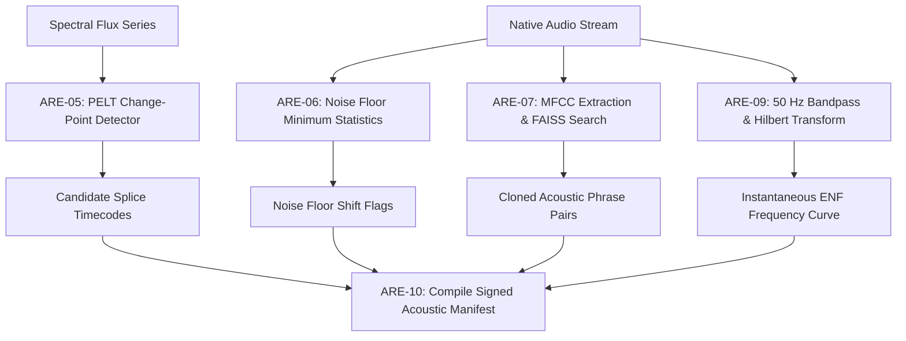

**Validation Strategy:**  
Inject a 500ms tone or spliced spoken phrase into 10 test audio tracks at known millisecond timestamps; verify that ARE-05 detects the splice boundary within $\pm 50\text{ ms}$; verify that untampered controls produce 0 false-positive splice alarms above threshold.

**Definition of Done:**  
Modules `src/ps05/engines/audio/are/edit_detect.py`, `noise.py`, `repetition.py`, and `enf.py` implemented; unit tests in `tests/unit/test_are_splice.py` pass.

**Dependencies & Risks:**  
*Risk:* Heavy lossy compression obscuring ENF signal. *Mitigation:* Explicitly mark ENF as `INCONCLUSIVE_NO_USABLE_ENF` when SNR $< 6\text{ dB}$.

**Checkpoint Table:**

| Checkpoint ID | Topic / Subtopic | Verification action | Expected evidence | Status | Pass criteria |
| :--- | :--- | :--- | :--- | :--- | :--- |
| **A2-CP-01** | Splice Localization | Run PELT detector on audio with injected splice at $T=02.500\text{s}$ | Flagged splice interval covers $02.450\text{s} - 02.550\text{s}$ | `NOT_STARTED` | Localization error $\le \pm 50\text{ ms}$ |
| **A2-CP-02** | Noise Floor Tracking | Ingest audio with background room tone step jump ($+6\text{ dB}$) | Anomaly alert flagged with start/end timecode | `NOT_STARTED` | Detects jump $> 4\text{ dB}$ lasting $> 200\text{ ms}$ |
| **A2-CP-03** | Repeated Phrases | Test audio with identical duplicated sentence | Segment pair identified with similarity $> 0.92$ | `NOT_STARTED` | Accurately identifies cloned intervals |
| **A2-CP-04** | ENF Availability | Extract ENF from clean mains-connected studio recording | Frequency curve centered at $50.0 \pm 0.15\text{ Hz}$ | `NOT_STARTED` | Instantaneous frequency tracked cleanly |

---

### Phase AURAS-A3: MVSI Foundation — VAD & Speech Segmentation

**Status:** `PLANNED`

**Objective:**  
Implement voice activity detection (VAD), acoustic quality gating, and neural speech segmentation to isolate genuine speech intervals from non-speech background, silence, and environmental static.

**Scope:**
- *Included:* MVSI-01 (Audio quality assessment), MVSI-02 (Silero VAD / WebRTC VAD), MVSI-03 (Neural speech segmentation), temporal smoothing hysteresis.
- *Explicit Exclusions:* Speaker clustering and diarization (deferred to A4), language ID (deferred to A5).

**Prerequisites:**  
Phase AURAS-A0 Gate passed; working Artifact B (16 kHz mono normalized WAV) available.

**Topics & Subtopics:**
1. **Audio Quality Pre-Gating (MVSI-01):** Assess signal quality before speech processing. If SNR $< 5\text{ dB}$ or clipping $> 5\%$, issue an `AUDIO_QUALITY_DEGRADED` warning.
2. **Silero VAD v4 Integration (MVSI-02):** Load pre-packaged TorchScript model (`vad-silero-v4`); stream 16 kHz audio chunks (512 samples); calculate frame-level speech probabilities $P(\text{speech})$.
3. **WebRTC VAD Baseline Fallback:** Provide lightweight CPU-only WebRTC VAD baseline for low-power triage.
4. **Temporal Smoothing & Hysteresis:** Apply speech threshold ($P_{\text{start}} = 0.50$, $P_{\text{end}} = 0.35$); enforce minimum speech duration ($250\text{ ms}$) and minimum silence duration ($100\text{ ms}$) to avoid cutting words mid-phoneme.
5. **Speech Segmentation & Chunker (MVSI-03):** Slice continuous speech stream into discrete acoustic turns bounded by pauses.
6. **Speech Duty Cycle Metric:** Calculate total active speech time vs. total recording duration.
7. **Quiet Speech & Noisy Audio Robustness:** Evaluate VAD performance on low-amplitude whispers and noisy roadside audio.
8. **Speech Interval Schema Serialization:** Serialize output into `List[SpeechInterval(start_sec, end_sec, avg_prob, snr_db)]`.
9. **CPU/GPU Resource Optimization:** Run Silero VAD on CPU using INT8 quantization to preserve GPU VRAM for deepfake models.
10. **Unit Testing on Synthetic Speech/Silence Fixtures:** Validate boundary detection on synthetic alternating 2.0s speech and 1.0s silence audio.

**Execution Workflow:**

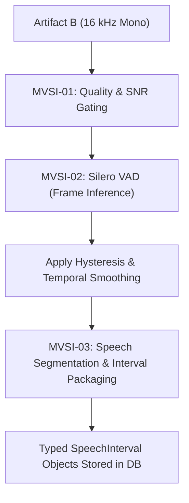

**Validation Strategy:**  
Run VAD test suite against 10 clean conversational clips and 5 noisy background controls; assert false alarm rate $< 5\%$ and speech boundary timing accuracy within $\pm 30\text{ ms}$.

**Definition of Done:**  
Modules `src/ps05/engines/audio/mvsi/vad.py` and `segmentation.py` implemented; `tests/unit/test_mvsi_vad.py` passes 100%.

**Dependencies & Risks:**  
*Risk:* High background noise causing speech fragmentation. *Mitigation:* Dynamic threshold adaptation based on estimated background noise floor.

**Checkpoint Table:**

| Checkpoint ID | Topic / Subtopic | Verification action | Expected evidence | Status | Pass criteria |
| :--- | :--- | :--- | :--- | :--- | :--- |
| **A3-CP-01** | Speech Isolation | Ingest 10-second audio with 4.0s speech and 6.0s silence | Extracted intervals total $4.0 \pm 0.15\text{ s}$ | `NOT_STARTED` | Accurate speech duty cycle |
| **A3-CP-02** | Quiet Speech Sensitivity | Test whisper audio sample (peak $-25\text{ dBFS}$) | Speech interval detected without truncation | `NOT_STARTED` | Detects speech above $-30\text{ dBFS}$ |
| **A3-CP-03** | Low Quality Warning | Test audio with synthetic SNR $= 3\text{ dB}$ | Emits `AUDIO_QUALITY_DEGRADED` warning | `NOT_STARTED` | Low SNR flagged explicitly |
| **A3-CP-04** | Runtime Latency | Process 5-minute audio track on 4-core CPU | Execution completes in $< 2.0\text{ seconds}$ | `NOT_STARTED` | Faster than $150\times$ real-time on CPU |

---

### Phase AURAS-A4: MVSI Advanced — Overlap-Aware Speaker Diarization

**Status:** `PLANNED`

**Objective:**  
Implement end-to-end speaker diarization supporting simultaneous overlapping speech. Extract high-dimensional speaker embeddings, cluster speaker turns, and produce multi-label "who spoke when" timelines allowing concurrent speaker activity.

**Scope:**
- *Included:* MVSI-04 (Overlapped Speech Detection), MVSI-05 (ECAPA-TDNN embeddings), MVSI-06 (Agglomerative clustering), MVSI-07/08 (Overlap-aware diarization timeline).
- *Explicit Exclusions:* Language identification (deferred to A5), speech-to-text transcription (optional in A5).

**Prerequisites:**  
Phase AURAS-A3 Gate passed; speech segments and intervals operational.

**Topics & Subtopics:**
1. **Overlapped Speech Detection (OSD) (MVSI-04):** Apply PyAnnote OSD model on speech frames; output framewise multi-talker overlap probabilities $P(\text{overlap})$.
2. **Speaker Representation Extraction (MVSI-05):** Extract 192-dimensional speaker embeddings using SpeechBrain ECAPA-TDNN (`emb-ecapa-tdnn`) over segmented speech turns.
3. **Embedding Normalization & Centroid Tracking:** Apply length normalization ($L_2$) and compute running speaker centroids.
4. **Speaker Clustering (MVSI-06):** Cluster embeddings using Agglomerative Hierarchical Clustering (AHC) with cosine distance thresholding or Spectral Clustering.
5. **Conservative Speaker Count Estimation:** Handle unknown speaker counts using eigengap heuristic; avoid over-clustering uncertain background voices.
6. **Overlap-Aware Timeline Assembly (MVSI-07/08):** Combine single-speaker cluster tracks with OSD overlap intervals to produce multi-label timelines:
   - Example: Interval $T_1$ has `["SPEAKER_00"]`, Interval $T_2$ has `["SPEAKER_00", "SPEAKER_01"]`.
7. **Simultaneous Multi-Speaker Data Model:** Enforce database schema where `speaker_segments` table includes `is_overlapped` and `concurrent_speakers JSONB`.
8. **Ambiguous Assignment & Low-Confidence Gating:** Flag segments where distance to nearest centroid is close to cluster threshold as `UNCERTAIN_SPEAKER_ASSIGNMENT`.
9. **Diarization Error Rate (DER) Evaluation:** Evaluate on benchmark multi-talker audio; calculate DER, Jaccard Error Rate (JER), and missed overlap rate.
10. **Separation Model Boundary:** Source separation models (e.g., Conv-TasNet) are documented as optional listening aids only; they **never** alter the master evidence file.

**Execution Workflow:**

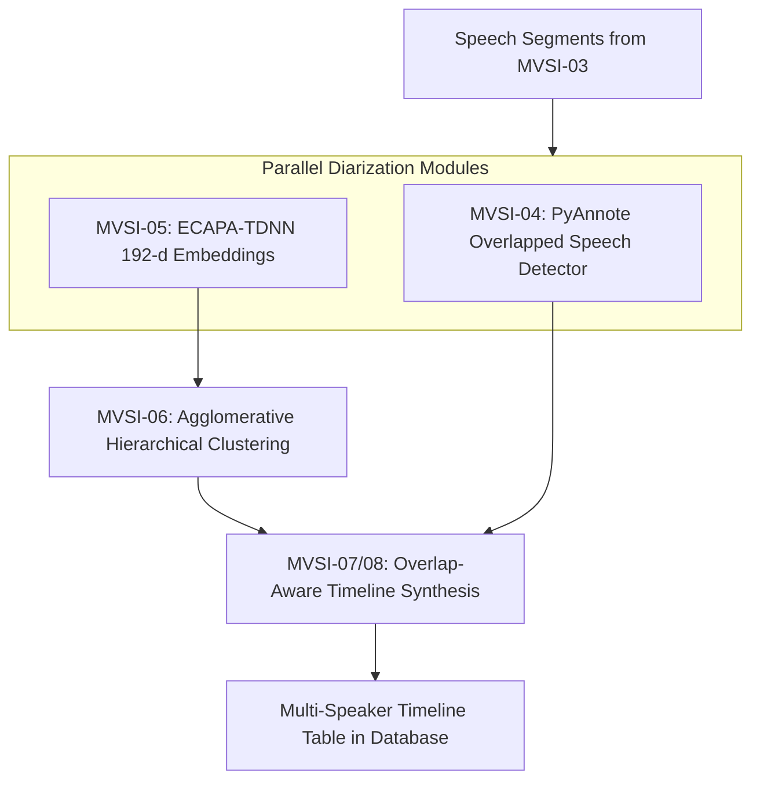

**Validation Strategy:**  
Run diarization on 5 multi-speaker conversations containing known overlapping turns; verify that overlapping intervals contain at least 2 active speaker labels; assert overall DER $< 18\%$.

**Definition of Done:**  
Modules `src/ps05/engines/audio/mvsi/embeddings.py`, `osd.py`, and `diarization.py` implemented; `tests/unit/test_mvsi_diarization.py` passes 100%.

**Dependencies & Risks:**  
*Risk:* Speaker clustering fragmentation when speakers whisper or shout. *Mitigation:* Use PLDA scoring and length-normalized ECAPA-TDNN embeddings.

**Checkpoint Table:**

| Checkpoint ID | Topic / Subtopic | Verification action | Expected evidence | Status | Pass criteria |
| :--- | :--- | :--- | :--- | :--- | :--- |
| **A4-CP-01** | Overlap Preservation | Diarize audio with known simultaneous dialogue (Speaker A & B) | Timeline displays interval with both Speaker A and B active | `NOT_STARTED` | Multi-label overlap accurately logged |
| **A4-CP-02** | Diarization Accuracy | Run DER benchmark on 3-speaker meeting audio | `DER < 18.0%` | `NOT_STARTED` | Benchmark threshold achieved |
| **A4-CP-03** | Stable Speaker Labels | Run diarization 3 times on identical audio hash | Identical speaker cluster count and turn bounds | `NOT_STARTED` | Deterministic clustering reproducibility |
| **A4-CP-04** | Three-Way Overlap | Test synthetic multi-track mix of 3 concurrent talkers | Timeline supports 3 active concurrent speaker tags | `NOT_STARTED` | No single-speaker exclusivity forced |

---

### Phase AURAS-A5: MVSI Multilingual & Speaker-Language Analytics

**Status:** `PLANNED`

**Objective:**  
Implement multilingual spoken language identification (LID), intra-utterance code-switching detection, and aggregated speaker-language analytics across Scheduled Indian Languages and regional Hindi dialects.

**Scope:**
- *Included:* MVSI-09 (Multilingual LID), MVSI-10 (Code-switch boundary detector), MVSI-11 (Optional forensic ASR), MVSI-12 (Speaker-language analytics matrix), Indian language database registry.
- *Explicit Exclusions:* Deepfake classification (deferred to A6–A8).

**Prerequisites:**  
Phase AURAS-A4 Gate passed; speaker segments and diarization timeline available.

**Topics & Subtopics:**
1. **Extensible Indian Language Registry:** Populate `language_registry` table covering Scheduled Indian Languages (Hindi, Bengali, Tamil, Telugu, etc.) and regional Bihar dialects (Bhojpuri, Maithili, Magahi).
2. **Multilingual Spoken Language Identification (MVSI-09):** Pass segmented speech audio through OpenAI Whisper Medium LID head and Meta MMS-LID; output top-3 language hypotheses with confidence scores.
3. **Catalogue Coverage vs. Validated Model Support:** Maintain clear separation between catalogued languages, models with claimed support, and benchmark-validated languages.
4. **Sliding-Window Language Tracking:** Apply 1.0s sliding window with 0.25s stride across speech turns to detect language changes.
5. **Intra-Utterance Code-Switching Detection (MVSI-10):** Identify transition boundaries where language probability crosses threshold (e.g., Hindi $\to$ English); refine boundary timestamp.
6. **Speaker Identity $\neq$ Language Identity Invariant:** Guarantee that a speaker switching languages retains their singular `speaker_label`.
7. **Optional Forensic ASR Transcription (MVSI-11):** Generate text transcripts using Faster-Whisper / MMS ASR as an investigatory aid; embed legal disclaimer that transcripts are supplementary.
8. **Speaker-Language Analytics Matrix (MVSI-12):** Compute aggregate statistics: total speaking time per speaker, language percentage breakdown per speaker, and cross-speaker interaction metrics.
9. **Overlap-Aware Speaking Duration Calculation:** Ensure simultaneous overlapping speech correctly attributes talk time to both concurrent speakers without artificial truncation.
10. **Unsupported Language & Dialect Uncertainty:** If top language confidence $< 0.40$, label as `UNCLASSIFIED_REGIONAL_DIALECT` with uncertainty warning.

**Execution Workflow:**

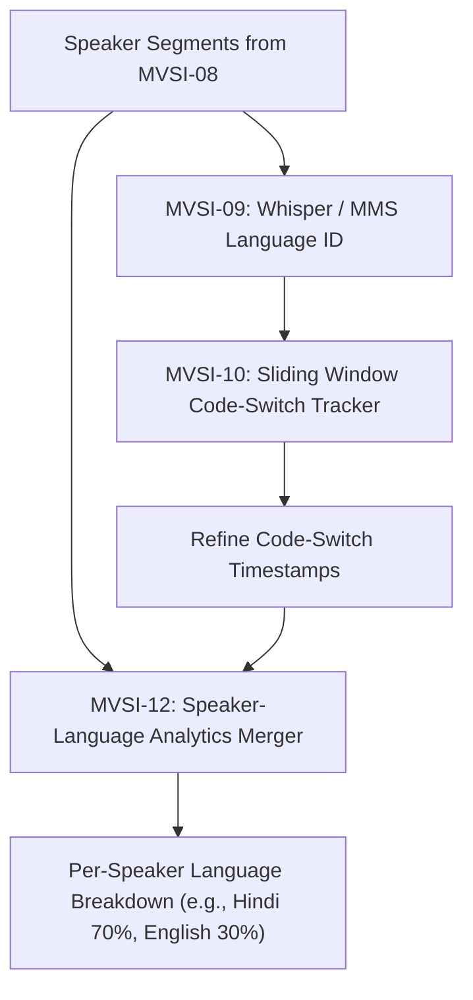

**Validation Strategy:**  
Test against bilingual audio clips (Hinglish, Bhojpuri-Hindi); verify that code-switching boundaries are detected within $\pm 200\text{ ms}$; verify that speaker cluster count remains 1 for a single speaker code-switching.

**Definition of Done:**  
Modules `src/ps05/engines/audio/mvsi/language_id.py`, `code_switch.py`, and `registry.py` implemented; `tests/unit/test_mvsi_multilingual.py` passes.

**Dependencies & Risks:**  
*Risk:* Low-resource dialects (Magahi, Maithili) misclassified as standard Hindi. *Mitigation:* Explicitly record regional variant tags and output confidence ranges.

**Checkpoint Table:**

| Checkpoint ID | Topic / Subtopic | Verification action | Expected evidence | Status | Pass criteria |
| :--- | :--- | :--- | :--- | :--- | :--- |
| **A5-CP-01** | Speaker Invariant | Process Hinglish recording of 1 speaker switching languages | Total speaker count $= 1$; language tags show both `hin` and `eng` | `NOT_STARTED` | Single speaker retained across languages |
| **A5-CP-02** | Language Classification | Run LID on clean Hindi, Bengali, and Tamil audio clips | Top-1 predicted language matches ground truth | `NOT_STARTED` | Accuracy $> 90\%$ on clean primary languages |
| **A5-CP-03** | Code-Switch Boundary | Test sentence switching from Hindi to English at $T=03.200\text{s}$ | Code-switch flagged at $03.200 \pm 0.250\text{ s}$ | `NOT_STARTED` | Transition boundary localized |
| **A5-CP-04** | Duration Aggregation | Verify duration summary for 2-minute conversation | Sum of per-speaker durations matches ground truth | `NOT_STARTED` | Duration calculation error $< 1.0\text{ s}$ |

---

### Phase AURAS-A6: ADDE Foundation — Independent Detector Framework

**Status:** `PLANNED`

**Objective:**  
Establish the dedicated, decoupled package boundary and model execution framework for the Audio Deepfake Detection Engine (ADDE). Implement standardized sliding-window preprocessing, integrate baseline neural detectors (RawNet2 and AASIST), and enforce pinned model manifests.

**Scope:**
- *Included:* ADDE-01 (Preprocessing & sliding windows), ADDE-02 (RawNet2), ADDE-03 (AASIST), model registry, checkpoint verification, and failure isolation.
- *Explicit Exclusions:* Advanced foundation SSL models (deferred to A7), calibration and late-fusion ensemble (deferred to A8).

**Prerequisites:**  
Phase AURAS-A0 Gate passed; working Artifact C (standardized 2.0s sliding slices at 16 kHz) available.

**Topics & Subtopics:**
1. **Independent ADDE Package Boundary:** Structure `src/ps05/engines/audio/adde/` as an autonomous package with its own configuration, exceptions, and execution contracts.
2. **Sliding-Window Preprocessing Contract (ADDE-01):** Slice audio into 2.0-second frames with 0.5-second stride ($32000$ samples at 16 kHz); zero-pad tail frames; apply energy-based silence masking.
3. **Model Registry & Cryptographic Checksum Verification:** Register `df-rawnet2-v1` and `df-aasist-v2`; verify checkpoint SHA-256 hashes upon model loading.
4. **RawNet2 Baseline Implementation (ADDE-02):** Implement time-domain raw waveform classifier with sinc-convolution front-end; output raw logit $z_{\text{raw}}$.
5. **AASIST Baseline Implementation (ADDE-03):** Implement Audio Anti-Spoofing using Integrated Spectro-Temporal Graph Attention; construct spectral and temporal graphs; output raw logit $z_{\text{aasist}}$.
6. **Execution Isolation from ARE/MVSI:** Ensure ADDE runs independently without requiring ARE or MVSI outputs.
7. **Model Loading & Memory Management:** Implement lazy loading; support automatic device placement (CUDA with CPU fallback).
8. **Inference Exception Handling:** Safely catch GPU Out-Of-Memory (OOM) errors; automatically fallback to CPU sliding-window inference with warning log.
9. **ADDE Finding Schema:** Define typed Pydantic models for raw window scores and per-detector outputs.
10. **Test Fixtures & Synthetic Forward Passes:** Create unit tests verifying forward-pass execution on dummy $1 \times 32000$ audio tensors.

**Execution Workflow:**

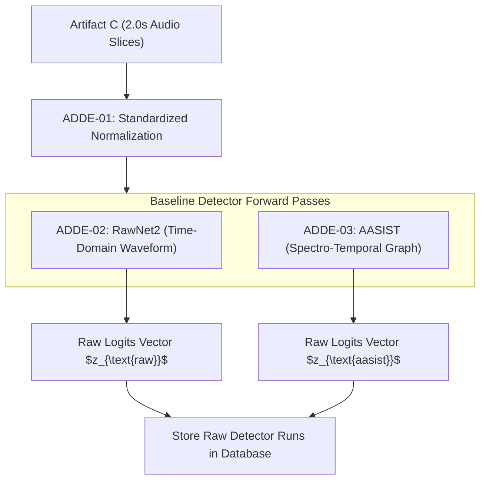

**Validation Strategy:**  
Execute unit tests loading RawNet2 and AASIST architectures with mock weights; assert output logit tensor shapes match $(B, 2)$ where $B$ is batch size; verify that missing checkpoint raises explicit `ModelCheckpointNotFoundError`.

**Definition of Done:**  
Modules `src/ps05/engines/audio/adde/preprocess.py`, `rawnet2.py`, and `aasist.py` implemented; `tests/unit/test_adde_foundation.py` passes 100%.

**Dependencies & Risks:**  
*Risk:* PyTorch CUDA version mismatch on target police server. *Mitigation:* Pin PyTorch 2.2+ CPU/CUDA compatibility and test on both environments.

**Checkpoint Table:**

| Checkpoint ID | Topic / Subtopic | Verification action | Expected evidence | Status | Pass criteria |
| :--- | :--- | :--- | :--- | :--- | :--- |
| **A6-CP-01** | Standalone Execution | Run ADDE on audio file without running ARE or MVSI | Returns structured deepfake findings | `NOT_STARTED` | Operates completely independently |
| **A6-CP-02** | Checkpoint Integrity | Verify model checkpoint loading against manifest hash | Checksum matches `df-rawnet2-v1` hash | `NOT_STARTED` | Pinned model weights verified |
| **A6-CP-03** | Forward Pass | Execute RawNet2 and AASIST on 2.0s audio tensor | Output logits of shape `(1, 2)` produced | `NOT_STARTED` | Clean forward-pass execution |
| **A6-CP-04** | GPU Fallback | Force CUDA OOM simulation during inference | System catches error, falls back to CPU, completes | `NOT_STARTED` | Graceful CPU degradation |

---

### Phase AURAS-A7: ADDE Advanced — Models, SSL & Multilingual Robustness

**Status:** `PLANNED`

**Objective:**  
Integrate self-supervised speech foundation models (WavLM Base+), spectral vocoder classifiers (LFCC/CQCC + Light-CNN), sliding-window partial manipulation localization, and lossy codec robustness testing (CodecFake).

**Scope:**
- *Included:* ADDE-04 (WavLM foundation SSL), ADDE-05 (Spectral vocoder classifier), ADDE-06 (Codec robustness), ADDE-07 (Partial manipulation localization).
- *Explicit Exclusions:* Late-fusion ensembling and calibration (deferred to A8).

**Prerequisites:**  
Phase AURAS-A6 Gate passed; baseline detector framework operational.

**Topics & Subtopics:**
1. **Self-Supervised Speech Foundation Model (ADDE-04):** Integrate WavLM Base+ pre-trained encoder; attach binary classification head; output foundation model logit $z_{\text{wavlm}}$.
2. **Spectral Vocoder Artifact Classifier (ADDE-05):** Extract 60 Linear Frequency Cepstral Coefficients (LFCC) and Constant Q Cepstral Coefficients (CQCC); classify via 9-layer Light-CNN to detect parametric vocoder synthesis.
3. **Sliding-Window Partial Manipulation Localization (ADDE-07):** Align sliding window scores ($0.5\text{s}$ stride) along time axis; apply median smoothing ($w = 3$ frames) to identify short spliced synthetic phrases.
4. **Short-Interval Preservation:** Prevent temporal smoothing from erasing brief synthetic word insertions ($> 500\text{ ms}$).
5. **Codec-Oriented Robustness Evaluation (ADDE-06):** Evaluate detection resilience against lossy VoIP and mobile codecs (AMR-WB, Opus 6kbps, AAC 64kbps, G.711).
6. **Re-Encoding Simulation Layer:** Simulate codec degradation on validation sets to evaluate false-alarm rates on compressed authentic speech.
7. **Multilingual Deepfake Generalization:** Evaluate foundation models across Indian language speech samples to quantify dialectal false positives.
8. **Speaker-Disjoint and Generator-Disjoint Splits:** Guarantee evaluation datasets avoid speaker identity leakage or seen-generator overfitting.
9. **Dataset Provenance & Licensing Audit:** Verify licensing compliance for evaluation datasets (ASVspoof 2019/2021, WaveFake, In-the-Wild).
10. **Benchmark Metric Calculation:** Compute Equal Error Rate (EER) and Area Under ROC Curve (ROC-AUC) per individual detector branch.

**Execution Workflow:**

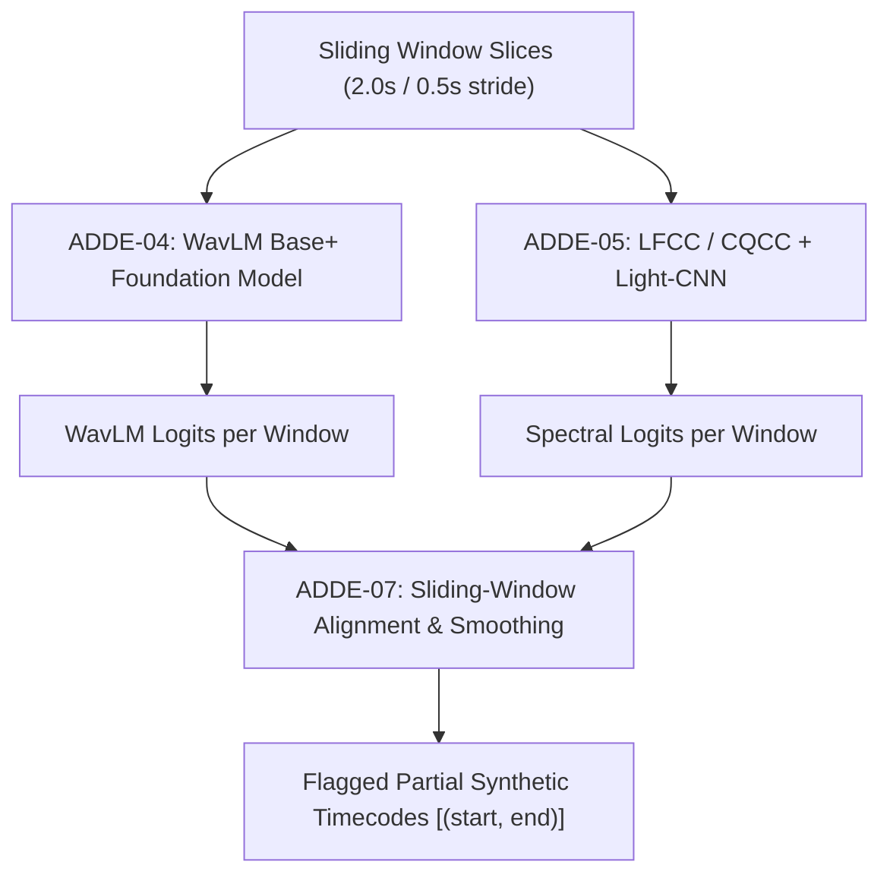

**Validation Strategy:**  
Create test audio with a 1.5-second ElevenLabs synthetic voice clone inserted inside a 30-second genuine recording; verify that ADDE-07 localizes the synthetic interval within $\pm 250\text{ ms}$ boundary precision; assert individual detector EER $< 7.0\%$.

**Definition of Done:**  
Modules `src/ps05/engines/audio/adde/ssl_wavlm.py`, `spectral.py`, and `codec_robust.py` implemented; unit tests in `tests/unit/test_adde_advanced.py` pass.

**Dependencies & Risks:**  
*Risk:* WavLM VRAM usage on low-spec hardware. *Mitigation:* Apply dynamic batching ($B=1$) and half-precision (FP16) inference.

**Checkpoint Table:**

| Checkpoint ID | Topic / Subtopic | Verification action | Expected evidence | Status | Pass criteria |
| :--- | :--- | :--- | :--- | :--- | :--- |
| **A7-CP-01** | Partial Splice Localization | Test audio with 2.0s synthetic insert at $T=05.000\text{s}$ | Flagged manipulated interval covers $04.800\text{s} - 07.200\text{s}$ | `NOT_STARTED` | Localizes partial synthetic insert |
| **A7-CP-02** | WavLM Foundation Inference | Run WavLM branch on speech audio slice | Produces classification logit and 768-d embedding | `NOT_STARTED` | Clean forward-pass execution |
| **A7-CP-03** | Codec Robustness | Evaluate detector on audio transcoded via Opus 12kbps | Emits codec warning if compression degrades score | `NOT_STARTED` | Accurately manages lossy compression |
| **A7-CP-04** | Disjoint Data Splits | Inspect evaluation split code | Asserts zero speaker overlap between train and test | `NOT_STARTED` | Zero data leakage in evaluation |

---

### Phase AURAS-A8: ADDE Ensemble, Calibration & Forensic Interpretation

**Status:** `PLANNED`

**Objective:**  
Implement score calibration (Platt scaling / temperature scaling), quality-weighted late fusion ensembling, Mahalanobis distance out-of-distribution (OOD) uncertainty estimation, and standalone 1:1 speaker verification.

**Scope:**
- *Included:* ADDE-08 (1:1 speaker verification), ADDE-09 (Calibration), ADDE-10 (Late fusion ensemble), ADDE-11 (OOD uncertainty), ADDE-12 (Suspicion heatmaps & report visuals).
- *Explicit Exclusions:* Unified reporting integration (deferred to A9).

**Prerequisites:**  
Phase AURAS-A7 Gate passed; all four detector branches (RawNet2, AASIST, WavLM, Spectral) operational.

**Topics & Subtopics:**
1. **Probability Calibration via Platt Scaling (ADDE-09):** Fit logistic sigmoid parameters $(A_i, B_i)$ on held-out validation data to convert raw logits into posterior probabilities $p_i \in [0, 1]$.
2. **Temperature Scaling Evaluation:** Compare Platt scaling against temperature scaling $p_i = \sigma(z_i / T)$; verify Expected Calibration Error (ECE $< 0.05$).
3. **Quality-Weighted Late Fusion Ensemble (ADDE-10):** Compute composite deepfake score $P(\text{fake}) = \sum w_i p_i$; adjust weights $w_i$ based on SNR and codec indicators.
4. **Detector Disagreement Reporting:** If discrepancy between detectors $\max(p_i) - \min(p_i) > 0.50$, generate `DETECTOR_DISAGREEMENT_WARNING` with breakdown.
5. **Mahalanobis Distance OOD Detection (ADDE-11):** Calculate embedding distance $D_M(x)$ against training distribution centroid in WavLM embedding space; emit `OOD_UNCERTAINTY: HIGH` when $D_M(x) > \text{Threshold}$.
6. **Synthetic Speech vs. Voice Conversion Separation:** Differentiate between fully synthesized text-to-speech (TTS) and voice conversion (VC).
7. **Standalone 1:1 Reference Speaker Verification (ADDE-08):** Compare questioned voice against authorized reference recording using ECAPA-TDNN cosine distance. Strictly maintain separation from deepfake score.
8. **Forensic Suspicion Curve Generation (ADDE-12):** Generate time-aligned millisecond suspicion curve and PNG heatmap artifact for examiner review.
9. **False-Positive & Conclusiveness Balancing:** Ensure low-quality, noisy, or out-of-distribution inputs output `INCONCLUSIVE` rather than false-positive alarms.
10. **Comprehensive Ensemble Benchmarking:** Benchmark ensemble on ASVspoof 2019/2021 and in-the-wild test sets; assert composite EER $< 5.5\%$, ROC-AUC $> 0.96$.

**Execution Workflow:**

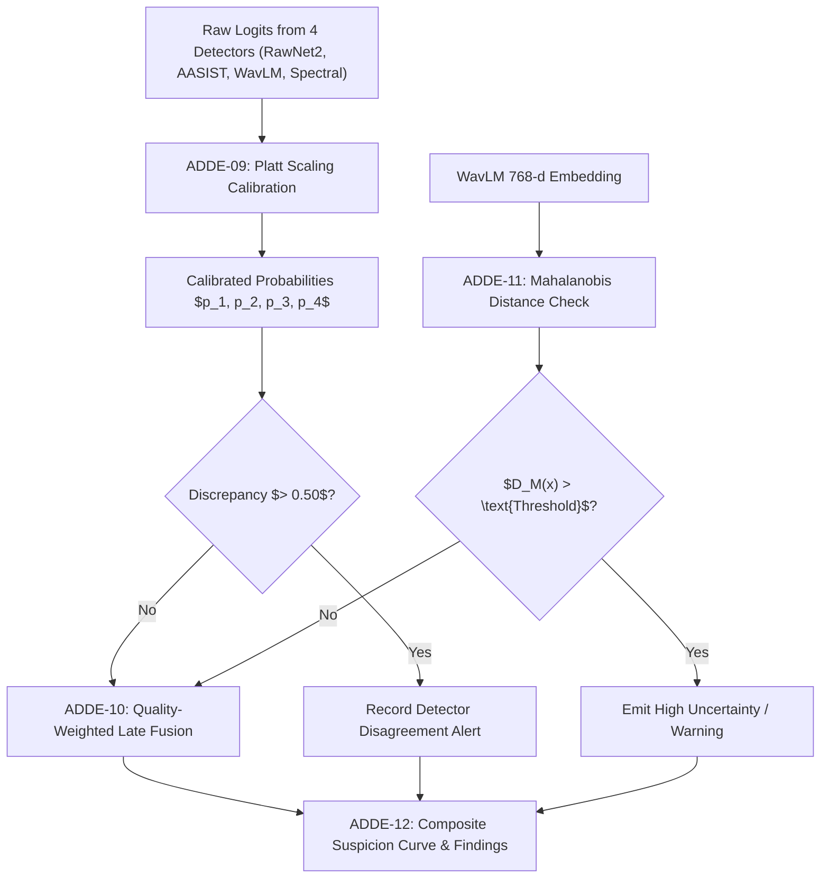

**Validation Strategy:**  
Evaluate calibrated ensemble on 100 genuine and 100 spoofed test samples; verify that Brier score $< 0.08$ and ECE $< 0.05$; assert that extreme white noise input triggers OOD uncertainty rather than a false deepfake detection.

**Definition of Done:**  
Modules `src/ps05/engines/audio/adde/calibration.py`, `ensemble.py`, `ood.py`, and `verification.py` implemented; `tests/benchmarks/test_adde_metrics.py` passes.

**Dependencies & Risks:**  
*Risk:* Overfitting calibration parameters to training vocoders. *Mitigation:* Fit calibration strictly on held-out validation sets featuring unseen vocoders.

**Checkpoint Table:**

| Checkpoint ID | Topic / Subtopic | Verification action | Expected evidence | Status | Pass criteria |
| :--- | :--- | :--- | :--- | :--- | :--- |
| **A8-CP-01** | Calibration Quality | Calculate ECE on held-out validation set | `ECE < 0.05` | `NOT_STARTED` | Well-calibrated probabilities |
| **A8-CP-02** | Ensemble Superiority | Compare ensemble EER vs best single detector | Ensemble EER is lower than any single detector branch | `NOT_STARTED` | Late-fusion improves generalization |
| **A8-CP-03** | OOD Flagging | Ingest synthetic white noise and heavily distorted audio | `OOD_UNCERTAINTY == HIGH` emitted | `NOT_STARTED` | Rejects out-of-distribution inputs |
| **A8-CP-04** | Disagreement Handling | Test sample where WavLM flags fake but RawNet2 flags real | `DETECTOR_DISAGREEMENT_WARNING` included in findings | `NOT_STARTED` | Transparency on detector conflict |

---

### Phase AURAS-A9: Audio Orchestration, Reporting & Reviewer Workflow

**Status:** `PLANNED`

**Objective:**  
Unify independent findings from ARE, MVSI, and ADDE into a consolidated forensic timeline; implement Celery task dispatching, partial-failure recovery, reviewer annotation capabilities, Archify JSON IR formatting, and court-admissible electronic evidence reporting (Section 65B IEA / Section 63 BSA).

**Scope:**
- *Included:* Audio job orchestrator, cross-engine timeline alignment, finding merger, reviewer verdict overrides, Archify JSON IR generation, WeasyPrint PDF compilation.
- *Explicit Exclusions:* Image and video findings (handled in Phase 7).

**Prerequisites:**  
Phases AURAS-A2, AURAS-A5, and AURAS-A8 Gates passed; all three audio engines operational.

**Topics & Subtopics:**
1. **Asynchronous Audio Task Orchestration:** Dispatch parallel Celery tasks for ARE, MVSI, and ADDE; aggregate results upon completion with task timeout handling (max 10 mins).
2. **Partial-Failure Recovery:** If one engine fails (e.g., ADDE GPU OOM), record structured warning and allow ARE and MVSI findings to be exported with `PARTIAL_ANALYSIS` status.
3. **Cross-Engine Timeline Alignment:** Synchronize splice candidate timestamps (ARE) with speech turns (MVSI) and deepfake suspicion curves (ADDE) onto a unified millisecond time grid.
4. **Cross-Engine Corroboration Logic:**
   - Case A: High deepfake suspicion + spectral flux discontinuity at turn boundary $\to$ *High Confidence Spliced Voice Clone*.
   - Case B: Single detector spike + no signal discontinuity + low-SNR $\to$ *Acoustic Anomaly / Inconclusive*.
5. **Human Examiner Reviewer Workflow:** Provide review endpoints allowing certified examiners to inspect flagged intervals, annotate findings, and record formal conclusions.
6. **Archify JSON IR Serialization:** Export complete case graph into Archify-compatible intermediate representation (`archify.report.json`).
7. **Court-Admissible PDF Certificate Generation:** Compile Section 65B IEA / Section 63 BSA certified PDF using Jinja2 and WeasyPrint, embedding exhibit hashes, environment details, and spectral visuals.
8. **Digital Signature Sealing:** Sign generated PDF and JSON manifest using PKCS#7 / X.509 digital certificates.
9. **Tamper-Evident Audit Logging:** Log all examiner reviews and report generations to append-only Merkle hash chain.
10. **REST API Endpoint Integration:** Implement `POST /api/v1/evidence/{id}/analyze` and `GET /api/v1/jobs/{id}/results`.

**Execution Workflow:**

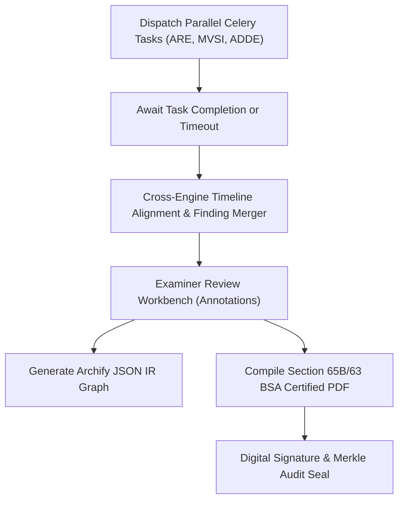

**Validation Strategy:**  
Execute end-to-end integration test dispatching a job on an audio file; verify that findings from all 3 engines merge cleanly into the result JSON; verify that generated PDF compiles with valid layout and correct hashes.

**Definition of Done:**  
Modules `src/ps05/core/orchestrator.py` and `src/ps05/reporting/compiler.py` implemented; integration tests in `tests/integration/test_audio_orchestrator.py` pass.

**Dependencies & Risks:**  
*Risk:* Long-running audio jobs timing out on CPU. *Mitigation:* Implement incremental progress heartbeats over Redis every 5 seconds.

**Checkpoint Table:**

| Checkpoint ID | Topic / Subtopic | Verification action | Expected evidence | Status | Pass criteria |
| :--- | :--- | :--- | :--- | :--- | :--- |
| **A9-CP-01** | Multi-Engine Dispatch | Dispatch job enabling ARE, MVSI, and ADDE | All 3 engine runs recorded in database | `NOT_STARTED` | Clean parallel execution |
| **A9-CP-02** | Partial Failure Grace | Simulate artificial crash in ADDE engine | ARE and MVSI results exported with partial warning | `NOT_STARTED` | Graceful degradation preserved |
| **A9-CP-03** | Timeline Synchronization | Inspect unified timeline on spliced audio exhibit | Splice timecode aligns with deepfake spike | `NOT_STARTED` | Timecodes synchronized $\pm 50\text{ ms}$ |
| **A9-CP-04** | PDF Generation | Compile forensic report for test audio exhibit | Valid PDF generated containing Section 65B certificate | `NOT_STARTED` | PDF compiles cleanly with hash manifest |

---

### Phase AURAS-A10: End-to-End Audio Validation & Release Readiness

**Status:** `PLANNED`

**Objective:**  
Execute comprehensive regression testing, benchmark the complete audio subsystem against curated test corpora, audit dependency licensing and air-gap integrity, and establish release readiness for the hackathon demonstration.

**Scope:**
- *Included:* Regression test suite, reproducibility audit, performance benchmarking, air-gap validation, documentation consistency audit.
- *Explicit Exclusions:* None (covers full audio subsystem).

**Prerequisites:**  
Phase AURAS-A9 Gate passed; full audio pipeline operational end-to-end.

**Topics & Subtopics:**
1. **Curated Audio Test Corpus:** Assemble diverse evaluation set: clean voice, noisy calls, WhatsApp transcoded audio, ElevenLabs voice clones, spliced dialogues, bilingual Hinglish conversations, and authentic control audio.
2. **Reproducibility Audit:** Re-run complete forensic analysis on identical audio hashes 5 times; assert bit-for-bit identical findings, scores, and JSON manifests.
3. **End-to-End Evidence Workflow Testing:** Test complete journey from initial file intake to final signed PDF download.
4. **Latency & Throughput Benchmarking:** Profile execution speed across CPU and GPU configurations; document resource consumption.
5. **Memory Leak & Stress Testing:** Ingest 50 consecutive audio files without restarting worker processes; assert no memory accumulation in Celery workers.
6. **Air-Gap Integrity Verification:** Execute complete audio suite on network-isolated test runner with outbound connections blocked; assert zero HTTP requests.
7. **Model License & Checkpoint Audit:** Verify that all pre-trained models (Silero, PyAnnote, SpeechBrain, WavLM, RawNet2) comply with open-source licenses (MIT, Apache 2.0, BSD-3-Clause).
8. **Documentation Alignment:** Audit `README.md`, `PRD.md`, `TRD.md`, and `PHASES.md` for consistent terminology, requirement IDs, and status markers.
9. **Hackathon Demonstration Scenario Preparation:** Package representative demonstration exhibits with pre-computed forensic dossiers.
10. **Final Forensic Review:** Peer review of algorithmic explainability statements and courtroom certifiability.

**Execution Workflow:**

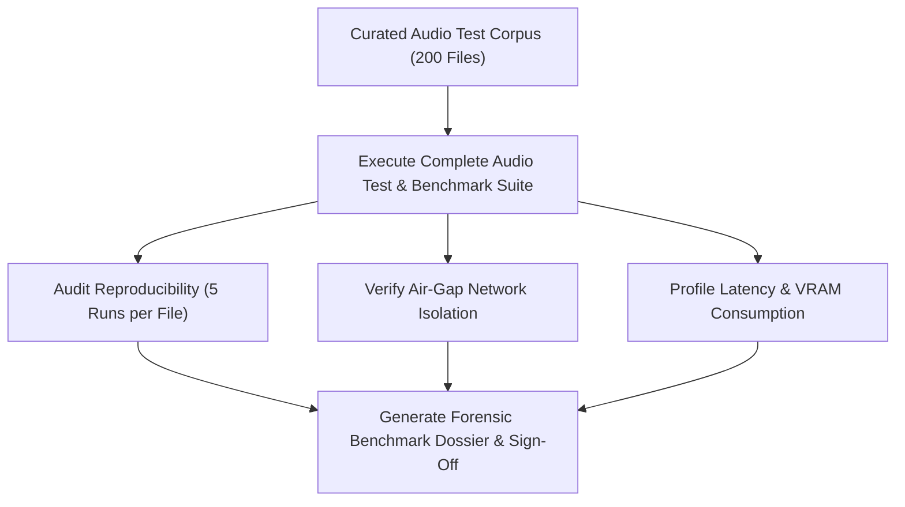

**Validation Strategy:**  
Execute `pytest tests/` covering all unit, integration, and benchmark tests; assert 100% green pass rate (exit code 0); verify zero outbound network packets via packet capture.

**Definition of Done:**  
Full test suite passes with zero failures; benchmark dossier compiled; all phase checkpoints verified.

**Dependencies & Risks:**  
*Risk:* Hardware differences between development and hackathon jury laptops. *Mitigation:* Pre-configure both CPU and GPU execution modes.

**Checkpoint Table:**

| Checkpoint ID | Topic / Subtopic | Verification action | Expected evidence | Status | Pass criteria |
| :--- | :--- | :--- | :--- | :--- | :--- |
| **A10-CP-01** | Full Pipeline Pass | Run complete test suite on audio corpus | `pytest` exits with code 0 (100% passing) | `NOT_STARTED` | All tests pass |
| **A10-CP-02** | Reproducibility | Compare output hashes across 5 identical runs | 100% identical JSON outputs and scores | `NOT_STARTED` | Zero non-deterministic variance |
| **A10-CP-03** | Air-Gap Isolation | Run full suite with network adapters disabled | Suite runs completely offline without errors | `NOT_STARTED` | Zero external network calls |
| **A10-CP-04** | License Compliance | Audit all PyPI dependencies and model licenses | All licenses verified as commercial/hackathon permissive | `NOT_STARTED` | Zero GPL/proprietary license conflicts |

---

## 4. Non-Audio Subsystems & Platform Milestones

The platform's non-audio subsystems remain distinct, modular components operating in parallel with the audio workstream:

### Phase 4: Image Forensics Subsystem (IFS)
- **Status:** `PLANNED`
- **Scope:** EXIF & metadata tampering audit, Error Level Analysis (ELA) multi-quality heatmaps, JPEG double-compression DCT ghost analysis, and Copy-Move Forgery Detection (CMFD) via SIFT keypoint clustering.
- **Deliverables:** `src/ps05/engines/image/` modules and image benchmark suite.

### Phase 5: Video & CCTV Forensics Subsystem (VFS)
- **Status:** `PLANNED`
- **Scope:** FFprobe PTS/DTS bitstream continuity, CCTV frame integrity validator (detecting missing, dropped, duplicated, or reordered frames via optical flow and SSIM), timestamp OCR vs. metadata correlation, and cryptographically bound audio extraction.
- **Deliverables:** `src/ps05/engines/video/` modules and video benchmark suite.

### Phase 7: Unified Platform Cross-Engine Reporting
- **Status:** `PLANNED`
- **Scope:** Cross-engine finding aggregation across audio, image, video, and CCTV evidence; Section 65B Indian Evidence Act / Section 63 Bharatiya Sakshya Adhiniyam (BSA 2023) certified PDF compilation; Archify JSON IR visual dossier export.

### Phase 8: Web Dashboard & Forensic Examiner Workbench
- **Status:** `PLANNED`
- **Scope:** Next.js / React interactive web frontend; multi-modal evidence viewer with synchronized audio waveform, spectrogram, video frame player, and ELA error-slider.

### Phase 9: Security Hardening & Air-Gapped Deployment
- **Status:** `PLANNED`
- **Scope:** Offline containerization (Docker Compose), local model checkpoint verification scripts, POSIX 0400 WORM vault locking, and security compliance audit.

### Phase 10: Final Hackathon Demonstration & Release
- **Status:** `PLANNED`
- **Scope:** End-to-end platform validation, automated demonstration script (`scripts/run_demo.py`), curated evidence showcase, and technical presentation defense.

---

## 5. Development Roadmap Timeline (Gantt Chart)

```mermaid
gantt
    title PS-05 Platform & AURAS Audio Forensics Roadmap
    dateFormat  YYYY-MM-DD
    axisFormat  %b %d

    section Foundation
    Phase 0: Architecture Baseline          :done,    p0, 2026-10-20, 2026-10-20
    AURAS-A0 / Phase 1: Shared Core & WORM  :active,  a0, 2026-10-21, 2026-10-23

    section AURAS Audio Workstream
    AURAS-A1: ARE Baseline (Signal & Spec)  :         a1, 2026-10-24, 2026-10-26
    AURAS-A2: ARE Advanced (Splice, ENF)    :         a2, 2026-10-27, 2026-10-29
    AURAS-A3: MVSI Foundation (VAD & Chunks):         a3, 2026-10-24, 2026-10-26
    AURAS-A4: MVSI Overlap Diarization      :         a4, 2026-10-27, 2026-10-29
    AURAS-A5: MVSI Multilingual Indian LID  :         a5, 2026-10-30, 2026-11-01
    AURAS-A6: ADDE Foundation (RawNet/AASIST):        a6, 2026-10-27, 2026-10-29
    AURAS-A7: ADDE Advanced (WavLM & Splicing):       a7, 2026-10-30, 2026-11-02
    AURAS-A8: ADDE Ensemble & Calibration   :         a8, 2026-11-02, 2026-11-04
    AURAS-A9: Audio Orchestrator & Review   :         a9, 2026-11-04, 2026-11-06
    AURAS-A10: End-to-End Audio Benchmark   :         a10, 2026-11-06, 2026-11-08

    section Non-Audio Subsystems
    Phase 4: Image Forensics Subsystem (IFS):         p4, 2026-10-24, 2026-10-27
    Phase 5: Video & CCTV Forensics (VFS)   :         p5, 2026-10-27, 2026-10-30

    section Platform Delivery
    Phase 7: Cross-Engine Legal Reporting   :         p7, 2026-11-08, 2026-11-10
    Phase 8: Web Dashboard & Workbench     :         p8, 2026-11-09, 2026-11-12
    Phase 9: Security Hardening & Air-Gap   :         p9, 2026-11-12, 2026-11-14
    Phase 10: Final Hackathon Demonstration :         p10, 2026-11-14, 2026-11-15
```
