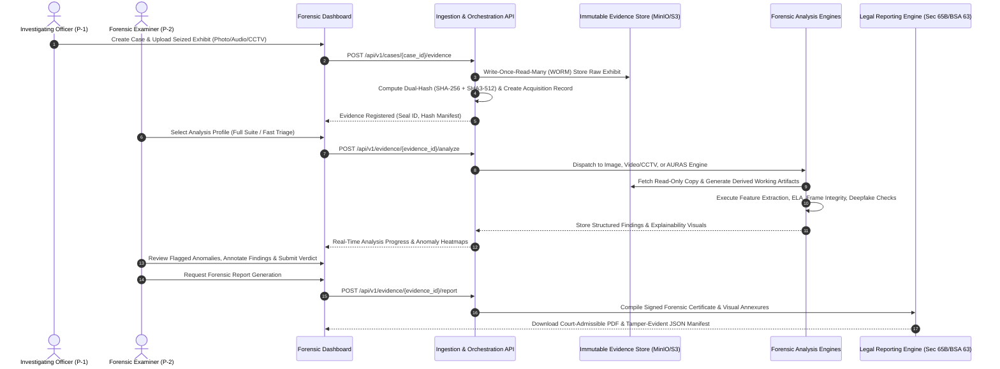
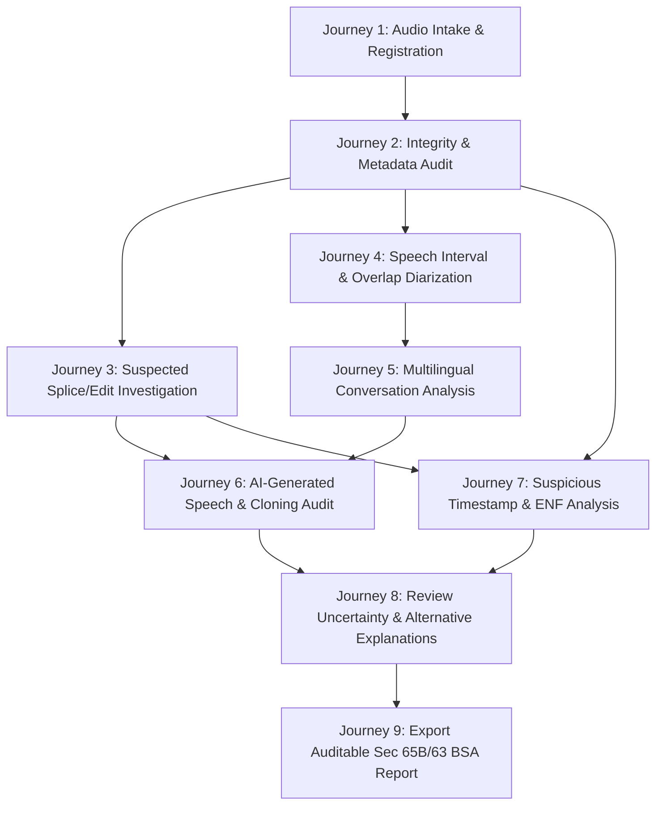

# Product Requirements Document (PRD)

## Project: Digital Evidence Authenticity & Integrity Verification Platform (PS-05)
**Hackathon:** Bihar Government Cyber Hackathon 2026 (C-DAC Patna, CCSU, Bihar Police)  
**Track:** Digital Forensics  
**Problem Statement:** PS-05 — Digital Evidence Authenticity and Integrity Verification Platform  
**Document Version:** 1.1.0  
**Status:** Approved Architecture Baseline (Deepened Audio Forensics Specification)  

---

## 1. Executive Summary

In contemporary law enforcement, judicial proceedings, and cybersecurity operations, digital media—such as digital photographs, voice calls, audio recordings, video clips, and CCTV camera footage—form the bedrock of evidence. However, the democratisation of generative AI tools (deepfakes, voice cloning, diffusion models) alongside sophisticated non-AI editing suites has created a crisis of evidence credibility. Digital artifacts can be manipulated, spliced, synthetically generated, re-encoded, or timestamp-altered in ways that are undetectable to the naked eye or human ear. Manual forensic examination by cyber forensic examiners is time-consuming, prone to human error, and completely overwhelmed by the volume of digital exhibits seized in active investigations.

The **PS-05 Platform (Digital Evidence Authenticity & Integrity Verification Platform)** is an enterprise-grade, modular, explainable, and auditable cyber-forensic analysis system engineered specifically for law enforcement agencies (state police departments including Bihar Police), forensic science laboratories (FSLs), and judicial authorities. The platform automates multi-modal evidence ingestion, cryptographic chain of custody preservation, multi-engine forensic analysis across audio, image, video, and CCTV footage, and court-admissible forensic reporting under **Section 65B of the Indian Evidence Act (IEA)** and **Section 63 of the Bharatiya Sakshya Adhiniyam, 2023 (BSA)**.

---

## 2. Problem Statement & Context

### 2.1 The Official Hackathon Challenge (PS-05)
As specified by C-DAC Patna, CCSU, and Bihar Police:
> *"Digital images, voice recordings, videos, and CCTV footage are increasingly used as evidence, but may be altered or synthetically generated. Manual examination can be time-consuming and may overlook sophisticated manipulations.*
>
> *The proposed solution should address the following requirements:*
> - *Image and Metadata Forensics: Detect image splicing and other potential manipulations; examine EXIF data, device details, GPS coordinates, and timestamps for inconsistencies or tampering.*
> - *Compression and Editing Analysis: Examine JPEG recompression patterns and Error Level Analysis (ELA) to identify potentially edited image regions.*
> - *CCTV Frame Integrity Validation: Detect missing, duplicated, inserted, or reordered video frames.*
> - *Timestamp Anomaly Detection: Identify inconsistencies between embedded timestamps, metadata, and video frame sequences.*
> - *Audio and Voice Tampering Detection: Identify manipulated, edited, or AI-generated voice recordings and examine the authenticity and integrity of audio evidence, highlighting suspicious segments where possible.*
> - *Forensic Dashboard and Reporting: Present detected anomalies, supporting evidence, confidence indicators, and structured forensic findings.*
>
> *The solution should enable law-enforcement agencies and forensic laboratories to rapidly verify digital images, audio, video, and other digital artifacts, improving the reliability of electronic evidence during investigations and judicial proceedings."*

### 2.2 Operational Forensic Gaps
1. **Tool Fragmentation:** Investigators currently rely on disparate, disconnected single-purpose scripts (e.g., ExifTool for metadata, manual Audacity spectrographs for audio, standalone open-source deepfake detectors) with zero unified case registry or evidentiary lineage.
2. **Fragile Chain of Custody:** Lack of cryptographically sealed, immutable storage workflows results in frequent defense challenges in court regarding whether an exhibit was altered during triage.
3. **Black-Box AI Fallacy:** Generic machine learning models provide opaque "binary classification" scores (e.g., "94% Fake") without segment localization, spectral proof, error-level analysis, or signal-level justification, which are legally inadmissible in contested courtrooms.
4. **Multilingual and Regional Gaps:** Deepfake audio detectors trained solely on English or standard Chinese completely fail when deployed on Indian dialectal speech, code-switched dialogues (e.g., Hinglish, Bhojpuri, Maithili, Magahi), or low-resource regional acoustics.
5. **CCTV Stream Discontinuities:** Video surveillance systems present unique packet-drop, frame-duplication, variable frame rate (VFR), and proprietary timestamp overlay characteristics that break conventional video forensics.

---

## 3. Product Vision & Objectives

### 3.1 Vision Statement
To establish India's most trustworthy, court-admissible, and technologically advanced digital forensic verification platform—empowering cyber cells and forensic laboratories to separate genuine electronic evidence from manipulated or synthetically fabricated digital artifacts with mathematical certainty, signal-level explainability, and cryptographic rigor.

### 3.2 Measurable Objectives
- **O-1 (Integrity Assurance):** 100% cryptographic verification (SHA-256 / SHA3-512) and zero-alteration write-blocking of all original digital exhibits upon intake.
- **O-2 (Multi-Modal Analysis):** Automated forensic pipelines covering Images, CCTV Footage, Video streams, and Audio recordings across four specialized forensic engines.
- **O-3 (Explainable Evidence):** Every positive manipulation finding must be accompanied by temporal/spatial localization, signal/spectrographic/ELA artifacts, and confidence intervals rather than a bare scalar score.
- **O-4 (Legal Compliance):** Automated generation of forensic certificates conforming to Section 65B Indian Evidence Act / Section 63 Bharatiya Sakshya Adhiniyam (BSA 2023) with complete audit trail hash manifests.
- **O-5 (Indian Linguistic Resilience):** Audio speaker diarization and voice tampering verification that operates across Indian language environments including Scheduled Indian Languages and regional Hindi dialects.

---

## 4. Target User Personas & User Journeys

### 4.1 Target Personas

| Persona ID | Role | Organization | Core Needs & Frustrations | Primary Platform Interaction |
| :--- | :--- | :--- | :--- | :--- |
| **P-1** | Cyber Police Investigating Officer (IO) | State Cyber Crime Police Station / District Cyber Cell | Needs fast preliminary triage of seized suspect phones, CCTV clips, and extortion audio calls. Frustrated by backlogs and complex CLI tools. | Ingestion portal, automated triage dashboard, summary authenticity certificates for charge sheets. |
| **P-2** | Senior Digital Forensic Examiner | State / Central Forensic Science Laboratory (FSL / CFSL) | Requires deep signal analysis, frame-by-frame validation, ELA heatmaps, PRNU sensor noise matching, and custom parameter tuning. | Advanced workbench, spectrogram inspection, filter tuning, raw artifact inspection, audit verification. |
| **P-3** | Public Prosecutor / Legal Counsel | Directorate of Prosecution / High Court | Needs explainable, defense-resilient evidence reports that can withstand rigorous cross-examination regarding tampering and chain of custody. | Section 65B/63 BSA certified PDF reports, visual evidence annexures, cryptographic verification logs. |
| **P-4** | System Administrator & Evidence Custodian | Police HQ / Forensic Lab IT | Needs strict Role-Based Access Control (RBAC), multi-tenant case isolation, tamper-evident audit logging, and offline air-gapped deployment capability. | Admin portal, storage management, engine status monitoring, user role auditing, air-gapped node synchronization. |

### 4.2 Primary User Journey: End-to-End Forensic Case Lifecycle

---

## 5. Dedicated Audio Forensics User Journeys (AURAS)

AURAS provides structured, legally auditable workflows specifically tailored to digital audio evidence (recorded telephone calls, voice notes, sting operation recordings, CCTV audio tracks):

### 5.1 Detailed Audio User Journey Walkthroughs

#### Journey 1: Uploading and Registering Audio Evidence
- **Actor:** Investigating Officer (IO) / Seizure Officer.
- **Workflow:** IO uploads seized audio file (`.wav`, `.mp3`, `.m4a`, `.aac`) through web portal or CLI.
- **System Action:** Computes SHA-256 and SHA3-512 in memory while streaming bytes to WORM storage. Generates unique `evidence_id`, acquisition seal, and registers immutable database record.

#### Journey 2: Checking Integrity and Metadata
- **Actor:** Forensic Examiner (P-2).
- **Workflow:** Examiner opens case exhibit; requests baseline integrity and container audit.
- **System Action:** Compares SHA-256 hash against initial seizure manifest. Runs FFprobe, ExifTool, and Mutagen to extract container streams, encoder tags (e.g., LAME version, Audacity/ProTools metadata signatures), sample rate, bit depth, channel configuration, and decoder warnings.

#### Journey 3: Investigating Suspected Edits or Splices
- **Actor:** Forensic Examiner (P-2).
- **Workflow:** In an extortion case, suspect claims the recording was spliced to take words out of context. Examiner requests splice candidate localization.
- **System Action:** ARE engine computes STFT, spectral flux, and executes PELT change-point detection. Highlights millisecond timestamps where room acoustic reverberation, stationary noise floor, or phase coherence abruptly shift.

#### Journey 4: Identifying Speech Intervals and Overlapping Speakers
- **Actor:** Forensic Examiner / Transcriber.
- **Workflow:** Examiner analyzes multi-party meeting recording where several individuals interrupt and speak concurrently.
- **System Action:** MVSI engine executes Silero VAD to isolate speech, flags multi-speaker overlapping frames via Overlapped Speech Detection (OSD), extracts ECAPA-TDNN embeddings, and produces an overlap-aware diarization timeline supporting concurrent speaker labels (e.g., Speaker A + Speaker C active simultaneously).

#### Journey 5: Analyzing Multilingual Conversations
- **Actor:** Cyber Police IO (P-1) / Forensic Linguist.
- **Workflow:** IO analyzes a conversation with rapid code-switching between Hindi, English, and regional dialects (Bhojpuri/Maithili).
- **System Action:** MVSI multilingual engine classifies spoken language per segment using Whisper/MMS LID. Detects intra-utterance code-switch boundaries. Enforces the invariant that **Speaker Identity $\neq$ Language Identity**, preserving a unified speaker profile even when that speaker alternates between languages.

#### Journey 6: Reviewing AI-Generated or Manipulated Speech Indicators
- **Actor:** Senior Forensic Examiner (P-2).
- **Workflow:** Defense claims a leaked audio clip of a public official is an AI deepfake clone. Examiner triggers ADDE deepfake suite.
- **System Action:** ADDE executes RawNet2 (time-domain waveform), AASIST (spectrotemporal graph), and WavLM (foundation SSL) in parallel. Produces calibrated posterior probabilities, localized sliding-window suspicion curves, and flags whether the voice matches authorized reference samples (separate 1:1 speaker verification check).

#### Journey 7: Inspecting Suspicious Timestamps & ENF
- **Actor:** Forensic Physicist / Examiner (P-2).
- **Workflow:** IO needs to verify if an audio recording was made on the specific date and time claimed in the FIR.
- **System Action:** ARE-09 bandpass filters the audio around 50 Hz (nominal Indian electrical grid frequency) and tracks instantaneous frequency variations via Hilbert transform. If reference grid logs from the regional Power Grid Corporation of India (PGCIL) are available, compares the extracted curve to corroborate or refute recording timestamps.

#### Journey 8: Reviewing Uncertainty & Alternative Explanations
- **Actor:** Senior Examiner (P-2) preparing courtroom testimony.
- **Workflow:** Examiner reviews flagged anomalies to rule out benign environmental or codec artifacts.
- **System Action:** System displays alternative explanation sidebars: distinguishes microphone dropouts from splices, lossy AMR compression cutoffs from vocoder artifacts, and low-SNR recording conditions from deepfake model uncertainty.

#### Journey 9: Exporting an Auditable Forensic Report
- **Actor:** Forensic Examiner (P-2) & Public Prosecutor (P-3).
- **Workflow:** Case moves to trial; formal electronic evidence certificate required.
- **System Action:** Generates a Section 65B IEA / Section 63 BSA compliant PDF dossier, embedding exhibit checksums, examiner details, machine environment hashes, spectral annexures, and a tamper-evident Archify JSON IR graph.

---

## 6. Functional Requirements (FR)

### 6.1 Shared Evidence Management & Orchestration Layer (FR-CORE)

| Requirement ID | Module | Title | Description | Acceptance Criteria | Priority |
| :--- | :--- | :--- | :--- | :--- | :--- |
| **FR-CORE-001** | Ingestion | Case Registration & Exhibit Intake | System shall register forensic cases with mandatory metadata (FIR/Case number, Police Station, Investigating Officer ID, Seizure Date/Time, Evidence Type). | Case created with unique UUIDv4; all subsequent exhibits bound to case; prevents orphaned files. | P0 |
| **FR-CORE-002** | Integrity | Cryptographic Dual-Hashing | System shall immediately compute both SHA-256 and SHA3-512 checksums upon byte intake before any file writing or processing. | Hashes recorded in immutable audit ledger; rejects truncated or corrupt network uploads. | P0 |
| **FR-CORE-003** | Storage | Immutable Raw Evidence Storage | System shall store master exhibits in a Write-Once-Read-Many (WORM) storage partition with strictly read-only filesystem permissions. | Zero write/delete permissions granted to worker processes; prevents accidental modification of original exhibit. | P0 |
| **FR-CORE-004** | Lineage | Derived Artifact Transformation Tracking | Any resampled, trans手游, extracted, or cropped artifact must have a deterministic manifest linking parent Exhibit ID, transform parameters, and child hash. | Complete DAG (Directed Acyclic Graph) of artifact provenance retrievable via API and visualised in UI. | P0 |
| **FR-CORE-005** | Orchestration | Asynchronous Job Queue | System shall dispatch forensic tasks to a distributed worker queue with priority scheduling, failure retries, and task heartbeats. | Long-running video/audio jobs execute without blocking HTTP API; worker crash does not corrupt database state. | P0 |
| **FR-CORE-006** | Audit | Tamper-Evident Audit Logging | System shall log every user action, exhibit access, analysis execution, and report generation in an append-only cryptographic audit log. | Every audit record signed with previous record hash (Merkle/Hash chain); verifiable integrity of audit trail. | P1 |
| **FR-CORE-007** | Reporting | Section 65B / BSA Section 63 Certificate Generation | System shall automatically compile a standardized electronic evidence certificate detailing hash records, hardware environment, tool versions, and examiner signatures. | Generates high-fidelity PDF compliant with statutory formats under Indian Evidence Act Sec 65B and BSA 2023 Sec 63. | P0 |

### 6.2 Image Forensics Subsystem (FR-IMG)

| Requirement ID | Module | Title | Description | Acceptance Criteria | Priority |
| :--- | :--- | :--- | :--- | :--- | :--- |
| **FR-IMG-001** | Metadata | EXIF & Structural Metadata Forensic Audit | Extract and validate all EXIF, XMP, IPTC, and TIFF tags; cross-reference camera make/model against known sensor profiles and lens specs. | Flags missing tags, editing software signatures (e.g., Photoshop, GIMP), or date-time sequence inconsistencies. | P0 |
| **FR-IMG-002** | Geolocation | GPS & Timestamp Sanity Validation | Validate embedded GPS coordinates against geographic boundaries and verify timezone alignment with camera local clock. | Highlights impossible travel speeds between sequential photos; flags spoofed or null GPS headers. | P1 |
| **FR-IMG-003** | Compression | Error Level Analysis (ELA) | Compute compression error discrepancies across image blocks by recompressing at known quality levels (e.g., 90%, 95%) and calculating pixel differences. | Generates multi-scale ELA heatmap highlighting regions with inconsistent error levels indicating foreign insertion/splicing. | P0 |
| **FR-IMG-004** | Compression | JPEG Double-Compression & Ghost Detection | Analyze Quantization Tables (QT) and discrete cosine transform (DCT) histogram periodicity to detect re-compression ghosts. | Identifies if an image was compressed multiple times with different quality factors; localizes spliced regions. | P0 |
| **FR-IMG-005** | Cloning | Copy-Move Forgery Detection (CMFD) | Detect duplicate regions within the same image using dense feature matching (SIFT/ORB) combined with spatial clustering (DBSCAN). | Localizes cloned objects (e.g., duplicate crowds, removed objects covered with background patches) with bounding polygons. | P0 |
| **FR-IMG-006** | Splicing | Noise Inconsistency & Lighting Analysis | Evaluate local sensor pattern noise (PRNU) and high-frequency noise variance across candidate image segments. | Flags spliced composite regions whose underlying sensor noise profile deviates from the host background image. | P1 |
| **FR-IMG-007** | AI Synthesis | Synthetic & Diffusion Image Detection | Detect visual artifacts characteristic of GANs and Latent Diffusion models (frequency domain anomalies, abnormal eye reflections, texture blending). | Provides synthetic probability score, frequency domain spectrum (FFT magnitude), and model attribution if recognized. | P1 |

### 6.3 Video & CCTV Forensics Subsystem (FR-VID)

| Requirement ID | Module | Title | Description | Acceptance Criteria | Priority |
| :--- | :--- | :--- | :--- | :--- | :--- |
| **FR-VID-001** | Stream | Container & Codec Bitstream Inspection | Analyze MP4, AVI, MKV, and DVR raw streams for Presentation Time Stamp (PTS) and Decoding Time Stamp (DTS) monotonicity. | Flags frame timeline skips, out-of-order packets, variable frame rate jumps, and missing I-frame intervals. | P0 |
| **FR-VID-002** | CCTV Frame | Missing & Dropped Frame Detection | Inspect sequential frame numbers, temporal cadence, and optical flow vectors to detect missing or deliberately removed time slices. | Flags exact frame indices and timestamps where footage was clipped or dropped; estimates duration of missing gap. | P0 |
| **FR-VID-003** | CCTV Frame | Duplicated & Frozen Frame Detection | Calculate structural similarity (SSIM) and perceptual hashing across adjacent video frames to identify artificial video loops or freeze-frames. | Flags frozen or looping surveillance sequences commonly used to conceal unauthorized entry or tampering. | P0 |
| **FR-VID-004** | CCTV Frame | Inserted & Reordered Frame Validation | Analyze background illumination variance and motion vector continuity to identify spliced external video frames or altered sequence order. | Pinpoints sudden scene changes, unnatural object teleportation, or reordered chronological events. | P0 |
| **FR-VID-005** | Timeline | Timestamp OCR vs. Metadata Correlation | Perform Optical Character Recognition (OCR) on burned-in on-screen CCTV timestamp text and compare with container metadata and PTS cadence. | Detects discrepancies between the visible clock overlay on screen and the true underlying digital video timeline. | P0 |
| **FR-VID-006** | Audio-Video | AV Synchronization & Audio Extraction | Extract embedded audio tracks to an independent derived exhibit bound by cryptographic hash and compute audio-video lip-sync / event alignment. | Extracted audio seamlessly ingested into AURAS engine; original video timecode mapping perfectly preserved. | P0 |
| **FR-VID-007** | Face Tampering | Video Deepfake & Face-Swap Inspection | Detect temporal flickering, facial boundary warping, and biometric inconsistencies (abnormal blink rates, unnatural facial landmark trajectories). | Generates frame-by-frame face manipulation confidence timeline and visual overlay of suspicious facial boundaries. | P1 |

---

### 6.4 Deepened Audio Forensics Requirements (AURAS: AUD-FR-001 to AUD-FR-020)

| Requirement ID | Subsystem / Engine | Title & Description | Rationale | Pri | Inputs & Dependencies | Expected Outputs | Acceptance Criteria | Status |
| :--- | :--- | :--- | :--- | :--- | :--- | :--- | :--- | :--- |
| **AUD-FR-001** | Shared Core / Intake | **Audio Evidence Registration & WORM Preservation:** Ingest audio files into immutable WORM vault with strictly read-only permissions (0400). | Absolute chain of custody; prevents defense claims of tampering during lab triage. | P0 | Raw binary audio stream, Case FIR metadata. | `AudioEvidence` record, WORM URI, Acquisition seal. | Original file bytes remain bit-for-bit unchanged; write attempts throw PermissionError. | `PLANNED` |
| **AUD-FR-002** | Shared Core / Crypto | **SHA-256 / SHA3-512 Dual-Hashing & Trusted Matching:** Compute dual cryptographic hashes upon intake; compare against reference hashes when provided. | Validates bitstream integrity and verifies identity against police seizure hash memos. | P0 | Input bitstream; optional `trusted_sha256` reference string. | Hash manifest, bitstream match verdict (MATCH / MISMATCH / NO_REFERENCE). | Computes identical hashes across repeated runs; detects single-bit alteration. | `PLANNED` |
| **AUD-FR-003** | ARE-02 | **Container, Codec & Metadata Inspection:** Audit audio headers using FFprobe, ExifTool, and Mutagen for encoder signatures, truncation, and DAW traces. | Exposes editing software artifacts (ProTools, Audacity) and detects codec mismatch anomalies. | P0 | Native-rate audio file. Dep: FFprobe, ExifTool. | Structured metadata dictionary, codec parameters, encoder tag warnings. | Flags editing software signatures, truncated streams, and non-standard bitrates. | `PLANNED` |
| **AUD-FR-004** | ARE-03 | **Waveform Profiling & Signal Statistics:** Extract RMS, true-peak, clipping events, DC offset bias, SNR, and zero-crossing rate across all channels. | Measures physical recording quality; identifies clipping and synthetic dynamic compression. | P0 | Multi-channel audio array. Dep: NumPy, SciPy. | Typed signal metrics (RMS, peak dBFS, clip count, DC bias, SNR dB). | Correctly counts clipped samples ($|x[n]| \ge 0.9999$); calculates channel SNR within 0.5 dB tolerance. | `PLANNED` |
| **AUD-FR-005** | ARE-04 | **Spectral & Time-Frequency Analysis:** Compute STFT, log-mel spectrogram, Welch PSD, and spectral flux across full bandwidth. | Visualizes frequency cutoffs (codec recompression) and energy discontinuities. | P0 | Normalized audio array. Dep: Librosa, SciPy. | 2D Spectrogram array, Welch PSD curve, spectral flux time series. | Accurately identifies high-frequency cutoffs (e.g., 16 kHz MP3 cutoff); generates print-ready visual. | `PLANNED` |
| **AUD-FR-006** | ARE-05 | **Splice & Edit Candidate Localization:** Detect candidate splice points using PELT change-point detection on spectral flux and RMS energy series. | Localizes exact points where an audio recording was physically cut and joined. | P0 | Spectral flux and energy time series. Dep: `ruptures` (PELT). | List of timestamped splice candidate intervals with change-point scores. | Detects injected 500ms tone or spliced phrase with timestamp accuracy $\pm 50\text{ ms}$. | `PLANNED` |
| **AUD-FR-007** | ARE-06 | **Ambient Noise Floor Consistency Tracking:** Track stationary background noise floor and acoustic room tone profile across time. | Detects spliced inserts where background acoustic ambience abruptly changes. | P0 | Audio array. Dep: Librosa spectral subtraction. | Continuous noise-floor dB curve, ambient room tone shift flags. | Flags noise floor jumps $> 4\text{ dB}$ lasting $> 200\text{ ms}$; highlights spliced intervals. | `PLANNED` |
| **AUD-FR-008** | ARE-07 | **Acoustic Self-Similarity & Repeated Phrase Detection:** Extract MFCCs and compute self-similarity matrices with FAISS to detect cloned/repeated segments. | Identifies copy-pasted words, repeated background noise loops, or cloned phrases. | P1 | 13 MFCC coefficients over 25ms windows. Dep: FAISS. | Candidate repeated segment pairs with start/end timecodes and similarity scores. | Flags identical acoustic sequences ($> 1.0\text{ s}$) occurring at multiple distinct timestamps. | `PLANNED` |
| **AUD-FR-009** | ARE-09 | **Electric Network Frequency (ENF) Forensics:** Bandpass filter around 50 Hz ($\pm 0.2\text{ Hz}$); extract instantaneous mains frequency curve via Hilbert transform. | Corroborates recording date, time, and continuity when 50 Hz grid reference is available. | P2 | Native audio file. Dep: SciPy 8th-order Butterworth. | Time-frequency ENF curve, grid correlation coefficient (if reference present). | Correctly extracts 50 Hz hum when present with SNR $> 10\text{ dB}$; marks INCONCLUSIVE if hum absent. | `PLANNED` |
| **AUD-FR-010** | MVSI-02/03 | **Voice Activity Detection & Speech Segmentation:** Isolate speech from silence/noise using Silero VAD; decompose into coherent speech chunks. | Eliminates silent and noisy non-speech intervals from downstream speaker analysis. | P0 | 16 kHz mono audio. Dep: Silero VAD (TorchScript). | Speech intervals `[(start, end)]`, speech duty cycle percentage. | Correctly isolates speech with $< 5\%$ false alarm on quiet background; preserves short pauses. | `PLANNED` |
| **AUD-FR-011** | MVSI-04 | **Overlapped Speech Detection (OSD):** Detect intervals where two or more persons speak simultaneously. | Prevents multi-speaker overlapping frames from corrupting single-speaker embedding clusters. | P0 | 16 kHz mono speech segments. Dep: PyAnnote OSD. | List of overlapping time intervals `[(start, end)]` with overlap probability. | Accurately flags concurrent speech intervals; output feeds directly into overlap-aware diarizer. | `PLANNED` |
| **AUD-FR-012** | MVSI-07/08 | **Overlap-Aware Speaker Diarization:** Produce "who spoke when" timelines allowing multiple active speakers in the same interval. | Accurately documents multi-party interrogations and calls without dropping concurrent speakers. | P0 | Speech segments, ECAPA-TDNN embeddings. Dep: PyAnnote. | Multi-label diarization timeline supporting concurrent speaker labels. | Diarization timeline correctly represents simultaneous speakers; DER $< 18\%$ on clean benchmark. | `PLANNED` |
| **AUD-FR-013** | MVSI-09 | **Multilingual Language Identification (LID):** Classify spoken language per segment across Scheduled Indian Languages and regional dialects. | Identifies spoken languages in Indian multi-lingual environments (Hindi, Bengali, Tamil, etc.). | P0 | Segment audio slices. Dep: Whisper LID / MMS-LID. | ISO 639-3 language code, confidence score per segment. | Macro-F1 $> 85\%$ across primary Indian languages; marks unrecognized dialects as unclassified. | `PLANNED` |
| **AUD-FR-014** | MVSI-10 | **Intra-Utterance Code-Switching Detection:** Detect rapid language switching within single utterances (e.g., Hinglish, Bhojpuri-Hindi mixing). | Maps conversational patterns in Indian context; maintains single speaker profile across languages. | P1 | Sliding window language hypotheses. Dep: MMS-LID. | Code-switch transition boundaries `[(timestamp, from_lang, to_lang)]`. | Accurately identifies language shift boundaries; does not split speaker identity. | `PLANNED` |
| **AUD-FR-015** | MVSI-12 | **Speaker-Language Analytics & Turn Metrics:** Aggregate speaking duration, turn counts, and language distribution per speaker. | Provides quantitative communication summaries for forensic investigation. | P0 | Diarization timeline, segment language tags. | Per-speaker talk time, language breakdown percentages, interaction matrix. | Output matches manual ground truth duration sums within $\pm 1.0$ second. | `PLANNED` |
| **AUD-FR-016** | ADDE-02..05 | **Multi-Branch Deepfake Inference:** Pass audio slices through RawNet2, AASIST, WavLM, and LFCC/Light-CNN detectors. | Detects phase, graph, vocoder, and foundation model synthetic speech artifacts. | P0 | 16 kHz sliding-window slices (2.0s / 0.5s stride). Dep: PyTorch. | Raw logit vectors $z_1, z_2, z_3, z_4$ per sliding window. | Executes all 4 branches without error; produces raw scores for calibration layer. | `PLANNED` |
| **AUD-FR-017** | ADDE-07 | **Sliding-Window Partial Manipulation Localization:** Scan across sliding windows to localize short spliced synthetic words/sentences within authentic speech. | Prevents binary whole-file misclassifications; pinpoints exact manipulated words. | P0 | Segment logit arrays, time mappings. | Time-aligned suspicion curve, flagged manipulated intervals `[(start, end)]`. | Accurately localizes a 1.5-second spliced synthetic phrase inside a 60-second genuine recording. | `PLANNED` |
| **AUD-FR-018** | ADDE-09/10 | **Score Calibration & Quality-Weighted Ensemble:** Calibrate raw logits via Platt scaling; fuse into composite score with disagreement reporting. | Transforms raw logits into true probabilities; reports when detectors disagree. | P0 | Raw logits from 4 detector branches. Dep: Scikit-learn. | Calibrated probability $P(\text{fake}) \in [0, 1]$, detector disagreement metric. | Ensemble outperforms individual detectors on out-of-domain benchmarks; ECE $< 0.05$. | `PLANNED` |
| **AUD-FR-019** | ADDE-11 | **OOD Uncertainty & Codec Robustness Reporting:** Compute Mahalanobis distance in embedding space; flag out-of-distribution acoustic conditions. | Prevents overconfident false alarms on unfamiliar microphones, codecs, or noisy audio. | P0 | WavLM embedding vectors, codec metadata. | OOD uncertainty score (LOW / MEDIUM / HIGH), forensic warning text. | Emits HIGH UNCERTAINTY on severe lossy compression or SNR $< 5\text{ dB}$; avoids false certainty. | `PLANNED` |
| **AUD-FR-020** | ADDE-08 | **Standalone 1:1 Speaker Verification:** Compare questioned voice against authorized reference recording using ECAPA-TDNN cosine / PLDA distance. | Evaluates whether questioned voice matches known suspect reference. | P1 | Questioned voice segment, reference voice recording. | Cosine similarity score, PLDA log-likelihood ratio, calibration statement. | Strictly separated from deepfake detection; outputs similarity without claiming absolute identity. | `PLANNED` |

---

## 7. Non-Functional Requirements (NFR)

### 7.1 Security, Privacy & Integrity (NFR-SEC)
- **NFR-SEC-001 (Zero Alteration Invariant):** Original digital evidence files stored in the repository must NEVER be modified, renamed, or overwritten under any operational condition.
- **NFR-SEC-002 (Cryptographic Sealing):** All exhibits must be dual-hashed (SHA-256 and SHA3-512) upon arrival. Hashes must be verified before and after every forensic worker task.
- **NFR-SEC-003 (Access Control):** Strict Role-Based Access Control (RBAC) separating System Admins, Investigating Officers, Forensic Examiners, and Legal Observers. Multi-tenant case isolation prevents cross-case evidence leakage.
- **NFR-SEC-004 (Air-Gapped Operation):** The platform core and all neural models must be 100% capable of offline, air-gapped deployment without requiring internet access or external cloud API calls.
- **NFR-SEC-005 (Secret Management):** Zero hardcoded passwords, tokens, or encryption keys in source code or version control. All credentials loaded exclusively from environment variables or secure vault stores.

### 7.2 Performance, Latency & Scalability (NFR-PERF)
- **NFR-PERF-001 (Audio Ingestion Throughput):** ARE baseline signal profiling must process a 5-minute audio file in less than 3.0 seconds on standard CPU.
- **NFR-PERF-002 (Deepfake Inference Latency):** Full ADDE multi-detector ensemble inference on a 60-second audio clip must complete in < 15 seconds on an NVIDIA T4 / RTX 3060 GPU (or < 60 seconds on modern 8-core CPU).
- **NFR-PERF-003 (Image Forensic Triage):** Full Image Forensics suite (EXIF, ELA, CMFD, Double-Compression) on a 12 Megapixel image must execute in < 8 seconds.
- **NFR-PERF-004 (CCTV Stream Processing):** CCTV Frame Integrity engine must process video streams at a minimum of 2x real-time playback speed (e.g., 10-minute 1080p 25fps video analyzed in < 5 minutes on GPU).
- **NFR-PERF-005 (Asynchronous Concurrency):** System must support at least 10 concurrent active forensic analysis jobs without worker starvation or memory exhaustion.

### 7.3 Reliability & Explainability (NFR-REL)
- **NFR-REL-001 (No False Certainty):** The system shall never output binary "100% Genuine" or "100% Fake" absolutes. All outputs must provide calibrated confidence ranges, anomaly heatmaps, and explicit limitation statements.
- **NFR-REL-002 (Graceful Degradation):** If a neural model or optional dependency fails (e.g., GPU out of memory, missing language model), the system must degrade gracefully, completing deterministic signal/metadata checks and issuing a partial analysis warning.
- **NFR-REL-003 (Idempotent Execution):** Re-running an identical analysis profile on the same evidence hash must produce identical numerical scores, findings, and hashes.

---

## 8. Audio Acceptance Criteria & Verification Mapping

Every audio functional requirement is mapped to a concrete, testable acceptance gate and verification method:

| Requirement ID | Acceptance Criterion | Test Verification Method | Target Milestone |
| :--- | :--- | :--- | :--- |
| **AUD-FR-001** | Original audio file bytes remain bit-for-bit unchanged before and after full analysis. | Invariant checksum assertion (`test_worm_immutability.py`). | AURAS-A0 |
| **AUD-FR-002** | SHA-256 and SHA3-512 hashes match reference; single-bit alteration triggers alert. | Cryptographic unit test with synthetic 1-bit corrupted file. | AURAS-A0 |
| **AUD-FR-003** | Structural metadata extracted with accurate codec, sample rate, bit depth, and DAW tag alerts. | Unit test against curated corpus of ProTools, Audacity, and WhatsApp files. | AURAS-A1 |
| **AUD-FR-004** | RMS, true-peak, clipping events, and SNR calculated accurately across channels. | Mathematical verification against synthetic sine waves with known clipping. | AURAS-A1 |
| **AUD-FR-005** | High-frequency cutoff accurately detected; Welch PSD and STFT generated cleanly. | Spectral analysis test against 128kbps MP3 vs 24-bit 96kHz FLAC controls. | AURAS-A1 |
| **AUD-FR-006** | Injected splice candidate localized with timestamp error $\le \pm 50\text{ ms}$. | Synthetic splice benchmark: 20 spliced audio samples with ground truth timestamps. | AURAS-A2 |
| **AUD-FR-007** | Abrupt ambient noise floor shifts ($> 4\text{ dB}$) correctly flagged. | Synthetic noise discontinuity test: ambient room tone spliced with street noise. | AURAS-A2 |
| **AUD-FR-008** | Repeated audio segments ($> 1.0\text{ s}$) localized via FAISS self-similarity. | Synthetic copy-paste test: audio sentence duplicated at multiple timecodes. | AURAS-A2 |
| **AUD-FR-009** | 50 Hz ENF curve extracted when present; marks INCONCLUSIVE if SNR too low. | Electrical grid test with real recorded mains hum vs synthetic battery-powered audio. | AURAS-A2 |
| **AUD-FR-010** | Silero VAD isolates speech intervals with $< 5\%$ false alarm on quiet background. | VAD evaluation on clean and noisy conversational speech datasets. | AURAS-A3 |
| **AUD-FR-011** | Concurrent speech segments flagged as overlapped speech; overlap confidence recorded. | Overlapped speech benchmark test against multi-talker overlapping audio. | AURAS-A4 |
| **AUD-FR-012** | Overlap-aware diarization supports multiple speakers in same time window; DER $< 18\%$. | PyAnnote diarization benchmark on multi-speaker meeting recordings. | AURAS-A4 |
| **AUD-FR-013** | Spoken language classified across Indian languages with Macro-F1 $> 85\%$. | Multilingual evaluation corpus (Hindi, Bengali, Tamil, Telugu, Marathi, Gujarati). | AURAS-A5 |
| **AUD-FR-014** | Code-switch transitions identified without fragmenting speaker cluster identity. | Bilingual conversational speech test (Hinglish dialogue with 1 speaker). | AURAS-A5 |
| **AUD-FR-015** | Per-speaker speaking duration sums match ground truth within $\pm 1.0$ second. | Ground-truth timeline duration sum comparison test. | AURAS-A5 |
| **AUD-FR-016** | RawNet2, AASIST, WavLM, and Spectral branches execute and output raw logits. | Multi-detector forward-pass smoke test on 16kHz test fixture audio. | AURAS-A6 |
| **AUD-FR-017** | Short synthetic phrases embedded in authentic speech localized accurately. | Partial manipulation test: 2.0s ElevenLabs clone spliced into 30s real speech. | AURAS-A7 |
| **AUD-FR-018** | Platt calibration transforms logits to probabilities; late-fusion ensemble outputs ECE $< 0.05$. | Calibration evaluation on held-out validation split. | AURAS-A8 |
| **AUD-FR-019** | Mahalanobis OOD distance flags unfamiliar codecs and extreme noise conditions. | Out-of-domain evaluation: speech corrupted with Gaussian noise and heavy AMR codec. | AURAS-A8 |
| **AUD-FR-020** | 1:1 speaker verification outputs cosine similarity without claiming absolute identity. | Biometric verification test comparing target speaker vs impostor voice. | AURAS-A8 |

---

## 9. Assumptions, Dependencies & Risks

### 9.1 Assumptions
1. Seized digital exhibits are supplied as digital files (WAV, MP3, MP4, MKV, JPG, PNG) rather than direct physical memory chip dumps.
2. The Indian electrical grid nominal frequency is 50 Hz with standard state-level variations for ENF matching (when ENF comparison references are available).
3. The legal requirements for digital certificates correspond to Section 65B of the Indian Evidence Act, 1872 and Section 63 of the Bharatiya Sakshya Adhiniyam (BSA), 2023.

### 9.2 Dependencies
- **System Tools:** FFmpeg (>= 6.0), FFprobe, ExifTool, libsndfile.
- **ML Frameworks:** PyTorch (>= 2.1), TorchAudio, PyAnnote, Hugging Face Transformers.
- **Data & Cache:** PostgreSQL (>= 15), Redis (>= 7.0), MinIO / S3.

### 9.3 Risks & Mitigations

| Risk ID | Risk Description | Severity | Likelihood | Mitigation Strategy |
| :--- | :--- | :--- | :--- | :--- |
| **RSK-01** | Heavy lossy compression (WhatsApp, Telegram) destroying subtle deepfake phase artifacts. | High | High | Integrate codec-aware models (CodecFake benchmark); adjust confidence weighting; emphasize metadata and contextual signal checks. |
| **RSK-02** | Dialectal and code-switched Indian speech causing speaker diarization fragmentation. | High | Medium | Utilize multilingual foundation models (MMS, Whisper) and temporal smoothing; separate language identity from speaker cluster identity. |
| **RSK-03** | Variable Frame Rate (VFR) in low-cost CCTV DVRs causing false missing frame alarms. | Medium | High | Perform PTS/DTS continuity checks before optical flow analysis; distinguish network packet drop from manual video clipping. |
| **RSK-04** | GPU VRAM exhaustion during multi-detector deepfake ensemble inference. | High | Medium | Implement sliding-window chunking; sequential model loading or quantized ONNX runtimes; automatic CPU fallback. |
