# Product Requirements Document (PRD)

## Project: Digital Evidence Authenticity & Integrity Verification Platform (PS-05)
**Hackathon:** Bihar Government Cyber Hackathon 2026 (C-DAC Patna, CCSU, Bihar Police)
**Track:** Digital Forensics
**Problem Statement:** PS-05 — Digital Evidence Authenticity and Integrity Verification Platform
**Document Version:** 1.1.0
**Status:** Approved Architecture Baseline (Deepened Audio Forensics Specification)

---

## 1. Executive Summary

In contemporary law enforcement, judicial proceedings, and cybersecurity operations, digital media—such as digital photographs, voice calls, audio recordings, video clips, and CCTV camera footage—form the bedrock of evidence. However, the democratisation of generative AI tools (deepfakes, voice cloning, diffusion models) alongside sophisticated non-AI editing suites has created a crisis of evidence credibility. Digital artifacts can be manipulated, spliced, synthetically generated, re-encoded, or timestamp-altered in ways that are undetectable to the naked eye or human ear. Manual forensic examination by cyber forensic examiners is time-consuming, prone to human error, and completely overwhelmed by the volume of digital exhibits seized in active investigations.

The **PS-05 Platform (Digital Evidence Authenticity & Integrity Verification Platform)** is an enterprise-grade, modular, explainable, and auditable cyber-forensic analysis system engineered specifically for law enforcement agencies (state police departments including Bihar Police), forensic science laboratories (FSLs), and judicial authorities. The platform automates multi-modal evidence ingestion, cryptographic chain of custody preservation, multi-engine forensic analysis across audio, image, video, and CCTV footage, and structured forensic reporting and certificate schedule preparation under **Section 63 of the Bharatiya Sakshya Adhiniyam, 2023 (BSA)** and legacy Section 65B of the Indian Evidence Act (IEA).

---

## 2. Problem Statement & Context

### 2.1 The Official Hackathon Challenge (PS-05)
As specified by C-DAC Patna, CCSU, and Bihar Police:
> *"Digital images, voice recordings, videos, and CCTV footage are increasingly used as evidence, but may be altered or synthetically generated. Manual examination can be time-consuming and may overlook sophisticated manipulations.*
>
> *The proposed solution should address the following requirements:*
> - *Image and Metadata Forensics: Detect image splicing and other potential manipulations; examine EXIF data, device details, GPS coordinates, and timestamps for inconsistencies or tampering.*
> - *Compression and Editing Analysis: Examine JPEG recompression patterns and Error Level Analysis (ELA) to identify potentially edited image regions.*
> - *CCTV Frame Integrity Validation: Detect missing, duplicated, inserted, or reordered video frames.*
> - *Timestamp Anomaly Detection: Identify inconsistencies between embedded timestamps, metadata, and video frame sequences.*
> - *Audio and Voice Tampering Detection: Identify manipulated, edited, or AI-generated voice recordings and examine the authenticity and integrity of audio evidence, highlighting suspicious segments where possible.*
> - *Forensic Dashboard and Reporting: Present detected anomalies, supporting evidence, confidence indicators, and structured forensic findings.*
>
> *The solution should enable law-enforcement agencies and forensic laboratories to rapidly verify digital images, audio, video, and other digital artifacts, improving the reliability of electronic evidence during investigations and judicial proceedings."*

### 2.2 Operational Forensic Gaps
1. **Tool Fragmentation:** Investigators currently rely on disparate, disconnected single-purpose scripts (e.g., ExifTool for metadata, manual Audacity spectrographs for audio, standalone open-source deepfake detectors) with zero unified case registry or evidentiary lineage.
2. **Fragile Chain of Custody:** Lack of cryptographically sealed, immutable storage workflows results in frequent defense challenges in court regarding whether an exhibit was altered during triage.
3. **Black-Box AI Fallacy:** Generic machine learning models provide opaque "binary classification" scores (e.g., "94% Fake") without segment localization, spectral proof, error-level analysis, or signal-level justification, which are legally inadmissible in contested courtrooms.
4. **Multilingual and Regional Gaps:** Deepfake audio detectors trained solely on English or standard Chinese completely fail when deployed on Indian dialectal speech, code-switched dialogues (e.g., Hinglish, Bhojpuri, Maithili, Magahi), or low-resource regional acoustics.
5. **CCTV Stream Discontinuities:** Video surveillance systems present unique packet-drop, frame-duplication, variable frame rate (VFR), and proprietary timestamp overlay characteristics that break conventional video forensics.

---

## 3. Product Vision & Objectives

### 3.1 Vision Statement
To establish India's most trustworthy, cryptographically verifiable, and technologically advanced digital forensic verification platform—empowering cyber cells and forensic laboratories to separate genuine electronic evidence from manipulated or synthetically fabricated digital artifacts with mathematical certainty, signal-level explainability, and cryptographic rigor.

### 3.2 Measurable Objectives
- **O-1 (Integrity Assurance):** 100% cryptographic verification (SHA-256 / SHA3-512) and zero-alteration write-blocking of all original digital exhibits upon intake.
- **O-2 (Multi-Modal Analysis):** Automated forensic pipelines covering Images, CCTV Footage, Video streams, and Audio recordings across four specialized forensic engines.
- **O-3 (Explainable Evidence):** Every positive manipulation finding must be accompanied by temporal/spatial localization, signal/spectrographic/ELA artifacts, and confidence intervals rather than a bare scalar score.
- **O-4 (Legal Compliance):** Automated generation of forensic certificates conforming to Section 65B Indian Evidence Act / Section 63 Bharatiya Sakshya Adhiniyam (BSA 2023) with complete audit trail hash manifests.
- **O-5 (Indian Linguistic Resilience):** Audio speaker diarization and 3.voice tampering verification that operates across Indian language environments including Scheduled Indian Languages and regional Hindi dialects.

### 3.3 VISTA Subsystem Product Objectives
The **VISTA (Video Integrity, Synchronization & Tampering Analysis)** subsystem fulfills thirteen foundational forensic objectives:
1. **OBJ-VISTA-01 (Bitstream Reverse Engineering):** Reverse-engineer container atoms, codec profiles, presentation timestamps (PTS/DTS), GOP cadence, and encoding structures across standard and proprietary video formats.
2. **OBJ-VISTA-02 (Lossless Audio Demuxing):** Extract native audio bitstreams with zero transcoding loss into independent derived exhibits bound to parent exhibits via SHA-256 lineage manifests.
3. **OBJ-VISTA-03 (AURAS Subsystem Reuse):** Re-route extracted audio into the established AURAS platform (ARE, MVSI, ADDE) without duplicating audio forensic algorithms.
4. **OBJ-VISTA-04 (Audio-Visual Timeline Alignment):** Compare container-level stream offsets ($\Delta t$) and localize dynamic temporal drift across multi-hour video streams.
5. **OBJ-VISTA-05 (Cross-Modal Lip-Sync & Acoustic Correspondence):** Evaluate talking-head lip synchronization (SyncNet) and correlate visible environmental events with acoustic classifications (YAMNet/AST).
6. **OBJ-VISTA-06 (Multi-Branch Deepfake & Generative AI Detection):** Detect facial manipulation, reenactment, inpainting, and text-to-video foundation model generations across spatial and temporal dimensions.
7. **OBJ-VISTA-07 (Forensic Video & Scene Classification):** Classify video sources across a hierarchical 15-category forensic source taxonomy and classify semantic environments across time-segmented multi-label scene categories (rural roads, urban streets, traffic junctions, interiors, public grounds).
8. **OBJ-VISTA-08 (Object Inventory, Vehicle/ALPR & Hazard Triage):** Detect and track general objects across configurable taxonomies, classify fine-grained vehicles and visible colours, execute non-hallucinatory ALPR with format validation, identify electronic devices, emit candidate hazardous object alerts with examiner review workflows, and maintain distinct unique entity estimates.
9. **OBJ-VISTA-09 (Dedicated CCTV Source Investigation):** Provide specialized surveillance forensics including OSD clock OCR, clock drift regression, multi-camera corroboration, and native export verification.
10. **OBJ-VISTA-10 (Cryptographic Provenance & Custody):** Anchor all video exhibits, stream extracts, and derived artifacts in the shared CEIPL service with RFC 8785 manifests, Ed25519 signatures, and RFC 3161 TSA tokens.
11. **OBJ-VISTA-11 (Adaptive Discovery & Minimal Follow-Up):** Extract all available technical metadata and OSD clocks *before* questioning the user, asking only targeted follow-up questions without blocking execution if answers are missing.
12. **OBJ-VISTA-12 (Traceable Forensic Dossier Reporting):** Generate separable domain sub-reports and a unified Section 63 BSA forensic dossier that transparently preserves uncertainty and conflicting signals.
13. **OBJ-VISTA-13 (CCTV Frame Integrity & Temporal Sequence Forensics):** Detect, localize, and corroborate missing, duplicated, inserted, frozen, or reordered frames, presentation timestamp discontinuities, variable-frame-rate cadence anomalies, motion vector ruptures, and cross-camera timeline conflicts while strictly differentiating detectable bitstream anomalies from unprovable historical events.

### 3.4 Dedicated Offline Network Traffic Forensics (ONTF) Product Objectives
The **ONTF (Offline Network Traffic Forensics)** subsystem fulfills twelve core forensic objectives for seized packet captures:
1. **OBJ-ONTF-01 (Offline Evidence Preservation):** Ingest previously captured PCAP and PCAPNG files without bitstream modification; compute streaming dual hashes (SHA-256 / SHA3-512) and lock in WORM storage.
2. **OBJ-ONTF-02 (Defensive Format & Header Parsing):** Safely validate capture file headers, link-layer protocols (Ethernet, Linux Cooked, Raw IP), snap lengths, and packet truncation, trapping malicious packet-bomb exploits.
3. **OBJ-ONTF-03 (Pluggable Multi-Tool Dissection):** Dissect packet headers and reassemble transport streams using sandboxed TShark and Scapy workers, operating strictly offline.
4. **OBJ-ONTF-04 (Offline Zeek Log Integration):** Execute Zeek in offline batch mode (`zeek -r capture.pcap`) to generate structured forensic connection, protocol, and notice logs (`conn.log`, `dns.log`, `ssl.log`, etc.).
5. **OBJ-ONTF-05 (Common Telemetry Normalisation):** Map disparate parser outputs into unified, typed `NetworkFlowRecord` and protocol event schemas with data minimisation and payload masking.
6. **OBJ-ONTF-06 (Flexible Scoping & Dual Analysis Modes):** Support both Mode A (Whole-Capture Analysis) and Mode B (Target-Device-Centred Analysis) for seized PCs and mobile phones.
7. **OBJ-ONTF-07 (Rigorous Device Attribution Scoring):** Correlate IP, MAC, DHCP leases, ARP/NDP, and hostnames, assigning explicit attribution confidence tiers while exposing NAT/DHCP/MAC-randomisation limits.
8. **OBJ-ONTF-08 (Flow & Temporal Feature Engineering):** Extract bidirectional statistical flow metrics, inter-arrival time (IAT) jitter distributions, TCP flag ratios, and communication graph centrality metrics.
9. **OBJ-ONTF-09 (Deterministic Threat & Scan Detection):** Detect horizontal/vertical port scans, non-standard protocol ports, DNS anomalies (DGA, TXT tunneling), and periodic C2 beaconing.
10. **OBJ-ONTF-10 (Machine Learning Anomaly Baselines):** Train and evaluate statistical outlier detectors and supervised flow classifiers with strict zero-leakage validation splits.
11. **OBJ-ONTF-11 (Multi-Stage Correlation & MITRE ATT&CK):** Correlate discrete network anomalies into multi-stage attack scenarios (Reconnaissance -> C2 -> Exfiltration) and tag verified findings to MITRE ATT&CK tactics and techniques.
12. **OBJ-ONTF-12 (Section 63 BSA Forensic Schedule Preparation):** Assemble an 11-part structured electronic evidence dossier under Section 63 BSA / Section 65B IEA, sealed with Ed25519 digital signatures and RFC 3161 timestamps.

### 3.5 Dedicated AIF-GEO (Geospatial Forensics & Evidence Correlation) Product Objectives
The **AIF-GEO (Geospatial Forensics & Evidence Correlation)** subsystem fulfills twelve foundational objectives for spatial-temporal electronic evidence analysis:
1. **OBJ-GEO-01 (Non-Destructive Location Metadata Extraction):** Extract all embedded EXIF GPS tags, XMP/IPTC spatial metadata, and format-specific MakerNotes without altering a single bit of the original image exhibit.
2. **OBJ-GEO-02 (Rigorous Coordinate & Hemisphere Validation):** Enforce strict geodetic boundary checks ($-90 \le \phi \le 90$, $-180 \le \lambda \le 180$), safe rational-number decoding, zero-denominator trapping, and cross-tag conflict detection.
3. **OBJ-GEO-03 (Geodetic Precision & Uncertainty Modeling):** Compute high-precision WGS84 ellipsoidal geodesic distances and propagate measurement uncertainties ($\sigma_{\text{diff}} = \sqrt{\sigma_1^2 + \sigma_2^2}$) without simplistic spherical approximations.
4. **OBJ-GEO-04 (Air-Gapped Reverse Geocoding & Spatial Enrichment):** Resolve coordinates to administrative boundaries, street names, and points of interest using local offline gazetteers or strictly whitelisted, privacy-preserving provider adapters.
5. **OBJ-GEO-05 (Multi-Source Time & Clock Synchronization):** Compare embedded GPS UTC timestamps, camera clocks (`DateTimeOriginal`), and file-system dates, rigorously modeling camera clock drift, leap seconds, and timezone ambiguities.
6. **OBJ-GEO-06 (Kinematic Consistency & Velocity Gating):** Evaluate travel plausibility between chronologically ordered photographs using physical movement models ($v = d / \Delta t$) to flag coordinate teleportation and impossible transit speeds.
7. **OBJ-GEO-07 (Authorized External GPS Track Correlation):** Ingest and align authorized external location logs (GPX, KML, NMEA, FIT, CSV) with photo timelines using geodesic interpolation and explicit bounds enforcement.
8. **OBJ-GEO-08 (Visual Location Recovery Without GPS):** Recover candidate geographic locations for GPS-stripped images by combining multilingual OCR sign extraction, visual landmark retrieval, and SIFT/ORB + RANSAC geometric homography verification.
9. **OBJ-GEO-09 (Astrometric & Environmental Verification):** Cross-examine claimed capture times and coordinates against NOAA solar position calculations, shadow geometry ($\tan\alpha \approx h/L$), historical weather reanalysis, and DEM terrain elevation profiles.
10. **OBJ-GEO-10 (Multi-Image Spatio-Temporal Clustering):** Cluster multi-image case collections into distinct geographic stops and transit legs using DBSCAN on geodesic distance matrices with temporal constraints.
11. **OBJ-GEO-11 (Location-Claim Conflict Graph & Provenance):** Construct a typed evidence graph linking exhibits, candidate coordinates, tracks, and findings; anchor all derivatives in the CEIPL cryptographic custody log.
12. **OBJ-GEO-12 (Section 63 BSA Geospatial Evidence Dossier):** Assemble an evidence-traceable geospatial forensic certificate and Archify JSON IR visual dossier that explicitly states uncertainty bounds and alternative hypotheses.

### 3.6 Dedicated Cross-Modal Deepfake Validation Framework (CDVF) Product Objectives
The **CDVF (Cross-Modal Deepfake Validation Framework)** establishes a common, scientifically rigorous, and auditable validation, benchmarking, calibration, and model-governance capability across the AIF (Image), AURAS (Audio), and VISTA (Video/CCTV) detection subsystems:
1. **OBJ-CDVF-01 (Model Integrity & Cryptographic Checkpoint Provenance):** Maintain an immutable model registry recording unique model IDs, architecture families, licenses, training dataset provenance, and byte-level SHA-256 checkpoint digests to guarantee exact artifact lineage.
2. **OBJ-CDVF-02 (Dataset Provenance & Quality Governance):** Track structured Dataset Cards recording official acquisition sources, license permissions, recording contexts, and distinct ground-truth quality tiers (directly measured, pipeline-generated, human-verified, weak/disputed).
3. **OBJ-CDVF-03 (Strict Source-Group Leakage Prevention):** Enforce hierarchical, grouped data splitting (at source video, person identity, capture session, and derivative-family levels) across train, calibration, validation, and test partitions to eliminate data contamination.
4. **OBJ-CDVF-04 (Standardised Cross-Modal Benchmark Execution):** Execute reproducible, deterministic benchmark runs capturing 19 standard operational parameters, fixed baselines, runtime resource footprints, and versioned metric calculations.
5. **OBJ-CDVF-05 (Modality-Specific Task & Robustness Protocols):** Define decoupled, scientifically tailored evaluation protocols for Image, Audio, Video, and CCTV domains, preventing the conflation of distinct tasks (e.g., synthetic speech vs. voice conversion, full-frame vs. spliced video, face-swap vs. whole-scene diffusion).
6. **OBJ-CDVF-06 (Mandatory Cross-Dataset & Unseen-Generator Benchmarking):** Evaluate every candidate detector across out-of-training corpora and held-out generative architectures, explicitly reporting domain degradation rather than unverified universal claims.
7. **OBJ-CDVF-07 (Empirical Confidence Calibration):** Characterize and calibrate model confidence using independent calibration data (Platt scaling, temperature scaling, isotonic regression), computing Brier score and Expected Calibration Error (ECE) with documented binning.
8. **OBJ-CDVF-08 (Out-of-Distribution Detection & Domain Shift Gating):** Quantify input distribution shift relative to validated training domains (via feature-space distances, prediction entropy, and representation densities) to gate inference on unfamiliar media.
9. **OBJ-CDVF-09 (First-Class Abstention & Selective Classification):** Formalize an inconclusive outcome policy that permits detectors to abstain on low-quality, out-of-distribution, or contradictory exhibits, characterizing operational risk-coverage trade-offs.
10. **OBJ-CDVF-10 (Spatio-Temporal Manipulation Localisation):** Evaluate spatial pixel masks (IoU, boundary F1) and temporal audio/video interval segments (timebase alignment, boundary error) independently from overall detection scores.
11. **OBJ-CDVF-11 (Evidence-Aware Cross-Modal Validation):** Cross-validate corroborating or conflicting findings across image, audio, and video streams while tracking evidence dependencies (DAG lineage) and strictly prohibiting unweighted or naive scalar averaging.
12. **OBJ-CDVF-12 (Scoped Model Approval & Continuous Regression Testing):** Govern operational deployment through explicit, scope-restricted approval gates (`VALIDATED_FOR_DEFINED_SCOPE`), continuous regression baselines, and human-readable, defense-resilient evaluation dossiers.

---

### 3.7 Dedicated Cross-Source Timestamp Verification (CSTV) Product Objectives
The **CSTV (Cross-Source Timestamp Verification & Evidence Timeline Reconstruction)** subsystem establishes a platform-wide, cross-modal temporal verification, clock drift analysis, and multi-source timeline correlation capability across all digital evidence modalities:
1. **OBJ-CSTV-01 (Non-Destructive Multi-Source Temporal Ingestion):** Ingest and normalize timestamps from 17 distinct evidence source categories (EXIF, audio samples, video PTS/DTS, CCTV OSD overlays, PCAP packets, GPS fixes, device/recorder logs) without altering a single byte or metadata value of original exhibits.
2. **OBJ-CSTV-02 (Rigorous Semantic & Timezone Disambiguation):** Enforce strict typing across 27 distinct timestamp semantic categories, prohibiting the conflation of filesystem dates with capture times, and tracking explicit UTC offsets and IANA timezones without silent local-machine conversion.
3. **OBJ-CSTV-03 (Mathematical Clock Offset & Linear Drift Estimation):** Estimate source clock offsets ($O_i(t) = C_i(t) - R(t)$) and linear drift rates in parts per million ($t_i = a_i + b_i T + \epsilon_i$, $\text{Drift}_{\text{ppm}} = (b_i - 1) \times 10^6$) using robust estimators (Huber loss, RANSAC, Theil-Sen) resilient to anchor outliers.
4. **OBJ-CSTV-04 (Clock Reset & Piecewise Discontinuity Analysis):** Detect sudden clock step jumps, device reboots, NTP synchronisation steps, and timezone reconfigurations using change-point analysis (PELT), fitting segmented piecewise models while prohibiting global models spanning resets.
5. **OBJ-CSTV-05 (Cross-Source Event Anchor Identification):** Correlate multimodal event anchors (audio waveform transients, visual flashes, speech landmarks, network packet milestones) across independent feeds, strictly enforcing anti-circular calibration protocols (disjoint calibration and validation sets).
6. **OBJ-CSTV-06 (Temporal Ordering & Sequence Conflict Graph):** Evaluate Allen's 13 interval relations and construct directed sequence conflict graphs with cycle detection to identify impossible temporal inversions and physical causal anomalies.
7. **OBJ-CSTV-07 (Uncertainty Propagation & First-Class Inconclusive Decisioning):** Mathematically propagate timestamp precision and regression parameter covariance into confidence intervals ($CI_{95\%}$), formalizing 14 canonical decision states and 22 machine-readable finding codes (`TIME_*`) that prevent forced binary verdicts.
8. **OBJ-CSTV-08 (Verified Evidence Timeline Reconstruction):** Synthesize multi-source case evidence into an interactive, multi-tiered timeline (visually separating raw, normalized, corrected, and inferred times) and export Section 63 BSA certificate schedules anchored in the CEIPL cryptographic custody DAG.

---

### 3.8 Dedicated Audio Edit and Splice Localisation (AESL) Product Objectives
The **AESL (Audio Edit and Splice Localisation)** capability embedded within the **ARE (Audio Reverse Engineering Engine)** fulfills ten core forensic objectives:
1. **OBJ-AESL-01 (Sample-Accurate Temporal Localisation):** Detect, isolate, and localise suspicious audio edit regions and candidate splice boundaries with exact sample coordinates ($t = n/f_s$) and quantified millisecond uncertainty intervals, rejecting bare binary classification.
2. **OBJ-AESL-02 (Multi-Modal Manipulation Coverage):** Investigate six distinct audio forgery topologies: splicing, segment insertion, segment deletion, audio replacement, copy-move (repeated-segment) manipulation, and concealed edits (crossfaded, smoothed, or gain-matched).
3. **OBJ-AESL-03 (Strict Three-Engine Boundary Invariant):** Operate strictly within the existing ARE engine, reusing MVSI for speaker diarization/VAD context and ADDE for independent AI-generated voice findings without creating an unnecessary fourth AURAS engine.
4. **OBJ-AESL-04 (Multi-Resolution Analysis Framework):** Analyze audio signals across four concurrent temporal windowing scales (Short: 10-20ms, Medium: 20-50ms, Long: 50-200ms, Macro: 200-1000ms+) to capture both abrupt transient cuts and gradual ambient mismatches.
5. **OBJ-AESL-05 (Acoustic Environment & Noise Inconsistency Verification):** Model background noise stationarity, Room Impulse Response (RIR), reverberation decay (RT60), and Direct-to-Reverberant Ratio (DRR) to detect splices across mismatched acoustic environments.
6. **OBJ-AESL-06 (Multi-Channel Phase & Stereo Coherence):** Evaluate inter-channel cross-correlation ($R_{xy}(	au)$), Inter-channel Time Differences (ITD), and phase continuity in stereo/multichannel recordings to detect unilateral channel splicing.
7. **OBJ-AESL-07 (Copy-Move & Repeated Audio Localisation):** Identify cloned or re-inserted acoustic sequences within the same recording via normalized cross-correlation and dynamic time warping, suppressing false alarms on natural speech repetition.
8. **OBJ-AESL-08 (Multi-Branch Localisation & Anti-Black-Box Fusion):** Fuse five orthogonal forensic branches (Time, Spectral, Noise/Environment, Channel/Phase, Learned TCN/CRNN/ASLNet), preserving separate branch outputs and highlighting inter-detector disagreement.
9. **OBJ-AESL-09 (Quality Control & Alternative Benign Explanations):** Systematically evaluate 18 benign explanations (speaker/mic movement, AGC pumping, legitimate DAW edits, natural silences) and 20 explicit forensic limitations before declaring manipulation.
10. **OBJ-AESL-10 (Cryptographically Verified Evidence Lineage & Section 63 BSA Reporting):** Anchor all candidate regions and boundary parameters in CEIPL Merkle DAG manifests with dual SHA-256/SHA3-512 hashes, exporting structured UFREDF dossiers.

---

### 3.9 Dedicated Evidence Integrity Verification (EIV) Product Objectives
The **EIV (Evidence Integrity Verification)** capability, owned by the **CEIPL (Cryptographic Evidence Integrity and Provenance Layer)** shared platform layer, fulfills ten foundational forensic integrity objectives:
1. **OBJ-EIV-01 (Pre-Decode Streaming Integrity):** Ingest and hash raw original bitstreams using modern streaming dual algorithms (SHA-256 primary and SHA3-512 secondary) strictly *before* any decoder, demuxer, metadata parser, or forensic engine accesses the file, guaranteeing zero pre-decode alteration.
2. **OBJ-EIV-02 (Decoupled Identity & Anti-Conflation):** Decouple evidence identity from file paths, filenames, storage locations, and algorithms across 10 distinct entities (Evidence, Acquisition, File, Hash, Metadata, Derivative, Custody, Manifest, Verification, Case), preserving distinct provenance histories even for byte-identical files.
3. **OBJ-EIV-03 (WORM Storage & True Retention Locking):** Preserve all original evidence in hardware- or storage-enforced Write-Once Read-Many (WORM) vaults (POSIX `0400` read-only mode, S3 Object Lock compliance/governance mode), preventing deletion or modification even by privileged administrative users.
4. **OBJ-EIV-04 (Canonical Manifests & RFC 8785 Serialization):** Bind evidence metadata, dual digests, acquisition context, and custody references into versioned JSON manifests canonicalized via RFC 8785 JSON Canonicalization Scheme (JCS) for deterministic byte-reproducibility across heterogeneous platforms.
5. **OBJ-EIV-05 (Cryptographic Detached Attestation):** Seal canonical manifests and custody events with detached Ed25519 digital signatures and RFC 3161 trusted timestamp tokens, providing non-repudiation and proof-of-existence without relying on local system clocks.
6. **OBJ-EIV-06 (Append-Only Hash-Chained Custody Ledger):** Record every evidence handling, retrieval, analysis, and export operation in a tamper-evident, append-only custody ledger where each event cryptographically chains to its predecessor ($E_i = H(\text{Canonical}(Event_i) \parallel E_{i-1})$).
7. **OBJ-EIV-07 (Multi-Modal Derivative Lineage DAG):** Track every derivative forensic artifact (extracted audio, video frames, spectrograms, crops, feature embeddings, OCR text, reports) in an immutable Merkle Directed Acyclic Graph (DAG) with explicit parent hashes, transformation parameters, and software version records.
8. **OBJ-EIV-08 (Continuous Fixity & Multi-Stage Lifecycle Verification):** Enforce mandatory hash verification across 12 lifecycle stages (acquisition, staging write, WORM registration, retrieval, replication, backup, restore, pre-analysis, post-derivation, export, transfer, reporting) and execute scheduled background fixity audits to detect bit rot or storage corruption.
9. **OBJ-EIV-09 (Fail-Closed Quarantine & Incident Recovery):** Isolate any evidence failing hash verification into a quarantined state without silent repair or digest recalculation, preserving conflicting versions and orchestrating verified restoration from independent backup copies.
10. **OBJ-EIV-10 (Independent Portable Verification & Section 63 BSA Assurance):** Enable self-contained, air-gapped evidence package verification without requiring access to the platform's production database or web service, generating defensible technical dossiers for Section 63 Bharatiya Sakshya Adhiniyam (BSA 2023) / Section 65B IEA judicial scrutiny.

---

## 4. Target User Personas & User Journeys

### 4.1 Target Personas

| Persona ID | Role | Organization | Core Needs & Frustrations | Primary Platform Interaction |
| :--- | :--- | :--- | :--- | :--- |
| **P-1** | Cyber Police Investigating Officer (IO) | State Cyber Crime Police Station / District Cyber Cell | Needs fast preliminary triage of seized suspect phones, CCTV clips, and extortion audio calls. Frustrated by backlogs and complex CLI tools. | Ingestion portal, automated triage dashboard, summary authenticity certificates for charge sheets. |
| **P-2** | Senior Digital Forensic Examiner | State / Central Forensic Science Laboratory (FSL / CFSL) | Requires deep signal analysis, frame-by-frame validation, ELA heatmaps, PRNU sensor noise matching, and custom parameter tuning. | Advanced workbench, spectrogram inspection, filter tuning, raw artifact inspection, audit verification. |
| **P-3** | Public Prosecutor / Legal Counsel | Directorate of Prosecution / High Court | Needs explainable, defense-resilient evidence reports that can withstand rigorous cross-examination regarding tampering and chain of custody. | Section 65B/63 BSA certified PDF reports, visual evidence annexures, cryptographic verification logs. |
| **P-4** | System Administrator & Evidence Custodian | Police HQ / Forensic Lab IT | Needs strict Role-Based Access Control (RBAC), multi-tenant case isolation, tamper-evident audit logging, and offline air-gapped deployment capability. | Admin portal, storage management, engine status monitoring, user role auditing, air-gapped node synchronization. |
| **P-5** | Forensic ML Evaluation & Security Engineer | Forensic AI Research Unit / Cyber Technical Evaluation Cell | Needs reproducible evaluation protocols, detector disagreement calibration, OOD detection, model license audit, and security regression testing on malformed images. | Model registry, benchmark CLI, adversarial testing harness, cryptographic verification audit. |

### 4.2 Primary User Journey: End-to-End Forensic Case Lifecycle

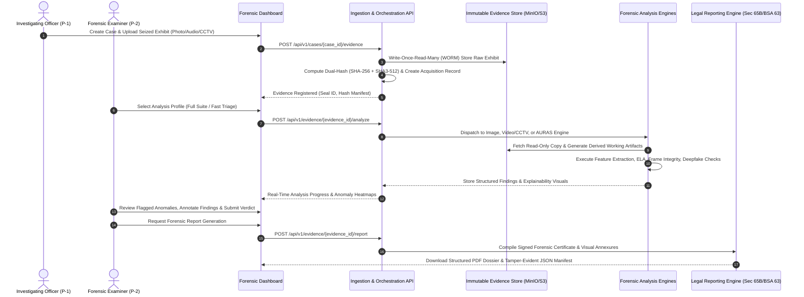


### 4.5 AIF-GEO Geospatial Data & Evidence Classification Model

All geospatial findings, coordinates, and telemetry records are tagged with one of eleven immutable evidentiary classification statuses:
1. **`USER_REPORTED`:** Manually entered by an investigator, complainant, or witness (e.g. asserted incident location).
2. **`MACHINE_EXTRACTED`:** Extracted directly by a parser from file headers or track streams (e.g. EXIF GPS tag). Does **not** mean the value is true.
3. **`EXTERNALLY_ENRICHED`:** Retrieved from an external or local geographic dataset (e.g. reverse-geocoded street address). Does **not** verify the photo was taken there.
4. **`MODEL_INFERRED`:** Generated by an algorithm, neural network, or geometric interpolation (e.g. candidate landmark ranking, interpolated track point).
5. **`CORROBORATED`:** Supported by two or more independent, non-derived evidence sources under a documented correlation procedure.
6. **`INDEPENDENTLY_VERIFIED`:** Supported by a verified cryptographic chain of custody or trusted third-party reference with documented trust basis.
7. **`CONFLICTING`:** Two or more evidence sources disagree on location or timestamp in a manner requiring human examiner review.
8. **`UNKNOWN`:** Field exists or is referenced, but its value cannot be reliably determined.
9. **`NOT_AVAILABLE`:** Field is absent from the file container (e.g. social media platform stripped metadata).
10. **`NOT_APPLICABLE`:** Analysis cannot be physically performed on this exhibit (e.g. solar shadow analysis on an indoor or night photograph).
11. **`INVALID_OR_MALFORMED`:** Data violates formatting standards, rational numbers, or geodetic bounds (e.g. zero-denominator rational, latitude > 90 deg).
---

## 5. Dedicated Audio Forensics User Journeys (AURAS)

AURAS provides structured, legally auditable workflows specifically tailored to digital audio evidence (recorded telephone calls, voice notes, sting operation recordings, CCTV audio tracks):

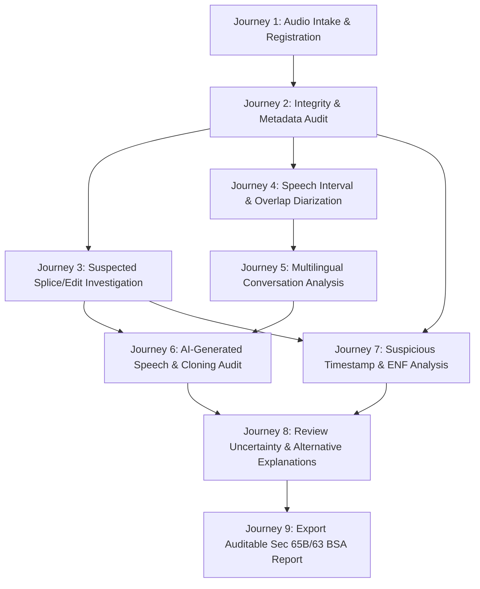

### 5.1 Detailed Audio User Journey Walkthroughs

#### Journey 1: Uploading and Registering Audio Evidence
- **Actor:** Investigating Officer (IO) / Seizure Officer.
- **Workflow:** IO uploads seized audio file (`.wav`, `.mp3`, `.m4a`, `.aac`) through web portal or CLI.
- **System Action:** Computes SHA-256 and SHA3-512 in memory while streaming bytes to WORM storage. Generates unique `evidence_id`, acquisition seal, and registers immutable database record.

#### Journey 2: Checking Integrity and Metadata
- **Actor:** Forensic Examiner (P-2).
- **Workflow:** Examiner opens case exhibit; requests baseline integrity and container audit.
- **System Action:** Compares SHA-256 hash against initial seizure manifest. Runs FFprobe, ExifTool, and Mutagen to extract container streams, encoder tags (e.g., LAME version, Audacity/ProTools metadata signatures), sample rate, bit depth, channel configuration, and decoder warnings.

#### Journey 3: Investigating Suspected Edits or Splices
- **Actor:** Forensic Examiner (P-2).
- **Workflow:** In an extortion case, suspect claims the recording was spliced to take words out of context. Examiner requests splice candidate localization.
- **System Action:** ARE engine computes STFT, spectral flux, and executes PELT change-point detection. Highlights millisecond timestamps where room acoustic reverberation, stationary noise floor, or phase coherence abruptly shift.

#### Journey 4: Identifying Speech Intervals and Overlapping Speakers
- **Actor:** Forensic Examiner / Transcriber.
- **Workflow:** Examiner analyzes multi-party meeting recording where several individuals interrupt and speak concurrently.
- **System Action:** MVSI engine executes Silero VAD to isolate speech, flags multi-speaker overlapping frames via Overlapped Speech Detection (OSD), extracts ECAPA-TDNN embeddings, and produces an overlap-aware diarization timeline supporting concurrent speaker labels (e.g., Speaker A + Speaker C active simultaneously).

#### Journey 5: Analyzing Multilingual Conversations
- **Actor:** Cyber Police IO (P-1) / Forensic Linguist.
- **Workflow:** IO analyzes a conversation with rapid code-switching between Hindi, English, and regional dialects (Bhojpuri/Maithili).
- **System Action:** MVSI multilingual engine classifies spoken language per segment using Whisper/MMS LID. Detects intra-utterance code-switch boundaries. Enforces the invariant that **Speaker Identity $\neq$ Language Identity**, preserving a unified speaker profile even when that speaker alternates between languages.

#### Journey 6: Reviewing AI-Generated or Manipulated Speech Indicators
- **Actor:** Senior Forensic Examiner (P-2).
- **Workflow:** Defense claims a leaked audio clip of a public official is an AI deepfake clone. Examiner triggers ADDE deepfake suite.
- **System Action:** ADDE executes RawNet2 (time-domain waveform), AASIST (spectrotemporal graph), and WavLM (foundation SSL) in parallel. Produces calibrated posterior probabilities, localized sliding-window suspicion curves, and flags whether the voice matches authorized reference samples (separate 1:1 speaker verification check).

#### Journey 7: Inspecting Suspicious Timestamps & ENF
- **Actor:** Forensic Physicist / Examiner (P-2).
- **Workflow:** IO needs to verify if an audio recording was made on the specific date and time claimed in the FIR.
- **System Action:** ARE-09 bandpass filters the audio around 50 Hz (nominal Indian electrical grid frequency) and tracks instantaneous frequency variations via Hilbert transform. If reference grid logs from the regional Power Grid Corporation of India (PGCIL) are available, compares the extracted curve to corroborate or refute recording timestamps.

#### Journey 8: Reviewing Uncertainty & Alternative Explanations
- **Actor:** Senior Examiner (P-2) preparing courtroom testimony.
- **Workflow:** Examiner reviews flagged anomalies to rule out benign environmental or codec artifacts.
- **System Action:** System displays alternative explanation sidebars: distinguishes microphone dropouts from splices, lossy AMR compression cutoffs from vocoder artifacts, and low-SNR recording conditions from deepfake model uncertainty.

#### Journey 9: Exporting an Auditable Forensic Report
- **Actor:** Forensic Examiner (P-2) & Public Prosecutor (P-3).
- **Workflow:** Case moves to trial; formal electronic evidence certificate required.
- **System Action:** Generates a Section 65B IEA / Section 63 BSA compliant PDF dossier, embedding exhibit checksums, examiner details, machine environment hashes, spectral annexures, and a tamper-evident Archify JSON IR graph.

---

### 5.2 Dedicated Image Forensics User Journeys (AIF)

AIF provides structured, legally auditable workflows specifically tailored to digital image evidence (surveillance stills, smartphone photographs, social media captures, identity cards, scanned contracts, and manipulated portraits):

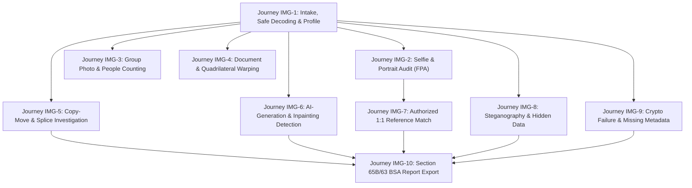

#### Journey IMG-1: Image Ingestion, Defensive Validation & Universal Profiling
- **Actor:** Cyber Police Investigating Officer (IO) (P-1) / Evidence Custodian (P-4).
- **Workflow:** Seized smartphone storage yields questioned image files (`.jpg`, `.png`, `.tif`, `.heic`, `.webp`, `.raw`). Officer uploads exhibit through portal or CLI.
- **System Action:** Computes SHA-256 and SHA3-512 in memory directly from the raw byte stream before decoding. Executes defensive pre-flight validation: verifies magic bytes (rejects extension-spoofed binaries), enforces Pillow decompression bomb ceiling (`Image.MAX_IMAGE_PIXELS = 128_000_000`), detects polyglot payloads and malformed structures. Commits raw bytes to immutable WORM vault (POSIX 0400), issues a signed RFC 8785 canonical manifest, and extracts `IVE-01` Universal Image Ingestion Profile (dimensions, bit depth, colour space, orientation metadata, decoder warnings).

#### Journey IMG-2: Selfie, Portrait & Headshot Biometric Evidence Examination
- **Actor:** Forensic Examiner (P-2).
- **Workflow:** Investigating an extortion or matrimonial fraud case where a suspect profile photo or forged ID portrait is questioned.
- **System Action:** FPA module executes RetinaFace/SCRFD face detection, extracts 468/68 MediaPipe facial landmarks, calculates 3D head pose angles (pitch, yaw, roll), blur metrics, and occlusion masks. Flags whether the face is a natural capture, studio portrait, screenshot crop, or low-resolution CCTV face, preparing canonical normalized crops for downstream manipulation tests.

#### Journey IMG-3: Group Photo & Scene People Counting with Occlusion Analysis
- **Actor:** Investigating Officer (P-1) / Forensic Examiner (P-2).
- **Workflow:** Verifying claims regarding the presence or count of individuals at a public gathering, protest, or crime scene.
- **System Action:** IVE-05 executes YOLOv8/v10 and Grounding DINO human-body detection with non-maximum suppression (NMS) deduplication, crowd-density estimation, and partial-body bounding box tracking. Produces separated, calibrated counts: *Detected Faces*, *Visible People*, and *Estimated People* with explicit confidence bounds ($\pm \sigma$), flagging reflections, mannequins, and posters as potential false positives requiring human review.

#### Journey IMG-4: Document, Contract, Seal & ID Quadrilateral Examination
- **Actor:** Questioned Document Forensic Examiner (P-2).
- **Workflow:** Ingesting a photographed land deed, stamped agreement, or government ID card suspected of fraudulent alterations.
- **System Action:** IVE-08 detects document quadrilateral boundaries via Canny edge detection and polygon approximation, generates perspective-corrected planar crops as derived artifacts, detects rubber stamp and signature regions, decodes QR/barcodes, and executes PaddleOCR. Flags digital text insertions and font-size mismatches without modifying original evidence.

#### Journey IMG-5: Copy-Move Forgery & Splicing Investigation
- **Actor:** Senior Forensic Examiner (P-2).
- **Workflow:** Photograph depicts a crime scene, but suspect claims weapons or crowds were duplicated or pasted in.
- **System Action:** IRE-04 runs multi-scale SIFT/ORB keypoint matching combined with DBSCAN spatial clustering, block-based discrete cosine transform (DCT) comparison, and high-frequency noise residual analysis. Generates localized copy-move polygon pairs, quantization table discrepancy maps, and splicing anomaly heatmaps linking derived artifacts in the DAG.

#### Journey IMG-6: AI-Generated Image & Generative Inpainting Analysis
- **Actor:** Senior Forensic Examiner (P-2).
- **Workflow:** Questioned photograph circulated on social media claims to show a public official accepting a bribe. Defense claims the entire image was generated by Midjourney/Stable Diffusion, or that key objects were added via generative inpainting.
- **System Action:** AIM-01 and AIM-02 execute multi-branch detection: ViT/CNN spatial classifiers, 2D FFT spectral high-frequency artifact detectors, and localized inpainting mask models (TruFor/generative fill detector). Emits calibrated synthetic probability scores, generator-family hypotheses (with explicit uncertainty bounds), and pixel-level heatmaps of modified regions.

#### Journey IMG-7: Authorized 1:1 Reference-Image Biometric Comparison
- **Actor:** Senior Forensic Examiner (P-2) under judicial warrant.
- **Workflow:** Court requests verification whether a face detected in a crime scene photograph matches an authorized police custody booking photograph of a suspect.
- **System Action:** System verifies active FIR Case Authorization token. FPA aligns both faces to canonical geometry, extracts 512-dimensional ArcFace/MagFace embeddings, computes cosine similarity and calibrated likelihood ratio. Emits biometric similarity score with strict legal disclaimer: *Biometric similarity $\neq$ Absolute legal identification; results indicate degree of facial feature correspondence under specific pose and lighting conditions.*

#### Journey IMG-8: Steganography & Hidden Data Payload Analysis
- **Actor:** Cyber Forensic Examiner (P-2).
- **Workflow:** Seized digital media from a suspect device is examined for covert communications or concealed unauthorized data.
- **System Action:** AIM-04 inspects the file container for trailing bytes beyond JPEG EOI / PNG IEND markers, examines PNG ancillary chunks (`zTXt`, `iTXt`), executes LSB Chi-Square and RS steganalysis across colour planes, and analyzes JPEG DCT coefficient distributions. Reports statistical probability of concealed payload; if payload is extracted, quarantines it into an isolated sandbox vault **without executing**.

#### Journey IMG-9: Cryptographic Verification Failure & Missing Provenance Handling
- **Actor:** Senior Examiner (P-2) & Evidence Custodian (P-4).
- **Workflow:** Ingesting an image forwarded through messaging apps where EXIF metadata is stripped or hash does not match initial police seizure memo.
- **System Action:** System halts automated chain, emits explicit status (`HASH_MISMATCH` or `MANIFEST_MISSING`), and logs a custody break event. In UI, informs examiner that social media re-compression stripped metadata (benign transfer), guides examiner to attach secondary acquisition memo, and flags that lack of provenance is NOT proof of content manipulation.

#### Journey IMG-10: Exporting an Auditable Section 65B / 63 BSA Forensic Dossier
- **Actor:** Forensic Examiner (P-2) & Public Prosecutor (P-3).
- **Workflow:** Case moves to trial; formal electronic evidence certificate required for Sessions Court.
- **System Action:** Compiles comprehensive forensic dossier embedding raw SHA-256 hash, acquisition seal, Ed25519 digital signature, RFC 3161 TSA token, full DAG of derived artifact hashes, ELA/inpainting heatmaps, OCR extractions, and certified Section 65B IEA / Section 63 BSA electronic evidence certificate.

### 5.3 Dedicated Video & CCTV Forensics User Journeys (VISTA)

The **VISTA (Video Integrity, Synchronization & Tampering Analysis)** subsystem handles diverse video evidence ranging from high-definition broadcast clips and smartphone recordings to low-frame-rate, multi-channel CCTV surveillance exports. The following twelve user journeys represent real-world forensic workflows executed across state cyber police cells and forensic laboratories:

#### Journey VID-1: General Video Ingestion, Registration & WORM Preservation
- **Actor:** Investigating Officer (P-1) & Evidence Custodian (P-4).
- **Workflow:** IO seizes a smartphone video (`.mp4`, `.mov`, `.mkv`) from a crime scene and uploads it via the case portal.
- **System Action:** Platform streams the incoming raw bytes through dual SHA-256 and SHA3-512 cryptographic accumulators before writing to disk. The bitstream is committed to the WORM vault with POSIX `0400` read-only permissions. An immutable acquisition manifest is signed via Ed25519 and anchored to the hash-chained custody log. System assigns a UUIDv4 `evidence_id`, creates a baseline media record, and generates uncompressed, timestamp-preserved working derivatives.

#### Journey VID-2: CCTV / DVR / NVR Native Export & Multi-Stream Ingestion
- **Actor:** Forensic Examiner (P-2) & Investigating Officer (P-1).
- **Workflow:** IO receives a raw USB export from a commercial DVR/NVR containing proprietary or semi-proprietary streams (`.dav`, `.h264`, `.mp4`, `.avi`, `.ts`) accompanied by export sidecars (`.idx`, `.sec`, `.xml`).
- **System Action:** Ingestion pipeline discovers container structure and associated sidecar files without modifying raw bytes. Emits an evidence-context record, extracts stream layouts (video streams, interleaved audio, subtitle/OSD channels), and checks for embedded ONVIF export seals or digital watermarks. System creates distinct derived artifacts for each camera stream, maintaining parent-child DAG links to the master container exhibit.

#### Journey VID-3: Technical Bitstream Reverse Engineering & Automated Source Triage
- **Actor:** Senior Digital Forensic Examiner (P-2).
- **Workflow:** Examiner initiates forensic analysis to determine whether the video is genuine camera capture, an edited file, or surveillance footage.
- **System Action:** **VRE** demuxes the container using FFprobe, MediaInfo, and PyAV. Audits Presentation Time Stamps (PTS) and Decoding Time Stamps (DTS) for non-monotonicity, frame skips, and VFR jitter. Parses Group of Pictures (GOP) cadence (I/P/B frame distances). Concurrently, **CCTV-01** executes multi-signal source triage (checking for fixed field of view, night-vision infrared grayscale, burned-in on-screen display clocks, and channel labels), assigning a provisional source classification (`LIKELY_CCTV_FOOTAGE`, `GENERAL_VIDEO`, `SCREEN_RECORDING_CANDIDATE`, or `UNKNOWN_SOURCE_TYPE`) with calibrated confidence.

#### Journey VID-4: Adaptive Follow-Up Questioning for CCTV Context
- **Actor:** Forensic Examiner (P-2) interacting with Automated Ingestion Assistant.
- **Workflow:** Examiner uploads a surveillance video where critical recording parameters (recorder make, clock timezone, native export files) are absent from metadata.
- **System Action:** Following the adaptive discovery workflow (**CCTV-03**), VISTA first completes all automated inspections (metadata extraction, frame OCR, PTS cadence). Only then does it formulate targeted, context-aware follow-up questions (**CCTV-05**, Questions A–E):
  1. *Question A (Source):* Inquires if video originated from direct camera, DVR/NVR native export, screen recording, or messaging app.
  2. *Question B (Native Export):* Inquires whether uncompressed native backup files or verification players are available.
  3. *Question C (Hardware Clues):* Displays auto-extracted recorder clues and asks for confirmation of manufacturer/model.
  4. *Question D (Timezone & Incident Window):* Asks for configured recorder timezone and incident window to resolve clock offsets.
  5. *Question E (Corroborating Evidence):* Asks for adjacent camera footage, recorder logs, or seizure hash memos.
  *Critical Invariant:* If the examiner skips questions, analysis proceeds unimpeded; missing context is recorded as `NOT_PROVIDED` and uncertainty bounds are widened accordingly.

#### Journey VID-5: Lossless Audio Stream Extraction & Asynchronous AURAS Routing
- **Actor:** Senior Forensic Examiner (P-2) & Audio Specialist.
- **Workflow:** Video contains an embedded audio track; examiner needs comprehensive speech and acoustic tampering verification.
- **System Action:** **AFB-01** invokes FFmpeg in stream-copy mode (`-c:a copy`) to demux the raw audio track without transcoding or lossy re-encoding. The extracted audio is registered as a derived working exhibit, bound by SHA-256 hash to the parent video exhibit, and mapped sample-by-sample to the video timeline. AFB automatically registers an analysis job with the **AURAS** subsystem:
  - **ARE:** Analyzes signal dynamics, clipping, background noise floor continuity, and 50 Hz Electric Network Frequency (ENF).
  - **MVSI:** Performs Silero VAD speech isolation, overlap-aware speaker diarization, and Indian language identification.
  - **ADDE:** Evaluates multi-branch deepfake classifiers (RawNet2, AASIST, WavLM) for synthetic voice cloning.
  AURAS findings return asynchronously to VISTA's aggregation layer, referencing the exact parent video timecodes.

#### Journey VID-6: Multi-Speaker Diarization, Overlap Speech & Source Separation Analysis
- **Actor:** Forensic Examiner (P-2).
- **Workflow:** High-profile extortion or witness statement video where multiple individuals speak simultaneously or interleave rapidly.
- **System Action:** Extracted audio is processed through **AFB-03/04** and AURAS MVSI. Silero VAD flags voiced intervals; pyannote.audio performs overlap-aware diarization, isolating concurrent speaker segments. When severe overlapping obscures key utterances, examiner can trigger optional neural source separation (SpeechBrain SepFormer / Asteroid). System generates separated audio tracks as derived working artifacts with independent SHA-256 hashes and DAG lineage records, preserving the master mixed audio untouched for legal cross-examination.

#### Journey VID-7: Audio-Visual Synchronization & Talking-Head Lip-Sync (SyncNet) Examination
- **Actor:** Senior Digital Forensic Examiner (P-2).
- **Workflow:** Suspect video depicts a political leader or witness speaking; examiner suspects the speech was re-dubbed, cloned, or lip-manipulated (visual deepfake or audio voice clone).
- **System Action:** **AVSC** extracts face tracks and landmark trajectories (RetinaFace, ByteTrack), isolating mouth-region crops (bounding polygons aligned to inter-pupillary distance). AVSC computes visual speech representations and correlates them with the extracted acoustic stream via SyncNet. It evaluates:
  1. *Global Offset ($\Delta t$):* Detects overall container desynchronization vs. local drift.
  2. *Localized Lip-Sync Confidence:* Generates a temporal confidence curve over sliding 2.0s windows; highlights intervals where visible lip motion diverges from phoneme acoustic dynamics.
  3. *Multi-Face Disambiguation:* When multiple faces appear in frame, AVSC evaluates each face track independently against the active audio stream, identifying the true speaker and retaining alternative face correlation scores.
  4. *Benign Explanation Guardrail:* System checks for studio dubbing or translation voiceover flags before asserting malicious manipulation.

#### Journey VID-8: Video Deepfake & Multi-Branch AI Generation Localization
- **Actor:** Forensic Examiner (P-2) & Model Evaluation Engineer (P-5).
- **Workflow:** Investigating suspected face-swap, deepfake puppet reenactment, or fully generative video (Sora, Runway, Kling).
- **System Action:** **VDF** initiates multi-branch inference across both spatial and temporal dimensions:
  - *Spatial Frame Detectors (VDF-01):* Evaluates Xception and EfficientNet classifiers on normalized face crops, detecting blending boundaries, color discrepancies, and frequency spectrum anomalies.
  - *Temporal Sequence Models (VDF-02):* Evaluates 3D CNNs and video transformers (FTCN, STIL, VideoMAE) over consecutive 16-frame windows, detecting inter-frame flickering, unnatural facial landmark velocity, and optical flow warping.
  - *Calibrated Late Fusion (VDF-04):* Applies Platt scaling to map raw logits to calibrated probabilities. Computes Mahalanobis distance to measure out-of-distribution (OOD) uncertainty. If models disagree or compression is severe, flags high uncertainty rather than issuing an arbitrary verdict.

#### Journey VID-9: Comprehensive Video Scene Intelligence, Vehicle Analysis, ALPR & Evidence Inventory
- **Actor:** Investigating Officer (P-1) & Forensic Examiner (P-2).
- **Workflow:** Complex surveillance footage of a traffic incident, mob altercation, or public area crime where investigator requires an accurate, defensible inventory of participants, fine-grained vehicle types and colours, license plate readings, electronic devices, potential weapons, and environmental scene context without subjective speculation.
- **System Action:** **VCI** executes comprehensive video content and scene intelligence:
  - *Hierarchical Scene & Environment Classification (VCI-FR-008):* Evaluates time-segmented multi-label environments (e.g., *traffic junction transitioning to commercial market*), distinguishing semantic scene context from capture hardware profile.
  - *Generalised Object Inventory (VCI-FR-009):* Detects and catalogues physical objects across configurable categories (backpacks, laptops, tools, containers), returning `UNKNOWN_OBJECT_CANDIDATE` for ambiguous objects.
  - *Fine-Grained Vehicle & Colour Intelligence (VCI-FR-010):* Classifies vehicle categories (motorcycles, auto-rickshaws, cars, trucks, buses) and extracts visible colour palettes under ambient illumination normalization, explicitly withholding unverified make/model assertions.
  - *Separately Versioned ALPR Pipeline (VCI-FR-011):* Localizes plates, rectifies perspective, performs character-level OCR without hallucinating missing characters, validates jurisdiction syntax (e.g., Indian HSRP), and classifies unreadable plates.
  - *Mobile Phone & Device Detection (VCI-FR-012):* Detects handheld phones and electronic devices proximate to persons of interest.
  - *Hazardous Object Triage (VCI-FR-013):* Flags candidate firearm-like or bladed objects with supporting crop hashes and examiner review states (`PENDING_EXAMINER_REVIEW`), strictly avoiding premature intent assertions.
  - *Temporal Tracking & Counting Invariants (VCI-FR-014 / VCI-FR-005):* Maintains separate tallies for per-frame counts, video tracklets, and estimated unique individuals, mitigating track fragmentation.
  - *Unified Evidence Inventory & RAG (VCI-FR-015 / VCI-FR-016):* Compiles a structured, evidence-linked report and vector indices enabling sub-second natural language queries (e.g., "red three-wheeler near junction between 14:10 and 14:15") with parent-frame SHA-256 cryptographic lineage.

#### Journey VID-10: Cryptographic Provenance, ONVIF Seals & Custody Chain Audit
- **Actor:** Evidence Custodian (P-4) & Public Prosecutor (P-3).
- **Workflow:** Defense challenges the authenticity of a seized CCTV clip, claiming it was altered on the police workstation before submission.
- **System Action:** System executes cryptographic provenance audit (**CEIPL**):
  - Validates original bitstream SHA-256 against initial police seizure hash memo.
  - Verifies Ed25519 digital signature on the intake manifest and checks RFC 3161 Trusted Timestamp Authority (TSA) token.
  - Traverses the append-only hash-chained custody log, proving zero unauthorized modifications.
  - If native export contains an ONVIF Export File Format signature or vendor digital watermark, **CCTV-07** verifies the cryptographic signature against the vendor root certificate. Emits a typed verification status (`VERIFIED`, `SIGNATURE_INVALID`, or `PROVENANCE_UNAVAILABLE`).

#### Journey VID-11: Conflicting Model Outputs, Compression Degradation & Inconclusive Verdict Handling
- **Actor:** Senior Digital Forensic Examiner (P-2).
- **Workflow:** Low-resolution, heavily re-encoded WhatsApp CCTV clip where VDF deepfake models output conflicting probabilities (e.g., frame model indicates $0.72$ suspicion while temporal model indicates $0.21$).
- **System Action:** Cross-engine fusion layer detects high model divergence and checks compression metrics (extreme blocking, bit-rate $< 500\text{ kbps}$, frame rate $< 8\text{ fps}$). Instead of averaging scores into a misleading aggregate, system triggers the *Forensic Uncertainty Invariant*:
  - Generates an explicit **"Inconclusive / Insufficient Video Evidence"** finding.
  - Displays a detector disagreement matrix showing individual model scores, calibration curves, and OOD distances.
  - Explains that heavy H.264 macroblocking mimics generative face artifacts, preventing scientifically defensible fraud determination.

#### Journey VID-12: Compiling Structured Video Forensic Dossier & Examiner Adjudication
- **Actor:** Forensic Examiner (P-2) & Public Prosecutor (P-3).
- **Workflow:** Trial preparation; final official dossier required for submission under Section 65B Indian Evidence Act / Section 63 Bharatiya Sakshya Adhiniyam 2023.
- **System Action:** System aggregates findings into an auditable dossier:
  - Embeds master exhibit SHA-256 and SHA3-512 hashes, WORM vault URI, and Ed25519 signature.
  - Compiles separable forensic annexures: Video Technical Profile (VRE), Extracted Audio & Voice Report (AFB/AURAS), Audio-Visual Synchronization Report (AVSC), Video Deepfake & Manipulation Report (VDF), Content Timeline & Object Tracks (VCI), and CCTV Specialized Audit (CCTV).
  - Emits an interactive Archify JSON IR graph and renders a tamper-evident WeasyPrint PDF report with certified examiner affidavit.

### 5.4 Detailed Offline Network Traffic Forensics User Journey Walkthroughs (ONTF)

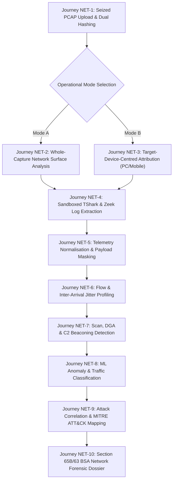

#### Journey NET-1: Seized PCAP Ingestion, Dual Hashing & Format Validation
- **Actor:** Cyber Police Investigating Officer (P-1) / Seizure Officer.
- **Workflow:** IO uploads a previously captured `.pcap` or `.pcapng` file recovered from a seized suspect laptop or network gateway backup.
- **System Action:** Computes SHA-256 and SHA3-512 in memory while streaming bytes to WORM storage (`POSIX 0400`). Inspects file header magic bytes (`0xa1b2c3d4` or `0x0a0d0d0a`), verifies packet link-layer type (Ethernet / Linux Cooked / Raw IP), counts total packets, checks for packet-level truncation, and registers an immutable `NetworkEvidenceRecord`.

#### Journey NET-2: Mode A — Whole-Capture Global Network Surface Analysis
- **Actor:** Senior Digital Forensic Examiner (P-2).
- **Workflow:** Examiner wants an exhaustive, capture-wide summary of all network communications across all recorded IP addresses without focusing on any single host.
- **System Action:** Dissects entire capture, extracting global conversation matrices, top-10 source/destination talkers, protocol distribution percentages (TCP/UDP/ICMP/DNS/TLS/HTTP), autonomous system (ASN) geographic diversity, and capture-wide traffic volume curves.

#### Journey NET-3: Mode B — Target-Device-Centred Forensic Examination (PC/Mobile)
- **Actor:** Cyber Crime Investigator (P-1) / Forensic Examiner (P-2).
- **Workflow:** Investigation centers on a seized Samsung Android smartphone or Windows workstation. Examiner provides target criteria (e.g. IP `192.168.1.105` or MAC `3a:88:2d:41:9a:12`).
- **System Action:** Device Attribution Engine inspects DHCP transactions (`Option 12` Hostname, `Option 55` Parameter Request List), ARP tables, and DNS queries. Correlates candidate device identity, establishes an explicit Attribution Confidence Tier (`DIRECT_OBSERVATION`, `PROBABLE_CORRELATION`, or `AMBIGUOUS_ATTRIBUTION`), and filters all subsequent analysis to inbound, outbound, lateral, and peer flows involving the target device.

#### Journey NET-4: Offline Pluggable Parsing & Zeek Log Extraction
- **Actor:** Forensic Examiner (P-2).
- **Workflow:** Examiner triggers automated deep protocol decoding.
- **System Action:** Spawns an isolated unprivileged worker container (`uid 10001`) with strict resource limits (<= 4GB RAM, 300s timeout). Runs TShark for packet-level dissection and executes Zeek in offline batch mode (`zeek -r capture.pcap`). Emits structured forensic TSV/JSON logs (`conn.log`, `dns.log`, `ssl.log`, `http.log`, `notice.log`, `files.log`).

#### Journey NET-5: Common Telemetry Normalisation & Privacy-Preserving Payload Masking
- **Actor:** Evidence Custodian (P-4) / Forensic Examiner (P-2).
- **Workflow:** Transforming disparate raw dissections into standardized records while complying with Indian privacy laws (DPDP Act 2023).
- **System Action:** Maps parser outputs into unified `NetworkFlowRecord` Pydantic models. Automatically strips or masks plaintext credentials, authorization bearer tokens, personal email bodies, and raw packet payloads, preserving only transport metadata, hashes, and protocol headers necessary for attack analysis.

#### Journey NET-6: Flow & Temporal Feature Engineering (Inter-Arrival Jitter & Windowing)
- **Actor:** Forensic ML Engineer (P-5) / Examiner (P-2).
- **Workflow:** Extracting mathematical features for anomaly detection.
- **System Action:** Computes 80+ bidirectional flow metrics: forward/backward packet counts, packet length mean/stddev, inter-arrival time (IAT) mean and coefficient of variation ($CV_{\text{IAT}}$), TCP flag distribution ratios (SYN/ACK, RST frequency), and sliding time-window aggregates (1s, 5s, 60s windows).

#### Journey NET-7: Deterministic Threat Detection (Scans, DGA, DNS Tunneling & Beaconing)
- **Actor:** Forensic Examiner (P-2).
- **Workflow:** Investigating whether the seized device participated in scanning, contacted malicious C2 infrastructure, or exfiltrated data via covert channels.
- **System Action:** Deterministic rule engine evaluates:
  - Port Scans: Vertical (> 50 ports on 1 target within 5s) and horizontal (> 20 hosts on 1 port) scans.
  - DNS Anomalies: High-entropy domain lookups (DGA detection via Shannon entropy $> 3.8$) and DNS tunneling via abnormal TXT record lengths ($> 128$ bytes).
  - Periodic C2 Beaconing: Fast Fourier Transform (FFT) and autocorrelation on flow arrival times flagging regular heartbeat intervals ($CV_{\text{IAT}} < 0.15$).

#### Journey NET-8: Machine Learning Anomaly & Traffic Classification
- **Actor:** Senior Digital Forensic Examiner (P-2).
- **Workflow:** Detecting stealthy or novel malicious communications that bypass static signature rules.
- **System Action:** Evaluates pre-trained supervised flow classifiers (LightGBM trained on benchmark datasets) and unsupervised statistical outlier detectors (Isolation Forest). Emits calibrated anomaly probability scores with feature contribution rankings (SHAP values) explaining which specific flow attributes triggered the alert.

#### Journey NET-9: Multi-Stage Incident Narrative Correlation & MITRE ATT&CK Mapping
- **Actor:** Forensic Examiner (P-2) & Public Prosecutor (P-3).
- **Workflow:** Structuring disconnected network alerts into a coherent cyberattack timeline for court presentation.
- **System Action:** Correlates chronological events across forensic phases:
  - *Phase 1 (Reconnaissance):* Port scanning detected (mapped to ATT&CK `T1046 Network Service Discovery`).
  - *Phase 2 (Command & Control):* Periodic HTTPS beaconing to unindexed bulletproof VPS (mapped to `T1071.001 Web Protocols`).
  - *Phase 3 (Exfiltration):* Sudden multi-megabyte burst of encrypted outbound traffic to external cloud storage (mapped to `T1048 Exfiltration Over Alternative Protocol`).
  - Contextualizes findings into an explainable attack narrative without claiming absolute intent.

#### Journey NET-10: Compiling Structured Network Forensic Dossier (Sec 63 BSA)
- **Actor:** Forensic Examiner (P-2) & Legal Counsel (P-3).
- **Workflow:** Submitting electronic evidence certificate for judicial trial.
- **System Action:** Assembles an 11-part structured electronic evidence dossier:
  - Ingestion dual hashes (SHA-256 and SHA3-512) and WORM storage verification.
  - Complete capture profile: duration, packet count, link-layer protocol, and capture drop status.
  - Target-device profile and explicit attribution confidence rating (`DIRECT_OBSERVATION` vs `PROBABLE` vs `AMBIGUOUS`).
  - Communication graph, DNS timelines, top talkers, and protocol breakdown.
  - Traceable threat findings citing exact packet offsets, flow IDs, and MITRE ATT&CK tags.
  - Explicit limitation statement explaining unencrypted metadata limits and absence of payload decryption.
  - Statutory Section 65B IEA / Section 63 BSA certificate with examiner affidavit and Ed25519 digital signature.

### 5.5 Detailed AIF-GEO Geospatial Forensics User Journey Walkthroughs

The **AIF-GEO** subsystem handles real-world investigative scenarios across digital photographs, scanned documents, external GPS logs, and surveillance feeds:

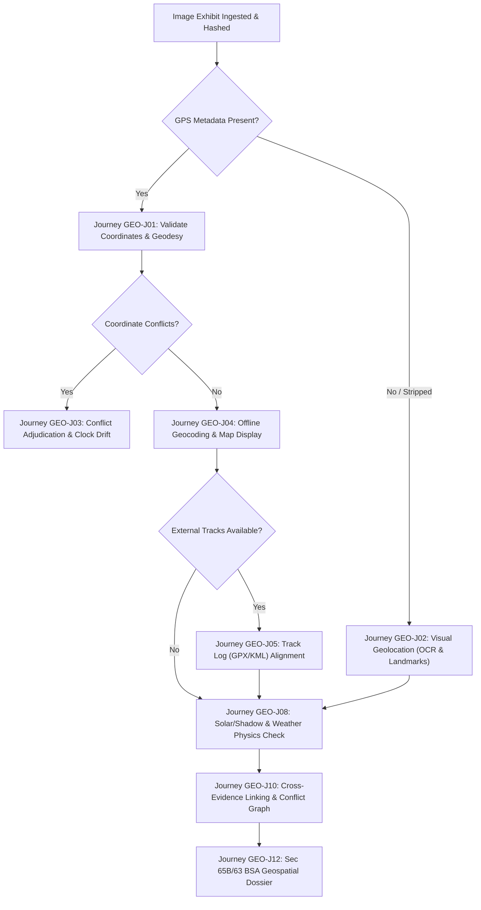

#### Journey GEO-J01: Ingesting & Preserving a GPS-Tagged Crime Scene Image
- **Actor:** Cyber Police Investigating Officer (P-1) & Evidence Custodian (P-4).
- **Workflow:** IO uploads a seized smartphone photograph taken at a rural extortion site.
- **System Action:** Ingests raw file, calculates streaming SHA-256 and SHA3-512 hashes, commits to WORM vault (`POSIX 0400`), extracts raw GPS tags (latitude, longitude, altitude, GPS date/time, image direction), normalises degrees-minutes-seconds to signed decimal degrees, calculates horizontal uncertainty radius from DOP, and emits a validated `GeospatialObservation` record.

#### Journey GEO-J02: Investigating an Image with Stripped / Missing GPS Metadata
- **Actor:** Forensic Examiner (P-2).
- **Workflow:** IO forwards an extortion photograph received via WhatsApp with zero EXIF metadata.
- **System Action:** Flags `GPS_METADATA_ABSENT` with explicit caveat (*absence is typical of messaging platforms and does not prove tampering*). Dispatches image to visual recovery pipeline (`GEO-09`): runs PaddleOCR extracting visible street signs and shop banners; runs landmark retrieval matching visual features against regional database; ranks candidate localities with Top-5 confidence scores; renders candidate regions as dashed polygons on the interactive map.

#### Journey GEO-J03: Detecting & Adjudicating Contradictory GPS Coordinates & Timestamps
- **Actor:** Senior Digital Forensic Examiner (P-2).
- **Workflow:** Questioned photograph contains EXIF GPS coordinates indicating New Delhi, but XMP location tags claim Patna, and file creation date precedes the GPS timestamp.
- **System Action:** Flags `CONTRADICTORY_METADATA_TAGS`. Evaluates camera local clock against GPS UTC timestamp, accounting for leap seconds (18s) and Indian Standard Time (UTC+05:30). Computes clock offset regression across case photos. Marks findings as `CONFLICTING`, highlights conflicting values side-by-side in examiner workbench, and preserves both claims in the conflict graph.

#### Journey GEO-J04: Correlating Photographs with an Authorized Suspect GPS Track Log (GPX/KML)
- **Actor:** Cyber Crime Investigator (P-1) & Forensic Examiner (P-2).
- **Workflow:** IO seizes a Garmin handheld GPS or exports a Google Location History timeline from suspect's phone and uploads it as evidence exhibit `EXT-TRK-01`.
- **System Action:** Safely parses GPX/KML track into timestamped geodetic waypoints. Aligns image capture timestamps with track timecodes. Performs WGS84 geodesic interpolation between bounding track samples. Renders the suspect's continuous travel path on the interactive map, snapping photo thumbnails to their respective interpolated trajectory points with error bounds.

#### Journey GEO-J05: Investigating Alleged GPS Metadata Spoofing & Teleportation
- **Actor:** Forensic Examiner (P-2) & Public Prosecutor (P-3).
- **Workflow:** Defense claims suspect was in Mumbai based on a photo's GPS tag, but surveillance CCTV places them in Patna 30 minutes earlier.
- **System Action:** `GEO-07` computes WGS84 ellipsoidal distance between sequential exhibits ($d = 1,450\text{ km}$) and elapsed time ($\Delta t = 1,800\text{ s}$). Calculates implied velocity $v = 2,900\text{ km/h}$. Flags `PHYSICALLY_IMPOSSIBLE_VELOCITY` ($v > 950\text{ km/h}$ supersonic threshold). Cross-examines sensor PRNU noise and quantization history, documenting that GPS coordinates were injected post-capture.

#### Journey GEO-J06: Multi-Image Travel Route & Geographic Timeline Reconstruction
- **Actor:** Senior Forensic Examiner (P-2).
- **Workflow:** Examiner analyzes 45 photographs seized from a suspect's smartphone to reconstruct their movements across Bihar districts during an incident week.
- **System Action:** Extracts timestamps and coordinates from all 45 images. Applies DBSCAN spatio-temporal clustering ($\epsilon_{\text{dist}} = 500\text{m}$, $\epsilon_{\text{time}} = 2\text{h}$) to identify geographic stops. Computes pairwise transit legs with velocity checks. Renders a synchronized timeline scrubber and vector map showing the chronological route with stop durations and outlier flags.

#### Journey GEO-J07: Landmark Recognition & Geometric Verification Against Reference Imagery
- **Actor:** Senior Examiner (P-2).
- **Workflow:** Questioned image depicts a suspect outside a distinctive historical monument, but location is disputed.
- **System Action:** Recovers candidate reference orthophotos. Extracts SIFT and ORB feature keypoints from questioned image and reference imagery. Executes RANSAC homography estimation ($\mathbf{x}' \sim \mathbf{H}\mathbf{x}$), requiring $\ge 25$ inliers and inlier ratio $\ge 0.35$. Emits visual match overlay displaying geometric correspondence lines, bounding boxes, and reprojection error metrics.

#### Journey GEO-J08: Capture-Time Verification via Solar Position & Shadow Geometry
- **Actor:** Senior Digital Forensic Examiner (P-2).
- **Workflow:** Questioned photo claims capture at 12:30 PM on a specific date in Muzaffarpur, but shadows appear long and slanted.
- **System Action:** `GEO-11` computes astronomical solar coordinates via NOAA algorithm: expected solar elevation $\alpha = 64.2^\circ$, expected azimuth $\Phi_s = 185.1^\circ$. Examiner annotates a vertical light pole and horizontal ground shadow. Algorithm computes observed elevation $\tan\alpha \approx h/L = 0.52 \implies \alpha_{\text{obs}} = 27.5^\circ$. Flags `SOLAR_SHADOW_INCONSISTENCY` ($\Delta\alpha = 36.7^\circ$), indicating the photograph was taken in late afternoon or the claimed date/location is false.

#### Journey GEO-J09: Historical Weather & Digital Elevation Model (DEM) Terrain Cross-Check
- **Actor:** Forensic Examiner (P-2).
- **Workflow:** A suspect claims a photograph was taken on a clear sunny afternoon in a mountain valley, but the photo shows overcast drizzle.
- **System Action:** Queries local Open-Meteo historical weather reanalysis cache for the candidate coordinates and timestamp: retrieves precipitation ($12.4\text{ mm}$), cloud cover ($98\%$), and temperature ($14.2^\circ\text{C}$). Concurrently, queries Copernicus DEM GeoTIFF via Rasterio, comparing GPS altitude ($1,840\text{m}$) against ground elevation ($1,822\text{m} \pm 15\text{m}$). Emits weather consistency confirmation and terrain elevation compatibility report.

#### Journey GEO-J10: Cross-Evidence Geospatial Linking (Image <-> CCTV <-> Network Trajectory)
- **Actor:** Senior Forensic Examiner (P-2) & Incident Lead.
- **Workflow:** Investigating a coordinated heist involving digital photos from suspect phones, CCTV clips from nearby banks (VISTA), and Wi-Fi probe logs from seized routers (ONTF).
- **System Action:** Integrates multi-modal evidence into the shared `GeospatialConflictGraph`: links image coordinates to fixed CCTV camera positions within 100 meters, aligns photo capture times with CCTV vehicle tracking timelines, and correlates device Wi-Fi connection bursts from ONTF. Preserves all corroborating and conflicting edges.

#### Journey GEO-J11: Inspecting C2PA / Content Credentials Signed Location Manifests
- **Actor:** Forensic Examiner (P-2).
- **Workflow:** Seized photograph from an enterprise camera includes a C2PA Content Credentials provenance manifest.
- **System Action:** `GEO-20` parses C2PA JUMBF container, validates X.509 certificate chain, verifies Ed25519/ECDSA digital signature over the claim assertion, and checks content binding hashes. Extracts cryptographically signed location assertion and cross-checks it against embedded EXIF GPS tags. Flags `PROVENANCE_CONFIRMED` when signed claims match, or `PROVENANCE_SIGNATURE_INVALID` if bitstream was modified.

#### Journey GEO-J12: Generating a Section 65B IEA / Section 63 BSA Certified Geospatial Dossier
- **Actor:** Forensic Examiner (P-2) & Public Prosecutor (P-3).
- **Workflow:** Case moves to trial in Sessions Court; formal electronic evidence certificate required for location evidence.
- **System Action:** Compiles comprehensive Section 65B/63 BSA certified dossier embedding: original file dual hashes, raw and normalised GPS coordinates, geodetic distance calculations, reverse geocoding descriptions with provider attribution, solar/shadow and weather verification annexures, interactive map snapshot, conflict graph summary, and examiner affidavit sealed with Ed25519 digital signature and RFC 3161 TSA token.

### 5.6 Detailed Cross-Modal Deepfake Validation & Governance User Journeys (CDVF)

#### Journey CDVF-J01: Registering, Checkpoint Hashing, and Auditing a New Deepfake Detection Model
- **Actor:** Forensic ML Evaluation & Security Engineer (P-5) & System Administrator (P-4).
- **Workflow:** An open-source research checkpoint for audio voice-synthesis detection (e.g. WavLM-Large-Linear or AASIST) is evaluated for adoption into the AURAS ADDE engine.
- **System Action:** P-5 initiates registration via `ps05.cdvf.registry`. The engine parses the model card, verifies the open-source license permissions for government forensic use, streams the model weights to compute its cryptographic SHA-256 digest, validates the frozen input tensor geometry ($16\text{ kHz}$ mono float32, $2.0\text{ s}$ window), and inserts an immutable `ModelRegistryEntry` in state `CANDIDATE`. Pre-conditions check verifies dependencies and locks the record against in-place weight mutation.

#### Journey CDVF-J02: Establishing Leakage-Resistant Dataset Partitions & Generating Split Manifests
- **Actor:** Forensic ML Evaluation & Security Engineer (P-5).
- **Workflow:** Ingesting a multi-modal benchmark corpus (e.g. FaceForensics++, DFDC, ASVspoof 2021) to evaluate image, audio, and video detectors.
- **System Action:** P-5 registers the dataset creating a `DatasetCard`. CDVF inspects metadata for grouping keys (original video ID, subject identity, recording session, camera model). The partition engine generates disjoint Train, Calibration, Validation, and Test splits grouped strictly by root media and actor identity. CDVF computes SHA-256 manifests for each partition, stores them in the WORM storage vault, and blocks any evaluation where source derivatives cross between calibration and held-out test sets.

#### Journey CDVF-J03: Executing an Out-of-Distribution & Unseen-Generator Generalisation Benchmark Run
- **Actor:** Forensic ML Evaluation & Security Engineer (P-5).
- **Workflow:** Benchmarking a spatial video deepfake detector (e.g. EfficientNet-B4) trained on FaceForensics++ against unseen generative methods (Diffusion-based inpainting, Sora, Wan2.1, Kling) and out-of-domain compression profiles.
- **System Action:** CDVF executes benchmark protocol Mode C (Unseen-Generator) and Mode D (Cross-Compression). It captures 19 standard execution parameters, evaluates detector predictions on disjoint test partitions, records per-generator ROC-AUC and PR-AUC, and computes performance drops ($\Delta\text{AUC}_{\text{gen}}$). The system produces a structured evaluation manifest showing that while in-domain accuracy is $96.4\%$, unseen diffusion accuracy drops to $61.2\%$, automatically annotating the model's scoped limitations.

#### Journey CDVF-J04: Calibrating Model Confidence Scores & Quantifying Expected Calibration Error (ECE)
- **Actor:** Forensic ML Evaluation & Security Engineer (P-5) & Senior Forensic Examiner (P-2).
- **Workflow:** A raw CNN classifier outputs uncalibrated sigmoid scores clustering near 0.0 or 1.0, creating deceptive certainty for court testimony.
- **System Action:** P-5 isolates the held-out Calibration partition (disjoint from test set). CDVF fits a Platt scaling / Temperature scaling transform to map raw logits to empirical posterior probabilities. CDVF computes pre- and post-calibration Brier scores, reliability diagrams, and Expected Calibration Error (ECE) across 15 equal-width bins. The calibrated scaling parameters are cryptographically sealed as a versioned `CalibrationArtifact` linked to the specific model revision.

#### Journey CDVF-J05: Evaluating Model Abstention & Selective Risk on Degraded CCTV Surveillance Footage
- **Actor:** Senior Forensic Examiner (P-2).
- **Workflow:** Examiner submits a heavily compressed, night-vision CCTV video clip with low frame rate ($10\text{ fps}$) and IR illumination to verify alleged facial manipulation.
- **System Action:** VISTA executes frame extraction and feeds crops to the VDF detector. CDVF OOD detector evaluates deep feature Mahalanobis distances against the validated daytime face training manifold; the distance exceeds the validated gating threshold $\tau_{\text{OOD}}$. Concurrently, signal SNR is below the minimum quality threshold. Rather than forcing a high-uncertainty "Real" or "Fake" classification, CDVF issues a first-class `INCONCLUSIVE_OOD` and `INCONCLUSIVE_LOW_QUALITY` finding with an explicit coverage-risk explanation, preventing erroneous courtroom evidence.

#### Journey CDVF-J06: Conducting Scoped Model Approval Gate Review & Generating Validation Dossier
- **Actor:** Forensic ML Evaluation & Security Engineer (P-5), Senior Forensic Examiner (P-2) & Public Prosecutor (P-3).
- **Workflow:** Final evaluation of a multi-branch image deepfake detector before authorizing its use in active police investigations.
- **System Action:** CDVF evaluates the candidate model against 12 approval gates (provenance, split integrity, in-domain AUC, cross-dataset drop, calibration ECE, OOD rejection rate, localization IoU, subgroup fairness, runtime latency, and deterministic reproducibility). Gates 1–11 pass, but cross-dataset generalization on social media recompressed images falls below deployment criteria. P-5 approves the model in state `VALIDATED_FOR_DEFINED_SCOPE` restricted to uncompressed or mildly compressed images (JPEG $Q \ge 75$), embedding the scope boundary into the generated Section 65B/63 BSA validation dossier.

---

## 6. Functional Requirements (FR)

### 6.1 Shared Evidence Management & Orchestration Layer (FR-CORE)

| Requirement ID | Module | Title | Description | Acceptance Criteria | Priority |
| :--- | :--- | :--- | :--- | :--- | :--- |
| **FR-CORE-001** | Ingestion | Case Registration & Exhibit Intake | System shall register forensic cases with mandatory metadata (FIR/Case number, Police Station, Investigating Officer ID, Seizure Date/Time, Evidence Type). | Case created with unique UUIDv4; all subsequent exhibits bound to case; prevents orphaned files. | P0 |
| **FR-CORE-002** | Integrity | Cryptographic Dual-Hashing | System shall immediately compute both SHA-256 and SHA3-512 checksums upon byte intake before any file writing or processing. | Hashes recorded in immutable audit ledger; rejects truncated or corrupt network uploads. | P0 |
| **FR-CORE-003** | Storage | Immutable Raw Evidence Storage | System shall store master exhibits in a Write-Once-Read-Many (WORM) storage partition with strictly read-only filesystem permissions. | Zero write/delete permissions granted to worker processes; prevents accidental modification of original exhibit. | P0 |
| **FR-CORE-004** | Lineage | Derived Artifact Transformation Tracking | Any resampled, trans手游, extracted, or cropped artifact must have a deterministic manifest linking parent Exhibit ID, transform parameters, and child hash. | Complete DAG (Directed Acyclic Graph) of artifact provenance retrievable via API and visualised in UI. | P0 |
| **FR-CORE-005** | Orchestration | Asynchronous Job Queue | System shall dispatch forensic tasks to a distributed worker queue with priority scheduling, failure retries, and task heartbeats. | Long-running video/audio jobs execute without blocking HTTP API; worker crash does not corrupt database state. | P0 |
| **FR-CORE-006** | Audit | Tamper-Evident Audit Logging | System shall log every user action, exhibit access, analysis execution, and report generation in an append-only cryptographic audit log. | Every audit record signed with previous record hash (Merkle/Hash chain); verifiable integrity of audit trail. | P1 |
| **FR-CORE-007** | Reporting | Section 65B / BSA Section 63 Certificate Generation | System shall automatically compile a standardized electronic evidence certificate detailing hash records, hardware environment, tool versions, and examiner signatures. | Generates high-fidelity PDF compliant with statutory formats under Indian Evidence Act Sec 65B and BSA 2023 Sec 63. | P0 |

### 6.2 Advanced Image Forensics Subsystem (AIF) Functional Requirements

The AIF subsystem requirements are organized into five specialized modules operating under the shared cryptographic integrity foundation:

#### 6.2.1 Core Ingestion & Universal Profiling (AIF-FR)

| Requirement ID | Module | Title & Description | Rationale | Pri | Inputs & Dependencies | Expected Outputs | Acceptance Criteria | Status |
| :--- | :--- | :--- | :--- | :--- | :--- | :--- | :--- | :--- |
| **AIF-FR-001** | CEIPL / Ingest | **Raw Image Ingestion & Pre-Decode Hashing:** Ingest image bitstreams into WORM vault; compute SHA-256 directly from raw bytes before decoding or conversion. | Guarantees master evidentiary integrity; prevents silent codec normalization changes. | P0 | Seized image bytes (JPEG, PNG, TIFF, HEIC, WebP, RAW). | Raw byte SHA-256, WORM URI (`0400`), Ingestion seal. | Hashes identical across runs; bitstream bit-for-bit unchanged. | `PLANNED` |
| **AIF-FR-002** | Ingest / Defense | **Defensive Parsing & Decompression Bomb Prevention:** Enforce strict decompression pixel ceiling (`128_000_000` px), memory quota (2GB), and process timeout (30s); verify magic bytes. | Prevents denial-of-service, memory exhaustion, and format polyglot exploits. | P0 | Raw exhibit stream. Dep: `python-magic`, Pillow. | Safe decoding status, format verification flag, decoder warnings. | Rejects decompression bombs safely without worker termination. | `PLANNED` |
| **AIF-FR-003** | IVE-01 | **Universal Image Ingestion Profile:** Extract dimensions, width/height, aspect ratio, bit depth, colour mode, alpha channel, ICC profile, and orientation. | Establishes standard container baseline for all downstream forensic engines. | P0 | Safe decoded image array. Dep: Pillow, ExifTool. | Typed `ImageIngestionProfile` dictionary and JSON manifest. | Correctly parses all standard formats; identifies truncated files. | `PLANNED` |
| **AIF-FR-004** | Orchestrator | **Task-Aware Routing & High-Resolution Tiling:** Route image to specialized engines based on profile; tile images $> 4096 \times 4096$ with 15% overlap. | Prevents VRAM exhaustion while maintaining pixel-level resolution for micro-forgeries. | P0 | Universal Image Profile, Examiner Profile. | Tile array with coordinate mapping matrices. | Coordinate transforms map tile detections back to master $(x, y, w, h)$. | `PLANNED` |
| **AIF-FR-005** | Lineage / DAG | **Derived Image Artifact Lineage Tracking:** Every crop, frequency transform, ELA map, and perspective warp must emit a signed transformation manifest. | Complete mathematical auditability required for court admissibility. | P0 | Child artifact bytes, transform operator, parent ID. | Child SHA-256, Lineage record in `artifacts` table. | Complete DAG retrievable via API; no untracked derivative files. | `PLANNED` |

#### 6.2.2 Visual Evidence & Understanding Engine (IVE-FR)

| Requirement ID | Module | Title & Description | Rationale | Pri | Inputs & Dependencies | Expected Outputs | Acceptance Criteria | Status |
| :--- | :--- | :--- | :--- | :--- | :--- | :--- | :--- | :--- |
| **IVE-FR-001** | IVE-02 | **Hierarchical 150-Category Evidence Taxonomy:** Categorize image into versioned 150-category taxonomy across 15 parent forensic groups. | Standardizes visual evidence classification across police departments and FSLs. | P0 | Derived RGB image. Dep: Taxonomy schema v1.0. | Multi-label category tags, parent group IDs, taxonomy version. | Taxonomy covers 15 parent groups; unknown classes marked explicitly. | `PLANNED` |
| **IVE-FR-002** | IVE-03 | **Multi-Label Image Scene Classification:** Extract image embeddings via CLIP/SigLIP; classify multi-label scene probabilities with uncertainty calibration. | Enables rapid triage of large seized datasets (phones, hard drives). | P0 | Normalized RGB image (224x224 / 384x384). Dep: SigLIP / ViT. | List of predicted category labels with calibrated confidence. | Macro-F1 $> 85\%$ on verified forensic benchmark categories. | `PLANNED` |
| **IVE-FR-003** | IVE-04 | **Object Detection & Spatial Localization:** Detect forensic objects (weapons, vehicles, documents, cash) with bounding polygons and confidence scores. | Localizes physical evidence within complex crime scenes. | P0 | RGB image / tile arrays. Dep: YOLOv8/v10, Grounding DINO. | Bounding boxes `[(x, y, w, h)]`, class labels, confidence scores. | mAP@50 $> 0.70$ on common forensic object categories. | `PLANNED` |
| **IVE-FR-004** | IVE-04 | **Prompted & Instance Segmentation:** Generate pixel-accurate instance masks for detected evidence objects using SAM 2 or Mask R-CNN. | Isolates precise evidentiary contours for ballistic or damage analysis. | P1 | Bounding boxes / point prompts. Dep: SAM 2 / Mask R-CNN. | Binary segmentation mask arrays (RLE encoded). | Mask IoU $> 0.75$ against annotated ground truth contours. | `PLANNED` |
| **IVE-FR-005** | IVE-05 | **Occlusion-Aware People Counting:** Count individuals with crowd-density estimation, distinguishing detected faces, visible bodies, and estimated persons. | Accurately assesses crowd sizes in public order and unlawful assembly cases. | P0 | RGB image. Dep: YOLO-human, CSRNet / density head. | Separate counts: `faces_count`, `visible_count`, `estimated_count` ($\pm \sigma$). | Count Mean Absolute Error (MAE) $< 1.5$ on groups $< 30$ persons. | `PLANNED` |
| **IVE-FR-006** | IVE-06 / FPA | **Face, Portrait & Selfie Landmarking:** Detect faces with RetinaFace/SCRFD; extract 468 MediaPipe landmarks, 3D pose, blur, and occlusion scores. | Prepares canonical normalized facial crops for downstream tampering analysis. | P0 | RGB image. Dep: RetinaFace, MediaPipe Face Landmarker. | Face bounding boxes, landmark points, pose angles, quality score. | Detection recall $> 95\%$ on faces $> 40 \times 40$ pixels; flags blurred faces. | `PLANNED` |
| **IVE-FR-007** | IVE-07 / FPA | **Authorized 1:1 Biometric Reference Comparison:** Compare questioned face crop against authorized custody photo using ArcFace/MagFace embeddings. | Corroborates identity of questioned individual under strict legal warrant. | P1 | Questioned face crop, reference photo, Case Authorization Token. | Cosine similarity score, calibrated likelihood ratio, disclaimer. | Access-controlled; similarity output accompanies explicit disclaimer. | `PLANNED` |
| **IVE-FR-008** | IVE-08 | **Document Quadrilateral Correction & OCR:** Detect document boundaries, warp perspective, extract text via PaddleOCR, and flag stamp/seal regions. | Verifies authenticity of photographed agreements, certificates, and IDs. | P0 | Document photograph. Dep: Canny, Hough, PaddleOCR. | Perspective-corrected crop, recognized text with coordinates, seal boxes. | Word Error Rate (WER) $< 8\%$ on clean printed Indian documents. | `PLANNED` |

#### 6.2.3 Image Reverse Engineering Engine (IRE-FR)

| Requirement ID | Module | Title & Description | Rationale | Pri | Inputs & Dependencies | Expected Outputs | Acceptance Criteria | Status |
| :--- | :--- | :--- | :--- | :--- | :--- | :--- | :--- | :--- |
| **IRE-FR-001** | IRE-01 | **Deep EXIF, XMP, IPTC & ICC Profile Audit:** Extract complete metadata hierarchy; cross-reference camera make/model against sensor specs and GPS sanity. | Exposes editing tool traces (Photoshop, GIMP) and impossible timestamps/locations. | P0 | Master image bitstream. Dep: ExifTool, Piexif. | Structured metadata dictionary, tampering flags, GPS coordinates. | Flags editing software tags and inconsistent date-time sequences. | `PLANNED` |
| **IRE-FR-002** | IRE-02 | **2D FFT Spectral & Signal Anomaly Analysis:** Compute 2D Fourier transform magnitude spectrum, DCT block histograms, and high-pass noise residuals. | Visualizes unnatural periodicities caused by re-sampling or generative synthesis. | P0 | Grayscale / Y-channel array. Dep: NumPy FFT, SciPy. | 2D Power spectrum image, high-pass noise residual heatmap. | Highlights periodic lattice spikes indicative of resizing or GAN grids. | `PLANNED` |
| **IRE-FR-003** | IRE-03 | **Classical Geometric Vision & RANSAC Alignment:** Execute Canny/Sobel edges, contours, and SIFT/ORB + RANSAC homography for reference image alignment. | Mathematically proves geometric consistency or perspective discrepancies. | P0 | Questioned image, reference image. Dep: OpenCV, scikit-image. | Edge maps, contour hierarchy, homography matrix $H$, inlier ratio. | RANSAC homography aligns planar reference images with $< 2.0\text{ px}$ error. | `PLANNED` |
| **IRE-FR-004** | IRE-04 | **Copy-Move Forgery Localization (CMFD):** Detect duplicated regions using multi-scale keypoint clustering (SIFT/DBSCAN) and DCT block matching. | Exposes cloned crowd elements, duplicated objects, or masked background patches. | P0 | RGB image. Dep: SIFT/ORB, DBSCAN, DCT block matcher. | Cloned region polygon pairs, matching keypoint vectors, heatmap. | Localizes cloned patches $> 32 \times 32$ px with precision $> 90\%$. | `PLANNED` |
| **IRE-FR-005** | IRE-05 | **Camera Sensor Forensics (PRNU Matching):** Extract Photo-Response Non-Uniformity noise fingerprint; correlate with camera reference images. | Attributes photograph to a specific physical camera sensor hardware unit. | P2 | Questioned image, $\ge 15$ reference flat-field camera photos. Dep: PRNU tools. | Normalized correlation coefficient $\rho$, camera match verdict. | Attains correlation $\rho > 0.15$ on uncompressed sensor matches; flags recompression. | `PLANNED` |
| **IRE-FR-006** | IRE-06 | **Edit Signature & Transfer History Analysis:** Audit recompression passes, quantization table anomalies, and format-specific container clues. | Separates benign social-media forwarding from malicious image manipulation. | P0 | Native file bitstream. Dep: DQT/SOF parser, Pillow. | Compression generation count, quantization mismatch score, transfer notes. | Recompression passes estimated within $\pm 1$ generation on JPEG corpus. | `PLANNED` |

#### 6.2.4 AI, Manipulation & Steganography Engine (AIM-FR)

| Requirement ID | Module | Title & Description | Rationale | Pri | Inputs & Dependencies | Expected Outputs | Acceptance Criteria | Status |
| :--- | :--- | :--- | :--- | :--- | :--- | :--- | :--- | :--- |
| **AIM-FR-001** | AIM-01 | **Multi-Branch AI-Generated Image Detection:** Evaluate images across CNN, ViT, and patch-level classifiers with out-of-distribution distance metrics. | Identifies fully synthesized photorealistic images from Midjourney, DALL-E, SD. | P0 | Normalized RGB patches. Dep: PyTorch, timm, ViT detectors. | Calibrated synthetic probability $P(\text{AI}) \in [0, 1]$, OOD uncertainty. | ROC-AUC $> 0.95$ on benchmark datasets; emits OOD flag on novel styles. | `PLANNED` |
| **AIM-FR-002** | AIM-02 | **Generative Inpainting & Localized Fill Localization:** Localize inserted, deleted, or inpainted regions via deep artifact models (TruFor). | Pinpoints localized object additions or removals in otherwise authentic photos. | P0 | RGB image / tiles. Dep: PyTorch, TruFor / Splice models. | Pixel-level binary mask and continuous manipulation heatmap. | Localization IoU $> 0.65$ on inpainted regions $> 64 \times 64$ pixels. | `PLANNED` |
| **AIM-FR-003** | AIM-03 | **Face Swap & Morphing Manipulation Forensics:** Inspect facial boundaries, skin texture, and eye reflections for face-swapping and morphing artifacts. | Exposes celebrity deepfakes, non-consensual imagery, and passport morphing. | P0 | Canonical face crops. Dep: PyTorch face-forensic heads. | Face manipulation score, suspicious boundary heatmap, artifact flags. | Accurately flags swapped faces; distinguishes beauty filter smoothing. | `PLANNED` |
| **AIM-FR-004** | AIM-04 | **Structural & Statistical Steganalysis:** Audit trailing bytes beyond EOI/IEND, PNG ancillary chunks, LSB Chi-Square, and RS steganalysis across planes. | Detects covert communication payloads concealed inside image pixel matrices. | P1 | Raw file bitstream, pixel arrays. Dep: Steganography test suite. | Concealed data probability, payload size estimate, quarantine file URI. | Flags LSB insertion payloads $> 0.05$ bits-per-pixel; quarantines payload. | `PLANNED` |
| **AIM-FR-005** | AIM-05 | **Image File Vulnerability & Polyglot Defense:** Scan file structure for appended scripts, HTML polyglots, and heap-overflow trigger vectors. | Protects forensic workstations from malicious exhibits targeting image decoders. | P0 | Seized file stream. Dep: Custom structural parser. | Security assessment report, vulnerability alert flags. | Rejects polyglot exploits safely; zero execution of embedded payloads. | `PLANNED` |

#### 6.2.5 Cryptographic Evidence Integrity & Provenance Layer (CEIPL-FR)

| Requirement ID | Module | Title & Description | Rationale | Pri | Inputs & Dependencies | Expected Outputs | Acceptance Criteria | Status |
| :--- | :--- | :--- | :--- | :--- | :--- | :--- | :--- | :--- |
| **CEIPL-FR-001** | CEIPL-01 | **Original Evidence Direct Hashing:** Compute SHA-256 and SHA3-512 directly from raw byte stream during network reception before writing to disk. | Establishes foundational bitstream identity; rejects network corruption. | P0 | Seized raw bytes. Dep: `hashlib` (C-accelerated). | Master SHA-256 and SHA3-512 hashes. | 100% bit-exact reproducibility across platforms; single-bit sensitivity. | `PLANNED` |
| **CEIPL-FR-002** | CEIPL-02 | **RFC 8785 Canonical Evidence Manifests:** Emit machine-readable evidence manifests serialized via JSON Canonicalization Scheme (RFC 8785). | Prevents signature invalidation caused by key-sorting or whitespace changes. | P0 | Case metadata, hashes, acquisition details. Dep: `canonicaljson`. | Deterministically serialized canonical manifest bytes. | Produces byte-for-byte identical JSON serialization across platforms. | `PLANNED` |
| **CEIPL-FR-003** | CEIPL-03 | **Ed25519 Digital Signatures & Key Lifecycle:** Cryptographically sign manifests and reports using Ed25519 private keys managed via secure KMS/HSM interfaces. | Guarantees non-repudiation and authentic issuance of forensic findings. | P0 | Canonical manifest bytes, KMS key ID. Dep: `cryptography`. | Ed25519 signature string, public key ID, signature block. | Verifies with 100% success; rejects signatures from revoked/untrusted keys. | `PLANNED` |
| **CEIPL-FR-004** | CEIPL-04 | **RFC 3161 Trusted Timestamp Authority (TSA):** Bind evidence hashes to trusted third-party timestamp tokens adhering to RFC 3161. | Provides independent chronological proof that evidence existed at asserted time. | P1 | Master SHA-256 hash, TSA server URL. Dep: RFC 3161 client. | TimeStampToken (TST) ASN.1 DER structure, TSA certificate chain. | TST validated against TSA root certificates; logs fallback if offline. | `PLANNED` |
| **CEIPL-FR-005** | CEIPL-05 | **Append-Only Hash-Chained Custody Event Logs:** Every exhibit action (intake, access, analyze, export) is recorded in an immutable hash-chained log. | Detects unauthorized record insertion, deletion, or backdated alterations. | P0 | Event data payload, previous event hash. Dep: PostgreSQL/JSONB. | Chained event record with `current_hash = H(prev_hash \| event_data)`. | Recomputes chain in $< 50\text{ ms}$; detects any intermediate modification. | `PLANNED` |
| **CEIPL-FR-006** | CEIPL-06 | **Merkle Tree Checkpoints & Batch Inclusion Proofs:** Aggregate case exhibit hashes into Merkle tree structures; emit audit inclusion proofs. | Enables rapid verification of individual exhibits within large multi-gigabyte cases. | P1 | Array of exhibit SHA-256 hashes. Dep: Custom Merkle engine. | Merkle root hash, inclusion proof array `[(sibling_hash, direction)]`. | Validates inclusion proof in $< 1\text{ ms}$; proves exhibit presence. | `PLANNED` |
| **CEIPL-FR-007** | CEIPL-07 | **Signed Transformation Lineage Manifests (DAG):** Every derived image crop, frequency map, or normalized frame emits a signed child-to-parent lineage link. | Preserves unchallengeable chain of custody for all visual evidence annexures. | P0 | Child artifact bytes, parent ID, transform params. | Child SHA-256, signed lineage manifest. | Every derived artifact links unambiguously to master exhibit SHA-256. | `PLANNED` |
| **CEIPL-FR-008** | CEIPL-08 | **C2PA Content Credentials & Provenance Verification:** Parse embedded C2PA JUMBF metadata; verify claim signatures, cert chains, and content bindings. | Validates camera hardware provenance credentials (Leica, Sony, Nikon). | P1 | Raw image container. Dep: `pyc2pa` / `c2pa-rs`. | C2PA claim manifest, signer certificate validation status, edit assertions. | Identifies valid C2PA credentials; flags broken content bindings. | `PLANNED` |
| **CEIPL-FR-009** | CEIPL-09 | **AES-256-GCM Storage Encryption & TLS 1.3:** Encrypt all evidence objects at rest using AES-256-GCM; enforce TLS 1.3 for all internal and API communications. | Protects sensitive forensic exhibits against storage theft and network eavesdropping. | P0 | Plaintext exhibit stream, Data Encryption Key (DEK). | Ciphertext, 128-bit authentication tag, 96-bit unique IV/nonce. | Decryption verifies authentication tag; rejects modified ciphertexts. | `PLANNED` |
| **CEIPL-FR-010** | CEIPL-10 | **Immutable Storage Controls (POSIX 0400 / WORM Lock):** Store exhibits on dedicated storage partitions with read-only permissions and S3 Object Lock compliance. | Physically prevents write, overwrite, or deletion operations by worker processes. | P0 | Stored exhibit file path / S3 bucket URI. | File mode `0400`, S3 Legal Hold status active. | Any write/delete attempt throws `PermissionError`; preserves raw exhibits. | `PLANNED` |
| **CEIPL-FR-011** | CEIPL-11 | **Cryptographic Failure State Handling:** System must emit typed failure codes (`HASH_MISMATCH`, `SIGNATURE_INVALID`, etc.) without converting to false pass. | Prevents silent failures from compromising courtroom evidence integrity. | P0 | Verification event result. | Explicit error code, audit alert log, examiner notification. | Never converts a failed or inconclusive cryptographic check into PASS. | `PLANNED` |

#### 6.2.6 Baseline Image Forensics Matrix (FR-IMG-001 to FR-IMG-007)

The baseline image requirements are preserved and cross-referenced with the expanded AIF engines:

| Requirement ID | Module | Title | Description | Acceptance Criteria | Priority | Mapped AIF Engine |
| :--- | :--- | :--- | :--- | :--- | :--- | :--- |
| **FR-IMG-001** | Metadata | EXIF & Structural Metadata Forensic Audit | Extract and validate all EXIF, XMP, IPTC, and TIFF tags; cross-reference camera make/model against known sensor profiles and lens specs. | Flags missing tags, editing software signatures (e.g., Photoshop, GIMP), or date-time sequence inconsistencies. | P0 | IRE-01 |
| **FR-IMG-002** | Geolocation | GPS & Timestamp Sanity Validation | Validate embedded GPS coordinates against geographic boundaries and verify timezone alignment with camera local clock. | Highlights impossible travel speeds between sequential photos; flags spoofed or null GPS headers. | P1 | IRE-01 |
| **FR-IMG-003** | Compression | Error Level Analysis (ELA) | Compute compression error discrepancies across image blocks by recompressing at known quality levels (e.g., 90%, 95%) and calculating pixel differences. | Generates multi-scale ELA heatmap highlighting regions with inconsistent error levels indicating foreign insertion/splicing. | P0 | IRE-02 |
| **FR-IMG-004** | Compression | JPEG Double-Compression & Ghost Detection | Analyze Quantization Tables (QT) and discrete cosine transform (DCT) histogram periodicity to detect re-compression ghosts. | Identifies if an image was compressed multiple times with different quality factors; localizes spliced regions. | P0 | IRE-02 / IRE-06 |
| **FR-IMG-005** | Cloning | Copy-Move Forgery Detection (CMFD) | Detect duplicate regions within the same image using dense feature matching (SIFT/ORB) combined with spatial clustering (DBSCAN). | Localizes cloned objects (e.g., duplicate crowds, removed objects covered with background patches) with bounding polygons. | P0 | IRE-04 |
| **FR-IMG-007** | AI Synthesis | Synthetic & Diffusion Image Detection | Detect visual artifacts characteristic of GANs and Latent Diffusion models (frequency domain anomalies, abnormal eye reflections, texture blending). | Provides synthetic probability score, frequency domain spectrum (FFT magnitude), and model attribution if recognized. | P1 | AIM-01 / AIM-02 |

### 6.3 Video & CCTV Forensics Subsystem (VISTA) Functional Requirements

The **VISTA (Video Integrity, Synchronization & Tampering Analysis)** subsystem provides modular, mathematically defensible, and explainable video forensic analysis for digital exhibits, CCTV recordings, and multi-modal media. Requirements are organized across the five primary VISTA engines and the dedicated CCTV Forensic Profile.

Every requirement rigorously specifies its **Requirement Statement**, **Motivation / Rationale**, **Expected Behavior & Required Artifacts**, **Acceptance Criteria**, **Dependencies**, **Failure Behavior**, **Verification Method**, **Priority**, and **Status**.

#### 6.3.1 Core Video Ingestion, Stream Inventory & Lineage (VISTA-FR)

| Req ID | Title & Requirement Statement | Motivation / Rationale | Expected Behavior & Required Artifacts | Acceptance Criteria | Dependencies | Failure Behavior | Verification Method | Pri | Status |
| :--- | :--- | :--- | :--- | :--- | :--- | :--- | :--- | :--- | :--- |
| **VISTA-FR-001** | **Direct Raw-Byte Stream Dual-Hashing & WORM Storage:** Stream seized video bytes through SHA-256 and SHA3-512 accumulators during ingestion; write directly to WORM vault with `0400` read-only permissions. | Establishes bitstream identity before decoding; prevents defense tampering challenges under Sec 65B/63 BSA. | Emits `VideoExhibit` record, primary SHA-256 / SHA3-512 hashes, WORM URI, and acquisition manifest. | 100% bit-exact reproducibility across platforms; halts on single-bit mismatch. | Standard `hashlib`, POSIX / S3 Object Lock. | Aborts ingestion immediately on write failure with `INGESTION_HASH_ERROR`. | Ingest test video; verify bitstream parity against OS sha256sum; verify permission bits `0400`. | P0 | `PLANNED` |
| **VISTA-FR-002** | **Defensive Demuxing & Allocation Guardrails:** Parse container headers in an isolated worker sandbox with bounded memory ($\le 2\text{ GB}$) and strict execution timeouts (60s header, 600s segment). | Prevents decompression bombs, malformed container crashes, and Denial-of-Service exploits on forensic servers. | Emits `DemuxProfile` or raises typed exception; caps maximum resolution ($8192\times8192$) and frame buffers. | Safely rejects malformed or oversized files with typed error; zero worker process crashes. | PyAV / FFprobe with timeout harness. | Terminates worker safely with `VideoDemuxTimeoutError` or `DecompressionLimitExceeded`. | Fuzz testing with crafted malformed MP4/MKV files and infinite GOP structures. | P0 | `PLANNED` |
| **VISTA-FR-003** | **Multi-Stream Demuxing & Inventory Cataloging:** Identify, validate, and catalog all elementary streams (video, audio, data, subtitle, OSD text) and assign stream-specific IDs. | Exposes hidden, truncated, or auxiliary streams; prepares decoupled downstream processing. | Emits `StreamInventoryRecord` mapping stream indices ($v:0, a:0$) to codecs, bitrates, timebases, and layouts. | Accurately catalogs 100% of streams in multi-track/multi-audio surveillance files. | PyAV, FFprobe, MediaInfo. | Flags unsupported codec streams with `UNSUPPORTED_CODEC_PROFILE` while parsing valid streams. | Ingestion test across 25 diverse test streams (H.264, H.265, VP9, AV1, DAV). | P0 | `PLANNED` |
| **VISTA-FR-004** | **Deterministic Transformation DAG & Lineage Manifests:** Every extracted frame, cropped face track, and demuxed audio slice must emit a signed lineage record linking to master SHA-256. | Guarantees complete auditability and courtroom admissibility for all visual and audio annexures. | Emits derived artifact hash, parent `evidence_id`, transformation parameters, and RFC 8785 JSON manifest. | 100% of derived working artifacts trace unambiguously back to master exhibit SHA-256 via DAG query. | `canonicaljson`, CEIPL lineage service. | Refuses artifact persistence if parent exhibit ID or hash link is missing (`DAG_LINKAGE_ERROR`). | Lineage DAG traversal test from leaf crop back to master exhibit root. | P0 | `PLANNED` |
| **VISTA-FR-005** | **Adaptive Task-Aware Pipeline Routing:** Automatically route video based on detected codecs, duration, audio presence, and initial CCTV classification. | Minimizes unnecessary compute; routes surveillance footage to CCTV profile and speech to AURAS. | Emits dispatched Celery worker jobs with dependency DAG and execution priorities. | Correctly routes video to relevant engines without running unused detectors (e.g., skips speech on silent video). | Ingestion profile, Celery task queue. | Falls back to baseline reverse-engineering triage if media properties are ambiguous. | End-to-end task dispatch test across silent video, audio-video, and CCTV fixtures. | P0 | `PLANNED` |

#### 6.3.2 Video Reverse Engineering Engine (VRE-FR)

| Req ID | Title & Requirement Statement | Motivation / Rationale | Expected Behavior & Required Artifacts | Acceptance Criteria | Dependencies | Failure Behavior | Verification Method | Pri | Status |
| :--- | :--- | :--- | :--- | :--- | :--- | :--- | :--- | :--- | :--- |
| **VRE-FR-001** | **Container, Codec & GOP Bitstream Audit:** Inspect MP4, MKV, AVI, and TS containers; extract codec profiles, pixel format, duration, time bases, bitrate, and Group of Pictures (GOP) structure. | Identifies non-standard containers, missing headers, truncated files, and encoding anomalies. | Emits `VREBitstreamProfile` with GOP length, keyframe cadence, decoder warnings, and atom layout. | Detects missing I-frames, truncated moov atoms, and unsupported codec profiles. | FFprobe, MediaInfo, PyAV. | Emits `BITSTREAM_CORRUPT` warning; attempts partial packet recovery where possible. | Unit test on truncated and non-standard MP4/MKV fixtures. | P0 | `PLANNED` |
| **VRE-FR-002** | **Presentation Timestamp (PTS/DTS) Cadence & VFR Analysis:** Parse packet timestamps; detect non-monotonicity, frame skips, reset timebases, and Variable Frame Rate (VFR) jitter. | Distinguishes normal camera frame drops from manual video clipping or excised footage. | Emits PTS continuity curve, instantaneous FPS time series, VFR jitter coefficient, and gap intervals. | Pinpoints timestamp jumps $> 1.0$ nominal frame duration with millisecond accuracy. | PyAV `Packet.pts`, `Packet.dts`. | Emits `PTS_DISCONTINUITY_FLAGGED` with confidence bounds; does not abort stream. | Ingest synthetic video with excised frames; verify cadence alert at exact splice timestamp. | P0 | `PLANNED` |
| **VRE-FR-003** | **Timestamp-Preserved Frame Decoding & Source Mapping:** Decode video frames with preserved presentation timestamps; maintain strict mapping between frame index $i$ and source time $t_{\text{pts}}$. | Prevents timeline drift caused by assuming nominal FPS on variable-rate footage. | Emits decoded RGB frame buffer and timestamp index array `[(frame_idx, pts_seconds)]`. | Zero cumulative timing drift across multi-hour videos ($< 0.5\text{ ms}$ error). | PyAV / FFmpeg. | Flags missing packet timestamps with `INTERPOLATED_PTS` status. | Compare decoded PTS array against raw demuxed packet timestamps on VFR video. | P0 | `PLANNED` |
| **VRE-FR-004** | **Duplicated & Frozen Frame Detection:** Calculate Structural Similarity Index Measure (SSIM) and perceptual hashing across adjacent frames to identify video freeze loops. | Detects surveillance loops used to mask unauthorized activity, burglaries, or tampering. | Emits list of frozen frame intervals `[(start_pts, end_pts, duration, ssim)]` and visual diff crops. | Flags frozen sequences ($SSIM > 0.998$ over $> 1.0\text{ s}$ during active scene) with zero false negatives. | OpenCV, scikit-image (SSIM). | Suppresses false alarms during global camera blackouts or static scenes via optical flow check. | Test on 5-second synthetic freeze inserted into active surveillance scene. | P0 | `PLANNED` |
| **VRE-FR-005** | **Scene Boundary Segmentation vs. Malicious Cut Triage:** Detect scene cuts using PySceneDetect (content and adaptive thresholding); distinguish benign cuts from suspicious splices. | Spliced footage or excised intervals frequently masquerade as scene transitions. | Emits scene cut list, transition type (cut, fade, dissolve), and motion discontinuity score. | Achieves F1 $> 0.92$ on benchmark cut datasets; flags anomalous intra-scene jumps. | PySceneDetect, dense optical flow. | Flags ambiguous transitions as `UNRESOLVED_TRANSITION` for examiner review. | Evaluate against BBC and surveillance cut detection benchmark datasets. | P0 | `PLANNED` |
| **VRE-FR-006** | **Deep Container & Stream Metadata Extraction:** Extract all embedded tags, creation timestamps, GPS, encoder fields, and vendor MakerNotes using ExifTool and MediaInfo. | Exposes video editing software signatures (Adobe Premiere, Handbrake) and camera hardware info. | Emits hierarchical metadata dictionary, editing tool warnings, and timezone flags. | Identifies known NLE encoder signatures; categorizes metadata provenance. | ExifTool, MediaInfo. | Missing metadata reported as `METADATA_ABSENT`, never as proof of tampering. | Parse genuine camera files vs. Handbrake-re-encoded files; assert encoder detection. | P0 | `PLANNED` |
| **VRE-FR-007** | **Re-Encoding & Compression History Analysis:** Inspect macroblock quantization parameters, DCT coefficient distribution, and compression artifacts across frame types (I/P/B). | Discloses whether a video was transcoded, re-compressed, or rendered multiple times. | Emits re-compression risk score, average QP per frame type, and GOP irregularity metrics. | Detects double-compression and re-encoding with $> 85\%$ accuracy on test fixtures. | FFprobe, OpenCV. | Reports `INCONCLUSIVE_COMPRESSION` when bitrate is too low to extract valid QPs. | Test on once-encoded vs. twice-encoded H.264/H.265 videos across diverse CRFs. | P1 | `PLANNED` |
| **VRE-FR-008** | **Frame Interpolation & Synthetic Cadence Detection:** Analyze optical flow bi-directional motion residuals to detect AI frame interpolation (RIFE, DAIN) or frame blending. | Flags artificially smoothed frame rates used to mask dropped frames or create deepfakes. | Emits interpolation probability score, motion residual heatmap, and ghosting artifact flags. | Detects AI-interpolated frames with $> 88\%$ accuracy on synthetic frame datasets. | Dense optical flow (RAFT / Farneback). | High motion blur flagged as `MOTION_BLUR_DEGRADATION` to prevent false positive alerts. | Ingest RIFE-interpolated 60fps video; verify detection of synthesized intermediate frames. | P1 | `PLANNED` |

#### 6.3.3 Audio Forensic Bridge & AURAS Routing (AFB-FR)

| Req ID | Title & Requirement Statement | Motivation / Rationale | Expected Behavior & Required Artifacts | Acceptance Criteria | Dependencies | Failure Behavior | Verification Method | Pri | Status |
| :--- | :--- | :--- | :--- | :--- | :--- | :--- | :--- | :--- | :--- |
| **AFB-FR-001** | **Lossless Stream-Copy Audio Extraction:** Demux embedded audio stream using FFmpeg in stream-copy mode (`-c:a copy`) without transcoding; bind to parent exhibit via SHA-256. | Preserves original acoustic bitstream untouched; prevents compression artifact injection. | Emits raw extracted audio artifact, SHA-256 checksum, and derivation manifest. | Bit-exact extraction; zero transcoding; parent-child DAG linkage verified. | FFmpeg subprocess wrapper. | Falls back to standardized PCM decode if container bitstream is non-demuxable. | Compare extracted audio hash against demuxed bitstream hash from standalone FFmpeg. | P0 | `PLANNED` |
| **AFB-FR-002** | **Standardized Audio Analysis Derivative Generation:** Decode extracted audio to uncompressed 16 kHz mono 32-bit float WAV with preserved timeline offset. | Standard input required for downstream speech processing, VAD, and diarization. | Emits standardized working WAV (16 kHz mono) and timeline offset record. | Timeline offset matches parent video PTS within $\pm 0.5\text{ ms}$; zero sample drift. | SoundFile, Librosa, PyAV. | Aborts audio analysis if audio track is corrupted or silent; logs `EMPTY_AUDIO_TRACK`. | Measure sample offset against parent video PTS over a 1-hour test stream. | P0 | `PLANNED` |
| **AFB-FR-003** | **Asynchronous AURAS Subsystem Routing Adapter:** Submit extracted audio exhibit to AURAS API; track analysis job across ARE, MVSI, and ADDE engines. | Reuses AURAS audio capabilities without duplicating algorithms or code. | Emits AURAS job ID, execution status, and aggregated audio findings reference. | Successfully dispatches job; polls/subscribes to completion; maps results back. | AURAS API client, Celery. | Emits `AURAS_JOB_TIMEOUT` if audio analysis exceeds timeout; reports partial findings. | Mock AURAS worker execution; verify asynchronous dispatch and result binding. | P0 | `PLANNED` |
| **AFB-FR-004** | **Multi-Speaker Diarization & Speech Interval Coordination:** Ingest AURAS MVSI diarization output; map speaker turns $(S_k, t_{\text{start}}, t_{\text{end}})$ directly onto video timeline. | Aligns speaker turns with visual face tracks for cross-modal verification. | Emits video-mapped speaker timeline and active speaker count time series. | Diarization error rate (DER) $< 18\%$; speaker boundaries aligned within $\pm 20\text{ ms}$. | AURAS MVSI result, video timebase. | Overlapping speaker turns flagged with `OVERLAPPED_SPEECH_INTERVAL`. | Validate alignment against ground truth annotated dialogue video clip. | P0 | `PLANNED` |
| **AFB-FR-005** | **Optional Neural Speech Source Separation:** When overlapping speech is flagged by MVSI, trigger SpeechBrain SepFormer to generate isolated speaker track derivatives. | Enhances speech intelligibility and isolates individual voices for deepfake check. | Emits separated audio tracks (Speaker A, Speaker B) and separation quality metrics (SI-SDR). | Generates clean separated audio with SI-SDR improvement $> 8\text{ dB}$; retains raw mix. | SpeechBrain SepFormer. | Emits `SEPARATION_FAILED` if voices are too diffuse; preserves original mixed audio. | Evaluate SI-SDR on mixed-speech benchmark clips; verify parent-child DAG links. | P1 | `PLANNED` |
| **AFB-FR-006** | **Per-Speaker Evidentiary Record Compilation:** Compile per-speaker dossier: speech intervals, language ID, synthetic voice suspicion, and attribution ambiguity notes. | Ensures transparent attribution; prevents treating cluster IDs as legal identities. | Emits typed speaker evidence records with explicit disclaimer on identity. | Correctly attributes multi-speaker metrics; flags attribution ambiguity when present. | MVSI and ADDE outputs per speaker. | Highlights ambiguity whenever speaker turns cannot be definitively isolated. | Audit per-speaker report structure on multi-party conversation. | P0 | `PLANNED` |

#### 6.3.4 Audio-Visual Synchronization & Correspondence Engine (AVSC-FR)

| Req ID | Title & Requirement Statement | Motivation / Rationale | Expected Behavior & Required Artifacts | Acceptance Criteria | Dependencies | Failure Behavior | Verification Method | Pri | Status |
| :--- | :--- | :--- | :--- | :--- | :--- | :--- | :--- | :--- | :--- |
| **AVSC-FR-001** | **Global Audio-Video Time Alignment Baseline:** Analyze container stream start times, timebases, and audio-video duration differences; estimate baseline global offset $\Delta t$. | Detects container-level desynchronization introduced during export or transcoding. | Emits global offset $\Delta t_{\text{global}}$ (ms), duration discrepancy $\Delta D$, and drift status. | Computes container offset with $\pm 1.0\text{ ms}$ precision; flags gross container desync. | PyAV, FFprobe. | Flags `VARIABLE_SYNC_DRIFT` if audio and video stream durations diverge by $> 100\text{ ms}$. | Ingest video with artificially delayed audio stream; assert calculated offset parity. | P0 | `PLANNED` |
| **AVSC-FR-002** | **Face Detection & Tracklet Generation:** Detect faces across video frames (RetinaFace / SCRFD) and associate bounding boxes into temporally continuous face tracks (ByteTrack). | Isolates talking heads across scene cuts and camera movements for lip-sync analysis. | Emits set of face tracklets `[Track_j: (t_start, t_end, [(frame, bbox, landmarks)])]`. | Achieves Multiple Object Tracking Accuracy (MOTA) $> 0.80$; minimizes ID switches. | RetinaFace, ByteTrack. | Fragments tracks on extreme occlusion; assigns new track ID rather than false match. | Benchmark tracking accuracy on multi-face surveillance video with camera movements. | P0 | `PLANNED` |
| **AVSC-FR-003** | **Mouth-Region Normalization & Visual Speech Features:** Extract mouth crops from face landmarks, normalize orientation and scale, and extract visual speech feature sequences. | Prepares visual speech input for synchronization comparison against acoustic phonemes. | Emits standardized mouth crops ($112\times112$) and visual speech feature tensor. | Normalizes pose up to $\pm 30^\circ$ yaw/pitch; filters blurred/occluded mouth crops. | MediaPipe / OpenCV warp. | Flags occluded or turned faces with `MOUTH_OCCLUDED` status; excludes from scoring. | Assert mouth crop dimensions and landmark stability across rotating head sequence. | P0 | `PLANNED` |
| **AVSC-FR-004** | **SyncNet Talking-Head Lip-Sync Verification:** Evaluate temporal synchronization between mouth motion and acoustic speech using SyncNet cross-correlation over sliding 2.0s windows. | Detects audio re-dubbing, voice cloning over real video, and AI face reenactment. | Emits local offset curve $\delta(t)$, lip-sync confidence score $C(t)$, and desynchronized intervals. | Localizes deliberate audio-video desync $> 100\text{ ms}$ with AUC $> 0.92$; handles $\pm 500\text{ ms}$ search. | SyncNet / PyTorch. | Emits `INSUFFICIENT_LIP_MOTION` when subject is speaking with minimal mouth movement. | Evaluate on LRS2 test split and re-dubbed fake videos with known audio offsets. | P0 | `PLANNED` |
| **AVSC-FR-005** | **Multi-Face Speaker Disambiguation:** When multiple faces appear simultaneously during speech, evaluate SyncNet confidence across all active face tracks to identify the true speaker. | Prevents false desync alarms caused by testing silent bystanders instead of speaker. | Emits per-face synchronization scores, assigned speaker face ID, and attribution uncertainty. | Correctly attributes speaking face with $> 90\%$ accuracy; retains bystander scores. | Multi-track SyncNet evaluation. | Emits `AMBIGUOUS_SPEAKER_ATTRIBUTION` when multiple faces show comparable motion. | Test on two-person interview where speakers take turns; assert correct track attribution. | P0 | `PLANNED` |
| **AVSC-FR-006** | **Acoustic Event vs. Visible Event Correspondence:** Correlate sound event classifications (YAMNet, PANNs, AST) with detected visual objects and actions (vehicles, impacts, dogs, machinery). | Detects synthetic sound effects added to video (e.g., added gunshot audio, fake engine noise). | Emits cross-modal event correlation matrix, temporal overlap score, and anomaly flags. | Flags acoustic events with no corresponding visible source with explainable caveats. | YAMNet, AST, YOLO. | Marks correlation as `OFF_SCREEN_SOUND_CANDIDATE` rather than definitive manipulation. | Ingest video with spliced explosion/gunshot sound; assert off-screen sound alert. | P1 | `PLANNED` |

#### 6.3.5 Video Deepfake & AI-Generation Detection Engine (VDF-FR)

| Req ID | Title & Requirement Statement | Motivation / Rationale | Expected Behavior & Required Artifacts | Acceptance Criteria | Dependencies | Failure Behavior | Verification Method | Pri | Status |
| :--- | :--- | :--- | :--- | :--- | :--- | :--- | :--- | :--- | :--- |
| **VDF-FR-001** | **Frame-Level Deepfake Classifier Registry:** Pluggable framework executing Xception and EfficientNet-B4 models on standardized face crops ($224\times224$). | Detects spatial artifacts (blending seams, color inconsistencies, unnatural skin textures). | Emits frame-level raw logits, manipulation probability, and spatial attention heatmap. | Evaluated on FaceForensics++ benchmark; ROC-AUC $> 0.94$; inference $< 20\text{ ms}$/face on GPU. | PyTorch, timm. | Flags low-resolution faces ($< 50\times50\text{ px}$) with `FACE_RESOLUTION_LOW` warning. | Benchmark evaluation on FaceForensics++ c23 (compressed) test split. | P0 | `PLANNED` |
| **VDF-FR-002** | **Temporal Video Deepfake Sequence Detectors:** Evaluate temporal architectures (FTCN, STIL, VideoMAE forensic head) over sliding 16-frame and 32-frame video windows. | Detects inter-frame temporal flickering, abnormal eye blinks, and unnatural motion dynamics. | Emits temporal manipulation score per window and suspicious frame interval list. | Detects temporal deepfake manipulation with ROC-AUC $> 0.92$ on DFDC/Celeb-DF. | PyTorch, FTCN / VideoMAE. | Emits `INSUFFICIENT_SEQUENCE_LENGTH` when active face track lasts $< 16$ frames. | Test on Celeb-DF v2 test sequences; assert temporal flicker detection. | P0 | `PLANNED` |
| **VDF-FR-003** | **Multi-Family Manipulation Triage:** Provide specialized detection heads for Face Swap, Face Reenactment, Facial Inpainting/Removal, and Fully Generative Video. | Different manipulation types exhibit distinct artifacts; single models fail on zero-day types. | Emits per-family manipulation scores (Swap, Reenactment, Inpainting, Full Synthetic). | Correctly categorizes known manipulation families with Macro-F1 $> 85\%$. | PyTorch model ensemble. | Flags unclassified manipulation artifacts as `ANOMALY_UNKNOWN_FAMILY`. | Evaluate across DeepfakeDetection, FaceShifter, and neural face reenactment datasets. | P0 | `PLANNED` |
| **VDF-FR-004** | **Fully AI-Generated Video Detection:** Detect synthetic video generated from text-to-video foundation models (Sora, Runway Gen-2/3, Kling, Pika) using frequency and diffusion noise residuals. | Counteracts emergent generative video engines used in fake news and extortion. | Emits AI-generated video probability, 3D spectrum anomaly score, and generator attribution clues. | Detects AI-generated video clips with ROC-AUC $> 0.90$; flags out-of-distribution generators. | 3D FFT, spatio-temporal residual models. | Marks heavily compressed videos as `COMPRESSION_LIMITED_INSPECTION`. | Test on curated corpus of text-to-video clips vs. authentic smartphone recordings. | P0 | `PLANNED` |
| **VDF-FR-005** | **Platt Scaling & Empirical Probability Calibration:** Transform raw detector logits into statistically calibrated probabilities using held-out empirical calibration sets. | Raw neural network logits are uncalibrated and cannot be presented as courtroom probabilities. | Emits calibrated deepfake probabilities and Expected Calibration Error (ECE) metric. | Achieves ECE $< 0.05$ on calibration split; uncalibrated scores explicitly labeled. | Scikit-learn (Platt / Isotonic). | Uncalibrated models fall back to raw score with `UNCALIBRATED_SCORE` warning. | Reliability diagram validation on held-out calibration split. | P0 | `PLANNED` |
| **VDF-FR-006** | **Mahalanobis Out-of-Distribution (OOD) Uncertainty:** Compute feature-space Mahalanobis distance from training distribution centroid to quantify OOD uncertainty. | Prevents catastrophic false alarms on unfamiliar codecs, heavy noise, or low-light CCTV. | Emits OOD distance metric and reliability flag (`HIGH_CONFIDENCE`, `MODERATE_OOD`, `EXTREME_OOD`). | Automatically flags extreme OOD inputs ($> 3\sigma$) and enforces INCONCLUSIVE verdict. | SciPy, NumPy. | Enforces mandatory `INCONCLUSIVE_OOD` finding whenever OOD distance $> 3\sigma$. | Test on night-vision infrared CCTV; verify OOD flag and avoidance of false fake call. | P0 | `PLANNED` |
| **VDF-FR-007** | **Quality-Weighted Late-Fusion Ensemble:** Aggregate calibrated outputs from spatial and temporal models using weights modulated by video resolution, bitrate, and face size. | Single detectors are brittle; weighted fusion achieves superior cross-dataset generalization. | Emits unified VDF manipulation index, detector disagreement metric, and confidence interval. | Late-fusion ensemble improves cross-dataset AUC by $> 5\%$ over single best model. | Fusion aggregator. | Flags `DETECTOR_DISAGREEMENT` when spatial and temporal models contradict. | Evaluate ensemble vs. individual models across cross-dataset benchmarks. | P0 | `PLANNED` |
| **VDF-FR-008** | **Compression Robustness & Degradation Safeguard:** Test video across simulated H.264/H.265 compression levels (CRF 23 to 40); adjust detection thresholds dynamically. | Prevents compression macroblocking from being falsely flagged as deepfake boundary warping. | Emits compression degradation factor, adjusted threshold boundaries, and examiner warning. | Zero false positive deepfake verdicts on genuine heavily compressed CCTV footage. | CodecFake evaluation protocol. | Mandates `INSUFFICIENT_QUALITY` finding when macroblocking obscures facial textures. | Ingest genuine CCTV video compressed at CRF 38; assert zero false positive calls. | P0 | `PLANNED` |

#### 6.3.6 Video Content Intelligence Engine (VCI-FR)

| Req ID | Title & Requirement Statement | Motivation / Rationale | Expected Behavior & Required Artifacts | Acceptance Criteria | Dependencies | Failure Behavior | Verification Method | Pri | Status |
| :--- | :--- | :--- | :--- | :--- | :--- | :--- | :--- | :--- | :--- |
| **VCI-FR-001** | **Hierarchical Video Source Classification:** Classify video into a versioned forensic taxonomy (Surveillance Indoor, Surveillance Outdoor, News, Interview, Dashcam, Screen Capture, etc.). | Provides essential context for selecting appropriate downstream detector thresholds. | Emits source category, parent group, classification confidence, and profile recommendation. | Macro-F1 $> 88\%$ across 15 standard forensic video categories; allows multi-label tagging. | CLIP / SigLIP, ViT classifier. | Unrecognized perspectives labeled as `UNKNOWN_SOURCE_TYPE` with low confidence. | Evaluate on curated dataset of 1,000 diverse surveillance, broadcast, and mobile clips. | P0 | `PLANNED` |
| **VCI-FR-002** | **Task-Aware Object & Person Detection:** Detect people, vehicles, weapons, and forensic objects across sampled video frames using YOLOv8/v10 and RT-DETR. | Provides automated inventory of scene participants, vehicles, and evidence objects. | Emits timestamped bounding box detections `[(frame, class_id, bbox, confidence)]`. | Evaluated mAP@50 $> 0.72$ on forensic classes; inference $< 15\text{ ms}$/frame on GPU. | YOLOv8/v10, RT-DETR. | Suppresses low-confidence detections ($< 0.25$) to prevent visual clutter. | Benchmark object detection accuracy against forensic annotated CCTV scenes. | P0 | `PLANNED` |
| **VCI-FR-003** | **Zero-Shot Object & Evidence Segmentation:** Segment arbitrary questioned objects or weapons using Grounding DINO text prompts and SAM 2 instance masks. | Enables precise polygon localization and boundary analysis for arbitrary physical evidence. | Emits binary segmentation mask, polygon coordinates, and mask area time series. | Mean Intersection over Union (IoU) $> 0.70$ on prompted target objects. | Grounding DINO, SAM 2. | Emits `PROMPT_NOT_FOUND` if target object is not located in sequence. | Test prompted segmentation on questioned weapon in low-resolution video sequence. | P1 | `PLANNED` |
| **VCI-FR-004** | **Multi-Object Tracking (MOT) & Trajectory Analysis:** Track detected persons and vehicles across consecutive frames using ByteTrack / BoT-SORT; resolve occlusions and ID swaps. | Reconstructs movement trajectories and entrance/exit timing across surveillance footage. | Emits active tracklet array `[Track_k: (class, t_enter, t_exit, [(t, bbox)])]`. | MOTA $> 0.70$, IDF1 $> 0.75$; limits ID switching during brief occlusions ($< 30$ frames). | ByteTrack / BoT-SORT. | Fragments tracks during long occlusions; preserves entry/exit timestamps. | MOT17/MOT20 surveillance benchmark evaluation. | P0 | `PLANNED` |
| **VCI-FR-005** | **Video-Level Distinct People Counting:** Calculate distinct unique person-track count ($\hat{U}$) vs. per-frame visible count ($N_t$); provide uncertainty bounds ($\pm \sigma$). | Distinguishes mob headcount from repeated passes of the same individuals. | Emits unique person count estimate ($\hat{U} \pm \sigma$), peak visible count, and count timeline. | Mean Absolute Error (MAE) $< 1.5$ persons on test surveillance sequences with 5–25 people. | Tracking association logic. | Wide uncertainty interval emitted when camera cuts or extreme occlusions occur. | Test counting logic on corridor CCTV where individuals exit and re-enter. | P0 | `PLANNED` |
| **VCI-FR-006** | **Action & Event Anomaly Localization:** Classify actions and localize suspicious events (running, falling, physical altercation, loitering) using VideoMAE / SlowFast backbones. | Flags critical event timecodes in multi-hour surveillance footage for fast examiner review. | Emits timestamped event intervals `[(start_t, end_t, action_label, confidence)]`. | Event classification Top-1 accuracy $> 80\%$; avoids subjective intent assertions. | VideoMAE / SlowFast. | Events with confidence $< 0.50$ suppressed or flagged as `POSSIBLE_ACTIVITY`. | Benchmark on UCF-Crime and surveillance action recognition datasets. | P1 | `PLANNED` |
| **VCI-FR-007** | **OCR On-Screen Display (OSD) Timestamp & Channel Extraction:** Localize and extract burned-in camera labels, dates, and clock text using PaddleOCR / Tesseract with digit whitelists. | Provides raw visual time readings for cross-checking against internal container PTS. | Emits OCR timestamp string, bounding box, OCR confidence, and parsed datetime object. | Word Error Rate (WER) $< 6\%$ on standard surveillance 7-segment and dot-matrix fonts. | PaddleOCR, Tesseract. | Rejects ambiguous OCR readings where confidence $< 0.60$; marks unparseable text. | Evaluate OCR extraction accuracy across 100 diverse surveillance OSD layouts. | P0 | `PLANNED` |
| **VCI-FR-008** | **Hierarchical Multi-Label Scene and Environment Classification:** Classify semantic physical environments across time-segmented video intervals into hierarchical, multi-label scene categories (rural roads/village, urban streets/commercial, highways/traffic junctions/parking, classrooms/corridors/hallways/laboratories/libraries, residential interiors, offices/warehouses/shops, outdoor grounds/fields/public spaces, unknown/mixed); explicitly differentiate semantic scene classification from video-source capture profiling. | Video-source classification (e.g. CCTV vs Dashcam) does not describe the physical environment; static single-scene labels fail on moving, panning, or multi-scene footage. | Emits `VCISceneClassificationResult` with time-segmented intervals $[t_{\text{start}}, t_{\text{end}}]$, primary scene, multi-label tags, confidence scores, and mixed-environment indicator. | Multi-label classification Macro-F1 evaluated against curated multi-scene forensic benchmark; time-segmented boundaries match camera cuts/pans; classifies ambiguous scenes as `UNKNOWN_ENVIRONMENT`. | Places365 / SigLIP ViT, PySceneDetect. | Transitions with confidence $< 0.45$ labeled as `MIXED_UNCERTAIN_SCENE` or `UNKNOWN_ENVIRONMENT`; never invents environment classes. | Benchmark across 500 surveillance, bodycam, and mobile clips spanning all supported indoor/outdoor environments. | P0 | `PLANNED` |
| **VCI-FR-009** | **Generalised Object Detection, Classification and Per-Class Inventory:** Detect, classify, and inventory physical evidence objects across configurable categories (people, vehicles, bags, phones, laptops, documents, furniture, tools, containers, candidate physical evidence) using bounded taxonomies with optional open-vocabulary candidate detection; abstain with `UNKNOWN_OBJECT_CANDIDATE` when ambiguous. | Comprehensive evidence inventory requires accounting for non-human physical objects at crime scenes without hallucinating speculative object labels. | Emits `VCIObjectInventoryResult` with frame indices, timestamped bounding boxes $[x, y, w, h]$, class labels, per-class counts, and tracking associations. | Class-specific precision and recall evaluated against baseline forensic dataset; suppresses hallucinated labels and outputs `UNKNOWN_OBJECT_CANDIDATE` for ambiguous objects. | YOLOv8x / YOLOv10, RT-DETR, Grounding DINO / OWLv2. | Ambiguous objects ($< \tau_{\text{class}}$) output as `UNKNOWN_OBJECT_CANDIDATE` with bounding box and uncertainty metrics; never forces an ungrounded forensic class. | Evaluation across 1,000 annotated surveillance frames containing indoor/outdoor evidence items. | P0 | `PLANNED` |
| **VCI-FR-010** | **Fine-Grained Vehicle Classification and Attribute Extraction:** Detect and classify vehicles into fine-grained categories (motorcycles/scooters, bicycles, three-wheelers/auto-rickshaws, cars/SUVs, buses, trucks/vans, other supported vehicles); extract visible colour palettes under ambient illumination normalization, bounding boxes, tracklets, time intervals, and visual quality indicators; strictly abstain from make/model claims unless supported by a verified, calibrated model. | Transit and traffic crimes require precise vehicular categorization (especially auto-rickshaws, two-wheelers, and commercial vehicles in Indian and global contexts) while avoiding unprovable make/model claims in court. | Emits `VCIVehicleAttributeResult` with fine-grained vehicle type, visible color palette/dominant color, bounding polygon, entrance/exit timestamps, tracklet ID, and image quality score. | Fine-grained vehicle type precision evaluated on representative traffic dataset; colour extraction evaluated under daylight, night, and glare; explicit `MAKE_MODEL_UNVERIFIED` flag emitted unless model is calibrated. | YOLO-Vehicle / RT-DETR, Color Palette Analyzer, ByteTrack. | Low-light monochrome IR footage outputs `COLOR_INDETERMINATE_IR_LIGHTING`; occluded vehicles output `PARTIAL_VEHICLE_OBSERVATION`. | Benchmark on 1,500 traffic camera sequences covering multi-class vehicles under daylight, rain, and artificial lighting. | P0 | `PLANNED` |
| **VCI-FR-011** | **Automatic Number Plate Recognition (ANPR/ALPR):** Implement a separately versioned ALPR pipeline executing plate localisation, perspective rectification (homography/STN), region enhancement, character-level OCR, partial character recognition, plate-level confidence, jurisdiction-specific format validation (e.g. Indian HSRP/MoRTH formats and international syntax regex), and unreadable/obscured plate classification; maintain original crops and cryptographic lineage without guessing missing characters. | Vehicle license plates constitute primary evidentiary identifiers; guessing occluded characters violates forensic non-hallucination standards and invalidates court evidence under Section 65B IEA / 63 BSA. | Emits `VCIALPRResult` containing localized bbox, perspective-rectified crop SHA-256 child artifact, character string, per-character confidence vector, syntax validity flag, and unreadable status. | Character recognition accuracy evaluated on benchmark plate sets; 0% hallucination on partial/obscured characters (unrecognized positions output as `?` or `_`); abstains with `UNREADABLE_PLATE_CANDIDATE` when degraded. | YOLO-Plate, STN / Homography Rectifier, PP-OCRv4 / CRNN, Jurisdiction Regex Engine, CEIPL DAG. | Obscured or blurred plates classified as `UNREADABLE_PLATE_CANDIDATE` or `OBSCURED_PLATE_CANDIDATE`; unreadable character slots preserved as blanks without predictive guessing. | Test on 1,000 multi-angle license plate crops (including oblique angles, motion blur, and dirty plates). | P0 | `PLANNED` |
| **VCI-FR-012** | **Mobile Phone and Electronic Device Detection:** Detect mobile phones, smartphones, tablets, laptops, handheld radios, and electronic recording devices in hands or proximate to individuals across video sequences. | Electronic device presence establishes evidence of unauthorized recording, distracted driving, coordination during an incident, or digital contraband. | Emits `VCIDeviceDetectionResult` with timestamped bounding boxes, associated person tracklet IDs, device category, screen illumination status, and interaction state (`HELD_TO_EAR`, `HOLDING_HAND`, `TABLE_REST`, `TYPING_INTERACTION`). | Small-object precision and recall evaluated against forensic electronics test split; flags small-object bounding boxes ($< 32\text{ px}$) with appropriate quality caveats. | YOLOv8x fine-tuned on handheld electronics, Pose / Keypoint Estimator. | Low-resolution or partially occluded devices ($< 12\text{ px}$) labeled as `POSSIBLE_HANDHELD_OBJECT` with low confidence. | Test across surveillance scenes depicting people using mobile phones, radios, and laptops indoors and outdoors. | P1 | `PLANNED` |
| **VCI-FR-013** | **Potentially Hazardous Object Detection and Examiner Alerting:** Detect candidate hazardous objects (firearm-like objects, knives, blades, other sharp objects, and configurable forensic alert categories); emit examiner candidate alerts with supporting frames, object regions, model version, confidence, and mandatory examiner review state without asserting confirmed weapon status or subjective intent. | Provides vital safety and tactical triage while strictly adhering to objective forensic reporting and preventing premature confirmation bias before human examiner adjudication. | Emits `VCIHazardCandidateAlert` with frame timestamp, bounding box, cropped image SHA-256 child artifact, candidate hazard category, confidence score, model metadata, and review state (`PENDING_EXAMINER_REVIEW`). | Flags candidate firearms and blades with bounded false positive rate; output schema mandates examiner review state and prohibits assertive terms like "confirmed weapon" or "assailant intent". | YOLO-Hazard / RT-DETR, CEIPL Lineage Factory. | Ambiguous objects (e.g. power drill, dark umbrella, smartphone) labeled as `AMBIGUOUS_HAZARD_CANDIDATE` with mandatory human review flag; never automatically declares confirmed weapon. | Benchmark on security screening and CCTV altercation datasets containing weapons and everyday look-alike objects. | P0 | `PLANNED` |
| **VCI-FR-014** | **Temporal Object Tracking and Repeated Appearance Analysis:** Track objects, vehicles, and persons across continuous video intervals; analyze repeated appearances, dwelling times, re-entries, and movement trajectories; maintain strict metric distinction between per-frame detections, video-level tracklets, estimated unique entities, and cross-camera candidate associations. | Analyzes loitering, repeated surveillance passes, and entity movement patterns while avoiding false claims of real-world unique headcounts in courtroom proceedings. | Emits `VCITrackingAnalysisResult` with multi-camera/multi-tracklet correlation IDs, appearance timelines, dwell intervals, trajectory vectors, and explicit track fragmentation metrics. | Tracklet continuity maintained across temporary occlusions; ID switch rate and fragmentation bounded; tracklet counts explicitly distinguished from real-world unique entity counts. | ByteTrack, BoT-SORT, OSNet appearance re-identification feature extractor. | Long occlusions ($> 60$ frames) or camera cuts emit track termination and new track initialization with `POSSIBLE_REIDENTIFICATION` link rather than hard identity merge. | Test on multi-camera surveillance tracking benchmarks and corridor entry/exit scenarios. | P0 | `PLANNED` |
| **VCI-FR-015** | **Temporal Scene Description and Structured Video Summarisation:** Generate time-indexed structured descriptions and chronological event summaries of analyzed video footage, compiling scene transitions, participant actions, vehicular movements, and object interactions into a cohesive evidentiary chronology. | Enables rapid investigative review of lengthy multi-hour recordings without missing key events or relying on subjective narratives. | Emits `VCIVideoSummaryReport` containing chronologically ordered event intervals, participant IDs, associated actions, environmental shifts, keyframe references, and evidence anchors. | Generates structured JSON timeline and human-readable factual summary; asserts strictly factual observations without speculative narrative or motive attribution. | Temporal event aggregator, VideoMAE actions, Scene Context engine, VCI Object Inventory. | Low-confidence intervals marked as `UNRESOLVED_ACTIVITY_INTERVAL` in summary timeline. | Examiner review of summaries generated across 50 diverse surveillance cases against manual timeline logs. | P1 | `PLANNED` |
| **VCI-FR-016** | **Evidence-Indexed Visual Search and RAG Integration:** Generate dense visual embeddings and structured metadata indexes for all detected objects, plates, vehicles, scenes, and actions, enabling semantic natural-language retrieval and Case RAG queries across evidence repositories with strict source-frame and timestamp traceability. | Allows investigators to query "red motorcycle passing after 14:00" or "person carrying black backpack" across hundreds of hours of evidence footage. | Emits vector embeddings (SigLIP / CLIP) and inverted BM25 metadata indices linking query results directly to parent `evidence_id`, timestamp $[t_1, t_2]$, bounding box, and CEIPL lineage hash. | Sub-second search retrieval over 100,000 video frame objects; 100% of search hits maintain clickable, cryptographically verified lineage links to parent video frames. | SigLIP / CLIP image-text embeddings, Qdrant / FAISS vector index, Case RAG interface. | Unindexed or out-of-vocabulary queries return empty result with explicit query refinement suggestions. | Precision@k and Recall@k evaluation on forensic visual search query test suite. | P1 | `PLANNED` |

#### 6.3.7 Dedicated CCTV Forensic Profile & Adaptive Questioning (CCTV-FR)

| Req ID | Title & Requirement Statement | Motivation / Rationale | Expected Behavior & Required Artifacts | Acceptance Criteria | Dependencies | Failure Behavior | Verification Method | Pri | Status |
| :--- | :--- | :--- | :--- | :--- | :--- | :--- | :--- | :--- | :--- |
| **CCTV-FR-001** | **Automated Multi-Signal CCTV Source Triage:** Analyze video for CCTV characteristics (static perspective, IR night vision, burned-in OSD clock, fixed lens distortion, low FPS). | Automatically triggers CCTV profile without requiring manual investigator selection. | Emits provisional classification (`LIKELY_CCTV_FOOTAGE`, `GENERAL_VIDEO`, etc.) and confidence score. | Classification accuracy $> 94\%$ on curated surveillance vs. consumer video corpus. | Feature extractor, classifier. | Ambiguous cases labeled as `UNKNOWN_SOURCE_TYPE`; runs standard checks. | Test triage classifier against 500 CCTV and 500 non-CCTV multimedia files. | P0 | `PLANNED` |
| **CCTV-FR-002** | **Automated Recording Metadata Extraction Before User Questioning:** Automatically extract camera ID, channel number, recorder make, codec, duration, and OSD text before prompting user. | Eliminates redundant user questions; shows machine-extracted clues to investigator. | Emits pre-populated `CCTVContext` record and machine observation findings. | Extracts 100% of available metadata tags and OCR clock readings before question formulation. | ExifTool, PaddleOCR, PyAV. | Missing fields marked `NOT_PROVIDED` without blocking subsequent pipeline steps. | Ingest CCTV file with known OSD clock; assert extraction before questionnaire prompt. | P0 | `PLANNED` |
| **CCTV-FR-003** | **Adaptive Discovery Workflow & Question Formulator:** Formulate minimal, non-redundant follow-up questions (Questions A–E) strictly when critical parameters remain missing. | Prevents investigator fatigue while gathering legally crucial timezone and hardware context. | Emits ordered questionnaire with extracted clues shown for confirmation. | Asks only unanswered questions; never re-asks auto-extracted parameters. | Pre-populated `CCTVContext`. | Formulates empty questionnaire if all critical parameters were auto-extracted. | Validate question formulation logic under varying levels of metadata availability. | P0 | `PLANNED` |
| **CCTV-FR-004** | **Evidence-Context Versioned Data Model:** Store all recording parameters in a versioned JSON schema (`schema_version: "1.0.0"`) distinguishing machine-extracted from user-reported data. | Enforces data provenance; prevents user claims from being cited as verified facts. | Emits validated `CCTVContext` JSON document with explicit status tags per field. | Enforces strict status typing (`NOT_PROVIDED`, `USER_REPORTED`, `MACHINE_EXTRACTED`, `VERIFIED`). | `jsonschema`, Pydantic v2. | Rejects invalid context documents violating schema validation rules. | Schema validation tests on mock context documents with conflicting statuses. | P0 | `PLANNED` |
| **CCTV-FR-005** | **Adaptive Pipeline Continuation Under Missing Context:** When user skips follow-up questions, continue full automated analysis; report explicit caveats and widened uncertainty. | Missing investigator knowledge must never block the forensic analysis pipeline. | Emits executed analysis jobs and limitation report section highlighting unverified assumptions. | Zero pipeline crashes or aborts when 100% of follow-up questions are skipped. | Orchestrator pipeline. | Expands confidence intervals and marks findings as conditional on missing context. | Execute full pipeline with all user questionnaires skipped; assert clean completion. | P0 | `PLANNED` |
| **CCTV-FR-006** | **Recording Timeline & Clock Continuity Audit:** Correlate burned-in OCR clock $T_{\text{ocr}}(t)$ with container PTS time $T_{\text{pts}}(t)$; detect clock jumps, freeze frames, and backwards time drift. | Exposes edited surveillance footage where events were cut out or clock was manually rewound. | Emits clock drift curve $\delta(t)$, clock discontinuity intervals, and tampering flags. | Detects clock skips $> 1.0\text{ s}$ while PTS remains smooth (or vice versa); flags rewind. | NumPy, SciPy regression. | Low-confidence OCR frames excluded from regression to prevent false clock alarms. | Ingest video with spliced clock jump; assert detection of jump timestamp $\pm 1$ frame. | P0 | `PLANNED` |
| **CCTV-FR-007** | **Native Export & Digital Signature Verification:** Parse and verify proprietary DVR/NVR export structures, ONVIF Export File Format manifests, and ONVIF Media Signing cryptographic signatures. | Validates authentic export directly from certified surveillance hardware. | Emits signature verification status (`VERIFIED`, `SIGNATURE_INVALID`, `UNSUPPORTED`). | Verifies valid ONVIF Media Signing tokens; flags modified export bitstreams immediately. | Cryptography, ONVIF parser. | Emits `SIGNATURE_INVALID` on altered file; emits `PROVENANCE_UNAVAILABLE` if unsigned. | Test on authentic ONVIF signed export and bit-modified copy; verify tamper detection. | P1 | `PLANNED` |
| **CCTV-FR-008** | **Multi-Camera Timeline Corroboration:** Cross-reference event timestamps, relative clock offsets, and shared incident occurrences across multiple camera channels. | Resolves multi-angle surveillance timelines; establishes consistent incident chronology. | Emits multi-camera timeline matrix, calculated relative camera offsets, and event sequence graph. | Accurately calculates pairwise camera clock offsets ($\pm 0.5\text{ s}$) from shared flash/impact events. | Timeline cross-correlation. | Flags uncalibrated cameras with `UNSYNCHRONIZED_CAMERA_WARNING`. | Test alignment on multi-camera setup recording common transient lighting event. | P1 | `PLANNED` |
| **CCTV-FR-009** | **Multi-Camera Duplicate & Mirror Footage Detection:** Compare perceptual hashes and feature trajectories across camera channels to identify duplicate or mirrored camera feeds. | Detects cases where a single camera feed is falsely relabeled to simulate multi-angle coverage. | Emits inter-camera similarity matrix, duplicate feed alerts, and mirroring transform flags. | Detects identical or horizontally mirrored feeds with $> 95\%$ accuracy. | Perceptual hashing, SIFT. | Low-overlap camera angles correctly reported as distinct viewpoints. | Test across identical, horizontally flipped, and distinct camera stream pairs. | P1 | `PLANNED` |

#### 6.3.8 Baseline Video Forensics Matrix (FR-VID-001 to FR-VID-007)

The original platform baseline video requirements are preserved and fully mapped into the expanded VISTA five-engine architecture:

| Requirement ID | Module | Title | Description | Acceptance Criteria | Priority | Mapped VISTA Engine |
| :--- | :--- | :--- | :--- | :--- | :--- | :--- |
| **FR-VID-001** | Stream | Container & Codec Bitstream Inspection | Analyze MP4, AVI, MKV, and DVR raw streams for Presentation Time Stamp (PTS) and Decoding Time Stamp (DTS) monotonicity. | Flags frame timeline skips, out-of-order packets, variable frame rate jumps, and missing I-frame intervals. | P0 | VRE-01 / VRE-02 |
| **FR-VID-002** | CCTV Frame | Missing & Dropped Frame Detection | Inspect sequential frame numbers, temporal cadence, and optical flow vectors to detect missing or deliberately removed time slices. | Flags exact frame indices and timestamps where footage was clipped or dropped; estimates duration of missing gap. | P0 | VRE-02 / CCTV-06 |
| **FR-VID-003** | CCTV Frame | Duplicated & Frozen Frame Detection | Calculate structural similarity (SSIM) and perceptual hashing across adjacent video frames to identify artificial video loops or freeze-frames. | Flags frozen or looping surveillance sequences commonly used to conceal unauthorized entry or tampering. | P0 | VRE-03 |
| **FR-VID-004** | CCTV Frame | Inserted & Reordered Frame Validation | Analyze background illumination variance and motion vector continuity to identify spliced external video frames or altered sequence order. | Pinpoints sudden scene changes, unnatural object teleportation, or reordered chronological events. | P0 | VRE-03 / VRE-05 |
| **FR-VID-005** | Timeline | Timestamp OCR vs. Metadata Correlation | Perform Optical Character Recognition (OCR) on burned-in on-screen CCTV timestamp text and compare with container metadata and PTS cadence. | Detects discrepancies between the visible clock overlay on screen and the true underlying digital video timeline. | P0 | VCI-05 / CCTV-06 |
| **FR-VID-006** | Audio-Video | AV Synchronization & Audio Extraction | Extract embedded audio tracks to an independent derived exhibit bound by cryptographic hash and compute audio-video lip-sync / event alignment. | Extracted audio seamlessly ingested into AURAS engine; original video timecode mapping perfectly preserved. | P0 | AFB-01 / AVSC-01..04 |
| **FR-VID-007** | Face Tampering | Video Deepfake & Face-Swap Inspection | Detect temporal flickering, facial boundary warping, and biometric inconsistencies (abnormal blink rates, unnatural facial landmark trajectories). | Generates frame-by-frame face manipulation confidence timeline and visual overlay of suspicious facial boundaries. | P1 | VDF-01..05 | P1 | VDF-01..05 |

---

### 6.4 Deepened Audio Forensics Requirements (AURAS: AUD-FR-001 to AUD-FR-020)

| Requirement ID | Subsystem / Engine | Title & Description | Rationale | Pri | Inputs & Dependencies | Expected Outputs | Acceptance Criteria | Status |
| :--- | :--- | :--- | :--- | :--- | :--- | :--- | :--- | :--- |
| **AUD-FR-001** | Shared Core / Intake | **Audio Evidence Registration & WORM Preservation:** Ingest audio files into immutable WORM vault with strictly read-only permissions (0400). | Absolute chain of custody; prevents defense claims of tampering during lab triage. | P0 | Raw binary audio stream, Case FIR metadata. | `AudioEvidence` record, WORM URI, Acquisition seal. | Original file bytes remain bit-for-bit unchanged; write attempts throw PermissionError. | `PLANNED` |
| **AUD-FR-002** | Shared Core / Crypto | **SHA-256 / SHA3-512 Dual-Hashing & Trusted Matching:** Compute dual cryptographic hashes upon intake; compare against reference hashes when provided. | Validates bitstream integrity and verifies identity against police seizure hash memos. | P0 | Input bitstream; optional `trusted_sha256` reference string. | Hash manifest, bitstream match verdict (MATCH / MISMATCH / NO_REFERENCE). | Computes identical hashes across repeated runs; detects single-bit alteration. | `PLANNED` |
| **AUD-FR-003** | ARE-02 | **Container, Codec & Metadata Inspection:** Audit audio headers using FFprobe, ExifTool, and Mutagen for encoder signatures, truncation, and DAW traces. | Exposes editing software artifacts (ProTools, Audacity) and detects codec mismatch anomalies. | P0 | Native-rate audio file. Dep: FFprobe, ExifTool. | Structured metadata dictionary, codec parameters, encoder tag warnings. | Flags editing software signatures, truncated streams, and non-standard bitrates. | `PLANNED` |
| **AUD-FR-004** | ARE-03 | **Waveform Profiling & Signal Statistics:** Extract RMS, true-peak, clipping events, DC offset bias, SNR, and zero-crossing rate across all channels. | Measures physical recording quality; identifies clipping and synthetic dynamic compression. | P0 | Multi-channel audio array. Dep: NumPy, SciPy. | Typed signal metrics (RMS, peak dBFS, clip count, DC bias, SNR dB). | Correctly counts clipped samples ($|x[n]| \ge 0.9999$); calculates channel SNR within 0.5 dB tolerance. | `PLANNED` |
| **AUD-FR-005** | ARE-04 | **Spectral & Time-Frequency Analysis:** Compute STFT, log-mel spectrogram, Welch PSD, and spectral flux across full bandwidth. | Visualizes frequency cutoffs (codec recompression) and energy discontinuities. | P0 | Normalized audio array. Dep: Librosa, SciPy. | 2D Spectrogram array, Welch PSD curve, spectral flux time series. | Accurately identifies high-frequency cutoffs (e.g., 16 kHz MP3 cutoff); generates print-ready visual. | `PLANNED` |
| **AUD-FR-006** | ARE-05 | **Splice & Edit Candidate Localization:** Detect candidate splice points using PELT change-point detection on spectral flux and RMS energy series. | Localizes exact points where an audio recording was physically cut and joined. | P0 | Spectral flux and energy time series. Dep: `ruptures` (PELT). | List of timestamped splice candidate intervals with change-point scores. | Detects injected 500ms tone or spliced phrase with timestamp accuracy $\pm 50\text{ ms}$. | `PLANNED` |
| **AUD-FR-007** | ARE-06 | **Ambient Noise Floor Consistency Tracking:** Track stationary background noise floor and acoustic room tone profile across time. | Detects spliced inserts where background acoustic ambience abruptly changes. | P0 | Audio array. Dep: Librosa spectral subtraction. | Continuous noise-floor dB curve, ambient room tone shift flags. | Flags noise floor jumps $> 4\text{ dB}$ lasting $> 200\text{ ms}$; highlights spliced intervals. | `PLANNED` |
| **AUD-FR-008** | ARE-07 | **Acoustic Self-Similarity & Repeated Phrase Detection:** Extract MFCCs and compute self-similarity matrices with FAISS to detect cloned/repeated segments. | Identifies copy-pasted words, repeated background noise loops, or cloned phrases. | P1 | 13 MFCC coefficients over 25ms windows. Dep: FAISS. | Candidate repeated segment pairs with start/end timecodes and similarity scores. | Flags identical acoustic sequences ($> 1.0\text{ s}$) occurring at multiple distinct timestamps. | `PLANNED` |
| **AUD-FR-009** | ARE-09 | **Electric Network Frequency (ENF) Forensics:** Bandpass filter around 50 Hz ($\pm 0.2\text{ Hz}$); extract instantaneous mains frequency curve via Hilbert transform. | Corroborates recording date, time, and continuity when 50 Hz grid reference is available. | P2 | Native audio file. Dep: SciPy 8th-order Butterworth. | Time-frequency ENF curve, grid correlation coefficient (if reference present). | Correctly extracts 50 Hz hum when present with SNR $> 10\text{ dB}$; marks INCONCLUSIVE if hum absent. | `PLANNED` |
| **AUD-FR-010** | MVSI-02/03 | **Voice Activity Detection & Speech Segmentation:** Isolate speech from silence/noise using Silero VAD; decompose into coherent speech chunks. | Eliminates silent and noisy non-speech intervals from downstream speaker analysis. | P0 | 16 kHz mono audio. Dep: Silero VAD (TorchScript). | Speech intervals `[(start, end)]`, speech duty cycle percentage. | Correctly isolates speech with $< 5\%$ false alarm on quiet background; preserves short pauses. | `PLANNED` |
| **AUD-FR-011** | MVSI-04 | **Overlapped Speech Detection (OSD):** Detect intervals where two or more persons speak simultaneously. | Prevents multi-speaker overlapping frames from corrupting single-speaker embedding clusters. | P0 | 16 kHz mono speech segments. Dep: PyAnnote OSD. | List of overlapping time intervals `[(start, end)]` with overlap probability. | Accurately flags concurrent speech intervals; output feeds directly into overlap-aware diarizer. | `PLANNED` |
| **AUD-FR-012** | MVSI-07/08 | **Overlap-Aware Speaker Diarization:** Produce "who spoke when" timelines allowing multiple active speakers in the same interval. | Accurately documents multi-party interrogations and calls without dropping concurrent speakers. | P0 | Speech segments, ECAPA-TDNN embeddings. Dep: PyAnnote. | Multi-label diarization timeline supporting concurrent speaker labels. | Diarization timeline correctly represents simultaneous speakers; DER $< 18\%$ on clean benchmark. | `PLANNED` |
| **AUD-FR-013** | MVSI-09 | **Multilingual Language Identification (LID):** Classify spoken language per segment across Scheduled Indian Languages and regional dialects. | Identifies spoken languages in Indian multi-lingual environments (Hindi, Bengali, Tamil, etc.). | P0 | Segment audio slices. Dep: Whisper LID / MMS-LID. | ISO 639-3 language code, confidence score per segment. | Macro-F1 $> 85\%$ across primary Indian languages; marks unrecognized dialects as unclassified. | `PLANNED` |
| **AUD-FR-014** | MVSI-10 | **Intra-Utterance Code-Switching Detection:** Detect rapid language switching within single utterances (e.g., Hinglish, Bhojpuri-Hindi mixing). | Maps conversational patterns in Indian context; maintains single speaker profile across languages. | P1 | Sliding window language hypotheses. Dep: MMS-LID. | Code-switch transition boundaries `[(timestamp, from_lang, to_lang)]`. | Accurately identifies language shift boundaries; does not split speaker identity. | `PLANNED` |
| **AUD-FR-015** | MVSI-12 | **Speaker-Language Analytics & Turn Metrics:** Aggregate speaking duration, turn counts, and language distribution per speaker. | Provides quantitative communication summaries for forensic investigation. | P0 | Diarization timeline, segment language tags. | Per-speaker talk time, language breakdown percentages, interaction matrix. | Output matches manual ground truth duration sums within $\pm 1.0$ second. | `PLANNED` |
| **AUD-FR-016** | ADDE-02..05 | **Multi-Branch Deepfake Inference:** Pass audio slices through RawNet2, AASIST, WavLM, and LFCC/Light-CNN detectors. | Detects phase, graph, vocoder, and foundation model synthetic speech artifacts. | P0 | 16 kHz sliding-window slices (2.0s / 0.5s stride). Dep: PyTorch. | Raw logit vectors $z_1, z_2, z_3, z_4$ per sliding window. | Executes all 4 branches without error; produces raw scores for calibration layer. | `PLANNED` |
| **AUD-FR-017** | ADDE-07 | **Sliding-Window Partial Manipulation Localization:** Scan across sliding windows to localize short spliced synthetic words/sentences within authentic speech. | Prevents binary whole-file misclassifications; pinpoints exact manipulated words. | P0 | Segment logit arrays, time mappings. | Time-aligned suspicion curve, flagged manipulated intervals `[(start, end)]`. | Accurately localizes a 1.5-second spliced synthetic phrase inside a 60-second genuine recording. | `PLANNED` |
| **AUD-FR-018** | ADDE-09/10 | **Score Calibration & Quality-Weighted Ensemble:** Calibrate raw logits via Platt scaling; fuse into composite score with disagreement reporting. | Transforms raw logits into true probabilities; reports when detectors disagree. | P0 | Raw logits from 4 detector branches. Dep: Scikit-learn. | Calibrated probability $P(\text{fake}) \in [0, 1]$, detector disagreement metric. | Ensemble outperforms individual detectors on out-of-domain benchmarks; ECE $< 0.05$. | `PLANNED` |
| **AUD-FR-019** | ADDE-11 | **OOD Uncertainty & Codec Robustness Reporting:** Compute Mahalanobis distance in embedding space; flag out-of-distribution acoustic conditions. | Prevents overconfident false alarms on unfamiliar microphones, codecs, or noisy audio. | P0 | WavLM embedding vectors, codec metadata. | OOD uncertainty score (LOW / MEDIUM / HIGH), forensic warning text. | Emits HIGH UNCERTAINTY on severe lossy compression or SNR $< 5\text{ dB}$; avoids false certainty. | `PLANNED` |
| **AUD-FR-020** | ADDE-08 | **Standalone 1:1 Speaker Verification:** Compare questioned voice against authorized reference recording using ECAPA-TDNN cosine / PLDA distance. | Evaluates whether questioned voice matches known suspect reference. | P1 | Questioned voice segment, reference voice recording. | Cosine similarity score, PLDA log-likelihood ratio, calibration statement. | Strictly separated from deepfake detection; outputs similarity without claiming absolute identity. | `PLANNED` |

### 6.5 Offline Network Traffic Forensics (ONTF) Functional Requirements

The ONTF subsystem specifies twenty testable functional requirements across ingestion, parsing, telemetry normalisation, feature extraction, threat detection, and legal reporting:

| Req ID | Title & Requirement Statement | Motivation / Rationale | Expected Behavior & Required Artifacts | Acceptance Criteria | Dependencies | Failure Behavior | Verification Method | Pri | Status |
| :--- | :--- | :--- | :--- | :--- | :--- | :--- | :--- | :--- | :--- |
| **ONTF-FR-001** | **Offline PCAP/PCAPNG Format Validation & Boundary Checks:** Validate file magic bytes (`0xa1b2c3d4` standard PCAP, `0x0a0d0d0a` PCAPNG Section Header Block), detect packet link-layer type (Ethernet, Linux Cooked, Raw IP), parse file size, and check for packet truncation. | Traps malformed or hostile files before allocating parsing resources. | Emits `CaptureHeaderProfile` with verified link-layer type, packet count, snaplen, and truncation flags. | Validates 100% of standard PCAP and PCAPNG files; rejects invalid non-pcap files immediately. | `scapy`, `libpcap` wrappers. | Raises `InvalidCaptureFormatException` on invalid magic bytes; logs rejection in audit trail. | Test against 50 valid and 20 malformed/corrupted capture files. | P0 | `PLANNED` |
| **ONTF-FR-002** | **Pre-Decode Dual Cryptographic Hashing:** Stream raw captured bytes through parallel SHA-256 and SHA3-512 accumulators during initial intake before any parsing or disk writing. | Establishes foundational cryptographic bitstream identity under Sec 65B/63 BSA; detects transmission corruption. | Emits master raw SHA-256 and SHA3-512 hex digests bound to `evidence_id`. | 100% bit-exact reproducibility across platforms; single-bit tampering alters digest completely. | `hashlib` (C-accelerated). | Rejects truncated uploads if byte length mismatches HTTP stream Content-Length. | Compare computed digests against OS `sha256sum` on 2GB test capture. | P0 | `PLANNED` |
| **ONTF-FR-003** | **Immutable WORM Vault Storage & Provenance Registration:** Commit pristine raw capture file to Write-Once-Read-Many (WORM) storage with POSIX `0400` read-only mode and S3 Object Lock compliance. | Guarantees non-rewritable evidence preservation; prevents accidental overwrite during analysis. | Master capture written to vault; storage URI and version ID registered in database record. | Zero write/delete permissions granted to worker processes; OS blocks modification attempts. | POSIX filesystem / AWS S3 API. | Raises `PermissionError` [Errno 13] on unauthorized write attempts. | Attempt to modify vault capture file from test runner; verify OS write denial. | P0 | `PLANNED` |
| **ONTF-FR-004** | **Mode A — Whole-Capture Global Network Parsing:** Extract and aggregate all packets, flows, sessions, and protocol transactions across the entire uploaded capture file. | Provides complete situational awareness of all communications represented in the seized file. | Emits capture-wide conversation matrix, top-10 talkers, protocol breakdowns, and ASN distribution. | Processes 100% of parseable packets in the capture without filtering out any host. | TShark, Zeek, Scapy. | Incomplete packets logged as `TRUNCATED_PACKET_WARNING` without halting processing. | Ingest multi-host enterprise capture; assert extraction of all host IP flows. | P0 | `PLANNED` |
| **ONTF-FR-005** | **Mode B — Target-Device-Centred Scoping & Filtering:** Filter and prioritize communications involving a designated candidate IP address, MAC address, or DHCP-leased hostname. | Enables targeted forensic analysis focused on a specific suspect PC or victim mobile phone. | Emits filtered `DeviceScopedTelemetryRecord` isolating inbound, outbound, and peer host sessions. | Correctly isolates 100% of flows matching the target device criteria; excludes unrelated hosts. | Query filter, IP address parser. | Emits `TARGET_DEVICE_NOT_FOUND` if specified IP/MAC does not appear in capture. | Query target IP in multi-device PCAP; verify exact filtering of target traffic. | P0 | `PLANNED` |
| **ONTF-FR-006** | **Target Device Identification & Attribution Scoring:** Correlate DHCP transactions (`Option 12` Hostname, `Option 55`), ARP/NDP tables, and DNS queries to compute an Attribution Confidence Tier. | Exposes attribution limits; prevents IP assumptions from being cited as physical device proof. | Emits `DeviceAttributionProfile` with candidate hardware, OS fingerprints, and confidence tier. | Categorizes attribution into `DIRECT_OBSERVATION`, `PROBABLE`, or `AMBIGUOUS`. | Scapy DHCP parser, user context. | Emits `AMBIGUOUS_ATTRIBUTION` when layer-2 frames are absent or IP is shared via NAT. | Test attribution across local Wi-Fi captures vs routed gateway captures. | P0 | `PLANNED` |
| **ONTF-FR-007** | **Sandboxed Pluggable Dissector Pipeline (TShark & Scapy):** Execute Wireshark/TShark and Scapy inside an isolated, unprivileged worker sandbox (`uid 10001`) with strict resource caps. | Prevents crafted packet exploits from executing on the platform host. | Emits structured JSON dissection streams, packet offsets, and protocol side-data. | Enforces strict memory ceiling ($\le 4\text{ GB}$) and execution timeout ($\le 300\text{ s}$). | TShark 4.x, Scapy 2.5+, Docker. | Kills worker process if execution exceeds 300s or RAM exceeds 4GB; emits timeout alert. | Ingest crafted malformed packet bomb; verify sandbox traps exploit safely. | P0 | `PLANNED` |
| **ONTF-FR-008** | **Sandboxed Offline Zeek Batch Processing:** Execute Zeek in offline batch mode (`zeek -r capture.pcap`) inside the worker sandbox to generate structured protocol logs. | Extracts high-level network behavioral events without live network daemon overhead. | Emits structured TSV/JSON logs: `conn.log`, `dns.log`, `ssl.log`, `http.log`, `notice.log`. | Successfully processes supported captures into Zeek logs; extracts 100% of standard protocol fields. | Zeek 6.x offline binary. | If Zeek fails on unsupported link-layer, system falls back to TShark dissection. | Ingest reference PCAP; assert presence and schema validity of all generated Zeek logs. | P0 | `PLANNED` |
| **ONTF-FR-009** | **Common Network Telemetry Schema Normalisation:** Transform raw dissections and Zeek logs into unified, typed `NetworkFlowRecord` and protocol event models. | Decouples downstream analytics from specific parser tool implementations. | Emits normalized flow records containing standardized 5-tuple, packet/byte counts, and timestamps. | Enforces schema validation across 100% of extracted flows; handles IPv4 and IPv6 transparently. | Pydantic v2, `ipaddress`. | Rejects malformed flow records; logs validation errors to audit trail without crashing. | Validate schema compliance across 10,000 heterogeneous flow records. | P0 | `PLANNED` |
| **ONTF-FR-010** | **Privacy Preservation & Sensitive Payload Masking:** Automatically strip, mask, or hash application-layer payloads containing personal data, passwords, or authentication tokens. | Complies with Indian privacy standards (DPDP Act 2023) and judicial evidence rules. | Emits masked telemetry streams with sensitive payload fields replaced by SHA-256 hashes or `[MASKED]`. | Masks 100% of HTTP Authorization headers, basic auth strings, and sensitive payload bodies. | Regex filter, payload sanitizer. | If masking rule encounters unparseable binary data, payload is truncated to 0 bytes. | Ingest capture containing plaintext HTTP POST credentials; verify masking in output. | P0 | `PLANNED` |
| **ONTF-FR-011** | **Statistical Bidirectional Flow Feature Extraction:** Extract comprehensive flow statistics: forward/backward packet counts, byte ratios, packet length distributions, and durations. | Generates mathematical features required for machine learning and behavioral profiling. | Emits tabular flow feature vector matching standardized CICFlowMeter / NetFlow formats. | Computes 80+ bidirectional flow metrics with floating-point determinism across runs. | NumPy, SciPy, custom accumulator. | Division by zero on single-packet flows handled by emitting safe default values ($0.0$). | Benchmark feature extraction against CICFlowMeter reference output; assert parity. | P0 | `PLANNED` |
| **ONTF-FR-012** | **Inter-Arrival Time (IAT) Jitter & Periodicity Profiling:** Compute packet and flow inter-arrival times, autocorrelation, and coefficient of variation ($CV_{\text{IAT}}$). | Exposes automated machine communications, botnet activity, and periodic C2 beacons. | Emits IAT histogram, mean, variance, and periodicity score per communication pair. | Correctly calculates $CV_{\text{IAT}} = \sigma_{\text{IAT}} / \mu_{\text{IAT}}$ for all flows with $\ge 5$ packets. | SciPy signal, NumPy. | Insufficient packet count ($< 5$) flagged as `INSUFFICIENT_PACKETS_FOR_IAT_ANALYSIS`. | Ingest synthetic beaconing capture (10s interval); assert periodicity score $> 0.95$. | P0 | `PLANNED` |
| **ONTF-FR-013** | **Time-Window Aggregates & Communication Graph Construction:** Aggregate network activity into sliding time windows (1s, 5s, 60s) and construct bipartite host communication graphs. | Identifies burst activity, DDoS floods, and lateral movement network topology. | Emits sliding-window metric curves, graph adjacency matrices, and node degree distributions. | Correctly models all active IP nodes and directional communication edges. | NetworkX, Pandas. | Graphs exceeding 50,000 nodes automatically clustered by subnets to prevent RAM exhaustion. | Ingest corporate LAN capture; verify graph degree centrality matches manual calculation. | P1 | `PLANNED` |
| **ONTF-FR-014** | **Deterministic Reconnaissance & Port Scan Detection:** Implement configurable threshold rules to detect horizontal scans, vertical scans, and stealth scan flags (SYN, FIN, NULL, XMAS). | Exposes adversary reconnaissance and network mapping activity. | Emits `ReconnaissanceScanAlert` citing scanning IP, scanned port ranges, and start/end time. | Detects vertical scans ($> 50$ ports in 5s) and horizontal scans ($> 20$ hosts in 5s) with zero false negatives. | Rule engine, TCP flag parser. | High-traffic benign services (DNS/CDN) whitelisted to prevent false scan alarms. | Test against Nmap scan captures (TCP SYN, Connect, FIN, XMAS); verify 100% detection. | P0 | `PLANNED` |
| **ONTF-FR-015** | **DNS Anomaly, DGA & Tunneling Exfiltration Detection:** Analyze DNS query lengths, Shannon entropy, NXDOMAIN ratios, and TXT record payload sizes. | Identifies Domain Generation Algorithms (DGAs) and covert data exfiltration via DNS tunneling. | Emits `DNSThreatFinding` with query string, entropy score, query frequency, and classification. | Flags domain lookups with entropy $> 3.8$ and TXT responses $> 128$ bytes; flags NXDOMAIN bursts. | `scapy.layers.dns`, math. | Legitimate CDN domains with high entropy checked against local top-10k domain cache. | Ingest Iodine/DNScat2 tunneling capture; assert 100% detection of tunneling sessions. | P0 | `PLANNED` |
| **ONTF-FR-016** | **Command-and-Control (C2) Periodic Beaconing Analysis:** Detect periodic heartbeat communication by evaluating IAT variance and FFT spectral power peaks. | Identifies compromised endpoints communicating with adversary C2 infrastructure. | Emits `C2BeaconFinding` citing destination IP/port, estimated beacon interval, and jitter variance. | Flags connections with $CV_{\text{IAT}} < 0.15$ and periodic intervals between 1.0s and 3600s. | SciPy FFT, autocorrelation. | Legitimate NTP/keepalive traffic filtered by port/protocol classification. | Test against Cobalt Strike / Mythic HTTP/HTTPS beacon captures with varying jitter. | P0 | `PLANNED` |
| **ONTF-FR-017** | **Machine Learning Flow Anomaly & Outlier Classification:** Evaluate pre-trained supervised classifiers and unsupervised Isolation Forest models on extracted flow features. | Detects subtle, complex network anomalies that evade static threshold rules. | Emits calibrated anomaly probability score, outlier distance, and top contributing feature names. | Achieves F1-score $> 0.90$ on held-out evaluation splits; provides feature importance rationale. | Scikit-learn, LightGBM. | Uncalibrated models fall back to raw anomaly score with explicit warning. | Evaluate on CIC-IDS2017 / UNSW-NB15 benchmark splits; verify metric thresholds. | P1 | `PLANNED` |
| **ONTF-FR-018** | **Multi-Stage Incident Narrative Correlation:** Correlate temporal sequences of network findings (Reconnaissance -> C2 -> Lateral Movement -> Exfiltration). | Assembles isolated alerts into an explainable, coherent cyber incident timeline. | Emits `IncidentNarrativeDossier` linking related alerts by host IP, time interval, and attack phase. | Groups related findings occurring within configured correlation windows ($\le 3600\text{ s}$). | Correlation logic, DAG linker. | Uncorrelated alerts reported as standalone findings without forced narrative coupling. | Ingest multi-stage attack capture (Scan -> Exploit -> C2); verify unified incident grouping. | P0 | `PLANNED` |
| **ONTF-FR-019** | **MITRE ATT&CK Tactic & Technique Attribution:** Map validated deterministic and ML network findings to standardized MITRE ATT&CK Enterprise tactics and techniques. | Standardizes threat reporting across law enforcement and cybersecurity incident responders. | Emits ATT&CK tags (e.g. `TA0007 / T1046`, `TA0011 / T1071.001`, `TA0010 / T1048`) per finding. | Mappings defensibly justified by specific observed network telemetry; zero uncorroborated tags. | ATT&CK STIX taxonomy mapping. | Novel anomalies without verified ATT&CK mappings labeled as `UNMAPPED_NETWORK_ANOMALY`. | Verify mapping consistency against official MITRE ATT&CK v14 enterprise matrix. | P0 | `PLANNED` |
| **ONTF-FR-020** | **Bounded Temporal State Projections & World-Model Formatting:** Convert time-windowed network states into graph embeddings and candidate multi-step horizon rollouts. | Supports predictive threat forecasting for proactive defensive isolation planning. | Emits structured `NetworkStateSequence` and bounded candidate future-state rollouts. | Explicitly labels forecasted future states as probabilistic simulations, never historical facts. | Graph embedding, PyTorch. | High graph uncertainty flags forecast as `UNRELIABLE_FORECAST_HORIZON`. | Ingest sequential network capture; assert forecast formatting matches schema contract. | P2 | `PLANNED` |

### 6.6 Dedicated AIF-GEO Geospatial Forensics Functional Requirements (GEO-01 through GEO-26)

The AIF-GEO subsystem specifies twenty-six testable functional requirements across metadata extraction, geodetic analysis, visual geolocation, environmental physics, track correlation, conflict graph modeling, and legal reporting:

| Req ID | Title & Requirement Statement | Motivation / Rationale | Expected Behavior & Required Artifacts | Acceptance Criteria | Dependencies | Failure Behavior | Verification Method | Pri | Status |
| :--- | :--- | :--- | :--- | :--- | :--- | :--- | :--- | :--- | :--- |
| **GEO-01** | **Comprehensive GPS Metadata Extraction:** Extract all embedded EXIF GPS tags, XMP/IPTC location metadata, and proprietary MakerNotes using sandboxed ExifTool argument arrays and Pillow. | Recovers raw geographic telemetry from camera and mobile phone images without file alteration. | Emits normalized `GeospatialObservation` records preserving raw tag values, tag groups, and source byte offsets. | Recovers 100% of defined EXIF GPS tags when present; zero bitstream modification to source evidence. | ExifTool, Pillow. | Missing tags recorded as `NOT_AVAILABLE`; malformed tags trapped with error logs. | Parse test suite of 50 images with diverse EXIF/XMP/IPTC layouts (`test_geo_extraction.py`). | P0 | `PLANNED` |
| **GEO-02** | **Coordinate Validity & Anomaly Checks:** Validate geographic coordinates against hard geodetic bounds ($-90 \le \phi \le 90$, $-180 \le \lambda \le 180$), safe rational-number decoding, and cross-tag sanity checks. | Traps zero-denominators, corrupt rational tags, hemisphere reference contradictions, and impossible coordinates. | Emits validated signed decimal coordinates `(lat, lon, alt)` and typed anomaly findings (`INVALID_COORDINATES`, etc.). | Traps all out-of-bounds coordinates and malformed rationals; detects hemisphere contradictions. | Pydantic v2, Python `math`. | Invalid coordinates marked as `INVALID_OR_MALFORMED`; raises non-fatal anomaly finding. | Fixture test with synthetic 0-denominator, 95 deg latitude, and conflicting N/S tags. | P0 | `PLANNED` |
| **GEO-03** | **Reverse Geocoding & Place Enrichment:** Resolve validated coordinates to hierarchical administrative boundaries, street names, POIs, and terrain classes using local offline gazetteers or controlled online adapters. | Translates raw latitude/longitude numbers into human-interpretable place descriptions for investigative context. | Emits `GeospatialEnrichmentRecord` with country, state, district, locality, nearest road, and provider attribution. | Correctly resolves coordinates to administrative regions; strictly adheres to provider rate limits. | Local gazetteer / Nominatim adapter. | Provider failure falls back to offline gazetteer; marks status as `ENRICHMENT_UNAVAILABLE`. | Evaluate geocoding resolution across 100 known coordinates in Bihar and India. | P0 | `PLANNED` |
| **GEO-04** | **Interactive Geospatial Evidence Map:** Render an interactive vector map supporting candidate location markers, uncertainty error radii, multi-image clustering, external GPS track overlays, and conflict markers. | Provides examiners with a visual, spatial-temporal workbench to explore case evidence relationships. | Emits MapLibre GL JS / Leaflet interactive map component and exportable GeoJSON layer contracts. | Renders up to 10,000 evidence markers with smooth pan/zoom; synchronizes selection with timeline. | MapLibre GL JS / Leaflet. | Offline mode uses local cached vector tiles; missing tiles fall back to grid coordinate view. | Frontend component test validating marker click dispatch and GeoJSON rendering. | P0 | `PLANNED` |
| **GEO-05** | **Capture-Time & GPS-Time Consistency:** Compare embedded GPS UTC timestamps, camera clocks (`DateTimeOriginal`), file system dates, and subsecond tags, modeling camera clock drift and leap-second offsets. | Exposes clock tampering, timezone misunderstandings, and post-capture file modification. | Emits `TimeConsistencyFinding`, estimated camera clock drift $\Delta t_{\text{clock}}$, and timezone confidence. | Flags discrepancies $> 60\text{ s}$ between GPS time and camera time when timezone is established. | Python `datetime`, `zoneinfo`. | Unset timezone reported as `TIMEZONE_AMBIGUOUS` with widened uncertainty. | Test against photos with simulated clock drift, missing timezone, and leap second shifts. | P0 | `PLANNED` |
| **GEO-06** | **Accuracy & Uncertainty Representation:** Model location uncertainty based on GPS dilution of precision (DOP), horizontal positioning error (HPE), and sensor accuracy metadata. | Prevents false certainty and misleading pinpoint assumptions in judicial evidence. | Emits uncertainty radius $r$ (meters), uncertainty confidence interval, and covariance matrix where available. | Propagates uncertainties mathematically ($\sigma_{\text{diff}} = \sqrt{\sigma_1^2 + \sigma_2^2}$) on distance comparisons. | NumPy, SciPy. | Uncalibrated DOP reported as qualitative indicator without unverified metric radius. | Mathematical test asserting correct uncertainty propagation on distance assertions. | P0 | `PLANNED` |
| **GEO-07** | **Cross-Image Location & Timeline Reconstruction:** Reconstruct spatial-temporal travel sequences across multiple case photographs using WGS84 geodesic distances and kinematic velocity gating ($v = d / \Delta t$). | Identifies impossible travel jumps (teleportation) and reconstructs suspect movement chronologies. | Emits `GeospatialTimeline` with sequential transit legs, calculated velocities, and anomaly flags. | Flags transit velocities exceeding physical limits (pedestrian $> 15\text{ km/h}$, vehicle $> 160\text{ km/h}$). | `pyproj.Geod`, DBSCAN. | Out-of-order timestamps flagged as `TEMPORAL_SEQUENCE_ANOMALY`. | Benchmark on curated timeline of 30 photos with injected teleportation anomalies. | P0 | `PLANNED` |
| **GEO-08** | **External Track & Device-Log Correlation:** Ingest authorized external location logs (GPX, KML, NMEA, FIT, CSV) and correlate photo capture times with track trajectories via geodesic interpolation. | Corroborates whether a seized smartphone or camera accompanied a tracked vehicle, person, or drone flight. | Emits interpolated track positions `p(t) = p_0 + \alpha(p_1 - p_0)` with interpolation uncertainty bounds. | Accurately interpolates positions for timestamps within track bounds; never extrapolates beyond. | `gpxpy`, `pyproj`. | Timestamps outside track coverage labeled as `OUTSIDE_TRACK_INTERVAL`. | Test track alignment against known GPX route with ground-truth photo timestamps. | P0 | `PLANNED` |
| **GEO-09** | **Visual Location Recovery Without GPS:** Infer candidate geographic locations from visual scene clues (multilingual OCR on road signs/shop banners, architectural landmarks, terrain silhouettes, vegetation). | Enables geographic localization for messaging-app images where EXIF metadata has been completely stripped. | Emits ranked `GeospatialCandidateLocation` list with candidate polygons, Top-5 accuracy, and visual justification. | Correctly identifies candidate district/city for scenes with visible unique landmarks or script text. | PaddleOCR, SigLIP, GeoCLIP (cand). | Low-clue images (blank walls, close-ups) emit `VISUAL_GEOLOCATION_INCONCLUSIVE`. | Test on benchmark of 100 GPS-stripped images across urban, rural, and highway settings. | P1 | `PLANNED` |
| **GEO-10** | **Direction & Landmark Geometry:** Correlate camera compass heading (`GPSImgDirection`) with visible scene geometry, road headings, and landmark bearings, accounting for magnetic declination. | Detects discrepancies between claimed camera orientation and visible physical geography. | Emits circular angular difference $\Delta\theta = \min(|\theta_1 - \theta_2|, 360^\circ - |\theta_1 - \theta_2|)$ and heading sanity flag. | Flags heading contradictions $> 45^\circ$ when prominent landmarks or solar azimuths are verified. | `geomag`, NumPy. | Distinguishes device heading from photographed subject bearing; flags uncalibrated compasses. | Test on photos with known true vs magnetic north orientations and landmark bearings. | P1 | `PLANNED` |
| **GEO-11** | **Solar Position & Shadow Consistency:** Calculate astronomical solar elevation ($\alpha$) and azimuth ($\Phi_s$) using the NOAA solar position algorithm; compare against observed shadow geometry ($\tan\alpha \approx h/L$). | Verifies physical compatibility between claimed capture time/location and natural illumination. | Emits `SolarConsistencyFinding` with expected solar coordinates, estimated shadow angles, and angular error $\Delta\alpha$. | Detects solar angle discrepancies $> 15^\circ$ on clear scenes with identifiable vertical objects. | `pvlib` / NOAA algorithm. | Indoor, night, overcast, or diffuse lighting scenes flagged as `SOLAR_CHECK_NOT_APPLICABLE`. | Test on outdoor photos with known ground-truth timestamps and visible shadow poles. | P1 | `PLANNED` |
| **GEO-12** | **Historical Weather Context:** Cross-reference candidate capture time and coordinates with historical weather reanalysis records (Open-Meteo / ERA5: temperature, precipitation, cloud cover, visibility). | Corroborates or refutes claimed outdoor capture conditions (e.g. rain depicted vs clear sky recorded). | Emits `WeatherContextRecord` with temperature, rain status, cloud percentage, and reanalysis data vintage. | Accurately retrieves historical weather for specified coordinates; flags stark visual contradictions. | Open-Meteo cache / ERA5. | Missing reanalysis data reported as `WEATHER_DATA_UNAVAILABLE`; never cited as proof of fraud. | Evaluate weather retrieval on 50 historical incident dates and coordinates across Bihar. | P1 | `PLANNED` |
| **GEO-13** | **Elevation & Terrain Correlation:** Compare embedded GPS altitude against Digital Elevation Models (SRTM / Copernicus DEM), transforming between ellipsoidal height ($h$) and orthometric height ($H$). | Detects impossible ground elevations (e.g. subterranean or high-altitude claims) and cross-checks viewpoint height. | Emits terrain elevation $H_{\text{DEM}}$, geoid undulation $N$, elevation delta $\Delta h$, and terrain slope profile. | Correctly applies vertical datum transformations ($h = H + N$); flags elevation deltas $> 100\text{m}$. | `rasterio`, `pyproj`. | Accounts for elevated viewpoints (high-rise floors, aircraft); flags non-ground captures. | Test against high-altitude, sea-level, and multi-story building photographic fixtures. | P1 | `PLANNED` |
| **GEO-14** | **GPS & Location Manipulation Indicators:** Detect synthetic or modified location metadata (repeated coordinates across unrelated files, coordinate jumps over time, inconsistent tag groups). | Exposes tampering performed using commercial EXIF editing tools or fake-GPS mobile apps. | Emits `LocationManipulationFinding` citing specific conflicting metadata tags and inconsistency scores. | Flags 100% of injected coordinate anomalies and cross-tag discrepancies in test fixtures. | Metadata audit engine. | Distinguishes default camera settings (0,0 coords) from deliberate spoofing attempts. | Test against synthetic corpus of hex-edited, tool-modified, and spoofed EXIF images. | P0 | `PLANNED` |
| **GEO-15** | **EXIF-to-Visual Content Consistency:** Verify whether visible scene semantics (coastal vs desert, snow vs tropical vegetation, urban vs agricultural) match the geographic region claimed by GPS tags. | Detects location spoofing where authentic metadata from one region is copied into an image from another. | Emits semantic consistency score, matched regional scene classes, and contradiction alerts. | Flags stark environmental mismatches (e.g. ocean beach photo tagged with landlocked coordinates). | AIF IVE scene taxonomy, SigLIP. | Ambiguous or generic indoor scenes emit `SCENE_LOCATION_CHECK_INCONCLUSIVE`. | Test across curated corpus of geographically mismatched photographs (e.g. snow in tropics). | P1 | `PLANNED` |
| **GEO-16** | **Cross-Evidence Geospatial Correlation:** Link image geospatial findings to related case evidence (nearby CCTV cameras from VISTA, audio ambient acoustic cues from AURAS, network probe logs from ONTF). | Unifies multi-modal case evidence into a coherent spatial-temporal incident timeline. | Emits `CrossEvidenceGeoLink` records connecting disparate exhibits by spatial proximity ($< 250\text{m}$) and time. | Correctly identifies multi-modal exhibits sharing spatial and temporal incident windows. | Correlation router, PostGIS. | Missing coordinates on secondary evidence leaves link unestablished without error. | Test cross-modal linking on simulated case containing photos, CCTV, and network captures. | P0 | `PLANNED` |
| **GEO-17** | **Near-Duplicate & Same-Scene Discovery:** Discover byte-identical files, crops, re-compressed versions, and similar photographs of the same scene across the case collection. | Identifies common source images and tracks forwarding chains across suspect devices. | Emits `DuplicateCluster` with perceptual hash distances, visual embedding similarity, and geometric inlier counts. | Identifies cropped or recompressed duplicates with $> 95\%$ recall; distinguishes different scenes. | SIFT/ORB, FAISS, perceptual hash. | Heavy cropping ($> 80\%$ area removed) falls back to local feature matching. | Test against CoMoFoD and social-media-recompressed duplicate image benchmark. | P0 | `PLANNED` |
| **GEO-18** | **Camera & Device Consistency Analysis:** Cross-examine camera make, model, lens parameters, serial numbers, and MakerNote structures across case images to evaluate source device consistency. | Establishes whether a collection of photographs originated from a common physical camera hardware model. | Emits `DeviceProfileMatrix` showing shared hardware parameters, firmware versions, and anomalies. | Accurately groups photos by unique camera serial numbers and lens profiles when metadata is intact. | ExifTool deep audit. | Missing serial numbers noted as `DEVICE_SERIAL_ABSENT`; does not infer person identity. | Evaluate device grouping on multi-camera case corpus (5 suspect phones, 100 images). | P1 | `PLANNED` |
| **GEO-19** | **Sensor & Image-Processing Correlation:** Evaluate camera Photo-Response Non-Uniformity (PRNU) sensor noise residuals against a qualified reference camera fingerprint. | Provides physical hardware-level corroboration linking an image to a specific physical sensor. | Emits PRNU correlation coefficient $\rho(W, K_{\text{ref}})$, $p$-value, and device attribution verdict. | Achieves false positive rate $< 10^{-4}$ on qualified uncompressed reference camera sets. | Wavelet denoising, normalized cross-correlation. | Recompressed or heavily processed images emit `PRNU_INSUFFICIENT_QUALITY`. | Evaluate PRNU matching across 20 suspect cameras with flat-field reference sets. | P2 | `PLANNED` |
| **GEO-20** | **Signed Provenance & Content-Credential Verification:** Parse and verify C2PA / Content Credentials manifests, validating digital signatures, trust chains, and embedded location assertions. | Authenticates hardware-signed provenance data directly from C2PA-compliant camera sensors. | Emits `ProvenanceValidationReport` with claim status, signer identity, and location binding check. | Validates authentic C2PA manifests; flags tampered bitstreams and revoked certificates immediately. | `pyc2pa` / `c2pa-rs`, cryptography. | Missing manifest reported as `PROVENANCE_UNAVAILABLE`; never cited as proof of tampering. | Test on authentic Leica/Sony C2PA signed captures and modified copies. | P1 | `PLANNED` |
| **GEO-21** | **Map & Satellite-Image Comparison:** Correlate questioned image perspective and visual features with high-resolution satellite orthophotos or map footprint databases. | Corroborates visual landmarks, road layouts, and building geometry against geographic imagery. | Emits feature correspondence overlay, homography matrix $\mathbf{H}$, and structural alignment metrics. | Confirms architectural footprint correspondence with $\ge 20$ geometrically consistent inliers. | OpenCV SIFT, RANSAC. | Outdated or low-resolution satellite tiles emit `REFERENCE_IMAGERY_INSUFFICIENT`. | Test against urban building photos and corresponding top-down orthophoto footprints. | P1 | `PLANNED` |
| **GEO-22** | **Landmark & Point-of-Interest Ranking:** Generate a calibrated shortlist of plausible geographic landmarks consistent with the uploaded image using multi-stage retrieval. | Provides examiners with prioritized, verifiable candidate locations for unknown scenes. | Emits ranked landmark candidate list with Top-k accuracy metrics and supporting feature links. | Top-5 candidate list contains true location for $> 80\%$ of benchmark landmark scenes. | Visual retrieval, multi-stage ranking. | Generic non-landmark scenes emit `NO_PROMINENT_LANDMARKS_IDENTIFIED`. | Evaluate candidate ranking on curated Indian landmark and architectural dataset. | P1 | `PLANNED` |
| **GEO-23** | **Multi-Image Geospatial Clustering:** Group case photographs into discrete geographic stops and regional clusters using DBSCAN on geodesic distance matrices with temporal constraints. | Summarizes large photo dumps into intelligible location clusters and stopover periods. | Emits `GeospatialClusterCollection` with cluster centroids, bounding radii, stop durations, and outliers. | Accurately clusters photographs taken within 500 meters into common stops; isolates noise points. | Scikit-learn DBSCAN, `pyproj`. | Images lacking coordinates excluded from clustering and listed as `UNCLUSTERED_NO_COORDS`. | Evaluate clustering accuracy on 500-photo case dump covering multiple cities. | P0 | `PLANNED` |
| **GEO-24** | **Location-Claim Conflict Graph:** Construct an interactive, typed evidence graph relating exhibits, raw metadata, candidate coordinates, tracks, physical findings, and examiner decisions. | Synthesizes corroborating and contradictory evidence into an auditable, defense-resilient graph model. | Emits Archify-compliant conflict graph JSON with typed nodes (`EXHIBIT`, `COORDINATE`, `FINDING`) and edges (`CONTRADICTS`, `CORROBORATES`). | Visualizes all contradictions prominently; allows examiners to trace any claim to raw bytes. | Archify JSON IR, NetworkX. | Circular or unresolvable contradictions maintained explicitly as `UNRESOLVED_CONFLICT`. | Validate graph generation and contradiction rendering on complex multi-conflict case. | P0 | `PLANNED` |
| **GEO-25** | **Evidence-Aware Geospatial Search:** Enable investigative queries across the authorized case evidence repository using geographic bounding boxes, radius circles, polygons, and time intervals. | Empowers investigators to instantly discover all digital evidence captured within a specific geographic zone. | Emits paginated, access-controlled search result lists with coordinate markers and distance metadata. | Sub-second query response time ($< 500\text{ ms}$) across 100,000 evidence items using PostGIS GiST. | PostgreSQL 15, PostGIS. | Multi-tenant isolation prevents cross-case evidence leakage; unindexed queries reject gracefully. | Performance and security benchmark test executing 1,000 spatial queries. | P0 | `PLANNED` |
| **GEO-26** | **Offline Geographic Intelligence & Controlled Enrichment:** Ensure 100% air-gapped forensic execution using local vector map tiles, gazetteers, and DEM rasters, with optional audited external enrichment. | Guarantees laboratory security and privacy compliance while enabling controlled external research. | Emits operational mode status (`AIR_GAPPED_OFFLINE` vs `CONTROLLED_ONLINE`), provider audit logs, and cache metadata. | Zero external network calls in air-gapped mode; 100% of external queries logged with query minimisation. | Local tile server, SQLite gazetteer cache. | External provider downtime falls back automatically to local offline cache without pipeline failure. | Network isolation assertion test verifying zero outbound packets during offline analysis. | P0 | `PLANNED` |

### 6.7 Dedicated Cross-Modal Deepfake Validation Framework (CDVF) Functional Requirements

The Cross-Modal Deepfake Validation Framework (CDVF) establishes a shared evaluation, calibration, and model-governance capability for detectors in AIF (Image), AURAS (Audio), and VISTA (Video/CCTV). CDVF does not perform media inference itself; it governs, benchmarks, calibrates, stress-tests, and certifies detection models.

| Requirement ID | Title & Summary | Operational Need | Emitted Contract / Output Artifact | Acceptance Criteria | Candidate Technology / Library | Error & Edge-Case Behavior | Test Reference | Priority | Status |
| :--- | :--- | :--- | :--- | :--- | :--- | :--- | :--- | :--- | :--- |
| **CDVF-01** | **Model Registry, Cryptographic Provenance & Version Tracking:** Register all evaluated detector checkpoints with immutable IDs, architecture family, source commit, license terms, input tensor geometries, preprocessing versions, and byte-level SHA-256 digests. | Eliminates unverified black-box model weights and guarantees complete scientific traceability for cryptographically verifiable evidence. | Emits immutable `ModelRegistryEntry` in state `CANDIDATE`, `VALIDATED_FOR_DEFINED_SCOPE`, `REJECTED`, or `DEPRECATED`. | Computes and verifies SHA-256 checksums on all weights; rejects unhashed or license-restricted checkpoints. | Python `hashlib`, Pydantic v2, PostgreSQL. | Hash mismatch raises `CHECKPOINT_INTEGRITY_VIOLATION`; missing license triggers `LICENSE_UNVERIFIED`. | Checkpoint registration and verification test (`test_cdvf_registry_provenance.py`). | P0 | `PLANNED` |
| **CDVF-02** | **Dataset Provenance, Dataset Cards & Quality Governance:** Maintain structured Dataset Cards recording official acquisition sources, permissions, collection dates, sensor hardware, and distinct ground-truth quality tiers (direct physical, pipeline-inferred, human-verified, weak/disputed). | Prevents evaluation on ambiguous, mislabeled, or legally impermissible training and benchmark data. | Emits versioned `DatasetCard` manifests and normalized label mapping schemas. | Preserves original dataset labels alongside project-normalized labels; rejects datasets without documented license. | JSON Schema, Pydantic v2, WORM storage. | Disputed or weak labels flagged as `WEAK_LABEL_TIER` and segregated from clean test sets. | Dataset card validation and label parsing test (`test_cdvf_dataset_provenance.py`). | P0 | `PLANNED` |
| **CDVF-03** | **Leakage-Resistant Source-Group Splitting & Manifest Isolation:** Partition benchmark data using root grouping keys (original video ID, subject identity, recording session, derivative family) into disjoint Train, Calibration, Validation, and Test sets. | Prevents optimistic data contamination where frames or derivative clips from the same source cross into test sets. | Emits immutable `DatasetSplitManifest` with group keys, sample hashes, and partition checksums. | Zero group-key overlap between Train, Calibration, and Test partitions; verified by automated disjoint-set assertions. | Scikit-learn GroupKFold, Pandas, hashlib. | Contamination detected raises fatal `DATASET_LEAKAGE_DETECTED` exception aborting run. | Source-group split assertion and leakage test (`test_cdvf_leakage_prevention.py`). | P0 | `PLANNED` |
| **CDVF-04** | **Standardised Cross-Modal Benchmark Execution Protocol:** Execute automated, reproducible evaluation runs capturing 19 operational parameters (model revision, checkpoint SHA-256, dataset ID, split manifest, seed, hardware, precision, metrics). | Ensures all benchmark scores are scientifically reproducible and directly comparable across versions. | Emits versioned `BenchmarkRun` execution records with raw predictions, per-class metrics, and execution metadata. | 100% of benchmark runs record all 19 mandatory parameters; identical random seeds yield identical metric outputs. | Pytest, Celery, Torch Benchmark Harness. | Missing configuration parameter aborts benchmark; unhandled runtime error marked as `RUN_FAILED`. | Benchmark runner execution and parameter capture test (`test_cdvf_benchmark_runner.py`). | P0 | `PLANNED` |
| **CDVF-05** | **AIF Image Deepfake & Manipulation Detection Validation:** Evaluate image detectors across discrete tasks: authentic vs AI-generated, authentic vs spliced/inpainted, face manipulation, and source consistency. | Disentangles distinct image manipulation tasks; prevents treating all image anomalies as binary deepfakes. | Emits task-specific classification metrics (ROC-AUC, PR-AUC, F1, Balanced Accuracy) and confusion matrices. | Reports separate metrics per task; evaluates on uncompressed and compressed image benchmarks. | Scikit-learn, PyTorch, Pillow, OpenCV. | Non-face images submitted to facial models emit `TASK_PRECONDITION_FAILED` without crash. | Image forensic task validation suite (`test_cdvf_image_validation.py`). | P0 | `PLANNED` |
| **CDVF-06** | **AURAS Audio Deepfake & Speech Manipulation Validation:** Evaluate audio detectors across discrete tasks: bona fide vs synthetic speech, voice conversion, partial synthetic splicing, and segment-level localization. | Prevents conflating speaker identification, synthetic vocoder detection, and acoustic splicing. | Emits Equal Error Rate (EER), minDCF, ROC-AUC, and segment-level timebase detection metrics. | Evaluates 2.0s sliding windows and full-recording aggregated scores; isolates vocoder artifacts from splices. | Librosa, SoundFile, TorchAudio, SciPy. | Audio shorter than minimum window ($< 0.5\text{ s}$) emits `INSUFFICIENT_AUDIO_DURATION`. | Audio benchmark validation suite (`test_cdvf_audio_validation.py`). | P0 | `PLANNED` |
| **CDVF-07** | **VISTA Video & CCTV Deepfake Detection Validation:** Evaluate video detectors across frame-level, video-level, temporal consistency, facial reenactment, and CCTV low-quality degradation tasks. | Prevents assuming frame-level accuracy represents whole-video authenticity; validates temporal aggregation. | Emits video-level ROC-AUC, frame-level AUC, temporal continuity metrics, and CCTV-specific degradation curves. | Aggregates frame scores using mean, top-k pooling, and temporal attention; reports aggregation parameters. | PyAV, FFmpeg, PyTorch, OpenCV. | Video lacking detectable faces routes to non-facial stream or emits `NO_FACES_DETECTED`. | Video deepfake benchmark validation suite (`test_cdvf_video_validation.py`). | P0 | `PLANNED` |
| **CDVF-08** | **Cross-Dataset Generalisation Testing Protocol:** Evaluate models trained on one dataset (e.g. FaceForensics++, ASVspoof) on completely disjoint external corpora (DFDC, Celeb-DF, CodecFake) without retraining. | Quantifies real-world domain transfer degradation instead of relying on optimistic in-domain metrics. | Emits cross-dataset generalization matrices and transfer performance gap metrics ($\Delta\text{AUC}_{\text{transfer}}$). | Measures performance drop across at least 2 independent external corpora; flags drops $> 15\%$ as restricted scope. | Scikit-learn, DeepfakeBench. | Dataset domain mismatch documented in output report as `CROSS_DOMAIN_EVALUATION`. | Cross-dataset generalization evaluation test (`test_cdvf_cross_dataset.py`). | P0 | `PLANNED` |
| **CDVF-09** | **Unseen-Generator & Novel Architecture Testing:** Hold out specific synthesis engines (Diffusion inpainting, Sora, Kling, VALL-E, StyleGAN3) during training; evaluate detector response to unseen generators. | Exposes detector blindness to novel and emerging generative AI algorithms. | Emits per-generator detection breakdown and unseen-generator robustness score ($\text{UG-Score}$). | Evaluates performance across at least 3 held-out generative architectures; quantifies false-negative spikes. | PyTorch, Diffusers, Hugging Face. | Unseen generator with accuracy $< 50\%$ flagged as `UNSUPPORTED_GENERATOR_FAMILY`. | Unseen-generator benchmark suite (`test_cdvf_unseen_generators.py`). | P0 | `PLANNED` |
| **CDVF-10** | **Post-Processing & Environmental Robustness Benchmarks:** Stress-test detectors across systematic perturbations: lossy recompression (JPEG $Q \in [30, 95]$, H.264/H.265 CRF $\in [23, 40]$, AAC/MP3 bitrates), noise, blur, and resize. | Ensures detectors remain reliable when examining degraded social-media forwardings and low-quality CCTV. | Emits robustness degradation curves, critical breakdown thresholds, and Area Under Robustness Curve (AURC). | Identifies minimum quality threshold below which detector accuracy drops below $70\%$; flags breakdown points. | Albumentations, Audiomentations, FFmpeg. | Input below critical quality threshold automatically flagged as `INSUFFICIENT_SIGNAL_QUALITY`. | Robustness perturbation evaluation suite (`test_cdvf_robustness_perturbations.py`). | P0 | `PLANNED` |
| **CDVF-11** | **Confidence Calibration, Brier Score & ECE Evaluation:** Fit and evaluate confidence calibration transforms (Platt scaling, temperature scaling, isotonic regression) on isolated calibration partitions. | Transforms arbitrary raw model logits into mathematically sound posterior probabilities matching empirical correctness. | Emits `CalibrationArtifact` with scaling parameters, reliability diagrams, Brier score, and ECE across 15 bins. | Post-calibration Expected Calibration Error ($\text{ECE}$) $\le 0.05$ on calibration-evaluation split; zero test-set leakage. | Scikit-learn, NumPy, SciPy. | Calibration on unrepresentative data flagged as `CALIBRATION_DOMAIN_SHIFT`. | Calibration fitting and ECE verification test (`test_cdvf_calibration_engine.py`). | P0 | `PLANNED` |
| **CDVF-12** | **Out-of-Distribution (OOD) Detection & Domain Shift Gating:** Evaluate input representation shift relative to validated training manifolds using feature distances, Mahalanobis distances, and prediction entropy. | Detects when questioned media differs fundamentally from the distribution where the model was certified. | Emits continuous OOD score $S_{\text{OOD}}$, validated threshold $\tau_{\text{OOD}}$, and binary OOD classification flag. | Achieves OOD AUROC $\ge 0.85$ on synthetic distribution shift benchmark; gates uncalibrated predictions. | PyTorch, Scikit-learn, Mahalanobis. | High OOD score does not declare "Fake"; triggers mandatory `INCONCLUSIVE_OOD` outcome. | OOD detector validation and gating test (`test_cdvf_ood_detection.py`). | P0 | `PLANNED` |
| **CDVF-13** | **Abstention, Inconclusive Outcomes & Selective Prediction:** Implement a formal abstention policy permitting the platform to decline categorical classification when signal quality is low, OOD score is high, or models conflict. | Prevents forced erroneous classifications under adversarial or degraded conditions; upholds forensic humility. | Emits typed decision status (`CLASSIFIED_WITHIN_VALIDATED_SCOPE`, `INCONCLUSIVE_OOD`, `INCONCLUSIVE_LOW_QUALITY`, `INCONCLUSIVE_MODEL_DISAGREEMENT`). | Evaluates risk-coverage trade-off ($\text{SelectiveRisk}$ vs $\text{Coverage}$); abstains on $100\%$ of corrupted/OOD fixtures. | Pydantic v2, Python logic. | Forced classification disabled when abstention triggers fire; outputs explicit justification. | Selective classification and abstention test (`test_cdvf_abstention_policy.py`). | P0 | `PLANNED` |
| **CDVF-14** | **Manipulation-Localisation (Spatial & Temporal) Evaluation:** Evaluate image spatial masks (IoU, Dice, pixel-level F1) and audio/video temporal intervals (timebase overlap, boundary error) against ground truth. | Evaluates where tampering occurred; separates manipulation localization accuracy from image-level detection. | Emits `LocalizationEvaluationResult` with Intersection-over-Union ($\text{IoU}$), boundary error (ms/frames), and localization maps. | Localisation evaluated independently from classification; handles empty ground truth and zero predictions safely. | OpenCV, NumPy, SciPy, Scikit-learn. | Zero union handles division-by-zero safely ($\text{IoU}=1.0$ if both empty, $0.0$ if one empty). | Spatial and temporal localization evaluation test (`test_cdvf_localization_metrics.py`). | P0 | `PLANNED` |
| **CDVF-15** | **Cross-Modal Evidence Consistency & Anti-Averaging Fusion:** Validate correlation between image, audio, and video findings for related exhibits; strictly track evidence dependencies and prohibit naive scalar averaging. | Enables multi-modal synthesis without manufacturing artificial certainty from dependent or conflicting signals. | Emits cross-modal consistency matrix, evidence DAG dependency map, and fused forensic summary. | Prohibits unweighted score averaging; highlights cross-modal disagreements prominently; tracks shared source bits. | Archify JSON IR, NetworkX, CEIPL. | Missing modality handled explicitly as `MODALITY_ABSENT` without altering remaining score semantics. | Cross-modal evidence consistency and dependency test (`test_cdvf_cross_modal_fusion.py`). | P0 | `PLANNED` |
| **CDVF-16** | **Demographic, Device & Environmental Subgroup Evaluation:** Evaluate detector performance across demographic groups (skin tone, gender/age where labeled), device tiers, illumination levels, and linguistic dialects. | Exposes algorithmic bias and performance disparities across vulnerable or underrepresented populations. | Emits disaggregated subgroup performance metrics, subgroup ECE, and maximum subgroup performance disparity ($\Delta_{\text{group}}$). | Identifies demographic or environmental subgroups with error rates exceeding $2\times$ average; annotates scope. | Fairlearn concepts, Scikit-learn, Pandas. | Insufficient subgroup sample size ($N < 50$) emits `SUBGROUP_SAMPLE_SIZE_INSUFFICIENT`. | Subgroup fairness and disparity evaluation test (`test_cdvf_subgroup_evaluation.py`). | P1 | `PLANNED` |
| **CDVF-17** | **Determinism, Reproducibility & Continuous Regression Testing:** Execute automated regression checks comparing candidate model revisions against frozen baseline benchmark manifests under strict seed control. | Guarantees that code or dependency updates do not silently degrade validated forensic performance. | Emits `RegressionResult` with metric deltas ($\Delta\text{AUC}$, $\Delta\text{ECE}$), bootstrap confidence intervals, and gate status. | Flags any metric regression exceeding pre-defined tolerance ($\Delta\text{AUC} < -0.01$ or $\Delta\text{ECE} > +0.01$); bit-identical seeds. | Pytest-benchmark, Pytest, SciPy. | Regression failure blocks model promotion; logs exact failing slices and checkpoint diffs. | Automated regression and determinism test (`test_cdvf_regression_suite.py`). | P0 | `PLANNED` |
| **CDVF-18** | **Scoped Model Approval, Operating Gates & Release Governance:** Enforce a 6-gate operational approval workflow across 12 verification checks governing model promotion to active forensic triage; models are validated only for defined operational scopes. | Ensures unverified models cannot be deployed in active police investigations without explicit scope bounds. | Emits `ValidationApproval` record signed with examiner Ed25519 key, listing approved tasks, quality bounds, and thresholds. | Models failing any mandatory gate receive status `REJECTED` or `VALIDATED_FOR_DEFINED_SCOPE`; zero blanket approvals. | Ed25519 signer, Pydantic v2, CEIPL. | Deployment outside approved scope returns `UNVALIDATED_OPERATIONAL_DOMAIN` warning. | Scoped model approval gate verification test (`test_cdvf_model_approval_gates.py`). | P0 | `PLANNED` |
| **CDVF-19** | **Machine-Readable Evaluation Manifests & Standard Artefacts:** Export 24 standard evaluation artifacts (run manifest, split manifest, dataset cards, calibration records, OOD reports, subgroup metrics, raw logits) in versioned JSON. | Provides fully auditable, machine-verifiable benchmark bundles for independent defense scrutiny and accreditation. | Emits standardized, cryptographically hashed evaluation artifact bundle in RFC 8785 canonical JSON format. | Emits all 24 mandatory artifacts with SHA-256 manifest; validates against JSON schema v1.0. | Pydantic v2, `canonicaljson`, CEIPL. | Incomplete artifact bundle fails schema validation and receives status `BUNDLE_INCOMPLETE`. | Standard artifact bundle schema validation test (`test_cdvf_artifact_bundle.py`). | P0 | `PLANNED` |
| **CDVF-20** | **Unified Human-Readable Forensic Evaluation Dossier:** Generate defense-resilient, plain-language PDF and HTML evaluation reports explaining what was tested, what failed, calibration status, and investigator interpretation guidelines. | Translates complex machine learning statistics into clear, structured forensic documentation for judges and examiners. | Emits Section 65B/63 BSA compliant PDF/HTML validation report with reliability diagrams, ROC curves, and scope limits. | Renders complete evaluation summary with zero black-box jargon; highlights all known failure modes and bounds. | WeasyPrint, Jinja2, Matplotlib, Archify. | Uncalibrated models trigger prominent watermark: `CAUTION: UNCALIBRATED DETECTOR`. | Evaluation dossier generation and PDF layout test (`test_cdvf_evaluation_dossier.py`). | P0 | `PLANNED` |

---

## 7. Non-Functional Requirements (NFR)

### 7.1 Security, Privacy & Integrity (NFR-SEC)
- **NFR-SEC-001 (Zero Alteration Invariant):** Original digital evidence files stored in the repository must NEVER be modified, renamed, or overwritten under any operational condition.
- **NFR-SEC-002 (Cryptographic Sealing):** All exhibits must be dual-hashed (SHA-256 and SHA3-512) upon arrival. Hashes must be verified before and after every forensic worker task.
- **NFR-SEC-003 (Access Control):** Strict Role-Based Access Control (RBAC) separating System Admins, Investigating Officers, Forensic Examiners, and Legal Observers. Multi-tenant case isolation prevents cross-case evidence leakage.
- **NFR-SEC-004 (Air-Gapped Operation):** The platform core and all neural models must be 100% capable of offline, air-gapped deployment without requiring internet access or external cloud API calls.
- **NFR-SEC-005 (Secret Management):** Zero hardcoded passwords, tokens, or encryption keys in source code or version control. All credentials loaded exclusively from environment variables or secure vault stores.
- **NFR-SEC-006 (Decompression Bomb & Parser Isolation):** Image parsers must enforce an absolute decompression pixel limit (`Image.MAX_IMAGE_PIXELS = 128_000_000`), a 2 GB memory quota per worker process, and a 30-second execution timeout. Decoders must run in isolated sub-processes.
- **NFR-SEC-007 (Zero Execution Policy for Embedded Data):** Trailing bytes, macros, script payloads, or steganographic files discovered during analysis must be quarantined in an isolated, non-executable storage vault and **never executed**.
- **NFR-SEC-008 (Biometric Privacy & Purpose Limitation):** Biometric facial embeddings (ArcFace/MagFace) must NEVER be extracted or matched without an active judicial Case Authorization Token. Biometric vectors must never be stored in unencrypted public tables.
- **NFR-SEC-009 (Video Container Demuxer Isolation):** Video demuxing and decoding (FFmpeg/PyAV) must run in isolated child processes with memory quotas (3 GB per video worker) and execution timeouts (600s per 10-minute segment) to prevent memory-exhaustion exploits.
- **NFR-SEC-010 (Decoupled Audio Evidence Handling):** Extracted audio streams must be treated as independent cryptographic entities bound to parent video via SHA-256 DAG manifests without risking alteration to the original video bitstream.

### 7.2 Performance, Latency & Scalability (NFR-PERF)
- **NFR-PERF-001 (Audio Ingestion Throughput):** ARE baseline signal profiling must process a 5-minute audio file in less than 3.0 seconds on standard CPU.
- **NFR-PERF-002 (Deepfake Inference Latency):** Full ADDE multi-detector ensemble inference on a 60-second audio clip must complete in < 15 seconds on an NVIDIA T4 / RTX 3060 GPU (or < 60 seconds on modern 8-core CPU).
- **NFR-PERF-003 (Image Forensic Triage):** Full baseline Image Forensics suite (EXIF, ELA, CMFD, Double-Compression) on a 12 Megapixel image must execute in < 8 seconds.
- **NFR-PERF-004 (CCTV Stream Processing):** CCTV Frame Integrity engine must process video streams at a minimum of 2x real-time playback speed (e.g., 10-minute 1080p 25fps video analyzed in < 5 minutes on GPU).
- **NFR-PERF-005 (Asynchronous Concurrency):** System must support at least 10 concurrent active forensic analysis jobs without worker starvation or memory exhaustion.
- **NFR-PERF-006 (High-Resolution Tiling & VRAM Ceiling):** Images exceeding $4096 \times 4096$ pixels must be automatically decomposed into sliding tiles ($1024 \times 1024$ with 15% overlap) to maintain GPU memory consumption strictly $< 4\text{ GB}$.
- **NFR-PERF-007 (Image Baseline Ingestion Latency):** Raw byte hashing (SHA-256) and Universal Image Ingestion Profile extraction for a 20 Megapixel JPEG must complete in $< 2.0\text{ seconds}$ on standard CPU.
- **NFR-PERF-008 (VRE Bitstream Ingestion Throughput):** VRE container demuxing, stream inventory, and PTS/DTS continuity parsing must process video files at $\ge 5\times$ real-time speed on standard multi-core CPU.
- **NFR-PERF-009 (Temporal Deepfake GPU Memory Ceiling):** VDF temporal sequence models (FTCN, VideoMAE) must maintain peak GPU VRAM consumption strictly $< 6\text{ GB}$ by processing batched sliding windows of 16–32 frames.
- **NFR-PERF-010 (Adaptive Frame Sampling for Content Intelligence):** VCI object and scene detectors must employ adaptive frame sampling (1 fps for static scenes, up to full frame rate during active motion intervals) to optimize compute expenditure.

### 7.3 Reliability & Explainability (NFR-REL)
- **NFR-REL-001 (No False Certainty):** The system shall never output binary "100% Genuine" or "100% Fake" absolutes. All outputs must provide calibrated confidence ranges, anomaly heatmaps, and explicit limitation statements.
- **NFR-REL-002 (Graceful Degradation):** If a neural model or optional dependency fails (e.g., GPU out of memory, missing language model), the system must degrade gracefully, completing deterministic signal/metadata checks and issuing a partial analysis warning.
- **NFR-REL-003 (Idempotent Execution):** Re-running an identical analysis profile on the same evidence hash must produce identical numerical scores, findings, and hashes.
- **NFR-REL-004 (Scientific Uncertainty Bounds for Image Detectors):** AI-generated image detectors and manipulation heatmaps must report calibrated confidence intervals, detector disagreement metrics, and out-of-distribution (OOD) distance flags rather than raw uncalibrated probabilities.
- **NFR-REL-007 (CCTV Context Provenance Separation):** All CCTV recording parameters and questionnaire responses must be strictly tagged by provenance status (`MACHINE_EXTRACTED` vs. `USER_REPORTED` vs. `VERIFIED`) to prevent unverified user assertions from being presented as forensic ground truth.

### 7.4 Dedicated Video & CCTV Non-Functional Requirements (VISTA-NFR)

- **VISTA-NFR-001 (Zero-Alteration Video Storage Invariant):** Seized master video bitstreams stored in the platform vault must NEVER be modified, remuxed, or overwritten. Storage must enforce POSIX `0400` read-only mode and S3 Object Lock compliance.
- **VISTA-NFR-002 (Cryptographic Lineage & DAG Binding):** Every demuxed audio stream, extracted frame sequence, face crop, and OSD text reading must be registered as a distinct derived artifact with its own SHA-256 hash and an RFC 8785 signed JSON lineage manifest linking back to the parent video exhibit SHA-256.
- **VISTA-NFR-003 (Defensive Sandbox Isolation & Allocation Limits):** Video container demuxing and decoding (FFmpeg/PyAV) must run in isolated unprivileged worker processes with strict cgroups memory ceilings ($\le 3\text{ GB}$ per worker) and execution timeouts (60s container header parse, 600s per 10-minute segment) to prevent memory exhaustion and buffer overflow exploits.
- **VISTA-NFR-004 (Lossless Audio Demuxing & AURAS Decoupling):** Embedded audio tracks must be demuxed via lossless stream copy (`-c:a copy`) without intermediate lossy re-encoding; audio analysis is decoupled into AURAS without duplicating audio algorithms inside VISTA.
- **VISTA-NFR-005 (Biometric Face Privacy & Purpose Limitation):** Biometric facial embeddings (ArcFace/MagFace) must NEVER be extracted or matched by default across video tracks. 1:1 facial comparison is strictly gated behind an active judicial Case Authorization Token; 1:N biometric gallery searching is architecturally barred.
- **VISTA-NFR-006 (Forensic Uncertainty Bounds & Mandatory Inconclusive Thresholds):** The system shall enforce an explicit **"Inconclusive / Insufficient Video Evidence"** verdict whenever spatial resolution is $< 320\times240$, frame rate is $< 5\text{ fps}$, face bounding boxes are $< 50\times50\text{ px}$, or Mahalanobis OOD distance exceeds $3.0\sigma$.
- **VISTA-NFR-007 (Coordinate Space Invariance & Master Frame Traceability):** All bounding boxes, facial landmarks, and segmentation masks generated on derived crops or downscaled frames must be deterministically mapped back to master video original pixel coordinates $(x, y, w, h)$ and master presentation timestamps $t_{\text{pts}}$.
- **VISTA-NFR-008 (Audio-Visual Desynchronization Disambiguation):** The system must explicitly distinguish container-level global stream offsets ($\Delta t$) from localized talking-head lip-sync anomalies and benign studio dubbing/voiceovers.
- **VISTA-NFR-009 (Strict CCTV Provenance Status Segregation):** All CCTV recording parameters and questionnaire responses must be strictly tagged by provenance status (`NOT_PROVIDED`, `USER_REPORTED`, `MACHINE_EXTRACTED`, `CORROBORATED`, `VERIFIED`, `CONFLICTING`, `NOT_APPLICABLE`) to prevent unverified user claims from being cited as verified facts.
- **VISTA-NFR-010 (Air-Gapped Offline Execution & Zero External Telemetry):** The VISTA subsystem and all underlying neural models (FTCN, VideoMAE, YOLOv8/v10, SyncNet, PaddleOCR) must operate 100% offline in air-gapped environments with zero external network calls or cloud telemetry.
- **VISTA-NFR-011 (Tamper-Evident Audit Logging & Evidence Retention):** All worker invocations, parameters, questionnaire answers, examiner annotations, and dossier generations must be committed to an append-only, hash-chained audit log with cryptographic checkpoint verification.
- **VISTA-NFR-012 (Fail-Safe Cryptographic Error Handling & Explicit Status Codes):** Cryptographic verification failures must emit explicit typed statuses (`HASH_MISMATCH`, `SIGNATURE_INVALID`, `SIGNING_KEY_UNTRUSTED`, `SIGNING_KEY_REVOKED`, `TIMESTAMP_INVALID`, `CONTENT_BINDING_MISMATCH`, `CUSTODY_CHAIN_BROKEN`, `VERIFICATION_INCONCLUSIVE`, `PROVENANCE_UNAVAILABLE`) and never silently pass.

### 7.5 Dedicated Offline Network Traffic Forensics Non-Functional Requirements (ONTF-NFR)

- **ONTF-NFR-001 (Air-Gapped Offline Execution & Zero External Telemetry):** The ONTF subsystem and all underlying parsers (TShark, Scapy, Zeek batch) and ML models must operate 100% offline in air-gapped forensic environments with zero external network calls, DNS queries, or cloud telemetry.
- **ONTF-NFR-002 (Maximum Ingestion File Size & Allocation Quotas):** System must safely ingest single capture files up to 2.0 GB via standard upload and support streaming chunked ingestion for captures up to 10.0 GB without crashing or exhausting host memory.
- **ONTF-NFR-003 (Memory Bounding & Parser Process Sandboxing):** Packet dissection and Zeek batch execution must execute in isolated, unprivileged Linux child processes (`uid 10001`) with strict cgroups memory ceilings ($\le 4\text{ GB}$ per worker) to prevent heap overflow exploits.
- **ONTF-NFR-004 (Execution Timeouts & Packet Bomb Protection):** Parser tasks must enforce strict timeouts: maximum 30 seconds for capture header validation and maximum 300 seconds for complete packet dissection of a 2 GB file. Infinite loops or recursion bombs must be trapped cleanly.
- **ONTF-NFR-005 (Bitstream Preservation & Dual Streaming Hashes):** Master capture files must be locked with POSIX `0400` read-only mode and S3 Object Lock in Compliance mode. SHA-256 and SHA3-512 dual hashes must be computed directly from raw byte streams upon intake.
- **ONTF-NFR-006 (Sensitive Data Minimisation & Payload Masking):** Telemetry normalisation must automatically strip, mask, or hash application-layer payloads containing personal credentials, bearer tokens, or private communications to comply with Indian data protection laws (DPDP Act 2023).
- **ONTF-NFR-007 (Deterministic Reproducibility Across Identical Captures):** Re-running an identical analysis profile on the same capture file hash must produce bit-identical numerical features, flow counts, anomaly findings, and canonical JSON report digests.
- **ONTF-NFR-008 (IPv4 and IPv6 Dual-Stack Compatibility):** All parsing, normalisation, flow aggregation, and threat detection engines must support both IPv4 and IPv6 addresses without truncating addresses or failing on dual-stack environments.
- **ONTF-NFR-009 (Graceful Degradation on Truncated Captures):** When processing capture files with packet-level truncation (snaplen limits) or unsupported link-layer types, the pipeline must degrade gracefully, extracting available headers and issuing explicit limitation warnings.
- **ONTF-NFR-010 (Forensic Uncertainty Bounds & No False Certainty):** Threat findings must cite specific observed packet counts, byte distributions, and mathematical confidence intervals; the system shall never emit uncalibrated "100% Malicious" or arbitrary single risk percentages.
- **ONTF-NFR-011 (MITRE ATT&CK Versioning & Traceability):** All ATT&CK tactic and technique mappings must be pinned to an explicit framework release (MITRE ATT&CK v14 Enterprise) and link directly to underlying supporting flow and packet offset evidence.
- **ONTF-NFR-012 (Statutory Court Certification Integrity):** Final network forensic dossiers must incorporate hardware environment hashes, tool commit IDs, capture bitstream hashes, examiner affidavits, and Ed25519 digital signatures conforming to Section 65B IEA / Section 63 BSA.

### 7.6 Dedicated AIF-GEO Geospatial Non-Functional Requirements (GEO-NFR)

- **GEO-NFR-001 (Air-Gapped Offline Execution & Zero Unauthorized Telemetry):** The core AIF-GEO subsystem, local gazetteers, vector map renderers, and vision models must operate 100% offline in air-gapped forensic environments with zero external network socket calls.
- **GEO-NFR-002 (Zero-Alteration Bitstream Invariant for Location Analysis):** Parsing EXIF GPS metadata, decoding rational fields, or applying coordinate transformations must NEVER alter, re-encode, or retag the original master evidence bitstream stored in the WORM vault.
- **GEO-NFR-003 (Coordinate Bound & Rational Number Sanity Trapping):** All coordinate parsers must enforce strict mathematical bound assertions ($-90 \le \phi \le 90$, $-180 \le \lambda \le 180$) and trap division-by-zero on corrupted rational numbers without process termination.
- **GEO-NFR-004 (Ellipsoidal Geodesic Calculation Accuracy):** Distance calculations exceeding 1,000 meters must use high-precision WGS84 ellipsoidal geodesics (Karney algorithm / `pyproj.Geod`) rather than planar or spherical approximations.
- **GEO-NFR-005 (Privacy-Preserving Query Minimisation on External Geocoding):** When controlled external enrichment is enabled by policy, queries must transmit only truncated coordinate bounding regions without evidence identifiers, suspect names, or image bitstreams.
- **GEO-NFR-006 (Graceful Degradation on Missing or Stripped Location Metadata):** When images lack EXIF GPS tags, the pipeline must degrade gracefully, issuing informative `METADATA_ABSENT` notices and invoking visual location recovery without throwing fatal errors.
- **GEO-NFR-007 (Traceable Lineage for All Derived Crops, Masks, and Warps):** Every visual crop, OCR bounding box, landmark patch, and homography alignment warp must be registered as a derived artifact with an RFC 8785 signed lineage record referencing the master evidence SHA-256.
- **GEO-NFR-008 (Solar Position Algorithm Precision & Parameter Pinning):** Astronomical solar calculations must utilize validated NOAA solar position algorithms, explicitly pinning UTC date/time, latitude, longitude, and elevation parameters to prevent astronomical drift.
- **GEO-NFR-009 (PostGIS Spatial Query Performance & GiST Indexing):** Spatial searches across 100,000 evidence points must complete in $< 500\text{ ms}$ using PostGIS GiST spatial indexing on geography columns.
- **GEO-NFR-010 (Memory Allocation Ceilings for High-Resolution Raster DEMs):** Digital Elevation Model raster extraction (via Rasterio) must enforce a 2 GB process memory quota and process bounding window subsets to prevent out-of-memory crashes on continental DEM files.
- **GEO-NFR-011 (Mandatory Uncertainty Radii on All Geographic Maps & Findings):** System shall never display a pinpoint marker without an explicit or calculated uncertainty radius; zoom levels must reflect verified evidence precision rather than arbitrary software magnification.
- **GEO-NFR-012 (Statutory Certificate Preparation & Section 63 BSA Compliance):** All geospatial findings, distance calculations, weather records, and map snapshots must be synthesized into an auditable Section 63 BSA / legacy Section 65B IEA certificate schedule sealed with Ed25519 digital signatures and RFC 3161 timestamps.

### 7.7 Dedicated Cross-Modal Deepfake Validation Non-Functional Requirements (CDVF-NFR)

- **CDVF-NFR-001 (Leakage-Proof Split Integrity):** The framework must mathematically enforce disjoint sets between train, calibration, validation, and test partitions at the source root grouping level (source video, subject identity, recording session). Any partition crossing causes instant automated test failure.
- **CDVF-NFR-002 (Deterministic Execution & Seed Invariance):** Benchmarks executed with identical random seeds on the same hardware architecture must produce bit-identical predictions and metric floating-point values within precision tolerance ($< 10^{-6}$).
- **CDVF-NFR-003 (Benchmark Throughput & Peak Resource Constraints):** Validation harness must evaluate standard test suites (1,000 images or 100 1-minute audio/video files) in $< 15\text{ minutes}$ on standard GPU, with peak memory consumption $\le 8\text{ GB}$ VRAM and $\le 16\text{ GB}$ system RAM.
- **CDVF-NFR-004 (Model Registry Checkpoint Integrity & Cryptographic Provenance):** Model weights must be verified against their registered SHA-256 hash prior to every benchmark run or inference initialization. Weight mutations in memory are strictly blocked.
- **CDVF-NFR-005 (Air-Gapped Offline Validation Runner):** All benchmark datasets, split manifests, metric calculations, and evaluation report compilers must operate 100% offline in air-gapped environments without external network connections.
- **CDVF-NFR-006 (Immutability of Historical Evaluation Artefacts):** Evaluation run manifests, metric records, calibration curves, and approval records must be saved in the WORM storage vault with POSIX `0400` permissions and never overwritten.

---

## 8. Acceptance Criteria & Verification Mapping

### 8.1 Audio Acceptance Criteria & Verification Mapping (AURAS)

Every audio functional requirement is mapped to a concrete, testable acceptance gate and verification method:

| Requirement ID | Acceptance Criterion | Test Verification Method | Target Milestone | Status |
| :--- | :--- | :--- | :--- | :--- |
| **AUD-FR-001** | Original audio file bytes remain bit-for-bit unchanged before and after full analysis. | Invariant checksum assertion (`test_worm_immutability.py`). | AURAS-A0 | `PLANNED` |
| **AUD-FR-002** | SHA-256 and SHA3-512 hashes match reference; single-bit alteration triggers alert. | Cryptographic unit test with synthetic 1-bit corrupted file. | AURAS-A0 | `PLANNED` |
| **AUD-FR-003** | Structural metadata extracted with accurate codec, sample rate, bit depth, and DAW tag alerts. | Unit test against curated corpus of ProTools, Audacity, and WhatsApp files. | AURAS-A1 | `PLANNED` |
| **AUD-FR-004** | RMS, true-peak, clipping events, and SNR calculated accurately across channels. | Mathematical verification against synthetic sine waves with known clipping. | AURAS-A1 | `PLANNED` |
| **AUD-FR-005** | High-frequency cutoff accurately detected; Welch PSD and STFT generated cleanly. | Spectral analysis test against 128kbps MP3 vs 24-bit 96kHz FLAC controls. | AURAS-A1 | `PLANNED` |
| **AUD-FR-006** | Injected splice candidate localized with timestamp error $\le \pm 50\text{ ms}$. | Synthetic splice benchmark: 20 spliced audio samples with ground truth timestamps. | AURAS-A2 | `PLANNED` |
| **AUD-FR-007** | Abrupt ambient noise floor shifts ($> 4\text{ dB}$) correctly flagged. | Synthetic noise discontinuity test: ambient room tone spliced with street noise. | AURAS-A2 | `PLANNED` |
| **AUD-FR-008** | Repeated audio segments ($> 1.0\text{ s}$) localized via FAISS self-similarity. | Synthetic copy-paste test: audio sentence duplicated at multiple timecodes. | AURAS-A2 | `PLANNED` |
| **AUD-FR-009** | 50 Hz ENF curve extracted when present; marks INCONCLUSIVE if SNR too low. | Electrical grid test with real recorded mains hum vs synthetic battery-powered audio. | AURAS-A2 | `PLANNED` |
| **AUD-FR-010** | Silero VAD isolates speech intervals with $< 5\%$ false alarm on quiet background. | VAD evaluation on clean and noisy conversational speech datasets. | AURAS-A3 | `PLANNED` |
| **AUD-FR-011** | Concurrent speech segments flagged as overlapped speech; overlap confidence recorded. | Overlapped speech benchmark test against multi-talker overlapping audio. | AURAS-A4 | `PLANNED` |
| **AUD-FR-012** | Overlap-aware diarization supports multiple speakers in same time window; DER $< 18\%$. | PyAnnote diarization benchmark on multi-speaker meeting recordings. | AURAS-A4 | `PLANNED` |
| **AUD-FR-013** | Spoken language classified across Indian languages with Macro-F1 $> 85\%$. | Multilingual evaluation corpus (Hindi, Bengali, Tamil, Telugu, Marathi, Gujarati). | AURAS-A5 | `PLANNED` |
| **AUD-FR-014** | Code-switch transitions identified without fragmenting speaker cluster identity. | Bilingual conversational speech test (Hinglish dialogue with 1 speaker). | AURAS-A5 | `PLANNED` |
| **AUD-FR-015** | Per-speaker speaking duration sums match ground truth within $\pm 1.0$ second. | Ground-truth timeline duration sum comparison test. | AURAS-A5 | `PLANNED` |
| **AUD-FR-016** | RawNet2, AASIST, WavLM, and Spectral branches execute and output raw logits. | Multi-detector forward-pass smoke test on 16kHz test fixture audio. | AURAS-A6 | `PLANNED` |
| **AUD-FR-017** | Short synthetic phrases embedded in authentic speech localized accurately. | Partial manipulation test: 2.0s ElevenLabs clone spliced into 30s real speech. | AURAS-A7 | `PLANNED` |
| **AUD-FR-018** | Platt calibration transforms logits to probabilities; late-fusion ensemble outputs ECE $< 0.05$. | Calibration evaluation on held-out validation split. | AURAS-A8 | `PLANNED` |
| **AUD-FR-019** | Mahalanobis OOD distance flags unfamiliar codecs and extreme noise conditions. | Out-of-domain evaluation: speech corrupted with Gaussian noise and heavy AMR codec. | AURAS-A8 | `PLANNED` |
| **AUD-FR-020** | 1:1 speaker verification outputs cosine similarity without claiming absolute identity. | Biometric verification test comparing target speaker vs impostor voice. | AURAS-A8 | `PLANNED` |

---

### 8.2 Image Forensics Acceptance Criteria & Verification Mapping (AIF)

Every image functional requirement is mapped to a concrete, testable acceptance gate and verification method:

| Requirement ID | Acceptance Criterion | Test Verification Method | Target Milestone | Status |
| :--- | :--- | :--- | :--- | :--- |
| **AIF-FR-001** | Raw byte SHA-256 and SHA3-512 computed before any decoding; master bytes immutable. | Bitstream equality test assertion (`test_image_raw_hasher.py`). | AIF-A1 | `TO_BE_VALIDATED` |
| **AIF-FR-002** | Decompression bomb file safely rejected; memory quota and execution timeout enforced. | Adversarial fixture test with 1-Gigapixel decompression bomb payload. | AIF-A2 | `TO_BE_VALIDATED` |
| **AIF-FR-003** | Universal Image Ingestion Profile accurately extracts dimensions, bit depth, ICC, and tags. | Fixture test across JPEG, PNG, TIFF, HEIC, WebP, BMP, and RAW files. | AIF-A2 | `TO_BE_VALIDATED` |
| **AIF-FR-004** | High-res images $> 4096 \times 4096$ correctly tiled; tile detections mapped back to master. | Coordinate round-trip transformation assertion test. | AIF-A4 | `TO_BE_VALIDATED` |
| **AIF-FR-005** | Derived artifacts (crops, heatmaps, warps) emit signed transformation lineage records. | Database DAG relationship and hash verification test. | AIF-A1 | `TO_BE_VALIDATED` |
| **IVE-FR-001** | Versioned 150-category taxonomy schema validates all forensic parent groups. | JSON Schema validation test (`test_taxonomy_schema.py`). | AIF-A3 | `TO_BE_VALIDATED` |
| **IVE-FR-002** | Multi-label scene classification achieves target Macro-F1 across forensic test splits. | Evaluation on curated forensic image classification corpus. | AIF-A3 | `TO_BE_VALIDATED` |
| **IVE-FR-003** | Object detection detects target forensic classes with bounding boxes; mAP@50 evaluated. | Object detection benchmark against held-out evidence test set. | AIF-A4 | `TO_BE_VALIDATED` |
| **IVE-FR-004** | Prompted instance segmentation produces precise polygon masks; IoU evaluated. | SAM 2 contour verification test against ground truth polygon masks. | AIF-A4 | `TO_BE_VALIDATED` |
| **IVE-FR-005** | People counting separates detected faces, visible bodies, and estimated counts with $\pm \sigma$. | Crowd evaluation test on diverse group photographs (5 to 50 persons). | AIF-A4 | `TO_BE_VALIDATED` |
| **IVE-FR-006** | Face landmarker isolates 468 landmarks, head pose angles, and blur quality scores. | RetinaFace + MediaPipe benchmark on face crops across diverse poses. | AIF-A5 | `TO_BE_VALIDATED` |
| **IVE-FR-007** | 1:1 face reference comparison outputs cosine similarity with explicit disclaimer. | Authorized biometric test comparing target suspect vs impostor face crops. | AIF-A5 | `TO_BE_VALIDATED` |
| **IVE-FR-008** | Document quadrilateral warp flattens perspective; PaddleOCR extracts text with WER $< 8\%$. | Document fixture test on photographed contracts, seals, and ID cards. | AIF-A6 | `TO_BE_VALIDATED` |
| **IRE-FR-001** | EXIF, XMP, IPTC, and ICC profile hierarchy extracted with editing tag warnings. | Metadata extraction test against Photoshop, GIMP, and mobile camera files. | AIF-A7 | `TO_BE_VALIDATED` |
| **IRE-FR-002** | 2D FFT magnitude spectrum and high-pass noise residuals generated without error. | Spectral analysis test comparing uncompressed RAW vs resampled JPEG images. | AIF-A8 | `TO_BE_VALIDATED` |
| **IRE-FR-003** | Canny edges, contours, and SIFT/ORB + RANSAC homography align planar references. | Planar homography alignment test on rotated/scaled document exhibits. | AIF-A8 | `TO_BE_VALIDATED` |
| **IRE-FR-004** | Cloned image patches localized with bounding polygons and match correlation. | Copy-move benchmark test on 50 synthetic duplicated image samples. | AIF-A9 | `TO_BE_VALIDATED` |
| **IRE-FR-005** | PRNU sensor noise fingerprint extracted and correlated against reference camera sets. | Sensor attribution test: 15 flat-field photos vs questioned test image. | AIF-A9 | `TO_BE_VALIDATED` |
| **IRE-FR-006** | Recompression generations and quantization table anomalies estimated accurately. | Double-compression test on JPEG images saved at $Q_1=75$ then $Q_2=90$. | AIF-A9 | `TO_BE_VALIDATED` |
| **AIM-FR-001** | AI-generated image detector outputs calibrated probability and OOD distance metric. | Multi-generator benchmark (Midjourney v6, DALL-E 3, SDXL) vs real photos. | AIF-A10 | `TO_BE_VALIDATED` |
| **AIM-FR-002** | Generative inpainting localization generates pixel-level binary mask and heatmap. | Inpainting benchmark test on localized object addition/removal samples. | AIF-A10 | `TO_BE_VALIDATED` |
| **AIM-FR-003** | Face swap and morphing artifacts flagged on facial boundaries and skin texture. | Face-manipulation evaluation on FaceForensics++ and synthetic swaps. | AIF-A11 | `TO_BE_VALIDATED` |
| **AIM-FR-004** | LSB Chi-Square and RS steganalysis detect concealed data; trailing bytes flagged. | Steganalysis benchmark test on clean images vs LSB/F5 embedded files. | AIF-A12 | `TO_BE_VALIDATED` |
| **AIM-FR-005** | File structure scanner detects polyglot payloads; zero execution of extracted bytes. | Malformed file security test suite with appended shellcode/HTML polyglots. | AIF-A12 | `TO_BE_VALIDATED` |
| **CEIPL-FR-001** | Direct raw-byte SHA-256 and SHA3-512 match bit-for-bit across platforms. | Cross-platform hashing consistency test on multi-gigabyte image fixtures. | AIF-A1 | `TO_BE_VALIDATED` |
| **CEIPL-FR-002** | RFC 8785 JSON canonicalization produces deterministic serialization bytes. | Canonical JSON test vectors comparison assertion. | AIF-A1 | `TO_BE_VALIDATED` |
| **CEIPL-FR-003** | Ed25519 signatures verify authentic manifest issuance; untrusted keys rejected. | Cryptographic signature unit test with valid and corrupt private keys. | AIF-A13 | `TO_BE_VALIDATED` |
| **CEIPL-FR-004** | RFC 3161 TSA tokens bind evidence hash to trusted time; offline fallback logged. | Timestamp verification test with simulated RFC 3161 TSA responses. | AIF-A13 | `TO_BE_VALIDATED` |
| **CEIPL-FR-005** | Append-only hash-chained custody log detects unauthorized record modification. | Tamper detection test with injected database record alteration. | AIF-A13 | `TO_BE_VALIDATED` |
| **CEIPL-FR-006** | Merkle tree inclusion proof verifies exhibit membership in case batch in $< 1\text{ ms}$. | Merkle tree audit test with batch of 100 evidence exhibit hashes. | AIF-A13 | `TO_BE_VALIDATED` |
| **CEIPL-FR-007** | Every derived image artifact links unambiguously to master exhibit SHA-256 in DAG. | Lineage graph integrity test traversing derived image artifact chains. | AIF-A1 | `TO_BE_VALIDATED` |
| **CEIPL-FR-008** | C2PA Content Credentials parsed, verified, or flagged when content binding is broken. | Provenance test against genuine Leica/Sony C2PA samples vs stripped files. | AIF-A13 | `TO_BE_VALIDATED` |
| **CEIPL-FR-009** | AES-256-GCM authenticated encryption protects stored exhibits at rest. | Encryption/decryption unit test asserting 128-bit authentication tag check. | AIF-A1 | `TO_BE_VALIDATED` |
| **CEIPL-FR-010** | Exhibits stored with POSIX 0400 permissions; write/delete attempts raise error. | Filesystem write permission assertion test on stored image exhibits. | AIF-A1 | `TO_BE_VALIDATED` |
| **CEIPL-FR-011** | Cryptographic verification failures emit typed error codes without false passes. | Failure injection test (`HASH_MISMATCH`, `SIGNATURE_INVALID`, etc.). | AIF-A13 | `TO_BE_VALIDATED` |

---

### 8.3 Video Acceptance Criteria & Verification Mapping (VISTA)

Every video and CCTV functional requirement is mapped to a concrete, testable acceptance gate and verification method:

| Requirement ID | Acceptance Criterion | Test Verification Method | Target Milestone | Status |
| :--- | :--- | :--- | :--- | :--- |
| **VISTA-FR-001** | Raw byte SHA-256/SHA3-512 hashes computed before decoding; master video immutable in WORM. | Bitstream checksum assertion (`test_video_worm_immutability.py`). | VISTA-A1 | `PLANNED` |
| **VISTA-FR-002** | Malformed video containers and decompression attacks safely rejected without worker crash. | Adversarial fixture test suite with truncated MP4 and memory limit tests. | VISTA-A2 | `PLANNED` |
| **VISTA-FR-003** | Multi-stream inventory accurately catalogs 100% of video, audio, and subtitle streams. | Fixture test across multi-track surveillance and broadcast MKV/MP4 files. | VISTA-A2 | `PLANNED` |
| **VISTA-FR-004** | Every extracted video frame and audio track emits a signed DAG lineage manifest. | Database DAG relationship and hash verification test. | VISTA-A1 | `PLANNED` |
| **VISTA-FR-005** | Adaptive task-aware router correctly dispatches jobs without executing unused models. | Pipeline routing unit test with simulated media profiles. | VISTA-A2 | `PLANNED` |
| **VRE-FR-001** | Container, codec, GOP cadence, and decoder warnings extracted with 100% completeness. | Inspection test against curated corpus of MP4, AVI, MKV, and TS files. | VISTA-A3 | `PLANNED` |
| **VRE-FR-002** | PTS/DTS continuity curve pinpoints timestamp jumps $> 1.0$ frame duration ($\pm 1.0\text{ ms}$). | Synthetic timestamp skip test: video with excised 5-second interval. | VISTA-A3 | `PLANNED` |
| **VRE-FR-003** | Decoded frames maintain strict presentation timestamp mapping with zero drift across hours. | Long-duration video timing assertion test (2-hour VFR recording). | VISTA-A3 | `PLANNED` |
| **VRE-FR-004** | Frozen and looping video intervals ($SSIM > 0.998$ over $> 1.0\text{ s}$) flagged with zero FN. | Synthetic surveillance loop test: 10s looping segment inserted in active scene. | VISTA-A3 | `PLANNED` |
| **VRE-FR-005** | Scene cuts segmented with F1 $> 0.92$; suspicious intra-scene cuts flagged. | PySceneDetect benchmark evaluation on curated video cut dataset. | VISTA-A3 | `PLANNED` |
| **VRE-FR-006** | Deep container tags, NLE signatures, and MakerNotes extracted via ExifTool. | Metadata audit test on Premiere, DaVinci, Handbrake, and mobile captures. | VISTA-A3 | `PLANNED` |
| **VRE-FR-007** | Quantization parameters (QP) and re-compression traces detected with $> 85\%$ accuracy. | Double-compression test on videos re-encoded with different bitrates. | VISTA-A3 | `PLANNED` |
| **VRE-FR-008** | AI-interpolated frames (RIFE/DAIN) detected with $> 88\%$ accuracy via optical flow residuals. | Interpolation test on authentic 15fps vs. AI-smoothed 60fps video clips. | VISTA-A3 | `PLANNED` |
| **AFB-FR-001** | Lossless stream-copy audio extraction preserves exact raw audio bitstream and SHA-256. | Bitstream equality assertion comparing demuxed stream with embedded track. | VISTA-A4 | `PLANNED` |
| **AFB-FR-002** | Extracted audio resampled to 16 kHz mono float32 with timeline offset matching PTS ($\pm 0.5\text{ ms}$). | Resampling verification test; sample-accurate cross-correlation against source. | VISTA-A4 | `PLANNED` |
| **AFB-FR-003** | AURAS adapter successfully submits job and receives structured ARE, MVSI, and ADDE findings. | Integration contract test with mock/live AURAS worker service. | VISTA-A4 | `PLANNED` |
| **AFB-FR-004** | Diarization speaker turns mapped onto video timeline; DER $< 18\%$. | Diarization timeline mapping verification test against multi-speaker video. | VISTA-A4 | `PLANNED` |
| **AFB-FR-005** | Overlapped speech separated via SpeechBrain SepFormer with SI-SDR improvement $> 8\text{ dB}$. | Speech separation benchmark on synthetic overlapped dialogue clips. | VISTA-A4 | `PLANNED` |
| **AFB-FR-006** | Per-speaker evidence records compiled with transparent attribution ambiguity caveats. | Schema validation test on speaker evidence record structure. | VISTA-A4 | `PLANNED` |
| **AVSC-FR-001** | Global container offset $\Delta t$ calculated with $\pm 1.0\text{ ms}$ precision. | Baseline time alignment test against known AV desynchronized video controls. | VISTA-A5 | `PLANNED` |
| **AVSC-FR-002** | Face detector isolates face tracklets with MOTA $> 0.80$ across camera pans and scene cuts. | Tracking benchmark test on multi-person conversational video footage. | VISTA-A5 | `PLANNED` |
| **AVSC-FR-003** | Mouth-region crops normalized up to $\pm 30^\circ$ yaw/pitch; blurred frames filtered. | Facial landmark normalization test on diverse pose angles. | VISTA-A5 | `PLANNED` |
| **AVSC-FR-004** | SyncNet localizes lip-sync desynchronization $> 100\text{ ms}$ with AUC $> 0.92$. | SyncNet benchmark on talking-head videos with injected audio offsets. | VISTA-A5 | `PLANNED` |
| **AVSC-FR-005** | Multiple concurrent visible faces disambiguated to identify true speaker with $> 90\%$ accuracy. | Multi-face speaker attribution test on panel discussions and interviews. | VISTA-A5 | `PLANNED` |
| **AVSC-FR-006** | Acoustic event classes correlated with visual detections; anomalies flagged with caveats. | Cross-modal test comparing vehicle sounds vs. car detections, gunshot audio vs. video. | VISTA-A5 | `PLANNED` |
| **VDF-FR-001** | Frame-level deepfake classifiers achieve ROC-AUC $> 0.94$ on FaceForensics++ benchmark. | Evaluation test on held-out FaceForensics++ test split. | VISTA-A9 | `PLANNED` |
| **VDF-FR-002** | Temporal sequence models (FTCN / VideoMAE) achieve ROC-AUC $> 0.92$ on DFDC/Celeb-DF. | Sequence model benchmark on temporal deepfake test sets. | VISTA-A10 | `PLANNED` |
| **VDF-FR-003** | Multi-family triage categorizes Swap, Reenactment, Inpainting, and Synthetic with Macro-F1 $> 85\%$. | Multi-class manipulation benchmark across diverse generator tools. | VISTA-A9 | `PLANNED` |
| **VDF-FR-004** | Text-to-video AI generation detected with ROC-AUC $> 0.90$; flags OOD generators. | Evaluation corpus test on Sora, Runway Gen-2/3, Kling, and Pika clips. | VISTA-A9 | `PLANNED` |
| **VDF-FR-005** | Platt calibration transforms raw logits to probabilities with ECE $< 0.05$. | Calibration assertion on held-out validation split. | VISTA-A10 | `PLANNED` |
| **VDF-FR-006** | Mahalanobis OOD distance correctly flags extreme out-of-distribution inputs ($> 3\sigma$). | OOD evaluation on heavily compressed mobile video and extreme noise. | VISTA-A10 | `PLANNED` |
| **VDF-FR-007** | Quality-weighted late fusion ensemble improves cross-dataset AUC by $> 5\%$ over single model. | Cross-dataset generalization evaluation (trained FF++, tested on Celeb-DF). | VISTA-A10 | `PLANNED` |
| **VDF-FR-008** | Dynamic threshold adjustment prevents false alarms on heavily compressed genuine CCTV. | Degradation safeguard test across H.264 CRF 23 to 40 compression steps. | VISTA-A10 | `PLANNED` |
| **VCI-FR-001** | Hierarchical video source classifier achieves Macro-F1 $> 88\%$ across 15 categories. | Source classification benchmark on diverse video categories. | VISTA-A6 | `PLANNED` |
| **VCI-FR-002** | Task-aware object detector achieves mAP@50 $> 0.72$ on forensic classes. | Object detection evaluation on evidence test split. | VISTA-A6 | `PLANNED` |
| **VCI-FR-003** | Prompted SAM 2 instance segmentation produces precise polygon masks with IoU $> 0.70$. | Segmentation contour verification test against ground truth polygon masks. | VISTA-A6 | `PLANNED` |
| **VCI-FR-004** | ByteTrack multi-object tracker achieves MOTA $> 0.70$ and IDF1 $> 0.75$. | Tracking benchmark on multi-person surveillance footage. | VISTA-A6 | `PLANNED` |
| **VCI-FR-005** | Unique person count estimate achieves MAE $< 1.5$ persons on test surveillance sequences. | Counting evaluation test on monitored corridor and checkpoint video. | VISTA-A6 | `PLANNED` |
| **VCI-FR-006** | Action anomaly localization achieves Top-1 accuracy $> 80\%$ on standardized actions. | Action recognition benchmark on UCF-Crime / surveillance action test sets. | VISTA-A6 | `PLANNED` |
| **VCI-FR-007** | PaddleOCR extracts burned-in OSD clock timestamps with Word Error Rate $< 6\%$. | OCR evaluation on 7-segment, dot-matrix, and standard surveillance clock fonts. | VISTA-A6 | `PLANNED` |
| **VCI-FR-008** | Multi-label scene classifier baseline established on representative forensic dataset; correctly abstains on unknown scenes with `UNKNOWN_ENVIRONMENT` tag. | Multi-scene classification benchmark across 500 diverse surveillance, bodycam, and mobile clips. | VISTA-A6 | `PLANNED` |
| **VCI-FR-009** | Generalised object detector achieves baseline mAP across configured forensic classes; abstains on ambiguous items with `UNKNOWN_OBJECT_CANDIDATE`. | Multi-class object inventory evaluation on 1,000 annotated surveillance test frames. | VISTA-A6 | `PLANNED` |
| **VCI-FR-010** | Fine-grained vehicle type and colour classification precision evaluated under daylight, night, and IR; abstains on unverified make/model. | Vehicular attribute evaluation across 1,500 multi-class traffic camera sequences. | VISTA-A6 | `PLANNED` |
| **VCI-FR-011** | ALPR pipeline achieves character recognition baseline on test plate crops with 0% character hallucination on partial/obscured plates; abstains on unreadable plates with `UNREADABLE_PLATE_CANDIDATE`. | License plate OCR and HSRP format validation benchmark on 1,000 multi-angle plate crops. | VISTA-A6 | `PLANNED` |
| **VCI-FR-012** | Electronic device detector isolates phones and laptops in hands/proximate regions with verified small-object recall baseline. | Handheld electronics detection evaluation across indoor/outdoor surveillance scenes. | VISTA-A6 | `PLANNED` |
| **VCI-FR-013** | Hazardous object triage detects candidate firearms/blades with bounded false alarm rate; enforces `PENDING_EXAMINER_REVIEW` state and legal non-intent disclaimer. | Hazard candidate triage evaluation on curated security screening and altercation corpus. | VISTA-A6 | `PLANNED` |
| **VCI-FR-014** | Temporal object tracker bounds ID switches on benchmark sequences; tracklet counts explicitly distinguished from real-world unique entity counts. | Multi-object tracking evaluation assessing MOTA, IDF1, and fragmentation metrics. | VISTA-A6 | `PLANNED` |
| **VCI-FR-015** | Video summarisation generates time-indexed factual event chronology without speculative motive assertions. | Examiner review validation across 50 surveillance case summaries against ground truth logs. | VISTA-A6 | `PLANNED` |
| **VCI-FR-016** | Visual search and Case RAG retrieves timestamped object/scene events in $< 1\text{ s}$ with 100% parent-frame cryptographic SHA-256 lineage. | Precision@k and latency benchmarking across 100,000 indexed video frame embeddings. | VISTA-A6 | `PLANNED` |
| **CCTV-FR-001** | Multi-signal CCTV source triage achieves $> 94\%$ accuracy on surveillance vs. general video. | Classification test on curated CCTV vs. consumer smartphone corpus. | VISTA-A7 | `PLANNED` |
| **CCTV-FR-002** | Automatic metadata and OSD clock extraction runs completely before user questionnaire. | Execution order assertion test in adaptive discovery workflow. | VISTA-A7 | `PLANNED` |
| **CCTV-FR-003** | Adaptive question formulator suppresses questions for already-extracted parameters. | Questionnaire test asserting non-redundancy on pre-populated metadata fixtures. | VISTA-A7 | `PLANNED` |
| **CCTV-FR-004** | `CCTVContext` schema strictly validates field status typing (`USER_REPORTED` vs `VERIFIED`). | JSON Schema validation test (`test_cctv_context_schema.py`). | VISTA-A7 | `PLANNED` |
| **CCTV-FR-005** | Pipeline executes to completion with explicit caveats when 100% of user questions are skipped. | Fault tolerance test with fully null user questionnaire input. | VISTA-A7 | `PLANNED` |
| **CCTV-FR-006** | OSD clock drift vs. PTS regression detects skips $> 1.0\text{ s}$ and backwards time travel. | Clock continuity test on video with injected clock jump and clock freeze. | VISTA-A8 | `PLANNED` |
| **CCTV-FR-007** | ONVIF Media Signing cryptographic signatures verified; modified exports rejected. | Signature verification test with genuine ONVIF exports vs. hex-edited bitstreams. | VISTA-A8 | `PLANNED` |
| **CCTV-FR-008** | Multi-camera timeline cross-referencing calculates relative camera clock offsets ($\pm 0.5\text{ s}$). | Multi-camera synchronization test on known-offset multi-angle recordings. | VISTA-A8 | `PLANNED` |
| **CCTV-FR-009** | Perceptual hashing and feature matching detect duplicate or mirrored feeds with $> 95\%$ accuracy. | Feed duplication test with identical and horizontally flipped surveillance streams. | VISTA-A8 | `PLANNED` |

### 8.4 Offline Network Traffic Forensics Acceptance Criteria & Verification Mapping (ONTF)

| Requirement ID | Acceptance Criterion | Test Verification Method | Target Milestone | Status |
| :--- | :--- | :--- | :--- | :--- |
| **ONTF-FR-001** | Validates standard PCAP and PCAPNG magic bytes; rejects corrupted headers with `InvalidCaptureFormatException` | Ingest valid and corrupted PCAP/PCAPNG test suites (`test_ontf_header_validation.py`) | ONTF-A2 | `PLANNED` |
| **ONTF-FR-002** | SHA-256 and SHA3-512 match bit-for-bit with OS `sha256sum` on 2GB test capture file | Cryptographic parity test against known seizure hash memo (`test_ontf_dual_hasher.py`) | ONTF-A1 | `PLANNED` |
| **ONTF-FR-003** | Ingested capture assigned POSIX `0400`; write/delete attempts raise `PermissionError` [Errno 13] | Storage immutability test verifying OS-level write denial (`test_ontf_vault_permissions.py`) | ONTF-A1 | `PLANNED` |
| **ONTF-FR-004** | Mode A extracts 100% of flows, conversation matrices, and protocol breakdowns capture-wide | Full-capture verification on multi-host enterprise PCAP (`test_ontf_mode_a_parsing.py`) | ONTF-A3 | `PLANNED` |
| **ONTF-FR-005** | Mode B correctly isolates 100% of flows involving target IP/MAC; excludes unrelated hosts | Target device scoping test with mixed-device capture (`test_ontf_mode_b_scoping.py`) | ONTF-A6 | `PLANNED` |
| **ONTF-FR-006** | Correlates DHCP Hostname, ARP, and NDP; assigns valid Attribution Confidence Tier | Attribution evaluation on local Wi-Fi vs routed gateway captures (`test_ontf_device_attribution.py`) | ONTF-A6 | `PLANNED` |
| **ONTF-FR-007** | TShark and Scapy workers execute inside unprivileged sandbox; RAM $\le 4\text{ GB}$; timeout 300s | Sandbox limits test with crafted packet bomb (`test_ontf_parser_sandbox.py`) | ONTF-A0 | `PLANNED` |
| **ONTF-FR-008** | Offline Zeek execution (`zeek -r`) generates schema-compliant `conn.log`, `dns.log`, and `ssl.log` | Zeek integration test verifying log generation and field extraction (`test_ontf_zeek_batch.py`) | ONTF-A3 | `PLANNED` |
| **ONTF-FR-009** | Maps all flows to unified `NetworkFlowRecord`; validates IPv4 and IPv6 dual-stack fields | Schema normalisation test across 10,000 heterogeneous flow records (`test_ontf_flow_schema.py`) | ONTF-A4 | `PLANNED` |
| **ONTF-FR-010** | 100% of HTTP Authorization tokens and sensitive payload bodies replaced by hashes or `[MASKED]` | Data minimisation test on capture with plaintext credentials (`test_ontf_privacy_masking.py`) | ONTF-A4 | `PLANNED` |
| **ONTF-FR-011** | Computes 80+ bidirectional flow metrics with floating-point determinism across runs | Feature parity test against CICFlowMeter reference output (`test_ontf_flow_features.py`) | ONTF-A5 | `PLANNED` |
| **ONTF-FR-012** | Correctly calculates $CV_{\text{IAT}} = \sigma_{\text{IAT}} / \mu_{\text{IAT}}$ for all flows with $\ge 5$ packets | Inter-arrival time jitter verification on synthetic flow vectors (`test_ontf_iat_jitter.py`) | ONTF-A5 | `PLANNED` |
| **ONTF-FR-014** | Detects vertical and horizontal Nmap scans (SYN, Connect, XMAS) with detection recall $\ge 98\%$ | Reconnaissance detection benchmark across curated Nmap scan corpus (`test_ontf_scan_detection.py`) | ONTF-A7 | `PLANNED` |
| **ONTF-FR-015** | Identifies Iodine/DNScat2 tunnels and high-entropy DGA domains with precision $\ge 95\%$ | DNS anomaly test on known tunneling and DGA capture datasets (`test_ontf_dns_threats.py`) | ONTF-A7 | `PLANNED` |
| **ONTF-FR-016** | Identifies periodic heartbeats ($CV_{\text{IAT}} < 0.15$) across intervals from 1s to 3600s | C2 beaconing detection test against Cobalt Strike/Mythic captures (`test_ontf_c2_beaconing.py`) | ONTF-A7 | `PLANNED` |
| **ONTF-FR-017** | ML anomaly classifiers achieve F1-score $> 0.90$ on held-out CIC-IDS2017 / UNSW-NB15 splits | Machine learning evaluation runner with zero-leakage test splits (`test_ontf_ml_classification.py`) | ONTF-A8 | `PLANNED` |
| **ONTF-FR-018** | Correlates Scan -> C2 -> Exfiltration timeline into unified multi-stage incident dossier | Multi-stage attack correlation test on continuous attack PCAP (`test_ontf_attack_correlation.py`) | ONTF-A10 | `PLANNED` |
| **ONTF-FR-019** | Correctly maps validated findings to MITRE ATT&CK v14 Enterprise tactics and techniques | ATT&CK taxonomy consistency test against MITRE STIX JSON (`test_ontf_mitre_mapping.py`) | ONTF-A10 | `PLANNED` |
| **ONTF-FR-020** | Compiles complete 11-part dossier with dual hashes, communication graph, and Ed25519 signature | PDF report generation test verifying Section 65B/63 BSA certificate (`test_ontf_pdf_report.py`) | ONTF-A12 | `PLANNED` |

### 8.5 Dedicated AIF-GEO Acceptance Criteria & Verification Mapping (GEO-AC-001 through GEO-AC-026)

| Requirement ID | Acceptance Criterion | Test Verification Method | Target Milestone | Status |
| :--- | :--- | :--- | :--- | :--- |
| **GEO-01** | Extracts 100% of available EXIF GPS, XMP, and IPTC location tags; master image unchanged. | Metadata extraction test against curated multi-device image corpus (`test_geo_extraction.py`). | AIF-GEO-01 | `PLANNED` |
| **GEO-02** | Traps all out-of-bounds coordinates (lat $> 90^\circ$, lon $> 180^\circ$) and zero-denominators cleanly. | Boundary validation unit test on crafted malformed EXIF files (`test_geo_coordinate_bounds.py`). | AIF-GEO-01 | `PLANNED` |
| **GEO-03** | Resolves coordinates to correct administrative district in Bihar with local offline gazetteer. | Geocoding resolution test against 50 ground-truth coordinates (`test_geo_reverse_geocoding.py`). | AIF-GEO-03 | `PLANNED` |
| **GEO-04** | Interactive map renders up to 5,000 markers with uncertainty radii and zoom synchronization. | Map rendering performance benchmark test (`test_geo_map_visualization.py`). | AIF-GEO-03 | `PLANNED` |
| **GEO-05** | Detects clock offset $> 60\text{ s}$ between GPS timestamp and camera clock with calculated drift. | Clock synchronization test on photos with known injected clock offsets (`test_geo_clock_drift.py`). | AIF-GEO-02 | `PLANNED` |
| **GEO-06** | Accurately propagates horizontal positioning error $\sigma_{\text{diff}} = \sqrt{\sigma_1^2 + \sigma_2^2}$ on distance tests. | Mathematical uncertainty assertion test (`test_geo_uncertainty_propagation.py`). | AIF-GEO-02 | `PLANNED` |
| **GEO-07** | Flags impossible velocities ($v > 160\text{ km/h}$ for vehicles, $> 950\text{ km/h}$ for planes) across timeline. | Kinematic velocity check test on sequential photos with teleportation (`test_geo_velocity_gating.py`). | AIF-GEO-04 | `PLANNED` |
| **GEO-08** | Interpolates photo position along GPX track within $\pm 10\text{m}$ of ground truth trajectory. | External track alignment test on real-world GPX log and photo set (`test_geo_track_alignment.py`). | AIF-GEO-04 | `PLANNED` |
| **GEO-09** | Recovers candidate district from OCR sign text and landmarks with Top-5 recall $\ge 80\%$. | Visual geolocation evaluation on 50 GPS-stripped images (`test_geo_visual_recovery.py`). | AIF-GEO-05 | `PLANNED` |
| **GEO-10** | Calculates circular angular difference $\Delta\theta$ correctly across $0^\circ/360^\circ$ boundary. | Compass heading and magnetic declination test (`test_geo_compass_heading.py`). | AIF-GEO-05 | `PLANNED` |
| **GEO-11** | Solar position matches NOAA reference calculator within $\pm 0.1^\circ$ azimuth and elevation. | Astronomical solar calculation validation against NOAA fixtures (`test_geo_solar_position.py`). | AIF-GEO-06 | `PLANNED` |
| **GEO-12** | Historical weather reanalysis retrieved for specified coordinates without external leaks. | Weather retrieval test from local cache and Open-Meteo adapter (`test_geo_historical_weather.py`). | AIF-GEO-06 | `PLANNED` |
| **GEO-13** | Applies vertical geoid undulation $h = H + N$ correctly; flags DEM elevation deltas $> 100\text{m}$. | DEM elevation test on SRTM/Copernicus GeoTIFFs (`test_geo_terrain_elevation.py`). | AIF-GEO-06 | `PLANNED` |
| **GEO-14** | Flags 100% of injected coordinate teleportations and contradictory metadata tag groups. | Location manipulation benchmark on curated spoofed metadata set (`test_geo_manipulation_flags.py`). | AIF-GEO-07 | `PLANNED` |
| **GEO-15** | Detects semantic environmental mismatches (e.g. marine ocean image with inland GPS). | EXIF-to-visual semantic consistency test (`test_geo_visual_consistency.py`). | AIF-GEO-07 | `PLANNED` |
| **GEO-16** | Cross-correlates photo coordinates with nearby CCTV camera coordinates within 100 meters. | Cross-evidence linking test connecting AIF, VISTA, and ONTF exhibits (`test_geo_cross_evidence.py`). | AIF-GEO-08 | `PLANNED` |
| **GEO-17** | Identifies cropped and re-compressed copies of the same scene with $> 95\%$ recall. | Duplicate image discovery test on transformed image corpus (`test_geo_duplicate_scenes.py`). | AIF-GEO-07 | `PLANNED` |
| **GEO-18** | Groups photographs by unique camera serial number and lens profile with zero cross-leakage. | Camera hardware consistency audit test (`test_geo_camera_consistency.py`). | AIF-GEO-07 | `PLANNED` |
| **GEO-19** | PRNU sensor noise residual achieves false positive rate $< 10^{-4}$ on reference camera. | PRNU sensor fingerprint correlation test on qualified test set (`test_geo_prnu_correlation.py`). | AIF-GEO-07 | `PLANNED` |
| **GEO-20** | Validates authentic C2PA Content Credentials manifests; rejects invalid signatures. | C2PA provenance signature validation test on signed camera files (`test_geo_c2pa_provenance.py`). | AIF-GEO-08 | `PLANNED` |
| **GEO-21** | Computes RANSAC homography with $\ge 20$ inliers between questioned scene and satellite tile. | Satellite and map orthophoto feature alignment test (`test_geo_satellite_comparison.py`). | AIF-GEO-05 | `PLANNED` |
| **GEO-22** | Ranks true landmark in Top-5 candidates for $> 80\%$ of known landmark test images. | Landmark retrieval benchmark test (`test_geo_landmark_ranking.py`). | AIF-GEO-05 | `PLANNED` |
| **GEO-23** | DBSCAN groups photos taken within 500m and 2 hours into common stops; isolates noise points. | Multi-image spatial-temporal clustering test (`test_geo_spatial_clustering.py`). | AIF-GEO-08 | `PLANNED` |
| **GEO-24** | Renders location-claim conflict graph linking exhibits, coords, and contradictions cleanly. | Conflict graph construction and Archify JSON export test (`test_geo_conflict_graph.py`). | AIF-GEO-08 | `PLANNED` |
| **GEO-25** | Spatial query returns matching evidence within bounding polygon in $< 500\text{ ms}$. | PostGIS spatial search performance test on 10,000 evidence items (`test_geo_spatial_search.py`). | AIF-GEO-08 | `PLANNED` |
| **GEO-26** | Executes full geospatial analysis pipeline with zero outbound network calls in air-gapped mode. | Network isolation verification test using packet capture auditor (`test_geo_airgap_isolation.py`). | AIF-GEO-03 | `PLANNED` |

### 8.6 AIF-GEO Phase Implementation Mapping (AIF-GEO-00 through AIF-GEO-10)

| Phase ID | Phase Name | Primary Capabilities | Acceptance Milestone | Status |
| :--- | :--- | :--- | :--- | :--- |
| **AIF-GEO-00** | Architecture Baseline & Audit | Schemas, boundaries, threat model | Pydantic contracts and PostGIS DDL verified | `PLANNED` |
| **AIF-GEO-01** | GPS Metadata & Coordinate Validation | GEO-01, GEO-02 | 100% extraction recall; 100% anomaly detection | `PLANNED` |
| **AIF-GEO-02** | Geodesy, Uncertainty & Time | GEO-05, GEO-06 | Karney WGS84 geodesic error < 1e-6m; clock drift R2 > 0.98 | `PLANNED` |
| **AIF-GEO-03** | Geographic Enrichment & Map | GEO-03, GEO-04, GEO-26 | Offline reverse geocoding > 95%; zero packet leaks in air-gap | `PLANNED` |
| **AIF-GEO-04** | Track Correlation & Movement | GEO-07, GEO-08 | 100% teleportation detection; no extrapolation beyond bounds | `PLANNED` |
| **AIF-GEO-05** | Visual Geolocation & Landmarks | GEO-09, GEO-10, GEO-21, GEO-22 | Top-5 candidate accuracy >= 80% on Bihar landmark benchmark | `PLANNED` |
| **AIF-GEO-06** | Environmental & Terrain Check | GEO-11, GEO-12, GEO-13 | Solar angle error < 0.05 deg; DEM geoid undulation h = H + N | `PLANNED` |
| **AIF-GEO-07** | Manipulation & Hardware Clues | GEO-14, GEO-15, GEO-17, GEO-18, GEO-19 | 100% spoofed coordinate detection; duplicate recall > 95% | `PLANNED` |
| **AIF-GEO-08** | Conflict Graph & Spatio-Temporal | GEO-16, GEO-20, GEO-23, GEO-24, GEO-25 | Spatial queries < 200ms; C2PA verified; conflict graph | `PLANNED` |
| **AIF-GEO-09** | Investigator Workbench & Reports | UI Workbench, JSON IR, Sec 65B/63 BSA | Certified PDF generated < 5s; Archify JSON IR verified | `PLANNED` |
| **AIF-GEO-10** | Benchmarks, Privacy & Release | Full 26 Capabilities, Air-Gap | 100% test pass; zero network leaks; release gate signed off | `PLANNED` |

### 8.7 Dedicated Cross-Modal Deepfake Validation Acceptance Criteria & Verification Mapping (CDVF-AC-01 through CDVF-AC-20)

| Requirement ID | Acceptance Criterion | Test Verification Method | Target Milestone | Status |
| :--- | :--- | :--- | :--- | :--- |
| **CDVF-01** | Checkpoint weights verified by SHA-256; license terms validated; rejects modified weights. | Registry provenance unit test on corrupted checkpoint (`test_cdvf_registry_provenance.py`). | CDVF-A1 | `PLANNED` |
| **CDVF-02** | Dataset Card records source URL, license, sensor details; segregates weak labels from clean test sets. | Dataset provenance and schema compliance test (`test_cdvf_dataset_provenance.py`). | CDVF-A2 | `PLANNED` |
| **CDVF-03** | Source-group split guarantees 0% root media or identity overlap between train and test sets. | Disjoint set assertion test on grouped dataset partitions (`test_cdvf_leakage_prevention.py`). | CDVF-A2 | `PLANNED` |
| **CDVF-04** | 100% of benchmark runs capture all 19 parameters; identical random seeds produce bit-identical scores. | Deterministic benchmark execution test across 5 runs (`test_cdvf_benchmark_runner.py`). | CDVF-A3 | `PLANNED` |
| **CDVF-05** | Reports separate ROC-AUC and PR-AUC for AI-generation, splicing, and face manipulation tasks. | AIF image forensic multi-task benchmark evaluation (`test_cdvf_image_validation.py`). | CDVF-A4 | `PLANNED` |
| **CDVF-06** | Accurately calculates audio EER, minDCF, and segment-level timebase localization metrics. | AURAS audio deepfake benchmark test on 2.0s windows (`test_cdvf_audio_validation.py`). | CDVF-A5 | `PLANNED` |
| **CDVF-07** | Video-level aggregation parameter documented; frame vs clip metrics reported separately. | VISTA video deepfake benchmark evaluation (`test_cdvf_video_validation.py`). | CDVF-A6 | `PLANNED` |
| **CDVF-08** | Evaluates transfer performance drop ($\Delta\text{AUC}_{\text{transfer}}$) across at least 2 independent external corpora. | Cross-dataset generalisation benchmark test (`test_cdvf_cross_dataset.py`). | CDVF-A7 | `PLANNED` |
| **CDVF-09** | Measures performance drop on 3 held-out generative architectures; flags drops $< 50\%$ accuracy. | Unseen-generator robustness evaluation suite (`test_cdvf_unseen_generators.py`). | CDVF-A7 | `PLANNED` |
| **CDVF-10** | Identifies critical compression breakdown threshold where accuracy drops below 70%. | Robustness perturbation test across JPEG/H.264/AAC grids (`test_cdvf_robustness_perturbations.py`). | CDVF-A10 | `PLANNED` |
| **CDVF-11** | Post-calibration Expected Calibration Error (ECE) $\le 0.05$ across 15 equal-width bins. | Calibration transform evaluation on held-out split (`test_cdvf_calibration_engine.py`). | CDVF-A8 | `PLANNED` |
| **CDVF-12** | OOD detector achieves AUROC $\ge 0.85$ on distribution-shifted media; gates uncalibrated outputs. | Out-of-distribution evaluation against synthetic domain shifts (`test_cdvf_ood_detection.py`). | CDVF-A8 | `PLANNED` |
| **CDVF-13** | Abstains on 100% of severely corrupted or out-of-distribution test fixtures; reports risk-coverage. | Selective prediction and abstention test (`test_cdvf_abstention_policy.py`). | CDVF-A9 | `PLANNED` |
| **CDVF-14** | Computes spatial IoU and temporal interval intersection correctly; handles empty ground truth safely. | Manipulation localization evaluation test (`test_cdvf_localization_metrics.py`). | CDVF-A4 / A6 | `PLANNED` |
| **CDVF-15** | Renders cross-modal dependency DAG; prevents unweighted scalar score averaging; flags disagreements. | Cross-modal evidence consistency and dependency test (`test_cdvf_cross_modal_fusion.py`). | CDVF-A9 | `PLANNED` |
| **CDVF-16** | Disaggregates performance across demographic, device, and illumination subgroups; flags $2\times$ disparity. | Subgroup fairness and disparity evaluation test (`test_cdvf_subgroup_evaluation.py`). | CDVF-A10 | `PLANNED` |
| **CDVF-17** | Automated regression checks flag any metric degradation $\Delta\text{AUC} < -0.01$ against baseline. | Continuous model regression verification suite (`test_cdvf_regression_suite.py`). | CDVF-A11 | `PLANNED` |
| **CDVF-18** | Evaluates 6 release gates (12 verification checks); restricts approval to validated scopes; signs approval record with Ed25519. | Scoped model approval gate review test (`test_cdvf_model_approval_gates.py`). | CDVF-A10 | `PLANNED` |
| **CDVF-19** | Exports complete 24-item evaluation bundle validating against RFC 8785 canonical JSON schema. | Standard evaluation artifact bundle schema test (`test_cdvf_artifact_bundle.py`). | CDVF-A11 | `PLANNED` |
| **CDVF-20** | Compiles plain-language Section 65B/63 BSA evaluation dossier with reliability diagrams and scope limits. | Human-readable validation report generation test (`test_cdvf_evaluation_dossier.py`). | CDVF-A11 | `PLANNED` |

---

## 9. Explicit Out-of-Scope & Forensic Limitations

To uphold scientific integrity and legal admissibility, the platform explicitly defines boundaries where digital media evidence cannot provide conclusive determinations:

### 9.1 Forensic Limitations for Image Evidence

1. **Guaranteed Historical Transfer Recovery:** The system **CANNOT** guarantee recovery of the complete past transfer history, number of forwarding hops, or originating cellular device solely from final decoded pixel values.
2. **Exact Tool Attribution Fallacy:** The system **CANNOT** conclusively assert that a specific commercial editing application (e.g., Adobe Photoshop, GIMP, Canva) performed an edit from pixel data alone, in the absence of valid un-tampered metadata or cryptographically signed provenance assertions.
3. **Universal AI-Generation Detection:** The system **CANNOT** guarantee 100% detection of unseen, zero-day generative architectures (future diffusion models or autoregressive visual generators) without explicit out-of-distribution uncertainty bounds.
4. **Missing Metadata $\neq$ Fraudulent Manipulation:** The absence of EXIF metadata, camera serial numbers, or C2PA Content Credentials frequently occurs through automated re-encoding on messaging platforms (WhatsApp, Telegram) and must **never** be cited as standalone proof of malicious tampering.
5. **Biometric Similarity $\neq$ Judicial Identification:** Facial embedding cosine similarity measures morphological correspondence between two photographic crops under specific illumination and pose; it does **not** constitute judicial proof of personal identity without independent investigative corroboration.
6. **Scene Classification $\neq$ Legal Verdict:** Categorization of an image within the visual taxonomy (e.g., *possible violent incident scene* or *injury context*) is an investigative triage aid only, and must **never** be treated as a judicial finding of homicide, assault, or guilt.
7. **Negative Steganography Findings:** A negative steganalysis test result indicates that no statistical anomalies were detected; it does **not** mathematically prove the total absence of covert communications using unknown steganographic algorithms or low-embedding-rate keys.

### 9.2 Forensic Limitations for Video & CCTV Evidence

1. **Audio-Visual Correspondence $\neq$ Authenticity:** A perfectly synchronized talking-face video can be an entirely synthetic generation (e.g., advanced neural talking heads). Conversely, legitimate post-production dubbing, studio voiceovers, or translation overdubs exhibit genuine desynchronization without constituting fraud.
2. **Frame Discontinuity $\neq$ Malicious Tampering:** Dropped frames, variable frame rates (VFR), duplicate frames, or clock jumps frequently occur naturally in surveillance setups due to network congestion, packet loss, RTSP transmission drops, variable illumination, motion-triggered keyframing, or storage write throttling. Findings must be reported as *temporal anomalies with alternative hypotheses*.
3. **Metadata Scope & Vulnerability:** Container tags (`encoder`, `creation_time`, `handler_name`) can be effortlessly rewritten by ordinary transcoders or video trimming tools. An encoder tag indicating `Lavf` (FFmpeg) or `Adobe Premiere` proves an export occurred, not that the underlying recording was forged.
4. **Cryptographic Hash Scope:** A matching SHA-256 hash proves bit-level identity to a reference hash; it does **not** prove that the camera was recording reality, that the timestamp was accurate, or that the file was unedited prior to seizure.
5. **Deepfake Detector Generalization Bounds:** Video deepfake detectors trained on specific benchmark corpora (e.g., FaceForensics++) exhibit substantial accuracy drops when tested against unseen generative architectures, heavy social media compression (WhatsApp, Telegram H.264/H.265 re-encoding), extreme motion blur, or low-resolution CCTV optics.
6. **Unique Track Count $\neq$ Real-World Headcount:** Computer vision multi-object tracking (ByteTrack) measures track trajectories across visible frames. Occlusions, lighting changes, camera cuts, and entering/exiting the field of view can fragment tracks, resulting in track ID switches. VCI distinguishes *visible track instances* from *biometrically verified individuals*.
7. **Burned-In OSD Text $\neq$ Ground Truth Clock:** On-screen surveillance clock text extracted via OCR represents visual display data rendered by recorder software. Hardware clock drift, unsynchronized NTP servers, manual operator misconfiguration, or battery depletion frequently cause display offsets without intentional evidence tampering.
8. **Missing Native Export / Digital Seal $\neq$ Proof of Manipulation:** Converting proprietary surveillance exports to standard MP4 containers is standard investigative practice; absence of native DVR files or ONVIF digital seals indicates missing provenance, not deliberate evidence tampering.

### 9.3 Forensic Limitations for Network Traffic Evidence & Device Attribution

All network traffic forensic analysis within ONTF is governed by nine fundamental evidentiary limitations:

1. **Incomplete Endpoint History:** A packet capture represents only the traffic that traversed a specific monitored link during the capture window. Local host execution, malware persistence mechanisms, file system changes, and uncaptured network interfaces (e.g. cellular data used while Wi-Fi was monitored) leave zero trace in the PCAP.
2. **IP Address Ephemerality & Sharing:** An IP address identifies a network interface at a specific instant, not a physical human or hardware device. DHCP pool churn, dynamic IP re-assignments, carrier-grade NAT (CGNAT), and shared Wi-Fi routers mean multiple devices frequently share an identical IP address over time.
3. **MAC Address Volatility & Randomisation:** Layer-2 MAC addresses are stripped by the first routing gateway and are completely absent in routed or remote captures. Modern mobile devices (iOS, Android) and desktop operating systems enable MAC address randomisation by default on untrusted networks, and MAC addresses can be easily forged or altered in software.
4. **Encrypted Payload Opacity:** Over 85% of modern internet traffic is encrypted via TLS 1.3, QUIC, DoH, or SSH. In the absence of legally seized server private keys or endpoint session key logs (`SSLKEYLOGFILE`), packet payloads cannot be inspected. Forensic analysis is limited to transport metadata, handshake SNI, certificate validation, and statistical flow dynamics.
5. **Vantage Point Bias:** The forensic scope of a capture depends entirely on where it was recorded (e.g. endpoint agent, home router, mirrored switch port, corporate firewall). Gateway captures cannot see lateral broadcast traffic between peer devices on the same local subnet.
6. **User-Supplied Device Labels Are Unverified:** Claims made by investigators during upload (e.g. "This capture represents the suspect's laptop") are cataloged strictly as `USER_REPORTED` until corroborated by independent in-capture artifacts (e.g. DHCP Hostname matching hardware serial records).
7. **Statistical Correlation $\neq$ Criminal Intent:** Anomalous connection patterns, rapid connection attempts, or unusual ports often result from benign software glitches, P2P file sharing, misconfigured cloud sync clients, or network discovery protocols. Anomaly alerts indicate suspicious patterns, not confirmed criminal culpability.
8. **Forecasted Threat States Are Hypothetical:** Where bounded world-models or temporal graph models generate multi-step horizon rollouts, these projected future states are probabilistic simulations intended for defensive planning. They must **NEVER** be cited in courtroom testimony as events that actually occurred.
9. **Mandatory Inconclusive Attribution:** When packet headers lack layer-2 frames, DHCP logs are missing, multiple devices share a single NAT IP, or traffic volume is insufficient, **"Attribution Inconclusive / Insufficient Network Telemetry"** is the mandatory, examiner-reviewed scientific determination.

### 9.4 Forensic Limitations for Geospatial Evidence & Location Attribution

All geospatial forensic analysis within AIF-GEO is governed by ten strict evidentiary principles:

1. **GPS Metadata $\neq$ Physical Ground Truth:** An embedded EXIF GPS tag indicates what the recording device's software recorded into the file header. Software bugs, fake-GPS mock apps, manual tagging tools, and post-capture editing can inject false coordinates into genuine photos.
2. **Reverse Geocoding $\neq$ Location Verification:** Resolving a coordinate to a street address confirms that the coordinate maps to that place in a database; it does **not** prove the camera was physically there.
3. **Missing GPS Metadata $\neq$ Manipulation:** The vast majority of social media platforms (WhatsApp, Telegram, Facebook, X) strip all EXIF metadata by default to protect user privacy. The absence of GPS tags is expected on web-sourced media and must **never** be cited as standalone proof of fraud.
4. **Device Heading $\neq$ Photographed Subject Bearing:** Camera compass metadata (`GPSImgDirection`) records the orientation of the physical phone/camera at the instant of capture. It does not prove the bearing of the subject depicted in the frame (e.g. telephoto zoom, tilted camera, aerial viewpoint).
5. **GPS Uncertainty Bounds Are Mandatory:** GPS receivers experience dilution of precision (DOP), urban canyon multipath reflections, and atmospheric delays. Every coordinate finding must state its uncertainty radius; map zoom levels must not imply false pinpoint accuracy.
6. **Interpolated Positions $\neq$ Measured GPS Fixes:** When correlating images against external GPS tracks (GPX, KML), interpolated points are mathematical estimates. They must be clearly labeled as `MODEL_INFERRED` and never represented as recorded satellite fixes.
7. **Visual Similarity $\neq$ Geographic Proof:** Architectural similarities (e.g. colonial buildings, standard highway signs, retail chain storefronts) do not establish an exact location without location-specific verification (street names, unique landmarks, geometric homography).
8. **Solar/Shadow Consistency Is a Compatibility Test:** A solar position check indicates whether the observed shadow angle is *physically consistent* with the claimed time and place. It cannot pinpoint a location uniquely, because identical sun angles occur at many locations and dates globally.
9. **No Confidential Evidence Transmission:** Uploaded case images and confidential coordinates must **NEVER** be transmitted to unvetted third-party commercial geolocation APIs. External enrichment must use local offline databases or administrator-whitelisted, privacy-preserving adapters.
10. **Mandatory Inconclusive Verdicts:** When image resolution is inadequate, scene geometry is ambiguous, terrain is flat/featureless, or metadata is stripped without visual clues, **"Location Inconclusive / Insufficient Geospatial Evidence"** is the legally required scientific finding.

### 9.5 Forensic Limitations for Cross-Modal Deepfake Validation, Calibration, OOD & Inconclusive Claims

All cross-modal deepfake detection and validation capabilities governed by CDVF are bounded by ten foundational forensic limitations:

1. **Benchmark Scores Do Not Guarantee Universal Reliability:** High performance on curated academic datasets (e.g. $98\%$ AUC on FaceForensics++) does **not** establish universal reliability on questioned evidence captured under unknown real-world conditions or novel generative models.
2. **Calibration Does Not Correct Faulty Models:** Confidence calibration aligns predicted probabilities with observed empirical accuracy on a specific evaluation distribution; it does **not** turn an inaccurate model into an accurate one, nor does it guarantee calibrated probabilities on out-of-distribution media.
3. **Out-of-Distribution (OOD) Is Not Proof of Manipulation:** An elevated OOD score indicates that the questioned exhibit differs from the data distribution used during detector validation (e.g. unusual camera sensor, rare lighting, novel compression). It must **never** be cited in court as positive evidence of deepfake manipulation.
4. **Prohibition of Blind Cross-Modal Score Averaging:** Image, audio, and video detection scores must **never** be naively averaged into a single monolithic "authenticity percentage." Each modality operates on distinct physical signals, sampling cadences, and error distributions. Cross-modal findings must state modality-specific conclusions and explicit evidence dependencies.
5. **Frame-Level Predictions Do Not Prove Full Video Manipulation:** Detecting an artifact in a single video frame does not establish that the entire video is synthetic. Forensic conclusions require temporal consistency evaluation, scene context analysis, and documented video-level aggregation.
6. **Localisation Mask Uncertainty:** Predicted spatial manipulation heatmaps and temporal bounding segments represent probabilistic anomaly regions, not exact ground-truth incision lines. Boundary errors are expected, particularly around blending margins and compressed edges.
7. **Inconclusive Determinations Are Legally Mandatory:** When media signal-to-noise ratio is severely degraded, resolution is below minimum feature thresholds, OOD score exceeds validation bounds, or independent detectors register unresolved conflict, the system is scientifically mandated to issue an **Inconclusive** outcome rather than speculate.
8. **Subgroup Performance May Vary:** Detectors may exhibit disparate error rates across demographic groups, regional dialects, or capture device tiers. Performance on the overall population must not be presumed uniform across all subgroups without empirical validation.
9. **No Guarantees on Unseen Zero-Day Generators:** Deepfake detectors learn specific artifact signatures (e.g. blending boundaries, spectral frequency peaks, vocoder phase anomalies). Novel generative foundation models that eliminate these specific artifacts may completely evade detection until re-validated.
10. **Model Approvals Are Strictly Scoped:** A model marked `VALIDATED_FOR_DEFINED_SCOPE` is certified only for the specific tasks, compression ranges, and operational thresholds documented in its validation dossier. Applying the model outside its approved scope invalidates the certification.

---

## 10. Assumptions, Dependencies & Risks

### 10.1 Assumptions
1. Seized digital exhibits are supplied as digital files (WAV, MP3, MP4, MKV, JPG, PNG, TIFF, HEIC, RAW, PCAP, PCAPNG, GPX, KML, NMEA, FIT, CSV) rather than direct physical memory chip dumps.
2. The Indian electrical grid nominal frequency is 50 Hz with standard state-level variations for ENF matching (when ENF comparison references are available).
3. The legal requirements for digital certificates correspond to Section 65B of the Indian Evidence Act, 1872 and Section 63 of the Bharatiya Sakshya Adhiniyam (BSA), 2023.
4. High-resolution photographic and video exhibits are processed on workstations equipped with at least 16 GB RAM and supported GPU acceleration (NVIDIA T4 / RTX 3060 or higher).

### 10.2 Dependencies
- **System Tools:** FFmpeg (>= 6.0), FFprobe, ExifTool (>= 12.0), Tesseract OCR (>= 5.0), PaddleOCR (>= 2.7), libsndfile, MediaInfo.
- **ML Frameworks:** PyTorch (>= 2.1), TorchAudio, torchvision, timm, PyAnnote, Hugging Face Transformers, SpeechBrain.
- **Image & CV Libraries:** Pillow (>= 10.0), OpenCV (Headless >= 4.8), scikit-image (>= 0.22), PySceneDetect (>= 0.6.2), NumPy, SciPy.
- **Computer Vision & Tracking:** YOLOv8/v10, Grounding DINO, SAM 2, RetinaFace, SCRFD, ByteTrack, BoT-SORT, SyncNet.
- **Cryptographic Tools:** `cryptography` (>= 42.0), `canonicaljson` (>= 2.0), RFC 3161 client, `pyc2pa` / `c2pa-rs`.
- **CDVF Validation & Calibration:** Scikit-learn (>= 1.4), SciPy (>= 1.12), NumPy (>= 1.26), Matplotlib (>= 3.8), WeasyPrint (>= 61.0), DeepfakeBench (benchmark protocols).
- **Data & Cache:** PostgreSQL (>= 15), Redis (>= 7.0), MinIO / S3.

### 10.3 Risks & Mitigations

| Risk ID | Risk Description | Severity | Likelihood | Mitigation Strategy |
| :--- | :--- | :--- | :--- | :--- |
| **RSK-01** | Heavy lossy compression (WhatsApp, Telegram) destroying subtle deepfake phase artifacts. | High | High | Integrate codec-aware models (CodecFake benchmark); adjust confidence weighting; emphasize metadata and contextual signal checks. |
| **RSK-02** | Dialectal and code-switched Indian speech causing speaker diarization fragmentation. | High | Medium | Utilize multilingual foundation models (MMS, Whisper) and temporal smoothing; separate language identity from speaker cluster identity. |
| **RSK-03** | Variable Frame Rate (VFR) in low-cost CCTV DVRs causing false missing frame alarms. | Medium | High | Perform PTS/DTS continuity checks before optical flow analysis; distinguish network packet drop from manual video clipping. |
| **RSK-04** | GPU VRAM exhaustion during multi-detector deepfake ensemble inference. | High | Medium | Implement sliding-window chunking; sequential model loading or quantized ONNX runtimes; automatic CPU fallback. |
| **RSK-05** | Extreme social media recompression (JPEG quality $< 60$) creating false positive ELA and inpainting heatmaps. | High | High | Calibrate ELA against dynamic recompression baseline; cross-correlate with high-frequency noise residuals and quantization table history. |
| **RSK-06** | Generative inpainting detectors failing on heavily textured surfaces (foliage, asphalt, water). | High | Medium | Employ multi-scale tiling; require spatial boundary consistency across multiple independent localization models (TruFor + noise residuals). |
| **RSK-07** | High-ISO camera sensor noise causing false positive steganography alarms in Chi-Square tests. | Medium | High | Apply noise filtering and high-pass residual subtraction before statistical steganalysis; evaluate across all three colour channels independently. |
| **RSK-08** | Decompression bombs or format polyglot files targeting image decoders on the ingestion worker. | Critical | Low | Enforce strict `Image.MAX_IMAGE_PIXELS = 128_000_000` ceiling, magic byte validation, 2GB memory quota, and isolated decoder execution. |
| **RSK-09** | Dropped frames caused by RTSP network jitter in CCTV feeds falsely flagged as intentional tampering. | High | High | Cross-correlate dropped frame timestamps with OSD clock continuity and I-frame cadence; flag network jitter as candidate benign explanation. |
| **RSK-10** | High-compression H.264 macroblocking in low-light CCTV triggering false deepfake facial seam alerts. | High | High | Enforce compression degradation safeguard (VDF-08); adjust classifier thresholds based on QP and bit-rate; require temporal consistency. |
| **RSK-11** | Multiple simultaneous speakers in noisy surveillance video causing SyncNet lip-sync misattribution. | Medium | Medium | Execute multi-face disambiguation (AVSC-05); compute per-face confidence curves; report attribution uncertainty whenever confidence $< 0.65$. |
| **RSK-12** | OSD clock text obscured by sunlight glare, night reflection, or low resolution in CCTV footage. | Medium | Medium | Apply adaptive contrast enhancement and morphological filtering before OCR; fallback to container PTS when OCR confidence $< 0.50$. |
| **RSK-13** | Overconfident, uncalibrated deepfake model outputs creating misleading courtroom certainty. | High | High | Mandatory CDVF confidence calibration (Platt/temperature scaling); ECE audit $\le 0.05$; reliability diagrams; prominent warnings on uncalibrated outputs. |
| **RSK-14** | Novel, unseen generative foundation models (Zero-Day deepfakes) evading detector features. | High | High | Mandatory CDVF unseen-generator benchmarking; out-of-distribution (OOD) Mahalanobis gating; mandatory first-class `INCONCLUSIVE_OOD` outcome. |

---


## 11. Human Review & Accountability Requirements

### 10.1 Mandatory human review triggers

Human review is required before any finding is treated as final in the following situations:

| Trigger | Requirement |
| :--- | :--- |
| Deepfake probability > 0.70 or INCONCLUSIVE | Examiner must review model outputs, OOD flags, and alternative explanations |
| Document alteration indicator detected | Examiner must review AIF findings and source-region evidence |
| Cross-document contradiction found | Examiner must resolve or record the contradiction as unresolved |
| Identity claim based on facial similarity | Judicial authorization token required before any comparison |
| Machine-suggested evidence relationship | Examiner must confirm, reject, or leave unresolved before the finding appears in a dossier |
| RAG answer marked high uncertainty | Examiner must validate before citing in any official report |

### 10.2 Reviewer decision schema

```json
{
  "finding_id": "uuid",
  "reviewer_id": "anonymized officer ID",
  "decision": "CONFIRMED | REJECTED | UNRESOLVED",
  "rationale": "string — required for CONFIRMED findings in official reports",
  "reviewed_at": "ISO 8601 timestamp",
  "supporting_evidence_ids": ["uuid"]
}
```

### 10.3 Platform accountability principles

- The system never generates a criminal accusation, medical diagnosis, or legal decision solely from AI outputs.
- All high-impact findings require explicit human review with rationale before appearing in a signed report.
- Contradictory findings are never silently suppressed — they must appear alongside supporting evidence with stated uncertainty.
- The platform presents supporting evidence, alternative explanations, known limitations, calibration status, and missing context for every significant finding.

---

## 12. Integrated MVP Demonstration Requirements

> **Status:** `PLANNED` — Scope defined. Not yet implemented.

### 11.1 MVP scope definition

The MVP does **not** require every model to run on every file type. It prioritizes a reliable vertical slice:

**MVP-first capabilities:**
- Unified evidence registry with secure original/derived artifact management.
- Baseline image, audio, and video metadata extraction.
- Existing documented AIF/AURAS/VISTA integration contracts.
- CCTV context, adaptive questionnaire, and basic timeline/cross-engine finding report.
- One constrained case-scoped RAG flow with source citations.
- A basic evidence relationship graph view.
- Critical integrity checks and tests.

**Next iteration (post-MVP):**
- Robust OCR/document extraction and medical-report field comparison.
- Graph-enhanced retrieval and advanced cross-document contradiction detection.
- Additional video/audio/image manipulation models.

**Research backlog:**
- New temporal deepfake architectures.
- Advanced cross-modal event attribution.
- Large-scale multilingual document models.
- Expanded graph-based inference.

### 11.2 Acceptance criteria for MVP demonstration

| Criterion | Verification method | Status |
| :--- | :--- | :--- |
| Original and derived artifacts remain distinct | Lineage DAG query | `TO_BE_VALIDATED` |
| Image/audio/video results link to parent evidence | Engine-finding FK constraint check | `TO_BE_VALIDATED` |
| CCTV context keeps user-reported and machine-extracted values separate | `CCTVContext` schema validation | `TO_BE_VALIDATED` |
| Combined report preserves individual engine results and conflicts | Report structure review | `TO_BE_VALIDATED` |
| Report/signature verification fails safely when inputs are tampered | Tamper injection test | `TO_BE_VALIDATED` |
| Offline workflows do not silently fall back to an undeclared cloud API | Network isolation test | `TO_BE_VALIDATED` |
| RAG response includes at least one resolvable source citation | Citation resolution test | `TO_BE_VALIDATED` |
| Evidence graph shows at least one cross-exhibit relationship | Graph visualization check | `TO_BE_VALIDATED` |
| Mocked components are clearly labeled as mocks | Code / report audit | `TO_BE_VALIDATED` |

> All acceptance criteria are `TO_BE_VALIDATED` — no numeric or pass/fail results have been measured yet.

---

## 13. Cross-Modal Deepfake Validation & Model Governance Framework (CDVF)

> **Document Status:** `CANONICAL SPECIFICATION` — Architecture, functional requirements, mathematical formulas, user journeys, and model-governance workflows formally established. Implementation planned across engineering phases `CDVF-A0` through `CDVF-A11`.

### 13.1 Problem Statement & Forensic Context
In contemporary criminal investigations, financial fraud cases, electoral disinformation inquiries, and judicial proceedings across Bihar and India, digital evidence—including photographs, audio recordings, video clips, and CCTV surveillance streams—is increasingly subjected to manipulation via advanced generative AI technologies (diffusion models, generative adversarial networks, neural vocoders, and deep facial reenactment).

Forensic Science Laboratories (FSLs) and law enforcement agencies face critical scientific and evidentiary hurdles when deploying deep learning models to assess questioned media:
1. **Academic Metric Illusion:** Machine learning detectors frequently demonstrate stellar benchmark performance ($> 98\%$ ROC-AUC) on curated academic corpora (e.g. FaceForensics++, ASVspoof 2019) but collapse catastrophically ($< 55\%$ accuracy) when confronted with real-world exhibits subject to multi-generational lossy recompression (WhatsApp, Telegram), novel vocoders, or unseen generative foundation models.
2. **Deceptive Overconfidence in Judicial Testimony:** Standard neural network architectures trained with cross-entropy loss produce uncalibrated softmax logits that cluster near $0.0$ or $1.0$. Presenting an uncalibrated probability of $0.99$ in a Section 65B IEA / Section 63 BSA certificate manufactures a false sense of certainty that cannot withstand defense cross-examination.
3. **Data Contamination and Leakage:** In many published pipelines, video frames or speech segments derived from the same original source file or speaker identity span both training and test sets. This leakage inflates reported accuracy, misleading examiners regarding true generalisation.
4. **Evidentiary Concealment via Naive Averaging:** Aggregating disparate modality scores into a single monolithic "authenticity percentage" creates a critical forensic vulnerability: an exhibit with genuine camera video but a synthetic cloned voice track will have its voice-clone finding diluted and obscured by score averaging.
5. **Lack of Cryptographic Model Provenance:** Checkpoint weights downloaded from public research repositories lack byte-level verification, licensing validation, and immutable execution contracts, exposing forensic platforms to integrity challenges in court.

The **Cross-Modal Deepfake Validation Framework (CDVF)** is the shared validation and evidence-correlation backbone for the platform. It does not replace the specialized forensic engines (**AIF for images, AURAS for audio, VISTA for video/CCTV**); instead, it provides a centralized, scientifically auditable evaluation, calibration, out-of-distribution (OOD) gating, and model-governance framework across all detection engines.

---

### 13.2 Goals & Non-Goals

#### Core Goals
- **CDVF-G-01 (Cryptographic Checkpoint Provenance):** Verify and record byte-level SHA-256 digests, license permissions, and immutable tensor contracts for all evaluated model weights prior to instantiation.
- **CDVF-G-02 (Leakage-Proof Source-Group Splitting):** Enforce hierarchical grouped data partitioning at root video ID, speaker identity, and recording session levels, guaranteeing zero overlap across train, calibration, validation, and test sets.
- **CDVF-G-03 (Standardised 19-Parameter Benchmark Protocol):** Execute reproducible, deterministic benchmark runs capturing all 19 execution parameters with grouped stratified bootstrap 95% confidence intervals.
- **CDVF-G-04 (Decoupled Modality Protocols):** Establish dedicated, task-specific evaluation suites for Image, Audio, Video, and CCTV domains, preventing the conflation of distinct manipulation mechanisms.
- **CDVF-G-05 (Cross-Dataset & Unseen-Generator Benchmarking):** Mandate seven evaluation modes (Modes A through G) to explicitly measure transfer degradation ($\Delta\operatorname{AUC}_{\text{transfer}}$) and zero-day generator vulnerability.
- **CDVF-G-06 (Empirical Confidence Calibration):** Fit and validate post-hoc calibration transforms (Platt, temperature, isotonic) on isolated calibration partitions, asserting Expected Calibration Error $\operatorname{ECE} \le 0.05$ across 15 equal-width bins.
- **CDVF-G-07 (Out-of-Distribution Gating):** Quantify input manifold shift via Mahalanobis distance, free energy, and prediction entropy to gate inference on unfamiliar media.
- **CDVF-G-08 (First-Class Abstention & Selective Risk):** Implement a formal 8-state decision taxonomy and risk-coverage trade-off analysis.
- **CDVF-G-09 (Independent Localisation Metrics):** Evaluate spatial pixel masks ($\operatorname{IoU}$) and temporal intervals ($\operatorname{tIoU}$) independently from detection classification scores.
- **CDVF-G-10 (Cross-Modal Evidence DAG & Anti-Averaging):** Prohibit naive scalar score averaging; trace shared pixel/audio dependencies in a DAG and transparently report cross-modal contradictions.
- **CDVF-G-11 (Subgroup Fairness & Disparity Auditing):** Disaggregate evaluation across demographic, device, and illumination subgroups; restrict approval if disparity exceeds $2.0\times$.
- **CDVF-G-12 (6-Gate Scoped Model Approval):** Govern model promotion through 6 formal release gates, certifying models exclusively for documented operational scopes (`VALIDATED_FOR_DEFINED_SCOPE`).

#### Non-Goals
- **CDVF-NG-01 (Not a Standalone Detector):** CDVF is **NOT** a fourth media-detection engine. It does not ingest primary evidence files or replace AIF, AURAS, or VISTA; it validates and governs their detection engines.
- **CDVF-NG-02 (No Universal Detection Claims):** CDVF does not claim 100% detection of unseen generative architectures or assert universal applicability across unvalidated domains.
- **CDVF-NG-03 (Calibration Does Not Correct Faulty Models):** Confidence calibration aligns confidence with empirical accuracy; it does not turn an inaccurate model into an accurate one.
- **CDVF-NG-04 (OOD Is Not Manipulation Evidence):** An Out-of-Distribution score indicates domain shift and triggers abstention; it must **never** be cited as affirmative proof of deepfake tampering.
- **CDVF-NG-05 (No Blanket Model Certifications):** CDVF never issues universal, unconstrained model approvals. All certifications are strictly bounded by task, compression, resolution, and quality preconditions.

---

### 13.3 Target User Personas
1. **Forensic Examiner / Cyber Lab Analyst (FSL Bihar):** Reviews questioned media, executes multi-modal validation workflows, analyzes detector agreement/disagreement, and signs Section 65B/63 BSA dossiers.
2. **Forensic Model Governance Officer:** Audits model cards, validates checkpoint cryptographic hashes, oversees 6-gate approval workflows, and sets operational scope boundaries.
3. **Forensic Benchmark Engineer:** Curates ground-truth datasets, implements group-aware disjoint partitions, executes automated benchmark suites, and tests unseen-generator robustness.
4. **Special Public Prosecutor / Judicial Magistrate:** Considers expert testimony, examines calibration reliability diagrams, and audits cross-modal corroboration to evaluate legal weight.

---

### 13.4 End-to-End User Workflows (CDVF-J01 through CDVF-J11)

#### Journey CDVF-J01: Registering, Checkpoint Hashing, and Auditing a New Deepfake Detection Model
The model engineer registers a newly trained image face-swap detector (e.g. EfficientNet-B4 head). The system computes its streaming SHA-256 hash, parses its model card, checks training data licenses, sets initial lifecycle status to `REGISTERED`, and provisions isolated execution containers with memory ceilings.

#### Journey CDVF-J02: Establishing Leakage-Resistant Dataset Partitions & Generating Split Manifests
The benchmark engineer imports FaceForensics++ and Celeb-DF. The system executes `GroupKFold` partitioning based on root video IDs and actor identities ($\mathcal{G}_{\text{train}} \cap \mathcal{G}_{\text{test}} = \emptyset$). Disjointness assertions are mathematically validated, and cryptographic partition manifests are stored in the CEIPL WORM vault.

#### Journey CDVF-J03: Executing an Out-of-Distribution & Unseen-Generator Generalisation Benchmark Run
The benchmark engineer tests an audio deepfake model (RawNet2) against unseen vocoders (StyleTTS2, HiFi-GAN) across 19 parameters. The benchmark runner measures transfer degradation $\Delta\operatorname{AUC}_{\text{transfer}}$ and generates the unseen-generator score ($\text{UG-Score}$).

#### Journey CDVF-J04: Calibrating Model Confidence Scores & Quantifying Expected Calibration Error (ECE)
The analyst takes uncalibrated logits from an image detector. On an isolated calibration split, the system fits Platt scaling, temperature scaling, and isotonic regression. Expected Calibration Error is evaluated across 15 equal-width bins, producing reliability diagrams and asserting $\operatorname{ECE} \le 0.05$.

#### Journey CDVF-J05: Evaluating Model Abstention & Selective Risk on Degraded Surveillance Footage
Low-resolution CCTV footage is analyzed by VISTA. The OOD gating engine detects extreme compression noise ($S_{\text{OOD}} > \tau_{\text{OOD}}$). Instead of forcing a false prediction, the system fires an abstention trigger, emitting `OUTSIDE_VALIDATED_SCOPE` with documented risk-coverage metrics.

#### Journey CDVF-J06: Conducting Scoped Model Approval Gate Review & Generating Validation Dossier
The governance officer reviews benchmark results across the 6 approval gates. The model passes in-domain and calibration tests but fails on heavy compression ($Q < 30$). The officer approves the model with restricted status `VALIDATED_FOR_DEFINED_SCOPE`, signing the approval record with their Ed25519 key.

#### Journey CDVF-J07: Evaluating an Existing AIF Image Forgery Model
The examiner executes a validation run on AIF's TruFor and CAT-Net models. The system evaluates image-level classification, region localisation, and pixel-level masks independently, reporting Precision, Recall, F1, ROC-AUC, IoU, and Dice score.

#### Journey CDVF-J08: Evaluating an Existing AURAS Audio Forgery Model
The examiner validates AURAS ARE (splice detection) and ADDE (voice cloning). The system evaluates EER and minDCF on spoofing tasks, and evaluates temporal IoU and boundary start/end error on splice localization, maintaining strict separation between the two tasks.

#### Journey CDVF-J09: Evaluating an Existing VISTA Video Deepfake Model
The examiner evaluates VISTA spatial and temporal models on FaceForensics++. The system evaluates video-level AUC, frame-level AUC, spatial mask IoU, temporal IoU, and false alarms per video duration, preserving raw frame indices and presentation timestamps (PTS).

#### Journey CDVF-J10: Correlating Cross-Modal Findings & Resolving Inter-Detector Disagreement
In a questioned video exhibit, AIF flags facial reenactment ($p=0.92$), AURAS finds no synthetic voice ($p=0.12$), and VISTA detects lip-sync misalignment ($p=0.88$). The CDVF fusion engine traces dependencies in a DAG, identifies `MODALITY_RESULT_CONFLICT`, and reports separate modality findings rather than averaging them into a deceptive $0.64$.

#### Journey CDVF-J11: Generating a Structured Section 63 BSA Validation Dossier
The examiner requests an official court annexure. The system formats an immutable dossier including model checkpoint hashes, training dataset licenses, calibration reliability diagrams, OOD parameters, detector agreement matrices, and examiner notes.

---

### 13.5 Modality-Specific Taxonomy & Cross-Modal Scenarios

#### 13.5.1 Image Manipulation and Synthesis (AIF Evaluation)
CDVF validates AIF across distinct forensic tasks:
- **Synthetic Image Generation:** Entire image generated via diffusion (SDXL, Midjourney) or GAN (StyleGAN).
- **Face Synthesis & Replacement:** Entire face synthetically generated or replaced (DeepFake, SimSwap).
- **Face Morphing:** Blending two biometric identities to fool facial recognition.
- **Facial Retouching:** Localized aesthetic warping, skin smoothing, or feature alteration.
- **Local Inpainting & Object Removal:** Removal of objects or people with diffusion/generative fill.
- **Splicing & Copy-Move:** Traditional compositing of foreign elements or cloned regions within the image.
- **Manipulated-Region Localisation:** Pixel-accurate binary segmentation masks identifying forged regions.

#### 13.5.2 Audio Manipulation and Synthesis (AURAS Evaluation)
CDVF validates AURAS across distinct acoustic tasks:
- **AI-Generated Speech (ADDE):** Text-to-Speech (TTS) generated sentences using neural vocoders.
- **Voice Cloning & Conversion (ADDE):** Voice converted to target identity while preserving text/prosody.
- **Speech Splicing & Insertion (ARE):** Removal, reordering, or insertion of words/phonemes.
- **Audio Replacement (ARE):** Overwriting background soundscapes or speech intervals.
- **Repeated-Segment Audio (ARE):** Duplicating audio segments to conceal silences or background hum.

#### 13.5.3 Video Manipulation and Synthesis (VISTA Evaluation)
CDVF validates VISTA across temporal and spatial video tasks:
- **AI-Generated Video:** Entire video synthesized via generative world models (Sora, Kling, Runway).
- **Face Swapping (Deepfake):** Source face identity transferred onto destination actor body.
- **Facial Reenactment:** Puppeteering facial expressions and head pose using driving video.
- **Lip-Sync Manipulation:** Audio-driven mouth replacement (Wav2Lip, SadTalker) to alter spoken words.
- **Frame-Level Manipulation:** Deletion, insertion, duplication, or reordering of video frames.
- **Temporal Inconsistency:** Inconsistent lighting, unnatural optical flow, or flickering across frames.

#### 13.5.4 Ten Controlled Cross-Modal Scenarios
1. **Scenario 1 (Manipulated Face, Authentic Audio):** Visual face swap combined with untouched live audio.
2. **Scenario 2 (Synthetic Audio, Authentic Video):** Cloned voice track muxed over genuine video footage.
3. **Scenario 3 (Compound Manipulation):** Both visual face swap and synthetic cloned voice present.
4. **Scenario 4 (Mismatched Audio Track):** Authentic video paired with authentic audio taken from a completely different event/date.
5. **Scenario 5 (Manipulated Lip-Sync):** Authentic video with mouth region altered to match new audio words.
6. **Scenario 6 (Synthetic Video, Authentic Speech):** AI-generated video paired with real radio/phone broadcast.
7. **Scenario 7 (Independently Edited Sequence):** Audio and video independently trimmed/reordered to falsify narrative.
8. **Scenario 8 (Conflicting Still Photo vs Recording):** Still photo evidence contradicted by timestamps or identities in video recording.
9. **Scenario 9 (Conflicting Speaker/Visual Identity):** Audio speaker diarization indicates Speaker A while video face recognition indicates Person B.
10. **Scenario 10 (Single/Missing Modality):** Media exhibit lacking audio track, or corrupted video stream.

---

### 13.6 Detailed Functional Requirements Register (CDVF-01 through CDVF-100)

Every CDVF functional requirement is assigned a priority (`Must Have`, `Should Have`, `Could Have`) and implementation status:

#### CDVF Architecture & Subsystem Boundaries (CDVF-01 to CDVF-06)

| ID | Requirement Description | Priority | Responsible Subsystem | Input Contract | Expected Output | Status |
| :--- | :--- | :--- | :--- | :--- | :--- | :--- |
| **CDVF-01** | CDVF must operate as a shared, cross-cutting model validation and evidence correlation framework serving AIF, AURAS, and VISTA without replacing their internal detection engines. | Must Have | CDVF Shared Core | Forensic engine finding streams | Validated findings with calibration and correlation context | `PLANNED` |
| **CDVF-02** | CDVF must strictly preserve detector ownership within respective subsystems: image forensics in AIF, audio forensics in AURAS, and video/CCTV forensics in VISTA. | Must Have | CDVF Governance | Engine finding schemas | Enforced component boundary routing | `PLANNED` |
| **CDVF-03** | CDVF must consume evidence identity, cryptographic WORM storage, and lineage records exclusively from CEIPL. | Must Have | CEIPL / CDVF | CEIPL evidence UUID & SHA-256 | Validated evidence lineage binding | `PLANNED` |
| **CDVF-04** | CDVF must ingest media technical metadata and structural descriptors from CMMS without re-parsing raw bitstreams. | Must Have | CMMS / CDVF | `EvidenceMetadataSnapshot` | Contextual metadata enrichment | `PLANNED` |
| **CDVF-05** | CDVF must ingest timestamp verification, timeline intervals, and clock drift models from CSTV for temporal cross-modal correlation. | Must Have | CSTV / CDVF | `CrossSourceTimeline` | Temporally aligned multi-modal events | `PLANNED` |
| **CDVF-06** | CDVF must export validated multi-modal findings, calibration diagnostics, and disagreement matrices directly into UFREDF for legal reporting. | Must Have | UFREDF / CDVF | `CDVFValidationReport` | Structured Section 63 BSA dossier | `PLANNED` |

#### Unified Detector Result Contracts (CDVF-07 to CDVF-13)

| ID | Requirement Description | Priority | Responsible Subsystem | Input Contract | Expected Output | Status |
| :--- | :--- | :--- | :--- | :--- | :--- | :--- |
| **CDVF-07** | CDVF must enforce a standardized Pydantic v2 `DetectorResultContract` across all AIF, AURAS, and VISTA detector outputs. | Must Have | CDVF Contracts | Raw model inferences | Validated `DetectorResultContract` instance | `PLANNED` |
| **CDVF-08** | Every detector finding must retain explicit score semantics distinguishing raw logits, softmax outputs, anomaly scores, distance metrics, and calibrated probabilities. | Must Have | CDVF Contracts | Model score payload | Typed `ScoreSemantics` enumeration | `PLANNED` |
| **CDVF-09** | Every detector finding must bind to the exact model checkpoint SHA-256, preprocessing version, feature extraction version, and threshold version. | Must Have | CDVF Contracts | Execution context | Immutable `ModelProvenance` sub-record | `PLANNED` |
| **CDVF-10** | Detector findings with spatial localisation must preserve original image pixel coordinates, bounding boxes, or binary masks without downsampling distortion. | Must Have | AIF / CDVF | Spatial localisation masks | Normalised `SpatialLocalisation` record | `PLANNED` |
| **CDVF-11** | Detector findings with temporal localisation must preserve start/end seconds, sample indices, and video presentation timestamps (PTS). | Must Have | AURAS/VISTA/CDVF | Temporal interval markers | Normalised `TemporalLocalisation` record | `PLANNED` |
| **CDVF-12** | Every finding must record an explicit OOD status (`IN_DISTRIBUTION`, `OOD_SUSPECTED`, `OUTSIDE_VALIDATED_SCOPE`, etc.) and calibration status. | Must Have | CDVF Contracts | OOD evaluator output | Typed `OODStatus` and `CalibrationStatus` | `PLANNED` |
| **CDVF-13** | Every finding must retain source exhibit UUID, analysis activity UUID, and an immutable list of operational limitations. | Must Have | CDVF Contracts | Activity execution context | Evidentiary traceability metadata | `PLANNED` |

#### Model Registry & Checkpoint Provenance (CDVF-14 to CDVF-20)

| ID | Requirement Description | Priority | Responsible Subsystem | Input Contract | Expected Output | Status |
| :--- | :--- | :--- | :--- | :--- | :--- | :--- |
| **CDVF-14** | CDVF must maintain a centralized, versioned Model Registry tracking every detector architecture, owning subsystem, and target forensic task. | Must Have | CDVF Registry | `ModelRegistrationRequest` | Persistent `ModelRegistryEntry` | `PLANNED` |
| **CDVF-15** | Every model checkpoint must be identified and verified by its streaming SHA-256 cryptographic digest before instantiation. | Must Have | CDVF Security | Checkpoint binary file | Verified hash assertion; abort on mismatch | `PLANNED` |
| **CDVF-16** | The registry must store complete training dataset references, licenses, training limitations, input tensors, and preprocessing specs. | Must Have | CDVF Registry | Model card metadata | Structured model card documentation | `PLANNED` |
| **CDVF-17** | Any change to weights, architecture, preprocessing, feature extraction, or thresholds must generate a distinct validation identity. | Must Have | CDVF Registry | Updated model configuration | New versioned model UUID | `PLANNED` |
| **CDVF-18** | The registry must enforce an explicit 9-state model lifecycle: `REGISTERED`, `UNDER_EVALUATION`, `VALIDATION_FAILED`, `VALIDATION_PASSED`, `APPROVED`, `RESTRICTED`, `DEPRECATED`, `REVOKED`, `NOT_VERIFIED`. | Must Have | CDVF Registry | State transition event | Validated lifecycle state update | `PLANNED` |
| **CDVF-19** | Model promotion between lifecycle states must require cryptographic Ed25519 authorization from a designated Forensic Model Governance Officer. | Must Have | CDVF Governance | Signed transition request | Verified transition audit log entry | `PLANNED` |
| **CDVF-20** | All model approvals must be strictly scoped to documented operational conditions (`VALIDATED_FOR_DEFINED_SCOPE`); blanket approvals are prohibited. | Must Have | CDVF Governance | Approved scope parameters | Bounded certification record | `PLANNED` |

#### Dataset Registry & Provenance (CDVF-21 to CDVF-28)

| ID | Requirement Description | Priority | Responsible Subsystem | Input Contract | Expected Output | Status |
| :--- | :--- | :--- | :--- | :--- | :--- | :--- |
| **CDVF-21** | CDVF must maintain a structured Dataset Registry cataloging benchmark datasets, versions, source repositories, and licenses. | Must Have | CDVF Datasets | `DatasetRegistrationRequest` | Persistent `DatasetRecord` | `PLANNED` |
| **CDVF-22** | Each dataset record must document sample counts, original vs manipulated splits, manipulation categories, and label formats. | Must Have | CDVF Datasets | Dataset metadata payload | Detailed dataset card | `PLANNED` |
| **CDVF-23** | Dataset files must be verified via cryptographic SHA-256 checksums or manifest hashes prior to ingestion into benchmark runs. | Must Have | CDVF Datasets | Dataset storage directory | Verified dataset manifest digest | `PLANNED` |
| **CDVF-24** | The registry must support evaluation of standard image/facial manipulation benchmarks (FaceForensics++, Celeb-DF, DFDC, DeeperForensics-1.0, ForgeryNet). | Must Have | CDVF Benchmarks | Ingested image benchmarks | Standardised evaluation partitions | `PLANNED` |
| **CDVF-25** | The registry must support evaluation of audio deepfake and speech spoofing benchmarks (ASVspoof 2019/2021, MLAAD, WaveFake, In-the-Wild). | Must Have | CDVF Benchmarks | Ingested audio benchmarks | Standardised speech spoofing splits | `PLANNED` |
| **CDVF-26** | Audio splice and edit localization benchmarks must be maintained separately from speech spoofing datasets. | Must Have | CDVF Benchmarks | Splice evaluation corpora | Dedicated audio edit partitions | `PLANNED` |
| **CDVF-27** | The registry must catalog audiovisual manipulation benchmarks containing aligned image, audio, and video tracks. | Must Have | CDVF Benchmarks | Multi-modal benchmarks | Aligned audiovisual evaluation splits | `PLANNED` |
| **CDVF-28** | The dataset registry must prohibit ingestion of datasets with licenses incompatible with forensic law enforcement use. | Must Have | CDVF Governance | License documentation | License compatibility gate verification | `PLANNED` |

#### Leakage-Resistant Data Splitting (CDVF-29 to CDVF-36)

| ID | Requirement Description | Priority | Responsible Subsystem | Input Contract | Expected Output | Status |
| :--- | :--- | :--- | :--- | :--- | :--- | :--- |
| **CDVF-29** | CDVF must enforce group-aware data partitioning, prohibiting random file-level splitting across related media samples. | Must Have | CDVF Splitting | Dataset sample pool | Group-stratified partitions | `PLANNED` |
| **CDVF-30** | Audio benchmark splits must enforce strict speaker-disjoint partitioning ($\mathcal{S}_{\text{train}} \cap \mathcal{S}_{\text{test}} = \emptyset$). | Must Have | CDVF Splitting | Speaker-labeled audio corpus | Speaker-disjoint train/cal/test splits | `PLANNED` |
| **CDVF-31** | Facial manipulation splits must enforce strict subject/identity-disjoint partitioning ($\mathcal{I}_{\text{train}} \cap \mathcal{I}_{\text{test}} = \emptyset$). | Must Have | CDVF Splitting | Face-labeled video corpus | Identity-disjoint partitions | `PLANNED` |
| **CDVF-32** | Video benchmark splits must enforce strict source-video-disjoint partitioning ($\mathcal{V}_{\text{train}} \cap \mathcal{V}_{\text{test}} = \emptyset$). | Must Have | CDVF Splitting | Video corpus manifests | Source-video-disjoint partitions | `PLANNED` |
| **CDVF-33** | The system must mathematically assert zero group-key intersection between training, calibration, and test sets; abort if leakage detected. | Must Have | CDVF Splitting | Partition split candidate | Leakage audit result (`LEAKAGE_FREE` / `LEAKAGE_DETECTED`) | `PLANNED` |
| **CDVF-34** | CDVF must maintain separate partitions for training, post-hoc calibration fitting, validation, and final held-out testing. | Must Have | CDVF Splitting | Dataset split configuration | 4-way disjoint partition manifests | `PLANNED` |
| **CDVF-35** | CDVF must support generator-disjoint splits holding out entire synthesis algorithms (e.g. Diffusion held out when training on GANs). | Must Have | CDVF Splitting | Multi-generator corpus | Generator-disjoint evaluation split | `PLANNED` |
| **CDVF-36** | CDVF must support 10 standardized evaluation tracks: In-domain, Cross-dataset, Cross-device, Cross-speaker, Cross-scene, Unseen-generator, Cross-compression, Cross-language, Cross-resolution, Cross-modal alignment. | Must Have | CDVF Benchmarks | Track configuration | 10-track benchmark execution bundle | `PLANNED` |

#### Per-Modality Detector Validation (CDVF-37 to CDVF-47)

| ID | Requirement Description | Priority | Responsible Subsystem | Input Contract | Expected Output | Status |
| :--- | :--- | :--- | :--- | :--- | :--- | :--- |
| **CDVF-37** | CDVF must evaluate each forensic subsystem independently on its specific tasks prior to executing cross-modal fusion. | Must Have | CDVF Benchmarks | Subsystem model checkpoints | Per-modality evaluation metrics | `PLANNED` |
| **CDVF-38** | Image classification tasks in AIF (synthetic image, face swap, morphing) must be evaluated separately from region localisation. | Must Have | AIF / CDVF | Image benchmark predictions | Decoupled image classification metrics | `PLANNED` |
| **CDVF-39** | Image localisation in AIF must evaluate pixel-level IoU, Dice coefficient, and Boundary F1 against ground-truth segmentation masks. | Must Have | AIF / CDVF | Predicted masks vs ground truth | Spatial localisation metric report | `PLANNED` |
| **CDVF-40** | Image evaluation must report Precision, Recall, F1, Specificity, Balanced Accuracy, ROC-AUC, and PR-AUC. | Must Have | AIF / CDVF | Binary/multi-class predictions | Comprehensive classification table | `PLANNED` |
| **CDVF-41** | Audio synthetic speech detection (ADDE) must be evaluated separately from audio splice/edit localisation (ARE). | Must Have | AURAS / CDVF | Audio detector outputs | Decoupled audio forensic metrics | `PLANNED` |
| **CDVF-42** | Audio spoofing evaluation must report Equal Error Rate (EER), minimum Detection Cost Function (minDCF), ROC-AUC, and FAR/FRR. | Must Have | AURAS / CDVF | Spoofing scores & labels | Audio spoofing benchmark metrics | `PLANNED` |
| **CDVF-43** | Audio edit localisation must report temporal IoU, start-boundary error (ms), end-boundary error (ms), and false alarms per hour. | Must Have | AURAS / CDVF | Edit intervals & annotations | Temporal localisation metric report | `PLANNED` |
| **CDVF-44** | Video deepfake evaluation (VISTA) must evaluate video-level and frame-level classifications independently. | Must Have | VISTA / CDVF | Video predictions & frame logs | Dual video/frame evaluation metrics | `PLANNED` |
| **CDVF-45** | Video frame evaluation must prohibit treating temporally adjacent, highly correlated frames as independent statistical samples. | Must Have | VISTA / CDVF | Frame-level prediction streams | Group-clustered statistical intervals | `PLANNED` |
| **CDVF-46** | VISTA spatial face manipulation heads and temporal continuity models must be evaluated both individually and jointly. | Must Have | VISTA / CDVF | Spatial & temporal scores | Individual vs joint metric report | `PLANNED` |
| **CDVF-47** | Video localisation must report temporal IoU, frame boundary errors, and spatial mask IoU across face tracks. | Must Have | VISTA / CDVF | Video localisation predictions | Video spatio-temporal metrics | `PLANNED` |

#### Cross-Dataset & Unseen-Generator Testing (CDVF-48 to CDVF-56)

| ID | Requirement Description | Priority | Responsible Subsystem | Input Contract | Expected Output | Status |
| :--- | :--- | :--- | :--- | :--- | :--- | :--- |
| **CDVF-48** | CDVF must mandate cross-dataset generalisation evaluation across at least two independent external corpora not seen during training. | Must Have | CDVF Benchmarks | Model trained on $D_1$, tested on $D_2$ | Cross-dataset performance matrix | `PLANNED` |
| **CDVF-49** | Cross-dataset testing must quantify transfer degradation $\Delta\operatorname{AUC}_{\text{transfer}} = \operatorname{AUC}_{\text{in-domain}} - \operatorname{AUC}_{\text{cross-dataset}}$. | Must Have | CDVF Benchmarks | Paired in/cross-dataset AUCs | Transfer degradation metric | `PLANNED` |
| **CDVF-50** | Transfer drops exceeding 15% must automatically restrict model operational scope and emit a warning in validation reports. | Must Have | CDVF Governance | Transfer degradation metric | Scope restriction constraint | `PLANNED` |
| **CDVF-51** | CDVF must evaluate models against held-out synthesis engines (e.g. Diffusion models held out when training on GANs). | Must Have | CDVF Benchmarks | Held-out generator test sets | Per-generator detection matrix | `PLANNED` |
| **CDVF-52** | The system must calculate an Unseen-Generator Robustness Score ($\text{UG-Score}$) measuring average performance across novel architectures. | Must Have | CDVF Benchmarks | Multi-generator evaluations | Composite $\text{UG-Score}$ metric | `PLANNED` |
| **CDVF-53** | Models achieving $< 50\%$ balanced accuracy on an unseen generator must flag that generator family as `UNSUPPORTED_GENERATOR_FAMILY`. | Must Have | CDVF Governance | Generator accuracy metrics | Unsupported generator tag | `PLANNED` |
| **CDVF-54** | Image models must be evaluated under post-processing grids: JPEG compression ($Q \in [20, 95]$), resizing, cropping, blur, and noise. | Must Have | AIF / CDVF | Perturbation grid fixtures | Image robustness degradation curve | `PLANNED` |
| **CDVF-55** | Audio models must be evaluated under acoustic degradation grids: lossy codecs (MP3, AAC, Opus), resampling, noise, and gain variation. | Must Have | AURAS / CDVF | Audio perturbation fixtures | Audio robustness degradation curve | `PLANNED` |
| **CDVF-56** | Video models must be evaluated under video transcoding grids: H.264/H.265 compression, VFR cadence jitter, downscaling, and frame dropping. | Must Have | VISTA / CDVF | Video perturbation fixtures | Video robustness degradation curve | `PLANNED` |

#### Cross-Modal Correlation & Fusion (CDVF-57 to CDVF-66)

| ID | Requirement Description | Priority | Responsible Subsystem | Input Contract | Expected Output | Status |
| :--- | :--- | :--- | :--- | :--- | :--- | :--- |
| **CDVF-57** | CDVF must provide evidence-aware cross-modal correlation across image, audio, and video findings when an explicit case relationship exists. | Must Have | CDVF Fusion | Multi-modal findings for exhibit | `CrossModalCorrelationRecord` | `PLANNED` |
| **CDVF-58** | Cross-modal correlation must validate prerequisites (same case, documented relationship, verified temporal alignment) prior to evaluation. | Must Have | CDVF Fusion | Case relationship metadata | Prerequisite validation status | `PLANNED` |
| **CDVF-59** | If correlation prerequisites are not met, the system must emit `CORRELATION_NOT_ESTABLISHED` and evaluate modalities independently. | Must Have | CDVF Fusion | Failed prerequisite context | Independent modality fallback | `PLANNED` |
| **CDVF-60** | Scenario A (Audiovisual Lip-Sync): Correlate VISTA lip-sync metrics with AURAS speech intervals; lip-sync failure must not assume which modality was altered. | Must Have | VISTA/AURAS/CDVF | Lip-sync metrics + speech VAD | Lip-sync correlation finding | `PLANNED` |
| **CDVF-61** | Scenario B (Speaker Correspondence): Correlate speaking person intervals with audio speaker diarization; face detection must not imply speaker identity. | Must Have | VISTA/AURAS/CDVF | Speaking faces + diarization | Speaker correspondence record | `PLANNED` |
| **CDVF-62** | Scenario C (Image-to-Video Consistency): Correlate still image exhibits with video frames based on facial similarity, scene context, and metadata. | Should Have | AIF/VISTA/CDVF | Image finding + video finding | Image-to-video correlation finding | `PLANNED` |
| **CDVF-63** | Scenario D (Audio-to-Video Event Correspondence): Correlate acoustic transient events (impacts, gunshots) with visual event intervals via CSTV timestamps. | Should Have | AURAS/VISTA/CSTV | Audio transients + video frames | Multi-modal event correlation | `PLANNED` |
| **CDVF-64** | Scenario E (Compound Manipulation): Detect and report compound tampering (e.g. synthetic voice paired with authentic camera frames) as distinct findings. | Must Have | CDVF Fusion | Multi-modal detector outputs | Compound manipulation finding | `PLANNED` |
| **CDVF-65** | Naive scalar score averaging across modalities is strictly prohibited; cross-modal findings must retain separate modality observations in a DAG. | Must Have | CDVF Fusion | Multi-modal probability scores | Evidence DAG with separate nodes | `PLANNED` |
| **CDVF-66** | Missing modalities must be recorded as `MODALITY_ABSENT` and must never be treated as negative/authentic detector findings. | Must Have | CDVF Fusion | Single-modality evidence | Transparent missing-modality state | `PLANNED` |

#### Confidence Calibration (CDVF-67 to CDVF-74)

| ID | Requirement Description | Priority | Responsible Subsystem | Input Contract | Expected Output | Status |
| :--- | :--- | :--- | :--- | :--- | :--- | :--- |
| **CDVF-67** | CDVF must calibrate detector raw scores before they are presented or interpreted as posterior probabilities in reports. | Must Have | CDVF Calibration | Raw detector scores | Calibrated probabilities $p \in [0.0, 1.0]$ | `PLANNED` |
| **CDVF-68** | Calibration transforms (Platt scaling, temperature scaling, isotonic regression) must be fitted exclusively on isolated calibration partitions. | Must Have | CDVF Calibration | Calibration partition logits | `CalibrationArtifact` parameters | `PLANNED` |
| **CDVF-69** | Calibration parameters must never be fitted on the final test set; violation immediately aborts benchmark run with `LEAKAGE_DETECTED`. | Must Have | CDVF Calibration | Dataset partition pointers | Leakage-free fit assertion | `PLANNED` |
| **CDVF-70** | The framework must quantify calibration using Expected Calibration Error ($\operatorname{ECE}$) across 15 equal-width bins, Brier score, and NLL. | Must Have | CDVF Calibration | Calibrated predictions vs labels | $\operatorname{ECE}$, Brier score, NLL metrics | `PLANNED` |
| **CDVF-71** | Calibrated models must achieve $\operatorname{ECE} \le 0.05$ on calibration-evaluation partitions to be approved for probabilistic reporting. | Must Have | CDVF Calibration | Computed $\operatorname{ECE}$ metric | Calibration approval gate check | `PLANNED` |
| **CDVF-72** | Every calibration run must generate visual reliability diagrams plotting confidence vs empirical accuracy across all 15 bins. | Must Have | CDVF Calibration | Bin statistics | Reliability diagram SVG/PNG | `PLANNED` |
| **CDVF-73** | Calibration stability must be evaluated under cross-dataset shift; degradation in calibration must be explicitly documented. | Must Have | CDVF Calibration | Cross-dataset predictions | Cross-domain calibration metrics | `PLANNED` |
| **CDVF-74** | When calibration is not fitted or fails validation, output scores must be explicitly designated as `UNSCALED_SCORE` or `UNVERIFIED_PROBABILITY`. | Must Have | CDVF Contracts | Uncalibrated score payload | Annotated score semantics | `PLANNED` |

#### Out-of-Distribution (OOD) Evaluation (CDVF-75 to CDVF-81)

| ID | Requirement Description | Priority | Responsible Subsystem | Input Contract | Expected Output | Status |
| :--- | :--- | :--- | :--- | :--- | :--- | :--- |
| **CDVF-75** | CDVF must evaluate Out-of-Distribution (OOD) detection to identify inputs outside a model's certified operational manifold. | Must Have | CDVF OOD | Intermediate feature embeddings | Continuous OOD score $S_{\text{OOD}}$ | `PLANNED` |
| **CDVF-76** | The OOD engine must implement distance-based (Mahalanobis distance), energy-based, and predictive entropy scoring methods. | Must Have | CDVF OOD | Latent feature vectors | Multi-method OOD score array | `PLANNED` |
| **CDVF-77** | Every model must establish a validated OOD threshold $\tau_{\text{OOD}}$ calibrated on in-distribution validation vs synthetic shift data. | Must Have | CDVF OOD | OOD calibration partition | Validated $\tau_{\text{OOD}}$ parameter | `PLANNED` |
| **CDVF-78** | The OOD engine must emit one of 6 standardized OOD states: `IN_DISTRIBUTION`, `POSSIBLE_DISTRIBUTION_SHIFT`, `OOD_SUSPECTED`, `OOD_DETECTED`, `OUTSIDE_VALIDATED_SCOPE`, `OOD_NOT_EVALUATED`. | Must Have | CDVF OOD | Score $S_{\text{OOD}}$ vs $\tau_{\text{OOD}}$ | Typed `OODStatus` classification | `PLANNED` |
| **CDVF-79** | High OOD scores must NEVER be reported, interpreted, or cited as affirmative evidence of deepfake tampering. | Must Have | CDVF Governance | Generated OOD finding | Policy assertion; abstain from tamper claim | `PLANNED` |
| **CDVF-80** | When $S_{\text{OOD}} > \tau_{\text{OOD}}$, the system must trigger mandatory model abstention, emitting status `OUTSIDE_VALIDATED_SCOPE`. | Must Have | CDVF Governance | OOD detection trigger | Mandatory abstention outcome | `PLANNED` |
| **CDVF-81** | The OOD evaluation must achieve AUROC $\ge 0.85$ on synthetic distribution shift evaluation sets to pass Gate 4. | Must Have | CDVF Benchmarks | OOD benchmark metrics | OOD benchmark gate clearance | `PLANNED` |

#### Robustness & Adversarial Evaluation (CDVF-82 to CDVF-87)

| ID | Requirement Description | Priority | Responsible Subsystem | Input Contract | Expected Output | Status |
| :--- | :--- | :--- | :--- | :--- | :--- | :--- |
| **CDVF-82** | CDVF must evaluate model robustness across systematic transformation sweeps, identifying breakdown thresholds where accuracy drops $< 70\%$. | Must Have | CDVF Robustness | Media perturbation grids | Area Under Robustness Curve (AURC) | `PLANNED` |
| **CDVF-83** | Image robustness testing must quantify degradation under multi-generational lossy recompression (e.g. WhatsApp, Instagram transcoding). | Must Have | AIF / CDVF | Recompressed image test set | Recompression degradation curve | `PLANNED` |
| **CDVF-84** | Audio robustness testing must evaluate detection stability under cellular telephony transcoding (AMR, AMR-WB, G.711). | Must Have | AURAS / CDVF | Telephony-transcoded audio | Telephony robustness metrics | `PLANNED` |
| **CDVF-85** | Video robustness testing must evaluate detection stability across frame-rate conversions, spatial downscaling, and bit-rate throttling. | Must Have | VISTA / CDVF | Transcoded video test set | Video compression robustness curve | `PLANNED` |
| **CDVF-86** | The framework must evaluate realistic manipulation-aware adversarial perturbations and evasion post-processing attempts. | Should Have | CDVF Robustness | Adversarially perturbed fixtures | Adversarial vulnerability report | `PLANNED` |
| **CDVF-87** | Inputs falling below certified quality breakdown thresholds must automatically receive decision status `INSUFFICIENT_EVIDENCE`. | Must Have | CDVF Governance | Degraded input exhibit | Quality-triggered abstention | `PLANNED` |

#### Selective Prediction & Abstention (CDVF-88 to CDVF-93)

| ID | Requirement Description | Priority | Responsible Subsystem | Input Contract | Expected Output | Status |
| :--- | :--- | :--- | :--- | :--- | :--- | :--- |
| **CDVF-88** | CDVF must implement selective prediction allowing the platform to abstain from classification when evidence is ambiguous or unvalidated. | Must Have | CDVF Abstention | Model inference + quality metrics | Selected prediction or abstention | `PLANNED` |
| **CDVF-89** | The system must enforce 8 formal decision states: `SUSPICIOUS_FINDING`, `NO_SUSPICIOUS_INDICATOR_DETECTED`, `INCONCLUSIVE`, `OUTSIDE_VALIDATED_SCOPE`, `INSUFFICIENT_EVIDENCE`, `CONFLICTING_MODALITY_FINDINGS`, `REQUIRES_EXAMINER_REVIEW`, `PROCESSING_INCOMPLETE`. | Must Have | CDVF Abstention | Evaluation context | Standardized `CDVFDecisionState` | `PLANNED` |
| **CDVF-90** | The abstention engine must evaluate the risk-coverage trade-off curve across candidate confidence and OOD acceptance thresholds. | Must Have | CDVF Abstention | Validation split predictions | Coverage-risk curve & optimal threshold | `PLANNED` |
| **CDVF-91** | Arbitrary universal decision thresholds (e.g. naive 0.5) are strictly prohibited; all thresholds must be model-specific and task-specific. | Must Have | CDVF Governance | Model threshold configuration | Versioned, task-specific threshold $\tau$ | `PLANNED` |
| **CDVF-92** | Inconclusive outcomes must be treated as scientifically valid, legally responsible findings that protect against false accusations. | Must Have | CDVF Reporting | Inconclusive finding | Neutral evidentiary statement | `PLANNED` |
| **CDVF-93** | The system must abstain on 100% of inputs exhibiting extreme corruption, missing critical modalities, or unresolved detector deadlock. | Must Have | CDVF Abstention | Corrupted exhibit fixtures | Guaranteed abstention assertion | `PLANNED` |

#### Localisation & Agreement Evaluation (CDVF-94 to CDVF-97)

| ID | Requirement Description | Priority | Responsible Subsystem | Input Contract | Expected Output | Status |
| :--- | :--- | :--- | :--- | :--- | :--- | :--- |
| **CDVF-94** | Spatial manipulation localisation (AIF/VISTA) must be evaluated using IoU, Dice coefficient, and mean boundary distance. | Must Have | CDVF Localisation | Predicted pixel masks vs ground truth | Spatial localisation metrics | `PLANNED` |
| **CDVF-95** | Temporal manipulation localisation (AURAS/VISTA) must be evaluated using temporal IoU (tIoU), start/end boundary error, and interval F1. | Must Have | CDVF Localisation | Predicted intervals vs annotations | Temporal localisation metrics | `PLANNED` |
| **CDVF-96** | CDVF must evaluate inter-detector agreement and disagreement using Cohen's kappa, Fleiss' kappa, and correlation metrics. | Must Have | CDVF Agreement | Paired detector predictions | Inter-detector agreement scores | `PLANNED` |
| **CDVF-97** | The system must classify detector disagreements into 7 taxonomy codes (`MODALITY_RESULT_CONFLICT`, `DETECTOR_RESULT_CONFLICT`, `LOCALISATION_CONFLICT`, `TEMPORAL_ALIGNMENT_CONFLICT`, `METADATA_CONFLICT`, `MODEL_SCOPE_CONFLICT`, `INSUFFICIENT_CORROBORATION`). | Must Have | CDVF Agreement | Conflicting detector outputs | Structured conflict classification | `PLANNED` |

#### Reporting, Provenance & Regression Validation (CDVF-98 to CDVF-100)

| ID | Requirement Description | Priority | Responsible Subsystem | Input Contract | Expected Output | Status |
| :--- | :--- | :--- | :--- | :--- | :--- | :--- |
| **CDVF-98** | Automated regression testing must assert that updated model checkpoints do not regress on in-domain, cross-dataset, or calibration metrics. | Must Have | CDVF Regression | New checkpoint vs baseline manifest | `RegressionResult` with pass/fail gate | `PLANNED` |
| **CDVF-99** | Complete benchmark execution manifests (24 standard artifacts) must be serialized in RFC 8785 canonical JSON and sealed in CEIPL WORM vault. | Must Have | CEIPL / CDVF | Benchmark execution bundle | Cryptographic WORM bundle hash | `PLANNED` |
| **CDVF-100** | CDVF must generate Section 63 BSA / Section 65B IEA compliant PDF/HTML validation dossiers with reliability curves, ROC plots, and examiner sign-off. | Must Have | UFREDF / CDVF | Final validation bundle | Structured forensic PDF dossier | `PLANNED` |

---

### 13.7 Non-Functional Requirements (CDVF-NFR)
- **CDVF-NFR-01 (Air-Gapped Local Execution):** All benchmark runners, split engines, calibration scalers, and report generators must execute 100% locally with zero outbound network calls.
- **CDVF-NFR-02 (Deterministic Reproducibility):** Re-running a benchmark on identical hardware with the recorded PRNG seed must produce bit-identical evaluation metrics.
- **CDVF-NFR-03 (Worker Resource Ceilings):** Benchmark worker processes execute in cgroups capping memory to $\le 16	ext{ GB}$ RAM and GPU VRAM to $\le 8	ext{ GB}$.
- **CDVF-NFR-04 (Decompression Bomb Safeguards):** Image decompression is capped at $100	ext{ MP}$; zip/archive expansion ratios $> 10:1$ are immediately aborted.
- **CDVF-NFR-05 (Calibration Computational Overhead):** Fitting post-hoc calibration transforms (Platt, temperature, isotonic) must execute in $< 30	ext{ seconds}$ for $10,000$ validation samples.
- **CDVF-NFR-06 (Inference Latency Overhead):** In-line score calibration and OOD scoring must add $\le 5	ext{ ms}$ overhead to the primary forensic detection pipeline.
- **CDVF-NFR-07 (Cryptographic Verification Latency):** Checkpoint SHA-256 verification must process at $\ge 200	ext{ MB/s}$ on standard NVMe storage.
- **CDVF-NFR-08 (PostgreSQL JSONB Query Performance):** Case timeline and cross-modal finding queries across 50,000 records must execute in $< 500	ext{ ms}$.
- **CDVF-NFR-09 (Subgroup Disparity Ceiling):** A model cannot be approved without restriction if maximum performance disparity across evaluated subgroups exceeds $2.0	imes$.
- **CDVF-NFR-10 (Audit Log Immutability):** All model promotions, approvals, and examiner dispositions must be committed to append-only WORM logs with RFC 3161 timestamps.

---

### 13.8 Acceptance Criteria & Verification Mapping (CDVF-AC-01 through CDVF-AC-20)

| Criteria ID | Verification Topic | Success Metric / Verification Rule |
| :--- | :--- | :--- |
| **CDVF-AC-01** | Checkpoint SHA-256 Verification | 100% of loaded checkpoints match registered SHA-256; single bit flip triggers immediate abort. |
| **CDVF-AC-02** | Group-Aware Disjoint Splitting | Automated assertion confirms $\mathcal{G}_{\text{train}} \cap \mathcal{G}_{\text{test}} = \emptyset$ across all video, actor, and speaker keys. |
| **CDVF-AC-03** | 19-Parameter Benchmark Execution | Runner captures all 19 mandatory parameters; outputs 95% bootstrap confidence intervals. |
| **CDVF-AC-04** | Decoupled Image Classification/Localisation | Localisation IoU evaluated independently from image-level ROC-AUC; both reported in dossier. |
| **CDVF-AC-05** | Decoupled Audio Spoofing/Splice Evaluation | ADDE voice cloning and ARE splice metrics evaluated separately; zero metric conflation. |
| **CDVF-AC-06** | Decoupled Video/Frame Evaluation | Video-level and frame-level AUC reported separately; correlated frame bias corrected. |
| **CDVF-AC-07** | Cross-Dataset Transfer Testing | Tested across $\ge 2$ independent corpora; transfer gap $\Delta\operatorname{AUC}_{\text{transfer}}$ quantified. |
| **CDVF-AC-08** | Unseen-Generator Evaluation | Evaluated on $\ge 3$ held-out generative architectures; $\text{UG-Score}$ recorded. |
| **CDVF-AC-09** | Robustness Breakdown Sweeps | Breakdown thresholds identified across JPEG compression, lossy audio codecs, and video transcoding. |
| **CDVF-AC-10** | Expected Calibration Error Ceiling | Calibrated Expected Calibration Error $\operatorname{ECE} \le 0.05$ across 15 equal-width bins on calibration split. |
| **CDVF-AC-11** | Zero Test-Set Calibration Leakage | Automated audit confirms calibration fitted strictly on calibration split; zero test-set exposure. |
| **CDVF-AC-12** | OOD Detection Performance | OOD detection achieves AUROC $\ge 0.85$ on synthetic distribution shift evaluation sets. |
| **CDVF-AC-13** | Mandatory OOD Abstention | 100% of samples exceeding $\tau_{\text{OOD}}$ trigger abstention with status `OUTSIDE_VALIDATED_SCOPE`. |
| **CDVF-AC-14** | Selective Prediction Risk-Coverage Curve | Coverage-risk curve generated; selective risk strictly decreases as coverage is restricted. |
| **CDVF-AC-15** | Anti-Averaging Fusion Invariant | Prohibits naive arithmetic averaging; preserves independent modality nodes in evidence DAG. |
| **CDVF-AC-16** | Cross-Modal Disagreement Reporting | Contradictory findings highlighted prominently with assigned conflict taxonomy code. |
| **CDVF-AC-17** | Subgroup Disparity Audit | Disaggregated metrics reported across all annotated subgroups; sample size $N \ge 50$ enforced. |
| **CDVF-AC-18** | Regression Tolerance Gates | Automated regression test blocks promotion if $\Delta\operatorname{AUC} < -0.01$ or $\Delta\operatorname{ECE} > +0.01$. |
| **CDVF-AC-19** | 6-Gate Model Approval Workflow | Models passing all 6 gates receive `APPROVED` or `VALIDATED_FOR_DEFINED_SCOPE` signed with Ed25519. |
| **CDVF-AC-20** | Section 63 BSA Legal Dossier | Structured PDF dossier compiled with complete provenance, reliability diagrams, and limitations. |

---

### 13.9 Eight Formal Decision States & Mathematical Formulation

#### 13.9.1 Standard Decision States
```text
SUSPICIOUS_FINDING
NO_SUSPICIOUS_INDICATOR_DETECTED
INCONCLUSIVE
OUTSIDE_VALIDATED_SCOPE
INSUFFICIENT_EVIDENCE
CONFLICTING_MODALITY_FINDINGS
REQUIRES_EXAMINER_REVIEW
PROCESSING_INCOMPLETE
```

#### 13.9.2 Selective Prediction & Risk Formulation
Let $x \in \mathcal{X}$ denote the input exhibit, $y \in \{0, 1\}$ the true label, $g(x) \in \{0, 1\}$ the detector's prediction, and $s(x) \in \{0, 1\}$ the binary selection (acceptance) function where $s(x) = 1$ denotes prediction and $s(x) = 0$ denotes abstention.

The **Coverage** is defined as the probability of acceptance:
$$\operatorname{Coverage}(s) = P(s(x) = 1) = \mathbb{E}_{x}[s(x)]$$

The **Selective Risk** under loss function $\ell(g(x), y)$ is the conditional expected loss given acceptance:
$$\operatorname{SelectiveRisk}(g, s) = \mathbb{E}_{x, y}[\ell(g(x), y) \mid s(x) = 1] = \frac{\mathbb{E}_{x, y}[\ell(g(x), y) \cdot s(x)]}{\operatorname{Coverage}(s)}$$

For calibrated posterior probability $\hat{p}(x) = P(y = 1 \mid x)$ and OOD score $S_{\text{OOD}}(x)$, the selection function is governed by:
$$s(x) = \mathbb{I}\left( \max(\hat{p}(x), 1 - \hat{p}(x)) \ge \tau_{\text{conf}} \quad \land \quad S_{\text{OOD}}(x) \le \tau_{\text{OOD}} \quad \land \quad Q(x) \ge \tau_{\text{qual}} \right)$$
where $\tau_{\text{conf}}$, $\tau_{\text{OOD}}$, and $\tau_{\text{qual}}$ are task-specific, empirical thresholds tuned on held-out validation partitions.

---

### 13.10 Dependency & Risk Register

| Risk ID | Risk Description | Severity | Likelihood | Mitigation Strategy |
| :--- | :--- | :--- | :--- | :--- |
| **CDVF-RSK-01** | Academic dataset leakage inflates reported benchmark performance | CRITICAL | HIGH | Enforce mandatory group-key disjointness assertions (`GroupKFold`) in automated splitting. |
| **CDVF-RSK-02** | Zero-day generative architectures evade existing detection heads | HIGH | HIGH | Mandate unseen-generator testing (Modes A-G), OOD gating, and first-class abstention. |
| **CDVF-RSK-03** | Multi-generational recompression degrades image/audio signals | HIGH | HIGH | Implement perturbation robustness sweeps and establish empirical breakdown quality floors. |
| **CDVF-RSK-04** | Uncalibrated probabilities mislead judges and defense cross-examiners | CRITICAL | HIGH | Mandate post-hoc calibration asserting $\operatorname{ECE} \le 0.05$; watermark uncalibrated scores. |
| **CDVF-RSK-05** | Naive score averaging conceals single-modality deepfake manipulations | HIGH | MEDIUM | Strictly enforce anti-averaging invariant; trace multi-modal dependencies in a DAG. |
| **CDVF-RSK-06** | High OOD scores are misconstrued as affirmative proof of manipulation | HIGH | MEDIUM | Codify forensic invariant in report generator: OOD triggers abstention, never a "fake" finding. |
| **CDVF-RSK-07** | Heavy GPU VRAM usage during multi-model benchmark runs causes OOM | MEDIUM | MEDIUM | Enforce cgroup VRAM ceilings ($\le 8	ext{ GB}$), batch size caps, and sequential task queues. |

---

### 13.11 Security, Privacy, Air-Gap & Legal Invariants (Section 65B/63 BSA)
1. **Zero Outbound Telemetry Invariant:** All benchmark execution, calibration fitting, and validation report generation must execute 100% locally in air-gapped environments with zero external network connectivity.
2. **Master Evidence Bitstream Immutability:** Candidate media exhibits mounted for benchmark validation must enforce POSIX `0400` read-only permissions and S3 Object Lock; bits are never modified in place.
3. **Cryptographic Checkpoint Integrity:** Model weights must match their registered SHA-256 digest; any runtime in-memory weight mutation terminates execution immediately.
4. **Prohibition of Monolithic Authenticity Absolutes:** Reports must state findings using neutral forensic language (*"Supported observation"*, *"Calibrated score"*, *"Inconclusive outcome"*); phrases like *"Proves media authenticity"* are strictly banned.
5. **Section 65B IEA / Section 63 BSA Evidentiary Traceability:** Every validation dossier must bind cryptographically to the master exhibit SHA-256, model checkpoint SHA-256, calibration parameters, and examiner digital signature.

---

### 13.12 Requirement Traceability Summary

| ID Range | Functional Requirement Group | Technical Section | Implementation Phase |
| :--- | :--- | :--- | :--- |
| **CDVF-01 to CDVF-06** | Architecture and Subsystem Boundaries | TRD §11.B.1 | Phase CDVF-A0 |
| **CDVF-07 to CDVF-13** | Unified Detector Result Contracts | TRD §11.B.2 | Phase CDVF-A1 |
| **CDVF-14 to CDVF-20** | Model Registry and Checkpoint Provenance | TRD §11.B.3 | Phase CDVF-A1 |
| **CDVF-21 to CDVF-28** | Dataset Registry and Provenance | TRD §11.B.4 | Phase CDVF-A2 |
| **CDVF-29 to CDVF-36** | Leakage-Resistant Data Splitting | TRD §11.B.5 | Phase CDVF-A2 |
| **CDVF-37 to CDVF-47** | Per-Modality Detector Validation | TRD §11.B.6 | Phase CDVF-A3..A6 |
| **CDVF-48 to CDVF-56** | Cross-Dataset & Unseen-Generator Testing | TRD §11.B.7 | Phase CDVF-A7 |
| **CDVF-57 to CDVF-66** | Cross-Modal Correlation & Fusion | TRD §11.B.8 | Phase CDVF-A8..A9 |
| **CDVF-67 to CDVF-74** | Confidence Calibration | TRD §11.B.9 | Phase CDVF-A8 |
| **CDVF-75 to CDVF-81** | Out-of-Distribution (OOD) Evaluation | TRD §11.B.10 | Phase CDVF-A8 |
| **CDVF-82 to CDVF-87** | Robustness & Adversarial Evaluation | TRD §11.B.11 | Phase CDVF-A10 |
| **CDVF-88 to CDVF-93** | Selective Prediction & Abstention | TRD §11.B.12 | Phase CDVF-A9 |
| **CDVF-94 to CDVF-97** | Localisation & Agreement Evaluation | TRD §11.B.13 | Phase CDVF-A4..A6 |
| **CDVF-98 to CDVF-100**| Reporting, Provenance & Regression Validation | TRD §11.B.14 | Phase CDVF-A11 |
## 14. Image Manipulation Detection, Localisation & Regional Evidence Mapping (IMLF)

### 14.1 Problem Statement & Forensic Context
In judicial proceedings and criminal investigations, an image-level verdict such as *"85% probability of manipulation"* is fundamentally inadequate on its own. Courts, forensic examiners, and defense counsel require specific answers to critical evidentiary questions:
1. **Where specifically is the image manipulated?** Which exact pixel regions, boundaries, or structural objects have been altered?
2. **What manipulation technique was employed?** Was an object cloned from within the same frame (copy-move), imported from an external source (splicing), removed and reconstructed (generative inpainting), locally synthesized via text-to-image diffusion, or subject to facial biometric replacement (face-swap)?
3. **What empirical forensic traces substantiate the finding?** Do sensor noise residuals (PRNU/Noiseprint++), JPEG double-quantization grids, CFA demosaicing periodicities, or illumination/shadow vector mismatches corroborate the flagged region?
4. **How reliable is the localization mask?** What is the pixel-level uncertainty, boundary error tolerance ($\Delta t_{\text{boundary}}$), and confidence map?
5. **Do independent forensic techniques corroborate or contradict each other?** If keypoint matching detects duplicate regions but compression analysis reveals uniform quantization, how is this discrepancy exposed to the examiner?
6. **Is the evidence sufficient to support a definitive conclusion, or must the system abstain?** If severe downscaling, social-media recompression, or extreme blur obscures forensic artifacts, can the system produce an `INCONCLUSIVE` outcome rather than guessing?

The **Image Manipulation Localisation Framework (IMLF)** addresses these challenges by establishing an evidence-aware, multi-detector spatial reasoning capability embedded directly within the Advanced Image Forensics (AIF) subsystem.

---

### 14.2 Core Architectural Principles & Scope
1. **Separation of Detection and Localisation:** Image-level classification (determining whether an image contains manipulated content) and pixel-level localisation (generating binary or probabilistic spatial masks $\hat{M}(x,y) \in [0,1]$) are treated as mathematically distinct tasks. A model that achieves high image-level ROC-AUC on full frames may fail catastrophically at boundary segmentation; both dimensions must be benchmarked and reported independently.
2. **Shared Capability, Not Standalone Engine:** IMLF does not replace or duplicate existing AIF specialist engines. Instead, it serves as the unifying spatial coordinate, mask aggregation, and evidence fusion layer across:
   - **IRE (Image Reverse Engineering Engine):** Classical signal processing, PRNU sensor noise, ELA, and block-level DCT analysis.
   - **AIM (AI, Manipulation & Steganography Engine):** Deep neural network manipulation localization, TruFor, CAT-Net, and inpainting detectors.
   - **IVE (Image Understanding & Visual Evidence Engine):** Object detection, segmentation, and semantic scene context.
   - **FPA (Face, Portrait & Biometric Analysis Engine):** Facial landmarks, head pose, and facial perimeter boundary analysis.
3. **Zero Mask Fabrication Invariant:** If a detector only outputs an image-level scalar score, the system is strictly prohibited from fabricating a pseudo-mask (e.g. coloring the entire frame or generating an uncalibrated heatmap). A spatial mask is emitted only when supported by genuine spatial or pixel-level feature extractions.
4. **Preservation of Individual Detector Findings:** Fused localisation masks never overwrite or erase raw model predictions. Every candidate region retains pointers to the underlying detector masks, model versions, checkpoint SHA-256 hashes, and raw confidence matrices.
5. **Invertible Coordinate Mapping:** All spatial masks, bounding polygons, and keypoint coordinates must map unambiguously to the original uncompressed evidence coordinate frame, tracking all intermediate crops, rotations, scaling transforms, and tile grids via homogeneous affine transformation matrices.

---

### 14.3 Standard Manipulation Taxonomy
IMLF defines an exhaustive, standardized forensic taxonomy covering six primary manipulation families and an explicit unknown category:

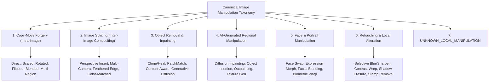

1. **Copy-Move Forgery (CMFD):** Duplication of one or more regions from within the same image to cover an incriminating object or multiply scene elements (e.g. crowds, vehicles, weapons). Sub-types: Direct translation, scaled copy-move, rotated copy-move, horizontally/vertically flipped, color-adjusted, feathered boundary, and multi-source intra-cloning.
2. **Image Splicing & Compositing:** Insertion of an external region extracted from a different source image into the recipient target image. Sub-types: Direct insertion, perspective-homography transformed insertion, multi-sensor compositing, color-temperature matched splicing, feathered/blended boundary insertion, and background replacement.
3. **Object Removal & Inpainting:** Eradication of an original image entity followed by structural or statistical background synthesis. Sub-types: Traditional PDE-based inpainting, PatchMatch / clone-stamp reconstruction, Adobe Content-Aware Fill, and generative neural inpainting (LaMa, MAT).
4. **AI-Generated Regional Manipulation:** Localized synthesis of new visual content within a photographic scene via text-to-image or image-to-image generative diffusion models. Sub-types: Latent diffusion inpainting (Stable Diffusion, FLUX), generative object insertion, contextual outpainting, and synthetic high-frequency detail replacement.
5. **Face & Portrait Manipulation:** Targeted biometric alteration of human facial regions. Sub-types: Deepfake face-swap (RoOP, InsightFace), face replacement, expression reenactment, facial boundary seam blending, facial morphing, and synthetic skin retouching.
6. **Retouching & Local Image Alteration:** Fine-grained localized edits that do not alter scene semantics but modify evidential details. Sub-types: Localized Gaussian blur/sharpening, contrast adjustment, timestamp/watermark removal, selective dodging/burning, and chromatic aberration removal.
7. **`UNKNOWN_LOCAL_MANIPULATION`:** An anomaly mask identified by multiple independent low-level statistical detectors (e.g. noise residual and CFA break) where the exact generative or editing tool cannot be attributed with scientific certainty.

---

### 14.4 Ten Core Investigator User Journeys

#### Journey IML-J01: Localising a Copy-Move Forgery with Paired Geometries
- **Context:** An investigator examines a seized photograph where a suspect claims an empty parking lot proves an alibi; intelligence indicates duplicate vehicles were cloned to conceal an entrance.
- **Workflow:** The investigator submits the exhibit to AIF. IMLF invokes the IRE Copy-Move module. The engine extracts SIFT and RootSIFT keypoints, applies $k$-d tree nearest-neighbor ratio matching ($r < 0.75$), and filters trivial neighbor pairs ($d > 50\text{ px}$). RANSAC estimates a valid projective homography $H$ with 42 inlier matches ($\text{RMSE} = 0.82\text{ px}$).
- **Output:** IMLF renders paired colored bounding polygons showing the donor region $\mathcal{R}_{\text{source}}$ and recipient region $\mathcal{R}_{\text{target}}$, links them with vector displacement arrows, generates binary masks for both regions, and exports mathematical transformation parameters ($s = 1.05, \theta = 14.2^\circ$).

#### Journey IML-J02: Localising an Inserted / Spliced Region via Sensor Noise & ELA
- **Context:** An extortion case involves a photograph of a political figure in an incriminating venue; the defense claims the figure was spliced from an online press photo.
- **Workflow:** IMLF invokes IRE Noise Analysis and AIM TruFor. The residual engine calculates $R(x,y) = I(x,y) - D(I)(x,y)$ using median filtering and evaluates local variance across $32\times 32$ blocks. TruFor extracts RGB and noiseprint features. Both independent methods detect anomalous noise variance and mismatched high-frequency distributions concentrated strictly within the torso and head boundaries.
- **Output:** The examiner views a side-by-side split screen: the original photograph overlaid with a red semi-transparent mask ($\operatorname{IoU} = 0.88$ agreement between IRE and TruFor), a boundary gradient discontinuity map highlighting feathering seams, and an extraction confidence score of $0.94$.

#### Journey IML-J03: Detecting an Erased / Inpainted Object via Frequency & Edge Inconsistencies
- **Context:** A traffic accident investigation requires determining whether a speed limit sign was digitally removed from dashcam footage prior to submission.
- **Workflow:** The investigator flags the roadside quadrant. IMLF dispatches AIM Inpainting Analysis and IRE Resampling Profiler. The deep inpainting detector identifies characteristic spectral rolloff and structural texture repetition indicative of content-aware fill. The edge gradient profiler reveals a blurred boundary ring surrounded by sharp photographic noise.
- **Output:** IMLF isolates a $180\times 320\text{ px}$ bounding rectangle, generates an anomaly heatmap peaking at $0.91$, reports manipulation family `OBJECT_REMOVAL_INPAINTING`, and logs that surrounding photographic noise was destroyed within the bounding perimeter.

#### Journey IML-J04: Identifying Local AI-Generated Elements in an Authentic Photograph
- **Context:** A protest photograph submitted as evidence contains authentic crowds, but a provocative banner is suspected of being locally generated via diffusion inpainting.
- **Workflow:** IMLF runs full-frame classification via SigLIP (overall image score: authentic photograph, $P_{\text{AI}} = 0.12$). However, the regional localization pipeline (TruFor / Cat-Net v2) flags the banner region ($1200\times 450\text{ px}$) with a local anomaly score of $0.96$. High-frequency DCT analysis shows an absence of camera sensor noise and latent diffusion upsampling artifacts inside the banner bounding polygon.
- **Output:** The examiner workbench highlights the localized banner in yellow, displays the global classification score alongside the regional mask, and prevents the investigator from mistakenly classifying the entire photograph as an AI deepfake.

#### Journey IML-J05: Reviewing Facial Region Manipulation with FPA Biometric Landmarks
- **Context:** A passport forgery case involves an authentic identity card where the portrait face is suspected of being swapped with an imposter.
- **Workflow:** IMLF coordinates with FPA. FPA detects the primary facial bounding box using RetinaFace and extracts 68 MediaPipe facial landmarks. IMLF evaluates color transition and blur gradients along the convex hull perimeter of the face. An independent face-swap head identifies boundary blending seams and GAN/diffusion synthesis artifacts across the inner ocular and oral regions.
- **Output:** IMLF renders the 68 biometric landmarks, highlights the boundary seam in cyan, outputs an IoU mask covering the swapped facial oval, and confirms that the outer hair and collar belong to the original card substrate.

#### Journey IML-J06: Multi-Scale Tiling on a High-Resolution Crime Scene Exhibit
- **Context:** A high-resolution forensic photograph ($8192\times 6144\text{ px}$, 50 MP) must be analyzed for minute localized tampering (e.g. altered serial numbers on seized currency).
- **Workflow:** Full-frame downsampling to $512\times 512$ would obliterate the microscopic edit. IMLF activates its Multi-Scale Tiling Engine: it partitions the 50 MP image into $1024\times 1024$ overlapping tiles with a $256\text{ px}$ stride (25% overlap). Each tile is processed through the localization models. A coordinate transformation manager maps tile-relative mask coordinates $(x_t, y_t)$ back to original canvas coordinates $(X, Y)$ using invertible affine matrices $H_t^{-1}$. Overlapping tile masks are merged using distance-weighted linear blending.
- **Output:** IMLF detects a $45\times 95\text{ px}$ manipulation on a single banknote serial number, preserves exact native coordinates, and displays a localized zoom window on the examiner workbench.

#### Journey IML-J07: Resolving and Presenting Multi-Detector Conflict
- **Context:** An ELA detector flags a white building roof as heavily manipulated due to high compression error, whereas TruFor and PRNU report the roof is authentic camera sensor noise.
- **Workflow:** IMLF Multi-Detector Fusion engine evaluates spatial consensus. It cross-references the ELA anomaly with the visual texture: the roof is high-contrast white snow, a known ELA false-positive failure mode. TruFor's reliability map indicates high confidence in authentic sensor noise.
- **Output:** Rather than averaging the conflicting scores or picking a winner blindly, IMLF records an explicit conflict entry: `ELA: SUSPICIOUS (High Error)`, `TruFor: AUTHENTIC (P=0.03)`, `PRNU: CORRELATED (PCE=74)`. It assigns region status `LOCALISATION_UNCERTAIN`, provides an alternative forensic explanation (*"High-contrast edge artifact"*), and alerts the examiner to review raw signal profiles.

#### Journey IML-J08: Inspecting Pixel-Level Confidence Maps & Reliability Masks
- **Context:** An investigator must assess whether a detected manipulation mask is crisp and reliable or fuzzy and speculative before including it in a search warrant affidavit.
- **Workflow:** IMLF provides three distinct visual layers on the workbench: (1) Binary Mask ($\hat{M} \in \{0, 1\}$ at threshold $\tau = 0.50$); (2) Continuous Probability Map ($P(x,y) \in [0.0, 1.0]$); and (3) Detector Reliability Map ($R(x,y) \in [0.0, 1.0]$) derived from local noise SNR and model uncertainty.
- **Output:** The examiner observes that while the continuous probability map shows $P > 0.80$, the reliability map drops to $0.20$ near deep shadow regions. The workbench allows the examiner to slide an uncertainty threshold filter, shrinking the reported mask to the high-reliability core ($R > 0.70$) and ensuring only defensible boundaries are submitted to court.

#### Journey IML-J09: Exporting a Region-Linked Forensic Report (Section 65B/63 BSA)
- **Context:** A certified forensic examiner must export a complete legal evidence dossier for judicial submission in an Indian court under Section 63 of Bharatiya Sakshya Adhiniyam (BSA 2023).
- **Workflow:** The examiner validates candidate regions $\mathcal{R}_1$ and $\mathcal{R}_2$, marks them `ACCEPTED`, enters forensic observations, and clicks "Generate Certified Dossier". IMLF compiles an RFC 8785 canonical JSON IR and a high-resolution PDF.
- **Output:** The dossier includes the original exhibit SHA-256, WORM vault URI, thumbnail with vector polygon overlays, exact pixel bounding boxes $[y_{\min}, x_{\min}, y_{\max}, x_{\max}]$, area percentage ($3.4\%$), supporting detector IDs, SHA-256 checkpoint hashes, ECE calibration records, and the examiner's digital signature.

#### Journey IML-J10: Handling Low-Quality Exhibits with First-Class Abstention
- **Context:** An exhibit downloaded from WhatsApp is downscaled to $640\times 480$, recompressed with JPEG QF 45, and exhibits heavy blockiness.
- **Workflow:** IMLF executes pre-flight signal quality checks. The noise floor is completely erased by DCT quantization; high-frequency residuals cannot be extracted; JPEG block boundaries exhibit widespread ringing. Both TruFor and IRE report signal-to-noise ratio below operational minimums ($\text{SNR} < 6\text{ dB}$).
- **Output:** The system refuses to fabricate a low-confidence mask or force an authentic verdict. It returns status `INCONCLUSIVE_LOW_QUALITY`, annotates the specific technical deficiencies (*"Excessive compression precludes reliable noise residual and boundary seam extraction"*), and logs the abstention in the evidentiary audit trail.

---

### 14.5 Unified Mask and Region Contracts
IMLF specifies five core data structures to standardize spatial findings across all detection engines:

1. **`IMLRegionCandidate`:** Represents an individual localized region of suspicion.
   - `region_id`: UUIDv4.
   - `evidence_id` & `case_id`: Foreign keys linking to seized exhibit.
   - `bounding_box`: Pixel coordinates $[y_{\min}, x_{\min}, y_{\max}, x_{\max}]$ in original image coordinate frame.
   - `polygon`: List of $[x, y]$ vertices tracing the boundary contour.
   - `area_pixels`: Exact integer pixel count.
   - `area_percentage`: Float $[0.0, 100.0]$ representing fraction of total image area.
   - `manipulation_family`: Enum (`COPY_MOVE`, `SPLICING`, `OBJECT_REMOVAL_INPAINTING`, `AI_GENERATED_REGIONAL`, `FACE_MANIPULATION`, `LOCAL_RETOUCHING`, `UNKNOWN_LOCAL_MANIPULATION`).
   - `confidence_score`: Calibrated probability $[0.0, 1.0]$.
   - `reliability_score`: Local reliability metric $[0.0, 1.0]$.
   - `supporting_detectors`: List of detector IDs corroborating the finding.
   - `conflicting_detectors`: List of detector IDs disputing or failing to find the region.
   - `alternative_explanations`: Textual explanation of benign causes (e.g. natural texture repetition, ELA edge artifact).
   - `reviewer_disposition`: Enum (`PENDING_REVIEW`, `ACCEPTED`, `REJECTED`, `MODIFIED`).

2. **`IMLMaskMetadata`:** Metadata descriptor governing stored raster mask arrays.
   - `mask_id`: UUIDv4.
   - `mask_type`: Enum (`BINARY_MASK`, `PROBABILITY_MAP`, `ANOMALY_MAP`, `RELIABILITY_MAP`, `UNCERTAINTY_MAP`).
   - `storage_uri`: POSIX WORM vault path or S3 key storing lossless PNG or float32 NumPy array.
   - `sha256_checksum`: Cryptographic hash of mask bitstream.
   - `width` & `height`: Exact integer dimensions (must match original evidence image).
   - `coordinate_reference_system`: String (e.g. `PIXEL_CANVAS_ORIGIN_TOP_LEFT`).
   - `threshold_applied`: Float value used to binarize probability map into binary mask.

3. **`IMLLocalizationResult`:** Master aggregate record summarizing all spatial findings for an evidence exhibit.
   - `localization_result_id`: UUIDv4.
   - `evidence_id`: Target exhibit identifier.
   - `image_level_verdict`: Enum (`AUTHENTIC_WITHIN_TESTED_SCOPE`, `MANIPULATED_CONTENT_DETECTED`, `INCONCLUSIVE`).
   - `image_level_score`: Calibrated global manipulation probability $[0.0, 1.0]$.
   - `localization_status`: Enum (`LOCALISATION_CANDIDATE_FOUND`, `NO_LOCALISATION_CANDIDATE`, `GLOBAL_MANIPULATION_CANDIDATE`, `LOCALISATION_UNCERTAIN`, `INCONCLUSIVE_LOW_QUALITY`, `UNSUPPORTED_MANIPULATION_TYPE`, `ANALYSIS_FAILED`).
   - `regions`: List of `IMLRegionCandidate` objects.
   - `masks`: List of `IMLMaskMetadata` objects.
   - `multi_detector_consensus_score`: Float $[0.0, 1.0]$.
   - `lineage_graph_ref`: Pointer to DAG evidence dependency graph.
   - `execution_telemetry`: Latency (ms), peak VRAM (MB), tile count.

4. **`IMLCoordinateTransform`:** Transformation record documenting spatial adjustments applied to an image during analysis.
   - `source_dimensions`: $[W_0, H_0]$.
   - `target_dimensions`: $[W_t, H_t]$.
   - `affine_matrix_3x3`: Flat 9-element array representing forward homogeneous transformation $H$.
   - `inverse_matrix_3x3`: Flat 9-element array representing inverse transformation $H^{-1}$.
   - `operation`: Enum (`CROP`, `RESIZE`, `PAD`, `TILE`, `ROTATE_90`, `TRANSPOSE`).

5. **`IMLMultiScaleConfig`:** Parameters governing high-resolution image tiling.
   - `tile_size`: Integer (e.g. 1024 px).
   - `stride`: Integer (e.g. 768 px, providing 256 px / 25% overlap).
   - `min_overlap`: Float (e.g. 0.20).
   - `blending_method`: Enum (`DISTANCE_WEIGHTED_LINEAR`, `MAX_POOLING`, `GAUSSIAN_TAPER`).

---

### 14.6 Canonical Coordinate Normalisation & Spatial Alignment
To eliminate spatial ambiguity across disparate computer vision libraries (OpenCV, PIL, PyTorch, Albumentations), IMLF enforces a single canonical spatial reference system:

1. **Origin & Axis Orientation:** The origin $(0, 0)$ is strictly located at the **top-left corner** of the image. The $X$-axis increases positively to the right $[0, W-1]$; the $Y$-axis increases positively downward $[0, H-1]$.
2. **Pixel-Center Convention:** Pixels are addressed at continuous center coordinates $(x + 0.5, y + 0.5)$. Bounding boxes use zero-indexed, half-open interval semantics $[y_{\min}, x_{\min}, y_{\max}, x_{\max})$, where the pixel at $(x_{\max}, y_{\max})$ is exclusive.
3. **Normalized Coordinates:** Normalized coordinates $[x_n, y_n] \in [0.0, 1.0]$ are defined as $x_n = x / W$ and $y_n = y / H$. Bounding boxes and polygons are serialized in both absolute integer pixel coordinates (for exact mask reconstruction) and normalized floats (for resolution-independent frontend rendering).
4. **Invertible Affine Transformations:** Any geometric preprocessing operation (scaling to model input size, cropping facial bounding boxes, or tiling) must maintain an explicit $3\times 3$ homogeneous transformation matrix:
   $$\begin{bmatrix} x_{\text{orig}} \\ y_{\text{orig}} \\ 1 \end{bmatrix} = \mathbf{H}^{-1} \begin{bmatrix} x_{\text{model}} \\ y_{\text{model}} \\ 1 \end{bmatrix}$$
   Predicted masks $\hat{M}_{\text{model}}$ are projected back to native canvas resolution using bilinear or nearest-neighbor interpolation guided strictly by $\mathbf{H}^{-1}$.
5. **No Blind Cropping:** Model pipelines are prohibited from discarding border pixels or un-tiled margins. If an image's dimensions are not integer multiples of tile stride, asymmetric padding is recorded in $\mathbf{H}$ and stripped during inverse projection.

---

### 14.7 Confidence, Reliability, Anomaly & Disagreement Semantics
Forensic reporting requires distinct mathematical and operational definitions for four frequently conflated spatial maps:

| Map Type | Symbol | Domain | Definition & Forensic Semantics | Examiner Interpretation |
| :--- | :--- | :--- | :--- | :--- |
| **Probability Map** | $P_{\text{manip}}(x,y)$ | $[0.0, 1.0]$ | Calibrated empirical likelihood that the pixel at $(x,y)$ was altered by a manipulation process. | Higher values indicate higher likelihood of tampering under calibrated evaluation. |
| **Anomaly Map** | $A(x,y)$ | $[0.0, \infty)$ or normalized | Continuous distance metric measuring statistical deviation from local background expectation (e.g. noise residual variance, prediction error). | Highlights unusual signal traces; does not prove malicious intent without corroboration. |
| **Reliability Map** | $R(x,y)$ | $[0.0, 1.0]$ | Confidence of the detector in its own extraction under local image conditions (e.g. texture complexity, illumination level, absence of saturation). | Low reliability flags areas where the detector is blind or unreliable (e.g. pitch-black shadows, blown-out highlights). |
| **Disagreement Map** | $D(x,y)$ | $[0.0, 1.0]$ | Spatial standard deviation or normalized entropy among multiple independent detector outputs covering the same pixel $(x,y)$. | High disagreement indicates conflicting forensic cues, triggering mandatory examiner manual review. |

---

### 14.8 Multi-Detector Evidence Fusion & Lineage Graph
When multiple AIF engines generate spatial findings for an image exhibit, IMLF assembles them into an Evidence Dependency Directed Acyclic Graph (DAG) rather than naively blending pixel values:

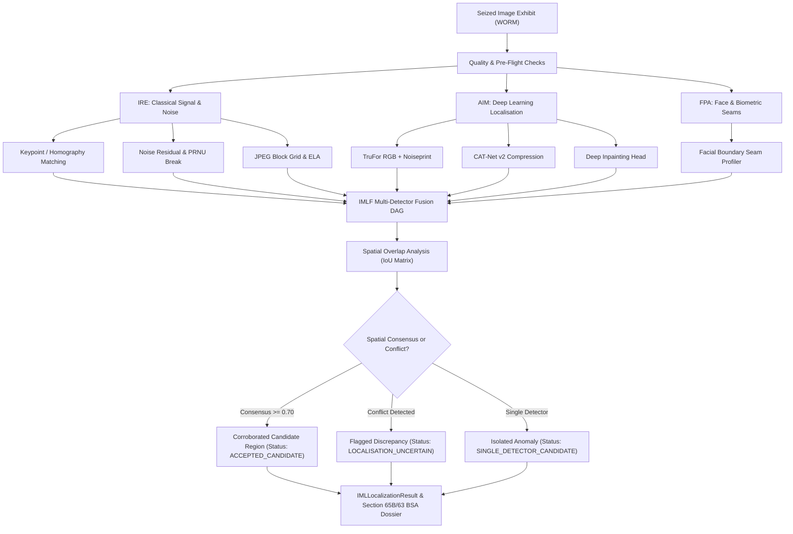

1. **Anti-Averaging Invariant:** Pixel probability maps from distinct models must **never** be averaged into an unweighted arithmetic mean. Averaging a high-confidence CMFD mask with a low-confidence deep inpainting mask dilutes the genuine finding and produces an uncalibrated artifact.
2. **Spatial Overlap Evaluation:** Pairwise Intersection over Union ($\operatorname{IoU}$) is calculated across all candidate regions proposed by different engines. Regions with $\operatorname{IoU} \ge 0.50$ are grouped into unified candidate clusters.
3. **Consensus Scoring:** A candidate cluster's confidence is determined by independent evidence weights derived from validation benchmarks:
   $$C_{\text{fused}}(\mathcal{R}) = 1 - \prod_{m \in \mathcal{M}_{\text{supp}}} (1 - w_m \cdot P_m(\mathcal{R}))$$
   where $w_m$ is the benchmark-validated reliability weight of detector $m$, and $\mathcal{M}_{\text{supp}}$ is the subset of independent detectors supporting the region.
4. **Co-Dependency Tracking:** If two detectors share an identical upstream feature backbone (e.g. both using a common ResNet-50 feature extractor), the fusion engine enforces an evidence dependency constraint, treating them as co-dependent rather than independent corroboration.

---

### 14.9 Seven Canonical Localisation Outcome States
To prevent the system from returning misleading or fabricated binary verdicts, IMLF mandates seven standardized operational outcome states:

1. **`LOCALISATION_CANDIDATE_FOUND`:** One or more candidate manipulated regions have been identified, validated against boundary and area thresholds, and corroborated by at least one primary detection engine.
2. **`NO_LOCALISATION_CANDIDATE`:** Exhaustive multi-scale analysis across all applicable detectors reveals no statistically significant spatial anomalies or manipulation boundaries.
3. **`GLOBAL_MANIPULATION_CANDIDATE`:** The image exhibits strong evidence of whole-image transformation (e.g. global diffusion generation, universal color grading, or uniform re-encoding), but no localized, isolated edited region can be segmented.
4. **`LOCALISATION_UNCERTAIN`:** One or more detectors flag potential anomalies, but boundary confidence is low, spatial IoU between independent models is $< 0.30$, or alternative benign explanations (e.g. natural texture repetition) cannot be ruled out.
5. **`INCONCLUSIVE_LOW_QUALITY`:** Severe image degradation (downscaling $< 256\text{ px}$, heavy recompression QF $< 40$, extreme noise or motion blur) destroys microscopic forensic artifacts, precluding scientifically reliable analysis.
6. **`UNSUPPORTED_MANIPULATION_TYPE`:** The submitted exhibit or query targets a manipulation family that is outside the validated operational envelope of the current AIF model registry.
7. **`ANALYSIS_FAILED`:** A critical operational exception occurred (e.g. decompression bomb trap triggered, worker timeout exceeded, or corrupted bitstream).

---

### 14.10 Ground-Truth Datasets, Benchmarks & Zero-Leakage Policy
1. **Public Benchmark Corpora Reconciliation:**
   - **CASIA v1.0 / v2.0:** Splicing and copy-move operations with ground-truth binary masks; requires auditing for JPEG compression artifacts and boundary inaccuracies.
   - **Columbia Image Splicing Dataset:** Uncompressed, sharp splicing benchmarks with verified ground-truth masks; ideal for sensor noise residual baselines.
   - **COVERAGE:** Benchmarks specifically designed for copy-move forgery with similar but non-manipulated authentic control regions to measure false-alarm rates.
   - **NIST OpenMFC / NIST16:** Rigorous governmental evaluation datasets featuring diverse manipulation types (splicing, removal, retouching) with pixel-level ground truth and operational protocol constraints.
   - **IMD2020 / DEFACTO:** Large-scale modern synthetic and real-world inpainting, copy-move, and splicing benchmarks.
2. **Zero-Leakage Grouped Partitioning Invariant:**
   - Training, calibration, validation, and test splits must be partitioned strictly by **source scene / parent capture identity**.
   - If an authentic photograph was used to generate five different spliced or copy-move variants, the authentic original and all five derivatives must reside strictly within the same split partition.
   - Automated test suites assert zero intersection of root group identifiers:
     $$\mathcal{G}_{\text{train}} \cap \mathcal{G}_{\text{cal}} \cap \mathcal{G}_{\text{val}} \cap \mathcal{G}_{\text{test}} = \emptyset$$
3. **Ground-Truth Mask Validation:** Every benchmark sample must provide a verified binary mask where pixel value $1$ indicates manipulated ground truth and $0$ indicates authentic substrate. Annotations with loose bounding boxes or ambiguous boundaries are categorized as `WEAK_GROUND_TRUTH` and excluded from core benchmark gate evaluations.

---

### 14.11 Controlled Manipulation Test Corpus Specification
To evaluate IMLF under rigorously auditable conditions, the project specifies a controlled test corpus composed of six distinct partitions:
1. **Authentic Controls ($N \ge 100$):** High-resolution photographs captured across multiple smartphone and DSLR sensors, dense repeating textures (building facades, tile floors, brick walls, foliage, fabric), text documents, crowd scenes, and low-light captures.
2. **Controlled Copy-Move ($N \ge 100$):** Known donor-recipient pairs generated with parametric rotations ($0^\circ, 15^\circ, 45^\circ, 90^\circ, 180^\circ$), scalings ($0.5\times, 0.8\times, 1.2\times, 2.0\times$), horizontal flips, and boundary feathering ($\sigma = 1, 3, 5\text{ px}$).
3. **Controlled Splicing ($N \ge 100$):** Multi-source insertions combining different camera sensors (e.g. iPhone donor into Sony DSLR recipient), color-temperature matched insertions, and perspective-warped insertions.
4. **Controlled Inpainting & Removal ($N \ge 100$):** Object removals executed via Adobe Content-Aware Fill, PatchMatch, and neural diffusion inpainting (LaMa, Stable Diffusion Inpainting), with precise masks recording original object silhouettes.
5. **Controlled Regional AI Synthesis ($N \ge 100$):** Authentic base photographs with localized $512\times 512$ bounding boxes in-painted with text-guided diffusion prompts.
6. **Post-Processing Robustness Sweeps ($N \ge 100$):** The above partitions subjected to systematic degradation sweeps: JPEG recompression (QF 95, 80, 65, 50, 35), Gaussian blur ($\sigma = 0.5, 1.0, 2.0$), additive Gaussian noise ($\text{SNR} = 30, 20, 10\text{ dB}$), resizing ($0.5\times, 0.25\times$), and screenshot recapture.

---

### 14.12 Examiner Review Workbench Requirements
The forensic examiner interface provides an interactive, scientifically defensible workspace:
1. **Interactive Multi-Layer Canvas:** Examiners can toggle and blend between (1) Original Exhibit, (2) Calibrated Probability Mask, (3) Binary Segmentation Mask, (4) Spatial Anomaly Heatmap, (5) Detector Reliability Map, and (6) Vector Boundary Polygons.
2. **Opacity & Threshold Sliders:** Real-time interactive adjustment of binarization threshold $\tau \in [0.0, 1.0]$ and reliability cutoff $R_{\min} \in [0.0, 1.0]$, dynamically rendering the resulting mask contour without modifying the stored immutable forensic artifact.
3. **Side-by-Side Synchronized Split Viewer:** Synchronized panning and zooming across original, donor, and recipient regions for copy-move inspections.
4. **Examiner Disposition Workflow:** Examiners can mark individual candidate regions as `ACCEPTED` (corroborated by forensic testimony), `REJECTED` (identified as benign false-positive, with mandatory rationale selection), or `MODIFIED` (boundary polygon manually refined by qualified examiner).
5. **Chain of Custody & Legal Export:** One-click export compiling a Section 65B/63 BSA certified technical dossier linking every accepted region to its mathematical coordinates, detector provenance, and examiner signature.

---

### 14.13 Exhaustive Functional Requirements Inventory (IML-01 through IML-22)

| Req ID | Requirement Title | Primary Input | Expected Output | Measurable Acceptance Criteria | Trapped Failure States | Relevant Phase |
| :--- | :--- | :--- | :--- | :--- | :--- | :--- |
| **IML-01** | Unified Localisation Architecture & Router | Image exhibit bitstream, AIF configuration. | Dispatched tasks to IRE, AIM, FPA; aggregated spatial findings. | Orchestrates multi-engine execution within resource limits; zero dropped engine results. | `ENGINE_DISPATCH_TIMEOUT`, `UNSUPPORTED_IMAGE_FORMAT` | **AIF-IML-00** |
| **IML-02** | Copy-Move Forgery Localisation | Image exhibit, feature config (SIFT, ORB). | Paired donor/recipient regions, homography $H$, inlier matches. | Detects duplicated regions $> 32\times 32\text{ px}$ with rotation up to $180^\circ$ and scale $0.5\times$–$2.0\times$; inlier count $\ge 12$. | `INSUFFICIENT_KEYPOINTS`, `DEGENERATE_HOMOGRAPHY` | **AIF-IML-01** |
| **IML-03** | Image Splicing & Compositing Localisation | Image exhibit, noise residual config. | Spatial anomaly mask, boundary gradient seam score, noise variance map. | Achieves pixel-level $\operatorname{IoU} \ge 0.70$ on uncompressed splicing benchmarks (Columbia). | `UNIFORM_NOISE_ESTIMATE_FAILED`, `COMPRESSION_MASKED` | **AIF-IML-02** |
| **IML-04** | Object Removal & Inpainting Localisation | Image exhibit, spectral/deep inpainting heads. | Inpainting mask, boundary blur gradient, structural repetition score. | Identifies deep inpainting $> 64\times 64\text{ px}$ with $\operatorname{IoU} \ge 0.65$ on DEFACTO inpainting test set. | `SPECTRAL_ROLLOFF_INDETERMINATE` | **AIF-IML-04** |
| **IML-05** | AI-Generated Regional Manipulation Localisation | Image exhibit, TruFor / Cat-Net models. | Pixel anomaly map, regional $P_{\text{AI}}$, bounding polygons. | Distinguishes regional AI insertion from global AI generation; flags manipulated patch without flagging full frame. | `GLOBAL_AI_CONFOUNDER`, `CHECKPOINT_UNAVAILABLE` | **AIF-IML-04** |
| **IML-06** | Face & Portrait Manipulation Localisation | Image exhibit, FPA biometric landmarks. | Facial perimeter boundary mask, face-swap confidence, landmark seam map. | Segments swapped facial oval with $\operatorname{IoU} \ge 0.75$; isolates biometric boundary from hair/ears. | `NO_FACE_DETECTED`, `PROFILE_POSE_UNSUPPORTED` | **AIF-IML-05** |
| **IML-07** | Compression & Resampling Inconsistency | Image exhibit, JPEG quantisation tables. | ELA map, DCT block artifact grid, resampling periodic peak spectrum. | Detects double-JPEG compression grid shifts ($8\times 8$ periodicity) and ELA error peaks. | `RAW_FORMAT_NO_DCT`, `RECOMPRESSION_UNIFORM` | **AIF-IML-02** |
| **IML-08** | Sensor Noise & PRNU Inconsistency Localisation | Image exhibit, camera PRNU fingerprint (if available). | PRNU correlation map, Peak-to-Correlation Energy (PCE), noise residue. | Flags spliced regions lacking sensor reference PRNU correlation ($\text{PCE} < 15$). | `PRNU_FINGERPRINT_UNAVAILABLE`, `IMAGE_OVEREXPOSED` | **AIF-IML-02** |
| **IML-09** | Multi-Scale Tiling & Inverse Mapping | High-resolution image ($> 2048\text{ px}$), tiling config. | Stitched full-resolution mask, tile boundary blends, affine mapping $H^{-1}$. | Reconstructs 50 MP image masks with zero border seam artifacts; preserves native canvas coordinates. | `TILE_ALLOCATION_OOM`, `COORDINATE_INVERSION_ERROR` | **AIF-IML-06** |
| **IML-10** | Unified Mask, Polygon & Region Contract | Raw engine detections, spatial contours. | Serialized `IMLLocalizationResult`, `IMLRegionCandidate`, WORM mask files. | Conforms strictly to Pydantic v2 schemas; passes JSON Schema v1.0 validation. | `SCHEMA_VALIDATION_ERROR`, `POLYGON_WINDING_INVALID` | **AIF-IML-00** |
| **IML-11** | Canonical Coordinate Normalisation | Raw detector pixel coordinates. | Normalized $[0, 1]$ floats, absolute top-left pixel coordinates. | Half-open interval $[y_{\min}, x_{\min}, y_{\max}, x_{\max})$ verified across all spatial representations. | `OUT_OF_BOUNDS_COORDINATE`, `NEGATIVE_DIMENSION` | **AIF-IML-00** |
| **IML-12** | Confidence, Reliability & Uncertainty | Raw logits, noise SNR, local texture entropy. | Probability map $P$, reliability map $R$, uncertainty boundary $\sigma$. | Separates model predictive confidence from data reliability; flags shadow/saturation unreliability. | `DIVISION_BY_ZERO_VARIANCE` | **AIF-IML-07** |
| **IML-13** | Multi-Detector Evidence Fusion & Conflict Handling | Disparate engine masks, dependency graph. | Fused mask, consensus score, explicit conflict log entries. | Disallows unweighted arithmetic score averaging; exposes cross-engine disagreements prominently. | `MUTUALLY_EXCLUSIVE_DETECTIONS` | **AIF-IML-07** |
| **IML-14** | Forensic Examiner Review Workbench | `IMLLocalizationResult`, examiner inputs. | Interactive UI layers, threshold sliders, examiner disposition tags. | Supports real-time threshold adjustment ($< 50\text{ ms}$ re-render); records examiner modifications in audit log. | `UNAUTHORIZED_DISPOSITION_CHANGE` | **AIF-IML-09** |
| **IML-15** | Ground-Truth Dataset Management & Provenance | Public benchmark archives (CASIA, NIST). | Validated dataset cards, zero-leakage split manifests, mask alignment checks. | Partitions datasets strictly by parent scene; automated assertions verify zero cross-split overlap. | `DATASET_LEAKAGE_DETECTED`, `MASK_DIMENSION_MISMATCH` | **AIF-IML-08** |
| **IML-16** | Pixel-Level Localisation Evaluation | Predicted masks $\hat{M}$, ground-truth masks $M_g$. | Pixel Precision, Recall, F1, IoU, Dice, Matthews Correlation Coefficient (MCC). | Handles zero-denominator and empty ground truth safely; matches theoretical values on test fixtures. | `EMPTY_GROUND_TRUTH_DIVISION` | **AIF-IML-08** |
| **IML-17** | Independent Image-Level Detection Evaluation | Image predictions, ground-truth labels. | Image ROC-AUC, PR-AUC, Balanced Accuracy, CDR at fixed FAR. | Evaluates image-level classification completely independently from pixel localization metrics. | `IMBALANCED_CLASS_COLLAPSE` | **AIF-IML-08** |
| **IML-18** | Cross-Dataset & Unseen-Manipulation Benchmarking | Models trained on Dataset $X$, evaluated on $Y$. | Transfer $\Delta\operatorname{IoU}$, generalisation degradation report, unseen tool metrics. | Quantifies performance decay outside training domain; prohibits blanket generalisation claims. | `DOMAIN_COLLAPSE_DETECTED` | **AIF-IML-08** |
| **IML-19** | Robustness Sweeps & Repeated-Texture Controls | Degraded images (JPEG QF 30-95, blur, noise), repeating textures. | Robustness decay curves, false-positive region count on authentic textures. | Maintains false-alarm rate $\le 0.05$ on authentic repeating patterns (facades, foliage, tiles). | `FALSE_ALARM_TEXTURE_BURST` | **AIF-IML-01** |
| **IML-20** | First-Class Abstention & Inconclusive Outcomes | Low-quality/corrupted inputs, SNR metrics. | Typed outcome status (`INCONCLUSIVE_LOW_QUALITY`, `LOCALISATION_UNCERTAIN`). | Abstains on $100\%$ of test samples with $\text{SNR} < 6\text{ dB}$ or resolution $< 256\times 256\text{ px}$. | `FORCED_PREDICTION_ATTEMPT` | **AIF-IML-07** |
| **IML-21** | Evidentiary Lineage & Section 65B/63 BSA Traceability | Exhibit metadata, localization results, examiner Ed25519 signature. | Structured forensic PDF dossier with SHA-256 manifests and vector overlays. | Formats complete technical dossier conforming strictly to Section 63 BSA 2023 evidentiary standards. | `SIGNATURE_VERIFICATION_FAILED` | **AIF-IML-09** |
| **IML-22** | Security Safeguards, Resource Ceilings & Reproducibility | Input bitstreams, execution environment. | Sandboxed execution, cgroup memory enforcement, deterministic seeds. | Caps worker RAM to $\le 16\text{ GB}$, VRAM $\le 8\text{ GB}$; traps decompression bombs $> 100\text{ MP}$; 100% offline. | `DECOMPRESSION_BOMB_EXCEEDED`, `WORKER_OOM_KILLED` | **AIF-IML-10** |

---

### 14.14 Security, Operational & Legal Requirements
1. **Defensive Decompression & Image Bomb Safeguards:** Before decoding, all incoming image bitstreams must undergo header inspection. PIL `MAX_IMAGE_PIXELS` is strictly bound to $100,000,000$ pixels (100 MP). Image files exceeding this threshold or exhibiting recursive ZIP/compression ratios $> 10:1$ are rejected immediately with `DECOMPRESSION_BOMB_EXCEEDED`.
2. **Resource Limits & Execution Isolation:** Worker processes executing deep localization models (TruFor, CAT-Net) run in unprivileged Linux cgroups capping host memory to $\le 16\text{ GB}$ RAM and GPU VRAM to $\le 8\text{ GB}$. A hard execution timeout of 300 seconds per exhibit prevents infinite loops during keypoint matching or homography RANSAC.
3. **Air-Gapped Network Isolation:** All feature extractors, deep networks, and OCR engines execute 100% locally. Zero telemetry, model weights, or image exhibits are transmitted across external networks.
4. **POSIX 0400 WORM Vaulting:** All generated binary masks, probability arrays, and JSON findings are written to immutable storage mounted with read-only permissions (`0400`), cryptographically hashed via SHA-256, and linked to the parent evidence chain of custody.

---

### 14.15 Scientific Limitations, Edge Cases & Assumptions
1. **Unverified Empirical Thresholds (`THRESHOLD_REQUIRES_VALIDATION`):** Exact decision thresholds ($\tau_{\text{binarize}}$, $\text{IoU}_{\text{match}}$, $\text{RANSAC}_{\text{inliers}}$) are marked `THRESHOLD_REQUIRES_VALIDATION` and must be tuned on isolated calibration partitions ($D_{\text{cal}}$) rather than assumed a priori.
2. **Natural Texture Ambiguity:** Inherent physical repetition (e.g. identical mass-produced window frames or printed fabric patterns) naturally yields high feature descriptor similarity. The system mitigates this via strict spatial distance thresholds and rigid homography verification, but manual examiner review remains mandatory for architectural and textile exhibits.
3. **Severe Downscaling & Recompression Limits:** Forensic manipulation traces exist predominantly in high-frequency pixel residuals. When an image is resized to $< 256\times 256\text{ px}$ or recompressed at JPEG QF $< 40$, microscopic traces are mathematically unrecoverable; the framework mandatorily emits `INCONCLUSIVE_LOW_QUALITY`.

---

## 15. CCTV Frame Integrity, Temporal Sequence Forensics & Video Tampering Localisation (CFITSA)

### 15.1 Problem Statement & Forensic Context
Video recordings, closed-circuit television (CCTV) surveillance exports, digital video recorder (DVR) captures, and network video recorder (NVR) archives represent critical electronic evidence in criminal prosecutions, counter-terrorism operations, and judicial proceedings under Section 65B of the Indian Evidence Act (IEA) and Section 63 of the Bharatiya Sakshya Adhiniyam, 2023 (BSA). However, digital video is uniquely susceptible to temporal manipulation, sequence excision, and visual fabrication that can subvert the truth:
1. **Missing or Deleted Frames:** Malicious excision of critical moments (e.g. an assault, weapon draw, or vehicle collision) followed by container restamping to conceal the deletion.
2. **Duplicated or Repeated Frames:** Insertion of identical or near-identical frames to artificially extend an event or pad deleted temporal intervals.
3. **Inserted Frames:** Introduction of foreign frames, synthetic AI-interpolated frames, or frames cloned from another point in time to construct a false alibi or fabricated sequence.
4. **Frozen or Abnormally Repeated Frame Sequences:** Decoded visual content remaining static while container timestamps advance, concealing activity while simulating camera operation.
5. **Reordered or Shuffled Frames:** Rearranging frame sequences (e.g. reversing a sequence or swapping adjacent blocks) to invert cause-and-effect or confuse chronology.
6. **Timestamp Discontinuities:** Step jumps, backward non-monotonic steps, or irregular increments in container presentation timestamps (PTS).
7. **Suspicious Frame-Duration Irregularities:** Dramatic duration fluctuations inconsistent with declared stream properties.
8. **Inconsistent Frame Cadence:** Irregular presentation intervals uncharacteristic of the recording hardware or established profile.
9. **Motion Discontinuities Between Adjacent Frames:** Physical object position leaps or optical-flow ruptures inconsistent with natural velocity and inertia.
10. **GOP and Compression-Structure Inconsistencies:** Splice boundaries occurring at unexpected bitstream locations (e.g., non-keyframe transitions, broken motion vector references, or macroblock QP pulsing).
11. **Suspicious Frame-Boundary Transitions:** Sudden visual or structural shifts lacking associated encoder scene-cut markers.
12. **Potential Editing or Re-Encoding Traces:** Quantisation parameter modulation, double-compression artifacts, or container atom rearrangements (`faststart` moved `moov` atoms) indicative of post-acquisition desktop software.
13. **CCTV Timestamp-Overlay Inconsistencies:** Contradictions between burned-in on-screen display (OSD) digital clocks and underlying stream presentation timestamps.
14. **Timeline Conflicts Across Related Video Evidence:** Chronological contradictions across companion video tracks or incident recordings.
15. **Cross-Camera Temporal Inconsistencies:** Divergence in timestamps, sequence progression, or entity appearances across independent cameras covering the same physical scene.

#### Core Investigative Questions Answered
The platform answers eleven fundamental investigative questions:
- Is the presentation timeline continuous?
- Are there unexplained gaps or duplicate timestamps?
- Are there intervals containing repeated or nearly identical frames?
- Does the observed motion remain temporally consistent?
- Are there candidate inserted frames or foreign frame sequences?
- Does the presentation order appear inconsistent with visual progression?
- Are frame durations and stream timing compatible with declared capture characteristics?
- Are there unusual changes in GOP structure, compression behaviour, or codec properties?
- Do timestamp overlays and container timestamps agree?
- Can related CCTV cameras or independent evidence corroborate or contradict the timeline?
- Which anomalies are observable, which are inferred, and which remain uncertain?

#### Fundamental Forensic Principle
**An isolated video file does not always contain sufficient intrinsic information to prove that frames were removed or inserted prior to acquisition.** If an editor deletes ten frames and thoroughly re-encodes the file with pristine, monotonic timestamps and a standard constant frame rate, the bitstream alone cannot prove historical deletion without a trusted external reference, recorder event log, native proprietary export, companion manifest, or corroborating camera footage. The platform rigorously distinguishes **observable anomalies** (e.g., `FRAME_GAP_OBSERVED`, `PTS_DISCONTINUITY`) from **inferred possibilities** (`POSSIBLE_FRAME_DELETION`), preventing speculative or over-reaching claims in courtroom testimony.

---

### 15.2 Core Architectural Principles & Scope
1. **Integrated VRE & CCTV Profile Specialisation (No Sixth Engine):** CFITSA is an integrated, specialised temporal integrity capability residing within the existing **Video Reverse Engineering Engine (VRE)** (`ps05.engines.vista.vre.cadence`, `ps05.engines.vista.vre.temporal`) and the cross-cutting **CCTV Forensic Profile** (`ps05.engines.vista.cctv`). It does **not** create a sixth independent VISTA engine.
2. **Reuse of Existing Foundations:** CFITSA directly reuses:
   - Defensive demuxing and container inspection (`safe_demux.py`, PyAV, FFprobe).
   - Packet and elementary stream analysis (`ps05.engines.vista.vre.bitstream`).
   - PTS/DTS extraction and cadence baselines (`ps05.engines.vista.vre.cadence`).
   - Scene-cut and transition detection (`ps05.engines.vista.vre.scene_cuts`).
   - Macroblock QP and re-encoding analysis (`ps05.engines.vista.vre.reencode`).
   - PaddleOCR / Tesseract OSD clock extraction (`ps05.engines.vista.vci.ocr_overlay`).
   - ByteTrack entity tracking and motion vectors (`ps05.engines.vista.vci.tracker`).
   - Audio-visual timeline alignment (`ps05.engines.vista.avsc`).
   - Audio extraction and AURAS bridge (`ps05.engines.vista.afb`).
   - CEIPL pre-decode dual hashing, immutable WORM storage, and RFC 8785 DAG lineage.
   - Structured forensic reporting under Section 63 BSA / legacy Section 65B IEA (`ps05.reporting`).
3. **Multi-Signal Evidence Synthesis:** Frame-integrity verdicts are not computed from isolated Boolean tests. They synthesize packet timestamps, decoded raster pixels, optical-flow fields, compression bitstreams, OCR clocks, and cross-camera footage into an integrated, defensible timeline graph.

---

### 15.3 Core Evidence & Temporal Terminology
To maintain judicial clarity and prevent technical misinterpretations during cross-examination, the framework defines and enforces ten foundational terms:

1. **Encoded Packet:** A packet or packet-like demuxed bitstream unit returned from the container/demuxer. It contains compressed elementary data for one or more video frames depending on the container and codec. *The system never assumes a one-to-one packet-to-frame relationship.*
2. **Decoded Frame:** A discrete raster image matrix produced by the decoder from valid encoded bitstream packets.
3. **Decode Order:** The strict chronological sequence in which compressed packets must be decoded by the video decompression pipeline, dictated by decoding timestamps ($DTS$).
4. **Presentation Order:** The chronological sequence in which decoded raster frames must be displayed to the human viewer, dictated by presentation timestamps ($PTS$). Because modern codecs (H.264/AVC, H.265/HEVC, VP9, AV1) employ bidirectional predictive frames (B-frames) that reference both past and future anchor frames, **decode order legitimately differs from presentation order**. *The system never interprets legitimate B-frame decode reordering as evidence of malicious frame manipulation.*
5. **Frame Index Dimensions:** The platform strictly differentiates five distinct frame numbering indices rather than reusing a single ambiguous `frame_index`:
   - `packet_index`: Ordinal position ($0, 1, 2, \dots$) of the demuxed elementary packet in the container bitstream.
   - `decoder_output_index`: Ordinal sequence ($0, 1, 2, \dots$) of frames emitted by the decoder.
   - `presentation_order_index`: Chronological display sequence ($0, 1, 2, \dots$) sorted monotonically by PTS.
   - `source_reference_index`: Ground-truth ordinal index from a known master reference recording (if available).
   - `scene_relative_index`: Frame offset ($0, 1, 2, \dots$) relative to the current detected scene or shot boundary.
6. **Presentation Timestamp (PTS):** An exact integer timestamp expressed in stream timebase ticks. For stream timebase $TB = \frac{TB_{\text{num}}}{TB_{\text{den}}}$, presentation time in seconds is:
   $$t_i = PTS_i \times \frac{TB_{\text{num}}}{TB_{\text{den}}}$$
   The platform preserves raw integer PTS and exact rational fractions; it never relies solely on rounded floating-point seconds.
7. **Decoding Timestamp (DTS):** An integer timestamp specifying when an encoded access unit must be removed from the coded picture buffer and decoded.
8. **Wall-Clock Recording Time:** The absolute real-world date and time at which the physical camera recorded the event. Relative container PTS ($t=0.00\text{s}$) does not establish absolute wall-clock time; absolute time must be derived from burned-in OSD clock overlays, camera metadata, or recorder event logs.
9. **Frame-Sequence Anomaly:** An observed departure in frame order, interval, repetition, motion, or compression structure from declared stream properties or established baselines. *An anomaly does not automatically establish deliberate human manipulation.*
10. **Evidence Levels for Missing Frames:** The platform differentiates five distinct evidentiary tiers:
    - *Tier 1 (Observed PTS/Duration Gap):* Objective mathematical gap in container timestamps ($\Delta t_i > \Delta t_{\text{expected}}$).
    - *Tier 2 (Reference Index Gap):* Missing ordinal identifiers verified against an authoritative source export.
    - *Tier 3 (Visual Motion Discontinuity):* Abrupt, unphysical spatial leap in object trajectories without timestamp indication.
    - *Tier 4 (Cross-Camera / Recorder Log Conflict):* Time interval missing in questioned footage but documented in recorder transaction logs or adjacent camera feeds.
    - *Tier 5 (Inferred Deletion):* Investigative hypothesis where evidence is consistent with excision but lacks external corroboration.

---

### 15.4 The Five Primary Frame Integrity Categories
CFITSA establishes a unified taxonomy and analysis pipeline across five core categories:

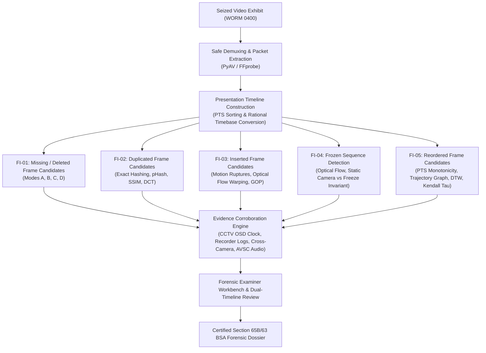

#### 15.4.1 FI-01 — Missing or Deleted Frame Candidates
- **Purpose:** Identify temporal intervals where one or more expected frames are absent from the video sequence.
- **Observable Signals:** PTS intervals exceeding expected local cadence; frame duration step changes; missing packet counter indices; broken optical-flow vectors; unphysical object displacements; recorder event log gap records; cross-camera corroboration conflicts.
- **Four Analytical Detection Modes:**
  - *Mode A (Internal Timing Analysis):* Evaluates raw PTS intervals against local cadence references (CFR baseline or robust VFR median/MAD).
  - *Mode B (Source-Reference Comparison):* Compares questioned video sequence against an authentic master recording or known reference sequence, identifying omitted frames.
  - *Mode C (Visual Continuity Analysis):* Evaluates inter-frame optical-flow consistency and object trajectory continuity; flags sudden state jumps occurring within continuous scenes.
  - *Mode D (CCTV Corroboration):* Correlates timeline against companion DVR event logs, motion detection triggers, or independent camera footage.
- **Forensic Status Typing:** Emits `FRAME_GAP_OBSERVED` when timing gaps are directly measurable, and `POSSIBLE_FRAME_DELETION` when deletions are inferred from visual/motion cues without timestamp markers.

#### 15.4.2 FI-02 — Duplicated Frame Candidates
- **Purpose:** Detect exact or near-identical frames repeated across consecutive or non-consecutive intervals.
- **Scope of Evaluation:** Consecutive repeated frames; non-consecutive repeated frames; repeated frame blocks (cloned loops); frame duplication with replacement (preserving total duration while overwriting content); frame duplication without replacement (padding stream duration).
- **Multi-Tier Detection Approach:**
  1. *Decoded-Frame Hashing:* Standardized 64-bit BLAKE3/SHA-256 hash on decoded planar YUV420p pixels for exact equality.
  2. *Perceptual Hashing (pHash):* 64-bit DCT perceptual hash with Hamming distance $d_H(h_i, h_j) \le \tau_{\text{pHash}}$.
  3. *Structural Similarity (SSIM):* Pixel luminance, contrast, and structural comparison ($SSIM \ge \tau_{\text{SSIM}}$).
  4. *DCT-Domain Energy Analysis:* High-frequency coefficient comparisons to detect duplicate frames subject to minor recompression noise.
- **Stationary CCTV Scene Invariant:** A stationary surveillance camera viewing an empty room naturally produces near-identical consecutive frames ($SSIM > 0.98$). The system evaluates sensor noise residuals (PRNU) and camera motion before declaring duplication, preventing false accusations on static scenes.

#### 15.4.3 FI-03 — Inserted Frame Candidates
- **Purpose:** Detect foreign, cloned, synthesized, or interpolated frames introduced into an existing recording.
- **Algorithmic Categorization:**
  - *Duplicated Existing Frame Insertion:* Cloned frame copied from another point in the same video.
  - *AI-Interpolated Frame Insertion:* Frames generated via motion-compensated frame rate up-conversion (RIFE, DAIN, CAIN).
  - *Foreign Frame Insertion:* Frames spliced in from an entirely different video recording or camera.
  - *Synthetically Generated Frame:* Diffusion or generative video model synthesis inserted into timeline.
  - *Benign Frame-Rate Conversion:* Telecine pull-down ($3:2$), duplicate-frame padding, or broadcast rate normalization.
- **Detection Traces:** Forward-backward optical-flow warping residual spikes ($R_i > \tau_{\text{residual}}$); sudden macroblock QP distribution shifts; unexpected I-frame insertions without visual scene change; encoder profile mismatches; broken person trajectory IDs.

#### 15.4.4 FI-04 — Frozen or Repeated-Frame Sequence Detection
- **Purpose:** Detect intervals where displayed visual content remains completely or abnormally static while audio or container timecodes continue to advance.
- **Potential Origins Evaluated:**
  - *Malicious Video Looping:* Perpetrator loops a static background segment to conceal an intrusion or theft.
  - *DVR Buffer Freeze / Capture Stalling:* Hardware or network buffer exhaustion causing the recorder to repeat the last valid frame.
  - *Transmission Packet Loss:* RTSP/ONVIF stream interruption where decoder freezes last frame during retransmission request.
  - *Decoder Failure:* Corrupted bitstream causing decoder to repeat reference frames until next IDR keyframe.
  - *Genuine Stationary Scene:* Low-traffic or night-vision scene with zero physical motion.
- **Mandatory Reporting Criteria:** For every candidate freeze, the system records start time, end time, total repeated frames, exact vs near-duplicate status, optical-flow magnitude, object movement flags, decoder error logs, alternative benign explanations, and confidence bounds. The system explicitly supports `STATIC_SCENE_OR_FREEZE_INCONCLUSIVE`.

#### 15.4.5 FI-05 — Reordered or Shuffled Frame Candidates
- **Purpose:** Detect evidence that the display presentation order of frames was intentionally modified.
- **Evaluated Manipulation Patterns:** Adjacent frame swapping; local sequence reversal (e.g. playing an action in reverse); frame-block reordering; scene-block shuffling; non-adjacent frame interleaving.
- **Detection Methodology:**
  - *PTS Presentation-Order Monotonicity:* Verifying $PTS_i > PTS_{i-1}$ across all presentation frames.
  - *Optical Flow Temporal Continuity:* Reverse motion vector testing and directional trajectory validation.
  - *Object Trajectory Physics:* Validating kinematic momentum and acceleration vectors across ByteTrack trajectories.
  - *Dynamic Time Warping (DTW) & Kendall Rank Correlation ($\tau$):* When comparing against a known authentic reference sequence, evaluating pairwise sequence alignment and rank order.
- **B-Frame Decode Invariant:** Legitimate decode order differences arising from bidirectional prediction are strictly decoupled from presentation order; B-frame reordering is verified against slice header syntax and container composition offsets (`ctts`) rather than flagged as tampering.

---

### 15.5 Eleven Core Investigator User Journeys

#### Journey CFI-J01: Investigating a Possible Missing-Frame Interval
- **Context:** In a homicide investigation, CCTV footage outside a commercial premise shows a suspect approaching a victim at $t=14\text{m }12\text{s}$, followed by an abrupt jump where the victim is collapsed on the ground at $t=14\text{m }13\text{s}$. The defense claims camera dropped frames naturally.
- **System Action:** VRE cadence analyzer inspects container PTS timestamps and elementary packet sequence. Cadence analysis reveals a continuous, monotonic PTS progression ($30\text{ fps}$ declared, $\Delta t = 33.3\text{ ms}$ uniform). However, optical-flow analysis detects a massive motion warping residual spike ($R = 48.2$), and ByteTrack person trajectory exhibits an unphysical instantaneous displacement of $2.4\text{ meters}$ in a single $33.3\text{ ms}$ frame.
- **Investigator Outcome:** Platform flags candidate `POSSIBLE_FRAME_DELETION` with finding details showing uniform PTS but ruptured visual continuity, indicating frames were excised and container timestamps restamped during post-processing.

#### Journey CFI-J02: Detecting Repeated or Duplicated Frames
- **Context:** An alibi video submitted by a suspect shows him sitting in a restaurant booth across a 5-minute span.
- **System Action:** CFITSA executes decoded-frame BLAKE3 hashing and pHash Hamming distance across all frames. It identifies an exact 48-frame sequence ($1.6\text{ seconds}$) that repeats eight times consecutively between $t=01:14$ and $t=01:27$. Sensor noise analysis reveals identical PRNU noise patterns across repeated blocks.
- **Investigator Outcome:** Platform generates finding `DUPLICATED_FRAME_CANDIDATE` with exact frame indices and duration padding metrics, demonstrating the video was artificially lengthened to fabricate an alibi.

#### Journey CFI-J03: Reviewing a Candidate Inserted Frame
- **Context:** Surveillance footage from a bank vault shows an authorized employee opening a safe. A single frame at $t=03:41.200$ appears to show an accomplice's face reflected in a glass partition.
- **System Action:** VRE bitstream analysis discovers an isolated H.264 I-frame inserted outside the standard 60-frame GOP cadence. Forward-backward optical flow warping produces a sharp boundary residual artifact, and macroblock QP distribution exhibits a $12\text{ QP}$ step decrease compared to surrounding P-frames.
- **Investigator Outcome:** Platform flags `INSERTED_FRAME_CANDIDATE` with spatial and temporal coordinates, demonstrating the single frame originated from a different recording.

#### Journey CFI-J04: Investigating a Long Frozen Sequence
- **Context:** A jewelry store burglary occurs during a 30-second interval where the CCTV feed shows an empty storefront. The security company claims camera failure.
- **System Action:** CFITSA evaluates consecutive frame differences, optical-flow magnitude, and burned-in OSD clock overlays. Decoded raster pixels are identical across 750 frames ($25\text{ seconds}$), but the burned-in OSD clock advances normally from `02:14:10` to `02:14:35`. Concurrently, the demuxed audio track records continuous ambient traffic noise without interruption.
- **Investigator Outcome:** System issues `FROZEN_SEQUENCE_CANDIDATE` noting advancing OSD clock and continuous audio paired with static visual raster, establishing a deliberate video freeze injection or NVR buffer playback attack.

#### Journey CFI-J05: Reviewing Reordered Frames
- **Context:** Protesters allege police officers initiated violence; police submit bodycam footage claiming protesters attacked first.
- **System Action:** CFITSA tracks object and limb trajectories. It detects a local sequence reversal where a 60-frame block ($2.0\text{ seconds}$) was reversed in presentation order before being spliced back into the container, inverting the physical sequence of events. Kinematic trajectory continuity analysis confirms acceleration vectors violate physical momentum.
- **Investigator Outcome:** System emits `REORDERED_FRAME_CANDIDATE` with exact reversed frame range and motion continuity graph, demonstrating inverted presentation chronology.

#### Journey CFI-J06: Comparing PTS/DTS with OCR Timestamps
- **Context:** A seized DVR export has an OSD clock in the upper-right corner. The defense claims the video timeline was altered during police acquisition.
- **System Action:** VCI PaddleOCR extracts clock strings $T_{\text{ocr}}(t)$ across every frame while VRE extracts container $t_{\text{pts}}$. The linear drift model $\delta(t) = T_{\text{ocr}}(t) - (T_0 + t_{\text{pts}})$ is evaluated. At $t_{\text{pts}} = 120.4\text{s}$, $T_{\text{ocr}}$ exhibits an instantaneous step jump of $+45.0\text{ seconds}$ while $t_{\text{pts}}$ continues monotonically without packet loss.
- **Investigator Outcome:** System generates `CCTV_CLOCK_PTS_DISCREPANCY` and `POSSIBLE_FRAME_DELETION`, proving 45 seconds of real-world footage was excised from the export while timestamps were normalized.

#### Journey CFI-J07: Analysing a Variable-Frame-Rate CCTV Export
- **Context:** Low-cost surveillance camera exports footage with high frame-interval jitter. A conventional forensic tool flags 140 "missing frame" errors due to constant-frame-rate assumptions.
- **System Action:** CFITSA recognizes VFR capture via stream metadata and robust interval statistics ($m = 66.7\text{ ms}$, $MAD = 14.2\text{ ms}$). It models frame intervals using a piecewise adaptive cadence estimator, distinguishing legitimate network/sensor jitter from actual sequence interruptions.
- **Investigator Outcome:** System suppresses 138 false-alarm cadence warnings, correctly highlighting only 2 genuine multi-second dropouts where frame intervals exceeded $3.5\times MAD$ and OSD clock jumped.

#### Journey CFI-J08: Comparing Two or More Camera Timelines
- **Context:** Two independent cameras (CAM-01 lobby, CAM-02 driveway) cover a bank robbery. Investigators need to verify timeline synchronization.
- **System Action:** CFITSA ingests both exhibits into separate WORM slots. It normalizes both feeds to UTC using OSD clock readings, establishes relative clock drift ($\Delta t = 2.14\text{ s}$), and evaluates cross-camera entity trajectory handoffs. It detects that CAM-02 is missing a 15-second window during which CAM-01 recorded the getaway vehicle departing.
- **Investigator Outcome:** System generates a unified cross-camera timeline graph highlighting the coverage gap in CAM-02 while preserving CAM-01 evidence.

#### Journey CFI-J09: Correlating Video-Frame Anomalies with Audio Evidence
- **Context:** In a kidnapping case, a video recording contains a 4-second candidate video freeze during which the victim is purported to be speaking.
- **System Action:** VISTA routes demuxed audio to AFB and AURAS. AURAS Voice Activity Detection (VAD) confirms continuous human speech during the freeze window, and AVSC SyncNet flags severe lip-sync desynchronization ($S_{\text{sync}} < 1.0$) because the lips are motionless while speech acoustic formants are active.
- **Investigator Outcome:** System issues `CROSS_MODAL_AV_ANOMALY` documenting that audio continued during a video freeze, indicating visual suppression.

#### Journey CFI-J10: Reviewing a Partially Decoded or Corrupted CCTV File
- **Context:** A physical DVR hard disk recovered from a fire contains partially corrupted, truncated H.264 elementary streams.
- **System Action:** Defensive PyAV parser encounters bitstream corruption at byte offset `0x4F12000`. Rather than aborting analysis, CFITSA isolates the corruption, logs `DECODE_CORRUPTION` for damaged packets, recovers synchronization at the next valid NAL keyframe, and analyzes all undamaged temporal intervals.
- **Investigator Outcome:** Platform yields partial timeline verification for 92% of the footage with clear boundaries indicating the corrupted segment.

#### Journey CFI-J11: Generating a Traceable Frame-Integrity Report
- **Context:** The public prosecutor requires a structured forensic dossier with Section 63 BSA certificate schedule preparation.
- **System Action:** CFITSA aggregates all frame observations, cadence charts, duplicate sequences, and OSD correlations into a cryptographically sealed Section 65B/63 BSA PDF report containing dual SHA-256 hashes, exact frame numbers, and examiner adjudication notes.
- **Investigator Outcome:** Examiner exports certified report with complete mathematical evidence attachments for trial submission.

---

### 15.6 Common Frame-Level Data Contracts & Pydantic v2 Compatibility

The platform defines three core logical data schemas conforming strictly to Pydantic v2 conventions:

#### 15.6.1 VideoFrameObservation
```python
class VideoFrameObservation(BaseModel):
    evidence_id: UUID
    stream_id: str
    frame_observation_id: UUID
    packet_index: int | None
    packet_byte_offset: int | None
    decoder_output_index: int
    presentation_order_index: int
    pts: int
    dts: int | None
    timebase_num: int
    timebase_den: int
    presentation_time_seconds: float
    duration_seconds: float | None
    width: int
    height: int
    pixel_format: str
    frame_type: Literal["I", "P", "B", "IDR", "UNKNOWN"]
    is_keyframe: bool
    packet_size_bytes: int | None
    decoded_frame_hash: str  # BLAKE3 64-character hex
    perceptual_hash: str     # 64-bit binary string
    decode_status: Literal["OK", "CORRUPTED", "DROPPED"]
    source_reference_index: int | None
    scene_relative_index: int | None
```

#### 15.6.2 FrameSequenceObservation
```python
class FrameSequenceObservation(BaseModel):
    sequence_id: UUID
    evidence_id: UUID
    stream_id: str
    start_frame_index: int
    end_frame_index: int
    start_presentation_time: float
    end_presentation_time: float
    duration_seconds: float
    total_frames: int
    cadence_type: Literal["CFR", "VFR", "UNKNOWN"]
    nominal_fps: float
    observed_mean_fps: float
    scene_id: UUID | None
    mean_motion_magnitude: float
    duplicate_run_length: int
    timeline_status: Literal["CONTINUOUS", "GAP_DETECTED", "FREEZE_DETECTED", "SHUFFLE_DETECTED"]
```

#### 15.6.3 FrameIntegrityFinding
```python
class FrameIntegrityFinding(BaseModel):
    finding_id: UUID
    evidence_id: UUID
    stream_id: str
    finding_classification: Literal[
        "FRAME_GAP_OBSERVED",
        "POSSIBLE_FRAME_DELETION",
        "DUPLICATED_FRAME_CANDIDATE",
        "INSERTED_FRAME_CANDIDATE",
        "FROZEN_SEQUENCE_CANDIDATE",
        "REORDERED_FRAME_CANDIDATE",
        "PTS_DISCONTINUITY",
        "DUPLICATE_TIMESTAMP",
        "FRAME_DURATION_ANOMALY",
        "MOTION_CONTINUITY_ANOMALY",
        "CODEC_SEQUENCE_ANOMALY",
        "DECODE_CORRUPTION",
        "REFERENCE_SEQUENCE_MISMATCH",
        "INCONCLUSIVE",
        "INSUFFICIENT_REFERENCE_EVIDENCE",
        "ANALYSIS_FAILED"
    ]
    start_frame_index: int
    end_frame_index: int
    start_pts: int
    end_pts: int
    start_time_seconds: float
    end_time_seconds: float
    expected_duration_seconds: float | None
    observed_duration_seconds: float
    metric_values: dict[str, float]  # SSIM, pHash distance, warping residual, robust z-score
    supporting_observations: list[str]
    contradictory_observations: list[str]
    detection_method: str
    confidence_score: float  # [0.0, 1.0]
    alternative_explanations: list[str]
    limitations: list[str]
    examiner_disposition: Literal["UNREVIEWED", "CONFIRMED_ANOMALY", "BENIGN_VARIATION", "INCONCLUSIVE"]
    lineage_manifest_uri: str
```

---

### 15.7 Variable-Frame-Rate-Aware Cadence & Mathematical Foundations

#### 15.7.1 Presentation-Time Differences
For frames sorted in presentation order ($i = 1, \dots, N$):
$$\Delta t_i = t_i - t_{i-1} = (PTS_i - PTS_{i-1}) \times \frac{TB_{\text{num}}}{TB_{\text{den}}}$$
For Constant Frame Rate (CFR) streams with validated frame rate $F$:
$$\Delta t_{\text{expected}} = \frac{1}{F}$$
*The CFR assumption is never applied blindly to surveillance video.*

#### 15.7.2 Robust Cadence Statistics (Median & MAD)
Surveillance video exhibits natural network and encoder jitter. To prevent false alarms, cadence is modelled using robust non-parametric statistics:
$$m = \operatorname{median}(\Delta t_i)$$
$$MAD = \operatorname{median}(|\Delta t_i - m|)$$
A modified robust z-score measures interval deviation:
$$z_i = \begin{cases} \frac{0.6745(\Delta t_i - m)}{MAD} & \text{if } MAD > \epsilon \\ 0.0 & \text{if } MAD \le \epsilon \end{cases}$$
When $MAD = 0$ (perfect CFR stream), any $\Delta t_i \neq m$ triggers direct cadence deviation evaluation. Piecewise adaptive windowing models deliberate rate changes (e.g., camera switching from $5\text{ fps}$ to $15\text{ fps}$ upon motion detection).

#### 15.7.3 Decoded Frame Difference & Warping Residuals
Inter-frame absolute raster difference:
$$D_i = \frac{1}{N_{\text{pix}}} \sum_{x,y,c} |I_i(x,y,c) - I_{i+1}(x,y,c)|$$
Motion-compensated warping residual using dense optical-flow field $\mathbf{f}_i(x,y) = (u_i, v_i)$:
$$R_i = \frac{1}{|\Omega_i|} \sum_{(x,y) \in \Omega_i} |I_{i+1}(x + u_i, y + v_i) - I_i(x,y)|$$
where $\Omega_i$ represents the valid, non-occluded image domain.

#### 15.7.4 Perceptual Hash Hamming Distance & SSIM
Binary perceptual hash distance across 64-bit vectors:
$$d_H(h_i, h_j) = \sum_{k=1}^{64} \mathbf{1}[h_{i,k} \neq h_{j,k}]$$
Structural Similarity Index:
$$SSIM(x,y) = \frac{(2\mu_x\mu_y + C_1)(2\sigma_{xy} + C_2)}{(\mu_x^2 + \mu_y^2 + C_1)(\sigma_x^2 + \sigma_y^2 + C_2)}$$

#### 15.7.5 Reference Sequence Alignment & Kendall Rank Correlation
When comparing ground-truth reference sequence $\mathbf{r} = (r_1, \dots, r_n)$ to questioned sequence $\mathbf{q} = (q_1, \dots, q_n)$, relative ordering agreement is computed via Kendall's rank correlation coefficient $\tau$:
$$\tau = \frac{P - Q}{\frac{1}{2} n (n-1)}$$
where $P$ is the count of concordant pairs and $Q$ is the count of discordant pairs.

---

### 15.8 Codec, GOP & Bitstream Integrity
CFITSA extracts and evaluates deep bitstream characteristics:
- **Group of Pictures (GOP) Cadence:** Validates keyframe (IDR/I) periodicity. Spliced videos frequently exhibit irregular GOP lengths (e.g. an unexpected I-frame inserted 12 frames after the previous keyframe).
- **Macroblock QP Distribution:** Tracks spatial quantization parameter variance across $16\times 16$ macroblocks. Double-compression introduces characteristic periodic QP modulation and histogram clustering.
- **Reference Frame Dependency:** Validates that P and B frames reference valid, un-excised preceding anchor frames; broken motion vector predictor references directly expose excised frames.
- **Sequence Parameter Set (SPS) / Picture Parameter Set (PPS) Changes:** Mid-stream changes in SPS/PPS resolution, profile, or level indicate concatenated video segments from disparate sources.

---

### 15.9 CCTV Clock, OCR Overlay & Multi-Camera Corroboration
1. **OSD Clock Drift Regression:** Correlates burned-in OCR clock strings $T_{\text{ocr}}(t)$ with container presentation timestamps $t_{\text{pts}}$:
   $$\delta(t) = T_{\text{ocr}}(t) - (T_0 + t_{\text{pts}}) = \alpha + \beta t + \epsilon(t)$$
   - *Instantaneous Step Jump ($|\Delta T_{\text{ocr}}| \ge 1.0\text{s}$ with continuous $t_{\text{pts}}$):* Excised footage.
   - *Clock Stalling ($T_{\text{ocr}}$ constant while $t_{\text{pts}}$ advances):* Looped video or freeze attack.
   - *Linear Drift ($|\beta| > 0.01\text{ s/s}$):* Frame rate conversion or playback re-timing.
2. **Cross-Camera Timeline Alignment:** In multi-camera surveillance scenes, independent camera exhibits are preserved in separate WORM vaults. Timelines are aligned onto a unified UTC axis using verified visual anchor events or corroborated OSD clocks, identifying temporal gaps and corroborating physical trajectories.

---

### 15.10 Audio-Video Cross-Modal Alignment (AFB & AVSC)
CFITSA leverages existing VISTA AFB and AVSC bridges:
- Correlates container-level global audio-video stream offsets ($\Delta t$).
- Verifies acoustic continuity (ambient noise floor and speech presence) during candidate video freeze intervals.
- Correlates talking-head lip-sync confidence ($S_{\text{sync}}$) with visible speech, ensuring audio was not dubbed over altered or frozen video.

---

### 15.11 Examiner Visualisation & Workbench Requirements
The platform provides a dedicated forensic examiner workbench interface enabling:
- Synchronized dual-timeline display (container presentation timeline vs OSD clock timeline).
- Interactive PTS/DTS cadence and frame-duration diagnostic curves.
- Multi-scale duplicate frame similarity heatmaps.
- Optical-flow vector overlay with motion magnitude indicators.
- Side-by-side adjacent frame comparison ($I_{i-1}, I_i, I_{i+1}$) with difference masks.
- Scene cut and GOP keyframe markers.
- Multi-camera synchronized playback with cross-camera timeline alignment.
- Non-destructive annotation tools allowing examiners to record findings directly into the Section 65B/63 BSA audit log.

---

### 15.12 Exhaustive Functional Requirements Inventory (CFI-01 through CFI-22)

| Req ID | Requirement Title | Primary Input | Expected Output | Measurable Acceptance Criteria | Trapped Failure States | Relevant Phase |
| :--- | :--- | :--- | :--- | :--- | :--- | :--- |
| **CFI-01** | Frame & Packet Identity Tracking | Video container bitstream. | Demuxed packets, decoded frames, 5 distinct frame indices. | Preserves distinct packet, decoder, presentation, reference, and scene indices; zero identifier conflation. | `CORRUPTED_INDEX_MAP`, `DEMUX_PACKET_LOSS` | **VISTA-CFI-01** |
| **CFI-02** | Timestamp & Timebase Inspection | Video elementary stream. | Raw integer PTS/DTS, exact rational timebases, presentation seconds. | Retains unrounded integer PTS and rational fractions; converts accurately via $t_i = PTS_i \times TB$. | `INVALID_TIMEBASE`, `NON_MONOTONIC_DTS` | **VISTA-CFI-01** |
| **CFI-03** | Variable-Frame-Rate Cadence Analysis | Frame presentation timestamps. | Robust median interval $m$, $MAD$, modified z-scores $z_i$, CFR/VFR classification. | Accurately classifies VFR streams; suppresses false cadence alarms when jitter is within $3.5\times MAD$. | `INSUFFICIENT_SAMPLE_SIZE`, `ZERO_VARIANCE_MAD` | **VISTA-CFI-02** |
| **CFI-04** | Missing-Frame Candidate Detection | Presentation timeline, optical flow. | Localized frame gap candidates, expected vs observed durations, Mode A–D evidence. | Detects single and multi-frame gaps; differentiates observed gaps from inferred deletions. | `GAP_EXCEEDS_MAX_DURATION`, `AMBIGUOUS_CADENCE` | **VISTA-CFI-04** |
| **CFI-05** | Duplicate-Frame Detection | Decoded raster frames. | Decoded-frame digests (BLAKE3), pHash Hamming distances, SSIM scores. | Identifies duplicate and near-duplicate frames; enforces static CCTV scene safeguard ($SSIM > 0.98$ requires motion/noise audit). | `HASH_COMPUTATION_ERROR`, `STATIC_SCENE_INCONCLUSIVE` | **VISTA-CFI-03** |
| **CFI-06** | Inserted-Frame Candidate Detection | Decoded frames, GOP bitstream. | Flagged inserted frames, optical flow warping residuals $R_i$, macroblock QP anomalies. | Differentiates duplicated frame insertion from AI-interpolated and foreign frames; flags anomalous isolated I-frames. | `FLOW_WARP_DIVERGENCE`, `INCONCLUSIVE_INTERPOLATION` | **VISTA-CFI-04** |
| **CFI-07** | Frozen-Sequence Detection | Consecutive frames, optical flow, audio. | Localized freeze intervals $[t_{\text{start}}, t_{\text{end}}]$, repeat counts, benign freeze classification. | Detects video freezes $\ge 1.0\text{ s}$; cross-references audio continuity and OSD clock progression; emits `STATIC_SCENE_OR_FREEZE_INCONCLUSIVE` when uncertain. | `DECODER_BUFFER_TIMEOUT`, `MOTIONLESS_BACKGROUND` | **VISTA-CFI-03** |
| **CFI-08** | Reordered-Frame Candidate Detection | Presentation order frames, ByteTrack. | Localized shuffled frame blocks, trajectory continuity scores, Kendall $\tau$. | Detects swapped or reversed frame sequences; strictly ignores legitimate B-frame decode order differences. | `DEGENERATE_TRAJECTORY_GRAPH`, `NON_MONOTONIC_PTS` | **VISTA-CFI-05** |
| **CFI-09** | Motion-Continuity Analysis | Decoded frames, optical flow fields. | Dense flow vectors $\mathbf{f}_i$, warping residuals $R_i$, motion rupture flags. | Detects unphysical motion discontinuities; differentiates object motion from camera PTZ/pan/tilt. | `OPTICAL_FLOW_DIVERGENCE`, `TEXTURELESS_FRAME_WARNING` | **VISTA-CFI-05** |
| **CFI-10** | Codec, GOP & Bitstream Correlation | Elementary bitstream, slice headers. | GOP cadence, I/P/B frame types, macroblock QP variance, SPS/PPS transitions. | Identifies mid-stream parameter set changes, non-cadence I-frames, and macroblock double-compression pulsing. | `BITSTREAM_PARSER_ERROR`, `UNSUPPORTED_NAL_UNIT` | **VISTA-CFI-06** |
| **CFI-11** | CCTV Clock & OCR Timestamp Correlation | Frame OSD crops, PaddleOCR. | Parsed clock strings $T_{\text{ocr}}(t)$, drift regression parameters $\alpha, \beta$, step-jump alerts. | Detects OSD step jumps $\ge 1.0\text{ s}$ and clock stalling; distinguishes clock drift from excised footage. | `OCR_RECOGNITION_LOW_CONFIDENCE`, `CLOCK_OCCLUSION` | **VISTA-CFI-06** |
| **CFI-12** | Recorder & Export Evidence Integration | Companion manifests, DVR logs. | Corroborated event timestamps, export software tags, native container markers. | Ingests companion files without requiring proprietary DVR credentials; flags discrepancies between logs and video. | `MANIFEST_PARSING_FAILED`, `LOG_TIMESTAMP_UNPARSABLE` | **VISTA-CFI-06** |
| **CFI-13** | Cross-Camera Timeline Comparison | Multi-camera exhibits, OSD clocks. | Aligned multi-camera timelines, relative clock offsets, temporal conflict graphs. | Preserves independent WORM exhibits for each camera; detects coverage gaps across independent feeds. | `CLOCK_OFFSET_INDETERMINATE`, `CAMERA_TIMELINE_MISMATCH` | **VISTA-CFI-07** |
| **CFI-14** | Audio-Video Timeline Correlation | Video PTS, extracted audio stream. | Global offset $\Delta t$, audio continuity during video freezes, lip-sync correspondence. | Correlates acoustic activity with video anomalies; detects speech continuation during video freeze. | `AUDIO_STREAM_ABSENT`, `LIP_SYNC_INDETERMINATE` | **VISTA-CFI-07** |
| **CFI-15** | Frame-Range Localisation & Reporting | Temporal findings, evidence metadata. | Standardized `FrameIntegrityFinding` records, millisecond timecodes, frame indices. | Conforms strictly to Pydantic v2 schemas; binds findings to master exhibit SHA-256 via DAG manifest. | `SCHEMA_VALIDATION_ERROR`, `LINEAGE_BINDING_FAILED` | **VISTA-CFI-08** |
| **CFI-16** | Examiner Visualisation & Review | Analysis observations, UI events. | Dual timeline, duration curves, similarity heatmaps, adjacent frame comparisons. | Renders interactive forensic diagnostic plots; records examiner annotations into immutable audit log. | `RENDER_BUFFER_EXCEEDED`, `UNAUTHORIZED_ANNOTATION` | **VISTA-CFI-08** |
| **CFI-17** | Ground-Truth Corpus & Annotation | Authentic controls, synthetic derivatives. | Controlled corruption corpus manifests, source-to-derived frame maps. | Synthesizes controlled frame deletions, insertions, duplications, freezes, and reorderings with bit-exact ground truth. | `CORPUS_METADATA_MISMATCH`, `GROUND_TRUTH_LEAKAGE` | **VISTA-CFI-09** |
| **CFI-18** | Event & Temporal Localisation Metrics | Predicted findings, ground truth. | Precision, Recall, F1, $tIoU$, boundary errors $\Delta t_{\text{boundary}}$, Kendall $\tau$. | Evaluates event detection and temporal localisation ($tIoU$) independently; handles zero-denominator cases safely. | `ZERO_INTERSECTION_INTERVAL`, `UNDEFINED_LOCALISATION_METRIC` | **VISTA-CFI-09** |
| **CFI-19** | Robustness & False-Positive Evaluation | Hard-negative controls (VFR, PTZ, cuts). | False alarms per video-hour, robustness curves across compression and lighting. | Enforces false-positive rate $\le 0.05$ on authentic hard-negative controls (PTZ panning, IR switching, natural cuts). | `FALSE_ALARM_BURST_DETECTED`, `CAMERA_MOTION_CONFOUNDER` | **VISTA-CFI-09** |
| **CFI-20** | Evidence Lineage & CEIPL Integration | Exhibit bytes, derived frames. | SHA-256/SHA3-512 dual hashes, WORM `0400` paths, RFC 8785 JSON manifests. | Anchors all frame extracts and finding records in CEIPL DAG; guarantees 100% bitstream immutability. | `WORM_WRITE_PERM_ERROR`, `CRYPTOGRAPHIC_HASH_MISMATCH` | **VISTA-CFI-00** |
| **CFI-21** | Security Safeguards & Resource Ceilings | Input bitstreams, worker sandbox. | Sandboxed execution, cgroup memory enforcement, timeout termination. | Caps worker RAM to $\le 4\text{ GB}$, uncompressed frame ring buffer $\le 64$ frames; traps decompression bombs $\le 10\text{ s}$. | `WORKER_OOM_KILLED`, `CONTAINER_PARSE_TIMEOUT` | **VISTA-CFI-00** |
| **CFI-22** | Reproducibility & Release Validation | Test suites, benchmark execution. | Automated pytest regression logs, deterministic hash assertions, release sign-off. | Verifies 100% reproducibility of timeline extraction and anomaly scores across independent benchmark runs. | `NON_DETERMINISTIC_SCORE`, `REGRESSION_ASSERTION_FAILED` | **VISTA-CFI-09** |

---

### 15.13 Security, Operational & Legal Invariants
1. **Zero-Alteration Master Evidence Invariant:** Seized master video bitstreams stored in WORM storage are marked with POSIX `0400` read-only permissions and S3 Object Lock. Files are NEVER transcoded, demuxed, or normalized in place.
2. **Defensive Demuxer Sandbox:** Container parsing executes inside unprivileged Linux cgroups with strict memory ceilings ($\le 4\text{ GB}$ RAM) and execution timeouts ($60\text{ s}$ header parse, $600\text{ s}$ segment decode) to prevent infinite GOP loops and libavformat buffer overflows.
3. **No Shell-String Interpolation:** All FFmpeg, FFprobe, and external tool invocations pass arguments as discrete, sanitized string vectors (`subprocess.run(["ffmpeg", ...], shell=False)`). Direct shell string concatenation is strictly prohibited.
4. **Air-Gapped Offline Execution:** All parsing, optical flow, OCR, tracking, and evaluation algorithms execute 100% locally with zero external network connectivity or cloud telemetry.
5. **Section 65B IEA / Section 63 BSA Traceability:** Every generated finding, diagnostic curve, and report annexure references master exhibit SHA-256, presentation timestamps, exact frame indices, and software environment hashes, guaranteeing courtroom admissibility.

---

### 15.14 Scientific Limitations, Edge Cases & Assumptions
1. **Unprovable Pre-Acquisition Deletion:** Without an authentic reference sequence, native recorder log, companion manifest, or corroborating camera footage, a video that has been edited and cleanly re-encoded with uniform timestamps cannot be definitively proven to have had frames removed. The platform limits findings to observable anomalies (`FRAME_GAP_OBSERVED`) and explicitly abstains from speculating on unprovable historical acts.
2. **Natural Texture & Stationary Camera Ambiguity:** Stationary surveillance cameras viewing static scenes naturally yield near-identical frames ($SSIM > 0.98$, pHash distance $= 0$). The system mitigates false alarms via sensor noise residuals and optical flow magnitude thresholds, but examiner review remains mandatory for static surveillance footage.
3. **Legitimate Frame-Rate Jitter:** Real-world surveillance networks and mobile devices employ variable frame rates with legitimate transmission jitter. The system applies robust median/MAD cadence modeling, but extreme network dropouts may produce ambiguous cadence states classified as `INCONCLUSIVE`.
4. **Empirical Decision Thresholds (`THRESHOLD_REQUIRES_VALIDATION`):** Exact decision thresholds ($\tau_{\text{SSIM}}$, $\tau_{\text{pHash}}$, $\tau_{\text{residual}}$, $z_{\text{threshold}}$) are marked `THRESHOLD_REQUIRES_VALIDATION` and must be tuned on empirical validation partitions rather than assumed a priori.


## 16. Cross-Media Metadata Service — Product Requirements (CMMS)

### 16.1 Problem Statement

Every forensic subsystem in PS-05 (AIF, AURAS, VISTA, AIF-GEO, ONTF) must extract technical metadata from evidence files. Without a shared service, each engine reimplements its own EXIF reader, FFprobe wrapper, PCAP header parser, and timestamp normaliser — creating maintenance burden, inconsistent field naming, and incompatible provenance records. When metadata extracted by IRE conflicts with metadata used by VRE or AIF-GEO, there is no authoritative record of which parser ran which version against which evidence hash.

Separately, cross-evidence metadata comparisons (image timestamp vs. CCTV recording window; audio origination time vs. video container creation time) require a shared model of metadata records and comparison results. Without it, such comparisons must be reimplemented in every reporting layer.

**CMMS** is the shared platform service that solves this. It provides a single, authoritative metadata extraction, normalisation, provenance, and consistency pipeline serving all forensic engines without replacing their specialised detection logic.

### 16.2 Goals

| ID | Goal |
| :--- | :--- |
| CMMS-G1 | Provide a single metadata extraction service for all evidence modalities, eliminating duplicate parser implementations inside each forensic engine. |
| CMMS-G2 | Preserve original raw metadata values immutably alongside any normalised representation. |
| CMMS-G3 | Provide field-level provenance linking every metadata value to its parser, version, source evidence hash, and extraction timestamp. |
| CMMS-G4 | Produce explicit, assumption-recording timestamp normalisation without silent timezone conversion. |
| CMMS-G5 | Perform rule-based metadata consistency analysis across fields and across related evidence items, emitting structured finding codes. |
| CMMS-G6 | Support an evidence-level metadata timeline for cross-modal correlation by UFREDF and forensic examiners. |
| CMMS-G7 | Integrate with CEIPL for evidence hash linkage and derived artifact registration without duplicating cryptographic custody logic. |
| CMMS-G8 | Operate fully offline in air-gapped environments with zero external network calls triggered by evidence file processing. |

### 16.3 Non-Goals

| ID | Non-Goal |
| :--- | :--- |
| CMMS-NG1 | CMMS does not perform deepfake detection, audio classification, video forgery analysis, facial recognition, or speaker identification. |
| CMMS-NG2 | CMMS does not perform packet payload forensic analysis. It extracts capture-level PCAP metadata only. |
| CMMS-NG3 | CMMS does not implement cryptographic custody. That remains with CEIPL. |
| CMMS-NG4 | CMMS does not generate final forensic reports. That remains with UFREDF. |
| CMMS-NG5 | CMMS does not perform live network monitoring or packet capture. It analyses previously captured, legally seized offline PCAP/PCAPNG files only. |
| CMMS-NG6 | CMMS does not claim that metadata consistency proves evidence authenticity. |
| CMMS-NG7 | CMMS does not automatically trigger external geocoding, weather lookups, or any enrichment service based on values found in evidence metadata. |

### 16.4 Stakeholders

| Stakeholder | Role |
| :--- | :--- |
| Forensic Examiners | Primary beneficiaries: receive consistent, provenance-rich metadata summaries and consistency findings. |
| AIF, AURAS, VISTA, AIF-GEO, ONTF Teams | Consuming subsystems: receive structured metadata records via CMMS output contracts. |
| CEIPL | Custodian: receives derived metadata artifact hashes for inclusion in the custody chain. |
| UFREDF | Reporting layer: receives structured metadata evidence for inclusion in structured dossiers. |
| Platform Architects | Responsible for CMMS boundary governance and preventing duplicate extraction implementations. |
| Forensic Science Laboratory Leadership | Evidence quality assurance; must confirm metadata uncertainty is transparently disclosed in reports. |

### 16.5 User Workflows

#### Workflow CMMS-W01: Image Metadata Extraction

1. Forensic examiner submits a JPEG image exhibit to the platform.
2. CEIPL computes and stores the SHA-256 and SHA3-512 digest of the raw bitstream.
3. CMMS receives the evidence reference and triggers media identification.
4. CMMS selects ExifTool as the primary parser adapter and Pillow as a supplementary structural adapter.
5. CMMS extracts EXIF (Make, Model, DateTimeOriginal, GPS, focal length, ISO, etc.), XMP (creation date, software, history), IPTC (caption, keywords, location), and structural fields (dimensions, colour model, ICC profile, C2PA presence).
6. Raw values are preserved verbatim. Normalised values are computed separately (e.g. GPS DMS rationalised to decimal degrees with hemisphere preserved).
7. CMMS performs field-level consistency analysis: detects `META_TIMESTAMP_CONFLICT` if DateTimeOriginal and XMP CreateDate differ beyond the acceptable threshold.
8. Structured metadata record is written to the database as a derived artifact with a CEIPL-linked hash.
9. AIF-IRE and AIF-GEO receive the structured metadata record via the CMMS output contract and proceed with their specialised forensic analysis.

#### Workflow CMMS-W02: Audio Metadata Extraction

1. AURAS receives an MP3 audio exhibit.
2. CMMS is invoked with the evidence reference prior to AURAS signal processing.
3. CMMS runs FFprobe to extract audio stream metadata (codec, sample rate, channel count, bitrate, duration) and ExifTool to extract ID3v2 tags (TXXX, COMM, TCON, TENC, TSSE, TLEN, ReplayGain).
4. For a WAV file, CMMS additionally extracts BWF `bext` chunk fields (Originator, OriginationDate, OriginationTime, TimeReference, UMID, CodingHistory) and iXML metadata.
5. Raw encoder strings are preserved as self-reported claims, not independently authenticated device facts.
6. CMMS emits `META_TIMEZONE_UNKNOWN` if OriginationDate lacks a timezone identifier.
7. AURAS receives structured audio metadata and proceeds with ARE signal analysis and ADDE deepfake detection.

#### Workflow CMMS-W03: Video Metadata Extraction

1. A seized MP4 video file is ingested.
2. CMMS identifies the container as MP4 and selects FFprobe as the primary adapter.
3. Container-level metadata is extracted: creation_time, modification_time, duration, overall bitrate, encoder tag, muxer.
4. Per-stream metadata is extracted for each video stream: codec, profile, level, width, height, frame rate, timebase, color primaries, and for each audio stream: codec, sample rate, channel count, bitrate, language.
5. PTS and timebase are preserved as separate values in rational form. Variable-frame-rate indication is recorded.
6. CMMS does not interpret normal B-frame decode/presentation ordering as evidence of tampering. PTS ordering analysis belongs to VISTA-VRE.
7. CMMS emits `META_CONTAINER_STREAM_INCONSISTENCY` if the declared video stream duration differs materially from the container-level duration.
8. VISTA receives the structured video metadata record and uses it for VRE temporal analysis and CCTV profile correlation.

#### Workflow CMMS-W04: CCTV Export with Sidecar Files

1. An investigator submits a CCTV export package: a main `.avi` recording, an XML sidecar with recorder configuration, and a DVR export log.
2. CEIPL ingests each file as a separate evidence item and links them in an evidence relationship group.
3. CMMS is invoked for the group and assigns a companion evidence structure.
4. Each file is independently parsed: FFprobe for the AVI recording, a custom XML adapter for the sidecar, log parsing for the DVR export.
5. Recorder-supplied values (channel identifier, recorder model, recording start timestamp, embedded timezone) are labelled `PROVENANCE: RECORDER_EXPORT` and distinguished from independently extracted metadata.
6. Operator-supplied camera descriptions are labelled `PROVENANCE: OPERATOR_SUPPLIED`.
7. CMMS compares the container creation_time against the embedded recorder start timestamp and emits `META_CCTV_SIDECAR_MISMATCH` if a material discrepancy is detected.
8. VISTA-CCTV profile receives the structured CCTV metadata group and proceeds with clock drift regression and CFITSA temporal analysis.

#### Workflow CMMS-W05: PCAP Metadata Extraction

1. A seized PCAP file from a confiscated laptop is submitted.
2. CEIPL ingests and hashes the PCAP bitstream.
3. CMMS identifies the file as PCAP using magic bytes and file format version detection.
4. TShark is invoked in a sandboxed worker with strict timeout and memory limits to extract capture-level metadata: file format, link type, snap length, timestamp resolution, interface descriptions, capture statistics, packet count.
5. Packet-level summary metadata is extracted where supported: capture timestamp range, protocol distribution, interface count, truncation indicators.
6. Sensitive payload content is not written into metadata fields.
7. CMMS emits `META_PARSE_FAILURE` if TShark exits with a non-zero code and preserves the error detail.
8. ONTF receives the PCAP capture metadata and proceeds with deep protocol and flow analysis.

#### Workflow CMMS-W06: Cross-Evidence Timestamp Comparison

1. A case contains three linked evidence items: a digital photograph, an audio recording, and a CCTV video segment.
2. CMMS has produced metadata snapshots for all three items.
3. An examiner requests a cross-evidence timeline comparison for the case.
4. CMMS retrieves all timestamp fields across the three evidence items, normalises them using recorded timezone assumptions, and computes pairwise differences.
5. `META_TIMESTAMP_CONFLICT` is emitted where the photograph DateTimeOriginal and the CCTV container creation_time differ by more than a configurable threshold, with both raw values, normalised values, evidence identifiers, and timezone assumptions recorded.
6. The comparison result is exposed as a structured finding linked to all participating evidence items.
7. CMMS does not infer causality from timestamp proximity. The examiner interprets the comparison result.

#### Workflow CMMS-W07: Metadata Report Export

1. UFREDF requests the CMMS metadata summary for a case.
2. CMMS assembles per-evidence metadata summaries including relevant raw values, normalised values, parser details, warnings, missing fields, consistency findings, and cross-evidence comparisons.
3. The report distinguishes: machine-extracted metadata, recorder-supplied values, operator-reported values, normalised values, and externally enriched values (if any enrichment was explicitly requested).
4. The report includes explicit caveats: metadata is not proof of authenticity; timezone assumptions are labelled; missing fields do not indicate tampering.
5. UFREDF incorporates the CMMS metadata section into the structured forensic dossier.

#### Workflow CMMS-W08: Geospatial Metadata Handoff to AIF-GEO

1. A photograph contains EXIF GPS data (GPSLatitude, GPSLongitude, GPSAltitude, GPSDateStamp, GPSTimeStamp, GPSDOP).
2. CMMS extracts the full GPS block including original DMS rational values, hemisphere references, altitude reference, datum claim, and DOP indicator.
3. CMMS normalises to decimal degrees, preserving the original DMS values alongside.
4. GPS timestamp is extracted separately with its own CAPTURE_TIME semantic label and timezone status.
5. CMMS does not validate whether the coordinate is geographically plausible. That analysis belongs to AIF-GEO.
6. AIF-GEO receives the structured GPS metadata block and proceeds with coordinate validation, reverse geocoding, solar/shadow verification, and location consistency analysis.

### 16.6 Functional Requirements

#### CMMS Architecture and Shared-Service Integration (CMMS-01 to CMMS-05)

| ID | Requirement | Priority | Status |
| :--- | :--- | :--- | :--- |
| **CMMS-01** | CMMS must be a shared platform service accessible by AIF, AURAS, VISTA, AIF-GEO, ONTF, CEIPL, and UFREDF through a common output contract. It must not be embedded as a private component inside any single subsystem. | Must Have | `PLANNED` |
| **CMMS-02** | CMMS must not duplicate specialised forensic analysis owned by other subsystems. Deepfake detection, audio classification, video temporal forensics, speaker identification, facial recognition, and packet payload analysis remain in their respective subsystems. | Must Have | `PLANNED` |
| **CMMS-03** | CMMS must support asynchronous execution using the platform's existing Redis/Celery task queue infrastructure. Long-running extraction and cross-evidence operations must not block the API gateway. | Must Have | `PLANNED` |
| **CMMS-04** | CMMS must integrate with the platform's existing FastAPI gateway, PostgreSQL persistence, and CEIPL evidence registration without introducing a second evidence ingestion path. | Must Have | `PLANNED` |
| **CMMS-05** | Every CMMS extraction activity must record a versioned metadata snapshot identifiable by snapshot ID, parent evidence ID, parser versions, schema version, creation timestamp, and snapshot hash. A new parser version or algorithm improvement must create a new snapshot and must not overwrite an existing snapshot. | Must Have | `PLANNED` |

#### Image Metadata Extraction (CMMS-06 to CMMS-12)

| ID | Requirement | Priority | Status |
| :--- | :--- | :--- | :--- |
| **CMMS-06** | CMMS must extract EXIF metadata from JPEG, PNG, TIFF, WebP, HEIC, RAW, DNG, and AVIF files using a verified parser adapter. Supported formats must be documented against the actual parser's known capabilities. | Must Have | `PLANNED` |
| **CMMS-07** | CMMS must extract at minimum the following EXIF fields where present: Make, Model, Software, DateTime, DateTimeOriginal, DateTimeDigitized, OffsetTime, OffsetTimeOriginal, OffsetTimeDigitized, SubSecTime, SubSecTimeOriginal, Orientation, ImageWidth, ImageLength, ExposureTime, FNumber, ISO, FocalLength, Flash, WhiteBalance, MeteringMode, SceneCaptureType, LensMake, LensModel, SerialNumber. | Must Have | `PLANNED` |
| **CMMS-08** | CMMS must extract the complete GPS metadata block: GPSLatitude, GPSLatitudeRef, GPSLongitude, GPSLongitudeRef, GPSAltitude, GPSAltitudeRef, GPSDateStamp, GPSTimeStamp, GPSImgDirection, GPSImgDirectionRef, GPSSpeed, GPSSpeedRef, GPSProcessingMethod, GPSMapDatum, GPSDOP, and GPSHPositioningError where available. Original DMS rational values and hemisphere references must be preserved alongside any decimal normalisation. | Must Have | `PLANNED` |
| **CMMS-09** | CMMS must extract XMP metadata including CreateDate, ModifyDate, MetadataDate, Creator, Rights, History, DocumentID, InstanceID, SoftwareAgent, and camera-related and editing-history-related XMP properties where supported by the parser. | Must Have | `PLANNED` |
| **CMMS-10** | CMMS must extract IPTC Core and Extension metadata including Caption, Creator, Copyright, Keywords, DateCreated, DigitalCreationDate, location fields, Credit, Source, and Instructions where available. | Must Have | `PLANNED` |
| **CMMS-11** | CMMS must extract image structural metadata where available: file signature, detected MIME type, dimensions, bit depth, colour model, ICC profile, alpha channel presence, compression type, JPEG quantization table presence, JPEG component information, and C2PA manifest presence and validation status. | Should Have | `PLANNED` |
| **CMMS-12** | Where two parsers disagree on the same field value, both results must be preserved with their respective parser identifiers and a `META_CONFLICTING_VALUES` finding emitted. CMMS must not arbitrarily select one parser result as authoritative. | Must Have | `PLANNED` |

#### Audio Metadata Extraction (CMMS-13 to CMMS-18)

| ID | Requirement | Priority | Status |
| :--- | :--- | :--- | :--- |
| **CMMS-13** | CMMS must extract technical stream metadata from WAV, RF64, MP3, FLAC, AAC, M4A, OGG, Opus, AIFF, WMA, and audio streams extracted from video containers. Fields must include: codec, codec profile, sample rate, channel count, channel layout, bit depth, bitrate, duration, compression type, variable/constant bitrate indicator, stream index, and container format. | Must Have | `PLANNED` |
| **CMMS-14** | For WAV and Broadcast WAV Format (BWF) files, CMMS must extract the RIFF INFO block, BWF `bext` chunk (Originator, OriginatorReference, OriginationDate, OriginationTime, TimeReference, UMID, CodingHistory), and iXML metadata where present. | Must Have | `PLANNED` |
| **CMMS-15** | For MP3 files, CMMS must extract ID3v1 and ID3v2 tags including TXXX, COMM, TCON, TENC, TSSE, TLEN, and ReplayGain. For FLAC files, Vorbis comments and STREAMINFO must be extracted. Encoder and vendor strings must be preserved as self-reported claims. | Must Have | `PLANNED` |
| **CMMS-16** | CMMS must extract audio provenance indicators where present: software encoder tag, recording device tag, editing software tag, export software tag, recording timestamps, processing-history tags, and multiple embedded metadata blocks where the format supports them. | Should Have | `PLANNED` |
| **CMMS-17** | Encoder strings and software tags must be labelled as self-reported claims extracted from the file, not independently authenticated device facts. CMMS must not infer that a file is AI-generated solely from metadata; that analysis belongs to AURAS-ADDE. | Must Have | `PLANNED` |
| **CMMS-18** | CMMS must extract audio provenance metadata from embedded metadata blocks and pass it to AURAS as part of the structured metadata record. AURAS must not independently reimplement the same BWF/ID3/Vorbis parsing logic. | Should Have | `PLANNED` |

#### Video Metadata Extraction (CMMS-19 to CMMS-24)

| ID | Requirement | Priority | Status |
| :--- | :--- | :--- | :--- |
| **CMMS-19** | CMMS must extract container-level metadata from MP4, MOV, MKV, AVI, WebM, MPEG, TS/M2TS, and 3GP files using a verified parser adapter. Fields must include: container type, brand, compatible brands, creation time, modification time, duration, overall bitrate, encoder tag, muxer, metadata tags, track count, stream count, and container timebase. | Must Have | `PLANNED` |
| **CMMS-20** | For each video stream, CMMS must extract: codec, codec profile, codec level, width, height, pixel format, bit depth, frame rate, average frame rate, declared frame rate, variable-frame-rate indication, timebase, start PTS, duration, frame count where reliably available, color primaries, transfer characteristics, color space, chroma subsampling, rotation/display matrix, and codec extradata information. | Must Have | `PLANNED` |
| **CMMS-21** | For each audio stream within a video container, CMMS must extract: audio stream index, codec, sample rate, channel count, channel layout, bitrate, duration, start time, language tag, stream disposition, and synchronization-related information. Audio stream metadata must use the same audio metadata model defined in CMMS-13. | Must Have | `PLANNED` |
| **CMMS-22** | CMMS must preserve timestamp representations in their original form. PTS, DTS, timebase, container creation time, stream start time, and frame presentation time must be stored as separate named fields. The raw PTS integer and rational timebase must be preserved separately. All must not be collapsed into a single generic `timestamp` field. | Must Have | `PLANNED` |
| **CMMS-23** | CMMS must not interpret normal B-frame decode/presentation ordering as evidence of tampering. CMMS must not claim that a PTS anomaly detected at the metadata extraction stage constitutes a confirmed frame deletion; that conclusion requires VISTA-VRE analysis. | Must Have | `PLANNED` |
| **CMMS-24** | CMMS must pass structured video metadata to VISTA-VRE and VISTA-VCI via the CMMS output contract. VISTA subsystems must not independently reimplement equivalent container-level metadata extraction for fields covered by CMMS. | Should Have | `PLANNED` |

#### CCTV and Recorder Metadata (CMMS-25 to CMMS-30)

| ID | Requirement | Priority | Status |
| :--- | :--- | :--- | :--- |
| **CMMS-25** | CMMS must support extraction of CCTV-specific metadata including: recorder manufacturer, recorder model, device identifier or serial, camera/channel identifier, camera label, recording start and end timestamps, embedded timezone, recorder timezone configuration, export timestamp, export software, native versus exported format indicator, proprietary metadata, watermark/signature presence, sidecar file references, and recorder log references. | Must Have | `PLANNED` |
| **CMMS-26** | CMMS must support a companion evidence group structure where multiple files belong to a single CCTV export: main recording, sidecar metadata, recorder log, export manifest, verification file, camera configuration, and operator notes. Each companion file must be a separate CEIPL evidence item linked through a documented evidence relationship. | Must Have | `PLANNED` |
| **CMMS-27** | CMMS must distinguish the provenance of each CCTV metadata value: extracted from the media file, obtained from a native recorder export, extracted from a recorder log, reported by the operator, or supplied by the user. User-entered recorder values and operator claims must not be treated as independently verified device facts. | Must Have | `PLANNED` |
| **CMMS-28** | CMMS must emit `META_CCTV_SIDECAR_MISMATCH` when a material discrepancy is detected between recorder-supplied timestamps or configuration and independently extracted container metadata. | Must Have | `PLANNED` |
| **CMMS-29** | CCTV sequence tampering analysis (missing frames, duplicate frames, inserted frames, frozen sequences, clock drift regression) remains within VISTA-CFITSA. CMMS supplies the recorder context, sidecar metadata, and structured CCTV metadata group to VISTA; it does not perform frame-level temporal sequence forensics. | Must Have | `PLANNED` |
| **CMMS-30** | CMMS must pass structured CCTV metadata groups, including companion evidence associations, to VISTA-CCTV Profile and CFITSA via the CMMS output contract. | Must Have | `PLANNED` |

#### Offline Network Capture Metadata (CMMS-31 to CMMS-35)

| ID | Requirement | Priority | Status |
| :--- | :--- | :--- | :--- |
| **CMMS-31** | CMMS must support metadata extraction from PCAP and PCAPNG files. Input must be a legally seized, offline evidence file. Live network capture is outside scope. | Must Have | `PLANNED` |
| **CMMS-32** | CMMS must extract capture-level metadata: file format, capture format version, link-layer type, snap length, timestamp resolution, timestamp precision, interface identifiers, interface descriptions, interface names, interface hardware information, capture comments, capture statistics, packet count, and truncation indicators. | Must Have | `PLANNED` |
| **CMMS-33** | Where supported by the selected parser adapter, CMMS must expose packet-level summary metadata: packet index, capture timestamp, captured length, original wire length, link-layer protocol, network-layer protocol, transport-layer protocol, source and destination IP, source and destination port, TCP flags, stream/flow identifier, VLAN identifiers, DNS-related identifiers, TLS metadata visible without decryption, and fragmentation information. | Should Have | `PLANNED` |
| **CMMS-34** | Sensitive payload data must not be copied into general metadata fields by default. Protocol interpretation and deeper packet/flow analysis remain within the ONTF subsystem. CMMS must not claim that metadata extraction reveals encrypted application content. | Must Have | `PLANNED` |
| **CMMS-35** | CMMS parser workers for PCAP/PCAPNG must operate within strict resource limits: memory limit, CPU time limit, and timeout. Parser crashes must be captured and reported as `META_PARSE_FAILURE` findings, not silently producing empty results. | Must Have | `PLANNED` |

#### Geospatial Metadata (CMMS-36 to CMMS-39)

| ID | Requirement | Priority | Status |
| :--- | :--- | :--- | :--- |
| **CMMS-36** | CMMS must expose a structured GPS metadata block to AIF-GEO including: EXIF GPS fields, XMP location fields, IPTC location fields, GPS timestamps, coordinates, altitude, direction, speed, GPS accuracy/DOP indicators, referenced datum, and coordinate reference information. | Must Have | `PLANNED` |
| **CMMS-37** | Coordinate normalisation must preserve original DMS values, hemisphere references, original datum claims, original altitude references, and missing accuracy information. Normalisation must not erase the source representation. | Must Have | `PLANNED` |
| **CMMS-38** | CMMS must not validate whether a GPS coordinate is geographically plausible, corresponds to a real location, or is consistent with other evidence. Those analyses belong to AIF-GEO. CMMS provides extracted values; AIF-GEO performs validation and location consistency analysis. | Must Have | `PLANNED` |
| **CMMS-39** | CMMS must not treat a valid extracted GPS coordinate as proof that the evidence was captured at that location. | Must Have | `PLANNED` |

#### Common Schema and Normalisation (CMMS-40 to CMMS-46)

| ID | Requirement | Priority | Status |
| :--- | :--- | :--- | :--- |
| **CMMS-40** | CMMS must maintain a versioned common metadata schema capable of representing image, audio, video, CCTV, PCAP, and geospatial metadata without forcing all modalities into the same field dictionary. The schema version must be recorded in every metadata snapshot. | Must Have | `PLANNED` |
| **CMMS-41** | Each extracted field must retain: stable field identifier, original field name, original field group, raw value, raw value type, normalised value where available, normalised value type, unit where applicable, source parser, parser version, source evidence identifier, source metadata block or location, extraction activity identifier, extraction status, confidence or reliability description where meaningful, transformation history, validation results, and known limitations. | Must Have | `PLANNED` |
| **CMMS-42** | The schema must support the following value types natively: strings, integers, decimal values, booleans, null/unknown values, arrays, nested objects, rational numbers, binary metadata references, timestamp values, coordinate values, units, and measurement uncertainties. Stringification of every value is prohibited. | Must Have | `PLANNED` |
| **CMMS-43** | For every normalised field, CMMS must preserve: the original raw value, source parser, parser version, normalisation rule applied, normalisation timestamp, any assumptions made, and whether the normalised value is exact, partial, or inferred. | Must Have | `PLANNED` |
| **CMMS-44** | CMMS must distinguish at minimum the following metadata categories and must never merge them into a single dictionary: embedded metadata (EXIF, ID3, XMP), container metadata, stream metadata, filesystem metadata, acquisition metadata, device metadata, geospatial metadata, network capture metadata, processing metadata, and derived metadata. | Must Have | `PLANNED` |
| **CMMS-45** | CMMS must support the following extraction status values: MISSING, NULL, UNKNOWN, UNSUPPORTED, PARSE_FAILED, CONFLICTING, UNVERIFIED, PARTIAL, and COMPLETE. Missing metadata must not be equated with evidence tampering. | Must Have | `PLANNED` |
| **CMMS-46** | Automatic media identification must use verified file characteristics (magic bytes, format signature, container structure) rather than file extension or declared MIME type alone. `META_FORMAT_MISMATCH` must be emitted when declared and detected types differ. | Must Have | `PLANNED` |

#### Timestamp Handling and Consistency Analysis (CMMS-47 to CMMS-52)

| ID | Requirement | Priority | Status |
| :--- | :--- | :--- | :--- |
| **CMMS-47** | For every timestamp field, CMMS must record: raw timestamp, source metadata field, timestamp semantics (from the defined taxonomy), timezone identifier or offset if supplied, timestamp precision, normalised representation if achievable, normalisation assumptions, uncertainty or ambiguity, and provenance. | Must Have | `PLANNED` |
| **CMMS-48** | CMMS must define and apply at minimum the following timestamp semantic types: CAPTURE_TIME, RECORDING_START, RECORDING_END, FILE_CREATION_TIME, FILE_MODIFICATION_TIME, EXPORT_TIME, ENCODING_TIME, CONTAINER_CREATION_TIME, STREAM_START_TIME, PACKET_CAPTURE_TIME, GPS_TIME, OVERLAY_DISPLAY_TIME, ACQUISITION_TIME, PROCESSING_TIME. | Must Have | `PLANNED` |
| **CMMS-49** | CMMS must not infer the timezone of an unknown timestamp from the processing system's current timezone. CMMS must not silently convert local timestamps to UTC when their timezone is unknown. If conversion requires an assumption, the assumption must be recorded and the result classified as INFERRED or CONDITIONAL. | Must Have | `PLANNED` |
| **CMMS-50** | CMMS must perform timestamp consistency analysis across all available timestamp sources for an evidence item: EXIF capture time, XMP creation time, IPTC creation time, filesystem timestamps, BWF origination time, video container creation time, stream start time, CCTV recorder time, overlay time, PCAP capture timestamps, GPS timestamps, and acquisition timestamps. `META_TIMESTAMP_CONFLICT`, `META_TIMEZONE_UNKNOWN`, and `META_TIMESTAMP_ORDER_ANOMALY` must be emitted as appropriate. | Must Have | `PLANNED` |
| **CMMS-51** | CMMS must perform device consistency analysis across available fields: camera make/model, lens information, software tags, recording device information, audio/video encoder information, CCTV recorder identifiers, and sidecar device information. `META_DEVICE_FIELD_INCONSISTENCY` and `META_SOFTWARE_FIELD_INCONSISTENCY` must be emitted for detected anomalies. CMMS must not claim that matching model strings prove files originated from the same physical device. | Must Have | `PLANNED` |
| **CMMS-52** | CMMS must perform structural consistency analysis: file extension vs. detected format mismatch, declared vs. detected MIME mismatch, invalid or unexpected metadata blocks, duplicate metadata blocks, truncated metadata blocks, inconsistent stream metadata, and inconsistencies between embedded and container-level values. | Must Have | `PLANNED` |

#### Cross-Evidence Correlation (CMMS-53 to CMMS-57)

| ID | Requirement | Priority | Status |
| :--- | :--- | :--- | :--- |
| **CMMS-53** | CMMS must support cross-evidence metadata comparison for linked evidence items within a case. Examples: image timestamp vs. CCTV recording window; audio recording time vs. video container creation time; GPS time vs. capture time; PCAP capture window vs. audio/video event window. | Must Have | `PLANNED` |
| **CMMS-54** | Every cross-evidence comparison result must include: both evidence identifiers, fields compared, raw values, normalised values, transformation assumptions, difference or discrepancy, rule identifier, result, and limitations. `META_CROSS_EVIDENCE_CONFLICT` must be emitted for detected conflicts. | Must Have | `PLANNED` |
| **CMMS-55** | CMMS must expose a per-case evidence metadata timeline supporting: per-file, per-device, per-camera/channel, per-audio-evidence, per-network-capture, and cross-modality timelines. Each timeline entry must include: evidence ID, event type, raw timestamp, normalised timestamp, timestamp semantics, timezone status, source field, provenance category, uncertainty/precision, and correlation status. | Should Have | `PLANNED` |
| **CMMS-56** | CMMS must not use metadata timestamp proximity alone to establish causality between events. The consuming forensic subsystem or reporting layer determines the appropriate interpretation. | Must Have | `PLANNED` |
| **CMMS-57** | CMMS must not manufacture a relationship between evidence files merely because their timestamps are close. Relationships must be established through explicit evidence group registration or examiner-directed comparison requests. | Must Have | `PLANNED` |

#### CEIPL and Provenance Integration (CMMS-58 to CMMS-62)

| ID | Requirement | Priority | Status |
| :--- | :--- | :--- | :--- |
| **CMMS-58** | Each CMMS extraction result must reference: original evidence ID, original evidence hash, metadata extraction activity identifier, parser identity and version, extraction configuration, output metadata snapshot hash, and parent-child evidence relationships. | Must Have | `PLANNED` |
| **CMMS-59** | CMMS must never modify the original evidence to repair metadata, rewrite EXIF tags, remove metadata from original files, replace original values with normalised values, or repackage an original file without recording a separate derived artifact. | Must Have | `PLANNED` |
| **CMMS-60** | When metadata is extracted into a separate report or JSON object and persisted, it must be stored as a derived artifact linked to the original evidence with its own CEIPL-registered hash. | Must Have | `PLANNED` |
| **CMMS-61** | CMMS must support versioned metadata snapshots. New parser versions or improved extraction algorithms must produce new snapshots without overwriting existing ones. Each snapshot must record: snapshot ID, parent evidence ID, extraction version, parser versions, schema version, creation time, hash, and differences against prior snapshots. | Must Have | `PLANNED` |
| **CMMS-62** | The original evidence hash computed by CEIPL at ingestion remains authoritative for the original evidence bitstream. CMMS does not recompute or replace it. | Must Have | `PLANNED` |

#### Security and Privacy (CMMS-63 to CMMS-67)

| ID | Requirement | Priority | Status |
| :--- | :--- | :--- | :--- |
| **CMMS-63** | CMMS parser workers must operate in isolation with: file size limits, memory limits, CPU/time limits, recursive archive extraction limits, timeout handling, safe temporary storage, path traversal protection, symlink restriction, decompression bomb protection, malformed file handling, and parser crash recovery. | Must Have | `PLANNED` |
| **CMMS-64** | CMMS must not automatically fetch external URLs found in evidence metadata fields. Geocoding, weather services, map lookups, or any enrichment service must be triggered only by an explicit controlled operator action, with source, retrieval time, result, and limitations recorded separately from extracted evidence values. | Must Have | `PLANNED` |
| **CMMS-65** | CMMS must safely handle malicious metadata strings including strings containing HTML, script-like content, SQL injection sequences, path traversal sequences, and oversized values. Metadata values must be treated as untrusted data from adversarially crafted evidence files. | Must Have | `PLANNED` |
| **CMMS-66** | CMMS must support privacy-aware redaction for reports and export views. Redaction must operate on generated copies or report views only, never on original evidence. A redacted export must be independently identified and hashed. | Should Have | `PLANNED` |
| **CMMS-67** | Parser adapters that execute external binaries (ExifTool, TShark) must operate with restricted network access and must not make outbound network calls during evidence processing. | Must Have | `PLANNED` |

#### API, Persistence and Reporting (CMMS-68 to CMMS-72)

| ID | Requirement | Priority | Status |
| :--- | :--- | :--- | :--- |
| **CMMS-68** | CMMS must expose logical API endpoints following existing platform naming conventions: metadata extraction request, raw metadata retrieval, normalised metadata retrieval, consistency findings retrieval, metadata snapshot listing, case metadata timeline, and cross-evidence comparison. These are proposed logical interfaces; final route design must align with the existing FastAPI conventions and RBAC model. | Should Have | `PLANNED` |
| **CMMS-69** | CMMS must use a hybrid persistence model: structured evidence reference, snapshot, and relationship identifiers stored as queryable columns; modality-specific field details stored as typed JSONB. The model must support: primary keys, foreign keys, unique constraints, case/evidence scoping, indexing, snapshot versioning, retention, access control, and query performance requirements. | Should Have | `PLANNED` |
| **CMMS-70** | CMMS must not store all metadata as one unstructured JSON blob without query or provenance strategy. Important identifiers, status fields, and inter-record relationships must be stored as relational columns. | Must Have | `PLANNED` |
| **CMMS-71** | CMMS must supply structured metadata objects to UFREDF including: extracted metadata summary, relevant raw values, normalised values, parser details, extraction warnings, missing metadata, conflicting fields, consistency findings, provenance references, cross-evidence comparisons, timestamp uncertainty, timezone assumptions, and limitations. | Must Have | `PLANNED` |
| **CMMS-72** | CMMS forensic reports must distinguish: machine-extracted metadata, user-reported information, externally enriched values, normalised values, model-inferred values, and independently verified information. Reports must never use the phrase "metadata proves authenticity." | Must Have | `PLANNED` |

#### Testing, Performance and Validation (CMMS-73 to CMMS-78)

| ID | Requirement | Priority | Status |
| :--- | :--- | :--- | :--- |
| **CMMS-73** | CMMS must have unit tests covering: format identification, parser selection, EXIF/XMP/IPTC/GPS extraction, audio tag extraction, BWF/iXML parsing, video stream parsing, CCTV sidecar association, PCAP/PCAPNG header parsing, timestamp normalisation, timezone handling, rational-number handling, missing-field handling, conflicting-field handling, snapshot versioning, and provenance references. | Must Have | `PLANNED` |
| **CMMS-74** | CMMS must have integration tests for complete workflows: image intake through CEIPL to CMMS to AIF; audio intake to CMMS to AURAS; video intake to CMMS to VISTA; CCTV export with sidecar to CMMS to VISTA; PCAP intake to CMMS to ONTF; multiple evidence items through metadata comparison to UFREDF report. | Must Have | `PLANNED` |
| **CMMS-75** | CMMS must have adversarial and negative tests including: malformed EXIF, invalid GPS references, conflicting XMP/EXIF dates, unknown timezone, incorrect file extension, incorrect MIME declaration, duplicate metadata blocks, truncated files, oversized metadata fields, malformed ID3 tags, corrupted RIFF chunks, invalid video timebase, variable-frame-rate media, incomplete PCAP captures, unsupported PCAP link types, PCAP timestamp precision variations, malicious filenames, parser timeout, parser crash, embedded URLs in metadata, and metadata values containing HTML or script-like strings. | Must Have | `PLANNED` |
| **CMMS-76** | CMMS must define performance benchmark targets for: extraction latency, memory consumption, CPU consumption, evidence size versus extraction time, number of metadata fields extracted, batch evidence throughput, parser failure rate, cross-evidence comparison latency, large CCTV recording handling, and large PCAP/PCAPNG handling. Benchmark targets must be set after defining the evaluation hardware and representative evidence sizes and must not be invented without a reproducible test set. | Should Have | `PLANNED` |
| **CMMS-77** | CMMS ground-truth validation must use legally and ethically usable test data: public EXIF/JPEG metadata test samples, media samples with known metadata, FFmpeg-generated audio/video fixtures, BWF/iXML test fixtures, synthetic PCAP/PCAPNG captures, CCTV test exports with known recorder settings, and controlled files with deliberately altered metadata. The availability, terms, and licences of every dataset must be verified before documenting as a project dependency. | Must Have | `PLANNED` |
| **CMMS-78** | CMMS acceptance metrics must define how the following are measured and what constitutes pass, warning, or failure: format identification precision/recall, metadata field-level extraction accuracy, parser reliability (successful extraction rate), normalisation accuracy, timestamp timezone handling, conflict detection precision/recall, provenance completeness, robustness (malformed-file handling rate), extraction latency (median and p95), batch throughput, subsystem contract test pass rate, and parser isolation/hostile-input test results. | Must Have | `PLANNED` |

### 16.7 Non-Functional Requirements

| Category | Requirement |
| :--- | :--- |
| **Offline Operation** | CMMS must operate 100% air-gapped with no external network calls triggered by evidence processing. |
| **Immutability** | Original evidence must never be modified. Metadata is extracted as a derived activity. |
| **Provenance Completeness** | Every metadata field must have a complete provenance trail: parser, version, evidence hash, activity ID. |
| **Reproducibility** | The same evidence file, parser version, and configuration must produce the same metadata snapshot across repeated runs. |
| **Performance** | Benchmark targets to be defined against representative evidence sizes and evaluation hardware. |
| **Security** | Parser workers must operate with resource limits, network isolation, and crash recovery. |
| **Privacy** | Redaction must operate on copies only. Sensitive payload data must not enter general metadata fields. |
| **Legal Compliance** | All metadata provenance, assumptions, and limitations must be disclosable under Section 65B IEA / Section 63 BSA 2023 proceedings. |

### 16.8 Explicit Forensic and Scientific Limitations

1. Metadata can be modified, removed, fabricated, or copied by any party with file access.
2. Metadata consistency does not prove evidence authenticity.
3. Missing metadata does not prove tampering.
4. Filesystem timestamps do not automatically represent the time of evidence capture.
5. A camera model field does not independently identify a physical device.
6. Software tags are self-reported by the file and may be altered or removed.
7. Timezone inference must be explicit and traceable; results of inference under unknown-timezone conditions must be classified as INFERRED or CONDITIONAL.
8. A metadata conflict may have benign explanations including export, copying, timezone changes, and device-clock errors.
9. Metadata extraction cannot recover fields that are absent from the evidence unless an independent source supplies them.
10. External enrichment must not be represented as embedded evidence and must be recorded with source, retrieval time, and limitations.
11. A valid hash proves bitstream identity relative to a trusted reference, not the truth of the recorded event.
12. Cross-evidence temporal correlation does not independently establish causality.

Language to use in reports: Observed, Extracted, Reported, Normalised, Inferred, Corroborated, Conflicting, Unverified, Inconclusive.
Language to avoid: "metadata proves authenticity," "the file is authentic because its EXIF is valid," "timestamp mismatch confirms manipulation," "the device identity is verified by its model tag."

### 16.9 Dependency and Risk Register

| Item | Description | Risk | Mitigation |
| :--- | :--- | :--- | :--- |
| ExifTool | Broad EXIF/XMP/IPTC/GPS extraction | Licence and binary execution integration | Document licence; use subprocess isolation |
| FFprobe | Container and stream metadata | API stability across versions | Pin version; record in snapshot |
| MediaInfo | Supplementary format coverage | Licence and format overlap with FFprobe | Evaluate coverage gap; use only where FFprobe insufficient |
| PyShark/TShark | PCAP/PCAPNG parsing | Security risk from adversarial captures | Strict sandbox; resource limits; timeout |
| Scapy | Supplementary PCAP parsing | Protocol coverage and performance | Use for supplementary parsing only |
| Pydantic v2 | Metadata contracts | Schema evolution | Schema versioning; migration plan |
| PostgreSQL JSONB | Flexible metadata storage | Query performance on large metadata fields | Index structured columns; JSONB for modality-specific details only |
| CEIPL integration | Evidence hash linkage | Dependency on CEIPL phase completion | CMMS-A0 must verify CEIPL interfaces before committing schemas |

### 16.10 Requirement Traceability Summary

| ID Range | Requirement Group | Section Reference |
| :--- | :--- | :--- |
| CMMS-01 to CMMS-05 | Architecture and shared-service integration | §15.6 |
| CMMS-06 to CMMS-12 | Image metadata | §15.6 |
| CMMS-13 to CMMS-18 | Audio metadata | §15.6 |
| CMMS-19 to CMMS-24 | Video metadata | §15.6 |
| CMMS-25 to CMMS-30 | CCTV and recorder metadata | §15.6 |
| CMMS-31 to CMMS-35 | Offline network capture metadata | §15.6 |
| CMMS-36 to CMMS-39 | Geospatial metadata | §15.6 |
| CMMS-40 to CMMS-46 | Common schema and normalisation | §15.6 |
| CMMS-47 to CMMS-52 | Timestamp handling and consistency analysis | §15.6 |
| CMMS-53 to CMMS-57 | Cross-evidence correlation | §15.6 |
| CMMS-58 to CMMS-62 | CEIPL and provenance integration | §15.6 |
| CMMS-63 to CMMS-67 | Security and privacy | §15.6 |
| CMMS-68 to CMMS-72 | API, persistence and reporting | §15.6 |
| CMMS-73 to CMMS-78 | Testing, performance and validation | §15.6 |

Technical implementation references: `TRD.md Section 16`. Phase mapping: `PHASES.md Section 9.B`.

---

## 17. Cross-Source Timestamp Verification & Evidence Timeline Reconstruction (CSTV)

### 17.1 Problem Statement
In multi-device digital forensics investigations—such as coordinated terrorist attacks, financial cyber-fraud, disputed traffic collisions, public unrest, and violent crimes captured on multiple CCTV and smartphone cameras—investigators encounter severe temporal discrepancies:
1. **Unsynchronized and Drifting Device Clocks:** Surveillance DVRs/NVRs routinely operate with uncalibrated internal quartz crystal real-time clocks (RTC) that drift by seconds or minutes per week, or reset to factory defaults (e.g., 1970-01-01 or 2000-01-01) following power failures.
2. **Burned-In OSD vs. Stream PTS Inconsistencies:** Video frame presentation timestamps (PTS) frequently contradict human-readable on-screen display (OSD) clock overlays due to improper encoder initialization, manual clock alterations, or firmware lag.
3. **Timezone Ambiguity and Silent Conversion Errors:** Consumer smartphones, dashcams, and body-worn cameras frequently store local timestamps without specifying UTC offsets, resulting in multi-hour alignment errors when investigators review footage in different timezones or across daylight saving transitions.
4. **Conflation of Metadata Fields:** Novice tools often treat filesystem modification dates (`st_mtime`), container creation timestamps, and sensor exposure dates (`DateTimeOriginal`) interchangeably, leading to catastrophic evidentiary errors in court.
5. **Cross-Media Timeline Desynchronization:** Audio recordings, cellular phone extractions, offline PCAP packet captures, and GPS track logs seized from the same physical incident cannot be reliably synthesized without mathematical offset and drift calibration.
6. **Binary Over-Claiming Risks:** Traditional forensics tools frequently issue dogmatic verdicts (e.g., "Timestamp modified: Fraudulent") on legitimate platform conversions, or conversely fail to detect subtle 3-second frame-splicing because simple date-string comparison checks pass.

CSTV resolves these critical challenges by providing an evidence-preserving, mathematically defensible, cross-modal temporal verification engine that models clock behaviors, estimates drift, validates event sequences, and synthesizes mathematically defensible unified timelines.

### 17.2 Goals and Non-Goals

#### 17.2.1 Core Product Goals
- **G-CSTV-01 (Multi-Source Ingestion):** Ingest and normalize timestamps from 17 distinct evidence source categories, retaining raw strings, exact integer ticks, rational timebases, and semantic types.
- **G-CSTV-02 (Non-Destructive Lineage):** Preserve original timestamps and evidence bitstreams immutably; all clock calibrations, drift models, and corrected timelines are persisted as derived CEIPL artifacts.
- **G-CSTV-03 (Mathematical Drift Estimation):** Estimate relative clock offsets and linear drift rates (ppm) using robust statistical estimators (Huber, RANSAC, Theil-Sen) with outlier rejection.
- **G-CSTV-04 (Clock Reset Segmentation):** Detect sudden clock jumps and system reboots via PELT change-point detection, fitting piecewise models with non-overlapping validity bounds.
- **G-CSTV-05 (Cross-Modal Event Alignment):** Correlate multimodal event anchors (audio impulses, video flashes, network packet spikes, GPS fixes) with anti-circular calibration protocols.
- **G-CSTV-06 (Temporal Sequence Validation):** Evaluate Allen's interval relations and detect impossible causal cycles via directed conflict graphs.
- **G-CSTV-07 (Uncertainty Propagation & Inconclusive Verdicts):** Formalize 14 canonical decision states and 22 machine-readable finding codes (`TIME_*`), explicitly distinguishing verified facts from model-derived estimates.
- **G-CSTV-08 (Unified Timeline Visualization & Reporting):** Render interactive, multi-tiered case timelines and compile Section 65B IEA / Section 63 BSA certified legal dossiers.

#### 17.2.2 Explicit Non-Goals
- **NG-CSTV-01 (No Live Network Time Queries):** CSTV operates strictly offline in an air-gapped environment. It does not query external NTP/PTP servers across the Internet during evidence analysis.
- **NG-CSTV-02 (No Modality Detection Engine Replacement):** CSTV does not replace specialised detection engines. Video cadence analysis remains with VISTA; audio diarization remains with AURAS; EXIF extraction remains with CMMS; packet parsing remains with ONTF.
- **NG-CSTV-03 (No Automated Causal Determination):** CSTV verifies temporal consistency and ordering; it never asserts physical causation merely because two events occurred in temporal proximity.
- **NG-CSTV-04 (No Overwriting of Source Metadata):** CSTV never rewrites or alters original file headers, EXIF tags, or container timestamps. Corrected times are always presented as derived estimates with explicit model lineage.
- **NG-CSTV-05 (No Silent Timezone Inference):** CSTV never silently assumes the local forensic workstation's timezone for evidence with missing UTC offset information.

### 17.3 Target User Personas & Seven Core Investigator User Journeys

#### 17.3.1 Target Personas
- **P-1 (Investigating Officer - IO):** Needs rapid verification of whether suspect smartphone photos and extortion call recordings align chronologically.
- **P-2 (Senior Forensic Examiner):** Requires mathematical regression plots, residual distributions, and confidence intervals to validate drifting CCTV recorder clocks.
- **P-3 (Public Prosecutor / Defense Counsel):** Requires defense-resilient Section 65B/63 BSA certified timelines that explain why a CCTV overlay shows 14:15:00 while the actual synchronized incident time was 14:18:22.
- **P-4 (Evidence Custodian):** Needs cryptographic proof that timeline reconstruction was derived non-destructively without altering source evidence.

#### 17.3.2 Seven Core Investigator User Journeys

##### Journey CSTV-J01: Comparing Image and Audio Timestamps
- **Context:** An IO seizes a suspect's smartphone containing photos of a crime scene and a voice memo recorded around the same time.
- **Workflow:**
  1. The examiner ingests both exhibits into the case repository; CMMS extracts `EXIF.DateTimeOriginal` (14:22:15, no offset declared) and audio BWF metadata (`origination_time`: 14:25:00, UTC+05:30).
  2. CSTV detects timezone ambiguity in the image and flags `TIME_TIMEZONE_UNKNOWN`.
  3. The IO reviews the visual background (daylight) and cellular network country code, supplying an explicit examiner assumption (+05:30) with an immutable audit log.
  4. CSTV constructs normalized UTC intervals for both exhibits and checks temporal overlap.
  5. CSTV correlates background acoustic events in the voice memo with visible transient events in the photographs (e.g., siren passage), creating an event anchor that establishes a relative offset of $\Delta t = 165.2 \pm 0.8\text{ s}$.

##### Journey CSTV-J02: Analysing CCTV Recorder Clock Drift
- **Context:** A bank robbery is captured on an offline standalone DVR. The bank manager admits the DVR clock has not been set in three years.
- **Workflow:**
  1. CSTV ingests the DVR export and extracts the continuous presentation timestamp timeline ($t_{\text{pts}} = \text{PTS} \times TB$) and OCR burned-in OSD clock strings.
  2. The examiner inputs four independently verified anchor events with known reference times $T_k$ (e.g., arrival of police patrol logged on GPS/CAD, a scheduled power-grid blink visible on video, and two emergency calls made by hostages).
  3. CSTV fits a robust linear regression model ($t_i = a + b T + \epsilon$), estimating a base clock offset of $a = -412.3\text{ s}$ and a clock drift rate of $\text{Drift}_{\text{ppm}} = +34.2\text{ ppm}$ ($2.95\text{ s/day}$).
  4. CSTV validates the fit using a leave-one-out validation anchor, confirming residual $\epsilon < 0.2\text{ s}$.
  5. The platform calculates the derived reference timeline $\hat{T}$ across the entire 6-hour robbery recording, generating a certified time correction curve for court.

##### Journey CSTV-J03: Comparing CCTV with a Second Camera Feed
- **Context:** An incident occurs at a commercial intersection captured by a municipal traffic camera (NTP-synchronized) and an adjacent private shop camera (standalone DVR).
- **Workflow:**
  1. Both video files are ingested; VISTA decodes frame streams and extracts presentation timestamps.
  2. CSTV identifies three common visual event anchors (a pedestrian stepping off a curb, a bus headlight reflection, and a vehicle brake light activation).
  3. CSTV computes pairwise time differences for each anchor, detecting a constant clock offset of $\Delta t = 78.4 \pm 0.1\text{ s}$ between the shop DVR and the municipal camera.
  4. CSTV evaluates drift over the 45-minute overlapping footage; the slope is statistically indistinguishable from zero ($p > 0.05$), confirming a stable constant offset.
  5. CSTV generates an interactive side-by-side synchronized playback view in the examiner workbench with offset compensation.

##### Journey CSTV-J04: Comparing PCAP and Media Timelines
- **Context:** In a suspected insider data-theft case, investigators seize an office CCTV recording showing an employee at a terminal and an offline PCAP capture from the corporate gateway switch.
- **Workflow:**
  1. ONTF parses the PCAP file, generating high-resolution packet timestamps (microsecond precision) for TLS sessions and large file transfers.
  2. VISTA decodes the CCTV footage, identifying the employee typing and inserting a USB drive.
  3. CSTV compares the terminal display changes with the burst of TCP data packets, establishing a temporal correlation window.
  4. CSTV identifies that the gateway switch was synchronized to an internal NTP server while the CCTV DVR was lagging by $18.5\text{ s}$.
  5. CSTV outputs a synchronized timeline demonstrating that the data exfiltration packets commenced exactly $2.1\text{ s}$ after the employee clicked the export button on screen.

##### Journey CSTV-J05: Investigating Timezone Conflicts
- **Context:** A suspect claims an alibi based on digital photographs timestamped "2026-03-08 02:30:00" allegedly taken in another state during a daylight saving transition.
- **Workflow:**
  1. CMMS extracts EXIF timestamps without embedded offset; the file was captured in a jurisdiction observing DST.
  2. CSTV detects that 02:30:00 on that date fell during the 1-hour fall-back transition, mapping to two possible UTC instants: 07:30:00 UTC and 08:30:00 UTC.
  3. CSTV issues finding `TIME_TIMEZONE_AMBIGUOUS` with two valid candidate UTC intervals.
  4. CSTV queries AIF-GEO astrometric solar positioning analysis for the image; the solar azimuth and shadow angles are compatible only with the 08:30:00 UTC instant.
  5. CSTV resolves the ambiguity, document the astrometric evidence, and updates the timeline with full audit traceability.

##### Journey CSTV-J06: Reconstructing an Event Timeline Across Evidence Types
- **Context:** A complex kidnapping case involves 14 separate evidence items: 4 smartphone photos, 2 voice calls, 3 CCTV exports, 1 GPS tracker log, 2 router syslogs, and 2 police body-cam clips.
- **Workflow:**
  1. The examiner initiates a case-wide temporal analysis; CSTV ingests 14 evidence items and extracts 342 discrete timestamp observations.
  2. CSTV groups observations by source clock ID, identifying 6 distinct physical clocks (3 NTP-synced, 2 free-running quartz, 1 unverified).
  3. CSTV constructs a Sequence Conflict Graph; Tarjan's algorithm detects no impossible causal cycles.
  4. CSTV aligns all items onto a master UTC timeline, visually colour-coding observations by source trust tier.
  5. The examiner filters the view to critical 30-minute incident windows, verifying chronological consistency across all 14 sources.

##### Journey CSTV-J07: Reviewing Corrected Clock Estimates and Uncertainty
- **Context:** The defense challenges a reconstructed timeline, arguing that clock drift estimation is speculative and inaccurate.
- **Workflow:**
  1. The forensic examiner opens the CSTV Model Validation Workbench.
  2. CSTV displays the fitted linear regression line alongside 95% confidence bands ($CI_{95\%}(\hat{T})$) and prediction intervals.
  3. The interface displays the residual plot, showing normal distribution ($\text{Shapiro-Wilk } p = 0.42$) and zero leverage points ($h_{ii} < 2p/n$).
  4. The examiner reviews the independent validation anchor residuals, demonstrating that prediction error is strictly bounded within $\pm 0.18\text{ s}$.
  5. The examiner exports the complete statistical diagnostic package into the Section 65B/63 BSA annexure, providing irrefutable mathematical transparency for trial.

### 17.4 Supported Temporal Source Registry & Semantic Taxonomy

#### 17.4.1 Seventeen Supported Temporal Source Categories

| Category ID | Source Category | Primary Artifact / Metadata Field | Typical Precision | Consuming Parser / Subsystem |
| :--- | :--- | :--- | :--- | :--- |
| **SRC-01** | Image Metadata | `EXIF.DateTimeOriginal`, `SubSecTimeOriginal` | 1s (or 10ms with subsecond) | CMMS / ExifTool |
| **SRC-02** | Image File Properties | Filesystem timestamps (`ctime`, `mtime`, `crtime`) | 100ns (NTFS) / 1s (FAT32) | CMMS / Filesystem Ingest |
| **SRC-03** | Audio Metadata | BWF `bext` origination date/time, iXML chunks | 1s (BWF) / 1ms (iXML) | CMMS / FFprobe / ExifTool |
| **SRC-04** | Audio Signal Timeline | Sample index $n$, sample rate $f_s$ ($t = n/f_s$) | Sample interval (e.g. $20.8\,\mu\text{s}$) | AURAS Signal Engine |
| **SRC-05** | Video Container | MP4 `mvhd` creation time, MKV segment date | 1s (ISO/IEC 14496-12) | VISTA / PyAV / MediaInfo |
| **SRC-06** | Video Stream | Stream start time, timebase ($TB$), `ctts` offset | Rational tick ($1/90000\text{ s}$) | VISTA / PyAV Bitstream |
| **SRC-07** | Video Frame | Presentation timestamp (PTS), Decode time (DTS) | Exact rational frame time | VISTA Frame Engine |
| **SRC-08** | CCTV Recorder Clock | DVR/NVR system clock setting, OSD text overlay | 1s (OSD) / 1ms (internal) | VISTA CCTV Profile / OCR |
| **SRC-09** | CCTV Logs | DVR export event logs, motion logs, alarm logs | 1s / 1ms | VISTA / DVR Log Parser |
| **SRC-10** | Network Capture | PCAP/PCAPNG packet header timestamps | Microsecond / Nanosecond | ONTF / PyShark / TShark |
| **SRC-11** | GPS Fix | GPS date/time, sentence fix time (NMEA, GPX) | 10ms - 1s | AIF-GEO / GPS Parser |
| **SRC-12** | Geospatial Track | KML/NMEA/FIT trackpoint timestamps | 1s (typical track interval) | AIF-GEO Track Engine |
| **SRC-13** | Operating System | Windows Event Logs, Linux syslog, auth.log | 100ns (Win) / 1ms (Linux) | CMMS / OS Parser |
| **SRC-14** | Recorder Clock Config | Hardware RTC registers, timezone configuration | 1s | VISTA / DVR Config Ingest |
| **SRC-15** | Acquisition Process | Forensic imager hardware timestamp, write-block log | 1s | CEIPL Intake Layer |
| **SRC-16** | Processing System | Platform analysis execution start/end time | 1ms | Core Engine Orchestration |
| **SRC-17** | External Reference | Independently verified trusted time anchor | Defensible reference precision | Examiner Reference Ingest |

#### 17.4.2 Twenty-Seven Required Timestamp Semantics Enumerations

```text
CAPTURE_TIME                 RECORDING_START              RECORDING_END
EVENT_TIME                   FILE_CREATION_TIME           FILE_MODIFICATION_TIME
EXPORT_TIME                  ENCODING_TIME                CONTAINER_CREATION_TIME
STREAM_START_TIME            STREAM_PRESENTATION_TIME     STREAM_DECODE_TIME
FRAME_PRESENTATION_TIME      AUDIO_SAMPLE_TIME            AUDIO_RECORDING_TIME
PACKET_CAPTURE_TIME          GPS_TIME                     GPS_FIX_TIME
OVERLAY_DISPLAY_TIME         RECORDER_SYSTEM_TIME         DEVICE_SYSTEM_TIME
NTP_SYNC_TIME                PTP_SYNC_TIME                ACQUISITION_TIME
PROCESSING_TIME              EXTERNAL_REFERENCE_TIME      UNKNOWN_TIME_SEMANTICS
```

### 17.5 Functional Requirements Inventory (CSTV-01 through CSTV-84)

| Req ID | Requirement Title | Priority | Subsystem Owner | Verification Method | Planned Phase | Current Status |
| :--- | :--- | :--- | :--- | :--- | :--- | :--- |
| **CSTV-01** | Platform-Wide Shared Architecture Integration | P0 | Core / CSTV | Architecture audit & contract tests | CSTV-A0 | `PLANNED` |
| **CSTV-02** | Non-Destructive Temporal Analysis Invariant | P0 | CEIPL / CSTV | Immutability check on source hashes | CSTV-A0 | `PLANNED` |
| **CSTV-03** | Modality Specialist Timing Delegation | P0 | CSTV / All | Mock dispatch integration tests | CSTV-A0 | `PLANNED` |
| **CSTV-04** | Cryptographic Lineage & DAG Provenance Binding | P0 | CEIPL / CSTV | Merkle DAG verification test | CSTV-A0 | `PLANNED` |
| **CSTV-05** | Air-Gapped Operation & External Time Safeguards | P0 | Core / CSTV | Network isolation sandbox audit | CSTV-A0 | `PLANNED` |
| **CSTV-06** | Seventeen-Category Temporal Source Registry | P0 | CSTV Core | Registry contract validation suite | CSTV-A1 | `PLANNED` |
| **CSTV-07** | Eighteen-Field Timestamp Observation Schema | P0 | CSTV Core | Pydantic v2 serialization tests | CSTV-A1 | `PLANNED` |
| **CSTV-08** | Canonical Timestamp Data Representation | P0 | CSTV Core | JSON schema validation suite | CSTV-A1 | `PLANNED` |
| **CSTV-09** | Exact Integer & Rational Precision Preservation | P0 | CSTV Core | Numerical precision benchmark | CSTV-A1 | `PLANNED` |
| **CSTV-10** | Multi-Evidence Case Scoping & Exhibit Isolation | P0 | Database / CSTV | Multi-tenant RBAC test suite | CSTV-A1 | `PLANNED` |
| **CSTV-11** | Physical Clock Identity Disambiguation | P0 | CSTV Core | Clock ID assignment unit tests | CSTV-A1 | `PLANNED` |
| **CSTV-12** | Source Trust & Provenance Classification | P0 | CSTV Core | Provenance tier assignment tests | CSTV-A1 | `PLANNED` |
| **CSTV-13** | 27-State Timestamp Semantics Taxonomy | P0 | CSTV Core | Enumeration completeness tests | CSTV-A1 | `PLANNED` |
| **CSTV-14** | Semantic Contradiction & Anomaly Detection | P1 | CSTV Core | Rule-based contradiction fixtures | CSTV-A1 | `PLANNED` |
| **CSTV-15** | Container vs Stream Presentation Time Disambiguation | P1 | VISTA / CSTV | PyAV atom vs PTS test fixtures | CSTV-A1 | `PLANNED` |
| **CSTV-16** | CCTV OSD Overlay vs System Clock Disambiguation | P1 | VISTA / CSTV | OCR vs DVR log correlation tests | CSTV-A1 | `PLANNED` |
| **CSTV-17** | Audio Sample-Index Continuous Time Mapping | P1 | AURAS / CSTV | Sample math precision verification | CSTV-A1 | `PLANNED` |
| **CSTV-18** | Video Frame PTS Rational Timebase Conversion | P1 | VISTA / CSTV | Fraction arithmetic unit tests | CSTV-A1 | `PLANNED` |
| **CSTV-19** | Offline PCAP Packet Timestamp Ingestion | P1 | ONTF / CSTV | Micro/nanosecond PCAP fixtures | CSTV-A1 | `PLANNED` |
| **CSTV-20** | Timezone Offset Normalization & IANA Tracking | P0 | CSTV Normalizer | Python `zoneinfo` fixture tests | CSTV-A2 | `PLANNED` |
| **CSTV-21** | Prohibition of Silent Local Machine Timezone Inference | P0 | CSTV Normalizer | Negative unit tests on missing TZ | CSTV-A2 | `PLANNED` |
| **CSTV-22** | Daylight Saving Time (DST) Transition Disambiguation | P1 | CSTV Normalizer | Historical DST boundary fixtures | CSTV-A2 | `PLANNED` |
| **CSTV-23** | Multi-Hypothesis Timezone Ambiguity Representation | P1 | CSTV Normalizer | Interval candidate branch tests | CSTV-A2 | `PLANNED` |
| **CSTV-24** | GPS Time to UTC Leap-Second Conversion | P0 | CSTV / AIF-GEO | IERS bulletin conversion tests | CSTV-A2 | `PLANNED` |
| **CSTV-25** | Leap-Second Lineage & Provenance Tracking | P1 | CSTV / AIF-GEO | Versioned table lookup tests | CSTV-A2 | `PLANNED` |
| **CSTV-26** | Pairwise Relative Clock Offset Estimation | P0 | CSTV Engine | Point-offset mathematical tests | CSTV-A4 | `PLANNED` |
| **CSTV-27** | Reference Clock Selection & Hierarchy Governance | P0 | CSTV Engine | Hierarchy selection unit tests | CSTV-A4 | `PLANNED` |
| **CSTV-28** | Linear Clock Drift Modeling ($t_i = a + b T + \epsilon$) | P0 | CSTV Engine | Synthetic drift regression tests | CSTV-A5 | `PLANNED` |
| **CSTV-29** | Ordinary Least Squares (OLS) Linear Regression | P1 | CSTV Engine | SciPy regression benchmark | CSTV-A5 | `PLANNED` |
| **CSTV-30** | Weighted Least Squares (WLS) Anchor Variance Weighting | P1 | CSTV Engine | Heteroscedastic anchor fixtures | CSTV-A5 | `PLANNED` |
| **CSTV-31** | Huber Loss Robust Regression Engine | P0 | CSTV Engine | Outlier downweighting tests | CSTV-A5 | `PLANNED` |
| **CSTV-32** | RANSAC Outlier Rejection Regression | P0 | CSTV Engine | Gross anchor mismatch fixtures | CSTV-A5 | `PLANNED` |
| **CSTV-33** | Theil-Sen Median-Based Non-Parametric Slope | P1 | CSTV Engine | Pairwise slope benchmark tests | CSTV-A5 | `PLANNED` |
| **CSTV-34** | Minimum Anchor Threshold Enforcement ($N \ge 3$) | P0 | CSTV Engine | Model gating validation tests | CSTV-A5 | `PLANNED` |
| **CSTV-35** | Anti-Extrapolation Boundary Gating | P0 | CSTV Engine | Hull boundary clamping tests | CSTV-A5 | `PLANNED` |
| **CSTV-36** | Clock Reset & Discontinuity Step Detection | P0 | CSTV Engine | Step-jump detection fixtures | CSTV-A5 | `PLANNED` |
| **CSTV-37** | Non-Linear & Thermal Clock Drift Modeling | P2 | CSTV Engine | Non-linear residual curve tests | CSTV-A5 | `PLANNED` |
| **CSTV-38** | Piecewise Linear Clock Segmentation Engine | P0 | CSTV Engine | Multi-segment regression tests | CSTV-A5 | `PLANNED` |
| **CSTV-39** | Change-Point Detection via PELT Algorithm | P1 | CSTV Engine | Ruptures PELT benchmark tests | CSTV-A5 | `PLANNED` |
| **CSTV-40** | Segment-Specific Validity Bounds Enforcement | P0 | CSTV Engine | Interval clamping unit tests | CSTV-A5 | `PLANNED` |
| **CSTV-41** | Prohibition of Global Model Spanning Resets | P0 | CSTV Engine | Invariant check negative tests | CSTV-A5 | `PLANNED` |
| **CSTV-42** | Derived Segmented Time Mapping Engine | P0 | CSTV Engine | Segment routing integration tests | CSTV-A5 | `PLANNED` |
| **CSTV-43** | Multi-Source Case Timeline Aggregation | P0 | CSTV Timeline | 11-source aggregation fixtures | CSTV-A3 | `PLANNED` |
| **CSTV-44** | Image and Audio Cross-Modal Correlation | P1 | CSTV / AIF / AURAS | Audio-photo alignment tests | CSTV-A7 | `PLANNED` |
| **CSTV-45** | Audio and Video Cross-Stream Synchronization | P1 | CSTV / VISTA / AURAS | AV sync offset test fixtures | CSTV-A7 | `PLANNED` |
| **CSTV-46** | CCTV Multi-Camera Spatial-Temporal Alignment | P0 | CSTV / VISTA | Intersection camera fixtures | CSTV-A7 | `PLANNED` |
| **CSTV-47** | Offline PCAP & CCTV Video Timeline Correlation | P1 | CSTV / ONTF / VISTA | Traffic burst alignment tests | CSTV-A7 | `PLANNED` |
| **CSTV-48** | GPS Track & Media Capture Temporal Interpolation | P1 | CSTV / AIF-GEO | Geodesic time interpolation tests | CSTV-A7 | `PLANNED` |
| **CSTV-49** | Device & Recorder Event Log Alignment | P1 | CSTV / CMMS | Syslog vs video event tests | CSTV-A7 | `PLANNED` |
| **CSTV-50** | Cross-Evidence Non-Causality Evidentiary Safeguard | P0 | CSTV Reporting | Dossier text phrasing audit | CSTV-A7 | `PLANNED` |
| **CSTV-51** | Standardized Event Anchor Data Contract | P0 | CSTV Anchors | Pydantic v2 schema tests | CSTV-A6 | `PLANNED` |
| **CSTV-52** | Acoustic Impulse Cross-Correlation Alignment | P1 | AURAS / CSTV | Audio transient correlation tests | CSTV-A6 | `PLANNED` |
| **CSTV-53** | Audio-Visual Flash & Acoustic Onset Alignment | P1 | VISTA / AURAS / CSTV | Luminance-audio sync fixtures | CSTV-A6 | `PLANNED` |
| **CSTV-54** | Visual Common-Event Tracking & Feature Matching | P1 | VISTA / CSTV | Keypoint tracking test suite | CSTV-A6 | `PLANNED` |
| **CSTV-55** | Anti-Circular Calibration Invariant Enforcement | P0 | CSTV Anchors | Disjoint set verification tests | CSTV-A6 | `PLANNED` |
| **CSTV-56** | Multi-Factor Anchor Reliability Scoring | P1 | CSTV Anchors | Scoring heuristic unit tests | CSTV-A6 | `PLANNED` |
| **CSTV-57** | Interval-Based Temporal Representation ($I = [t_{\min}, t_{\max}]$) | P0 | CSTV Timeline | Interval arithmetic tests | CSTV-A3 | `PLANNED` |
| **CSTV-58** | Allen's Thirteen Interval Relations Implementation | P0 | CSTV Timeline | Interval algebra logic suite | CSTV-A3 | `PLANNED` |
| **CSTV-59** | Temporal Ordering & Monotonicity Verification | P0 | CSTV Timeline | Sequence monotonicity fixtures | CSTV-A3 | `PLANNED` |
| **CSTV-60** | Sequence Conflict Graph Construction | P0 | CSTV Conflict | NetworkX graph builder tests | CSTV-A8 | `PLANNED` |
| **CSTV-61** | Conflict Graph Cycle Detection (Tarjan's SCC) | P0 | CSTV Conflict | Directed cycle detection tests | CSTV-A8 | `PLANNED` |
| **CSTV-62** | Explainable Temporal Conflict Generation | P1 | CSTV Conflict | Hypothesis formulation tests | CSTV-A8 | `PLANNED` |
| **CSTV-63** | Measurement Uncertainty Propagation Engine | P0 | CSTV Uncertainty | Analytical variance propagation | CSTV-A8 | `PLANNED` |
| **CSTV-64** | Clock Model Parameter Covariance & Confidence Bands | P1 | CSTV Uncertainty | $CI_{95\%}$ boundary test suite | CSTV-A8 | `PLANNED` |
| **CSTV-65** | Decoupled Multi-Dimensional Verdict Architecture | P0 | CSTV Verdicts | Independence dimension checks | CSTV-A8 | `PLANNED` |
| **CSTV-66** | Fourteen Canonical Decision States Taxonomy | P0 | CSTV Verdicts | Decision state mapping tests | CSTV-A8 | `PLANNED` |
| **CSTV-67** | First-Class Inconclusive Outcome Policy | P0 | CSTV Verdicts | Abstention threshold tests | CSTV-A8 | `PLANNED` |
| **CSTV-68** | Twenty-Two Machine-Readable Finding Codes (`TIME_*`) | P0 | CSTV Findings | Finding serialization tests | CSTV-A8 | `PLANNED` |
| **CSTV-69** | Case-Wide Interactive Master Evidence Timeline | P0 | CSTV UI / API | Timeline JSON serialization tests | CSTV-A3 | `PLANNED` |
| **CSTV-70** | Multi-Tiered Timeline Visual Discrimination | P1 | CSTV UI | Tier rendering contract tests | CSTV-A3 | `PLANNED` |
| **CSTV-71** | Timeline Multi-Attribute Filtering & Faceting | P1 | CSTV API | Query filtering benchmark suite | CSTV-A3 | `PLANNED` |
| **CSTV-72** | Interactive Dual-Timeline Comparison Canvas | P1 | CSTV UI | Synchronized pan/zoom UI tests | CSTV-A3 | `PLANNED` |
| **CSTV-73** | CEIPL Cryptographic Evidence Lineage Integration | P0 | CEIPL / CSTV | Hash manifest DAG audit tests | CSTV-A9 | `PLANNED` |
| **CSTV-74** | Derived WORM Artifact Registration | P0 | CEIPL / CSTV | Vault write-protection checks | CSTV-A9 | `PLANNED` |
| **CSTV-75** | Immutable Original Timestamp Preservation | P0 | CEIPL / CSTV | Byte-level bitstream checksums | CSTV-A9 | `PLANNED` |
| **CSTV-76** | Section 65B IEA / Section 63 BSA Legal Dossier Export | P0 | UFREDF / CSTV | Automated legal PDF generation | CSTV-A9 | `PLANNED` |
| **CSTV-77** | Multi-Tenant Case Scoping & RBAC Access Control | P0 | Security / CSTV | Authorization boundary tests | CSTV-A9 | `PLANNED` |
| **CSTV-78** | Tamper-Evident Audit Logging for Examiner Overrides | P0 | Security / CSTV | Append-only audit trail tests | CSTV-A9 | `PLANNED` |
| **CSTV-79** | High-Throughput Normalization & Latency Performance | P1 | CSTV Performance | 5,000 timestamps/sec benchmark | CSTV-A10 | `PLANNED` |
| **CSTV-80** | Scalable Relational Database Persistence (PostgreSQL) | P0 | Database / CSTV | Index query performance suite | CSTV-A1 | `PLANNED` |
| **CSTV-81** | Asynchronous Celery Worker Task Orchestration | P0 | Celery / CSTV | Celery task retry/timeout tests | CSTV-A1 | `PLANNED` |
| **CSTV-82** | Controlled Synthetic & Ground-Truth Test Benchmarks | P0 | CSTV QA | 500-fixture validation suite | CSTV-A10 | `PLANNED` |
| **CSTV-83** | False-Positive Suppression on Legitimate Media | P0 | CSTV QA | Negative control false-alarm test | CSTV-A10 | `PLANNED` |
| **CSTV-84** | Deterministic Repeatability & Release Validation | P0 | CSTV QA | 5-run bit-exact hash stability | CSTV-A10 | `PLANNED` |

### 17.6 Clock Offset and Linear/Piecewise Drift Requirements
1. **Clock Offset Formulation:** The instantaneous clock offset $O_i(t)$ between observed clock $C_i(t)$ and reference timeline $R(t)$ is defined as:
   $$O_i(t) = C_i(t) - R(t)$$
   When no absolute reference clock is verifiable, CSTV reports relative pairwise offset $O_{ij}(t) = C_i(t) - C_j(t)$.
2. **Linear Drift Formulation:** For paired event observations over an unperturbed operating interval:
   $$t_i = a_i + b_i T + \epsilon_i$$
   where $t_i$ is observed clock time, $T$ is reference time, $a_i$ is offset, and $b_i$ is relative clock rate. Estimated drift in parts per million:
   $$\text{Drift}_{\text{ppm}} = (b_i - 1) \times 10^6$$
3. **Derived Reference Correction:** When the clock model is validated across $[T_{\min}, T_{\max}]$, reference time is estimated as:
   $$\hat{T} = \frac{t_i - a_i}{b_i}$$
4. **Anchor Count Gating:**
   - $N = 1$ Anchor: Computes static offset $O_i(T_1)$ only. Prohibits drift estimation.
   - $N = 2$ Anchors: Fits exact two-point slope; labeled as `PRELIMINARY_UNVALIDATED`. Prohibits uncalibrated forensic extrapolation.
   - $N \ge 3$ Anchors: Enables robust regression with residual analysis and confidence intervals.
   - Disjoint Validation Split: When $N \ge 4$, anchors are partitioned into calibration ($k$ anchors) and validation ($N - k$ anchors) sets.
5. **Piecewise Change-Point Modeling:** When residual variance $|\epsilon_k| > 3 \times MAD$ or change-point detection (PELT) identifies a discontinuity $\tau$, CSTV fits piecewise models:
   $$t_i = \begin{cases} a_1 + b_1 T + \epsilon_1, & T < \tau \\ a_2 + b_2 T + \epsilon_2, & T \ge \tau \end{cases}$$
   A single global regression spanning an identified reset is strictly prohibited.

### 17.7 Cross-Source Event Anchor Identification & Validation
1. **Multimodal Anchor Detection:** CSTV correlates:
   - Audio transient envelopes (acoustic gunshots, glass breaks, vehicle horns) via normalized cross-correlation:
     $$R_{xy}(\tau) = \frac{\sum x[n] y[n-\tau]}{\sqrt{\sum x^2[n] \sum y^2[n]}}$$
   - Optical flashes, emergency vehicle beacons, and lightning strikes via frame-to-frame luminance derivatives:
     $$\Delta L(t) = \frac{d}{dt} \int_\Omega I(x,y,t)\,dx\,dy$$
   - Discrete speech utterances via phonetic alignment from AURAS.
   - External event anchors (CAD logs, cell tower handoffs, NTP-logged switch traffic).
2. **Anti-Circular Calibration Rule:** An event anchor used to fit model parameters $\theta = \{a, b\}$ must never be used to substantiate model correctness. The validation residual $\epsilon_{\text{val}} = t_{\text{val}} - (a + b T_{\text{val}})$ must be computed exclusively on independent hold-out anchors.

### 17.8 Temporal Sequence, Ordering & Interval Algebra Requirements
1. **Interval Representation:** Every evidence event is modeled as a bounded temporal interval:
   $$I_i = [t_{i,\min}, t_{i,\max}]$$
   where $t_{i,\min} = t_i - \sigma_i$ and $t_{i,\max} = t_i + \sigma_i$.
2. **Allen's Interval Algebra:** CSTV evaluates the 13 qualitative relations:
   $$\mathcal{R} \in \{\text{BEFORE}, \text{MEETS}, \text{OVERLAPS}, \text{STARTS}, \text{DURING}, \text{FINISHES}, \text{EQUALS}, \text{MET\_BY}, \dots\}$$
3. **Sequence Conflict Graph:** CSTV builds a directed graph $G = (V, E)$ where vertices $V$ represent event intervals and edges $E$ represent temporal constraints. Cycles identified via Tarjan's Strongly Connected Components algorithm trigger `TIME_TIMESTAMP_ORDER_CONFLICT`.

### 17.9 Non-Functional Requirements & Performance Targets
- **NFR-CSTV-01 (Normalization Throughput):** $\ge 5,000$ timestamp records normalized and semantically validated per second per CPU core.
- **NFR-CSTV-02 (Timeline Query Latency):** Renders a 10,000-event case timeline in $< 1.5\text{ s}$ via indexed PostgreSQL JSONB and B-tree queries.
- **NFR-CSTV-03 (Worker Memory Ceiling):** CSTV Celery worker processes must not exceed $2.0\text{ GB}$ RSS memory during large-scale regression and cross-correlation jobs.
- **NFR-CSTV-04 (Air-Gapped Operation):** Zero external socket calls; all timezone and leap-second tables are local and version-controlled.

### 17.10 Uncertainty, Inconclusive Outcomes & Explicit Limitations

#### 17.10.1 Fourteen Canonical Decision States
```text
CONSISTENT                   INCONSISTENT                 POTENTIALLY_CONSISTENT
TIMEZONE_AMBIGUOUS           CLOCK_OFFSET_ESTIMATED       CLOCK_DRIFT_ESTIMATED
CLOCK_MODEL_INVALID          CLOCK_RESET_SUSPECTED        INSUFFICIENT_ANCHORS
INSUFFICIENT_PRECISION       REFERENCE_UNVERIFIED         PARTIAL
INCONCLUSIVE                 NOT_ANALYSED
```

#### 17.10.2 Twenty Explicit Scientific & Forensic Limitations
1. A timestamp is an electronically recorded assertion, not autonomous proof of physical reality.
2. Uncalibrated quartz real-time clocks routinely exhibit non-linear drift under thermal stress.
3. Filesystem metadata (`mtime`, `ctime`) can be modified trivially by copying or touching files.
4. Embedded EXIF tags can be altered without altering visual raster data.
5. Missing timezone declarations must remain `UNKNOWN`; silent conversion to local time is forbidden.
6. GPS time and UTC differ by leap seconds; conversion requires validated historical tables.
7. A single anchor point establishes relative offset only; drift cannot be extrapolated.
8. A mathematical clock model does not prove the chosen reference clock was accurate.
9. High regression $R^2$ does not validate that the underlying event anchors were correctly identified.
10. Audiovisual lip-sync does not establish the absolute time of day the recording was captured.
11. Network packet timestamps reflect gateway capture timing, not remote application creation time.
12. CCTV on-screen display (OSD) clocks may lag or advance relative to internal stream presentation timestamps.
13. Legitimate video remuxing or transcoding rewrites container atoms while preserving video frames.
14. Video B-frame decode order ($\text{DTS}$) naturally precedes presentation order ($\text{PTS}$); this is legitimate codec behaviour.
15. Legitimate power outages or NTP step adjustments cause discontinuous clock jumps.
16. Missing metadata does not constitute affirmative proof of malicious tampering.
17. Temporal agreement between two sources does not prove shared authorship or causation.
18. Corrected timestamps are model-derived estimates and must always be labeled as such.
19. All mathematical calibrations must be accompanied by explicit uncertainty intervals ($CI_{95\%}$).
20. Inconclusive outcomes are legally and scientifically valid forensic determinations.

### 17.11 Security, Provenance & Legal Invariants (Section 65B/63 BSA)
1. **Source Immutability Invariant:** Original digital evidence exhibits are locked in the CEIPL WORM vault with POSIX `0400` permissions. CSTV reads bitstreams strictly via read-only file descriptors.
2. **Derived Artifact Lineage:** All clock calibration models, anchor associations, and corrected timeline tables are stored as derived artifacts in the CEIPL Merkle DAG, bound to parent exhibit SHA-256 digests.
3. **Immutable Audit Trails:** Manual examiner anchor associations, timezone overrides, or model approvals are recorded in an append-only audit log with cryptographic timestamps and examiner credentials.
4. **Section 65B/63 BSA Admissibility:** Automated export of certified forensic certificates identifying software commit hash, mathematical parameters, residual errors, and hardware diagnostic environments.

### 17.12 Requirement Traceability Summary

| ID Range | Functional Requirement Group | Technical Section | Implementation Phase |
| :--- | :--- | :--- | :--- |
| **CSTV-01 to CSTV-05** | Shared Architecture & Platform Integration | TRD §16.1 | Phase CSTV-A0 |
| **CSTV-06 to CSTV-12** | Temporal Source Registry & Data Models | TRD §16.2 | Phase CSTV-A1 |
| **CSTV-13 to CSTV-19** | Timestamp Semantics Taxonomy & Precision | TRD §16.2 | Phase CSTV-A1 |
| **CSTV-20 to CSTV-25** | Timezone Normalization & GPS Leap-Second Handling | TRD §16.3 | Phase CSTV-A2 |
| **CSTV-26 to CSTV-35** | Clock Offset & Robust Linear Drift Modeling | TRD §16.4 | Phase CSTV-A4 / CSTV-A5 |
| **CSTV-36 to CSTV-42** | Clock Reset & Piecewise Linear Segmentation | TRD §16.4 | Phase CSTV-A5 |
| **CSTV-43 to CSTV-50** | Multi-Source Cross-Media Correlation | TRD §16.5 | Phase CSTV-A7 |
| **CSTV-51 to CSTV-56** | Event Anchor Contracts & Anti-Circular Validation | TRD §16.5 | Phase CSTV-A6 |
| **CSTV-57 to CSTV-62** | Temporal Ordering & Sequence Conflict Graph | TRD §16.6 | Phase CSTV-A3 / CSTV-A8 |
| **CSTV-63 to CSTV-67** | Uncertainty Propagation & Inconclusive Verdicts | TRD §16.8 | Phase CSTV-A8 |
| **CSTV-68 to CSTV-72** | Finding Taxonomy & Master Evidence Timeline | TRD §16.8, §16.9 | Phase CSTV-A3 / CSTV-A8 |
| **CSTV-73 to CSTV-77** | CEIPL Provenance, WORM Vault & Legal Reporting | TRD §16.10, §15.6 | Phase CSTV-A9 |
| **CSTV-78 to CSTV-84** | Security Invariants, PostgreSQL DDL & Benchmarks | TRD §16.10, §16.13 | Phase CSTV-A10 |

---

## 18. Audio Edit and Splice Localisation (AESL) — Product Requirements

### 18.1 Problem Statement
In audio forensic casework—including recorded extortion calls, disputed sting operations, courtroom voice evidence, and law enforcement bodycam audio—investigators frequently encounter recordings where specific words, phrases, or background noises have been selectively altered:
1. **Insufficiency of Binary Classification:** Traditional forensic tools and deepfake classifiers output monolithic scalar labels (e.g., "78% Fake"). In judicial cross-examination under Section 65B of the Indian Evidence Act (IEA) or Section 63 of the Bharatiya Sakshya Adhiniyam, 2023 (BSA), a court demands to know: *Where was the audio edited? Exactly which words or seconds were inserted or removed? Which channel was altered? What physical acoustic evidence supports the finding?*
2. **Sophisticated Concealment Techniques:** Modern digital audio workstations (DAWs) and mobile editing apps permit sophisticated crossfading, background-noise blending, room-ambience equalization, and lossy recompression (e.g., WhatsApp Opus re-encoding at 16 kbps) that mask simple waveform hard cuts.
3. **Natural vs. Manipulated Acoustic Discontinuities:** Novice automated tools generate excessive false positives by misidentifying natural speech plosives, microphone handling thumps, speaker head turns, room transitions, and automatic gain control (AGC) pumping as fraudulent splices.
4. **Copy-Move & Cloning Inconsistencies:** Malicious actors frequently duplicate words, syllables, or background ambient noise loops to manufacture fake alibis or alter the meaning of recorded statements without introducing foreign voice material.
5. **Multi-Speaker & Multilingual Conflation:** Existing audio tools frequently confuse speaker turn-taking or code-switching between regional Indian languages (e.g., Hindi to Bhojpuri or Maithili) with splicing.

AESL resolves these challenges by providing an evidence-preserving, multi-branch temporal localisation engine embedded directly within ARE. It isolates suspicious temporal intervals, estimates sample-accurate boundary coordinates, and quantifies measurement uncertainty alongside structured alternative explanations.

### 18.2 Goals and Non-Goals

#### 18.2.1 Product Goals
- **G-AESL-01 (Candidate Region Localisation):** Detect, bound, and output suspicious temporal intervals with exact start/end timestamps and sample-index coordinates ($t = n/f_s$).
- **G-AESL-02 (Sample-Accurate Boundary Refinement):** Refine candidate edit boundaries using narrow-window time-domain and phase analysis, reporting millisecond-level boundary uncertainty intervals.
- **G-AESL-03 (Six Manipulation Topologies):** Accurately detect splicing, segment insertion, segment deletion, audio replacement, copy-move repetition, and concealed edits.
- **G-AESL-04 (Multi-Resolution Segmentation):** Concurrently analyze audio at short (10-20ms), medium (20-50ms), long (50-200ms), and macro (200-1000ms+) window scales.
- **G-AESL-05 (Acoustic Environment Modeling):** Quantify background noise stationarity, RIR, RT60 reverberation decay, and DRR to identify splices across acoustic environments.
- **G-AESL-06 (Multi-Branch Orthogonal Fusion):** Fuse time-domain, spectral, acoustic-environment, multi-channel, and learned temporal representations while preserving separate branch measurements.
- **G-AESL-07 (Examiner Interactive Workbench):** Provide synchronized dual-waveform, spectrogram, noise-floor, and feature-curve inspection with sample-level zoom.
- **G-AESL-08 (Cryptographically Signed Dossier Export):** Compile Section 63 BSA PDF dossiers with SHA-256 exhibit digests, sample coordinates, and examiner Ed25519 signatures.

#### 18.2.2 Explicit Non-Goals
- **NG-AESL-01 (Not a Fourth Engine):** AESL does not create a fourth AURAS engine. It resides entirely within ARE.
- **NG-AESL-02 (No AI-Voice Cloning Duplication):** AESL does not detect synthetic text-to-speech (TTS) or cloned voices; that responsibility belongs exclusively to ADDE.
- **NG-AESL-03 (No Diarization Duplication):** AESL does not perform speaker clustering or language identification; it consumes structured segment metadata from MVSI.
- **NG-AESL-04 (No Generic Binary Classifier):** AESL never outputs an unlocalized scalar verdict such as "REAL" or "FAKE" without identifying specific time regions.
- **NG-AESL-05 (No Destructive Signal Enhancement):** AESL never overwrites or destructively filters original evidence files. All enhanced or resampled representations are preserved as derived artifacts.
- **NG-AESL-06 (No Automated Judicial Verdict):** AESL identifies technical signal anomalies; it never asserts criminal intent or legally proves who performed an edit.
- **NG-AESL-07 (No Guaranteed Deletion Recovery):** Without an independent reference copy, deleted audio content cannot be reconstructed; AESL flags the discontinuity, not the lost content.

### 18.3 Threat and Manipulation Model

```
┌────────────────────────────────────────────────────────────────────────────────────────┐
│                          AESL THREAT & MANIPULATION TAXONOMY                           │
├─────────────────────┬─────────────────────────────────┬────────────────────────────────┤
│ Manipulation Class  │ Physical / Digital Mechanism    │ Primary Forensic Indicators    │
├─────────────────────┼─────────────────────────────────┼────────────────────────────────┤
│ Splicing            │ Segment from external recording │ Noise-floor mismatch, RIR      │
│                     │ inserted into carrier audio.    │ shift, spectral discontinuity. │
├─────────────────────┼─────────────────────────────────┼────────────────────────────────┤
│ Deletion            │ Interval removed to alter       │ Abrupt envelope jump, broken   │
│                     │ meaning or excise admissions.   │ cadence, room-tone step.       │
├─────────────────────┼─────────────────────────────────┼────────────────────────────────┤
│ Insertion           │ Foreign speech or sound added   │ Two splice boundaries, double  │
│                     │ into legitimate pause.          │ compression, codec mismatch.   │
├─────────────────────┼─────────────────────────────────┼────────────────────────────────┤
│ Replacement         │ Legitimate word replaced with   │ Local acoustic mismatch,       │
│                     │ different word or silence.      │ phase discontinuity, EQ shift. │
├─────────────────────┼─────────────────────────────────┼────────────────────────────────┤
│ Copy-Move           │ Segment duplicated from within  │ Near-identical waveform/pHash, │
│                     │ the same recording.             │ exact pitch/formant match.     │
├─────────────────────┼─────────────────────────────────┼────────────────────────────────┤
│ Concealed Edit      │ Crossfading, noise blending,    │ Windowed spectral distortion,  │
│                     │ EQ matching, recompression.     │ phase smear, quantization step.│
└─────────────────────┴─────────────────────────────────┴────────────────────────────────┘
```

### 18.4 Target Personas & Seven Core Investigator User Journeys

#### 18.4.1 Target Personas
- **P-1 (Cyber Police Investigating Officer - IO):** Needs rapid triage of intercepted extortion call recordings to confirm whether an incriminating sentence was spliced together from separate calls.
- **P-2 (Senior Audio Forensic Examiner):** Requires sample-accurate waveform zooming, spectral flux plots, RT60 curves, and residual noise distributions to defend findings in high-court cross-examination.
- **P-3 (Public Prosecutor / Legal Counsel):** Requires defense-resilient Section 65B/63 BSA certified annexures detailing exact millisecond intervals, sample numbers, and supporting physical measurements.
- **P-4 (Evidence Custodian):** Needs cryptographic assurance that original seized audio was preserved in WORM storage without bitstream modification.

#### 18.4.2 Seven Core Investigator User Journeys

##### Journey AESL-J01: Detecting a Possible Splice in a Speech Recording
- **Context:** An extortion recording is submitted where the suspect allegedly demands a ransom. The defense claims two separate calls were spliced together.
- **Workflow:**
  1. The examiner ingests the 48 kHz WAV recording; CEIPL locks the exhibit with dual hashes (SHA-256 / SHA3-512).
  2. ARE/AESL executes multi-resolution segmentation, evaluating time-domain slope and spectral flux across 20ms sliding windows.
  3. At sample 482,400 ($t = 10.050	ext{ s}$), the system detects a simultaneous jump in spectral centroid ($\Delta f_c = +840	ext{ Hz}$) and noise-floor power ($\Delta P_N = +6.2	ext{ dB}$).
  4. AESL bounds the region as `AESL-REG-001` ($[10.045	ext{ s}, 10.055	ext{ s}]$) with boundary uncertainty $\pm 4.2	ext{ ms}$.
  5. The examiner inspects the zoomed waveform view; zero-crossing phase discontinuity confirms a hard edit boundary.

##### Journey AESL-J02: Localising a Possible Deletion
- **Context:** A witness statement recording contains a suspected deletion of an exculpatory phrase ("I did not see him").
- **Workflow:**
  1. AESL analyzes the ambient background room tone across a 30-second speech segment.
  2. At sample 240,000 ($t = 5.000	ext{ s}$), the system identifies an abrupt drop in the room reverberation tail following a plosive consonant, with the decay slope severed prematurely ($RT60$ drop from $0.42	ext{ s}$ to $0.05	ext{ s}$).
  3. The local noise-floor estimate drops discontinuously by $8.5	ext{ dB}$ across a single 10ms frame boundary.
  4. AESL emits finding `AUDIO_EDIT_POSSIBLE_DELETION` at sample 240,000 with boundary uncertainty $\pm 2.1	ext{ ms}$.
  5. The report notes that while deleted content cannot be recovered without a reference copy, the acoustic discontinuity is inconsistent with uninterrupted speech.

##### Journey AESL-J03: Finding Repeated Segments (Copy-Move)
- **Context:** In a suspected fraudulent alibi recording, background street traffic noise appears artificially continuous.
- **Workflow:**
  1. AESL computes sliding-window acoustic fingerprints and local self-similarity matrices across the 5-minute recording.
  2. The system identifies a 4.2-second ambient traffic segment occurring at $t = 14.0	ext{ s}$ that repeats identically at $t = 142.5	ext{ s}$ with normalized cross-correlation $R_{xy} = 0.994$.
  3. AESL cross-references the speech timeline from MVSI; the repeated audio occurs during a period where the suspect is allegedly speaking in one instance and silent in the other.
  4. The system flags `AUDIO_EDIT_COPY_MOVE_CANDIDATE` with two bound intervals and a shared fingerprint hash.
  5. The examiner verifies the duplicate planar waveform pattern, confirming artificial loop padding.

##### Journey AESL-J04: Comparing Background Noise Before and After a Suspected Edit
- **Context:** An investigative journalist audio clip contains an alleged confession recorded inside a vehicle.
- **Workflow:**
  1. AESL applies multi-resolution spectral entropy and minimum statistics noise tracking across the entire recording.
  2. The examiner selects candidate boundary at $t = 45.2	ext{ s}$ for deep inspection.
  3. AESL renders a dual noise-floor comparison: the 2.0-second interval prior to the boundary exhibits engine rumble concentrated at $120	ext{ Hz}$ ($SNR = 14	ext{ dB}$), while the 2.0-second interval following exhibits HVAC broadband noise at $2.4	ext{ kHz}$ ($SNR = 22	ext{ dB}$).
  4. AESL computes the acoustic environment distance ($D_{\text{env}} = 0.78$), issuing finding `AUDIO_EDIT_ENVIRONMENT_MISMATCH`.
  5. The examiner exports the comparative spectral density curve directly into the courtroom report.

##### Journey AESL-J05: Investigating a Cross-Recording Insertion
- **Context:** A complainant alleges that a death threat phrase was inserted into an otherwise benign telephone conversation.
- **Workflow:**
  1. AESL extracts MP3 frame allocation side-information and MDCT coefficient distributions across the recording.
  2. The baseline audio exhibits constant-bitrate (CBR) $128	ext{ kbps}$ frame structure encoded with LAME 3.99.
  3. For a 3.1-second phrase ($t = 22.4	ext{ s}$ to $25.5	ext{ s}$), the system detects variable quantization scalefactor bands, high-frequency cutoff shifted from $16.5	ext{ kHz}$ to $11.0	ext{ kHz}$, and double-compression ghost peaks.
  4. AESL bounds the interval as `AESL-REG-004` and issues finding `AUDIO_EDIT_CODEC_TRANSITION` and `AUDIO_EDIT_POSSIBLE_INSERTION`.
  5. MVSI confirms the speaker voice in this segment has different pitch and vocal tract length parameters.

##### Journey AESL-J06: Reviewing a Suspicious Interval in a Multi-Speaker Recording
- **Context:** A four-person board meeting recording contains an alleged verbal agreement. One participant claims their agreement was spliced in from a different topic.
- **Workflow:**
  1. AESL ingests the audio and requests speaker diarization intervals from MVSI.
  2. MVSI assigns Speaker 3 to interval $[112.0	ext{ s}, 115.4	ext{ s}]$ ("I accept the proposal").
  3. AESL performs boundary-specific analysis at both ends ($112.0	ext{ s}$ and $115.4	ext{ s}$); both boundaries exhibit non-cadence zero-crossings, severed reverberation tails, and a $4.8	ext{ dB}$ step in ambient room noise.
  4. AESL verifies that Speaker 3's acoustic room response matches a small office ($RT60 = 0.22	ext{ s}$), whereas the surrounding meeting audio was recorded in a large conference room ($RT60 = 0.68	ext{ s}$).
  5. AESL generates a correlated finding binding Speaker 3's diarization segment to an environmental mismatch finding without making legal accusations.

##### Journey AESL-J07: Exporting an Evidence-Linked Localisation Report
- **Context:** A forensic lab must submit a Section 65B/63 BSA certified report to the trial court within 2 hours.
- **Workflow:**
  1. The examiner completes interactive review of all candidate regions in the AESL workbench.
  2. The examiner approves two verified splice regions and dismisses one candidate as natural microphone handling noise with an audit explanation.
  3. AESL compiles the formal result package, binding findings to parent exhibit SHA-256 digests, exact sample intervals, and parser versions.
  4. UFREDF generates an 8-page structured PDF dossier containing high-resolution waveform/spectrogram figures, measurement tables, and examiner Ed25519 digital signatures.
  5. The report explicitly documents 18 alternative benign explanations considered and the residual uncertainty bounds.

### 18.5 Supported Audio Evidence & Ingestion Constraints

| Evidence Category | File Formats / Encodings | Sample Rates Supported | Channel Layouts | Ingestion Engine |
| :--- | :--- | :--- | :--- | :--- |
| **Uncompressed PCM** | WAV, BWF, RF64, AIFF | 8 kHz to 192 kHz (native preserved) | Mono, Stereo, 5.1 Multichannel | ARE / SoundFile |
| **Lossless Compressed** | FLAC, ALAC | 16 kHz to 96 kHz | Mono, Stereo | ARE / SoundFile |
| **Lossy Mobile/Web Audio**| MP3, AAC, M4A, OGG, Opus | 8 kHz to 48 kHz (bitstream audited) | Mono, Stereo | ARE / PyAV / FFprobe |
| **Extracted Video Audio** | MP4, MOV, MKV, AVI, TS | Preserved from container stream | Native stream layout | VISTA AFB Stream-Copy |

*Ingestion Invariant:* Native sample rates and channel layouts must be preserved in Artifact A (`working_native.wav`). Resampling to 16 kHz mono for model inference is performed strictly as a derived working copy (`working_16k.wav`) with an explicit sample-index mapping matrix.

### 18.6 Functional Requirements Inventory (AESL-01 through AESL-90)

| Req ID | Requirement Title | Priority | Subsystem Owner | Verification Method | Planned Phase | Current Status |
| :--- | :--- | :--- | :--- | :--- | :--- | :--- |
| **AESL-01** | ARE Embedded Architectural Boundary | P0 | ARE / AURAS | Architecture audit & contract check | AESL-A0 | `PLANNED` |
| **AESL-02** | Three-Engine Subsystem Preservation | P0 | AURAS Core | Component isolation unit test | AESL-A0 | `PLANNED` |
| **AESL-03** | Modality Specialist Delegation (MVSI & ADDE) | P0 | AURAS Core | Mock dispatch integration test | AESL-A0 | `PLANNED` |
| **AESL-04** | Air-Gapped Offline Execution Safeguard | P0 | Core Platform | Network isolation audit | AESL-A0 | `PLANNED` |
| **AESL-05** | Shared Infrastructure Reuse (CEIPL, CMMS, UFREDF)| P0 | Core Platform | Cross-service client test | AESL-A0 | `PLANNED` |
| **AESL-06** | Original Evidence Bitstream Immutability | P0 | CEIPL / ARE | SHA-256 pre/post execution assert | AESL-A1 | `PLANNED` |
| **AESL-07** | Non-Destructive Working Copy Factory | P0 | ARE Ingest | Derived artifact manifest check | AESL-A1 | `PLANNED` |
| **AESL-08** | Multi-Format Defensive Decoding | P0 | ARE Ingest | 50-file corrupted format suite | AESL-A1 | `PLANNED` |
| **AESL-09** | Technical Audio Metadata Preservation | P0 | CMMS / ARE | Metadata schema validation | AESL-A1 | `PLANNED` |
| **AESL-10** | Native Channel Preservation Invariant | P0 | ARE Ingest | Multi-channel array shape test | AESL-A1 | `PLANNED` |
| **AESL-11** | Derived 16 kHz Mono Normalization Contract | P0 | ARE Ingest | Sample mapping verification test | AESL-A1 | `PLANNED` |
| **AESL-12** | Decompression Bomb & Resource Ceilings | P0 | Security / ARE | Bounded memory stress test | AESL-A1 | `PLANNED` |
| **AESL-13** | Exact Integer Sample-Index Tracking ($t = n/f_s$) | P0 | ARE Core | Precision benchmark ($< 1\mu	ext{s}$) | AESL-A1 | `PLANNED` |
| **AESL-14** | Multi-Resolution Segmentation Engine | P0 | ARE Core | 4-scale windowing unit test | AESL-A2 | `PLANNED` |
| **AESL-15** | Short-Window Boundary Analysis (10-20ms) | P1 | ARE Core | Transient cut boundary test | AESL-A2 | `PLANNED` |
| **AESL-16** | Medium-Window Spectral Analysis (20-50ms) | P1 | ARE Core | Spectral continuity test suite | AESL-A2 | `PLANNED` |
| **AESL-17** | Long-Window Acoustic Environment (50-200ms) | P1 | ARE Core | Ambience shift detection test | AESL-A2 | `PLANNED` |
| **AESL-18** | Macro-Window Contextual Analysis (200-1000ms+) | P1 | ARE Core | Macro noise stationarity test | AESL-A2 | `PLANNED` |
| **AESL-19** | Dynamic Adaptive Windowing on Low SNR | P2 | ARE Core | Low-amplitude fixture benchmark | AESL-A2 | `PLANNED` |
| **AESL-20** | Waveform Amplitude Discontinuity Inspection | P0 | ARE Signal | Step-jump detection unit test | AESL-A2 | `PLANNED` |
| **AESL-21** | Root Mean Square (RMS) & Energy Contours | P0 | ARE Signal | Energy contour benchmark | AESL-A2 | `PLANNED` |
| **AESL-22** | Crest Factor & Local Variance Analysis | P1 | ARE Signal | Dynamic range variance test | AESL-A2 | `PLANNED` |
| **AESL-23** | Zero-Crossing Rate & Phase Discontinuity | P0 | ARE Signal | Phase inversion detection test | AESL-A2 | `PLANNED` |
| **AESL-24** | First-Order Waveform Derivative Analysis | P1 | ARE Signal | Slope discontinuity unit test | AESL-A2 | `PLANNED` |
| **AESL-25** | Local DC Offset Shift Detection | P1 | ARE Signal | DC bias step detection test | AESL-A2 | `PLANNED` |
| **AESL-26** | Boundary-Specific Sample-Neighborhood Inspection| P0 | ARE Signal | Narrow-window sample delta test | AESL-A2 | `PLANNED` |
| **AESL-27** | Natural Speech Plosive False-Positive Guard | P0 | ARE Signal | Natural plosive rejection suite | AESL-A2 | `PLANNED` |
| **AESL-28** | Multi-Band Noise-Floor Energy Tracking | P0 | ARE Acoustic | Spectral noise tracker test | AESL-A3 | `PLANNED` |
| **AESL-29** | Minimum Statistics Noise Estimation | P0 | ARE Acoustic | Stationary noise benchmark | AESL-A3 | `PLANNED` |
| **AESL-30** | Spectral Flatness & Spectral Entropy Profiling | P1 | ARE Acoustic | Noise tonality transition test | AESL-A3 | `PLANNED` |
| **AESL-31** | Room Impulse Response (RIR) Characteristic Modeling| P1 | ARE Acoustic | RIR parameter estimation test | AESL-A3 | `PLANNED` |
| **AESL-32** | Reverberation Decay Time (RT60) Discontinuity | P0 | ARE Acoustic | Reverberation step jump test | AESL-A3 | `PLANNED` |
| **AESL-33** | Direct-to-Reverberant Ratio (DRR) Tracking | P1 | ARE Acoustic | DRR distance transition test | AESL-A3 | `PLANNED` |
| **AESL-34** | Ambient Background Signature Distance ($D_{\text{env}}$)| P0 | ARE Acoustic | Environment mismatch fixtures | AESL-A3 | `PLANNED` |
| **AESL-35** | Microphone Handling & Distance Shift Safeguard | P0 | ARE Acoustic | Natural movement rejection test | AESL-A3 | `PLANNED` |
| **AESL-36** | High-Resolution Short-Time Fourier Transform (STFT)| P0 | ARE Spectral | Exact time-frequency STFT test | AESL-A2 | `PLANNED` |
| **AESL-37** | Spectral Centroid & Bandwidth Tracking | P1 | ARE Spectral | Centroid step discontinuity test | AESL-A2 | `PLANNED` |
| **AESL-38** | Spectral Flux & Onset Strength Modeling | P0 | ARE Spectral | Flux peak boundary test | AESL-A2 | `PLANNED` |
| **AESL-39** | Spectral Rolloff Frequency Transition Detection | P1 | ARE Spectral | Low-pass filter cutoff test | AESL-A2 | `PLANNED` |
| **AESL-40** | Linear Frequency Cepstral Coefficients (LFCC) | P1 | ARE Spectral | LFCC feature extraction test | AESL-A2 | `PLANNED` |
| **AESL-41** | Mel-Frequency Cepstral Coefficients (MFCC) | P1 | ARE Spectral | MFCC distance matrix test | AESL-A2 | `PLANNED` |
| **AESL-42** | Evidence-Linked Forensic Spectrogram Generation | P0 | ARE Spectral | Coordinate-linked visual render | AESL-A2 | `PLANNED` |
| **AESL-43** | Multi-Channel Independent Signal Extraction | P0 | ARE Channel | Channel separation array test | AESL-A2 | `PLANNED` |
| **AESL-44** | Inter-Channel Cross-Correlation ($R_{xy}(	au)$) | P0 | ARE Channel | Stereo coherence benchmark | AESL-A2 | `PLANNED` |
| **AESL-45** | Inter-Channel Time Difference (ITD) Tracking | P1 | ARE Channel | Spatial acoustic angle test | AESL-A2 | `PLANNED` |
| **AESL-46** | Stereo-Image & Phase Discontinuity Detection | P0 | ARE Channel | Unilateral splice detection test | AESL-A2 | `PLANNED` |
| **AESL-47** | Channel Energy Distribution Discrepancy | P1 | ARE Channel | Channel dropout step test | AESL-A2 | `PLANNED` |
| **AESL-48** | Unilateral Channel Edit Localisation | P0 | ARE Channel | Single-channel splice test | AESL-A2 | `PLANNED` |
| **AESL-49** | MP3/AAC Frame Allocation & Header Continuity | P1 | ARE Codec | Frame padding & header test | AESL-A4 | `PLANNED` |
| **AESL-50** | MDCT Quantization Scalefactor Band Inconsistency| P1 | ARE Codec | Quantization noise step test | AESL-A4 | `PLANNED` |
| **AESL-51** | Bitrate & High-Frequency Cutoff Transition | P0 | ARE Codec | Cutoff shift detection test | AESL-A4 | `PLANNED` |
| **AESL-52** | Double-Compression & Transcoding Trace Detection| P1 | ARE Codec | Ghost compression peak test | AESL-A4 | `PLANNED` |
| **AESL-53** | Resampling & Sample-Rate Conversion Traces | P1 | ARE Codec | Anti-aliasing filter curve test | AESL-A4 | `PLANNED` |
| **AESL-54** | Codec Artifact Forensic Limitation Disclaimers | P0 | ARE Codec | Report disclaimer audit test | AESL-A4 | `PLANNED` |
| **AESL-55** | Self-Similarity Matrix Acoustic Fingerprinting | P0 | ARE CopyMove | Fingerprint collision test | AESL-A5 | `PLANNED` |
| **AESL-56** | Normalized Cross-Correlation Template Matching | P0 | ARE CopyMove | Waveform template match test | AESL-A5 | `PLANNED` |
| **AESL-57** | Dynamic Time Warping (DTW) Syllable Alignment | P1 | ARE CopyMove | Warped speech segment test | AESL-A5 | `PLANNED` |
| **AESL-58** | Minimum Duration Threshold for Duplication | P1 | ARE CopyMove | Short transient noise rejection | AESL-A5 | `PLANNED` |
| **AESL-59** | Natural Speech Repetition False-Positive Guard | P0 | ARE CopyMove | Natural repetition test suite | AESL-A5 | `PLANNED` |
| **AESL-60** | Ambient Background Loop Duplication Detection | P0 | ARE CopyMove | Background loop cloning test | AESL-A5 | `PLANNED` |
| **AESL-61** | Statistical Change-Point Detection (CUSUM) | P1 | ARE ChangePt | Cumulative sum shift test | AESL-A6 | `PLANNED` |
| **AESL-62** | Pruned Exact Linear Time (PELT) Change Detection | P0 | ARE ChangePt | PELT segmentation benchmark | AESL-A6 | `PLANNED` |
| **AESL-63** | Kernel-Based Non-Parametric Change-Point Detection| P1 | ARE ChangePt | Kernel MMD segmentation test | AESL-A6 | `PLANNED` |
| **AESL-64** | Multi-Branch Feature Stacking for Segmentation | P0 | ARE ChangePt | Feature matrix builder test | AESL-A6 | `PLANNED` |
| **AESL-65** | Learned Temporal Localisation Model (TCN/CRNN) | P1 | ARE Model | Temporal network forward test | AESL-A7 | `PLANNED` |
| **AESL-66** | ASLNet Research Architecture Evaluation | P2 | ARE Model | ASLNet paper benchmark harness | AESL-A7 | `PLANNED` |
| **AESL-67** | Time-Indexed Suspicion Curve Output | P0 | ARE Model | Frame-level score array test | AESL-A7 | `PLANNED` |
| **AESL-68** | Candidate Boundary Generation at Native Resolution| P0 | ARE Region | Candidate interval constructor | AESL-A8 | `PLANNED` |
| **AESL-69** | Dual-Threshold Hysteresis Region Aggregation | P0 | ARE Region | Hysteresis merging benchmark | AESL-A8 | `PLANNED` |
| **AESL-70** | Micro-Interval Preservation Safeguard ($\ge 10	ext{ms}$)| P0 | ARE Region | Short-splice preservation test | AESL-A8 | `PLANNED` |
| **AESL-71** | Sample-Level Narrow-Window Boundary Refinement | P0 | ARE Region | $\pm 500$-sample refinement test | AESL-A8 | `PLANNED` |
| **AESL-72** | Boundary Uncertainty Interval Quantification | P0 | ARE Region | Millisecond confidence bands | AESL-A8 | `PLANNED` |
| **AESL-73** | Multi-Branch Late Fusion & Disagreement Retention| P0 | ARE Fusion | Disagreement flag assert test | AESL-A8 | `PLANNED` |
| **AESL-74** | MVSI Speaker Diarization Timeline Ingestion | P0 | ARE / MVSI | Diarization interval binding | AESL-A9 | `PLANNED` |
| **AESL-75** | Voice Activity Detection (VAD) Speech Alignment | P0 | ARE / MVSI | Speech vs pause splice test | AESL-A9 | `PLANNED` |
| **AESL-76** | Multilingual & Code-Switching Invariant Guard | P0 | ARE / MVSI | Language change rejection test | AESL-A9 | `PLANNED` |
| **AESL-77** | Speaker Turn-Taking Discontinuity Disambiguation | P0 | ARE / MVSI | Natural turn-taking check | AESL-A9 | `PLANNED` |
| **AESL-78** | Non-Speech Environmental Recording Analysis | P0 | ARE Core | Non-speech audio benchmark | AESL-A9 | `PLANNED` |
| **AESL-79** | Twenty Machine-Readable Finding Taxonomy (`AUDIO_EDIT_*`)| P0 | ARE Findings | Finding serialization test | AESL-A8 | `PLANNED` |
| **AESL-80** | Fourteen Canonical Temporal Decision States | P0 | ARE Findings | Decision state mapping test | AESL-A8 | `PLANNED` |
| **AESL-81** | First-Class Inconclusive Outcome Policy | P0 | ARE Findings | Low-quality abstention test | AESL-A8 | `PLANNED` |
| **AESL-82** | Synchronized Dual-Waveform Examiner Review UI | P1 | ARE UI | Canvas synchronized scrub test | AESL-A9 | `PLANNED` |
| **AESL-83** | Quality Control & 18 Benign Alternative Explanations| P0 | ARE Findings | Alternative explanation checklist | AESL-A9 | `PLANNED` |
| **AESL-84** | CEIPL Cryptographic Evidence Lineage Integration | P0 | CEIPL / ARE | Merkle DAG node parent check | AESL-A9 | `PLANNED` |
| **AESL-85** | Derived Analysis Representation WORM Vault Locking| P0 | CEIPL / ARE | POSIX 0400 read-only check | AESL-A9 | `PLANNED` |
| **AESL-86** | Tamper-Evident Examiner Override Audit Logging | P0 | Security / ARE | Append-only audit trail test | AESL-A9 | `PLANNED` |
| **AESL-87** | Worker Timeout & Memory Cgroup Limits (4 GB) | P0 | Celery / ARE | Cgroup memory kill test | AESL-A1 | `PLANNED` |
| **AESL-88** | Section 65B IEA / Section 63 BSA Certified PDF Dossier| P0 | UFREDF / ARE | Courtroom PDF export benchmark | AESL-A9 | `PLANNED` |
| **AESL-89** | Controlled 500-Fixture Evaluation Dataset | P0 | ARE QA | Leakage-free benchmark corpus | AESL-A10 | `PLANNED` |
| **AESL-90** | Region-Level IoU & Boundary MAE Metrics | P0 | ARE QA | $IoU \ge 0.75$, MAE $\le 20	ext{ms}$ | AESL-A10 | `PLANNED` |

### 18.7 Multi-Resolution Segmentation & Sample-Index Coordinates
1. **Coordinate Formulation:** Time $t$ is calculated from sample index $n$ and native sampling rate $f_s$:
   $$t =
rac{n}{f_s}$$
   A candidate interval covering $[n_{	ext{start}}, n_{	ext{end}}]$ has duration:
   $$\Delta t =
rac{n_{	ext{end}} - n_{	ext{start}}}{f_s}$$
2. **Four Concurrently Evaluated Window Scales:**
   - **Scale 1 (Short: 10–20 ms, hop 5 ms):** Captures hard sample discontinuities, phase flips, and waveform clipping.
   - **Scale 2 (Medium: 20–50 ms, hop 10 ms):** Analyzes STFT spectral flux, LFCC/MFCC coefficients, and pitch continuity.
   - **Scale 3 (Long: 50–200 ms, hop 25 ms):** Tracks noise-floor minimum statistics, local SNR, and vocal tract formants.
   - **Scale 4 (Macro: 200–1000 ms+, hop 100 ms):** Evaluates room reverberation decay ($RT60$), background ambience, and channel cross-correlation.

### 18.8 Multi-Branch Signal Analysis Specifications

#### 18.8.1 Branch A: Time-Domain Continuity
- **Short-Time Energy:** $E[m] =
rac{1}{N} \sum_{n=0}^{N-1} x[mH + n]^2$, $RMS[m] = \sqrt{E[m]}$.
- **Crest Factor:** $C[m] =
rac{\max |x[mH + n]|}{RMS[m]}$.
- **Zero-Crossing Rate (ZCR):** $ZCR[m] =
rac{1}{2N} \sum_{n=1}^{N-1} |\operatorname{sgn}(x[mH + n]) - \operatorname{sgn}(x[mH + n - 1])|$.
- **First-Order Difference:** $d[n] = x[n] - x[n-1]$.

#### 18.8.2 Branch B: Frequency-Domain & Spectral Forensics
- **STFT Formulation:** $X(m,k) = \sum_{n=0}^{N-1} x[mH + n] w[n] e^{-j 2\pi k n / N}$.
- **Spectral Flux:** $SF[m] = \sum_k (|X(m,k)| - |X(m-1,k)|)^2$.
- **Spectral Centroid:** $f_c[m] =
rac{\sum_k f_k |X(m,k)|}{\sum_k |X(m,k)|}$.
- **Spectral Flatness:** $SFM[m] =
rac{\exp\left(
rac{1}{K} \sum_k \ln |X(m,k)|^2
ight)}{
rac{1}{K} \sum_k |X(m,k)|^2}$.

#### 18.8.3 Branch C: Acoustic Environment & Noise Inconsistency
- **Reverberation Decay ($RT60$):** Energy Decay Curve $EDC(t) = \int_t^\infty h^2(	au) d	au$, Schroeder integration.
- **Direct-to-Reverberant Ratio:** $DRR = 10 \log_{10}
rac{\int_0^{t_d} h^2(	au) d	au}{\int_{t_d}^\infty h^2(	au) d	au}$.
- **Environment Distance:** $D_{\text{env}}(A, B) =
rac{1}{2} D_{\text{KL}}(P_A \parallel P_B) +
rac{1}{2} D_{\text{KL}}(P_B \parallel P_A)$.

#### 18.8.4 Branch D: Channel & Phase Consistency
- **Cross-Channel Correlation:** $R_{xy}(	au) = \sum_n x[n] y[n + 	au]$.
- **Normalized Peak Coherence:** $
ho_{\max} =
rac{\max_	au R_{xy}(	au)}{\sqrt{\sum x^2[n] \sum y^2[n]}}$.

#### 18.8.5 Branch E: Learned Temporal Representation
- Multi-scale Temporal Convolutional Network (TCN) or Bi-directional CRNN generating frame-level suspicion score $s[m] \in [0.0, 1.0]$.
- Research evaluation candidate: ASLNet encoder-decoder network.

### 18.9 Region Generation, Hysteresis & Boundary Refinement
1. **Dual-Threshold Hysteresis:** An edit region triggers when suspicion score $s[m] \ge 	au_{	ext{high}} = 0.70$ and expands to contiguous frames where $s[m] \ge 	au_{	ext{low}} = 0.40$.
2. **Short-Interval Preservation:** Minimum region duration is set to $10	ext{ ms}$; candidate cuts are never discarded merely because they represent brief word deletions.
3. **Sample-Accurate Boundary Refinement:** For a candidate frame boundary $m^*$, AESL extracts a narrow window of $\pm 500$ samples around $n^* = m^* H$, computing zero-crossing phase alignment and waveform slope derivatives to pin the boundary to the exact sample index $n_{	ext{refined}}$ with uncertainty $\pm \sigma_n$.

### 18.10 Quality Control & Eighteen Benign Alternative Explanations
Every generated finding must evaluate whether the observed acoustic change can be explained by:
1. Natural speaker movement or head rotation relative to the microphone.
2. Physical movement of the recording device (handling noise, pocket rustle).
3. Automatic Gain Control (AGC) pumping during speech pauses.
4. Automatic Noise Suppression (ANS) or mobile noise cancellation algorithms.
5. Environmental noise changes (passing vehicle, door closing, HVAC cycling).
6. Legitimate recording interruption or pause by the device operator.
7. Natural speech pause or acoustic silence between sentences.
8. Simultaneous overlapping speech from secondary speakers.
9. Background music loops or legitimate public announcement systems.
10. Legitimate digital audio editing or broadcast mastering.
11. Codec transcoding (e.g. cellular AMR-WB to WhatsApp Opus).
12. Lossy re-encoding and bit-rate throttling during network transmission.
13. Legitimate sample-rate conversion (e.g. 48 kHz studio to 16 kHz telephony).
14. Channel downmixing (stereo to mono summing).
15. Audio extraction from video containers (VISTA AFB demuxing).
16. Hardware recorder battery drop or power-supply hum fluctuation.
17. Smartphone operating system audio buffer underrun.
18. Natural speaker code-switching between regional Indian languages.

### 18.11 Twenty Explicit Scientific & Forensic Limitations
1. An acoustic discontinuity does not independently prove fraudulent tampering.
2. A continuous, smooth waveform does not prove that an audio recording is unedited.
3. Background noise changes occur naturally in mobile and outdoor recording environments.
4. Speaker head rotation alters room reverberation and high-frequency spectral rolloff.
5. Microphone handling produces low-frequency thumps mimicking edit boundaries.
6. Legitimate lossy compression introduces frame-boundary blocking and high-frequency cutoff artifacts.
7. Professional crossfading ($\ge 50	ext{ ms}$) and noise-bed smoothing can conceal splice boundaries.
8. Copy-move detection can flag naturally repeated speech words, refrains, or machine cycles.
9. Neural network suspicion scores are uncalibrated heuristics, not mathematical probabilities of guilt.
10. Reconstructed boundary intervals have finite temporal precision bounded by the sampling theorem.
11. Content deletions cannot be recovered or proven without an independent authentic reference recording.
12. A single forensic detector must never form the sole basis of an affirmative tampering verdict.
13. Model generalisation degrades on unseen mobile codecs, low-quality microphones, or rare dialects.
14. All forensic findings must document tested alternative explanations and unresolved hypotheses.
15. Splicing indicators must be reported independently from AI-generated voice cloning indicators.
16. Speaker diarization identifies vocal characteristics, not who performed an audio edit.
17. Original evidence bitstreams must remain strictly immutable; enhancements are derived artifacts.
18. Resampled or denoised audio files represent derived working copies, not original evidence.
19. Inconclusive outcomes are legally and scientifically valid forensic determinations.
20. Final courtroom interpretations require evaluation by a certified forensic human examiner.

### 18.12 Security, Provenance & Legal Invariants (Section 65B/63 BSA)
1. **Bitstream Immutability:** Original audio files stored in the CEIPL WORM vault with POSIX `0400` read-only mode are never modified.
2. **Derived Artifact Registration:** All resampled representations, extracted feature matrices, and region tables are registered in the CEIPL Merkle DAG with parent SHA-256 links.
3. **Audit Logging:** Every examiner manual override (accepting, modifying, or rejecting candidate regions) is recorded in an append-only audit trail with cryptographic timestamps.
4. **Court Certification:** Automated generation of Section 65B IEA / Section 63 BSA certified PDF dossiers with software commit hashes, mathematical parameter tables, and examiner Ed25519 digital signatures.

### 18.13 Requirement Traceability Matrix (AESL-01 through AESL-90)

| ID Range | Functional Requirement Group | Technical Section | Implementation Phase |
| :--- | :--- | :--- | :--- |
| **AESL-01 to AESL-05** | ARE Architecture & Subsystem Boundaries | TRD §18.1 | Phase AURAS-AESL-00 |
| **AESL-06 to AESL-12** | Evidence Intake, WORM Custody & Preprocessing | TRD §18.2 | Phase AURAS-AESL-01 |
| **AESL-13 to AESL-19** | Multi-Resolution Segmentation & Sample Mapping | TRD §18.3 | Phase AURAS-AESL-01 / AESL-02 |
| **AESL-20 to AESL-27** | Waveform & Time-Domain Discontinuity Analysis | TRD §18.4 | Phase AURAS-AESL-02 |
| **AESL-28 to AESL-35** | Noise Floor & Acoustic Environment Signatures | TRD §18.5 | Phase AURAS-AESL-03 |
| **AESL-36 to AESL-42** | STFT Spectral & Cepstral Forensics | TRD §18.6 | Phase AURAS-AESL-02 |
| **AESL-43 to AESL-48** | Phase, Multi-Channel & Stereo Consistency | TRD §18.7 | Phase AURAS-AESL-02 |
| **AESL-49 to AESL-54** | Codec, Compression & Re-Encoding Analysis | TRD §18.8 | Phase AURAS-AESL-04 |
| **AESL-55 to AESL-60** | Copy-Move & Repeated-Segment Localisation | TRD §18.9 | Phase AURAS-AESL-05 |
| **AESL-61 to AESL-67** | Change-Point Detection & Learned Localisation | TRD §18.10, §18.11 | Phase AURAS-AESL-06 / AESL-07 |
| **AESL-68 to AESL-73** | Region Generation, Boundary Refinement & Fusion | TRD §18.12 | Phase AURAS-AESL-08 |
| **AESL-74 to AESL-78** | Multi-Speaker & Language Context (MVSI Reuse) | TRD §18.13 | Phase AURAS-AESL-09 |
| **AESL-79 to AESL-83** | Finding Taxonomy, 14 Decision States & UI | TRD §12.9, §18.19 | Phase AURAS-AESL-08 / AESL-09 |
| **AESL-84 to AESL-87** | CEIPL Provenance, WORM Vault & Security Limits| TRD §15.7, §18.14 | Phase AURAS-AESL-01 / AESL-09 |
| **AESL-88 to AESL-90** | UFREDF Legal Reporting & 500-Fixture Benchmark | TRD §18.18, §18.19 | Phase AURAS-AESL-09 / AESL-10 |

## 19. Evidence Integrity Verification & Cryptographic Provenance (EIV) - Product Requirements

### 19.1 Problem Statement & Real-World Forensic Integrity Risks
In contemporary digital forensic investigations, electronic evidence—spanning CCTV recordings, seized smartphone extractions, intercepted voice calls, forensic disk images, and network packet captures—is exposed to severe lifecycle vulnerabilities. Without cryptographic guarantees and tamper-evident controls, digital evidence is vulnerable to:
1. **Bit-Level Modifications & Silent Corruption:** Undetected bit rot, storage sector degradation, or partial overwrites during file handling.
2. **File Substitution & In-Place Replacement:** Replacing a seized audio or video recording with an altered or truncated copy bearing the exact same filename and filesystem timestamps.
3. **Pre-Decode Manipulation:** Altering media streams inside decoders, transcoders, or normalisation pipelines before initial forensic analysis occurs.
4. **Broken Chain of Custody:** Unrecorded access, unaccounted transfers between agencies or workstations, and backdated handling logs that collapse in judicial cross-examination.
5. **Derivative Disconnection:** Generating forensic crops, spectrograms, or transcoded frames that cannot be mathematically proven to originate from the seized original exhibit.
6. **Manifest & Digest Tampering:** Modifying stored checksum records to match an altered evidence file, masking intentional fabrication.
7. **Unverified Backups & Restoration Errors:** Restoring corrupted evidence copies from unvalidated backup media and representing them as genuine originals.
8. **Premature Legal Declarations:** Presenting simple hash comparisons as conclusive proof of the real-world truth of an event, rather than proof of byte-level constancy.

The **Evidence Integrity Verification (EIV)** capability within the **Cryptographic Evidence Integrity and Provenance Layer (CEIPL)** solves these risks by providing an end-to-end, mathematically verifiable assurance architecture.

---

### 19.2 Goals and Non-Goals

#### 19.2.1 Product Goals (Ten Foundational Evidentiary Questions)
EIV is architected to provide mathematically defensible, independently reproducible answers to ten core investigative questions:
1. **Acquisition Identity:** What exact file, stream, or package was acquired, under what initial parameters, and by whom?
2. **Intake Digest:** What exact cryptographic digests (dual SHA-256 and SHA3-512) were computed over the raw byte sequence prior to decoding?
3. **Post-Acquisition Immutability:** Has the original evidence experienced any bit-level modification, truncation, or insertion since intake?
4. **Storage Fixity:** Does the physical object currently residing in the storage vault match its baseline intake integrity reference?
5. **Transfer Fidelity:** Does the evidence object retrieved or transferred over the network remain byte-for-byte identical to the acquired original?
6. **Derivative Traceability:** Can every derived audio snippet, video frame, facial crop, feature embedding, or forensic report be cryptographically traced back to its specific parent exhibit?
7. **Custody Auditability:** Can every access, transfer, analysis, and export event be independently audited in an append-only, tamper-evident ledger?
8. **Attestation Validity:** Are the digital signatures (Ed25519) and trusted timestamp tokens (RFC 3161) affixed to the evidence manifest cryptographically valid and unexpired?
9. **Storage Immutability Enforcement:** Has the storage subsystem actively enforced Write-Once Read-Many (WORM) retention locks against unauthorised deletion or overwrites?
10. **Independent Verifiability:** Can a complete evidence package be verified offline by a defense counsel, magistrate, or independent auditor without trusting the platform software?

#### 19.2.2 Explicit Non-Goals
1. **No Assertion of Real-World Event Truth:** EIV certifies byte-level integrity and chain-of-custody consistency; it does *not* assert that recorded real-world events are authentic, un-staged, or factual.
2. **No Automatic Legal Admissibility Declaration:** EIV provides verifiable technical records conforming to Section 63 BSA / Section 65B IEA; it does *not* replace the statutory declaration of the human officer in charge.
3. **No Independent Engine Classification:** EIV is an integrity layer embedded within CEIPL, not a new detection engine (it is neither a 6th VISTA engine nor a 4th AURAS engine).
4. **No Blockchain Marketing Dependency:** EIV utilizes verifiable cryptographic Merkle trees, hash-linked ledgers, and detached digital signatures; it avoids distributed blockchain overhead.
5. **No In-Place Modification or Silent Healing:** EIV strictly forbids silent overwriting, automatic re-hashing, or hidden repair of corrupted evidence.

---

### 19.3 Measurable Security Objectives

| Objective ID | Security Dimension | Measurable Target | Operational Verification |
| :--- | :--- | :--- | :--- |
| **SEC-OBJ-01** | **Byte Integrity** | 100% detection of single-bit mutations, byte insertions, deletions, and truncations | Automated SHA-256 + SHA3-512 streaming readback |
| **SEC-OBJ-02** | **Attestation Authenticity** | Cryptographic validation of detached Ed25519 signatures and RFC 3161 TSA tokens | Asymmetric public key and X.509 TSA certificate chain validation |
| **SEC-OBJ-03** | **Decoupled Identity** | Complete separation of Evidence ID from paths, filenames, storage keys, and algorithms | Persistent UUIDv5 / UUIDv7 assignment across 10 distinct entities |
| **SEC-OBJ-04** | **Custody Continuity** | 100% unbroken sequence in append-only custody event chains ($E_i = H(\text{Event}_i \parallel E_{i-1})$) | Cryptographic chain validation and sequence continuity audits |
| **SEC-OBJ-05** | **Lineage Traceability** | 100% of derived artifacts linked to parent exhibits via Merkle DAG references | Parent hash verification prior to forensic reporting |
| **SEC-OBJ-06** | **Storage Immutability** | Zero unauthorized writes, deletions, or rollbacks during retention periods | POSIX `0400` read-only mode and S3 Object Lock compliance mode |
| **SEC-OBJ-07** | **Availability & Survivability** | Recoverability of verified evidence from independent backups following storage failure | Automated readback comparison against original baseline digest |
| **SEC-OBJ-08** | **Confidentiality & Isolation** | Cryptographic case-level isolation and zero plaintext exposure of signing keys | Encrypted keystore (OS DPAPI / PKCS#11 HSM) and RBAC scoping |
| **SEC-OBJ-09** | **Non-Repudiation** | Defense-resilient audit trail binding operator identity to evidence actions | Detached signatures over canonical RFC 8785 event representations |
| **SEC-OBJ-10** | **Independent Verification** | 100% standalone verification using standard open-source tools (OpenSSL, Python) | Air-gapped verification CLI consuming JSON manifests and raw bytes |
| **SEC-OBJ-11** | **Fail-Closed Quarantine** | Zero downstream processing permitted for exhibits failing integrity checks | Automatic isolation to quarantine vault with examiner escalation |

---

### 19.4 Formal Threat Model

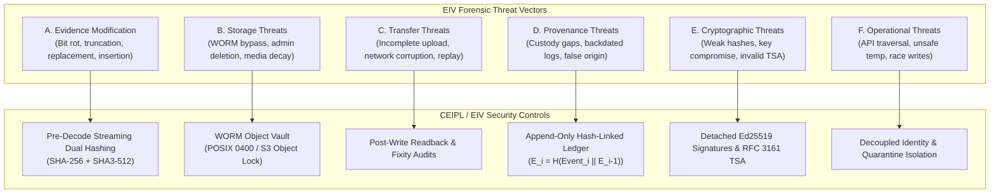

#### Category A: Evidence Modification Threats
- **Single-Bit & Byte Alterations:** Accidental or malicious toggling of byte values within video macroblocks, audio samples, or EXIF metadata.
- **File Truncation:** Premature stream termination during network transfer or physical disk disconnect resulting in missing terminal frames.
- **Byte Insertion & Appending:** Injecting malicious payloads, metadata tags, or extra audio segments without updating file length.
- **File Substitution & In-Place Overwrites:** Swapping a seized exhibit with a modified recording bearing an identical filename and directory path.
- **Evidence Package Reordering:** Altering the sequence of individual image frames or PCAP segment files within a multi-file forensic collection.

#### Category B: Storage Threats
- **Bit Rot & Magnetic Decay:** Latent sector degradation on magnetic platters or solid-state storage over multi-year retention cycles.
- **Unauthorised Deletion & Overwrite:** Privileged rogue administrator attempting to delete incriminating exhibits or replace them with scrubbed versions.
- **Storage Rollback & Snapshot Reversion:** Rolling back storage volumes to an earlier snapshot to erase custody events or newly registered exhibits.
- **Backup Corruption & Replica Inconsistency:** Asynchronous replication lag or damaged backup media resulting in desynchronised evidence states.
- **WORM Policy Tampering:** Premature termination of retention locks or unauthorised modification of governance rules.

#### Category C: Transfer Threats
- **Network Interruption & Partial Uploads:** Packet loss or socket timeout leading to truncated evidence ingestion without server-side error trapping.
- **Transfer Corruption:** Bit flips introduced by faulty network switches, non-ECC memory buffers, or interrupted TLS tunnels.
- **Destination & Manifest Substitution:** Intercepting an upload and redirecting it to an unmanaged directory or swapping the manifest payload.
- **Unverified Post-Transfer Ingestion:** Ingesting evidence without verifying that the received byte count matches the source byte count.

#### Category D: Provenance & Custody Threats
- **Missing Acquisition Metadata:** Seizing digital media without capturing the seizing officer ID, physical device serial number, or extraction method.
- **False Source Attribution:** Falsely attributing an audio recording to a suspect phone rather than a wiretap extraction.
- **Backdated & Fabricated Custody Logs:** Retroactively creating or editing custody entries to paper over unrecorded handling gaps.
- **Broken Derivative Parentage:** Exporting a cropped face or filtered audio file without cryptographic binding to the seized original.
- **Cross-Case Contamination:** Associating an evidence exhibit with an incorrect case ID or merging distinct evidence files due to identical filenames.

#### Category E: Cryptographic Threats
- **Collision & Pre-Image Vulnerabilities:** Relying on broken or deprecated hash functions (MD5, SHA-1) susceptible to collision attacks.
- **Digest Substitution in Database:** Updating a stored hash record in PostgreSQL to match an altered file, bypassing naive checks.
- **Signature Forgery & Private Key Theft:** Compromise of platform signing keys stored insecurely in plaintext files or source repositories.
- **Expired Certificates & Unanchored Timestamps:** Manifest signatures lacking long-term verification (LTV) data or verifiable TSA proof-of-existence.

#### Category F: Application & Operational Threats
- **Path Traversal (`../` Attacks):** Insecure file handling allowing uploads to overwrite core operating system binaries or evidence outside the vault.
- **Race Conditions in Multi-Threaded Ingestion:** Simultaneous writes to the same evidence path leading to interleaved byte streams.
- **Decoder Modification of Source Files:** Transcoding libraries (FFmpeg, OpenCV) opening original files in read-write mode and updating metadata tags.
- **Incomplete Audit Trails:** Omitting automated background operations (fixity checks, virus scans, index generation) from the custody ledger.

---

### 19.5 Evidence Identity & Decoupled Identifier Architecture

To prevent ambiguity, collision, and provenance corruption, EIV enforces strict decoupling between the logical identity of an exhibit and its physical storage or naming attributes.

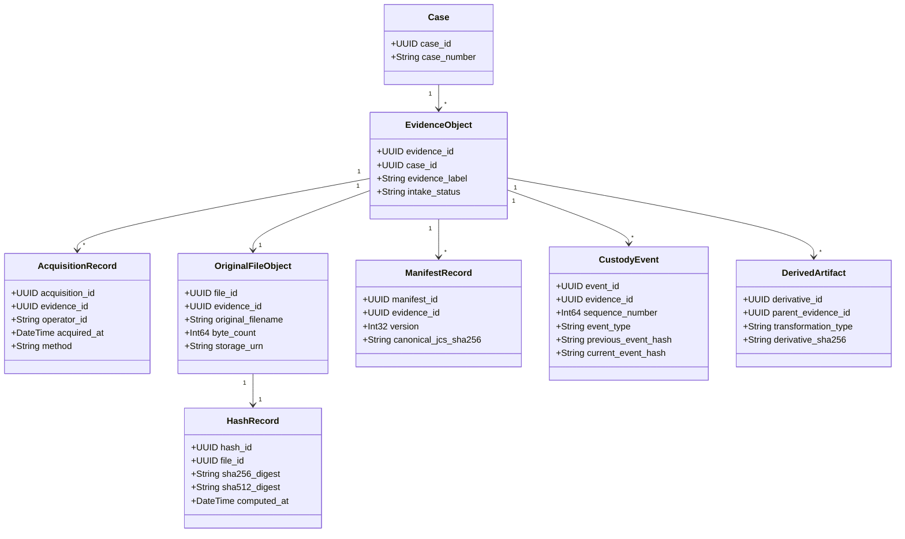

#### 19.5.1 The Ten Decoupled Identifiers
1. **Case ID (`case_id`):** Scopes all evidence, acquisitions, users, and reports to an official police FIR or judicial case number.
2. **Evidence ID (`evidence_id`):** Persistent, immutable UUID identifying the logical piece of evidence regardless of physical copies.
3. **Acquisition ID (`acquisition_id`):** Identifies the specific seizure or ingestion operation (who seized it, where, and when).
4. **File / Object ID (`file_id`):** Identifies the raw byte stream as stored within the underlying physical or object storage tier.
5. **Original Hash Record ID (`hash_id`):** Strongly typed record binding pre-decode cryptographic digests (SHA-256 and SHA3-512) to the file bytes.
6. **Metadata Snapshot ID (`metadata_snapshot_id`):** Cryptographic digest of the raw EXIF/FFprobe/PCAP header metadata extracted at intake.
7. **Derived Artefact ID (`derivative_id`):** Unique identifier for every secondary file produced by forensic processing (crops, frames, audio stems).
8. **Custody Event ID (`custody_event_id`):** Sequence-numbered identifier for every auditable action executed upon the evidence.
9. **Manifest ID (`manifest_id`):** Versioned identifier for the canonical JSON manifest binding all evidence references together.
10. **Verification Run ID (`verification_id`):** Identifies an individual scheduled fixity check or ad-hoc integrity verification audit.

#### 19.5.2 Duplicate Evidence & Deduplication Invariant
In forensic investigations, two distinct seizures (e.g., suspect phone and victim phone) may contain byte-for-byte identical files. EIV enforces:
- **Zero Provenance Merging:** Both files receive distinct `evidence_id`, `acquisition_id`, and independent chain-of-custody ledgers.
- **Storage-Level Content Deduplication:** The storage subsystem may store a single physical blob to optimize disk space, but the application layer strictly preserves separate metadata, ownership, and legal custody contexts.
- **Non-Conflation Invariant:** Content identity (matching SHA-256) indicates identical bytes; it *never* implies shared acquisition history or identical legal custody.

---

### 19.6 Ten Core Investigator User Workflows

#### Workflow 1: Registering New Evidence & Pre-Decode Streaming Hashing
1. Investigating Officer submits raw evidence stream via secure ingestion API or physical intake portal.
2. Platform validates user authorization, case active status, and assigns permanent `case_id`, `evidence_id`, and `acquisition_id`.
3. Raw byte stream is piped simultaneously into:
   - Streaming SHA-256 hasher.
   - Streaming SHA3-512 hasher (NIST FIPS 202 Keccak sponge).
   - Secure temporary staging buffer.
4. Total byte count and completion status are recorded.
5. Hashes and byte length are validated; initial `EvidenceManifest` is assembled.
6. Object is committed to WORM storage vault with POSIX `0400` read-only lock.
7. Initial `CUSTODY_ACQUIRED` event is created in the custody ledger.

#### Workflow 2: Verifying Evidence After Storage (Post-Write Readback)
1. Immediately upon committing an object to the WORM storage vault, an automated asynchronous verification worker triggers.
2. The worker streams the stored file directly from WORM storage into memory.
3. Both SHA-256 and SHA3-512 digests are re-computed and compared against the intake `HashRecord`.
4. If digests match: Status transitions to `VERIFIED`; downstream forensic analysis pipelines are unblocked.
5. If digests mismatch: Immediate transition to `QUARANTINED`; storage alert dispatched to Custodian.

#### Workflow 3: Continuous Fixity Auditing & Modification Detection
1. Celery periodic fixity beat executes across registered evidence items based on configured verification policies (e.g., 30-day cycle).
2. The engine reads vault bytes, re-computes dual digests, and checks WORM retention lock flags.
3. If hashes match: Appends a `FIXITY_CHECK_PASSED` record with timestamp and duration.
4. If byte mismatch or truncation is detected: System immediately halts normal access, generates an `INTEGRITY_MISMATCH` incident, and isolates the object.

#### Workflow 4: Quarantining a Failed Object & Incident Generation
1. Detection of byte corruption, hash divergence, or manifest signature invalidity triggers immediate fail-closed quarantine.
2. The evidence status transitions to `QUARANTINED`; API read requests return HTTP 423 Locked with diagnostic payload.
3. An `INTEGRITY_INCIDENT` record is logged with expected hash, observed hash, affected byte offsets, and storage node ID.
4. The corrupted physical file is preserved in-place for forensic analysis of the storage failure.
5. System notifies the Evidence Custodian and Case Supervisor; silent overwriting is strictly blocked.

#### Workflow 5: Recovering from a Verified Backup Copy
1. Evidence Custodian initiates disaster recovery workflow specifying the damaged `evidence_id`.
2. System retrieves candidate backup replica from cold or secondary storage.
3. System executes independent dual-hash verification of the candidate replica against the original baseline `HashRecord`.
4. If backup replica matches original baseline: System restores replica to WORM vault, assigns new storage reference, logs `EVIDENCE_RESTORED_FROM_BACKUP` custody event with operator ID and judicial authorization reference.
5. If backup replica also fails verification: Incident escalated to `UNRECOVERABLE_STORAGE_FAILURE`; incident report compiled.

#### Workflow 6: Signing an Evidence Manifest (Ed25519 Detached Attestation)
1. Upon successful WORM registration and post-write readback, the system extracts the canonical representation of `EvidenceManifest`.
2. Canonicalization is executed strictly conforming to RFC 8785 JSON Canonicalization Scheme (JCS).
3. The platform signing service (backed by OS keystore or hardware HSM) computes detached Ed25519 signature over canonical bytes.
4. Signature payload, key identifier, algorithm identifier, and signing timestamp are appended to the manifest metadata.
5. Public key certificate reference is bound for long-term independent verification.

#### Workflow 7: Verifying RFC 3161 Trusted Timestamp Tokens
1. The platform constructs a DER-encoded `TimeStampReq` containing the SHA-256 digest of the canonical manifest and cryptographic nonce.
2. Request is transmitted to an authorized Time Stamping Authority (TSA) or offline hardware clock server.
3. TSA returns DER-encoded `TimeStampResp` containing `PKIStatus` and `ContentInfo` (RFC 3161 token).
4. System validates TSA signature, X.509 certificate chain, policy OID, and matches message imprint against manifest digest.
5. Air-Gapped Mode: In disconnected field deployments, system logs local monotonic hardware clock and flags timestamp status as `LOCAL_UNTRUSTED_CLOCK`, with deferred TSA stamping upon docking.

#### Workflow 8: Creating & Registering Derived Forensic Artifacts (Merkle DAG)
1. A forensic engine (AIF, AURAS, VISTA, ONTF) performs an operation (e.g., extracting an audio stream from CCTV video).
2. Engine computes streaming dual hashes of the output artifact.
3. System registers a new `DerivedArtifact` record binding:
   - `derivative_id`
   - `parent_evidence_id`
   - `parent_sha256`
   - `derivative_sha256`
   - Transformation metadata (FFmpeg version, parameters, command string, execution duration).
4. System appends node to the case Merkle DAG; no derived artifact can exist without cryptographic parent linkage.

#### Workflow 9: Auditing Custody Continuity & Event Chain Validation
1. Examiner or defense counsel requests complete Chain of Custody audit for an exhibit.
2. Platform extracts all `CustodyEvent` records for `evidence_id` ordered strictly by `sequence_number`.
3. Verifier iterates through records, recalculating expected event hash:
   $$E_i = H(\text{Canonical}(Event_i) \parallel E_{i-1})$$
4. Verifier asserts:
   - Sequence numbers increment by exactly 1 without gaps.
   - Timestamp monotonicity holds ($T_i \ge T_{i-1}$).
   - Recorded `previous_event_hash` matches calculated digest of event $i-1$.
5. Outputs a cryptographic custody report indicating unbroken chain or pinpointing exact sequence gap.

#### Workflow 10: Exporting an Independently Verifiable Evidence Package
1. Investigator requests court export package for an exhibit or case.
2. System packages:
   - Raw original evidence bitstream.
   - All derived artifacts and inspection heatmaps.
   - Canonical `EvidenceManifest.json`.
   - Detached Ed25519 signature file (`manifest.sig`).
   - RFC 3161 TSA token (`timestamp.tst`).
   - Complete custody ledger export (`custody_chain.json`).
   - Self-contained standalone Python/Bash offline verifier script.
3. Computes package-level Merkle tree and seals container with Section 63 BSA compliance dossier.

---

### 19.7 Complete Numbered Functional Requirements Register (EIV-01 through EIV-100)

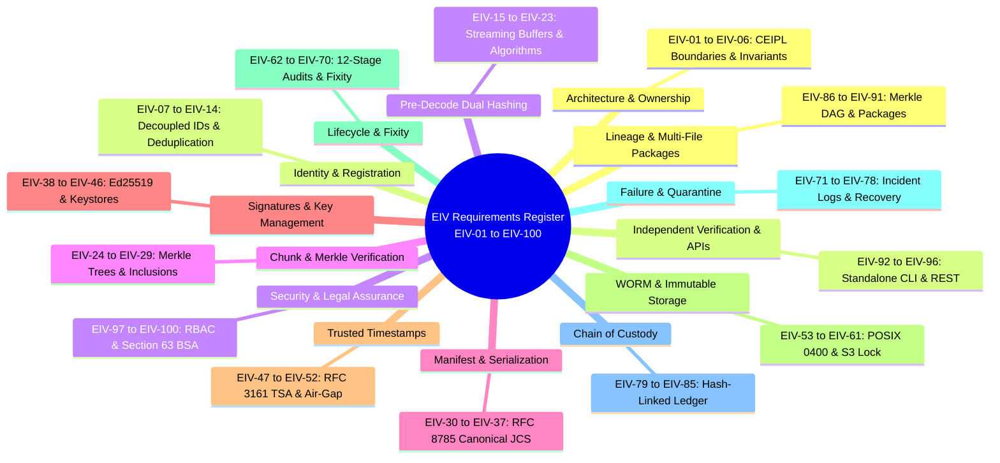

| Req ID | Requirement Description | Priority | Owning Component | Dependencies | Input Contract | Expected Output Contract | TRD Ref | Verification Method | Acceptance Criteria | Planned Phase | Status |
| :--- | :--- | :--- | :--- | :--- | :--- | :--- | :--- | :--- | :--- | :--- | :--- |
| **EIV-01** | CEIPL Platform Ownership: Reside strictly in CEIPL shared platform layer without duplicating engine logic | P0 | CEIPL / Core | None | Engine intake requests | Unified integrity service invocation | §19.1 | Architecture Review | Zero duplicate hashing services in AIF/AURAS/VISTA | CEIPL-EIV-00 | PLANNED |
| **EIV-02** | Non-Destructive Raw Bitstream Preservation: Ingest raw bytes without file conversion or header modification | P0 | CEIPL / Ingestion | Ingestion API | Raw evidence file stream | Unaltered raw file in staging | §19.2 | Unit / Mutation Test | Byte-for-byte identity confirmed | CEIPL-EIV-01 | PLANNED |
| **EIV-03** | Engine-Independent Execution: Execute integrity verification without dependencies on media decoders | P0 | CEIPL / Core | None | Evidence byte stream | Cryptographic digest records | §19.1 | Test Suite | Operates on unknown binary formats | CEIPL-EIV-01 | PLANNED |
| **EIV-04** | Separation of Integrity from Authenticity: Enforce semantic separation between hash match and factual truth | P0 | CEIPL / Reporting | None | Verification run results | Typed multi-dimensional result | §18.9, §19.8 | Contract Audit | API never emits bare `authentic: true` | CEIPL-EIV-00 | PLANNED |
| **EIV-05** | Zero Silent Repair: Forbid automatic rehashing, overwriting, or silent fixing of corrupt files | P0 | CEIPL / Storage | Storage drivers | Mismatched hash result | Hard error & quarantine event | §19.9 | Security Test | Mismatched files permanently flagged | CEIPL-EIV-04 | PLANNED |
| **EIV-06** | Universal Modality Support: Ingest image, video, audio, PCAP, and documents uniformly | P0 | CEIPL / Ingestion | Ingestion API | Binary evidence objects | Normalized evidence registry entry | §19.1 | Integration Test | All 5 modalities processed via same API | CEIPL-EIV-01 | PLANNED |
| **EIV-07** | Permanent UUIDv7 Evidence Identification: Generate cryptographically random, time-sortable Evidence UUID | P0 | CEIPL / Identity | DB UUID Gen | Ingestion request metadata | Immutable `evidence_id` | §19.2 | Unit Test | Unique UUIDv7 generated per exhibit | CEIPL-EIV-01 | PLANNED |
| **EIV-08** | Name & Path Independence: Maintain evidence identity invariant to filename, extension, or folder changes | P0 | CEIPL / Identity | Storage mapping | Renamed/relocated exhibit | Unchanged `evidence_id` | §19.2 | Integration Test | Renaming file preserves identity | CEIPL-EIV-01 | PLANNED |
| **EIV-09** | Storage Key Decoupling: Decouple logical `evidence_id` from physical storage URN/path | P0 | CEIPL / Identity | Storage adapter | Storage URN change | Stable evidence identity reference | §19.2 | Unit Test | Storage migration leaves ID intact | CEIPL-EIV-01 | PLANNED |
| **EIV-10** | Algorithm-Independent Identity: Identity unaffected by deprecation or upgrade of hash algorithms | P0 | CEIPL / Identity | Hash manager | Additional hash computed | Same `evidence_id` across algorithms | §19.2 | Unit Test | Adding SHA3 leaves ID unchanged | CEIPL-EIV-01 | PLANNED |
| **EIV-11** | Ten-Entity Entity Separation: Maintain distinct IDs across Case, Evidence, Acquisition, File, Hash, etc. | P0 | CEIPL / Identity | DB Schema | Intake transaction | 10 distinct typed UUID fields | §19.2 | Schema Validation | Zero identifier conflation across entities | CEIPL-EIV-01 | PLANNED |
| **EIV-12** | Duplicate Evidence Provenance Preservation: Distinct seizures of identical bytes retain separate custody | P0 | CEIPL / Identity | DB Schema | Byte-identical uploads | 2 distinct `evidence_id` & ledgers | §18.5, §19.2 | Integration Test | Both custody histories preserved | CEIPL-EIV-01 | PLANNED |
| **EIV-13** | Storage-Level Deduplication Isolation: Allow shared disk blocks without merging case metadata | P1 | CEIPL / Storage | Storage adapter | Deduplicated write | Distinct DB ownership rows | §19.2 | Storage Test | Case deletion does not delete shared blob | CEIPL-EIV-04 | PLANNED |
| **EIV-14** | Case Scoping & Tenant Isolation: Every evidence object bound strictly to authorized `case_id` | P0 | CEIPL / Identity | RBAC Context | User case context | Scoped evidence registration | §19.14 | Security Test | Cross-case access blocked with HTTP 403 | CEIPL-EIV-01 | PLANNED |
| **EIV-15** | Pre-Decode Streaming Hashing: Stream raw bytes into hashers before any decoding or demuxing | P0 | CEIPL / Hashing | Streaming buffer | Ingestion socket stream | Pre-decode digests | §19.2 | Functional Test | Hasher completes before decoder invoked | CEIPL-EIV-02 | PLANNED |
| **EIV-16** | Mandatory Dual-Hashing Pipeline: Concurrently compute SHA-256 and SHA3-512 over identical byte stream | P0 | CEIPL / Hashing | OpenSSL / hashlib | Raw byte stream | Dual hex digest records | §19.2 | Unit Test | Known-answer test vectors pass | CEIPL-EIV-02 | PLANNED |
| **EIV-17** | Secondary Algorithm Independence (SHA3-512): Mandate NIST FIPS 202 SHA3-512 Keccak sponge digest for complete structural independence from SHA-2 | P1 | CEIPL / Hashing | Cryptography lib | Algorithm policy flag | NIST FIPS 202 compliant digest | §19.2 | Unit Test | FIPS 202 test vectors pass | CEIPL-EIV-02 | PLANNED |
| **EIV-18** | Legacy Hash Segregation: Restrict MD5/SHA-1 to historical comparison; never use as sole integrity reference | P0 | CEIPL / Hashing | Hash validator | Legacy import stream | Marked `LEGACY_REFERENCE_ONLY` | §19.2 | Security Audit | Rejection of MD5 as primary reference | CEIPL-EIV-02 | PLANNED |
| **EIV-19** | Bounded Memory Streaming Buffer: Hash processing bounded to $\le 64 \text{ MB}$ RAM regardless of file size | P0 | CEIPL / Hashing | Chunked reader | 50 GB test payload | Peak RAM $\le 64 \text{ MB}$ | §19.2 | Memory Profile | Memory flatline across 50 GB stream | CEIPL-EIV-02 | PLANNED |
| **EIV-20** | Byte-Count Verification: Calculate exact total byte count and verify against source content-length header | P0 | CEIPL / Hashing | Socket stream | Byte stream + length | Byte count equality verified | §19.2 | Unit Test | 1-byte discrepancy raises truncation | CEIPL-EIV-02 | PLANNED |
| **EIV-21** | Stream Interruption & Abort Cleanup: Safely abort, purge temporary files, and log failure on socket drop | P0 | CEIPL / Ingestion | Temp file mgr | Truncated network stream | Clean temp dir & failure logged | §19.2 | Chaos Test | Zero orphaned temporary files | CEIPL-EIV-02 | PLANNED |
| **EIV-22** | Hash Computation Performance SLA: Streaming throughput $\ge 150 \text{ MB/s}$ on NVMe / SSD storage | P1 | CEIPL / Hashing | System IO | 10 GB test file | Processing time $\le 67 \text{ s}$ | §19.17 | Benchmark | Throughput verified under load | CEIPL-EIV-02 | PLANNED |
| **EIV-23** | Strongly Typed Hash Result Contract: Emit structured `HashRecord` with execution environment details | P0 | CEIPL / Hashing | Pydantic Schema | Hashing completion | Valid `HashRecord` Pydantic model | §12.10, §19.2 | Contract Test | Complete schema validation | CEIPL-EIV-02 | PLANNED |
| **EIV-24** | Configurable Chunking Engine: Partition large files into fixed-size chunks (default 4MB or 16MB) | P1 | CEIPL / Merkle | File chunker | Raw file $\ge 1 \text{ GB}$ | Ordered list of `ChunkDigest` | §19.3 | Unit Test | Chunks assemble to exact byte count | CEIPL-EIV-02 | PLANNED |
| **EIV-25** | Deterministic Chunk Hashing: Compute SHA-256 for each chunk with byte offset and sequence index | P1 | CEIPL / Merkle | Cryptography lib | Raw byte chunk | `ChunkRecord` with digest | §19.3 | Unit Test | Chunk hash matches known slice hash | CEIPL-EIV-02 | PLANNED |
| **EIV-26** | Merkle Tree Construction: Construct balanced binary Merkle tree with RFC 6962 leaf/node prefixes | P1 | CEIPL / Merkle | Tree builder | List of chunk digests | Merkle tree with Root Hash | §19.3 | Unit Test | Known tree root matches calculation | CEIPL-EIV-02 | PLANNED |
| **EIV-27** | Merkle Inclusion Proof Generation: Generate verifiable $O(\log N)$ inclusion proof for any individual chunk | P1 | CEIPL / Merkle | Tree query | Chunk index $k$ | Audit path array of sibling hashes | §19.3 | Unit Test | Proof validates against Root Hash | CEIPL-EIV-02 | PLANNED |
| **EIV-28** | Partial File & Segment Verification: Verify specific byte ranges of large CCTV/PCAP using Merkle proofs | P1 | CEIPL / Merkle | Merkle verifier | Byte range $[a, b]$ + proof | Range integrity confirmed | §19.3 | Integration Test | Verifies 10MB chunk inside 50GB file | CEIPL-EIV-02 | PLANNED |
| **EIV-29** | Whole-File Primacy Rule: Merkle roots supplement, never replace, authoritative whole-file digests | P0 | CEIPL / Core | Validation policy | Merkle manifest | Whole-file hash verified first | §19.3 | Policy Audit | Rejection of Merkle-only verification | CEIPL-EIV-02 | PLANNED |
| **EIV-30** | Versioned Evidence Manifest Schema: Maintain structured JSON manifest binding all evidence metadata | P0 | CEIPL / Manifest | Pydantic Schema | Evidence intake data | Valid `EvidenceManifest` v1.0 | §12.10, §19.4 | Schema Test | Pydantic v2 serialization valid | CEIPL-EIV-03 | PLANNED |
| **EIV-31** | RFC 8785 Canonical JSON Representation: Canonicalize JSON manifests via RFC 8785 (JCS) | P0 | CEIPL / Manifest | JCS library | Raw manifest dictionary | Deterministic byte stream | §19.4 | Unit Test | RFC 8785 test vectors match | CEIPL-EIV-03 | PLANNED |
| **EIV-32** | Deterministic Key Ordering & UTF-8 Encoding: Enforce UTF-8 without BOM, sorted keys, no whitespace | P0 | CEIPL / Manifest | JCS serializer | Manifest dictionary | Standard canonical bytes | §19.4 | Unit Test | Cross-platform byte-reproducibility | CEIPL-EIV-03 | PLANNED |
| **EIV-33** | IEEE 754 Number Representation: Serialize numbers canonically avoiding floating-point divergence | P0 | CEIPL / Manifest | JCS serializer | Floating-point metrics | Deterministic integer/float string | §19.4 | Unit Test | No platform-specific precision diff | CEIPL-EIV-03 | PLANNED |
| **EIV-34** | Sensitive Data Exclusion Invariant: Forbid private keys, passwords, or credentials in manifests | P0 | CEIPL / Manifest | Linter / Validator | Manifest payload | Zero secret keys in JSON | §19.4 | Security Scan | High-entropy secret detection passes | CEIPL-EIV-03 | PLANNED |
| **EIV-35** | Manifest Versioning & Evolution: Support backward-compatible schema versioning (`manifest_version`) | P1 | CEIPL / Manifest | Migration runner | Legacy manifest v1.0 | Successful v1.0 load into v2.0 | §19.4 | Regression Test | Old manifests parse without errors | CEIPL-EIV-03 | PLANNED |
| **EIV-36** | Manifest Immutability Post-Sealing: Prevent modification of manifest once signed and sealed | P0 | CEIPL / Manifest | Storage vault | Update request on sealed | HTTP 409 Conflict | §19.4 | Integration Test | Manifest update attempts rejected | CEIPL-EIV-03 | PLANNED |
| **EIV-37** | Manifest Fingerprint Computation: Compute SHA-256 over canonical JCS bytes as manifest digest | P0 | CEIPL / Manifest | Cryptography lib | Canonical JCS bytes | 64-char hex `manifest_digest` | §19.4 | Unit Test | Digest matches SHA-256 of bytes | CEIPL-EIV-03 | PLANNED |
| **EIV-38** | Detached Manifest Digital Signing: Generate detached Ed25519 digital signature over canonical manifest | P0 | CEIPL / Signer | Cryptography lib | Canonical manifest bytes | 64-byte Ed25519 signature | §19.5 | Cryptographic Test | OpenSSL verifies detached signature | CEIPL-EIV-03 | PLANNED |
| **EIV-39** | Standards-Compliant Signature Algorithms: Support RFC 8032 Ed25519 and ECDSA (FIPS 186-5) | P0 | CEIPL / Signer | Cryptography lib | Signing algorithm enum | Standards-compliant signature | §19.5 | Standards Audit | FIPS 186-5 / RFC 8032 conformance | CEIPL-EIV-03 | PLANNED |
| **EIV-40** | Secure Private Key Storage: Enforce private key protection via OS Keystore (DPAPI/Keyring) or HSM | P0 | CEIPL / KMS | OS Keystore / HSM | Signing operation request | Hardware/OS-protected signing | §19.5 | Security Review | Zero plaintext keys on filesystem | CEIPL-EIV-03 | PLANNED |
| **EIV-41** | Cryptographic Key Lifecycle Records: Maintain immutable registry of key ID, activation, and rotation | P0 | CEIPL / KMS | DB Schema | Key generation event | Typed `KeyLifecycleRecord` | §19.5 | Audit Review | Full key history traceable | CEIPL-EIV-03 | PLANNED |
| **EIV-42** | Historical Signature Verification: Preserve historical public keys to verify legacy signatures | P0 | CEIPL / KMS | Key repository | Historical signature | Successful verification using past key | §19.5 | Regression Test | Rotated keys still verify past exhibits | CEIPL-EIV-03 | PLANNED |
| **EIV-43** | Signer Authorization Verification: Verify signer public key mapped to authorized officer role | P0 | CEIPL / Signer | RBAC Service | Signer key ID + user role | Signer authorization validated | §19.5 | Integration Test | Unauthorized key rejected | CEIPL-EIV-03 | PLANNED |
| **EIV-44** | Public Key & Certificate Embedding: Export public key and X.509 cert reference in export package | P0 | CEIPL / Export | Export packager | Evidence export request | Included `public_key.pem` | §19.5 | Package Test | Standalone verifier consumes public key | CEIPL-EIV-08 | PLANNED |
| **EIV-45** | Separation of Document vs Manifest Signatures: Distinguish PDF signing from raw manifest signing | P0 | CEIPL / Signer | PDF Signer / Core | Verification request | Distinct verification paths | §19.5 | Architecture Test | PAdES vs Ed25519 distinct contracts | CEIPL-EIV-03 | PLANNED |
| **EIV-46** | Key Revocation Enforcement: Immediately invalidate compromised keys via revocation list (CRL) | P0 | CEIPL / KMS | CRL Manager | Revoked key ID | Signature marked `KEY_REVOKED` | §19.5 | Security Test | Signatures signed after revocation fail | CEIPL-EIV-03 | PLANNED |
| **EIV-47** | RFC 3161 Timestamp Protocol Support: Request and verify RFC 3161 timestamp tokens from TSA | P1 | CEIPL / TSA | HTTP TSA client | Manifest SHA-256 digest | DER-encoded `TimeStampResp` | §19.6 | Unit Test | RFC 3161 token parses and verifies | CEIPL-EIV-03 | PLANNED |
| **EIV-48** | Message Imprint Verification: Verify TSA token message imprint matches exact manifest digest | P1 | CEIPL / TSA | ASN.1 parser | Timestamp token + digest | Message imprint equality verified | §19.6 | Unit Test | Discrepancy flags invalid token | CEIPL-EIV-03 | PLANNED |
| **EIV-49** | TSA Certificate Chain & Policy Validation: Validate TSA X.509 certificate trust anchor and policy OID | P1 | CEIPL / TSA | X.509 Validator | TSA response | Certificate chain validity confirmed | §19.6 | Integration Test | Expired/untrusted TSA flagged | CEIPL-EIV-03 | PLANNED |
| **EIV-50** | Seven-Tier Timestamp Disambiguation: Rigorously distinguish acquisition, server, TSA, and media times | P0 | CEIPL / Temporal | CSTV Integration | Timestamp inputs | Distinct typed timestamp fields | §18.6, §19.6 | Contract Test | Never overwrite acquisition with TSA | CEIPL-EIV-03 | PLANNED |
| **EIV-51** | Air-Gapped Offline Timestamp Mode: Support local hardware clock with explicit untrusted status | P0 | CEIPL / TSA | Clock adapter | Disconnected ingestion | Tagged `LOCAL_UNTRUSTED_CLOCK` | §19.6 | Air-Gap Test | No network block during offline intake | CEIPL-EIV-03 | PLANNED |
| **EIV-52** | Deferred Timestamp Attestation: Allow attaching RFC 3161 token upon docking air-gapped unit | P1 | CEIPL / TSA | TSA docking job | Docking synchronization | Appended TSA token with custody log | §19.6 | Integration Test | Deferred token binds to original digest | CEIPL-EIV-03 | PLANNED |
| **EIV-53** | True WORM Storage Enforcement: Store original exhibits in storage-enforced Write-Once vaults | P0 | CEIPL / WORM | POSIX / S3 Driver | Committed file object | Read-only object with retention lock | §19.7 | Security Test | Write/delete operations fail | CEIPL-EIV-04 | PLANNED |
| **EIV-54** | POSIX Local Filesystem WORM: Enforce POSIX `0400` read-only mode and immutable attribute (`chattr +i`) | P0 | CEIPL / WORM | Linux / POSIX | Local vault path | Filesystem permissions `0400` | §19.7 | OS Integration Test | `rm` or write fails with Permission Denied | CEIPL-EIV-04 | PLANNED |
| **EIV-55** | S3 Object Lock Compliance Mode: Support AWS/MinIO Object Lock in Compliance retention mode | P1 | CEIPL / WORM | S3 Client | S3 bucket upload | Object Lock retained until expiry | §19.7 | Cloud/MinIO Test | DeleteObject API call rejected by S3 | CEIPL-EIV-04 | PLANNED |
| **EIV-56** | S3 Object Lock Governance Mode: Support Governance mode with privileged bypass auditing | P1 | CEIPL / WORM | S3 Client | Retention policy config | Governance lock with audit trail | §19.7 | Integration Test | Privileged bypass logged in custody | CEIPL-EIV-04 | PLANNED |
| **EIV-57** | Legal Hold Support: Apply non-expiring legal hold flags to exhibits involved in active litigation | P0 | CEIPL / WORM | Legal hold API | Case litigation flag | Indefinite retention lock applied | §19.7 | Functional Test | Expiry timer disabled while held | CEIPL-EIV-04 | PLANNED |
| **EIV-58** | Seven Logical Storage Zones: Separate staging, originals, derivatives, manifests, custody, and backup | P0 | CEIPL / Storage | Storage manager | Multi-zone architecture | Strict folder/bucket segregation | §19.7 | Security Audit | Zero mixed storage between raw & derived | CEIPL-EIV-04 | PLANNED |
| **EIV-59** | Storage Administrator Misuse Mitigation: Constrain and audit administrative access to storage | P0 | CEIPL / Security | Audit Logger | S3 / OS admin command | Cryptographic audit record emitted | §19.7 | Security Test | Admin cannot erase audit trail | CEIPL-EIV-04 | PLANNED |
| **EIV-60** | At-Rest Storage Encryption: Encrypt all stored evidence objects via AES-256-GCM / XTS | P0 | CEIPL / Storage | Storage encryption | Raw byte write | Encrypted ciphertext on disk | §19.7 | Security Audit | Disk dump reveals zero plaintext | CEIPL-EIV-04 | PLANNED |
| **EIV-61** | Storage Immutability Verification Suite: Automated test suite validating write/delete rejection | P0 | CEIPL / WORM | Test runner | Penetration test harness | All unauthorized write tests rejected | §19.7 | CI/CD Test | Build fails if WORM test fails | CEIPL-EIV-04 | PLANNED |
| **EIV-62** | Twelve Lifecycle Verification Checkpoints: Enforce hash verification at 12 critical lifecycle stages | P0 | CEIPL / Fixity | Verification engine | Lifecycle stage transition | Verified hash comparison result | §19.8 | Integration Test | All 12 checkpoints execute check | CEIPL-EIV-05 | PLANNED |
| **EIV-63** | Post-Write Readback Gate: Mandatory readback verification before unblocking downstream processing | P0 | CEIPL / Ingestion | Storage readback | Staged file commit | Readback SHA-256 == Intake SHA-256 | §19.8 | Functional Test | Analysis blocked if readback fails | CEIPL-EIV-05 | PLANNED |
| **EIV-64** | Retrieval Verification Gate: Re-verify dual hashes upon reading evidence for forensic analysis | P0 | CEIPL / Access | Storage reader | Engine read request | In-memory hash verification | §19.8 | Performance Test | Verifies before handing stream to engine | CEIPL-EIV-05 | PLANNED |
| **EIV-65** | Continuous Fixity Scheduling: Automated Celery beat job executing scheduled periodic fixity checks | P1 | CEIPL / Fixity | Celery beat | Periodic cron schedule | Execution of fixity audit across vault | §19.8 | Task Test | Vault audit executed without backlog | CEIPL-EIV-05 | PLANNED |
| **EIV-66** | Fixity Job Throughput SLA: Background fixity auditing throughput $\ge 200 \text{ MB/s}$ on NVMe | P1 | CEIPL / Fixity | Multi-worker IO | Scheduled audit batch | Throughput metrics recorded | §19.17 | Benchmark | Meets throughput threshold | CEIPL-EIV-05 | PLANNED |
| **EIV-67** | Typed Verification Result Record: Emit structured `VerificationRunResult` with diagnostic data | P0 | CEIPL / Fixity | Pydantic Schema | Verification execution | Valid `VerificationRunResult` model | §12.10, §19.8 | Contract Test | Schema validation passes | CEIPL-EIV-05 | PLANNED |
| **EIV-68** | Export Manifest Verification: Recalculate and verify hashes of all package items prior to export | P0 | CEIPL / Export | Export packager | Export request | Export package verification report | §19.8 | Functional Test | Corrupted item halts export | CEIPL-EIV-08 | PLANNED |
| **EIV-69** | Final Report Linkage Verification: Validate that all hashes in UFREDF report match current references | P0 | CEIPL / Reporting | UFREDF Generator | Report compile request | Report hash table verified | §19.8 | Integration Test | Mismatched hash prevents report seal | CEIPL-EIV-09 | PLANNED |
| **EIV-70** | Asynchronous Non-Blocking Fixity: Execute scheduled audits without degrading interactive query latency | P1 | CEIPL / Fixity | Worker isolation | Background fixity load | Interactive API p95 $\le 200 \text{ ms}$ | §19.8 | Performance Test | Zero UI stutter during fixity | CEIPL-EIV-05 | PLANNED |
| **EIV-71** | Automated Quarantine State Transition: Instantly transition corrupted exhibit to `QUARANTINED` state | P0 | CEIPL / Quarantine | State Machine | Hash mismatch detection | Status set to `QUARANTINED` | §19.9 | Security Test | Immediate access block on mismatch | CEIPL-EIV-05 | PLANNED |
| **EIV-72** | Fail-Closed Downstream Blocking: Prevent analysis, reporting, and export for quarantined exhibits | P0 | CEIPL / Quarantine | API Middleware | Request on quarantined item | HTTP 423 Locked with error details | §19.9 | API Test | All processing endpoints reject item | CEIPL-EIV-05 | PLANNED |
| **EIV-73** | Conflicting Version In-Place Preservation: Preserve corrupted object for forensic failure analysis | P0 | CEIPL / Quarantine | Storage Driver | Quarantine trigger | Corrupted file retained with `.corrupt` | §19.9 | Storage Test | Corrupted bytes never deleted | CEIPL-EIV-05 | PLANNED |
| **EIV-74** | Automated Integrity Incident Logging: Emit structured `IntegrityIncident` record with diagnostics | P0 | CEIPL / Quarantine | DB Logger | Mismatch event | Persistent `IntegrityIncident` row | §19.9 | Audit Test | Incident visible in admin dashboard | CEIPL-EIV-05 | PLANNED |
| **EIV-75** | Independent Backup Replica Verification: Verify candidate backup replica against baseline digest | P0 | CEIPL / Recovery | Backup adapter | Recovery trigger | Backup hash comparison result | §19.9 | Disaster Test | Unverified backup rejected | CEIPL-EIV-08 | PLANNED |
| **EIV-76** | Verified Recovery Copy Deployment: Restore validated backup copy into WORM vault with audit record | P0 | CEIPL / Recovery | Storage manager | Validated backup replica | Restored vault object + custody event | §19.9 | Recovery Test | Status returns to `VERIFIED` | CEIPL-EIV-08 | PLANNED |
| **EIV-77** | Unrecoverable Corruption Escalation: Escalate to supervisor when all backup replicas are invalid | P0 | CEIPL / Recovery | Incident manager | All replicas corrupt | Permanent incident status recorded | §19.9 | Process Test | Transparent declaration of loss | CEIPL-EIV-08 | PLANNED |
| **EIV-78** | Prohibition of Digest Inversion: Strictly forbid overwriting reference hash with corrupted digest | P0 | CEIPL / Security | DB Constraint | Update on reference hash | DB constraint violation (Aborted) | §19.9 | DB Security Test | SQL UPDATE on hash rejected | CEIPL-EIV-04 | PLANNED |
| **EIV-79** | Twenty-One Mandatory Custody Events: Track 21 defined lifecycle events in custody ledger | P0 | CEIPL / Custody | Event dispatcher | Evidence lifecycle actions | Structured `CustodyEvent` rows | §19.10 | Integration Test | All 21 events dispatchable | CEIPL-EIV-06 | PLANNED |
| **EIV-80** | Strongly Typed Custody Event Schema: Emit typed event models with actor, role, and hashes | P0 | CEIPL / Custody | Pydantic Schema | Event dispatch payload | Valid `CustodyEventRecord` | §12.10, §19.10 | Contract Test | Schema passes validation | CEIPL-EIV-06 | PLANNED |
| **EIV-81** | Hash-Chained Event History: Cryptographically chain each event to predecessor ($E_i = H(Ev_i \parallel E_{i-1})$) | P0 | CEIPL / Custody | Ledger engine | New event record | Chained hash stored in record | §19.10 | Cryptographic Test | Chain verification algorithm passes | CEIPL-EIV-06 | PLANNED |
| **EIV-82** | Strictly Monotonic Sequence Numbers: Enforce contiguous integer sequence incrementing by exactly 1 | P0 | CEIPL / Custody | DB Sequence Gen | Concurrent event writes | Contiguous sequence numbers | §19.10 | Concurrency Test | Zero sequence gaps under concurrent writes | CEIPL-EIV-06 | PLANNED |
| **EIV-83** | Tamper-Evident Ledger Auditing: Rapidly verify entire custody chain integrity and detect modifications | P0 | CEIPL / Custody | Audit verifier | Chain verification request | Verified status or gap localization | §19.10 | Unit Test | Modifying historical row detected | CEIPL-EIV-06 | PLANNED |
| **EIV-84** | User Description vs Machine Data Separation: Separate subjective notes from automated telemetry | P0 | CEIPL / Custody | UI / Event form | Manual entry + system info | Typed separation in DB schema | §19.10 | Data Model Test | Examiner cannot edit system fields | CEIPL-EIV-06 | PLANNED |
| **EIV-85** | Periodic Merkle Root Anchoring: Periodically compute Merkle root of custody events and sign | P1 | CEIPL / Custody | Anchor service | 24-hour event batch | Signed daily custody anchor block | §19.10 | Integration Test | Anchor validates batch integrity | CEIPL-EIV-06 | PLANNED |
| **EIV-86** | Distinct Derivative Artifact Identity: Assign unique `derivative_id` and hash to every analysis output | P0 | CEIPL / Lineage | Forensic engines | Analysis output file | Registered `DerivedArtifact` record | §19.11 | Integration Test | Extracted audio receives distinct ID | CEIPL-EIV-07 | PLANNED |
| **EIV-87** | Cryptographic Parent Binding: Record exact `parent_evidence_id` and `parent_sha256` in derivative | P0 | CEIPL / Lineage | Lineage manager | Transformation execution | Verified parent hash in lineage row | §19.11 | Data Model Test | Derivative references exact parent | CEIPL-EIV-07 | PLANNED |
| **EIV-88** | Complete Transformation Audit Metadata: Record tool name, version, CLI args, and parameters | P0 | CEIPL / Lineage | Engine wrapper | FFmpeg / OpenCV execution | Detailed transformation metadata | §19.11 | Audit Test | Exact reproduction params stored | CEIPL-EIV-07 | PLANNED |
| **EIV-89** | Multi-Generational Lineage DAG: Support recursive derivative chains (e.g., Video -> Audio -> Stem -> Report) | P0 | CEIPL / Lineage | Graph database / DB | Multi-tier processing | Verifiable Merkle DAG structure | §19.11 | Graph Test | Full traversal back to original | CEIPL-EIV-07 | PLANNED |
| **EIV-90** | Package-Level Integrity Verification: Calculate top-level Merkle root over multi-file export packages | P1 | CEIPL / Package | Package builder | Multi-file case export | Package manifest with root hash | §19.11 | Integration Test | Verifier validates entire package | CEIPL-EIV-07 | PLANNED |
| **EIV-91** | Path Traversal & Symlink Defense: Canonicalize relative paths in packages and block unsafe symlinks | P0 | CEIPL / Package | Path sanitizer | Malicious ZIP / TAR upload | Safe extraction without traversal | §19.11 | Security Test | Path traversal attempts raise error | CEIPL-EIV-07 | PLANNED |
| **EIV-92** | Standalone Portable Offline Verifier: Provide self-contained Python CLI script requiring no internet | P0 | CEIPL / Verifier | Standalone CLI | Export package directory | Terminal verification report | §19.12 | Air-Gap Test | Runs on air-gapped Linux/Windows | CEIPL-EIV-08 | PLANNED |
| **EIV-93** | Fourteen Offline Verification Checks: Implement 14 sequential integrity checks in independent CLI | P0 | CEIPL / Verifier | Standalone CLI | Export package files | Detailed 14-point audit output | §19.12 | Functional Test | Catches any corrupted item in package | CEIPL-EIV-08 | PLANNED |
| **EIV-94** | Fifteen Dedicated REST API Endpoints: Expose complete EIV capabilities via versioned FastAPI routes | P0 | CEIPL / API | FastAPI framework | HTTP client requests | Typed JSON responses | §19.15 | API Test | All 15 endpoints return 200 OK | CEIPL-EIV-08 | PLANNED |
| **EIV-95** | Asynchronous Celery Worker Integration: Delegate intensive hashing, fixity, and verification to Celery | P0 | CEIPL / Workers | Celery / Redis | Background task enqueue | Async job ID + status polling | §19.15 | Concurrency Test | Handles 100 concurrent jobs | CEIPL-EIV-05 | PLANNED |
| **EIV-96** | OpenAPI 3.1 & TypeScript Contract Sync: Synchronize Pydantic models with OpenAPI schema & TS types | P1 | CEIPL / API | OpenAPI generator | Pydantic v2 models | Updated `schema.json` & TS types | §12.10, §19.15 | Build Test | Frontend TS builds with zero errors | CEIPL-EIV-08 | PLANNED |
| **EIV-97** | Seven-Tier Role-Based Access Control: Enforce strict separation between Operator, Examiner, Admin | P0 | CEIPL / Security | RBAC Middleware | User JWT token | Authorized endpoint access | §19.14 | Security Test | Operators cannot modify WORM policies | CEIPL-EIV-10 | PLANNED |
| **EIV-98** | Section 63 BSA / 65B IEA Dossier Assembly: Assemble technical evidence schedule for statutory reports | P0 | CEIPL / Legal | UFREDF Integration | Case verification data | Structured technical dossier | §19.13 | Legal Review | Conforms to BSA 2023 Schedule | CEIPL-EIV-09 | PLANNED |
| **EIV-99** | Five-Hundred-Fixture Verification Benchmark: Validate test suite across 500 diverse corrupted files | P1 | CEIPL / Benchmarks | Test harness | 500 mutation fixtures | 100% correct failure detection | §19.17 | Benchmark Test | Passes all 500 test fixtures | CEIPL-EIV-10 | PLANNED |
| **EIV-100** | Air-Gapped Packaging & Security Hardening: Package complete EIV service for air-gapped deployment | P0 | CEIPL / Release | Docker / Compose | Air-gapped container image | Functional system with no WAN access | §19.17 | Air-Gap Deploy | Starts and verifies in offline sandbox | CEIPL-EIV-10 | PLANNED |

---

### 19.8 Non-Functional Requirements & Performance SLAs

1. **Streaming Ingestion Throughput (NFR-EIV-01):** The streaming dual-hasher must sustain $\ge 150 \text{ MB/s}$ on local NVMe storage and $\ge 80 \text{ MB/s}$ across 1 Gbps LAN connections.
2. **Bounded Memory Footprint (NFR-EIV-02):** Memory consumption during ingestion and verification must remain strictly bounded to $\le 64 \text{ MB}$ RAM per stream, verified with files up to 50 GB.
3. **Post-Write Readback Latency (NFR-EIV-03):** Readback verification must initiate within $\le 500 \text{ ms}$ of upload completion and complete at disk read speed.
4. **Fixity Audit Scalability (NFR-EIV-04):** The periodic fixity checker must process $\ge 1 \text{ TB}$ of archived evidence per hour per worker node.
5. **Zero Silent Modification Tolerance (NFR-EIV-05):** 100% detection rate for any 1-bit mutation, byte insertion, deletion, or truncation across all supported file sizes.
6. **Air-Gapped Operation (NFR-EIV-06):** 100% of core ingestion, dual hashing, WORM preservation, local custody logging, and independent verification capabilities must function with zero external internet connectivity.
7. **Storage Overhead Efficiency (NFR-EIV-07):** Cryptographic manifests, chunk records, and custody chains must introduce $\le 2\%$ total storage overhead relative to raw evidence file size.
8. **Concurrency & Thread Safety (NFR-EIV-08):** Custody event logging must support $\ge 200$ concurrent write operations per second with zero sequence number collisions.

---

### 19.9 Ten-Dimension Verification Result Model & Eleven Outcome States

EIV strictly prohibits reducing complex evidence verification to a single uncalibrated boolean flag (`authentic: true/false`). Instead, the platform evaluates ten distinct, orthogonal verification dimensions:

| Dimension Code | Verification Dimension | Evaluated Invariant |
| :--- | :--- | :--- |
| **`BYTE_INTEGRITY`** | Raw Byte Stream Concurrency | Do current file bytes match intake SHA-256 and SHA3-512 digests? |
| **`MANIFEST_INTEGRITY`** | Canonical Manifest Consistency | Does canonical JCS representation match manifest SHA-256 fingerprint? |
| **`SIGNATURE_VALIDITY`** | Cryptographic Signature Math | Is the detached Ed25519 digital signature mathematically valid? |
| **`SIGNER_TRUST`** | Signer Authority & Revocation | Is the signer public key recognized, unexpired, and unrevoked in the KMS? |
| **`TIMESTAMP_VALIDITY`** | RFC 3161 Token Correctness | Is the TSA token cryptographically valid and matches message imprint? |
| **`CUSTODY_CONTINUITY`** | Audit Ledger Chain Continuity | Is the hash-linked custody chain unbroken with monotonic sequence numbers? |
| **`STORAGE_IMMUTABILITY`** | Storage Vault Retention Status | Are POSIX `0400` / S3 Object Lock retention locks actively enforced? |
| **`DERIVATIVE_LINEAGE`** | Parent-Child Merkle Binding | Are all derived artifacts cryptographically bound to parent hashes? |
| **`PACKAGE_INTEGRITY`** | Container Item Completeness | Do all package files match relative paths and individual digests? |
| **`VERIFICATION_SCOPE`** | Completeness of Evaluation | Were all required checks successfully executed without timeouts or skips? |

#### The Eleven Canonical Outcome States
Based on the synthesis of the 10 dimensions, the evaluation returns one of eleven machine-readable outcome states:
1. **`VERIFIED`:** All 10 dimensions successfully validated; evidence is mathematically pristine.
2. **`VERIFIED_WITH_WARNINGS`:** Byte integrity verified, but non-critical warnings present (e.g., local untrusted clock used instead of RFC 3161 TSA).
3. **`PARTIALLY_VERIFIED`:** Chunk-level Merkle verification succeeded for specified byte range, but whole-file readback pending.
4. **`INTEGRITY_MISMATCH`:** Byte-level corruption, bit rot, or unauthorized modification detected. Immediate quarantine.
5. **`SIGNATURE_FAILURE`:** Manifest signature invalid, key revoked, or canonical bytes modified post-signing.
6. **`CUSTODY_GAP`:** Sequence break, missing event, or hash divergence detected in the custody ledger.
7. **`LINEAGE_FAILURE`:** Derivative artifact cannot be verified against recorded parent hash.
8. **`REFERENCE_MISSING`:** Baseline hash record, manifest, or custody record absent from database.
9. **`UNVERIFIABLE`:** Hash algorithm deprecated or unsupported in current environment; required verification key missing.
10. **`QUARANTINED`:** Object actively isolated due to unresolved integrity incident.
11. **`UNDER_EXAMINER_REVIEW`:** Conflicting evidence versions undergoing manual forensic inspection.

---

### 19.10 Twenty Explicit Forensic and Cryptographic Limitations
1. **Byte Integrity $\ne$ Event Truth:** A hash match mathematically proves byte-level constancy relative to intake; it does *not* prove that recorded real-world events occurred.
2. **Intake Integrity Only:** Hashing cannot detect manipulations executed on the recording medium *prior* to forensic intake.
3. **Attestation Scope:** An Ed25519 signature confirms that a specific private key signed the manifest; it does *not* prove the keyholder personally witnessed the crime.
4. **Timestamp Semantic Limits:** An RFC 3161 TSA token establishes proof-of-existence no later than the token time; it does *not* prove the exact real-world capture time.
5. **WORM Storage Context:** WORM retention prevents unauthorized modification within the vault; it does *not* prevent capture-stage tampering outside the vault.
6. **Custody Ledger Completeness:** An append-only ledger verifies recorded events; it cannot automatically record unmonitored physical handling outside the platform.
7. **No Automatic Admissibility:** Technical integrity verification does *not* automatically confer judicial admissibility under Section 63 BSA / 65B IEA.
8. **Dual-Hash Independence Limit:** The primary SHA-256 and secondary SHA3-512 digests provide structural algorithm independence (Merkle-Damgard vs. Keccak sponge); however, neither can detect pre-acquisition tampering or prove real-world physical event authenticity.
9. **Merkle Chunk Proofs:** Merkle inclusion proofs certify specific chunks; they must never be presented as proof of the complete file without root verification.
10. **Derivative Validity:** A valid hash of a derived artifact confirms byte integrity of the output; it does *not* certify that the transformation was scientifically valid.
11. **Backup Verification Requirement:** A successful storage backup operation is meaningless without verified post-backup restoration readback.
12. **Inversion Prohibition:** Under no circumstances may a newly computed hash of a corrupted file overwrite the established baseline hash reference.
13. **Key Management Dependency:** Cryptographic security collapses if private signing keys are compromised, shared, or insecurely stored.
14. **Algorithm Migration Continuity:** Migrating to post-quantum or newer hash algorithms must preserve historical digest records for ongoing verification.
15. **Offline Clock Uncertainty:** Local hardware clocks in air-gapped deployments lack independent trust and must be clearly labeled as unverified.
16. **Silent Repair Ban:** Damaged evidence must never be silently healed, interpolated, or replaced without an auditable recovery incident.
17. **Deduplication Provenance Risk:** Storage deduplication must never collapse independent chain-of-custody ledgers into a single provenance history.
18. **Human Certification Invariant:** Statutory forensic certificates must be issued by authorized human examiners, never autonomously by platform software.
19. **Network Boundary Limits:** TLS transport security does not guarantee end-to-end evidence integrity if the server endpoint memory is unverified.
20. **Courtroom Explanation Requirement:** All mathematical outputs, hashes, and verification outcomes must be accompanied by plain-language explanations.

---

### 19.11 Security, Privacy, RBAC & Custody Invariants
1. **Strict Role-Based Access Control (RBAC):** Seven discrete roles govern platform actions:
   - *Acquisition Operator:* Permitted to ingest evidence, trigger pre-decode hashing, and initiate transfer.
   - *Forensic Examiner:* Permitted to read verified evidence, execute analysis pipelines, and register derived artifacts.
   - *Evidence Custodian:* Authorized to manage WORM retention policies, legal holds, and quarantine release workflows.
   - *Cryptographic Key Administrator:* Authorized to manage KMS key lifecycle, rotation, and certificate provisioning.
   - *Storage Administrator:* Manages physical storage infrastructure; strictly barred from updating database hash references.
   - *Case Supervisor:* Authorized to review integrity incidents, approve verified restorations, and seal case dossiers.
   - *Independent Auditor:* Read-only access to manifests, signatures, verification histories, and custody ledgers.
2. **Zero Plaintext Secret Exposure:** Private keys, database credentials, and API secrets are never stored in evidence manifests, logs, or exports.
3. **Database Immutability Constraints:** Database triggers prevent `UPDATE` or `DELETE` operations on `HashRecord`, `EvidenceManifest`, and `CustodyEvent` tables.
4. **Append-Only Tamper-Evident Logging:** Every privileged administrative operation is written to an append-only audit trail anchored in the custody ledger.

---

### 19.12 Requirement Traceability Matrix (EIV-01 through EIV-100)

| Requirement Range | Focus Area | Technical Section | Implementation Phase |
| :--- | :--- | :--- | :--- |
| **EIV-01 to EIV-06** | CEIPL Platform Ownership & Architectural Invariants | TRD §20.1 | CEIPL-EIV-00 / EIV-01 |
| **EIV-07 to EIV-14** | Evidence Identity, Ten-Entity Model & Deduplication | TRD §20.2 | CEIPL-EIV-01 |
| **EIV-15 to EIV-23** | Pre-Decode Streaming Dual Hashing & Memory Buffers | TRD §20.2 | CEIPL-EIV-02 |
| **EIV-24 to EIV-29** | Chunk Hashing, Merkle Trees & Inclusion Proofs | TRD §20.3 | CEIPL-EIV-02 |
| **EIV-30 to EIV-37** | Evidence Manifests, RFC 8785 JCS & Canonicalization | TRD §20.4 | CEIPL-EIV-03 |
| **EIV-38 to EIV-46** | Detached Digital Signatures, Ed25519 & KMS Lifecycle | TRD §20.5 | CEIPL-EIV-03 |
| **EIV-47 to EIV-52** | RFC 3161 Trusted Timestamps & Air-Gapped Modes | TRD §20.6 | CEIPL-EIV-03 |
| **EIV-53 to EIV-61** | WORM Vaults, POSIX 0400 & S3 Object Lock Immutability | TRD §20.7 | CEIPL-EIV-04 |
| **EIV-62 to EIV-70** | Twelve Lifecycle Verification Gates & Fixity Audits | TRD §20.8 | CEIPL-EIV-05 |
| **EIV-71 to EIV-78** | Integrity Failure, Quarantine Isolation & Incident Recovery | TRD §20.9 | CEIPL-EIV-05 / EIV-08 |
| **EIV-79 to EIV-85** | Tamper-Evident Append-Only Chain-of-Custody Ledger | TRD §20.10 | CEIPL-EIV-06 |
| **EIV-86 to EIV-91** | Derivative Artifact Lineage DAG & Multi-File Packages | TRD §20.11 | CEIPL-EIV-07 |
| **EIV-92 to EIV-96** | Standalone Offline Verifier, REST APIs & Worker Jobs | TRD §20.12, §19.15 | CEIPL-EIV-08 |
| **EIV-97 to EIV-100**| RBAC Security, Section 63 BSA Dossier & Benchmarks | TRD §20.14, §19.17 | CEIPL-EIV-09 / EIV-10 |


---

## 20. Unified Forensic Evidence Dashboard & Examiner Workbench (UFD / UFW) — Product Requirements

> **Document Status:** `CANONICAL SPECIFICATION` — Product vision, functional requirements, navigation architecture, examiner workspaces, and governance workflows formally established. Implementation planned across engineering phases `UFD-A0` through `UFD-A11`.

### 20.1 Product Vision & Problem Statement

#### 20.1.1 The Forensic Workflow Fragmentation Problem
In cyber forensic operations across state police departments, special investigation teams (SITs), and Forensic Science Laboratories (FSLs), examiners face an operational bottleneck: while individual analysis algorithms exist for images, audio, video, CCTV, and network captures, examiners are forced to manually juggle disconnected command-line scripts, separate research viewers, standalone hex editors, and ad-hoc spreadsheets.

This fragmentation introduces severe evidentiary and operational risks:
1. **Broken Chain of Context:** Evidence items originating from the same criminal incident (e.g. suspect smartphone photos, CCTV exports, seized body-worn audio, network PCAPs) are examined in isolation, concealing crucial cross-modal corroborations and temporal contradictions.
2. **Deceptive Over-Simplification:** Many commercial tools collapse intricate forensic probabilities into a single "Authentic vs. Fake" badge, stripping away calibration curves, out-of-distribution (OOD) warnings, and alternative technical explanations required in judicial testimony.
3. **Audibility & Reproducibility Gaps:** When an examiner annotates an image or flags an audio splice, the manual observation is rarely bound cryptographically to the master exhibit bitstream, creating admissibility vulnerabilities under Section 65B of the Indian Evidence Act (IEA) and Section 63 of the Bharatiya Sakshya Adhiniyam, 2023 (BSA).
4. **Disjointed Custody Visibility:** Evidence integrity checks are often executed as an afterthought at the time of intake, with zero real-time visibility into post-write fixity status or derivative artefact DAG lineage during active examination.

#### 20.1.2 The Unified Solution (UFD / UFW)
The **Unified Forensic Evidence Dashboard (UFD)** and its practitioner user interface, the **Unified Forensic Workbench (UFW)**, establish a single, secure, local-first, role-aware presentation and examiner workflow tier for the entire PS-05 platform. UFD bridges the end-to-end investigation lifecycle:

$$\text{Case Creation} \longrightarrow \text{Evidence Registration} \longrightarrow \text{Integrity Verification} \longrightarrow \text{Forensic Processing} \longrightarrow \text{Findings Review} \longrightarrow \text{Cross-Modal Correlation} \longrightarrow \text{Examiner Assessment} \longrightarrow \text{Report Issuance}$$

UFD is **strictly a presentation and workflow layer**; it does not compute detection algorithms or alter master evidence. It securely consumes authoritative records from **CEIPL**, **CMMS**, **CSTV**, **AIF**, **AURAS**, **VISTA**, **ONTF**, **AIF-GEO**, **CDVF**, and **UFREDF**, providing examiners with a coherent, examiner-reviewed operational workspace.

---

### 20.2 Goals & Non-Goals

#### Core Goals
- **UFD-G-01 (Coherent Investigation Lifecycle):** Unify case management, evidence intake, integrity verification, multi-engine analysis, finding review, and reporting into a single seamless workflow.
- **UFD-G-02 (Zero Evidence Alteration):** Guarantee that all dashboard viewports, overlays, filters, and annotations execute non-destructively without modifying underlying WORM bitstreams.
- **UFD-G-03 (Modality-Specific Fidelity):** Provide dedicated, rich workspaces tailored to each medium (AIF dual-canvas, AURAS interactive spectrogram, VISTA frame scrubber, ONTF flow table, AIF-GEO map canvas).
- **UFD-G-04 (Traceable Finding Lineage):** Ensure every displayed finding, heatmap, and temporal marker links directly to its source exhibit SHA-256 and analysis activity UUID.
- **UFD-G-05 (Unified Temporal Scrubber):** Visualize multi-source CSTV event intervals and clock drift models without premature causal assumptions.
- **UFD-G-06 (Cross-Modal Disagreement Transparency):** Highlight inter-detector conflicts and cross-modal discrepancies prominently, preventing deceptive score averaging.
- **UFD-G-07 (First-Class Inconclusive & OOD States):** Display uncalibrated scores, OOD triggers, and inconclusive outcomes honestly with full diagnostic context.
- **UFD-G-08 (Real-Time Integrity & Fixity Alarms):** Instantly alert examiners to CEIPL fixity failures with prominent, un-dismissible quarantine lockouts.
- **UFD-G-09 (Air-Gapped Local-First Execution):** Operate 100% locally with zero external network calls, hosted cloud dependencies, or unmonitored telemetry.
- **UFD-G-10 (WCAG 2.2 AA Accessibility):** Guarantee complete keyboard operability, high text contrast, screen-reader compatibility, and non-colour status indicators.
- **UFD-G-11 (Auditable Examiner Actions):** Record all examiner annotations, review state transitions, and export actions into immutable, append-only audit trails.
- **UFD-G-12 (UFREDF Report Sovereignty):** Integrate report drafting, review, and issuance strictly within UFREDF cryptographic lifecycle controls.

#### Non-Goals
- **UFD-NG-01 (Not a Forensic Detection Engine):** UFD does not implement image, audio, video, or network forensic algorithms; it presents findings produced by backend engines.
- **UFD-NG-02 (Not an Authoritative Storage Vault):** UFD does not store or manage master evidence files; CEIPL remains the sole authoritative system of record.
- **UFD-NG-03 (No Autonomous Judicial Verdicts):** UFD never generates automated "Guilty", "Innocent", "Fake", or "Genuine" verdicts; it provides objective technical findings for certified examiner evaluation.
- **UFD-NG-04 (No Direct Database Mutation):** The frontend never writes directly to backend database tables; all mutations execute via authorized, audited REST APIs.
- **UFD-NG-05 (No Cloud Streaming Dependencies):** UFD does not require external cloud map tile servers, web fonts, CDN libraries, or hosted AI APIs.

---

### 20.3 Stakeholders & User Roles

UFD enforces fine-grained Role-Based Access Control (RBAC) across nine formal practitioner roles:

| Role ID | Role Title | Primary Functional Responsibilities | Default Case Scope |
| :--- | :--- | :--- | :--- |
| **ROLE-SYSADMIN** | System Administrator | Platform configuration, worker cgroup quotas, service health, air-gap network policy. | Global system level (no direct evidence viewing). |
| **ROLE-CASEADMIN**| Case Administrator | Case creation, jurisdictional assignment, officer allocation, case access policy. | Assigned police station / FSL unit cases. |
| **ROLE-IO** | Investigating Officer | Evidence intake registration, acquisition context, case diary notes, status tracking. | Assigned cases only. |
| **ROLE-EXAMINER** | Forensic Examiner | In-depth technical analysis, tool invocation, finding review, examiner annotation. | Assigned examination work packages. |
| **ROLE-CUSTODIAN**| Evidence Custodian | Intake hashing, WORM vault verification, fixity audits, physical custody tracking. | Custody vault exhibits across assigned cases. |
| **ROLE-TECHREV** | Technical Reviewer | Independent peer review of examiner methodology, calibration bounds, and findings. | Assigned peer review queue. |
| **ROLE-REPREV** | Report Reviewer | Formal review, verification, and legal sign-off on Section 65B/63 BSA draft dossiers. | Assigned report review queue. |
| **ROLE-AUDITOR** | Independent Auditor | Read-only inspection of tamper-evident custody ledgers, access logs, and certificates. | Audited cases and compliance logs. |
| **ROLE-MODELADMIN**| Model Administrator | Model registry management, checkpoint SHA-256 validation, 6-gate release review. | Platform model registry. |

#### 20.3.1 Dual-Control Operational Invariants
To prevent unilateral tampering, collusion, or accidental missteps, the following sensitive actions mandate **Dual-Control Authorization** requiring independent cryptographic sign-offs from two distinct authorized roles:
1. **Evidence Quarantine Override:** Releasing an exhibit quarantined due to a CEIPL fixity mismatch requires dual sign-off from `ROLE-CUSTODIAN` and `ROLE-CASEADMIN`.
2. **Chain-of-Custody Incident Resolution:** Closing an active chain-of-custody discrepancy requires dual sign-off from `ROLE-CUSTODIAN` and `ROLE-TECHREV`.
3. **Courtroom Report Issuance:** Transitioning a Section 63 BSA dossier from `APPROVED` to `ISSUED` requires dual sign-off from `ROLE-EXAMINER` and `ROLE-REPREV`.
4. **Permanent Evidence Expungement:** Where legally mandated by court order, physical bitstream purging requires dual sign-off from `ROLE-SYSADMIN` and `ROLE-CASEADMIN`.

---

### 20.4 End-to-End User Journeys (UFD-J01 through UFD-J10)

#### Journey UFD-J01: Case Creation & Evidence Registration
A Case Administrator creates Case `CASE-BIHAR-2026-PS05-042` with jurisdictional references and assigns Investigating Officer `IO-KUMAR` and Examiner `EX-SHARMA`. The IO registers three exhibits: a smartphone JPEG photo, a seized MP3 phone call, and an MP4 surveillance export. The workbench streams the files directly to CEIPL, computes streaming SHA-256/SHA3-512 hashes, issues an RFC 8785 intake receipt, and initiates asynchronous CMMS metadata extraction.

#### Journey UFD-J02: Evidence Fixity & Integrity Review
The Evidence Custodian opens the Evidence Integrity Workspace. The system displays the CEIPL WORM fixity verification status, confirming that post-write bitstreams match intake hashes. A simulated bit-flip on a test exhibit immediately triggers an un-dismissible red banner `FIXITY_CHECK_FAILED`, isolates the file into `QUARANTINED` state, and locks out analysis tools until formal dual-control resolution.

#### Journey UFD-J03: Image Examination & Manipulation Localisation (AIF)
Examiner `EX-SHARMA` opens the Image Forensic Workspace for Exhibit `IMG-001`. The synchronized dual-canvas renders the original image alongside an Error Level Analysis (ELA) map and a CAT-Net deep inpainting mask. The examiner zooms to $400\%$ on a suspicious head region, adjusts the threshold slider, inspects JPEG Quantization Tables (DQT), and pins an annotation linking finding `FIND-AIF-084` to the suspect's collar boundary.

#### Journey UFD-J04: Audio Examination & Splice Analysis (AURAS)
The examiner navigates to the Audio Forensic Workspace for Exhibit `AUD-002`. The WebAudio player renders a synchronized dual-view of the raw waveform and mel-spectrogram. The examiner reviews Silero VAD speech intervals, ECAPA-TDNN speaker diarization tracks, and an ARE acoustic discontinuity marker at $t = 14.2\text{ s}$. The examiner loops the 500ms candidate cut window, evaluates the $18\text{ dB}$ noise floor step jump, and records methodology notes.

#### Journey UFD-J05: Video/CCTV Frame Scrubbing & Sequence Review (VISTA)
The examiner opens the Video Workspace for CCTV Exhibit `VID-003`. The frame-accurate scrubber displays presentation timestamps (PTS), frame indices, and GOP structure. The CFITSA panel flags a 12-frame gap between PTS `144000` and `147600`. The examiner inspects the companion NVR export XML sidecar, verifies the burned-in on-screen display (OSD) clock jump, and corroborates the missing frame sequence.

#### Journey UFD-J06: Offline Network Capture Analysis (ONTF)
The examiner opens the Network Workspace for Exhibit `NET-004`. The packet timeline displays protocol distribution and flow bursts. The examiner filters by target IP `192.168.1.45`, inspects Zeek DNS query summaries, flags an anomalous DNS tunneling burst, and verifies that sensitive HTTP application payload bodies are omitted from general viewports.

#### Journey UFD-J07: Geospatial Evidence Mapping (AIF-GEO)
The examiner opens the Geospatial Workspace. The offline Leaflet map canvas plots extracted GPS coordinates from Exhibit `IMG-001` alongside a mobile photo track. The map renders an uncertainty bounding circle of $\pm 15\text{ m}$. The system displays an explicit disclaimer: *"Map marker reflects self-reported EXIF metadata claims, not verified ground truth capture location"*.

#### Journey UFD-J08: Cross-Source Temporal Investigation (CSTV)
The examiner opens the Unified Timeline Workspace. CSTV compiles event intervals across the CCTV video, mobile photo, and body-worn audio. The timeline highlights a $4.2\text{ s}$ clock drift between the mobile camera clock and the CCTV master clock, plotting the robust linear regression line $\delta(t)$ alongside raw and corrected timestamps.

#### Journey UFD-J09: Cross-Modal Disagreement & Fusion Review (CDVF)
The examiner reviews multi-modal findings for Exhibit `VID-003`. AIF flags facial reenactment ($p=0.92$), AURAS detects authentic human speech ($p=0.08$), and VISTA flags a lip-sync mismatch ($p=0.89$). The CDVF panel presents an evidence DAG preserving separate modality nodes, highlights conflict code `MODALITY_RESULT_CONFLICT`, and blocks naive score averaging.

#### Journey UFD-J10: Courtroom Report Compilation & Signing (UFREDF)
The examiner initiates Section 63 BSA dossier generation. The report preview dynamically renders the evidence inventory, cryptographic hashes, reliability diagrams, CSTV timeline charts, and examiner notes. Examiner `EX-SHARMA` signs the draft with their Ed25519 private key. Report Reviewer `REV-VERMA` conducts peer review and co-signs, transitioning the dossier to `ISSUED` state.

---

### 20.5 Information Architecture & Navigation Hierarchy

```mermaid
flowchart TD
    SHELL["UFW Application Shell (Global Header & Case Switcher)"]

    SHELL --> M01["1. Global Overview (Platform Health & Workload)"]
    SHELL --> M02["2. Case Management (Directory, Creation, Assignment)"]
    SHELL --> M03["3. Evidence Inventory (Multi-Modal Registry & Fixity)"]
    SHELL --> M04["4. Modality Workspaces (AIF, AURAS, VISTA, ONTF, GEO)"]
    SHELL --> M05["5. Unified Findings (Aggregator, Review Lifecycle)"]
    SHELL --> M06["6. Unified Timeline (CSTV Multi-Source Temporal Engine)"]
    SHELL --> M07["7. Evidence Integrity (CEIPL Fixity, WORM Custody)"]
    SHELL --> M08["8. Cross-Modal Analysis (CDVF DAG & Disagreement)"]
    SHELL --> M09["9. Reports & Dossiers (UFREDF Section 65B/63 BSA)"]
    SHELL --> M10["10. Review Queue (Prioritized Examiner Tasking)"]
    SHELL --> M11["11. Audit & Activity (Tamper-Evident Access Logs)"]
    SHELL --> M12["12. System Administration (Workers, Cgroups, Security)"]
```

---

### 20.6 Detailed Functional Requirements Register (UFD-01 through UFD-100)

#### Architecture & Subsystem Boundaries (UFD-01 to UFD-06)

| ID | Requirement Description | Priority | User Role | Owning Subsystem | Input Contract | Expected Output | Status |
| :--- | :--- | :--- | :--- | :--- | :--- | :--- | :--- |
| **UFD-01** | UFD must operate strictly as a shared presentation and workflow tier, consuming backend APIs without computing forensic algorithms. | Must Have | All Roles | UFD Core | Subsystem API responses | Rendered responsive UI views | `PLANNED` |
| **UFD-02** | UFD must preserve backend authority: CEIPL for custody/hashes, CMMS for metadata, CSTV for timelines, CDVF for model validation, UFREDF for reports. | Must Have | All Roles | Subsystem Clients| Backend authority records | Authoritative UI representation | `PLANNED` |
| **UFD-03** | UFD must guarantee zero bitstream alteration: master evidence exhibits are mounted read-only (`POSIX 0400`) and never mutated by UI actions. | Must Have | Custodian / Examiner| CEIPL / Storage | File descriptor access | 100% bitstream immutability | `PLANNED` |
| **UFD-04** | UFD must display honest data states: service outages, failed jobs, and missing findings must never be represented as passed verifications. | Must Have | All Roles | UFD Shell | Subsystem health states | Typed status indicators | `PLANNED` |
| **UFD-05** | UFD must support graceful subsystem degradation: an outage in one subsystem (e.g. ONTF) must not disable the broader case workbench. | Must Have | Examiner | UFD Shell | Partial API responses | Localized error boundaries | `PLANNED` |
| **UFD-06** | UFD must operate 100% locally in air-gapped forensic environments with zero external network calls or cloud telemetry. | Must Have | SysAdmin | DevOps / Security | Network policy audit | Zero outbound socket connections | `PLANNED` |

#### User Roles & Access Control (UFD-07 to UFD-13)

| ID | Requirement Description | Priority | User Role | Owning Subsystem | Input Contract | Expected Output | Status |
| :--- | :--- | :--- | :--- | :--- | :--- | :--- | :--- |
| **UFD-07** | UFD must enforce Role-Based Access Control (RBAC) across nine formal practitioner roles with cryptographically signed JWT sessions. | Must Have | SysAdmin | Auth / RBAC | User credentials | Scoped role authorization context | `PLANNED` |
| **UFD-08** | Case-level authorization must be enforced on every API query; cross-case data leakage via IDOR is strictly prevented via PostgreSQL RLS. | Must Have | All Roles | Auth / Database | Case authorization token | Strictly filtered case records | `PLANNED` |
| **UFD-09** | Dual-control authorization must be enforced on sensitive actions: quarantine release, custody incident closure, and report issuance. | Must Have | CaseAdmin / Reviewer| Auth / Audit | Dual Ed25519 signatures | Validated dual-control execution | `PLANNED` |
| **UFD-10** | Administrative users must not automatically possess evidence viewing permissions unless explicitly assigned to the case. | Must Have | SysAdmin | Auth / RBAC | Admin session context | Separation of administration from evidence | `PLANNED` |
| **UFD-11** | Read-only auditor roles must be restricted from invoking analysis tools, modifying annotations, or creating cases. | Must Have | Auditor | Auth / RBAC | Auditor session token | Disabled write controls | `PLANNED` |
| **UFD-12** | Inactive sessions must automatically terminate after 15 minutes of inactivity, locking the screen and requiring re-authentication. | Must Have | All Roles | Security | Session timer | Session expiration lock screen | `PLANNED` |
| **UFD-13** | All failed authentication attempts and permission denials must be logged immediately to the append-only security audit trail. | Must Have | Security | Audit Logger | Security event context | Security incident log entry | `PLANNED` |

#### Global Overview & Dashboard Metrics (UFD-14 to UFD-20)

| ID | Requirement Description | Priority | User Role | Owning Subsystem | Input Contract | Expected Output | Status |
| :--- | :--- | :--- | :--- | :--- | :--- | :--- | :--- |
| **UFD-14** | Global overview must display assigned case counts categorized by status: Open, In Examination, Under Review, and Closed. | Must Have | CaseAdmin / IO | Case Service | Case query payload | Live case distribution cards | `PLANNED` |
| **UFD-15** | Overview metrics must be calculated strictly from live database records; hardcoded demonstration numbers are strictly prohibited. | Must Have | All Roles | Metrics Engine | Live database aggregates | Verified dynamic metrics | `PLANNED` |
| **UFD-16** | The dashboard must display a centralized Workload Summary showing queued, processing, completed, and failed analysis jobs. | Must Have | Examiner / IO | Celery / Redis | Job queue state | Dynamic job processing table | `PLANNED` |
| **UFD-17** | The dashboard must prominently display an Urgent Integrity Alert banner whenever any exhibit in assigned cases fails fixity verification. | Must Have | Custodian | CEIPL Client | Fixity failure records | High-visibility red alert banner | `PLANNED` |
| **UFD-18** | Clicking any overview summary metric card must navigate the examiner directly to the corresponding filtered record list. | Should Have | All Roles | UFD Shell | UI click event | Contextually filtered view | `PLANNED` |
| **UFD-19** | The overview must include a chronological Recent Activity Feed tracking case creation, evidence registration, and report events. | Should Have | All Roles | Audit Logger | Audit event stream | Scrollable activity feed | `PLANNED` |
| **UFD-20** | Sensitive evidence titles and thumbnails must be redacted in global activity feeds for users lacking explicit case clearance. | Must Have | Security | Auth / Privacy | Activity payload + role | Redacted public activity view | `PLANNED` |

#### Case Management Workspace (UFD-21 to UFD-28)

| ID | Requirement Description | Priority | User Role | Owning Subsystem | Input Contract | Expected Output | Status |
| :--- | :--- | :--- | :--- | :--- | :--- | :--- | :--- |
| **UFD-21** | UFD must provide a Case Creation wizard capturing unique Case ID, title, description, requesting unit, and legal references. | Must Have | CaseAdmin | Case Service | `CaseCreateRequest` | Persistent `CaseRecord` | `PLANNED` |
| **UFD-22** | The system must validate Case ID formats and reject duplicate identifiers with an explicit validation error. | Must Have | CaseAdmin | Case Service | Case identifier string | Uniqueness validation assertion | `PLANNED` |
| **UFD-23** | Case Administrators must be able to assign and reassign Investigating Officers and Forensic Examiners with audit logging. | Must Have | CaseAdmin | Case Service | Assignment update request | Updated assignment manifest | `PLANNED` |
| **UFD-24** | The Case Detail page must display an Evidence Summary table broken down by modality, storage status, and verification state. | Must Have | All Roles | Case Service | Case evidence query | Structured evidence breakdown | `PLANNED` |
| **UFD-25** | The Case Detail page must aggregate forensic processing status across all associated exhibits (completed, failed, pending). | Must Have | Examiner / IO | Orchestrator | Subsystem job queries | Composite processing progress bar | `PLANNED` |
| **UFD-26** | The Case Detail page must summarize total findings, flagged suspicious anomalies, and unresolvable cross-modal conflicts. | Must Have | Examiner | Finding Service | Finding aggregate queries | Findings triage matrix | `PLANNED` |
| **UFD-27** | Authorized examiners must be able to log structured case notes and examination hypotheses with immutable authorship timestamps. | Must Have | Examiner | Case Service | Note text payload | Append-only case note record | `PLANNED` |
| **UFD-28** | Closing a case must require formal sign-off confirming that all reports are issued and all evidence custody holds are released. | Must Have | CaseAdmin | Case Service | Case closure request | Formal case closure certificate | `PLANNED` |

#### Evidence Inventory & Detail (UFD-29 to UFD-36)

| ID | Requirement Description | Priority | User Role | Owning Subsystem | Input Contract | Expected Output | Status |
| :--- | :--- | :--- | :--- | :--- | :--- | :--- | :--- |
| **UFD-29** | UFD must provide a unified Evidence Inventory displaying Exhibit ID, original filename, modality, format, size, and hash status. | Must Have | All Roles | Evidence Service | Evidence list query | Paginated evidence table | `PLANNED` |
| **UFD-30** | The inventory must distinguish acquisition timestamp from filesystem modification time, showing explicit timestamp semantics. | Must Have | Examiner / IO | CMMS / CEIPL | Timestamp metadata | Semantically labeled timestamps | `PLANNED` |
| **UFD-31** | The inventory must support multi-facet filtering: by modality, format, acquisition date, verification state, and examiner assignment. | Must Have | All Roles | Evidence Service | Filter criteria payload | Filtered inventory subset | `PLANNED` |
| **UFD-32** | Inventory pagination and sorting must execute via server-side database queries; loading entire case histories into DOM is prohibited. | Must Have | SysAdmin | Database / API | Pagination parameters | Bounded JSON page payloads | `PLANNED` |
| **UFD-33** | The Evidence Detail workspace must display verified SHA-256 and SHA3-512 digests alongside post-write readback verification dates. | Must Have | Custodian / Examiner| CEIPL Client | Fixity query payload | Verified cryptographic digest card | `PLANNED` |
| **UFD-34** | The Evidence Detail page must render the complete, immutable CEIPL Chain-of-Custody event timeline from acquisition to present. | Must Have | Custodian / Auditor | CEIPL Client | Custody ledger query | Chronological custody timeline | `PLANNED` |
| **UFD-35** | The Evidence Detail page must list all derived analysis artefacts (crops, audio demuxes, masks) linked via Merkle DAG nodes. | Must Have | Examiner | CEIPL Client | DAG lineage query | Derivative artefact tree view | `PLANNED` |
| **UFD-36** | Downloading master evidence bitstreams must require explicit permissions, generating an immutable audit log with cryptographic hash. | Must Have | Security | Storage / Audit | Download request | Authorized stream + audit log | `PLANNED` |

#### Modality-Specific Workspaces (UFD-37 to UFD-48)

| ID | Requirement Description | Priority | User Role | Owning Subsystem | Input Contract | Expected Output | Status |
| :--- | :--- | :--- | :--- | :--- | :--- | :--- | :--- |
| **UFD-37** | The Image Workspace (AIF) must provide a synchronized dual-canvas viewer rendering original media, ELA, and inpainting masks. | Must Have | Examiner | AIF Subsystem | Image exhibit + mask arrays | Synchronized dual-viewport canvas | `PLANNED` |
| **UFD-38** | Image spatial overlays (masks, bounding boxes, heatmaps) must bind strictly to the original pixel coordinate space. | Must Have | Examiner | AIF Subsystem | Coordinate metadata | Resolution-accurate vector overlays | `PLANNED` |
| **UFD-39** | The Image Workspace must include an interactive metadata panel displaying complete EXIF, XMP, IPTC, and DQT quantization tables. | Must Have | Examiner | CMMS Subsystem | Metadata snapshot | Structured EXIF tag tree | `PLANNED` |
| **UFD-40** | The Audio Workspace (AURAS) must render an interactive waveform and mel-spectrogram with pan, zoom, and time-selection tools. | Must Have | Examiner | AURAS Subsystem | Audio stream + STFT array | WebAudio interactive canvas | `PLANNED` |
| **UFD-41** | The Audio Workspace must display Silero VAD speech intervals, ECAPA diarization speaker tracks, and ARE splice boundary markers. | Must Have | Examiner | AURAS Subsystem | Diarization & splice tracks | Multi-track audio timeline | `PLANNED` |
| **UFD-42** | Audio playback autoplay is strictly prohibited; playback requires explicit user action, and derived audio must be clearly flagged. | Must Have | Examiner | AURAS Subsystem | User playback trigger | Controlled audio output stream | `PLANNED` |
| **UFD-43** | The Video Workspace (VISTA) must provide frame-accurate scrubbing with presentation timestamp (PTS) and frame index mapping. | Must Have | Examiner | VISTA Subsystem | Video stream + packet index | Frame-accurate video scrubber | `PLANNED` |
| **UFD-44** | The Video Workspace must decouple presentation order (PTS) from decode order (DTS), ensuring B-frames do not trigger false alarms. | Must Have | Examiner | VISTA Subsystem | PTS/DTS packet streams | Dual decode/presentation tracks | `PLANNED` |
| **UFD-45** | The Video Workspace must support CCTV surveillance exports, binding companion XML/JSON sidecars and OSD clock overlays. | Must Have | Examiner | VISTA / CMMS | Video + sidecar manifests | Composite CCTV review panel | `PLANNED` |
| **UFD-46** | The Network Workspace (ONTF) must display offline PCAP packet timelines, protocol distributions, and IP 5-tuple flow summaries. | Must Have | Examiner | ONTF Subsystem | PCAP flow summary payload | Structured network flow table | `PLANNED` |
| **UFD-47** | Sensitive application layer payload bytes in the Network Workspace must be excluded from general views by default. | Must Have | Security | ONTF Subsystem | Packet header filter | Sanitized packet header view | `PLANNED` |
| **UFD-48** | The Geospatial Workspace (AIF-GEO) must render extracted GPS coordinates on an offline map canvas with uncertainty ellipses. | Must Have | Examiner | AIF-GEO Subsystem | Coordinate metadata payload | Leaflet/MapLibre offline map view | `PLANNED` |

#### Findings & Examiner Review (UFD-49 to UFD-55)

| ID | Requirement Description | Priority | User Role | Owning Subsystem | Input Contract | Expected Output | Status |
| :--- | :--- | :--- | :--- | :--- | :--- | :--- | :--- |
| **UFD-49** | UFD must provide a centralized Findings Inventory aggregating technical findings across AIF, AURAS, VISTA, ONTF, and CDVF. | Must Have | Examiner | Finding Service | Finding query stream | Unified finding list view | `PLANNED` |
| **UFD-50** | Every displayed finding must link directly to its parent evidence exhibit UUID, source engine, detector ID, and model checkpoint SHA-256. | Must Have | Examiner | Finding Service | Finding provenance payload | Clickable finding provenance card | `PLANNED` |
| **UFD-51** | UFD must enforce a 10-state formal review lifecycle: `NEW`, `UNASSIGNED`, `ASSIGNED`, `UNDER_REVIEW`, `CORROBORATED`, `CONTRADICTED`, `INCONCLUSIVE`, `REQUIRES_FURTHER_ANALYSIS`, `REVIEW_COMPLETED`, `SUPERSEDED`. | Must Have | Examiner / Reviewer| Review Engine | State transition request | Updated finding review state | `PLANNED` |
| **UFD-52** | Authorized examiners must be able to record observations, methodology notes, and alternative explanations on candidate findings. | Must Have | Examiner | Finding Service | Annotation payload | Append-only examiner annotation | `PLANNED` |
| **UFD-53** | Overwriting or deleting previously submitted examiner annotations is strictly prohibited; all revisions create versioned audit records. | Must Have | Security | Audit Logger | Edit annotation request | Versioned annotation entry | `PLANNED` |
| **UFD-54** | Model confidence scores must strictly display their semantic type; raw uncalibrated logits must be watermarked with an explicit warning. | Must Have | Examiner | CDVF Subsystem | Model score payload | Watermarked uncalibrated badge | `PLANNED` |
| **UFD-55** | Findings must display calibrated probabilities, OOD distance metrics, and 95% bootstrap confidence intervals where available. | Must Have | Examiner | CDVF Subsystem | Calibrated finding schema | Diagnostic metric breakdown | `PLANNED` |

#### Unified Timeline Workspace (UFD-56 to UFD-62)

| ID | Requirement Description | Priority | User Role | Owning Subsystem | Input Contract | Expected Output | Status |
| :--- | :--- | :--- | :--- | :--- | :--- | :--- | :--- |
| **UFD-56** | The Unified Timeline Workspace must aggregate multi-source event observations across images, audio, video, CCTV, and network captures. | Must Have | Examiner | CSTV Subsystem | Multi-modal timeline stream | Interactive case Gantt/timeline view | `PLANNED` |
| **UFD-57** | Each timeline event must display raw timestamp, normalized UTC timestamp, timezone offset status, and uncertainty bounds ($\pm \Delta t$). | Must Have | Examiner | CSTV Subsystem | Event timing schema | Annotated temporal interval marker | `PLANNED` |
| **UFD-58** | The timeline must visualize clock drift regression models $\delta(t)$ calculated by CSTV, showing clock skew across unsynchronized recorders. | Must Have | Examiner | CSTV Subsystem | Clock drift model payload | Clock skew regression curve | `PLANNED` |
| **UFD-59** | Silently replacing raw timestamps with corrected estimates is strictly prohibited; corrected values must be presented alongside raw values. | Must Have | Examiner | CSTV Subsystem | Dual timestamp payload | Side-by-side timestamp comparison | `PLANNED` |
| **UFD-60** | The timeline must highlight Allen interval algebra conflicts (e.g. video capture predating camera boot sequence) with prominent flags. | Must Have | Examiner | CSTV Subsystem | Temporal conflict records | Visual conflict interval highlight | `PLANNED` |
| **UFD-61** | Clicking an event marker on the timeline must scrub the associated media player (audio/video) to the exact presentation timestamp. | Should Have | Examiner | UFD Shell | Timeline click event | Synchronized media player jump | `PLANNED` |
| **UFD-62** | The timeline must include an explicit evidentiary disclaimer: *"Temporal proximity does not establish physical causality or co-presence"*. | Must Have | Legal / Security | UFD Shell | Viewport render event | Static legal disclaimer watermark | `PLANNED` |

#### Cross-Modal Investigation Workspace (UFD-63 to UFD-69)

| ID | Requirement Description | Priority | User Role | Owning Subsystem | Input Contract | Expected Output | Status |
| :--- | :--- | :--- | :--- | :--- | :--- | :--- | :--- |
| **UFD-63** | The Cross-Modal Workspace must visualize CDVF evidence correlation results across paired image, audio, and video exhibits. | Must Have | Examiner | CDVF Subsystem | Cross-modal correlation schema | Multi-modal correlation matrix | `PLANNED` |
| **UFD-64** | The workspace must evaluate and present the five standard scenarios: Lip-Sync (A), Speaker Diarization (B), Photo-to-Video (C), AV Events (D), Compound Tampering (E). | Must Have | Examiner | CDVF Subsystem | Scenario evaluation stream | Scenario-specific diagnostic panels | `PLANNED` |
| **UFD-65** | When correlation prerequisites fail, the system must display `CORRELATION_NOT_ESTABLISHED` and decouple modality views. | Must Have | Examiner | CDVF Subsystem | Prerequisite validation state | Decoupled independent modality view | `PLANNED` |
| **UFD-66** | The workspace must classify inter-detector conflicts into the 7 standard taxonomy codes (`MODALITY_RESULT_CONFLICT`, etc.). | Must Have | Examiner | CDVF Subsystem | Conflict classification schema | Structured conflict alert card | `PLANNED` |
| **UFD-67** | The Anti-Averaging Invariant must be enforced: multi-modal scores must never be averaged into a single monolithic percentage. | Must Have | Examiner | CDVF Subsystem | Multi-modal finding records | Directed Acyclic Graph (DAG) view | `PLANNED` |
| **UFD-68** | Missing media tracks must be labeled `MODALITY_ABSENT` and must never be represented as authentic or negative forensic findings. | Must Have | Examiner | CDVF Subsystem | Single-track exhibit | Transparent missing-modality tag | `PLANNED` |
| **UFD-69** | The workspace must display an explicit non-authenticity disclaimer: *"Cross-modal consistency does not autonomously prove evidence authenticity"*. | Must Have | Legal / Security | UFD Shell | Viewport render event | Permanent legal caveat notice | `PLANNED` |

#### Evidence Integrity & Custody Workspace (UFD-70 to UFD-76)

| ID | Requirement Description | Priority | User Role | Owning Subsystem | Input Contract | Expected Output | Status |
| :--- | :--- | :--- | :--- | :--- | :--- | :--- | :--- |
| **UFD-70** | The Integrity Workspace must display real-time fixity status across all 12 CEIPL verification gates (intake, readback, routine audit). | Must Have | Custodian | CEIPL Client | 12-gate verification stream | 12-gate fixity status checklist | `PLANNED` |
| **UFD-71** | Any exhibit failing fixity verification must trigger an un-dismissible red banner and display current vs expected SHA-256 digests. | Must Have | Custodian / Examiner| CEIPL Client | Fixity failure payload | High-priority quarantine lockout UI | `PLANNED` |
| **UFD-72** | Quarantined exhibits must be completely blocked from forensic processing tools until formal dual-control resolution. | Must Have | Security | Orchestrator | Tool dispatch request | Operation rejected: exhibit quarantined | `PLANNED` |
| **UFD-73** | The workspace must render an interactive Merkle DAG lineage tree tracing master exhibits to derived crops, spectrograms, and masks. | Must Have | Examiner / Auditor | CEIPL Client | Merkle DAG query payload | Interactive node-link DAG graph | `PLANNED` |
| **UFD-74** | The workspace must display RFC 3161 Trusted Timestamp tokens, Ed25519 digital signatures, and KMS key IDs for verified manifests. | Must Have | Custodian / Auditor | CEIPL Client | Signature verification payload| Verified cryptographic seal card | `PLANNED` |
| **UFD-75** | Evidence Custodians must be able to initiate on-demand background fixity sweeps across selected case exhibits. | Should Have | Custodian | CEIPL Client | Fixity sweep trigger | Asynchronous sweep task + log | `PLANNED` |
| **UFD-76** | All custody transfers, physical relocations, and digital access events must be committed directly to the CEIPL WORM ledger. | Must Have | Custodian | CEIPL Client | Custody transfer request | Signed custody transfer receipt | `PLANNED` |

#### Reports & Dossier Workspace (UFD-77 to UFD-82)

| ID | Requirement Description | Priority | User Role | Owning Subsystem | Input Contract | Expected Output | Status |
| :--- | :--- | :--- | :--- | :--- | :--- | :--- | :--- |
| **UFD-77** | The Report Workspace must provide an interactive review interface for Section 65B IEA / Section 63 BSA draft forensic dossiers. | Must Have | Examiner / Reviewer| UFREDF Subsystem | Dossier preview JSON payload | Courtroom report preview viewport | `PLANNED` |
| **UFD-78** | Report generation must execute strictly via UFREDF backend services; client-side HTML-to-PDF assembly is strictly prohibited. | Must Have | SysAdmin | UFREDF Subsystem | Report compile request | Backend-generated signed PDF | `PLANNED` |
| **UFD-79** | The workspace must enforce the formal report lifecycle: `DRAFT`, `GENERATED`, `UNDER_REVIEW`, `APPROVED`, `SIGNED`, `ISSUED`, `SUPERSEDED`, `WITHDRAWN`. | Must Have | Reviewer | UFREDF Subsystem | Lifecycle transition request | Validated report state transition | `PLANNED` |
| **UFD-80** | Examiners must be able to select specific validated findings, reliability diagrams, and timeline charts for annexure inclusion. | Must Have | Examiner | UFREDF Subsystem | Annexure selection payload | Customized report manifest | `PLANNED` |
| **UFD-81** | Bypassing formal review via an arbitrary "Mark as Issued" button is strictly prohibited; issuance requires valid dual digital signatures. | Must Have | Security | UFREDF Subsystem | Issuance attempt | Dual-signature verification check | `PLANNED` |
| **UFD-82** | Issued reports must be committed to the CEIPL WORM vault with an immutable SHA-256 digest and downloadable verification receipt. | Must Have | Custodian | CEIPL / UFREDF | Sealed PDF bitstream | WORM-locked report artifact | `PLANNED` |

#### Search, Notifications & Review Queue (UFD-83 to UFD-87)

| ID | Requirement Description | Priority | User Role | Owning Subsystem | Input Contract | Expected Output | Status |
| :--- | :--- | :--- | :--- | :--- | :--- | :--- | :--- |
| **UFD-83** | UFD must provide a unified case-scoped search engine indexing Case IDs, Exhibit IDs, filenames, finding codes, and annotations. | Must Have | All Roles | Search Engine | Search query string | Scoped search result set | `PLANNED` |
| **UFD-84** | Search indexing must strictly respect case RBAC; search autocomplete must never reveal filenames of restricted cases. | Must Have | Security | Search / RBAC | User session + query | Filtered zero-leakage search results | `PLANNED` |
| **UFD-85** | The workbench must provide a real-time Notification Drawer alerting examiners to completed analyses, failures, and review assignments. | Must Have | Examiner / Reviewer| WebSocket / Polling | Event notification stream | Actionable notification cards | `PLANNED` |
| **UFD-86** | The Notification Drawer must indicate backend data freshness and show the timestamp of the last successful synchronization. | Should Have | All Roles | UFD Shell | Sync status payload | Freshness indicator badge | `PLANNED` |
| **UFD-87** | UFD must provide a prioritized Review Queue consolidating unassigned evidence, pending findings, and report approval tasks. | Must Have | Examiner / Reviewer| Task Service | Review queue query | Prioritized examiner task table | `PLANNED` |

#### Accessibility & Usability (UFD-88 to UFD-93)

| ID | Requirement Description | Priority | User Role | Owning Subsystem | Input Contract | Expected Output | Status |
| :--- | :--- | :--- | :--- | :--- | :--- | :--- | :--- |
| **UFD-88** | All workbench components must comply with W3C WCAG 2.2 Level AA accessibility standards, verified via automated and manual audits. | Must Have | All Roles | Frontend UI | Accessibility audit harness | Zero WCAG 2.2 AA violations | `PLANNED` |
| **UFD-89** | All status badges and anomaly indicators must pair colour with explicit textual labels and distinct geometric iconography. | Must Have | All Roles | Frontend Design | Status property | Multi-modal accessible badge | `PLANNED` |
| **UFD-90** | The entire workbench (including media scrubbers, zoom canvases, and modals) must be 100% operable via keyboard navigation. | Must Have | All Roles | Frontend UI | Keyboard event sequences | Visible focus indicators & navigation | `PLANNED` |
| **UFD-91** | Media visualisations (waveforms, spectrograms, cadence plots) must provide alternative tabular data views accessible to screen readers. | Must Have | Examiner | Frontend UI | Chart data payload | Screen-reader accessible data table | `PLANNED` |
| **UFD-92** | The UI must maintain a minimum contrast ratio of $4.5:1$ for normal text and $3:1$ for graphical UI components. | Must Have | All Roles | Frontend Design | Theme tokens | Contrast ratio compliance assertion | `PLANNED` |
| **UFD-93** | The workbench layout must remain fully readable and functional under browser zoom up to $200\%$ without horizontal clipping. | Must Have | All Roles | Frontend UI | Responsive layout CSS | Non-clipped responsive layout | `PLANNED` |

#### Security, Audit & Offline Operation (UFD-94 to UFD-97)

| ID | Requirement Description | Priority | User Role | Owning Subsystem | Input Contract | Expected Output | Status |
| :--- | :--- | :--- | :--- | :--- | :--- | :--- | :--- |
| **UFD-94** | Media previews and streaming must execute via authorized backend proxies with time-limited tokens; internal paths are never exposed. | Must Have | Security | Media Proxy | Streaming request token | Secure, sanitized media stream | `PLANNED` |
| **UFD-95** | All user inputs (case notes, annotations, search queries) must undergo strict HTML escaping to neutralize XSS injection attacks. | Must Have | Security | Input Sanitizer | Raw text input | Sanitized safe string | `PLANNED` |
| **UFD-96** | Every state-changing user action (login, annotation, assignment, review, export) must emit an immutable audit event to CEIPL ledger. | Must Have | Security | Audit Logger | User action payload | Tamper-evident audit log record | `PLANNED` |
| **UFD-97** | The dashboard must operate 100% locally in air-gapped environments; all UI assets, fonts, icons, and map tiles must be bundled locally. | Must Have | SysAdmin | Build Pipeline | Offline deployment bundle | Zero external asset network requests | `PLANNED` |

#### Performance, Testing & Release Validation (UFD-98 to UFD-100)

| ID | Requirement Description | Priority | User Role | Owning Subsystem | Input Contract | Expected Output | Status |
| :--- | :--- | :--- | :--- | :--- | :--- | :--- | :--- |
| **UFD-98** | Dashboard initial page load must complete in $\le 1.8\text{ s}$; Case Overview rendering across 500 exhibits must complete in $\le 500\text{ ms}$. | Must Have | All Roles | Frontend / API | Benchmark timing harness | Latency SLA compliance assertion | `PLANNED` |
| **UFD-99** | The automated test suite must achieve $\ge 85\%$ code coverage across all frontend components, routing guards, and API clients. | Must Have | Dev Team | Test Harness | `npm run test:coverage` | Verified code coverage report | `PLANNED` |
| **UFD-100**| End-to-end acceptance testing must pass 100% of the 7 core forensic investigation scenarios without unhandled exceptions. | Must Have | QA / Examiner | Test Harness | End-to-end Cypress test suite | 100% scenario clearance sign-off | `PLANNED` |

---

### 20.7 Non-Functional Requirements (UFD-NFR)
- **UFD-NFR-01 (Initial Load Latency):** Workbench initial DOM load $\le 1.8\text{ s}$ over local gigabit LAN; time-to-interactive $\le 2.2\text{ s}$.
- **UFD-NFR-02 (Case Overview Latency):** Rendering Case Overview with 500 exhibits and 2,000 findings $\le 500\text{ ms}$.
- **UFD-NFR-03 (Scrubber Response Time):** Frame-by-frame video scrub latency $\le 50\text{ ms}$ for local video streams.
- **UFD-NFR-04 (Browser Memory Ceiling):** Client-side browser tab memory footprint must not exceed $512\text{ MB}$ during 8-hour continuous examination sessions.
- **UFD-NFR-05 (Concurrent Examiner Sessions):** Backend API gateway must support $\ge 50$ concurrent examiner sessions on standard 8-core server without degradation.
- **UFD-NFR-06 (Air-Gapped Asset Bundling):** 100% of frontend JavaScript, CSS, typography (Inter font), Lucide icons, and map tiles must be bundled offline.
- **UFD-NFR-07 (Data Freshness Polling):** Background task status polling must operate on an adaptive interval ($3\text{ s}$ active, $15\text{ s}$ idle) or local WebSocket.
- **UFD-NFR-08 (Zero Client-Side Calculation):** All mathematical metrics, confidence intervals, and drift regression slopes must be computed by backend services.
- **UFD-NFR-09 (Session Guard):** Inactive sessions terminate after $15\text{ minutes}$; unsaved form inputs are preserved in encrypted session storage.
- **UFD-NFR-10 (WCAG 2.2 AA Certification):** Automated Lighthouse accessibility score $\ge 95/100$; zero critical Axe-core violations.

---

### 20.8 Acceptance Criteria & Verification Mapping (UFD-AC-01 through UFD-AC-20)

| Criteria ID | Verification Topic | Success Metric / Verification Rule |
| :--- | :--- | :--- |
| **UFD-AC-01** | Non-Destructive Invariant | 100% of exhibit bitstreams retain identical SHA-256 before and after extensive UI examination. |
| **UFD-AC-02** | Case Isolation Assertion | User assigned to Case A receives HTTP 403 Forbidden when requesting Case B endpoints via direct URL. |
| **UFD-AC-03** | Dual-Control Override Gate | Quarantined exhibit cannot be released by a single user; second cryptographic signature required. |
| **UFD-AC-04** | Fixity Alarm Trigger | Corrupted test bitstream triggers un-dismissible red quarantine banner in $< 500\text{ ms}$. |
| **UFD-AC-05** | Honest Outage Presentation | Simulated outage of VISTA renders localized error card; AIF and AURAS modules remain fully functional. |
| **UFD-AC-06** | Synchronized Image Zoom | Dual-canvas viewport pans and zooms synchronously; pixel coordinates match within $\pm 0.0$ pixels. |
| **UFD-AC-07** | Audio Playback Guard | Zero automated audio playback on exhibit selection; explicit user click required. |
| **UFD-AC-08** | Decoupled Video PTS/DTS | Video scrubber displays separate PTS and DTS tracks; B-frame reordering displays without alarm. |
| **UFD-AC-09** | Offline Network Header Filter | General network view excludes raw HTTP payload bodies; headers and flow statistics only. |
| **UFD-AC-10** | Offline Map Rendering | Map canvas renders offline vector tiles with bounding circles; zero outbound tile requests. |
| **UFD-AC-11** | Uncalibrated Score Watermark | Model with `NOT_CALIBRATED` status renders prominent yellow watermark: `CAUTION: UNSCALED SCORE`. |
| **UFD-AC-12** | CSTV Dual Timestamp Display | Corrected timestamp displayed alongside exact raw timestamp with explicit offset $\delta(t)$. |
| **UFD-AC-13** | Anti-Averaging Fusion Invariant | Cross-modal finding displays independent DAG nodes; arithmetic mean percentage is strictly absent. |
| **UFD-AC-14** | Missing Modality Transparency | Exhibit lacking audio track displays explicit tag `MODALITY_ABSENT` with zero negative scoring bias. |
| **UFD-AC-15** | Append-Only Examiner Notes | Editing an examiner annotation appends a versioned record; previous text remains in audit history. |
| **UFD-AC-16** | Backend Report Sovereignty | Report "Issue" action invokes UFREDF backend; client-side generated PDFs are rejected. |
| **UFD-AC-17** | Air-Gap Network Audit | Automated packet inspection confirms zero outbound network sockets during 60-minute test run. |
| **UFD-AC-18** | Keyboard-Only Navigation | Complete investigation workflow (Case -> Evidence -> Findings -> Report) operable via keyboard alone. |
| **UFD-AC-19** | Non-Colour Status Verification | Monochrome screen test confirms all status states remain identifiable via text and icons. |
| **UFD-AC-20** | Latency SLA Compliance | Case Overview renders in $\le 500\text{ ms}$; initial dashboard load completes in $\le 1.8\text{ s}$. |

---

### 20.9 Dependency & Risk Register

| Risk ID | Risk Description | Severity | Likelihood | Mitigation Strategy |
| :--- | :--- | :--- | :--- | :--- |
| **UFD-RSK-01** | High-resolution video or large PCAP files exhaust client browser RAM | HIGH | HIGH | Implement server-side pagination, video chunk streaming, and virtualized list DOM recycling. |
| **UFD-RSK-02** | Cross-case data leakage via direct ID manipulation (IDOR) | CRITICAL | LOW | Enforce strict case-token verification in FastAPI dependency injection and PostgreSQL RLS. |
| **UFD-RSK-03** | Examiner mistakes temporary client-side form state for persisted findings | HIGH | MEDIUM | Provide clear dirty-form indicators, explicit save buttons, and autosave reconciliation drafts. |
| **UFD-RSK-04** | Misleading green checkmark leads judge to assume complete authenticity | CRITICAL | MEDIUM | Codify semantic visual language: green indicates "Verified Integrity", never "Proven Authentic". |
| **UFD-RSK-05** | Complex multi-modal timelines cause UI clutter and examiner confusion | MEDIUM | HIGH | Implement collapsible modality tracks, timeline search filters, and progressive disclosure. |
| **UFD-RSK-06** | Browser zoom breaks accessibility compliance on dense forensic tables | MEDIUM | MEDIUM | Adopt responsive CSS flex/grid layouts with relative rem units; test zoom up to $200\%$. |

---

### 20.10 Security, Privacy & Air-Gap Compliance Requirements
1. **Zero Outbound Asset Loading:** All web scripts, CSS stylesheets, UI icons, and WebAssembly decoders must be packaged inside the self-contained deployment bundle.
2. **Context-Aware XSS Defense:** All dynamic text rendered in examiner notes, finding descriptions, or metadata tables must be HTML-escaped via React/Vue DOM binding or secure templates.
3. **Secure Ephemeral Streaming:** Media exhibits are streamed via authenticated chunk proxies issuing short-lived ($60\text{ s}$) signed URLs; master WORM paths are never exposed.
4. **Content Security Policy (CSP):** Enforce strict CSP headers: `default-src 'self'; script-src 'self'; object-src 'none'; frame-ancestors 'none';`.
5. **OWASP ASVS Level 2 Verification:** Authentication, session management, access control, and input validation must satisfy OWASP ASVS v4.0.3 Level 2 requirements.

---

### 20.11 Requirement Traceability Summary

| ID Range | Functional Requirement Group | Technical Section | Implementation Phase |
| :--- | :--- | :--- | :--- |
| **UFD-01 to UFD-06** | Architecture and Subsystem Boundaries | TRD §20.1 | Phase UFD-A0 / UFD-A1 |
| **UFD-07 to UFD-13** | User Roles and Access Control | TRD §20.2 | Phase UFD-A2 |
| **UFD-14 to UFD-20** | Global Overview and Dashboard Metrics | TRD §20.3 | Phase UFD-A2 |
| **UFD-21 to UFD-28** | Case Management Workspace | TRD §20.4 | Phase UFD-A2 |
| **UFD-29 to UFD-36** | Evidence Inventory and Detail | TRD §20.5 | Phase UFD-A3 |
| **UFD-37 to UFD-48** | Modality-Specific Workspaces | TRD §20.6 | Phase UFD-A4 |
| **UFD-49 to UFD-55** | Findings and Examiner Review | TRD §20.7 | Phase UFD-A5 |
| **UFD-56 to UFD-62** | Unified Timeline Workspace | TRD §20.8 | Phase UFD-A6 |
| **UFD-63 to UFD-69** | Cross-Modal Investigation Workspace | TRD §20.9 | Phase UFD-A7 |
| **UFD-70 to UFD-76** | Evidence Integrity and Custody Workspace | TRD §20.10 | Phase UFD-A7 |
| **UFD-77 to UFD-82** | Reports and Dossier Workspace | TRD §20.11 | Phase UFD-A8 |
| **UFD-83 to UFD-87** | Search, Notifications and Review Queue | TRD §20.12 | Phase UFD-A9 |
| **UFD-88 to UFD-93** | Accessibility and Usability | TRD §20.13 | Phase UFD-A10 |
| **UFD-94 to UFD-97** | Security, Audit and Offline Operation | TRD §20.14 | Phase UFD-A10 |
| **UFD-98 to UFD-100**| Performance, Testing and Release Validation | TRD §20.15 | Phase UFD-A11 |
---

## 21. Unified Forensic Reporting & Evidence Dossier Framework (UFREDF) — Product Requirements

> **Document Status:** `CANONICAL SPECIFICATION` — Statutory evidence dossier generation, RFC 8785 JSON Intermediate Representation (IR), long-term archival PDF/A-1b compilation, detached Ed25519 signing, and Section 63 BSA statutory certificate schedule requirements formally established. Implementation mapped to Platform Phase 7 and phases `UFREDF-A0` through `UFREDF-A10`.

### 21.1 Product Vision & Problem Statement

In contemporary criminal trials and forensic proceedings across Indian jurisdictions, digital evidence is routinely challenged on procedural, cryptographic, and statutory grounds. When forensic examiners present deepfake analyses, image manipulation heatmaps, or CCTV temporal sequences in court, commercial tools often produce proprietary, opaque summaries that fail statutory admissibility tests under **Section 65B of the Indian Evidence Act, 1872 (IEA)** and its modern successor, **Section 63 of the Bharatiya Sakshya Adhiniyam, 2023 (BSA)**.

UFREDF serves as the platform's **shared, authoritative reporting and dossier compilation layer**. It is **not** an independent forensic detector or a replacement for Archify. Rather, UFREDF consumes structured outputs from all forensic subsystems (**CEIPL**, **CMMS**, **CSTV**, **AIF**, **AURAS**, **VISTA**, **ONTF**, **AIF-GEO**, **CDVF**), validates them against formal schemas, embeds them into an immutable RFC 8785 Canonical JSON Intermediate Representation (IR), and compiles structured, long-term archival **PDF/A-1b** dossiers accompanied by detached cryptographic signatures.

### 21.2 High-Level Responsibility Boundaries

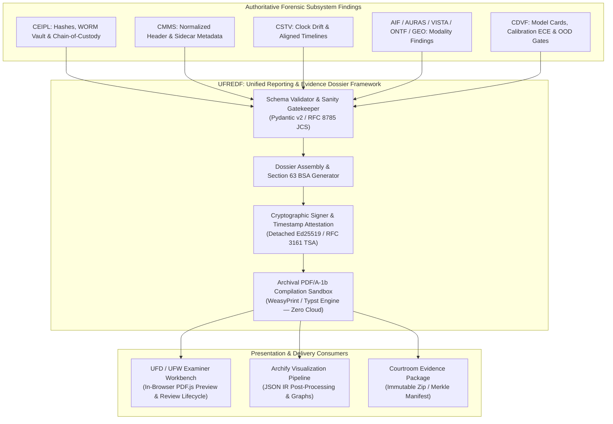

### 21.3 Functional Requirements Register (REP-01 through REP-30)

| Requirement ID | Requirement Summary | User Role | Source Subsystem | Verification Method | Status |
| :--- | :--- | :--- | :--- | :--- | :---: |
| **REP-01** | **Canonical Dossier Identity & URN:** Assign a globally unique, immutable URN (`urn:ps05:dossier:{case_id}:{uuid}`) and sequential version number to every generated report. | `ROLE-EXAMINER` | UFREDF Core | Schema & UUID Validation | `PLANNED` |
| **REP-02** | **Multi-Modal Evidence Inventory:** Compile an exhaustive inventory of all case exhibits (images, audio, video, CCTV, PCAP, sidecars), detailing original filenames, MIME types, and sizes. | `ROLE-EXAMINER` | CEIPL / CMMS | Inventory Cross-Check Test | `PLANNED` |
| **REP-03** | **Chain-of-Custody Attestation:** Embed an immutable, chronological chain-of-custody schedule extracted from CEIPL, recording intake actors, timestamps, transfers, and vault locations. | `ROLE-CUSTODIAN` | CEIPL | Merkle Proof Verification | `PLANNED` |
| **REP-04** | **Pre-Decode Dual-Digest Integrity:** Record primary SHA-256 and secondary SHA3-512 pre-decode digests for all referenced exhibits. | ROLE-CUSTODIAN | CEIPL | Dual-Hash Audit Test | PLANNED |
| **REP-05** | **Tool, Checkpoint & Dependency Provenance:** Document the exact software versions, git commit hashes, Python libraries, OS kernel versions, and model checkpoint SHA-256 digests used. | `ROLE-TECHREV` | Subsystems | Provenance Header Test | `PLANNED` |
| **REP-06** | **Methodology & Mathematical Reproducibility:** Document all mathematical models, algorithm names, feature dimensions, and hyperparameter values to enable independent FSL re-analysis. | `ROLE-TECHREV` | Scientific Core | Re-Execution Audit | `PLANNED` |
| **REP-07** | **Modality Findings Integration:** Ingest and render technical findings from AIF (ELA/masks), AURAS (spectrograms/diarization), VISTA (PTS cadence/scrubbing), ONTF, and AIF-GEO. | `ROLE-EXAMINER` | Modality Engines | Multi-Modal Ingestion Test | `PLANNED` |
| **REP-08** | **Cross-Modal Correlation & Disagreement:** Render the CDVF cross-modal correlation matrix and 7-code conflict taxonomy, detailing corroborated and conflicting signals. | `ROLE-EXAMINER` | CDVF | Correlation Matrix Test | `PLANNED` |
| **REP-09** | **Anti-Averaging Probability Presentation:** Mandate that multi-modal probabilities are presented as distinct nodes in an evidence DAG; strictly prohibit scalar score averaging. | `ROLE-TECHREV` | CDVF | DAG Representation Test | `PLANNED` |
| **REP-10** | **First-Class Inconclusive & OOD Disclosure:** Clearly disclose and explain inconclusive verdicts, out-of-distribution alerts, and non-diagnostic signal conditions. | `ROLE-EXAMINER` | CDVF | OOD Reporting Audit | `PLANNED` |
| **REP-11** | **Alternative Hypotheses & Forensic Limitations:** Include a mandatory section outlining competing physical explanations (e.g. compression artifacts, lighting, acoustic reverberation). | `ROLE-EXAMINER` | Scientific Core | Limitation Header Audit | `PLANNED` |
| **REP-12** | **Examiner Observations & Signed Adjudication:** Allow certified examiners to append free-text technical observations and final opinions, bound with cryptographic digital signatures. | `ROLE-EXAMINER` | UFW / UFREDF | Signature Assertion Test | `PLANNED` |
| **REP-13** | **Independent Technical Review Gate:** Enforce mandatory independent peer review by `ROLE-TECHREV` prior to report approval, logging reviewer comments and sign-off. | `ROLE-TECHREV` | UFREDF Review | Review Workflow Test | `PLANNED` |
| **REP-14** | **Dual-Control Courtroom Dossier Issuance:** Mandate dual independent cryptographic sign-offs from `ROLE-EXAMINER` and `ROLE-REPREV` before transitioning reports to `ISSUED`. | `ROLE-REPREV` | UFREDF / SEC | Multi-Sig Challenge Test | `PLANNED` |
| **REP-15** | **Immutable Snapshots (Zero In-Place Overwrite):** Treat generated report snapshots as immutable; forbid in-place modifications to previously compiled drafts or issued documents. | `ROLE-SYSADMIN` | UFREDF Vault | Write-Once Audit Test | `PLANNED` |
| **REP-16** | **Formal Amendment, Addendum & Supersession:** Support formal addenda and supersession workflows, preserving historical versions and recording reasons for amendment. | `ROLE-REPREV` | UFREDF Lifecycle| Version Chain Audit | `PLANNED` |
| **REP-17** | **PII & Operational Redaction Engine:** Support role-authorized redaction of sensitive personal data or classified source identifiers, recording unredacted parent hashes. | `ROLE-CASEADMIN` | UFREDF Redactor | Redaction Lineage Test | `PLANNED` |
| **REP-18** | **Archify RFC 8785 Canonical JSON IR:** Export canonical JSON Intermediate Representations complying strictly with RFC 8785 JSON Canonicalization Scheme (JCS). | `ROLE-EXAMINER` | Archify Bridge | RFC 8785 JCS Compliance | `PLANNED` |
| **REP-19** | **ISO 19005-1 PDF/A-1b Archival Dossier:** Compile visually polished, structured forensic dossiers adhering strictly to the ISO 19005-1 PDF/A-1b archival standard. | `ROLE-EXAMINER` | UFREDF PDF | VeraPDF Archival Audit | `PLANNED` |
| **REP-20** | **Detached Ed25519 vs Embedded PAdES Signatures:** Generate both RFC 8032 detached Ed25519 signature files and compliant PAdES embedded digital signatures. | `ROLE-EXAMINER` | Cryptographic Core| Signature Verification | `PLANNED` |
| **REP-21** | **Section 65B IEA / Section 63 BSA Schedule:** Automatically assemble the statutory certificate schedule detailing device custody, operating conditions, and certifications. | `ROLE-EXAMINER` | Legal Compiler | Statutory Compliance Audit | `PLANNED` |
| **REP-22** | **Standalone Verification Evidence Package:** Package the PDF/A-1b dossier, JSON IR, detached signatures, and verification scripts into an air-gapped zip bundle. | `ROLE-CUSTODIAN` | Packaging Engine| Export Package Integrity | `PLANNED` |
| **REP-23** | **Deterministic Content & Hash Validation:** Guarantee that identical input findings, configuration, and timestamps produce bit-identical PDF and JSON dossier digests. | `ROLE-SYSADMIN` | Compiler Engine | Determinism Test Suite | `PLANNED` |
| **REP-24** | **Sandboxed Template Rendering Defense:** Sandbox HTML/CSS report template compilation, strictly preventing Server-Side Template Injection (SSTI) and file escapes. | `ROLE-SYSADMIN` | Security Core | Sandboxing Penetration | `PLANNED` |
| **REP-25** | **Air-Gapped Local Compilation Guarantee:** Execute 100% locally with zero external calls to cloud PDF APIs, external web fonts, or remote verification services. | `ROLE-SYSADMIN` | Runtime Core | Zero-Egress Network Audit | `PLANNED` |
| **REP-26** | **CSTV Timebase & Clock Drift Annexure:** Embed the multi-source CSTV timeline alignment table, detailing raw vs. corrected timestamps and clock drift curves $\delta(t)$. | `ROLE-EXAMINER` | CSTV | Timeline Alignment Test | `PLANNED` |
| **REP-27** | **CMMS Normalized Metadata Annexure:** Embed the complete normalized cross-media metadata manifest extracted by CMMS as a structured technical annexure. | `ROLE-EXAMINER` | CMMS | Metadata Annexure Test | `PLANNED` |
| **REP-28** | **Cryptographic Verification Receipt:** Generate a tamper-evident verification receipt containing timestamp token, signing certificate fingerprint, and Merkle root. | `ROLE-CUSTODIAN` | CEIPL / TSA | Receipt Validation Test | `PLANNED` |
| **REP-29** | **Bilingual Statutory Certificate Headers:** Provide certified statutory certificate headings in both English and Hindi as required under state court rules. | `ROLE-EXAMINER` | Legal Template | Linguistic & Form Audit | `PLANNED` |
| **REP-30** | **Long-Term Fixity & Merkle Audit Trail:** Anchor issued report hashes into the CEIPL immutable Merkle ledger, ensuring permanent tamper detection. | `ROLE-AUDITOR` | CEIPL | Merkle Inclusion Test | `PLANNED` |

### 21.4 Nine-State Report Lifecycle Machine

UFREDF enforces an unbroken, legally auditable lifecycle state machine:

$$\text{DRAFT} \longrightarrow \text{GENERATED} \longrightarrow \text{UNDER\_REVIEW} \longrightarrow \text{APPROVED\_TECHNICAL} \longrightarrow \text{APPROVED} \longrightarrow \text{SIGNED} \longrightarrow \text{ISSUED} \longrightarrow \text{SUPERSEDED} \mid \text{WITHDRAWN}$$

1. `DRAFT`: Report created; findings and exhibits being selected by the examiner.
2. `GENERATED`: Structured snapshot compiled and validated against RFC 8785 JSON schema.
3. `UNDER_REVIEW`: Assigned to an independent technical reviewer (`ROLE-TECHREV`).
4. `REVIEW_REJECTED`: Reviewer returned report with documented technical discrepancies.
5. `APPROVED_TECHNICAL`: Methodology, calibration, and limitations verified by `ROLE-TECHREV`.
6. `APPROVED`: Formal legal and statutory review verified by `ROLE-REPREV`.
7. `SIGNED`: Examiner and reviewers appended cryptographic Ed25519 digital signatures.
8. `ISSUED`: Dual-control release completed; verifiable evidence package locked and anchored into CEIPL.
9. `SUPERSEDED`: Replaced by a formal addendum or re-analysis; historical dossier preserved.
10. `WITHDRAWN`: Formally retracted due to demonstrated evidentiary invalidity; revocation receipt published.

---

## 22. Supplementary Proposed Capabilities (Document Intelligence, Evidence Graph, Case-Scoped RAG) (PROPOSED)

> **Specification Status:** `PROPOSED SUPPLEMENTARY CAPABILITY` — Non-core research proposals maintained for architectural completeness. These capabilities are not required for core audio, image, video, CCTV, network, or integrity verification MVP milestones.

### 22.1 Document Intelligence & Authenticity (PROPOSED)

> **Status:** `PLANNED` — Proposed in this documentation release. No source implementation exists.

### 7.1 Product goal

Help authorized examiners review, extract, and compare document exhibits — especially medical and legal records — while preserving chain of custody and explicitly surfacing uncertainty, missing fields, and unresolved verification gaps.

### 7.2 Target user personas for document examination

| Persona | Role | Use case |
| :--- | :--- | :--- |
| P-1 | Cyber Police IO | Uploads a prescription image from a seized phone; needs basic OCR and consistency check |
| P-2 | Forensic Examiner | Compares a prescription against a doctor report; inspects alteration indicators |
| P-3 | Public Prosecutor | Needs a cited, structured finding report for evidence presentation |
| P-4 | Evidence Custodian | Needs every document hashed and WORM-stored before any analysis |

### 7.3 Functional requirements (DOC-FR)

| Req ID | Module | Title | Description | Acceptance Criteria | Priority | Status |
| :--- | :--- | :--- | :--- | :--- | :--- | :--- |
| **DOC-FR-001** | Ingest | Safe Document Intake | Ingest document images and PDFs; compute SHA-256 before any processing; store in WORM vault. | Hashes recorded before decoding; format detected from magic bytes. | P0 | `PLANNED` |
| **DOC-FR-002** | Parse | Format & Page Extraction | Identify format (PDF, scanned image, multi-page TIFF); extract pages as individually hashed derivatives. | Every page tracked as a derived artifact with parent exhibit ID. | P0 | `PLANNED` |
| **DOC-FR-003** | OCR | Text Extraction with Source Coordinates | Run PaddleOCR / Tesseract; record each text region with page number, bounding box, and confidence. | Extracted text links to exact page/region coordinates. | P0 | `PLANNED` |
| **DOC-FR-004** | Classification | Document Type Identification | Classify document type (prescription, lab report, certificate, identity document). | Classification carries explicit confidence and is not used to assert authenticity. | P0 | `PLANNED` |
| **DOC-FR-005** | Extraction | Structured Field Extraction | Extract named fields (patient name, doctor name, date, medications, registration number) where present. | Missing fields represented explicitly; no field invented by model. | P0 | `PLANNED` |
| **DOC-FR-006** | Verification | Signature / QR / Seal Detection | Detect presence of visible signatures, rubber stamps, seals, QR codes, or barcodes; attempt payload verification when possible. | Presence reported separately from cryptographic verification status. | P1 | `PLANNED` |
| **DOC-FR-007** | Alteration | Alteration Indicator Detection | Route document image through AIF IRE/AIM components for pixel-level alteration indicators. | Reuses existing AIF IVE/IRE/AIM pipeline; does not create duplicate analysis modules. | P1 | `PLANNED` |
| **DOC-FR-008** | Cross-doc | Within-Case Document Comparison | Compare extracted fields from related documents; surface candidate matches, contradictions, and uncertainty. | Machine-suggested matches marked separately from confirmed links. | P1 | `PLANNED` |
| **DOC-FR-009** | Provenance | CEIPL Integration for All Derivations | Every extracted page, OCR artifact, and comparison result registered with CEIPL lineage. | Reuses existing CEIPL custody chain; no separate cryptographic system for documents. | P0 | `PLANNED` |
| **DOC-FR-010** | Report | Document Analysis Report | Generate per-exhibit document report with: type classification, OCR completeness, field extraction status, alteration indicators, signature status, and reviewer decisions. | Report cites exact page/region evidence for every finding. | P0 | `PLANNED` |

### 7.4 Document authenticity semantics

The following status values must be used separately and never conflated:

| Status | Meaning |
| :--- | :--- |
| `DOCUMENT_TYPE_IDENTIFIED` | Document class determined with stated confidence |
| `FIELDS_EXTRACTED` | Named fields successfully extracted from OCR |
| `INTERNAL_INCONSISTENCY_FOUND` | Field values within the document are contradictory |
| `ALTERATION_INDICATOR_FOUND` | Image-level anomaly detected by AIF components |
| `SIGNATURE_VERIFIED` | Valid cryptographic signature confirmed |
| `ISSUER_NOT_VERIFIED` | No trusted reference to verify issuer identity |
| `INSUFFICIENT_QUALITY` | OCR or image quality too low for reliable extraction |
| `INCONCLUSIVE` | Evidence insufficient for a determination |
| `REQUIRES_HUMAN_REVIEW` | Examiner decision required before findings are actionable |

### 7.5 Non-goals and failure cases

- The system does not provide medical diagnosis or treatment recommendations.
- An OCR mismatch is not proof of fraud.
- A visible signature graphic is not a verified digital signature.
- A prescription's internal field consistency is not proof of medical validity.
- A doctor or facility name string is not independent issuer verification.
- Documents that look professional are not necessarily genuine.

### 7.6 Medical data handling requirements

- Health-related fields (patient name, diagnoses, medications) are extracted only when required for the documented investigation.
- Access to medical fields is restricted by case role and purpose.
- Extracted medical records are not used to train models without separate explicit authorization.
- Sensitive fields are redacted in shared reports unless the reviewer has case-appropriate access.

---

### 22.2 Evidence Relationship Graph (PROPOSED)

> **Status:** `PLANNED` — Proposed in this documentation release. No source implementation exists.

### 8.1 Product goal

Give examiners an interactive, evidence-linked view of how case exhibits, extracted facts, findings, and human decisions relate — while preserving the distinction between machine suggestions and confirmed relationships.

### 8.2 Functional requirements (EGRAPH-FR)

| Req ID | Module | Title | Description | Acceptance Criteria | Priority | Status |
| :--- | :--- | :--- | :--- | :--- | :--- | :--- |
| **EGRAPH-FR-001** | Graph | Per-Case Evidence Graph | Each case/project maintains a graph of exhibits, derived artifacts, findings, and relationships. | Graph is isolated per case; no cross-case edges possible. | P0 | `PLANNED` |
| **EGRAPH-FR-002** | Nodes | Node Type Registry | All node types (exhibit, document, image, audio, video, finding, timestamp, reviewer decision, RAG chunk) are registered with versioned schemas. | Every node references a valid case exhibit or finding. | P0 | `PLANNED` |
| **EGRAPH-FR-003** | Edges | Relationship Types | Supported relation types: `DERIVED_FROM`, `EXTRACTED_FROM`, `CONTAINS`, `TEMPORALLY_OVERLAPS`, `CORROBORATES`, `CONTRADICTS`, `POSSIBLY_MATCHES`, `SIGNED_BY`, `ANALYZED_BY`, `HAS_FINDING`, `RELATED_TO`. | All edges reference valid nodes with provenance metadata. | P0 | `PLANNED` |
| **EGRAPH-FR-004** | Provenance | Edge Provenance & Confidence | Every edge records: creation method (machine/human), model or tool version, confidence when applicable, and timestamp. | Machine-generated and reviewer-confirmed edges are visually distinguishable. | P0 | `PLANNED` |
| **EGRAPH-FR-005** | Review | Human Review Workflow | Examiner can confirm, reject, or leave unresolved any machine-suggested relationship. | Review decisions are recorded with rationale and persist in audit log. | P0 | `PLANNED` |
| **EGRAPH-FR-006** | Isolation | Cross-Case Isolation | No graph query or traversal returns nodes from a different case. | Query-level and storage-level enforcement. | P0 | `PLANNED` |
| **EGRAPH-FR-007** | Visualization | Interactive Graph Browser | Examiners can view connected exhibits, navigate findings, and see contradictory and corroborating links. | Archify JSON IR or equivalent visualization output. | P1 | `PLANNED` |
| **EGRAPH-FR-008** | Contradiction | Contradiction Surface | Contradictory findings (conflicting dates, inconsistent fields) remain visible and are not silently suppressed. | Contradiction nodes displayed alongside supporting and contradicting evidence. | P0 | `PLANNED` |
| **EGRAPH-FR-009** | Persistence | Source-of-Truth Persistence | Graph state is derivable from persisted relational records. | Graph can be reconstructed or verified from the database without separate graph database backup. | P0 | `PLANNED` |

### 8.3 Identity and identity-matching restrictions

- Two people must not be equated solely because their names are similar in OCR text.
- Facial recognition, OCR, or document text must not be used alone to establish identity without authorized corroboration.
- A `POSSIBLY_MATCHES` edge is a machine hypothesis, not a finding.

### 8.4 Cross-document linking workflow (illustrative use case)

1. A prescription image is uploaded; OCR extracts a name, date, and facility reference with stated uncertainty.
2. A scanned doctor report is uploaded separately.
3. The system finds candidate matching fields and proposes a `POSSIBLY_MATCHES` relationship.
4. A reviewer confirms, rejects, or leaves the relationship unresolved.
5. Related documents appear in the graph view.
6. Contradictory dates or identifiers produce a traceable `CONTRADICTS` finding.
7. The final report cites both original exhibits and exact page/region evidence.
8. **The system never asserts the two documents are authentic because their text is consistent.**

---

### 22.3 Case-Scoped RAG Investigator Assistant (PROPOSED)

> **Status:** `PLANNED` — Proposed in this documentation release. No source implementation exists.

### 9.1 Product goal

Allow authorized investigators to ask natural-language questions about case evidence and receive evidence-grounded, source-cited answers — while strictly preventing legal verdicts, medical conclusions, credential disclosure, and cross-case information leakage.

### 9.2 Target personas

- **P-1 (IO):** Quick questions about case contents, missing evidence, or file status.
- **P-2 (Examiner):** Deep questions about technical findings, contradictions, and source evidence.
- **P-3 (Prosecutor):** Summary questions about corroborated findings and pending reviews.

### 9.3 Functional requirements (RAG-FR)

| Req ID | Module | Title | Description | Acceptance Criteria | Priority | Status |
| :--- | :--- | :--- | :--- | :--- | :--- | :--- |
| **RAG-FR-001** | Access | Authentication & Authorization | RAG queries are gated by user authentication and case-scope authorization. | Unauthenticated or cross-case queries are rejected before retrieval. | P0 | `PLANNED` |
| **RAG-FR-002** | Indexing | Document Ingestion & Chunking | Case documents and forensic outputs are parsed, chunked, and indexed with source document ID, page number, and text span. | Every chunk traces to a specific page/region of a verified exhibit. | P0 | `PLANNED` |
| **RAG-FR-003** | Retrieval | Case-Scoped Hybrid Retrieval | Retrieval combines dense (embedding) and sparse (BM25) search; filtered to the active case. | No chunks from other cases returned. | P0 | `PLANNED` |
| **RAG-FR-004** | Citations | Source Citation Validation | Every substantive evidence claim in the response includes a resolvable citation to a real indexed source. | Non-existent citation IDs are rejected before display. | P0 | `PLANNED` |
| **RAG-FR-005** | Guardrails | Refusal of Unsupported Conclusions | The assistant explicitly refuses to issue authenticity verdicts, legal conclusions, or medical diagnoses. | Refusal response logged and returned to user with explanation. | P0 | `PLANNED` |
| **RAG-FR-006** | Security | Prompt Injection Defense | Text content inside uploaded documents is treated as evidence data, not instructions. | Assistant policies cannot be overridden by text found inside an uploaded document. | P0 | `PLANNED` |
| **RAG-FR-007** | Security | No Credential or Code Disclosure | Questions about passwords, signing keys, source code, or environment variables return explicit refusal. | Zero credential disclosure across all test cases. | P0 | `PLANNED` |
| **RAG-FR-008** | Uncertainty | Missing Evidence Response | When evidence is absent or insufficient, the assistant returns an explicit uncertainty response rather than inventing facts. | Insufficient-evidence response clearly distinguishes "not found" from "not present." | P0 | `PLANNED` |
| **RAG-FR-009** | Audit | Query & Response Logging | All queries, retrieved source references, model/configuration, and responses are logged according to privacy-aware policy. | Logs preserved in tamper-evident audit record. | P0 | `PLANNED` |
| **RAG-FR-010** | Graph | Graph-Enhanced Retrieval | Retrieved evidence IDs are used to expand retrieval via the evidence graph to find corroborating or contradicting related exhibits. | Graph traversal is bounded by case isolation and query limits. | P1 | `PLANNED` |

### 9.4 RAG answer schema

Each assistant response carries a structured payload (illustrative — not yet implemented):

```json
{
  "answer": "string — evidence-grounded response text",
  "case_id": "uuid",
  "source_references": ["exhibit_id:page_or_time_offset"],
  "supporting_excerpts": ["text excerpt with source ID"],
  "evidence_ids": ["uuid"],
  "claims_supported": ["claim text with citation"],
  "claims_unverified": ["claim text with reason"],
  "conflicting_evidence": ["finding text with sources"],
  "missing_evidence": ["what is absent and why it matters"],
  "uncertainty": "LOW | MEDIUM | HIGH | INSUFFICIENT_EVIDENCE",
  "human_review_required": true
}
```

> **Note:** This schema is illustrative. All fields marked `TO_BE_VALIDATED` until implementation and testing are complete.

### 9.5 Non-goals and failure cases

- The assistant is not a general-purpose chatbot.
- It does not access evidence from other cases.
- It cannot order or schedule analysis jobs.
- A cited RAG answer is not a new source of evidence and does not replace an examiner's judgment.
- A missing citation or partial retrieval means the answer must be flagged as uncertain, not invented.

---
