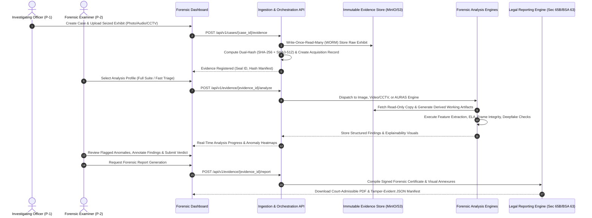
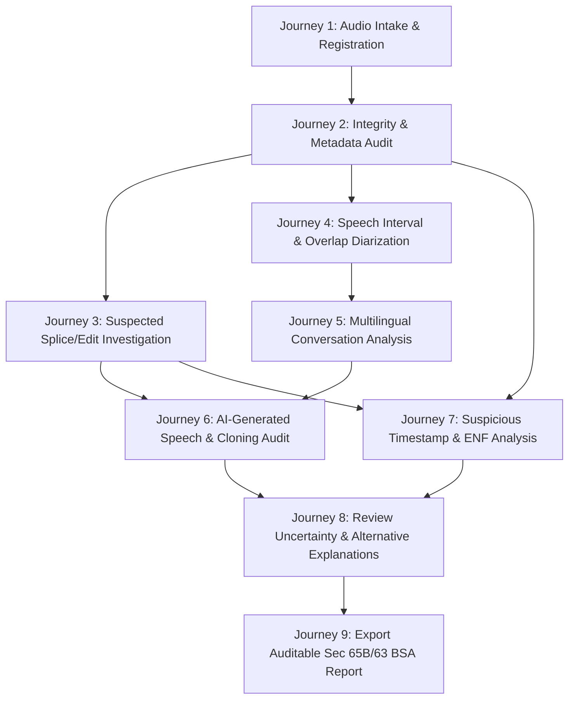
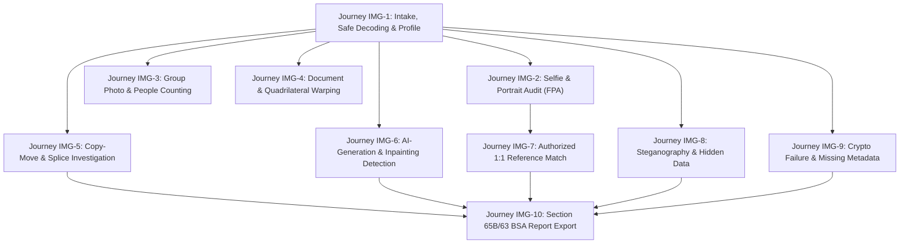
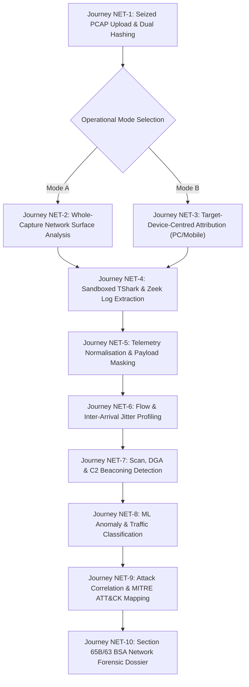

# Product Requirements Document (PRD)

## Project: Digital Evidence Authenticity & Integrity Verification Platform (PS-05)
**Hackathon:** Bihar Government Cyber Hackathon 2026 (C-DAC Patna, CCSU, Bihar Police)  
**Track:** Digital Forensics  
**Problem Statement:** PS-05 — Digital Evidence Authenticity and Integrity Verification Platform  
**Document Version:** 1.1.0  
**Status:** Approved Architecture Baseline (Deepened Audio Forensics Specification)  

---

## 1. Executive Summary

In contemporary law enforcement, judicial proceedings, and cybersecurity operations, digital media—such as digital photographs, voice calls, audio recordings, video clips, and CCTV camera footage—form the bedrock of evidence. However, the democratisation of generative AI tools (deepfakes, voice cloning, diffusion models) alongside sophisticated non-AI editing suites has created a crisis of evidence credibility. Digital artifacts can be manipulated, spliced, synthetically generated, re-encoded, or timestamp-altered in ways that are undetectable to the naked eye or human ear. Manual forensic examination by cyber forensic examiners is time-consuming, prone to human error, and completely overwhelmed by the volume of digital exhibits seized in active investigations.

The **PS-05 Platform (Digital Evidence Authenticity & Integrity Verification Platform)** is an enterprise-grade, modular, explainable, and auditable cyber-forensic analysis system engineered specifically for law enforcement agencies (state police departments including Bihar Police), forensic science laboratories (FSLs), and judicial authorities. The platform automates multi-modal evidence ingestion, cryptographic chain of custody preservation, multi-engine forensic analysis across audio, image, video, and CCTV footage, and court-admissible forensic reporting under **Section 65B of the Indian Evidence Act (IEA)** and **Section 63 of the Bharatiya Sakshya Adhiniyam, 2023 (BSA)**.

---

## 2. Problem Statement & Context

### 2.1 The Official Hackathon Challenge (PS-05)
As specified by C-DAC Patna, CCSU, and Bihar Police:
> *"Digital images, voice recordings, videos, and CCTV footage are increasingly used as evidence, but may be altered or synthetically generated. Manual examination can be time-consuming and may overlook sophisticated manipulations.*
>
> *The proposed solution should address the following requirements:*
> - *Image and Metadata Forensics: Detect image splicing and other potential manipulations; examine EXIF data, device details, GPS coordinates, and timestamps for inconsistencies or tampering.*
> - *Compression and Editing Analysis: Examine JPEG recompression patterns and Error Level Analysis (ELA) to identify potentially edited image regions.*
> - *CCTV Frame Integrity Validation: Detect missing, duplicated, inserted, or reordered video frames.*
> - *Timestamp Anomaly Detection: Identify inconsistencies between embedded timestamps, metadata, and video frame sequences.*
> - *Audio and Voice Tampering Detection: Identify manipulated, edited, or AI-generated voice recordings and examine the authenticity and integrity of audio evidence, highlighting suspicious segments where possible.*
> - *Forensic Dashboard and Reporting: Present detected anomalies, supporting evidence, confidence indicators, and structured forensic findings.*
>
> *The solution should enable law-enforcement agencies and forensic laboratories to rapidly verify digital images, audio, video, and other digital artifacts, improving the reliability of electronic evidence during investigations and judicial proceedings."*

### 2.2 Operational Forensic Gaps
1. **Tool Fragmentation:** Investigators currently rely on disparate, disconnected single-purpose scripts (e.g., ExifTool for metadata, manual Audacity spectrographs for audio, standalone open-source deepfake detectors) with zero unified case registry or evidentiary lineage.
2. **Fragile Chain of Custody:** Lack of cryptographically sealed, immutable storage workflows results in frequent defense challenges in court regarding whether an exhibit was altered during triage.
3. **Black-Box AI Fallacy:** Generic machine learning models provide opaque "binary classification" scores (e.g., "94% Fake") without segment localization, spectral proof, error-level analysis, or signal-level justification, which are legally inadmissible in contested courtrooms.
4. **Multilingual and Regional Gaps:** Deepfake audio detectors trained solely on English or standard Chinese completely fail when deployed on Indian dialectal speech, code-switched dialogues (e.g., Hinglish, Bhojpuri, Maithili, Magahi), or low-resource regional acoustics.
5. **CCTV Stream Discontinuities:** Video surveillance systems present unique packet-drop, frame-duplication, variable frame rate (VFR), and proprietary timestamp overlay characteristics that break conventional video forensics.

---

## 3. Product Vision & Objectives

### 3.1 Vision Statement
To establish India's most trustworthy, court-admissible, and technologically advanced digital forensic verification platform—empowering cyber cells and forensic laboratories to separate genuine electronic evidence from manipulated or synthetically fabricated digital artifacts with mathematical certainty, signal-level explainability, and cryptographic rigor.

### 3.2 Measurable Objectives
- **O-1 (Integrity Assurance):** 100% cryptographic verification (SHA-256 / SHA3-512) and zero-alteration write-blocking of all original digital exhibits upon intake.
- **O-2 (Multi-Modal Analysis):** Automated forensic pipelines covering Images, CCTV Footage, Video streams, and Audio recordings across four specialized forensic engines.
- **O-3 (Explainable Evidence):** Every positive manipulation finding must be accompanied by temporal/spatial localization, signal/spectrographic/ELA artifacts, and confidence intervals rather than a bare scalar score.
- **O-4 (Legal Compliance):** Automated generation of forensic certificates conforming to Section 65B Indian Evidence Act / Section 63 Bharatiya Sakshya Adhiniyam (BSA 2023) with complete audit trail hash manifests.
- **O-5 (Indian Linguistic Resilience):** Audio speaker diarization and voice tampering verification that operates across Indian language environments including Scheduled Indian Languages and regional Hindi dialects.

### 3.3 VISTA Subsystem Product Objectives
The **VISTA (Video Integrity, Synchronization & Tampering Analysis)** subsystem fulfills twelve foundational forensic objectives:
1. **OBJ-VISTA-01 (Bitstream Reverse Engineering):** Reverse-engineer container atoms, codec profiles, presentation timestamps (PTS/DTS), GOP cadence, and encoding structures across standard and proprietary video formats.
2. **OBJ-VISTA-02 (Lossless Audio Demuxing):** Extract native audio bitstreams with zero transcoding loss into independent derived exhibits bound to parent exhibits via SHA-256 lineage manifests.
3. **OBJ-VISTA-03 (AURAS Subsystem Reuse):** Re-route extracted audio into the established AURAS platform (ARE, MVSI, ADDE) without duplicating audio forensic algorithms.
4. **OBJ-VISTA-04 (Audio-Visual Timeline Alignment):** Compare container-level stream offsets ($\Delta t$) and localize dynamic temporal drift across multi-hour video streams.
5. **OBJ-VISTA-05 (Cross-Modal Lip-Sync & Acoustic Correspondence):** Evaluate talking-head lip synchronization (SyncNet) and correlate visible environmental events with acoustic classifications (YAMNet/AST).
6. **OBJ-VISTA-06 (Multi-Branch Deepfake & Generative AI Detection):** Detect facial manipulation, reenactment, inpainting, and text-to-video foundation model generations across spatial and temporal dimensions.
7. **OBJ-VISTA-07 (Forensic Video Classification):** Classify video sources across a hierarchical 15-category forensic taxonomy to dynamically select domain-appropriate analysis baselines.
8. **OBJ-VISTA-08 (Object & Unique Person Tracking):** Detect and track people and vehicles (ByteTrack), rigorously distinguishing per-frame visible counts from estimated unique individuals.
9. **OBJ-VISTA-09 (Dedicated CCTV Source Investigation):** Provide specialized surveillance forensics including OSD clock OCR, clock drift regression, multi-camera corroboration, and native export verification.
10. **OBJ-VISTA-10 (Cryptographic Provenance & Custody):** Anchor all video exhibits, stream extracts, and derived artifacts in the shared CEIPL service with RFC 8785 manifests, Ed25519 signatures, and RFC 3161 TSA tokens.
11. **OBJ-VISTA-11 (Adaptive Discovery & Minimal Follow-Up):** Extract all available technical metadata and OSD clocks *before* questioning the user, asking only targeted follow-up questions without blocking execution if answers are missing.
12. **OBJ-VISTA-12 (Traceable Court-Admissible Reporting):** Generate separable domain sub-reports and a unified Section 65B IEA / Section 63 BSA certified dossier that transparently preserves uncertainty and conflicting signals.

### 3.4 Dedicated Offline Network Traffic Forensics (ONTF) Product Objectives
The **ONTF (Offline Network Traffic Forensics)** subsystem fulfills twelve core forensic objectives for seized packet captures:
1. **OBJ-ONTF-01 (Offline Evidence Preservation):** Ingest previously captured PCAP and PCAPNG files without bitstream modification; compute streaming dual hashes (SHA-256 / SHA3-512) and lock in WORM storage.
2. **OBJ-ONTF-02 (Defensive Format & Header Parsing):** Safely validate capture file headers, link-layer protocols (Ethernet, Linux Cooked, Raw IP), snap lengths, and packet truncation, trapping malicious packet-bomb exploits.
3. **OBJ-ONTF-03 (Pluggable Multi-Tool Dissection):** Dissect packet headers and reassemble transport streams using sandboxed TShark and Scapy workers, operating strictly offline.
4. **OBJ-ONTF-04 (Offline Zeek Log Integration):** Execute Zeek in offline batch mode (`zeek -r capture.pcap`) to generate structured forensic connection, protocol, and notice logs (`conn.log`, `dns.log`, `ssl.log`, etc.).
5. **OBJ-ONTF-05 (Common Telemetry Normalisation):** Map disparate parser outputs into unified, typed `NetworkFlowRecord` and protocol event schemas with data minimisation and payload masking.
6. **OBJ-ONTF-06 (Flexible Scoping & Dual Analysis Modes):** Support both Mode A (Whole-Capture Analysis) and Mode B (Target-Device-Centred Analysis) for seized PCs and mobile phones.
7. **OBJ-ONTF-07 (Rigorous Device Attribution Scoring):** Correlate IP, MAC, DHCP leases, ARP/NDP, and hostnames, assigning explicit attribution confidence tiers while exposing NAT/DHCP/MAC-randomisation limits.
8. **OBJ-ONTF-08 (Flow & Temporal Feature Engineering):** Extract bidirectional statistical flow metrics, inter-arrival time (IAT) jitter distributions, TCP flag ratios, and communication graph centrality metrics.
9. **OBJ-ONTF-09 (Deterministic Threat & Scan Detection):** Detect horizontal/vertical port scans, non-standard protocol ports, DNS anomalies (DGA, TXT tunneling), and periodic C2 beaconing.
10. **OBJ-ONTF-10 (Machine Learning Anomaly Baselines):** Train and evaluate statistical outlier detectors and supervised flow classifiers with strict zero-leakage validation splits.
11. **OBJ-ONTF-11 (Multi-Stage Correlation & MITRE ATT&CK):** Correlate discrete network anomalies into multi-stage attack scenarios (Reconnaissance -> C2 -> Exfiltration) and tag verified findings to MITRE ATT&CK tactics and techniques.
12. **OBJ-ONTF-12 (Court-Admissible Forensic Certification):** Assemble an 11-part court-ready electronic evidence dossier under Section 65B IEA / Section 63 BSA, sealed with Ed25519 digital signatures and RFC 3161 timestamps.

---

## 4. Target User Personas & User Journeys

### 4.1 Target Personas

| Persona ID | Role | Organization | Core Needs & Frustrations | Primary Platform Interaction |
| :--- | :--- | :--- | :--- | :--- |
| **P-1** | Cyber Police Investigating Officer (IO) | State Cyber Crime Police Station / District Cyber Cell | Needs fast preliminary triage of seized suspect phones, CCTV clips, and extortion audio calls. Frustrated by backlogs and complex CLI tools. | Ingestion portal, automated triage dashboard, summary authenticity certificates for charge sheets. |
| **P-2** | Senior Digital Forensic Examiner | State / Central Forensic Science Laboratory (FSL / CFSL) | Requires deep signal analysis, frame-by-frame validation, ELA heatmaps, PRNU sensor noise matching, and custom parameter tuning. | Advanced workbench, spectrogram inspection, filter tuning, raw artifact inspection, audit verification. |
| **P-3** | Public Prosecutor / Legal Counsel | Directorate of Prosecution / High Court | Needs explainable, defense-resilient evidence reports that can withstand rigorous cross-examination regarding tampering and chain of custody. | Section 65B/63 BSA certified PDF reports, visual evidence annexures, cryptographic verification logs. |
| **P-4** | System Administrator & Evidence Custodian | Police HQ / Forensic Lab IT | Needs strict Role-Based Access Control (RBAC), multi-tenant case isolation, tamper-evident audit logging, and offline air-gapped deployment capability. | Admin portal, storage management, engine status monitoring, user role auditing, air-gapped node synchronization. |
| **P-5** | Forensic ML Evaluation & Security Engineer | Forensic AI Research Unit / Cyber Technical Evaluation Cell | Needs reproducible evaluation protocols, detector disagreement calibration, OOD detection, model license audit, and security regression testing on malformed images. | Model registry, benchmark CLI, adversarial testing harness, cryptographic verification audit. |

### 4.2 Primary User Journey: End-to-End Forensic Case Lifecycle



---

## 5. Dedicated Audio Forensics User Journeys (AURAS)

AURAS provides structured, legally auditable workflows specifically tailored to digital audio evidence (recorded telephone calls, voice notes, sting operation recordings, CCTV audio tracks):



### 5.1 Detailed Audio User Journey Walkthroughs

#### Journey 1: Uploading and Registering Audio Evidence
- **Actor:** Investigating Officer (IO) / Seizure Officer.
- **Workflow:** IO uploads seized audio file (`.wav`, `.mp3`, `.m4a`, `.aac`) through web portal or CLI.
- **System Action:** Computes SHA-256 and SHA3-512 in memory while streaming bytes to WORM storage. Generates unique `evidence_id`, acquisition seal, and registers immutable database record.

#### Journey 2: Checking Integrity and Metadata
- **Actor:** Forensic Examiner (P-2).
- **Workflow:** Examiner opens case exhibit; requests baseline integrity and container audit.
- **System Action:** Compares SHA-256 hash against initial seizure manifest. Runs FFprobe, ExifTool, and Mutagen to extract container streams, encoder tags (e.g., LAME version, Audacity/ProTools metadata signatures), sample rate, bit depth, channel configuration, and decoder warnings.

#### Journey 3: Investigating Suspected Edits or Splices
- **Actor:** Forensic Examiner (P-2).
- **Workflow:** In an extortion case, suspect claims the recording was spliced to take words out of context. Examiner requests splice candidate localization.
- **System Action:** ARE engine computes STFT, spectral flux, and executes PELT change-point detection. Highlights millisecond timestamps where room acoustic reverberation, stationary noise floor, or phase coherence abruptly shift.

#### Journey 4: Identifying Speech Intervals and Overlapping Speakers
- **Actor:** Forensic Examiner / Transcriber.
- **Workflow:** Examiner analyzes multi-party meeting recording where several individuals interrupt and speak concurrently.
- **System Action:** MVSI engine executes Silero VAD to isolate speech, flags multi-speaker overlapping frames via Overlapped Speech Detection (OSD), extracts ECAPA-TDNN embeddings, and produces an overlap-aware diarization timeline supporting concurrent speaker labels (e.g., Speaker A + Speaker C active simultaneously).

#### Journey 5: Analyzing Multilingual Conversations
- **Actor:** Cyber Police IO (P-1) / Forensic Linguist.
- **Workflow:** IO analyzes a conversation with rapid code-switching between Hindi, English, and regional dialects (Bhojpuri/Maithili).
- **System Action:** MVSI multilingual engine classifies spoken language per segment using Whisper/MMS LID. Detects intra-utterance code-switch boundaries. Enforces the invariant that **Speaker Identity $\neq$ Language Identity**, preserving a unified speaker profile even when that speaker alternates between languages.

#### Journey 6: Reviewing AI-Generated or Manipulated Speech Indicators
- **Actor:** Senior Forensic Examiner (P-2).
- **Workflow:** Defense claims a leaked audio clip of a public official is an AI deepfake clone. Examiner triggers ADDE deepfake suite.
- **System Action:** ADDE executes RawNet2 (time-domain waveform), AASIST (spectrotemporal graph), and WavLM (foundation SSL) in parallel. Produces calibrated posterior probabilities, localized sliding-window suspicion curves, and flags whether the voice matches authorized reference samples (separate 1:1 speaker verification check).

#### Journey 7: Inspecting Suspicious Timestamps & ENF
- **Actor:** Forensic Physicist / Examiner (P-2).
- **Workflow:** IO needs to verify if an audio recording was made on the specific date and time claimed in the FIR.
- **System Action:** ARE-09 bandpass filters the audio around 50 Hz (nominal Indian electrical grid frequency) and tracks instantaneous frequency variations via Hilbert transform. If reference grid logs from the regional Power Grid Corporation of India (PGCIL) are available, compares the extracted curve to corroborate or refute recording timestamps.

#### Journey 8: Reviewing Uncertainty & Alternative Explanations
- **Actor:** Senior Examiner (P-2) preparing courtroom testimony.
- **Workflow:** Examiner reviews flagged anomalies to rule out benign environmental or codec artifacts.
- **System Action:** System displays alternative explanation sidebars: distinguishes microphone dropouts from splices, lossy AMR compression cutoffs from vocoder artifacts, and low-SNR recording conditions from deepfake model uncertainty.

#### Journey 9: Exporting an Auditable Forensic Report
- **Actor:** Forensic Examiner (P-2) & Public Prosecutor (P-3).
- **Workflow:** Case moves to trial; formal electronic evidence certificate required.
- **System Action:** Generates a Section 65B IEA / Section 63 BSA compliant PDF dossier, embedding exhibit checksums, examiner details, machine environment hashes, spectral annexures, and a tamper-evident Archify JSON IR graph.

---

### 5.2 Dedicated Image Forensics User Journeys (AIF)

AIF provides structured, legally auditable workflows specifically tailored to digital image evidence (surveillance stills, smartphone photographs, social media captures, identity cards, scanned contracts, and manipulated portraits):



#### Journey IMG-1: Image Ingestion, Defensive Validation & Universal Profiling
- **Actor:** Cyber Police Investigating Officer (IO) (P-1) / Evidence Custodian (P-4).
- **Workflow:** Seized smartphone storage yields questioned image files (`.jpg`, `.png`, `.tif`, `.heic`, `.webp`, `.raw`). Officer uploads exhibit through portal or CLI.
- **System Action:** Computes SHA-256 and SHA3-512 in memory directly from the raw byte stream before decoding. Executes defensive pre-flight validation: verifies magic bytes (rejects extension-spoofed binaries), enforces Pillow decompression bomb ceiling (`Image.MAX_IMAGE_PIXELS = 128_000_000`), detects polyglot payloads and malformed structures. Commits raw bytes to immutable WORM vault (POSIX 0400), issues a signed RFC 8785 canonical manifest, and extracts `IVE-01` Universal Image Ingestion Profile (dimensions, bit depth, colour space, orientation metadata, decoder warnings).

#### Journey IMG-2: Selfie, Portrait & Headshot Biometric Evidence Examination
- **Actor:** Forensic Examiner (P-2).
- **Workflow:** Investigating an extortion or matrimonial fraud case where a suspect profile photo or forged ID portrait is questioned.
- **System Action:** FPA module executes RetinaFace/SCRFD face detection, extracts 468/68 MediaPipe facial landmarks, calculates 3D head pose angles (pitch, yaw, roll), blur metrics, and occlusion masks. Flags whether the face is a natural capture, studio portrait, screenshot crop, or low-resolution CCTV face, preparing canonical normalized crops for downstream manipulation tests.

#### Journey IMG-3: Group Photo & Scene People Counting with Occlusion Analysis
- **Actor:** Investigating Officer (P-1) / Forensic Examiner (P-2).
- **Workflow:** Verifying claims regarding the presence or count of individuals at a public gathering, protest, or crime scene.
- **System Action:** IVE-05 executes YOLOv8/v10 and Grounding DINO human-body detection with non-maximum suppression (NMS) deduplication, crowd-density estimation, and partial-body bounding box tracking. Produces separated, calibrated counts: *Detected Faces*, *Visible People*, and *Estimated People* with explicit confidence bounds ($\pm \sigma$), flagging reflections, mannequins, and posters as potential false positives requiring human review.

#### Journey IMG-4: Document, Contract, Seal & ID Quadrilateral Examination
- **Actor:** Questioned Document Forensic Examiner (P-2).
- **Workflow:** Ingesting a photographed land deed, stamped agreement, or government ID card suspected of fraudulent alterations.
- **System Action:** IVE-08 detects document quadrilateral boundaries via Canny edge detection and polygon approximation, generates perspective-corrected planar crops as derived artifacts, detects rubber stamp and signature regions, decodes QR/barcodes, and executes PaddleOCR. Flags digital text insertions and font-size mismatches without modifying original evidence.

#### Journey IMG-5: Copy-Move Forgery & Splicing Investigation
- **Actor:** Senior Forensic Examiner (P-2).
- **Workflow:** Photograph depicts a crime scene, but suspect claims weapons or crowds were duplicated or pasted in.
- **System Action:** IRE-04 runs multi-scale SIFT/ORB keypoint matching combined with DBSCAN spatial clustering, block-based discrete cosine transform (DCT) comparison, and high-frequency noise residual analysis. Generates localized copy-move polygon pairs, quantization table discrepancy maps, and splicing anomaly heatmaps linking derived artifacts in the DAG.

#### Journey IMG-6: AI-Generated Image & Generative Inpainting Analysis
- **Actor:** Senior Forensic Examiner (P-2).
- **Workflow:** Questioned photograph circulated on social media claims to show a public official accepting a bribe. Defense claims the entire image was generated by Midjourney/Stable Diffusion, or that key objects were added via generative inpainting.
- **System Action:** AIM-01 and AIM-02 execute multi-branch detection: ViT/CNN spatial classifiers, 2D FFT spectral high-frequency artifact detectors, and localized inpainting mask models (TruFor/generative fill detector). Emits calibrated synthetic probability scores, generator-family hypotheses (with explicit uncertainty bounds), and pixel-level heatmaps of modified regions.

#### Journey IMG-7: Authorized 1:1 Reference-Image Biometric Comparison
- **Actor:** Senior Forensic Examiner (P-2) under judicial warrant.
- **Workflow:** Court requests verification whether a face detected in a crime scene photograph matches an authorized police custody booking photograph of a suspect.
- **System Action:** System verifies active FIR Case Authorization token. FPA aligns both faces to canonical geometry, extracts 512-dimensional ArcFace/MagFace embeddings, computes cosine similarity and calibrated likelihood ratio. Emits biometric similarity score with strict legal disclaimer: *Biometric similarity $\neq$ Absolute legal identification; results indicate degree of facial feature correspondence under specific pose and lighting conditions.*

#### Journey IMG-8: Steganography & Hidden Data Payload Analysis
- **Actor:** Cyber Forensic Examiner (P-2).
- **Workflow:** Seized digital media from a suspect device is examined for covert communications or concealed unauthorized data.
- **System Action:** AIM-04 inspects the file container for trailing bytes beyond JPEG EOI / PNG IEND markers, examines PNG ancillary chunks (`zTXt`, `iTXt`), executes LSB Chi-Square and RS steganalysis across colour planes, and analyzes JPEG DCT coefficient distributions. Reports statistical probability of concealed payload; if payload is extracted, quarantines it into an isolated sandbox vault **without executing**.

#### Journey IMG-9: Cryptographic Verification Failure & Missing Provenance Handling
- **Actor:** Senior Examiner (P-2) & Evidence Custodian (P-4).
- **Workflow:** Ingesting an image forwarded through messaging apps where EXIF metadata is stripped or hash does not match initial police seizure memo.
- **System Action:** System halts automated chain, emits explicit status (`HASH_MISMATCH` or `MANIFEST_MISSING`), and logs a custody break event. In UI, informs examiner that social media re-compression stripped metadata (benign transfer), guides examiner to attach secondary acquisition memo, and flags that lack of provenance is NOT proof of content manipulation.

#### Journey IMG-10: Exporting an Auditable Section 65B / 63 BSA Forensic Dossier
- **Actor:** Forensic Examiner (P-2) & Public Prosecutor (P-3).
- **Workflow:** Case moves to trial; formal electronic evidence certificate required for Sessions Court.
- **System Action:** Compiles comprehensive forensic dossier embedding raw SHA-256 hash, acquisition seal, Ed25519 digital signature, RFC 3161 TSA token, full DAG of derived artifact hashes, ELA/inpainting heatmaps, OCR extractions, and certified Section 65B IEA / Section 63 BSA electronic evidence certificate.

### 5.3 Dedicated Video & CCTV Forensics User Journeys (VISTA)

The **VISTA (Video Integrity, Synchronization & Tampering Analysis)** subsystem handles diverse video evidence ranging from high-definition broadcast clips and smartphone recordings to low-frame-rate, multi-channel CCTV surveillance exports. The following twelve user journeys represent real-world forensic workflows executed across state cyber police cells and forensic laboratories:

#### Journey VID-1: General Video Ingestion, Registration & WORM Preservation
- **Actor:** Investigating Officer (P-1) & Evidence Custodian (P-4).
- **Workflow:** IO seizes a smartphone video (`.mp4`, `.mov`, `.mkv`) from a crime scene and uploads it via the case portal.
- **System Action:** Platform streams the incoming raw bytes through dual SHA-256 and SHA3-512 cryptographic accumulators before writing to disk. The bitstream is committed to the WORM vault with POSIX `0400` read-only permissions. An immutable acquisition manifest is signed via Ed25519 and anchored to the hash-chained custody log. System assigns a UUIDv4 `evidence_id`, creates a baseline media record, and generates uncompressed, timestamp-preserved working derivatives.

#### Journey VID-2: CCTV / DVR / NVR Native Export & Multi-Stream Ingestion
- **Actor:** Forensic Examiner (P-2) & Investigating Officer (P-1).
- **Workflow:** IO receives a raw USB export from a commercial DVR/NVR containing proprietary or semi-proprietary streams (`.dav`, `.h264`, `.mp4`, `.avi`, `.ts`) accompanied by export sidecars (`.idx`, `.sec`, `.xml`).
- **System Action:** Ingestion pipeline discovers container structure and associated sidecar files without modifying raw bytes. Emits an evidence-context record, extracts stream layouts (video streams, interleaved audio, subtitle/OSD channels), and checks for embedded ONVIF export seals or digital watermarks. System creates distinct derived artifacts for each camera stream, maintaining parent-child DAG links to the master container exhibit.

#### Journey VID-3: Technical Bitstream Reverse Engineering & Automated Source Triage
- **Actor:** Senior Digital Forensic Examiner (P-2).
- **Workflow:** Examiner initiates forensic analysis to determine whether the video is genuine camera capture, an edited file, or surveillance footage.
- **System Action:** **VRE** demuxes the container using FFprobe, MediaInfo, and PyAV. Audits Presentation Time Stamps (PTS) and Decoding Time Stamps (DTS) for non-monotonicity, frame skips, and VFR jitter. Parses Group of Pictures (GOP) cadence (I/P/B frame distances). Concurrently, **CCTV-01** executes multi-signal source triage (checking for fixed field of view, night-vision infrared grayscale, burned-in on-screen display clocks, and channel labels), assigning a provisional source classification (`LIKELY_CCTV_FOOTAGE`, `GENERAL_VIDEO`, `SCREEN_RECORDING_CANDIDATE`, or `UNKNOWN_SOURCE_TYPE`) with calibrated confidence.

#### Journey VID-4: Adaptive Follow-Up Questioning for CCTV Context
- **Actor:** Forensic Examiner (P-2) interacting with Automated Ingestion Assistant.
- **Workflow:** Examiner uploads a surveillance video where critical recording parameters (recorder make, clock timezone, native export files) are absent from metadata.
- **System Action:** Following the adaptive discovery workflow (**CCTV-03**), VISTA first completes all automated inspections (metadata extraction, frame OCR, PTS cadence). Only then does it formulate targeted, context-aware follow-up questions (**CCTV-05**, Questions A–E):
  1. *Question A (Source):* Inquires if video originated from direct camera, DVR/NVR native export, screen recording, or messaging app.
  2. *Question B (Native Export):* Inquires whether uncompressed native backup files or verification players are available.
  3. *Question C (Hardware Clues):* Displays auto-extracted recorder clues and asks for confirmation of manufacturer/model.
  4. *Question D (Timezone & Incident Window):* Asks for configured recorder timezone and incident window to resolve clock offsets.
  5. *Question E (Corroborating Evidence):* Asks for adjacent camera footage, recorder logs, or seizure hash memos.
  *Critical Invariant:* If the examiner skips questions, analysis proceeds unimpeded; missing context is recorded as `NOT_PROVIDED` and uncertainty bounds are widened accordingly.

#### Journey VID-5: Lossless Audio Stream Extraction & Asynchronous AURAS Routing
- **Actor:** Senior Forensic Examiner (P-2) & Audio Specialist.
- **Workflow:** Video contains an embedded audio track; examiner needs comprehensive speech and acoustic tampering verification.
- **System Action:** **AFB-01** invokes FFmpeg in stream-copy mode (`-c:a copy`) to demux the raw audio track without transcoding or lossy re-encoding. The extracted audio is registered as a derived working exhibit, bound by SHA-256 hash to the parent video exhibit, and mapped sample-by-sample to the video timeline. AFB automatically registers an analysis job with the **AURAS** subsystem:
  - **ARE:** Analyzes signal dynamics, clipping, background noise floor continuity, and 50 Hz Electric Network Frequency (ENF).
  - **MVSI:** Performs Silero VAD speech isolation, overlap-aware speaker diarization, and Indian language identification.
  - **ADDE:** Evaluates multi-branch deepfake classifiers (RawNet2, AASIST, WavLM) for synthetic voice cloning.
  AURAS findings return asynchronously to VISTA's aggregation layer, referencing the exact parent video timecodes.

#### Journey VID-6: Multi-Speaker Diarization, Overlap Speech & Source Separation Analysis
- **Actor:** Forensic Examiner (P-2).
- **Workflow:** High-profile extortion or witness statement video where multiple individuals speak simultaneously or interleave rapidly.
- **System Action:** Extracted audio is processed through **AFB-03/04** and AURAS MVSI. Silero VAD flags voiced intervals; pyannote.audio performs overlap-aware diarization, isolating concurrent speaker segments. When severe overlapping obscures key utterances, examiner can trigger optional neural source separation (SpeechBrain SepFormer / Asteroid). System generates separated audio tracks as derived working artifacts with independent SHA-256 hashes and DAG lineage records, preserving the master mixed audio untouched for legal cross-examination.

#### Journey VID-7: Audio-Visual Synchronization & Talking-Head Lip-Sync (SyncNet) Examination
- **Actor:** Senior Digital Forensic Examiner (P-2).
- **Workflow:** Suspect video depicts a political leader or witness speaking; examiner suspects the speech was re-dubbed, cloned, or lip-manipulated (visual deepfake or audio voice clone).
- **System Action:** **AVSC** extracts face tracks and landmark trajectories (RetinaFace, ByteTrack), isolating mouth-region crops (bounding polygons aligned to inter-pupillary distance). AVSC computes visual speech representations and correlates them with the extracted acoustic stream via SyncNet. It evaluates:
  1. *Global Offset ($\Delta t$):* Detects overall container desynchronization vs. local drift.
  2. *Localized Lip-Sync Confidence:* Generates a temporal confidence curve over sliding 2.0s windows; highlights intervals where visible lip motion diverges from phoneme acoustic dynamics.
  3. *Multi-Face Disambiguation:* When multiple faces appear in frame, AVSC evaluates each face track independently against the active audio stream, identifying the true speaker and retaining alternative face correlation scores.
  4. *Benign Explanation Guardrail:* System checks for studio dubbing or translation voiceover flags before asserting malicious manipulation.

#### Journey VID-8: Video Deepfake & Multi-Branch AI Generation Localization
- **Actor:** Forensic Examiner (P-2) & Model Evaluation Engineer (P-5).
- **Workflow:** Investigating suspected face-swap, deepfake puppet reenactment, or fully generative video (Sora, Runway, Kling).
- **System Action:** **VDF** initiates multi-branch inference across both spatial and temporal dimensions:
  - *Spatial Frame Detectors (VDF-01):* Evaluates Xception and EfficientNet classifiers on normalized face crops, detecting blending boundaries, color discrepancies, and frequency spectrum anomalies.
  - *Temporal Sequence Models (VDF-02):* Evaluates 3D CNNs and video transformers (FTCN, STIL, VideoMAE) over consecutive 16-frame windows, detecting inter-frame flickering, unnatural facial landmark velocity, and optical flow warping.
  - *Calibrated Late Fusion (VDF-04):* Applies Platt scaling to map raw logits to calibrated probabilities. Computes Mahalanobis distance to measure out-of-distribution (OOD) uncertainty. If models disagree or compression is severe, flags high uncertainty rather than issuing an arbitrary verdict.

#### Journey VID-9: Semantic Scene Understanding, Object Tracking & Unique Person Counting
- **Actor:** Investigating Officer (P-1) & Forensic Examiner (P-2).
- **Workflow:** Surveillance footage of a mob gathering, trespass, or traffic incident where investigator needs an accurate, defensible count of individuals and vehicles.
- **System Action:** **VCI** executes hierarchical scene classification, categorizing the environment (e.g., *surveillance indoor corridor* or *outdoor public square*). Runs YOLOv8/v10 and SAM 2 for object and person bounding boxes. Multi-object tracking (ByteTrack / BoT-SORT) tracks trajectories across frames:
  - Distinguishes *per-frame visible person count* ($N_t$) from *estimated unique individuals* ($\hat{U}$).
  - Mitigates track fragmentation and ID switching caused by temporary occlusions.
  - Emits timeline annotations linking person tracks to entrance and exit timestamps.

#### Journey VID-10: Cryptographic Provenance, ONVIF Seals & Custody Chain Audit
- **Actor:** Evidence Custodian (P-4) & Public Prosecutor (P-3).
- **Workflow:** Defense challenges the authenticity of a seized CCTV clip, claiming it was altered on the police workstation before submission.
- **System Action:** System executes cryptographic provenance audit (**CEIPL**):
  - Validates original bitstream SHA-256 against initial police seizure hash memo.
  - Verifies Ed25519 digital signature on the intake manifest and checks RFC 3161 Trusted Timestamp Authority (TSA) token.
  - Traverses the append-only hash-chained custody log, proving zero unauthorized modifications.
  - If native export contains an ONVIF Export File Format signature or vendor digital watermark, **CCTV-07** verifies the cryptographic signature against the vendor root certificate. Emits a typed verification status (`VERIFIED`, `SIGNATURE_INVALID`, or `PROVENANCE_UNAVAILABLE`).

#### Journey VID-11: Conflicting Model Outputs, Compression Degradation & Inconclusive Verdict Handling
- **Actor:** Senior Digital Forensic Examiner (P-2).
- **Workflow:** Low-resolution, heavily re-encoded WhatsApp CCTV clip where VDF deepfake models output conflicting probabilities (e.g., frame model indicates $0.72$ suspicion while temporal model indicates $0.21$).
- **System Action:** Cross-engine fusion layer detects high model divergence and checks compression metrics (extreme blocking, bit-rate $< 500\text{ kbps}$, frame rate $< 8\text{ fps}$). Instead of averaging scores into a misleading aggregate, system triggers the *Forensic Uncertainty Invariant*:
  - Generates an explicit **"Inconclusive / Insufficient Video Evidence"** finding.
  - Displays a detector disagreement matrix showing individual model scores, calibration curves, and OOD distances.
  - Explains that heavy H.264 macroblocking mimics generative face artifacts, preventing scientifically defensible fraud determination.

#### Journey VID-12: Compiling Court-Admissible Video Forensic Dossier & Examiner Adjudication
- **Actor:** Forensic Examiner (P-2) & Public Prosecutor (P-3).
- **Workflow:** Trial preparation; final official dossier required for submission under Section 65B Indian Evidence Act / Section 63 Bharatiya Sakshya Adhiniyam 2023.
- **System Action:** System aggregates findings into an auditable dossier:
  - Embeds master exhibit SHA-256 and SHA3-512 hashes, WORM vault URI, and Ed25519 signature.
  - Compiles separable forensic annexures: Video Technical Profile (VRE), Extracted Audio & Voice Report (AFB/AURAS), Audio-Visual Synchronization Report (AVSC), Video Deepfake & Manipulation Report (VDF), Content Timeline & Object Tracks (VCI), and CCTV Specialized Audit (CCTV).
  - Emits an interactive Archify JSON IR graph and renders a tamper-evident WeasyPrint PDF report with certified examiner affidavit.

### 5.4 Detailed Offline Network Traffic Forensics User Journey Walkthroughs (ONTF)



#### Journey NET-1: Seized PCAP Ingestion, Dual Hashing & Format Validation
- **Actor:** Cyber Police Investigating Officer (P-1) / Seizure Officer.
- **Workflow:** IO uploads a previously captured `.pcap` or `.pcapng` file recovered from a seized suspect laptop or network gateway backup.
- **System Action:** Computes SHA-256 and SHA3-512 in memory while streaming bytes to WORM storage (`POSIX 0400`). Inspects file header magic bytes (`0xa1b2c3d4` or `0x0a0d0d0a`), verifies packet link-layer type (Ethernet / Linux Cooked / Raw IP), counts total packets, checks for packet-level truncation, and registers an immutable `NetworkEvidenceRecord`.

#### Journey NET-2: Mode A — Whole-Capture Global Network Surface Analysis
- **Actor:** Senior Digital Forensic Examiner (P-2).
- **Workflow:** Examiner wants an exhaustive, capture-wide summary of all network communications across all recorded IP addresses without focusing on any single host.
- **System Action:** Dissects entire capture, extracting global conversation matrices, top-10 source/destination talkers, protocol distribution percentages (TCP/UDP/ICMP/DNS/TLS/HTTP), autonomous system (ASN) geographic diversity, and capture-wide traffic volume curves.

#### Journey NET-3: Mode B — Target-Device-Centred Forensic Examination (PC/Mobile)
- **Actor:** Cyber Crime Investigator (P-1) / Forensic Examiner (P-2).
- **Workflow:** Investigation centers on a seized Samsung Android smartphone or Windows workstation. Examiner provides target criteria (e.g. IP `192.168.1.105` or MAC `3a:88:2d:41:9a:12`).
- **System Action:** Device Attribution Engine inspects DHCP transactions (`Option 12` Hostname, `Option 55` Parameter Request List), ARP tables, and DNS queries. Correlates candidate device identity, establishes an explicit Attribution Confidence Tier (`DIRECT_OBSERVATION`, `PROBABLE_CORRELATION`, or `AMBIGUOUS_ATTRIBUTION`), and filters all subsequent analysis to inbound, outbound, lateral, and peer flows involving the target device.

#### Journey NET-4: Offline Pluggable Parsing & Zeek Log Extraction
- **Actor:** Forensic Examiner (P-2).
- **Workflow:** Examiner triggers automated deep protocol decoding.
- **System Action:** Spawns an isolated unprivileged worker container (`uid 10001`) with strict resource limits (<= 4GB RAM, 300s timeout). Runs TShark for packet-level dissection and executes Zeek in offline batch mode (`zeek -r capture.pcap`). Emits structured forensic TSV/JSON logs (`conn.log`, `dns.log`, `ssl.log`, `http.log`, `notice.log`, `files.log`).

#### Journey NET-5: Common Telemetry Normalisation & Privacy-Preserving Payload Masking
- **Actor:** Evidence Custodian (P-4) / Forensic Examiner (P-2).
- **Workflow:** Transforming disparate raw dissections into standardized records while complying with Indian privacy laws (DPDP Act 2023).
- **System Action:** Maps parser outputs into unified `NetworkFlowRecord` Pydantic models. Automatically strips or masks plaintext credentials, authorization bearer tokens, personal email bodies, and raw packet payloads, preserving only transport metadata, hashes, and protocol headers necessary for attack analysis.

#### Journey NET-6: Flow & Temporal Feature Engineering (Inter-Arrival Jitter & Windowing)
- **Actor:** Forensic ML Engineer (P-5) / Examiner (P-2).
- **Workflow:** Extracting mathematical features for anomaly detection.
- **System Action:** Computes 80+ bidirectional flow metrics: forward/backward packet counts, packet length mean/stddev, inter-arrival time (IAT) mean and coefficient of variation ($CV_{\text{IAT}}$), TCP flag distribution ratios (SYN/ACK, RST frequency), and sliding time-window aggregates (1s, 5s, 60s windows).

#### Journey NET-7: Deterministic Threat Detection (Scans, DGA, DNS Tunneling & Beaconing)
- **Actor:** Forensic Examiner (P-2).
- **Workflow:** Investigating whether the seized device participated in scanning, contacted malicious C2 infrastructure, or exfiltrated data via covert channels.
- **System Action:** Deterministic rule engine evaluates:
  - Port Scans: Vertical (> 50 ports on 1 target within 5s) and horizontal (> 20 hosts on 1 port) scans.
  - DNS Anomalies: High-entropy domain lookups (DGA detection via Shannon entropy $> 3.8$) and DNS tunneling via abnormal TXT record lengths ($> 128$ bytes).
  - Periodic C2 Beaconing: Fast Fourier Transform (FFT) and autocorrelation on flow arrival times flagging regular heartbeat intervals ($CV_{\text{IAT}} < 0.15$).

#### Journey NET-8: Machine Learning Anomaly & Traffic Classification
- **Actor:** Senior Digital Forensic Examiner (P-2).
- **Workflow:** Detecting stealthy or novel malicious communications that bypass static signature rules.
- **System Action:** Evaluates pre-trained supervised flow classifiers (LightGBM trained on benchmark datasets) and unsupervised statistical outlier detectors (Isolation Forest). Emits calibrated anomaly probability scores with feature contribution rankings (SHAP values) explaining which specific flow attributes triggered the alert.

#### Journey NET-9: Multi-Stage Incident Narrative Correlation & MITRE ATT&CK Mapping
- **Actor:** Forensic Examiner (P-2) & Public Prosecutor (P-3).
- **Workflow:** Structuring disconnected network alerts into a coherent cyberattack timeline for court presentation.
- **System Action:** Correlates chronological events across forensic phases:
  - *Phase 1 (Reconnaissance):* Port scanning detected (mapped to ATT&CK `T1046 Network Service Discovery`).
  - *Phase 2 (Command & Control):* Periodic HTTPS beaconing to unindexed bulletproof VPS (mapped to `T1071.001 Web Protocols`).
  - *Phase 3 (Exfiltration):* Sudden multi-megabyte burst of encrypted outbound traffic to external cloud storage (mapped to `T1048 Exfiltration Over Alternative Protocol`).
  - Contextualizes findings into an explainable attack narrative without claiming absolute intent.

#### Journey NET-10: Compiling Court-Admissible Network Forensic Dossier (Sec 65B/63 BSA)
- **Actor:** Forensic Examiner (P-2) & Legal Counsel (P-3).
- **Workflow:** Submitting electronic evidence certificate for judicial trial.
- **System Action:** Assembles an 11-part court-admissible electronic evidence dossier:
  - Ingestion dual hashes (SHA-256 and SHA3-512) and WORM storage verification.
  - Complete capture profile: duration, packet count, link-layer protocol, and capture drop status.
  - Target-device profile and explicit attribution confidence rating (`DIRECT_OBSERVATION` vs `PROBABLE` vs `AMBIGUOUS`).
  - Communication graph, DNS timelines, top talkers, and protocol breakdown.
  - Traceable threat findings citing exact packet offsets, flow IDs, and MITRE ATT&CK tags.
  - Explicit limitation statement explaining unencrypted metadata limits and absence of payload decryption.
  - Statutory Section 65B IEA / Section 63 BSA certificate with examiner affidavit and Ed25519 digital signature.

---

## 6. Functional Requirements (FR)

### 6.1 Shared Evidence Management & Orchestration Layer (FR-CORE)

| Requirement ID | Module | Title | Description | Acceptance Criteria | Priority |
| :--- | :--- | :--- | :--- | :--- | :--- |
| **FR-CORE-001** | Ingestion | Case Registration & Exhibit Intake | System shall register forensic cases with mandatory metadata (FIR/Case number, Police Station, Investigating Officer ID, Seizure Date/Time, Evidence Type). | Case created with unique UUIDv4; all subsequent exhibits bound to case; prevents orphaned files. | P0 |
| **FR-CORE-002** | Integrity | Cryptographic Dual-Hashing | System shall immediately compute both SHA-256 and SHA3-512 checksums upon byte intake before any file writing or processing. | Hashes recorded in immutable audit ledger; rejects truncated or corrupt network uploads. | P0 |
| **FR-CORE-003** | Storage | Immutable Raw Evidence Storage | System shall store master exhibits in a Write-Once-Read-Many (WORM) storage partition with strictly read-only filesystem permissions. | Zero write/delete permissions granted to worker processes; prevents accidental modification of original exhibit. | P0 |
| **FR-CORE-004** | Lineage | Derived Artifact Transformation Tracking | Any resampled, trans手游, extracted, or cropped artifact must have a deterministic manifest linking parent Exhibit ID, transform parameters, and child hash. | Complete DAG (Directed Acyclic Graph) of artifact provenance retrievable via API and visualised in UI. | P0 |
| **FR-CORE-005** | Orchestration | Asynchronous Job Queue | System shall dispatch forensic tasks to a distributed worker queue with priority scheduling, failure retries, and task heartbeats. | Long-running video/audio jobs execute without blocking HTTP API; worker crash does not corrupt database state. | P0 |
| **FR-CORE-006** | Audit | Tamper-Evident Audit Logging | System shall log every user action, exhibit access, analysis execution, and report generation in an append-only cryptographic audit log. | Every audit record signed with previous record hash (Merkle/Hash chain); verifiable integrity of audit trail. | P1 |
| **FR-CORE-007** | Reporting | Section 65B / BSA Section 63 Certificate Generation | System shall automatically compile a standardized electronic evidence certificate detailing hash records, hardware environment, tool versions, and examiner signatures. | Generates high-fidelity PDF compliant with statutory formats under Indian Evidence Act Sec 65B and BSA 2023 Sec 63. | P0 |

### 6.2 Advanced Image Forensics Subsystem (AIF) Functional Requirements

The AIF subsystem requirements are organized into five specialized modules operating under the shared cryptographic integrity foundation:

#### 6.2.1 Core Ingestion & Universal Profiling (AIF-FR)

| Requirement ID | Module | Title & Description | Rationale | Pri | Inputs & Dependencies | Expected Outputs | Acceptance Criteria | Status |
| :--- | :--- | :--- | :--- | :--- | :--- | :--- | :--- | :--- |
| **AIF-FR-001** | CEIPL / Ingest | **Raw Image Ingestion & Pre-Decode Hashing:** Ingest image bitstreams into WORM vault; compute SHA-256 directly from raw bytes before decoding or conversion. | Guarantees master evidentiary integrity; prevents silent codec normalization changes. | P0 | Seized image bytes (JPEG, PNG, TIFF, HEIC, WebP, RAW). | Raw byte SHA-256, WORM URI (`0400`), Ingestion seal. | Hashes identical across runs; bitstream bit-for-bit unchanged. | `PLANNED` |
| **AIF-FR-002** | Ingest / Defense | **Defensive Parsing & Decompression Bomb Prevention:** Enforce strict decompression pixel ceiling (`128_000_000` px), memory quota (2GB), and process timeout (30s); verify magic bytes. | Prevents denial-of-service, memory exhaustion, and format polyglot exploits. | P0 | Raw exhibit stream. Dep: `python-magic`, Pillow. | Safe decoding status, format verification flag, decoder warnings. | Rejects decompression bombs safely without worker termination. | `PLANNED` |
| **AIF-FR-003** | IVE-01 | **Universal Image Ingestion Profile:** Extract dimensions, width/height, aspect ratio, bit depth, colour mode, alpha channel, ICC profile, and orientation. | Establishes standard container baseline for all downstream forensic engines. | P0 | Safe decoded image array. Dep: Pillow, ExifTool. | Typed `ImageIngestionProfile` dictionary and JSON manifest. | Correctly parses all standard formats; identifies truncated files. | `PLANNED` |
| **AIF-FR-004** | Orchestrator | **Task-Aware Routing & High-Resolution Tiling:** Route image to specialized engines based on profile; tile images $> 4096 \times 4096$ with 15% overlap. | Prevents VRAM exhaustion while maintaining pixel-level resolution for micro-forgeries. | P0 | Universal Image Profile, Examiner Profile. | Tile array with coordinate mapping matrices. | Coordinate transforms map tile detections back to master $(x, y, w, h)$. | `PLANNED` |
| **AIF-FR-005** | Lineage / DAG | **Derived Image Artifact Lineage Tracking:** Every crop, frequency transform, ELA map, and perspective warp must emit a signed transformation manifest. | Complete mathematical auditability required for court admissibility. | P0 | Child artifact bytes, transform operator, parent ID. | Child SHA-256, Lineage record in `artifacts` table. | Complete DAG retrievable via API; no untracked derivative files. | `PLANNED` |

#### 6.2.2 Visual Evidence & Understanding Engine (IVE-FR)

| Requirement ID | Module | Title & Description | Rationale | Pri | Inputs & Dependencies | Expected Outputs | Acceptance Criteria | Status |
| :--- | :--- | :--- | :--- | :--- | :--- | :--- | :--- | :--- |
| **IVE-FR-001** | IVE-02 | **Hierarchical 150-Category Evidence Taxonomy:** Categorize image into versioned 150-category taxonomy across 15 parent forensic groups. | Standardizes visual evidence classification across police departments and FSLs. | P0 | Derived RGB image. Dep: Taxonomy schema v1.0. | Multi-label category tags, parent group IDs, taxonomy version. | Taxonomy covers 15 parent groups; unknown classes marked explicitly. | `PLANNED` |
| **IVE-FR-002** | IVE-03 | **Multi-Label Image Scene Classification:** Extract image embeddings via CLIP/SigLIP; classify multi-label scene probabilities with uncertainty calibration. | Enables rapid triage of large seized datasets (phones, hard drives). | P0 | Normalized RGB image (224x224 / 384x384). Dep: SigLIP / ViT. | List of predicted category labels with calibrated confidence. | Macro-F1 $> 85\%$ on verified forensic benchmark categories. | `PLANNED` |
| **IVE-FR-003** | IVE-04 | **Object Detection & Spatial Localization:** Detect forensic objects (weapons, vehicles, documents, cash) with bounding polygons and confidence scores. | Localizes physical evidence within complex crime scenes. | P0 | RGB image / tile arrays. Dep: YOLOv8/v10, Grounding DINO. | Bounding boxes `[(x, y, w, h)]`, class labels, confidence scores. | mAP@50 $> 0.70$ on common forensic object categories. | `PLANNED` |
| **IVE-FR-004** | IVE-04 | **Prompted & Instance Segmentation:** Generate pixel-accurate instance masks for detected evidence objects using SAM 2 or Mask R-CNN. | Isolates precise evidentiary contours for ballistic or damage analysis. | P1 | Bounding boxes / point prompts. Dep: SAM 2 / Mask R-CNN. | Binary segmentation mask arrays (RLE encoded). | Mask IoU $> 0.75$ against annotated ground truth contours. | `PLANNED` |
| **IVE-FR-005** | IVE-05 | **Occlusion-Aware People Counting:** Count individuals with crowd-density estimation, distinguishing detected faces, visible bodies, and estimated persons. | Accurately assesses crowd sizes in public order and unlawful assembly cases. | P0 | RGB image. Dep: YOLO-human, CSRNet / density head. | Separate counts: `faces_count`, `visible_count`, `estimated_count` ($\pm \sigma$). | Count Mean Absolute Error (MAE) $< 1.5$ on groups $< 30$ persons. | `PLANNED` |
| **IVE-FR-006** | IVE-06 / FPA | **Face, Portrait & Selfie Landmarking:** Detect faces with RetinaFace/SCRFD; extract 468 MediaPipe landmarks, 3D pose, blur, and occlusion scores. | Prepares canonical normalized facial crops for downstream tampering analysis. | P0 | RGB image. Dep: RetinaFace, MediaPipe Face Landmarker. | Face bounding boxes, landmark points, pose angles, quality score. | Detection recall $> 95\%$ on faces $> 40 \times 40$ pixels; flags blurred faces. | `PLANNED` |
| **IVE-FR-007** | IVE-07 / FPA | **Authorized 1:1 Biometric Reference Comparison:** Compare questioned face crop against authorized custody photo using ArcFace/MagFace embeddings. | Corroborates identity of questioned individual under strict legal warrant. | P1 | Questioned face crop, reference photo, Case Authorization Token. | Cosine similarity score, calibrated likelihood ratio, disclaimer. | Access-controlled; similarity output accompanies explicit disclaimer. | `PLANNED` |
| **IVE-FR-008** | IVE-08 | **Document Quadrilateral Correction & OCR:** Detect document boundaries, warp perspective, extract text via PaddleOCR, and flag stamp/seal regions. | Verifies authenticity of photographed agreements, certificates, and IDs. | P0 | Document photograph. Dep: Canny, Hough, PaddleOCR. | Perspective-corrected crop, recognized text with coordinates, seal boxes. | Word Error Rate (WER) $< 8\%$ on clean printed Indian documents. | `PLANNED` |

#### 6.2.3 Image Reverse Engineering Engine (IRE-FR)

| Requirement ID | Module | Title & Description | Rationale | Pri | Inputs & Dependencies | Expected Outputs | Acceptance Criteria | Status |
| :--- | :--- | :--- | :--- | :--- | :--- | :--- | :--- | :--- |
| **IRE-FR-001** | IRE-01 | **Deep EXIF, XMP, IPTC & ICC Profile Audit:** Extract complete metadata hierarchy; cross-reference camera make/model against sensor specs and GPS sanity. | Exposes editing tool traces (Photoshop, GIMP) and impossible timestamps/locations. | P0 | Master image bitstream. Dep: ExifTool, Piexif. | Structured metadata dictionary, tampering flags, GPS coordinates. | Flags editing software tags and inconsistent date-time sequences. | `PLANNED` |
| **IRE-FR-002** | IRE-02 | **2D FFT Spectral & Signal Anomaly Analysis:** Compute 2D Fourier transform magnitude spectrum, DCT block histograms, and high-pass noise residuals. | Visualizes unnatural periodicities caused by re-sampling or generative synthesis. | P0 | Grayscale / Y-channel array. Dep: NumPy FFT, SciPy. | 2D Power spectrum image, high-pass noise residual heatmap. | Highlights periodic lattice spikes indicative of resizing or GAN grids. | `PLANNED` |
| **IRE-FR-003** | IRE-03 | **Classical Geometric Vision & RANSAC Alignment:** Execute Canny/Sobel edges, contours, and SIFT/ORB + RANSAC homography for reference image alignment. | Mathematically proves geometric consistency or perspective discrepancies. | P0 | Questioned image, reference image. Dep: OpenCV, scikit-image. | Edge maps, contour hierarchy, homography matrix $H$, inlier ratio. | RANSAC homography aligns planar reference images with $< 2.0\text{ px}$ error. | `PLANNED` |
| **IRE-FR-004** | IRE-04 | **Copy-Move Forgery Localization (CMFD):** Detect duplicated regions using multi-scale keypoint clustering (SIFT/DBSCAN) and DCT block matching. | Exposes cloned crowd elements, duplicated objects, or masked background patches. | P0 | RGB image. Dep: SIFT/ORB, DBSCAN, DCT block matcher. | Cloned region polygon pairs, matching keypoint vectors, heatmap. | Localizes cloned patches $> 32 \times 32$ px with precision $> 90\%$. | `PLANNED` |
| **IRE-FR-005** | IRE-05 | **Camera Sensor Forensics (PRNU Matching):** Extract Photo-Response Non-Uniformity noise fingerprint; correlate with camera reference images. | Attributes photograph to a specific physical camera sensor hardware unit. | P2 | Questioned image, $\ge 15$ reference flat-field camera photos. Dep: PRNU tools. | Normalized correlation coefficient $\rho$, camera match verdict. | Attains correlation $\rho > 0.15$ on uncompressed sensor matches; flags recompression. | `PLANNED` |
| **IRE-FR-006** | IRE-06 | **Edit Signature & Transfer History Analysis:** Audit recompression passes, quantization table anomalies, and format-specific container clues. | Separates benign social-media forwarding from malicious image manipulation. | P0 | Native file bitstream. Dep: DQT/SOF parser, Pillow. | Compression generation count, quantization mismatch score, transfer notes. | Recompression passes estimated within $\pm 1$ generation on JPEG corpus. | `PLANNED` |

#### 6.2.4 AI, Manipulation & Steganography Engine (AIM-FR)

| Requirement ID | Module | Title & Description | Rationale | Pri | Inputs & Dependencies | Expected Outputs | Acceptance Criteria | Status |
| :--- | :--- | :--- | :--- | :--- | :--- | :--- | :--- | :--- |
| **AIM-FR-001** | AIM-01 | **Multi-Branch AI-Generated Image Detection:** Evaluate images across CNN, ViT, and patch-level classifiers with out-of-distribution distance metrics. | Identifies fully synthesized photorealistic images from Midjourney, DALL-E, SD. | P0 | Normalized RGB patches. Dep: PyTorch, timm, ViT detectors. | Calibrated synthetic probability $P(\text{AI}) \in [0, 1]$, OOD uncertainty. | ROC-AUC $> 0.95$ on benchmark datasets; emits OOD flag on novel styles. | `PLANNED` |
| **AIM-FR-002** | AIM-02 | **Generative Inpainting & Localized Fill Localization:** Localize inserted, deleted, or inpainted regions via deep artifact models (TruFor). | Pinpoints localized object additions or removals in otherwise authentic photos. | P0 | RGB image / tiles. Dep: PyTorch, TruFor / Splice models. | Pixel-level binary mask and continuous manipulation heatmap. | Localization IoU $> 0.65$ on inpainted regions $> 64 \times 64$ pixels. | `PLANNED` |
| **AIM-FR-003** | AIM-03 | **Face Swap & Morphing Manipulation Forensics:** Inspect facial boundaries, skin texture, and eye reflections for face-swapping and morphing artifacts. | Exposes celebrity deepfakes, non-consensual imagery, and passport morphing. | P0 | Canonical face crops. Dep: PyTorch face-forensic heads. | Face manipulation score, suspicious boundary heatmap, artifact flags. | Accurately flags swapped faces; distinguishes beauty filter smoothing. | `PLANNED` |
| **AIM-FR-004** | AIM-04 | **Structural & Statistical Steganalysis:** Audit trailing bytes beyond EOI/IEND, PNG ancillary chunks, LSB Chi-Square, and RS steganalysis across planes. | Detects covert communication payloads concealed inside image pixel matrices. | P1 | Raw file bitstream, pixel arrays. Dep: Steganography test suite. | Concealed data probability, payload size estimate, quarantine file URI. | Flags LSB insertion payloads $> 0.05$ bits-per-pixel; quarantines payload. | `PLANNED` |
| **AIM-FR-005** | AIM-05 | **Image File Vulnerability & Polyglot Defense:** Scan file structure for appended scripts, HTML polyglots, and heap-overflow trigger vectors. | Protects forensic workstations from malicious exhibits targeting image decoders. | P0 | Seized file stream. Dep: Custom structural parser. | Security assessment report, vulnerability alert flags. | Rejects polyglot exploits safely; zero execution of embedded payloads. | `PLANNED` |

#### 6.2.5 Cryptographic Evidence Integrity & Provenance Layer (CEIPL-FR)

| Requirement ID | Module | Title & Description | Rationale | Pri | Inputs & Dependencies | Expected Outputs | Acceptance Criteria | Status |
| :--- | :--- | :--- | :--- | :--- | :--- | :--- | :--- | :--- |
| **CEIPL-FR-001** | CEIPL-01 | **Original Evidence Direct Hashing:** Compute SHA-256 and SHA3-512 directly from raw byte stream during network reception before writing to disk. | Establishes foundational bitstream identity; rejects network corruption. | P0 | Seized raw bytes. Dep: `hashlib` (C-accelerated). | Master SHA-256 and SHA3-512 hashes. | 100% bit-exact reproducibility across platforms; single-bit sensitivity. | `PLANNED` |
| **CEIPL-FR-002** | CEIPL-02 | **RFC 8785 Canonical Evidence Manifests:** Emit machine-readable evidence manifests serialized via JSON Canonicalization Scheme (RFC 8785). | Prevents signature invalidation caused by key-sorting or whitespace changes. | P0 | Case metadata, hashes, acquisition details. Dep: `canonicaljson`. | Deterministically serialized canonical manifest bytes. | Produces byte-for-byte identical JSON serialization across platforms. | `PLANNED` |
| **CEIPL-FR-003** | CEIPL-03 | **Ed25519 Digital Signatures & Key Lifecycle:** Cryptographically sign manifests and reports using Ed25519 private keys managed via secure KMS/HSM interfaces. | Guarantees non-repudiation and authentic issuance of forensic findings. | P0 | Canonical manifest bytes, KMS key ID. Dep: `cryptography`. | Ed25519 signature string, public key ID, signature block. | Verifies with 100% success; rejects signatures from revoked/untrusted keys. | `PLANNED` |
| **CEIPL-FR-004** | CEIPL-04 | **RFC 3161 Trusted Timestamp Authority (TSA):** Bind evidence hashes to trusted third-party timestamp tokens adhering to RFC 3161. | Provides independent chronological proof that evidence existed at asserted time. | P1 | Master SHA-256 hash, TSA server URL. Dep: RFC 3161 client. | TimeStampToken (TST) ASN.1 DER structure, TSA certificate chain. | TST validated against TSA root certificates; logs fallback if offline. | `PLANNED` |
| **CEIPL-FR-005** | CEIPL-05 | **Append-Only Hash-Chained Custody Event Logs:** Every exhibit action (intake, access, analyze, export) is recorded in an immutable hash-chained log. | Detects unauthorized record insertion, deletion, or backdated alterations. | P0 | Event data payload, previous event hash. Dep: PostgreSQL/JSONB. | Chained event record with `current_hash = H(prev_hash \| event_data)`. | Recomputes chain in $< 50\text{ ms}$; detects any intermediate modification. | `PLANNED` |
| **CEIPL-FR-006** | CEIPL-06 | **Merkle Tree Checkpoints & Batch Inclusion Proofs:** Aggregate case exhibit hashes into Merkle tree structures; emit audit inclusion proofs. | Enables rapid verification of individual exhibits within large multi-gigabyte cases. | P1 | Array of exhibit SHA-256 hashes. Dep: Custom Merkle engine. | Merkle root hash, inclusion proof array `[(sibling_hash, direction)]`. | Validates inclusion proof in $< 1\text{ ms}$; proves exhibit presence. | `PLANNED` |
| **CEIPL-FR-007** | CEIPL-07 | **Signed Transformation Lineage Manifests (DAG):** Every derived image crop, frequency map, or normalized frame emits a signed child-to-parent lineage link. | Preserves unchallengeable chain of custody for all visual evidence annexures. | P0 | Child artifact bytes, parent ID, transform params. | Child SHA-256, signed lineage manifest. | Every derived artifact links unambiguously to master exhibit SHA-256. | `PLANNED` |
| **CEIPL-FR-008** | CEIPL-08 | **C2PA Content Credentials & Provenance Verification:** Parse embedded C2PA JUMBF metadata; verify claim signatures, cert chains, and content bindings. | Validates camera hardware provenance credentials (Leica, Sony, Nikon). | P1 | Raw image container. Dep: `pyc2pa` / `c2pa-rs`. | C2PA claim manifest, signer certificate validation status, edit assertions. | Identifies valid C2PA credentials; flags broken content bindings. | `PLANNED` |
| **CEIPL-FR-009** | CEIPL-09 | **AES-256-GCM Storage Encryption & TLS 1.3:** Encrypt all evidence objects at rest using AES-256-GCM; enforce TLS 1.3 for all internal and API communications. | Protects sensitive forensic exhibits against storage theft and network eavesdropping. | P0 | Plaintext exhibit stream, Data Encryption Key (DEK). | Ciphertext, 128-bit authentication tag, 96-bit unique IV/nonce. | Decryption verifies authentication tag; rejects modified ciphertexts. | `PLANNED` |
| **CEIPL-FR-010** | CEIPL-10 | **Immutable Storage Controls (POSIX 0400 / WORM Lock):** Store exhibits on dedicated storage partitions with read-only permissions and S3 Object Lock compliance. | Physically prevents write, overwrite, or deletion operations by worker processes. | P0 | Stored exhibit file path / S3 bucket URI. | File mode `0400`, S3 Legal Hold status active. | Any write/delete attempt throws `PermissionError`; preserves raw exhibits. | `PLANNED` |
| **CEIPL-FR-011** | CEIPL-11 | **Cryptographic Failure State Handling:** System must emit typed failure codes (`HASH_MISMATCH`, `SIGNATURE_INVALID`, etc.) without converting to false pass. | Prevents silent failures from compromising courtroom evidence integrity. | P0 | Verification event result. | Explicit error code, audit alert log, examiner notification. | Never converts a failed or inconclusive cryptographic check into PASS. | `PLANNED` |

#### 6.2.6 Baseline Image Forensics Matrix (FR-IMG-001 to FR-IMG-007)

The baseline image requirements are preserved and cross-referenced with the expanded AIF engines:

| Requirement ID | Module | Title | Description | Acceptance Criteria | Priority | Mapped AIF Engine |
| :--- | :--- | :--- | :--- | :--- | :--- | :--- |
| **FR-IMG-001** | Metadata | EXIF & Structural Metadata Forensic Audit | Extract and validate all EXIF, XMP, IPTC, and TIFF tags; cross-reference camera make/model against known sensor profiles and lens specs. | Flags missing tags, editing software signatures (e.g., Photoshop, GIMP), or date-time sequence inconsistencies. | P0 | IRE-01 |
| **FR-IMG-002** | Geolocation | GPS & Timestamp Sanity Validation | Validate embedded GPS coordinates against geographic boundaries and verify timezone alignment with camera local clock. | Highlights impossible travel speeds between sequential photos; flags spoofed or null GPS headers. | P1 | IRE-01 |
| **FR-IMG-003** | Compression | Error Level Analysis (ELA) | Compute compression error discrepancies across image blocks by recompressing at known quality levels (e.g., 90%, 95%) and calculating pixel differences. | Generates multi-scale ELA heatmap highlighting regions with inconsistent error levels indicating foreign insertion/splicing. | P0 | IRE-02 |
| **FR-IMG-004** | Compression | JPEG Double-Compression & Ghost Detection | Analyze Quantization Tables (QT) and discrete cosine transform (DCT) histogram periodicity to detect re-compression ghosts. | Identifies if an image was compressed multiple times with different quality factors; localizes spliced regions. | P0 | IRE-02 / IRE-06 |
| **FR-IMG-005** | Cloning | Copy-Move Forgery Detection (CMFD) | Detect duplicate regions within the same image using dense feature matching (SIFT/ORB) combined with spatial clustering (DBSCAN). | Localizes cloned objects (e.g., duplicate crowds, removed objects covered with background patches) with bounding polygons. | P0 | IRE-04 |
| **FR-IMG-007** | AI Synthesis | Synthetic & Diffusion Image Detection | Detect visual artifacts characteristic of GANs and Latent Diffusion models (frequency domain anomalies, abnormal eye reflections, texture blending). | Provides synthetic probability score, frequency domain spectrum (FFT magnitude), and model attribution if recognized. | P1 | AIM-01 / AIM-02 |

### 6.3 Video & CCTV Forensics Subsystem (VISTA) Functional Requirements

The **VISTA (Video Integrity, Synchronization & Tampering Analysis)** subsystem provides modular, mathematically defensible, and explainable video forensic analysis for digital exhibits, CCTV recordings, and multi-modal media. Requirements are organized across the five primary VISTA engines and the dedicated CCTV Forensic Profile.

Every requirement rigorously specifies its **Requirement Statement**, **Motivation / Rationale**, **Expected Behavior & Required Artifacts**, **Acceptance Criteria**, **Dependencies**, **Failure Behavior**, **Verification Method**, **Priority**, and **Status**.

#### 6.3.1 Core Video Ingestion, Stream Inventory & Lineage (VISTA-FR)

| Req ID | Title & Requirement Statement | Motivation / Rationale | Expected Behavior & Required Artifacts | Acceptance Criteria | Dependencies | Failure Behavior | Verification Method | Pri | Status |
| :--- | :--- | :--- | :--- | :--- | :--- | :--- | :--- | :--- | :--- |
| **VISTA-FR-001** | **Direct Raw-Byte Stream Dual-Hashing & WORM Storage:** Stream seized video bytes through SHA-256 and SHA3-512 accumulators during ingestion; write directly to WORM vault with `0400` read-only permissions. | Establishes bitstream identity before decoding; prevents defense tampering challenges under Sec 65B/63 BSA. | Emits `VideoExhibit` record, primary SHA-256 / SHA3-512 hashes, WORM URI, and acquisition manifest. | 100% bit-exact reproducibility across platforms; halts on single-bit mismatch. | Standard `hashlib`, POSIX / S3 Object Lock. | Aborts ingestion immediately on write failure with `INGESTION_HASH_ERROR`. | Ingest test video; verify bitstream parity against OS sha256sum; verify permission bits `0400`. | P0 | `PLANNED` |
| **VISTA-FR-002** | **Defensive Demuxing & Allocation Guardrails:** Parse container headers in an isolated worker sandbox with bounded memory ($\le 2\text{ GB}$) and strict execution timeouts (60s header, 600s segment). | Prevents decompression bombs, malformed container crashes, and Denial-of-Service exploits on forensic servers. | Emits `DemuxProfile` or raises typed exception; caps maximum resolution ($8192\times8192$) and frame buffers. | Safely rejects malformed or oversized files with typed error; zero worker process crashes. | PyAV / FFprobe with timeout harness. | Terminates worker safely with `VideoDemuxTimeoutError` or `DecompressionLimitExceeded`. | Fuzz testing with crafted malformed MP4/MKV files and infinite GOP structures. | P0 | `PLANNED` |
| **VISTA-FR-003** | **Multi-Stream Demuxing & Inventory Cataloging:** Identify, validate, and catalog all elementary streams (video, audio, data, subtitle, OSD text) and assign stream-specific IDs. | Exposes hidden, truncated, or auxiliary streams; prepares decoupled downstream processing. | Emits `StreamInventoryRecord` mapping stream indices ($v:0, a:0$) to codecs, bitrates, timebases, and layouts. | Accurately catalogs 100% of streams in multi-track/multi-audio surveillance files. | PyAV, FFprobe, MediaInfo. | Flags unsupported codec streams with `UNSUPPORTED_CODEC_PROFILE` while parsing valid streams. | Ingestion test across 25 diverse test streams (H.264, H.265, VP9, AV1, DAV). | P0 | `PLANNED` |
| **VISTA-FR-004** | **Deterministic Transformation DAG & Lineage Manifests:** Every extracted frame, cropped face track, and demuxed audio slice must emit a signed lineage record linking to master SHA-256. | Guarantees complete auditability and courtroom admissibility for all visual and audio annexures. | Emits derived artifact hash, parent `evidence_id`, transformation parameters, and RFC 8785 JSON manifest. | 100% of derived working artifacts trace unambiguously back to master exhibit SHA-256 via DAG query. | `canonicaljson`, CEIPL lineage service. | Refuses artifact persistence if parent exhibit ID or hash link is missing (`DAG_LINKAGE_ERROR`). | Lineage DAG traversal test from leaf crop back to master exhibit root. | P0 | `PLANNED` |
| **VISTA-FR-005** | **Adaptive Task-Aware Pipeline Routing:** Automatically route video based on detected codecs, duration, audio presence, and initial CCTV classification. | Minimizes unnecessary compute; routes surveillance footage to CCTV profile and speech to AURAS. | Emits dispatched Celery worker jobs with dependency DAG and execution priorities. | Correctly routes video to relevant engines without running unused detectors (e.g., skips speech on silent video). | Ingestion profile, Celery task queue. | Falls back to baseline reverse-engineering triage if media properties are ambiguous. | End-to-end task dispatch test across silent video, audio-video, and CCTV fixtures. | P0 | `PLANNED` |

#### 6.3.2 Video Reverse Engineering Engine (VRE-FR)

| Req ID | Title & Requirement Statement | Motivation / Rationale | Expected Behavior & Required Artifacts | Acceptance Criteria | Dependencies | Failure Behavior | Verification Method | Pri | Status |
| :--- | :--- | :--- | :--- | :--- | :--- | :--- | :--- | :--- | :--- |
| **VRE-FR-001** | **Container, Codec & GOP Bitstream Audit:** Inspect MP4, MKV, AVI, and TS containers; extract codec profiles, pixel format, duration, time bases, bitrate, and Group of Pictures (GOP) structure. | Identifies non-standard containers, missing headers, truncated files, and encoding anomalies. | Emits `VREBitstreamProfile` with GOP length, keyframe cadence, decoder warnings, and atom layout. | Detects missing I-frames, truncated moov atoms, and unsupported codec profiles. | FFprobe, MediaInfo, PyAV. | Emits `BITSTREAM_CORRUPT` warning; attempts partial packet recovery where possible. | Unit test on truncated and non-standard MP4/MKV fixtures. | P0 | `PLANNED` |
| **VRE-FR-002** | **Presentation Timestamp (PTS/DTS) Cadence & VFR Analysis:** Parse packet timestamps; detect non-monotonicity, frame skips, reset timebases, and Variable Frame Rate (VFR) jitter. | Distinguishes normal camera frame drops from manual video clipping or excised footage. | Emits PTS continuity curve, instantaneous FPS time series, VFR jitter coefficient, and gap intervals. | Pinpoints timestamp jumps $> 1.0$ nominal frame duration with millisecond accuracy. | PyAV `Packet.pts`, `Packet.dts`. | Emits `PTS_DISCONTINUITY_FLAGGED` with confidence bounds; does not abort stream. | Ingest synthetic video with excised frames; verify cadence alert at exact splice timestamp. | P0 | `PLANNED` |
| **VRE-FR-003** | **Timestamp-Preserved Frame Decoding & Source Mapping:** Decode video frames with preserved presentation timestamps; maintain strict mapping between frame index $i$ and source time $t_{\text{pts}}$. | Prevents timeline drift caused by assuming nominal FPS on variable-rate footage. | Emits decoded RGB frame buffer and timestamp index array `[(frame_idx, pts_seconds)]`. | Zero cumulative timing drift across multi-hour videos ($< 0.5\text{ ms}$ error). | PyAV / FFmpeg. | Flags missing packet timestamps with `INTERPOLATED_PTS` status. | Compare decoded PTS array against raw demuxed packet timestamps on VFR video. | P0 | `PLANNED` |
| **VRE-FR-004** | **Duplicated & Frozen Frame Detection:** Calculate Structural Similarity Index Measure (SSIM) and perceptual hashing across adjacent frames to identify video freeze loops. | Detects surveillance loops used to mask unauthorized activity, burglaries, or tampering. | Emits list of frozen frame intervals `[(start_pts, end_pts, duration, ssim)]` and visual diff crops. | Flags frozen sequences ($SSIM > 0.998$ over $> 1.0\text{ s}$ during active scene) with zero false negatives. | OpenCV, scikit-image (SSIM). | Suppresses false alarms during global camera blackouts or static scenes via optical flow check. | Test on 5-second synthetic freeze inserted into active surveillance scene. | P0 | `PLANNED` |
| **VRE-FR-005** | **Scene Boundary Segmentation vs. Malicious Cut Triage:** Detect scene cuts using PySceneDetect (content and adaptive thresholding); distinguish benign cuts from suspicious splices. | Spliced footage or excised intervals frequently masquerade as scene transitions. | Emits scene cut list, transition type (cut, fade, dissolve), and motion discontinuity score. | Achieves F1 $> 0.92$ on benchmark cut datasets; flags anomalous intra-scene jumps. | PySceneDetect, dense optical flow. | Flags ambiguous transitions as `UNRESOLVED_TRANSITION` for examiner review. | Evaluate against BBC and surveillance cut detection benchmark datasets. | P0 | `PLANNED` |
| **VRE-FR-006** | **Deep Container & Stream Metadata Extraction:** Extract all embedded tags, creation timestamps, GPS, encoder fields, and vendor MakerNotes using ExifTool and MediaInfo. | Exposes video editing software signatures (Adobe Premiere, Handbrake) and camera hardware info. | Emits hierarchical metadata dictionary, editing tool warnings, and timezone flags. | Identifies known NLE encoder signatures; categorizes metadata provenance. | ExifTool, MediaInfo. | Missing metadata reported as `METADATA_ABSENT`, never as proof of tampering. | Parse genuine camera files vs. Handbrake-re-encoded files; assert encoder detection. | P0 | `PLANNED` |
| **VRE-FR-007** | **Re-Encoding & Compression History Analysis:** Inspect macroblock quantization parameters, DCT coefficient distribution, and compression artifacts across frame types (I/P/B). | Discloses whether a video was transcoded, re-compressed, or rendered multiple times. | Emits re-compression risk score, average QP per frame type, and GOP irregularity metrics. | Detects double-compression and re-encoding with $> 85\%$ accuracy on test fixtures. | FFprobe, OpenCV. | Reports `INCONCLUSIVE_COMPRESSION` when bitrate is too low to extract valid QPs. | Test on once-encoded vs. twice-encoded H.264/H.265 videos across diverse CRFs. | P1 | `PLANNED` |
| **VRE-FR-008** | **Frame Interpolation & Synthetic Cadence Detection:** Analyze optical flow bi-directional motion residuals to detect AI frame interpolation (RIFE, DAIN) or frame blending. | Flags artificially smoothed frame rates used to mask dropped frames or create deepfakes. | Emits interpolation probability score, motion residual heatmap, and ghosting artifact flags. | Detects AI-interpolated frames with $> 88\%$ accuracy on synthetic frame datasets. | Dense optical flow (RAFT / Farneback). | High motion blur flagged as `MOTION_BLUR_DEGRADATION` to prevent false positive alerts. | Ingest RIFE-interpolated 60fps video; verify detection of synthesized intermediate frames. | P1 | `PLANNED` |

#### 6.3.3 Audio Forensic Bridge & AURAS Routing (AFB-FR)

| Req ID | Title & Requirement Statement | Motivation / Rationale | Expected Behavior & Required Artifacts | Acceptance Criteria | Dependencies | Failure Behavior | Verification Method | Pri | Status |
| :--- | :--- | :--- | :--- | :--- | :--- | :--- | :--- | :--- | :--- |
| **AFB-FR-001** | **Lossless Stream-Copy Audio Extraction:** Demux embedded audio stream using FFmpeg in stream-copy mode (`-c:a copy`) without transcoding; bind to parent exhibit via SHA-256. | Preserves original acoustic bitstream untouched; prevents compression artifact injection. | Emits raw extracted audio artifact, SHA-256 checksum, and derivation manifest. | Bit-exact extraction; zero transcoding; parent-child DAG linkage verified. | FFmpeg subprocess wrapper. | Falls back to standardized PCM decode if container bitstream is non-demuxable. | Compare extracted audio hash against demuxed bitstream hash from standalone FFmpeg. | P0 | `PLANNED` |
| **AFB-FR-002** | **Standardized Audio Analysis Derivative Generation:** Decode extracted audio to uncompressed 16 kHz mono 32-bit float WAV with preserved timeline offset. | Standard input required for downstream speech processing, VAD, and diarization. | Emits standardized working WAV (16 kHz mono) and timeline offset record. | Timeline offset matches parent video PTS within $\pm 0.5\text{ ms}$; zero sample drift. | SoundFile, Librosa, PyAV. | Aborts audio analysis if audio track is corrupted or silent; logs `EMPTY_AUDIO_TRACK`. | Measure sample offset against parent video PTS over a 1-hour test stream. | P0 | `PLANNED` |
| **AFB-FR-003** | **Asynchronous AURAS Subsystem Routing Adapter:** Submit extracted audio exhibit to AURAS API; track analysis job across ARE, MVSI, and ADDE engines. | Reuses AURAS audio capabilities without duplicating algorithms or code. | Emits AURAS job ID, execution status, and aggregated audio findings reference. | Successfully dispatches job; polls/subscribes to completion; maps results back. | AURAS API client, Celery. | Emits `AURAS_JOB_TIMEOUT` if audio analysis exceeds timeout; reports partial findings. | Mock AURAS worker execution; verify asynchronous dispatch and result binding. | P0 | `PLANNED` |
| **AFB-FR-004** | **Multi-Speaker Diarization & Speech Interval Coordination:** Ingest AURAS MVSI diarization output; map speaker turns $(S_k, t_{\text{start}}, t_{\text{end}})$ directly onto video timeline. | Aligns speaker turns with visual face tracks for cross-modal verification. | Emits video-mapped speaker timeline and active speaker count time series. | Diarization error rate (DER) $< 18\%$; speaker boundaries aligned within $\pm 20\text{ ms}$. | AURAS MVSI result, video timebase. | Overlapping speaker turns flagged with `OVERLAPPED_SPEECH_INTERVAL`. | Validate alignment against ground truth annotated dialogue video clip. | P0 | `PLANNED` |
| **AFB-FR-005** | **Optional Neural Speech Source Separation:** When overlapping speech is flagged by MVSI, trigger SpeechBrain SepFormer to generate isolated speaker track derivatives. | Enhances speech intelligibility and isolates individual voices for deepfake check. | Emits separated audio tracks (Speaker A, Speaker B) and separation quality metrics (SI-SDR). | Generates clean separated audio with SI-SDR improvement $> 8\text{ dB}$; retains raw mix. | SpeechBrain SepFormer. | Emits `SEPARATION_FAILED` if voices are too diffuse; preserves original mixed audio. | Evaluate SI-SDR on mixed-speech benchmark clips; verify parent-child DAG links. | P1 | `PLANNED` |
| **AFB-FR-006** | **Per-Speaker Evidentiary Record Compilation:** Compile per-speaker dossier: speech intervals, language ID, synthetic voice suspicion, and attribution ambiguity notes. | Ensures transparent attribution; prevents treating cluster IDs as legal identities. | Emits typed speaker evidence records with explicit disclaimer on identity. | Correctly attributes multi-speaker metrics; flags attribution ambiguity when present. | MVSI and ADDE outputs per speaker. | Highlights ambiguity whenever speaker turns cannot be definitively isolated. | Audit per-speaker report structure on multi-party conversation. | P0 | `PLANNED` |

#### 6.3.4 Audio-Visual Synchronization & Correspondence Engine (AVSC-FR)

| Req ID | Title & Requirement Statement | Motivation / Rationale | Expected Behavior & Required Artifacts | Acceptance Criteria | Dependencies | Failure Behavior | Verification Method | Pri | Status |
| :--- | :--- | :--- | :--- | :--- | :--- | :--- | :--- | :--- | :--- |
| **AVSC-FR-001** | **Global Audio-Video Time Alignment Baseline:** Analyze container stream start times, timebases, and audio-video duration differences; estimate baseline global offset $\Delta t$. | Detects container-level desynchronization introduced during export or transcoding. | Emits global offset $\Delta t_{\text{global}}$ (ms), duration discrepancy $\Delta D$, and drift status. | Computes container offset with $\pm 1.0\text{ ms}$ precision; flags gross container desync. | PyAV, FFprobe. | Flags `VARIABLE_SYNC_DRIFT` if audio and video stream durations diverge by $> 100\text{ ms}$. | Ingest video with artificially delayed audio stream; assert calculated offset parity. | P0 | `PLANNED` |
| **AVSC-FR-002** | **Face Detection & Tracklet Generation:** Detect faces across video frames (RetinaFace / SCRFD) and associate bounding boxes into temporally continuous face tracks (ByteTrack). | Isolates talking heads across scene cuts and camera movements for lip-sync analysis. | Emits set of face tracklets `[Track_j: (t_start, t_end, [(frame, bbox, landmarks)])]`. | Achieves Multiple Object Tracking Accuracy (MOTA) $> 0.80$; minimizes ID switches. | RetinaFace, ByteTrack. | Fragments tracks on extreme occlusion; assigns new track ID rather than false match. | Benchmark tracking accuracy on multi-face surveillance video with camera movements. | P0 | `PLANNED` |
| **AVSC-FR-003** | **Mouth-Region Normalization & Visual Speech Features:** Extract mouth crops from face landmarks, normalize orientation and scale, and extract visual speech feature sequences. | Prepares visual speech input for synchronization comparison against acoustic phonemes. | Emits standardized mouth crops ($112\times112$) and visual speech feature tensor. | Normalizes pose up to $\pm 30^\circ$ yaw/pitch; filters blurred/occluded mouth crops. | MediaPipe / OpenCV warp. | Flags occluded or turned faces with `MOUTH_OCCLUDED` status; excludes from scoring. | Assert mouth crop dimensions and landmark stability across rotating head sequence. | P0 | `PLANNED` |
| **AVSC-FR-004** | **SyncNet Talking-Head Lip-Sync Verification:** Evaluate temporal synchronization between mouth motion and acoustic speech using SyncNet cross-correlation over sliding 2.0s windows. | Detects audio re-dubbing, voice cloning over real video, and AI face reenactment. | Emits local offset curve $\delta(t)$, lip-sync confidence score $C(t)$, and desynchronized intervals. | Localizes deliberate audio-video desync $> 100\text{ ms}$ with AUC $> 0.92$; handles $\pm 500\text{ ms}$ search. | SyncNet / PyTorch. | Emits `INSUFFICIENT_LIP_MOTION` when subject is speaking with minimal mouth movement. | Evaluate on LRS2 test split and re-dubbed fake videos with known audio offsets. | P0 | `PLANNED` |
| **AVSC-FR-005** | **Multi-Face Speaker Disambiguation:** When multiple faces appear simultaneously during speech, evaluate SyncNet confidence across all active face tracks to identify the true speaker. | Prevents false desync alarms caused by testing silent bystanders instead of speaker. | Emits per-face synchronization scores, assigned speaker face ID, and attribution uncertainty. | Correctly attributes speaking face with $> 90\%$ accuracy; retains bystander scores. | Multi-track SyncNet evaluation. | Emits `AMBIGUOUS_SPEAKER_ATTRIBUTION` when multiple faces show comparable motion. | Test on two-person interview where speakers take turns; assert correct track attribution. | P0 | `PLANNED` |
| **AVSC-FR-006** | **Acoustic Event vs. Visible Event Correspondence:** Correlate sound event classifications (YAMNet, PANNs, AST) with detected visual objects and actions (vehicles, impacts, dogs, machinery). | Detects synthetic sound effects added to video (e.g., added gunshot audio, fake engine noise). | Emits cross-modal event correlation matrix, temporal overlap score, and anomaly flags. | Flags acoustic events with no corresponding visible source with explainable caveats. | YAMNet, AST, YOLO. | Marks correlation as `OFF_SCREEN_SOUND_CANDIDATE` rather than definitive manipulation. | Ingest video with spliced explosion/gunshot sound; assert off-screen sound alert. | P1 | `PLANNED` |

#### 6.3.5 Video Deepfake & AI-Generation Detection Engine (VDF-FR)

| Req ID | Title & Requirement Statement | Motivation / Rationale | Expected Behavior & Required Artifacts | Acceptance Criteria | Dependencies | Failure Behavior | Verification Method | Pri | Status |
| :--- | :--- | :--- | :--- | :--- | :--- | :--- | :--- | :--- | :--- |
| **VDF-FR-001** | **Frame-Level Deepfake Classifier Registry:** Pluggable framework executing Xception and EfficientNet-B4 models on standardized face crops ($224\times224$). | Detects spatial artifacts (blending seams, color inconsistencies, unnatural skin textures). | Emits frame-level raw logits, manipulation probability, and spatial attention heatmap. | Evaluated on FaceForensics++ benchmark; ROC-AUC $> 0.94$; inference $< 20\text{ ms}$/face on GPU. | PyTorch, timm. | Flags low-resolution faces ($< 50\times50\text{ px}$) with `FACE_RESOLUTION_LOW` warning. | Benchmark evaluation on FaceForensics++ c23 (compressed) test split. | P0 | `PLANNED` |
| **VDF-FR-002** | **Temporal Video Deepfake Sequence Detectors:** Evaluate temporal architectures (FTCN, STIL, VideoMAE forensic head) over sliding 16-frame and 32-frame video windows. | Detects inter-frame temporal flickering, abnormal eye blinks, and unnatural motion dynamics. | Emits temporal manipulation score per window and suspicious frame interval list. | Detects temporal deepfake manipulation with ROC-AUC $> 0.92$ on DFDC/Celeb-DF. | PyTorch, FTCN / VideoMAE. | Emits `INSUFFICIENT_SEQUENCE_LENGTH` when active face track lasts $< 16$ frames. | Test on Celeb-DF v2 test sequences; assert temporal flicker detection. | P0 | `PLANNED` |
| **VDF-FR-003** | **Multi-Family Manipulation Triage:** Provide specialized detection heads for Face Swap, Face Reenactment, Facial Inpainting/Removal, and Fully Generative Video. | Different manipulation types exhibit distinct artifacts; single models fail on zero-day types. | Emits per-family manipulation scores (Swap, Reenactment, Inpainting, Full Synthetic). | Correctly categorizes known manipulation families with Macro-F1 $> 85\%$. | PyTorch model ensemble. | Flags unclassified manipulation artifacts as `ANOMALY_UNKNOWN_FAMILY`. | Evaluate across DeepfakeDetection, FaceShifter, and neural face reenactment datasets. | P0 | `PLANNED` |
| **VDF-FR-004** | **Fully AI-Generated Video Detection:** Detect synthetic video generated from text-to-video foundation models (Sora, Runway Gen-2/3, Kling, Pika) using frequency and diffusion noise residuals. | Counteracts emergent generative video engines used in fake news and extortion. | Emits AI-generated video probability, 3D spectrum anomaly score, and generator attribution clues. | Detects AI-generated video clips with ROC-AUC $> 0.90$; flags out-of-distribution generators. | 3D FFT, spatio-temporal residual models. | Marks heavily compressed videos as `COMPRESSION_LIMITED_INSPECTION`. | Test on curated corpus of text-to-video clips vs. authentic smartphone recordings. | P0 | `PLANNED` |
| **VDF-FR-005** | **Platt Scaling & Empirical Probability Calibration:** Transform raw detector logits into statistically calibrated probabilities using held-out empirical calibration sets. | Raw neural network logits are uncalibrated and cannot be presented as courtroom probabilities. | Emits calibrated deepfake probabilities and Expected Calibration Error (ECE) metric. | Achieves ECE $< 0.05$ on calibration split; uncalibrated scores explicitly labeled. | Scikit-learn (Platt / Isotonic). | Uncalibrated models fall back to raw score with `UNCALIBRATED_SCORE` warning. | Reliability diagram validation on held-out calibration split. | P0 | `PLANNED` |
| **VDF-FR-006** | **Mahalanobis Out-of-Distribution (OOD) Uncertainty:** Compute feature-space Mahalanobis distance from training distribution centroid to quantify OOD uncertainty. | Prevents catastrophic false alarms on unfamiliar codecs, heavy noise, or low-light CCTV. | Emits OOD distance metric and reliability flag (`HIGH_CONFIDENCE`, `MODERATE_OOD`, `EXTREME_OOD`). | Automatically flags extreme OOD inputs ($> 3\sigma$) and enforces INCONCLUSIVE verdict. | SciPy, NumPy. | Enforces mandatory `INCONCLUSIVE_OOD` finding whenever OOD distance $> 3\sigma$. | Test on night-vision infrared CCTV; verify OOD flag and avoidance of false fake call. | P0 | `PLANNED` |
| **VDF-FR-007** | **Quality-Weighted Late-Fusion Ensemble:** Aggregate calibrated outputs from spatial and temporal models using weights modulated by video resolution, bitrate, and face size. | Single detectors are brittle; weighted fusion achieves superior cross-dataset generalization. | Emits unified VDF manipulation index, detector disagreement metric, and confidence interval. | Late-fusion ensemble improves cross-dataset AUC by $> 5\%$ over single best model. | Fusion aggregator. | Flags `DETECTOR_DISAGREEMENT` when spatial and temporal models contradict. | Evaluate ensemble vs. individual models across cross-dataset benchmarks. | P0 | `PLANNED` |
| **VDF-FR-008** | **Compression Robustness & Degradation Safeguard:** Test video across simulated H.264/H.265 compression levels (CRF 23 to 40); adjust detection thresholds dynamically. | Prevents compression macroblocking from being falsely flagged as deepfake boundary warping. | Emits compression degradation factor, adjusted threshold boundaries, and examiner warning. | Zero false positive deepfake verdicts on genuine heavily compressed CCTV footage. | CodecFake evaluation protocol. | Mandates `INSUFFICIENT_QUALITY` finding when macroblocking obscures facial textures. | Ingest genuine CCTV video compressed at CRF 38; assert zero false positive calls. | P0 | `PLANNED` |

#### 6.3.6 Video Content Intelligence Engine (VCI-FR)

| Req ID | Title & Requirement Statement | Motivation / Rationale | Expected Behavior & Required Artifacts | Acceptance Criteria | Dependencies | Failure Behavior | Verification Method | Pri | Status |
| :--- | :--- | :--- | :--- | :--- | :--- | :--- | :--- | :--- | :--- |
| **VCI-FR-001** | **Hierarchical Video Source Classification:** Classify video into a versioned forensic taxonomy (Surveillance Indoor, Surveillance Outdoor, News, Interview, Dashcam, Screen Capture, etc.). | Provides essential context for selecting appropriate downstream detector thresholds. | Emits source category, parent group, classification confidence, and profile recommendation. | Macro-F1 $> 88\%$ across 15 standard forensic video categories; allows multi-label tagging. | CLIP / SigLIP, ViT classifier. | Unrecognized perspectives labeled as `UNKNOWN_SOURCE_TYPE` with low confidence. | Evaluate on curated dataset of 1,000 diverse surveillance, broadcast, and mobile clips. | P0 | `PLANNED` |
| **VCI-FR-002** | **Task-Aware Object & Person Detection:** Detect people, vehicles, weapons, and forensic objects across sampled video frames using YOLOv8/v10 and RT-DETR. | Provides automated inventory of scene participants, vehicles, and evidence objects. | Emits timestamped bounding box detections `[(frame, class_id, bbox, confidence)]`. | Evaluated mAP@50 $> 0.72$ on forensic classes; inference $< 15\text{ ms}$/frame on GPU. | YOLOv8/v10, RT-DETR. | Suppresses low-confidence detections ($< 0.25$) to prevent visual clutter. | Benchmark object detection accuracy against forensic annotated CCTV scenes. | P0 | `PLANNED` |
| **VCI-FR-003** | **Zero-Shot Object & Evidence Segmentation:** Segment arbitrary questioned objects or weapons using Grounding DINO text prompts and SAM 2 instance masks. | Enables precise polygon localization and boundary analysis for arbitrary physical evidence. | Emits binary segmentation mask, polygon coordinates, and mask area time series. | Mean Intersection over Union (IoU) $> 0.70$ on prompted target objects. | Grounding DINO, SAM 2. | Emits `PROMPT_NOT_FOUND` if target object is not located in sequence. | Test prompted segmentation on questioned weapon in low-resolution video sequence. | P1 | `PLANNED` |
| **VCI-FR-004** | **Multi-Object Tracking (MOT) & Trajectory Analysis:** Track detected persons and vehicles across consecutive frames using ByteTrack / BoT-SORT; resolve occlusions and ID swaps. | Reconstructs movement trajectories and entrance/exit timing across surveillance footage. | Emits active tracklet array `[Track_k: (class, t_enter, t_exit, [(t, bbox)])]`. | MOTA $> 0.70$, IDF1 $> 0.75$; limits ID switching during brief occlusions ($< 30$ frames). | ByteTrack / BoT-SORT. | Fragments tracks during long occlusions; preserves entry/exit timestamps. | MOT17/MOT20 surveillance benchmark evaluation. | P0 | `PLANNED` |
| **VCI-FR-005** | **Video-Level Distinct People Counting:** Calculate distinct unique person-track count ($\hat{U}$) vs. per-frame visible count ($N_t$); provide uncertainty bounds ($\pm \sigma$). | Distinguishes mob headcount from repeated passes of the same individuals. | Emits unique person count estimate ($\hat{U} \pm \sigma$), peak visible count, and count timeline. | Mean Absolute Error (MAE) $< 1.5$ persons on test surveillance sequences with 5–25 people. | Tracking association logic. | Wide uncertainty interval emitted when camera cuts or extreme occlusions occur. | Test counting logic on corridor CCTV where individuals exit and re-enter. | P0 | `PLANNED` |
| **VCI-FR-006** | **Action & Event Anomaly Localization:** Classify actions and localize suspicious events (running, falling, physical altercation, loitering) using VideoMAE / SlowFast backbones. | Flags critical event timecodes in multi-hour surveillance footage for fast examiner review. | Emits timestamped event intervals `[(start_t, end_t, action_label, confidence)]`. | Event classification Top-1 accuracy $> 80\%$; avoids subjective intent assertions. | VideoMAE / SlowFast. | Events with confidence $< 0.50$ suppressed or flagged as `POSSIBLE_ACTIVITY`. | Benchmark on UCF-Crime and surveillance action recognition datasets. | P1 | `PLANNED` |
| **VCI-FR-007** | **OCR On-Screen Display (OSD) Timestamp & Channel Extraction:** Localize and extract burned-in camera labels, dates, and clock text using PaddleOCR / Tesseract with digit whitelists. | Provides raw visual time readings for cross-checking against internal container PTS. | Emits OCR timestamp string, bounding box, OCR confidence, and parsed datetime object. | Word Error Rate (WER) $< 6\%$ on standard surveillance 7-segment and dot-matrix fonts. | PaddleOCR, Tesseract. | Rejects ambiguous OCR readings where confidence $< 0.60$; marks unparseable text. | Evaluate OCR extraction accuracy across 100 diverse surveillance OSD layouts. | P0 | `PLANNED` |

#### 6.3.7 Dedicated CCTV Forensic Profile & Adaptive Questioning (CCTV-FR)

| Req ID | Title & Requirement Statement | Motivation / Rationale | Expected Behavior & Required Artifacts | Acceptance Criteria | Dependencies | Failure Behavior | Verification Method | Pri | Status |
| :--- | :--- | :--- | :--- | :--- | :--- | :--- | :--- | :--- | :--- |
| **CCTV-FR-001** | **Automated Multi-Signal CCTV Source Triage:** Analyze video for CCTV characteristics (static perspective, IR night vision, burned-in OSD clock, fixed lens distortion, low FPS). | Automatically triggers CCTV profile without requiring manual investigator selection. | Emits provisional classification (`LIKELY_CCTV_FOOTAGE`, `GENERAL_VIDEO`, etc.) and confidence score. | Classification accuracy $> 94\%$ on curated surveillance vs. consumer video corpus. | Feature extractor, classifier. | Ambiguous cases labeled as `UNKNOWN_SOURCE_TYPE`; runs standard checks. | Test triage classifier against 500 CCTV and 500 non-CCTV multimedia files. | P0 | `PLANNED` |
| **CCTV-FR-002** | **Automated Recording Metadata Extraction Before User Questioning:** Automatically extract camera ID, channel number, recorder make, codec, duration, and OSD text before prompting user. | Eliminates redundant user questions; shows machine-extracted clues to investigator. | Emits pre-populated `CCTVContext` record and machine observation findings. | Extracts 100% of available metadata tags and OCR clock readings before question formulation. | ExifTool, PaddleOCR, PyAV. | Missing fields marked `NOT_PROVIDED` without blocking subsequent pipeline steps. | Ingest CCTV file with known OSD clock; assert extraction before questionnaire prompt. | P0 | `PLANNED` |
| **CCTV-FR-003** | **Adaptive Discovery Workflow & Question Formulator:** Formulate minimal, non-redundant follow-up questions (Questions A–E) strictly when critical parameters remain missing. | Prevents investigator fatigue while gathering legally crucial timezone and hardware context. | Emits ordered questionnaire with extracted clues shown for confirmation. | Asks only unanswered questions; never re-asks auto-extracted parameters. | Pre-populated `CCTVContext`. | Formulates empty questionnaire if all critical parameters were auto-extracted. | Validate question formulation logic under varying levels of metadata availability. | P0 | `PLANNED` |
| **CCTV-FR-004** | **Evidence-Context Versioned Data Model:** Store all recording parameters in a versioned JSON schema (`schema_version: "1.0.0"`) distinguishing machine-extracted from user-reported data. | Enforces data provenance; prevents user claims from being cited as verified facts. | Emits validated `CCTVContext` JSON document with explicit status tags per field. | Enforces strict status typing (`NOT_PROVIDED`, `USER_REPORTED`, `MACHINE_EXTRACTED`, `VERIFIED`). | `jsonschema`, Pydantic v2. | Rejects invalid context documents violating schema validation rules. | Schema validation tests on mock context documents with conflicting statuses. | P0 | `PLANNED` |
| **CCTV-FR-005** | **Adaptive Pipeline Continuation Under Missing Context:** When user skips follow-up questions, continue full automated analysis; report explicit caveats and widened uncertainty. | Missing investigator knowledge must never block the forensic analysis pipeline. | Emits executed analysis jobs and limitation report section highlighting unverified assumptions. | Zero pipeline crashes or aborts when 100% of follow-up questions are skipped. | Orchestrator pipeline. | Expands confidence intervals and marks findings as conditional on missing context. | Execute full pipeline with all user questionnaires skipped; assert clean completion. | P0 | `PLANNED` |
| **CCTV-FR-006** | **Recording Timeline & Clock Continuity Audit:** Correlate burned-in OCR clock $T_{\text{ocr}}(t)$ with container PTS time $T_{\text{pts}}(t)$; detect clock jumps, freeze frames, and backwards time drift. | Exposes edited surveillance footage where events were cut out or clock was manually rewound. | Emits clock drift curve $\delta(t)$, clock discontinuity intervals, and tampering flags. | Detects clock skips $> 1.0\text{ s}$ while PTS remains smooth (or vice versa); flags rewind. | NumPy, SciPy regression. | Low-confidence OCR frames excluded from regression to prevent false clock alarms. | Ingest video with spliced clock jump; assert detection of jump timestamp $\pm 1$ frame. | P0 | `PLANNED` |
| **CCTV-FR-007** | **Native Export & Digital Signature Verification:** Parse and verify proprietary DVR/NVR export structures, ONVIF Export File Format manifests, and ONVIF Media Signing cryptographic signatures. | Validates authentic export directly from certified surveillance hardware. | Emits signature verification status (`VERIFIED`, `SIGNATURE_INVALID`, `UNSUPPORTED`). | Verifies valid ONVIF Media Signing tokens; flags modified export bitstreams immediately. | Cryptography, ONVIF parser. | Emits `SIGNATURE_INVALID` on altered file; emits `PROVENANCE_UNAVAILABLE` if unsigned. | Test on authentic ONVIF signed export and bit-modified copy; verify tamper detection. | P1 | `PLANNED` |
| **CCTV-FR-008** | **Multi-Camera Timeline Corroboration:** Cross-reference event timestamps, relative clock offsets, and shared incident occurrences across multiple camera channels. | Resolves multi-angle surveillance timelines; establishes consistent incident chronology. | Emits multi-camera timeline matrix, calculated relative camera offsets, and event sequence graph. | Accurately calculates pairwise camera clock offsets ($\pm 0.5\text{ s}$) from shared flash/impact events. | Timeline cross-correlation. | Flags uncalibrated cameras with `UNSYNCHRONIZED_CAMERA_WARNING`. | Test alignment on multi-camera setup recording common transient lighting event. | P1 | `PLANNED` |
| **CCTV-FR-009** | **Multi-Camera Duplicate & Mirror Footage Detection:** Compare perceptual hashes and feature trajectories across camera channels to identify duplicate or mirrored camera feeds. | Detects cases where a single camera feed is falsely relabeled to simulate multi-angle coverage. | Emits inter-camera similarity matrix, duplicate feed alerts, and mirroring transform flags. | Detects identical or horizontally mirrored feeds with $> 95\%$ accuracy. | Perceptual hashing, SIFT. | Low-overlap camera angles correctly reported as distinct viewpoints. | Test across identical, horizontally flipped, and distinct camera stream pairs. | P1 | `PLANNED` |

#### 6.3.8 Baseline Video Forensics Matrix (FR-VID-001 to FR-VID-007)

The original platform baseline video requirements are preserved and fully mapped into the expanded VISTA five-engine architecture:

| Requirement ID | Module | Title | Description | Acceptance Criteria | Priority | Mapped VISTA Engine |
| :--- | :--- | :--- | :--- | :--- | :--- | :--- |
| **FR-VID-001** | Stream | Container & Codec Bitstream Inspection | Analyze MP4, AVI, MKV, and DVR raw streams for Presentation Time Stamp (PTS) and Decoding Time Stamp (DTS) monotonicity. | Flags frame timeline skips, out-of-order packets, variable frame rate jumps, and missing I-frame intervals. | P0 | VRE-01 / VRE-02 |
| **FR-VID-002** | CCTV Frame | Missing & Dropped Frame Detection | Inspect sequential frame numbers, temporal cadence, and optical flow vectors to detect missing or deliberately removed time slices. | Flags exact frame indices and timestamps where footage was clipped or dropped; estimates duration of missing gap. | P0 | VRE-02 / CCTV-06 |
| **FR-VID-003** | CCTV Frame | Duplicated & Frozen Frame Detection | Calculate structural similarity (SSIM) and perceptual hashing across adjacent video frames to identify artificial video loops or freeze-frames. | Flags frozen or looping surveillance sequences commonly used to conceal unauthorized entry or tampering. | P0 | VRE-03 |
| **FR-VID-004** | CCTV Frame | Inserted & Reordered Frame Validation | Analyze background illumination variance and motion vector continuity to identify spliced external video frames or altered sequence order. | Pinpoints sudden scene changes, unnatural object teleportation, or reordered chronological events. | P0 | VRE-03 / VRE-05 |
| **FR-VID-005** | Timeline | Timestamp OCR vs. Metadata Correlation | Perform Optical Character Recognition (OCR) on burned-in on-screen CCTV timestamp text and compare with container metadata and PTS cadence. | Detects discrepancies between the visible clock overlay on screen and the true underlying digital video timeline. | P0 | VCI-05 / CCTV-06 |
| **FR-VID-006** | Audio-Video | AV Synchronization & Audio Extraction | Extract embedded audio tracks to an independent derived exhibit bound by cryptographic hash and compute audio-video lip-sync / event alignment. | Extracted audio seamlessly ingested into AURAS engine; original video timecode mapping perfectly preserved. | P0 | AFB-01 / AVSC-01..04 |
| **FR-VID-007** | Face Tampering | Video Deepfake & Face-Swap Inspection | Detect temporal flickering, facial boundary warping, and biometric inconsistencies (abnormal blink rates, unnatural facial landmark trajectories). | Generates frame-by-frame face manipulation confidence timeline and visual overlay of suspicious facial boundaries. | P1 | VDF-01..05 | P1 | VDF-01..05 |

---

### 6.4 Deepened Audio Forensics Requirements (AURAS: AUD-FR-001 to AUD-FR-020)

| Requirement ID | Subsystem / Engine | Title & Description | Rationale | Pri | Inputs & Dependencies | Expected Outputs | Acceptance Criteria | Status |
| :--- | :--- | :--- | :--- | :--- | :--- | :--- | :--- | :--- |
| **AUD-FR-001** | Shared Core / Intake | **Audio Evidence Registration & WORM Preservation:** Ingest audio files into immutable WORM vault with strictly read-only permissions (0400). | Absolute chain of custody; prevents defense claims of tampering during lab triage. | P0 | Raw binary audio stream, Case FIR metadata. | `AudioEvidence` record, WORM URI, Acquisition seal. | Original file bytes remain bit-for-bit unchanged; write attempts throw PermissionError. | `PLANNED` |
| **AUD-FR-002** | Shared Core / Crypto | **SHA-256 / SHA3-512 Dual-Hashing & Trusted Matching:** Compute dual cryptographic hashes upon intake; compare against reference hashes when provided. | Validates bitstream integrity and verifies identity against police seizure hash memos. | P0 | Input bitstream; optional `trusted_sha256` reference string. | Hash manifest, bitstream match verdict (MATCH / MISMATCH / NO_REFERENCE). | Computes identical hashes across repeated runs; detects single-bit alteration. | `PLANNED` |
| **AUD-FR-003** | ARE-02 | **Container, Codec & Metadata Inspection:** Audit audio headers using FFprobe, ExifTool, and Mutagen for encoder signatures, truncation, and DAW traces. | Exposes editing software artifacts (ProTools, Audacity) and detects codec mismatch anomalies. | P0 | Native-rate audio file. Dep: FFprobe, ExifTool. | Structured metadata dictionary, codec parameters, encoder tag warnings. | Flags editing software signatures, truncated streams, and non-standard bitrates. | `PLANNED` |
| **AUD-FR-004** | ARE-03 | **Waveform Profiling & Signal Statistics:** Extract RMS, true-peak, clipping events, DC offset bias, SNR, and zero-crossing rate across all channels. | Measures physical recording quality; identifies clipping and synthetic dynamic compression. | P0 | Multi-channel audio array. Dep: NumPy, SciPy. | Typed signal metrics (RMS, peak dBFS, clip count, DC bias, SNR dB). | Correctly counts clipped samples ($|x[n]| \ge 0.9999$); calculates channel SNR within 0.5 dB tolerance. | `PLANNED` |
| **AUD-FR-005** | ARE-04 | **Spectral & Time-Frequency Analysis:** Compute STFT, log-mel spectrogram, Welch PSD, and spectral flux across full bandwidth. | Visualizes frequency cutoffs (codec recompression) and energy discontinuities. | P0 | Normalized audio array. Dep: Librosa, SciPy. | 2D Spectrogram array, Welch PSD curve, spectral flux time series. | Accurately identifies high-frequency cutoffs (e.g., 16 kHz MP3 cutoff); generates print-ready visual. | `PLANNED` |
| **AUD-FR-006** | ARE-05 | **Splice & Edit Candidate Localization:** Detect candidate splice points using PELT change-point detection on spectral flux and RMS energy series. | Localizes exact points where an audio recording was physically cut and joined. | P0 | Spectral flux and energy time series. Dep: `ruptures` (PELT). | List of timestamped splice candidate intervals with change-point scores. | Detects injected 500ms tone or spliced phrase with timestamp accuracy $\pm 50\text{ ms}$. | `PLANNED` |
| **AUD-FR-007** | ARE-06 | **Ambient Noise Floor Consistency Tracking:** Track stationary background noise floor and acoustic room tone profile across time. | Detects spliced inserts where background acoustic ambience abruptly changes. | P0 | Audio array. Dep: Librosa spectral subtraction. | Continuous noise-floor dB curve, ambient room tone shift flags. | Flags noise floor jumps $> 4\text{ dB}$ lasting $> 200\text{ ms}$; highlights spliced intervals. | `PLANNED` |
| **AUD-FR-008** | ARE-07 | **Acoustic Self-Similarity & Repeated Phrase Detection:** Extract MFCCs and compute self-similarity matrices with FAISS to detect cloned/repeated segments. | Identifies copy-pasted words, repeated background noise loops, or cloned phrases. | P1 | 13 MFCC coefficients over 25ms windows. Dep: FAISS. | Candidate repeated segment pairs with start/end timecodes and similarity scores. | Flags identical acoustic sequences ($> 1.0\text{ s}$) occurring at multiple distinct timestamps. | `PLANNED` |
| **AUD-FR-009** | ARE-09 | **Electric Network Frequency (ENF) Forensics:** Bandpass filter around 50 Hz ($\pm 0.2\text{ Hz}$); extract instantaneous mains frequency curve via Hilbert transform. | Corroborates recording date, time, and continuity when 50 Hz grid reference is available. | P2 | Native audio file. Dep: SciPy 8th-order Butterworth. | Time-frequency ENF curve, grid correlation coefficient (if reference present). | Correctly extracts 50 Hz hum when present with SNR $> 10\text{ dB}$; marks INCONCLUSIVE if hum absent. | `PLANNED` |
| **AUD-FR-010** | MVSI-02/03 | **Voice Activity Detection & Speech Segmentation:** Isolate speech from silence/noise using Silero VAD; decompose into coherent speech chunks. | Eliminates silent and noisy non-speech intervals from downstream speaker analysis. | P0 | 16 kHz mono audio. Dep: Silero VAD (TorchScript). | Speech intervals `[(start, end)]`, speech duty cycle percentage. | Correctly isolates speech with $< 5\%$ false alarm on quiet background; preserves short pauses. | `PLANNED` |
| **AUD-FR-011** | MVSI-04 | **Overlapped Speech Detection (OSD):** Detect intervals where two or more persons speak simultaneously. | Prevents multi-speaker overlapping frames from corrupting single-speaker embedding clusters. | P0 | 16 kHz mono speech segments. Dep: PyAnnote OSD. | List of overlapping time intervals `[(start, end)]` with overlap probability. | Accurately flags concurrent speech intervals; output feeds directly into overlap-aware diarizer. | `PLANNED` |
| **AUD-FR-012** | MVSI-07/08 | **Overlap-Aware Speaker Diarization:** Produce "who spoke when" timelines allowing multiple active speakers in the same interval. | Accurately documents multi-party interrogations and calls without dropping concurrent speakers. | P0 | Speech segments, ECAPA-TDNN embeddings. Dep: PyAnnote. | Multi-label diarization timeline supporting concurrent speaker labels. | Diarization timeline correctly represents simultaneous speakers; DER $< 18\%$ on clean benchmark. | `PLANNED` |
| **AUD-FR-013** | MVSI-09 | **Multilingual Language Identification (LID):** Classify spoken language per segment across Scheduled Indian Languages and regional dialects. | Identifies spoken languages in Indian multi-lingual environments (Hindi, Bengali, Tamil, etc.). | P0 | Segment audio slices. Dep: Whisper LID / MMS-LID. | ISO 639-3 language code, confidence score per segment. | Macro-F1 $> 85\%$ across primary Indian languages; marks unrecognized dialects as unclassified. | `PLANNED` |
| **AUD-FR-014** | MVSI-10 | **Intra-Utterance Code-Switching Detection:** Detect rapid language switching within single utterances (e.g., Hinglish, Bhojpuri-Hindi mixing). | Maps conversational patterns in Indian context; maintains single speaker profile across languages. | P1 | Sliding window language hypotheses. Dep: MMS-LID. | Code-switch transition boundaries `[(timestamp, from_lang, to_lang)]`. | Accurately identifies language shift boundaries; does not split speaker identity. | `PLANNED` |
| **AUD-FR-015** | MVSI-12 | **Speaker-Language Analytics & Turn Metrics:** Aggregate speaking duration, turn counts, and language distribution per speaker. | Provides quantitative communication summaries for forensic investigation. | P0 | Diarization timeline, segment language tags. | Per-speaker talk time, language breakdown percentages, interaction matrix. | Output matches manual ground truth duration sums within $\pm 1.0$ second. | `PLANNED` |
| **AUD-FR-016** | ADDE-02..05 | **Multi-Branch Deepfake Inference:** Pass audio slices through RawNet2, AASIST, WavLM, and LFCC/Light-CNN detectors. | Detects phase, graph, vocoder, and foundation model synthetic speech artifacts. | P0 | 16 kHz sliding-window slices (2.0s / 0.5s stride). Dep: PyTorch. | Raw logit vectors $z_1, z_2, z_3, z_4$ per sliding window. | Executes all 4 branches without error; produces raw scores for calibration layer. | `PLANNED` |
| **AUD-FR-017** | ADDE-07 | **Sliding-Window Partial Manipulation Localization:** Scan across sliding windows to localize short spliced synthetic words/sentences within authentic speech. | Prevents binary whole-file misclassifications; pinpoints exact manipulated words. | P0 | Segment logit arrays, time mappings. | Time-aligned suspicion curve, flagged manipulated intervals `[(start, end)]`. | Accurately localizes a 1.5-second spliced synthetic phrase inside a 60-second genuine recording. | `PLANNED` |
| **AUD-FR-018** | ADDE-09/10 | **Score Calibration & Quality-Weighted Ensemble:** Calibrate raw logits via Platt scaling; fuse into composite score with disagreement reporting. | Transforms raw logits into true probabilities; reports when detectors disagree. | P0 | Raw logits from 4 detector branches. Dep: Scikit-learn. | Calibrated probability $P(\text{fake}) \in [0, 1]$, detector disagreement metric. | Ensemble outperforms individual detectors on out-of-domain benchmarks; ECE $< 0.05$. | `PLANNED` |
| **AUD-FR-019** | ADDE-11 | **OOD Uncertainty & Codec Robustness Reporting:** Compute Mahalanobis distance in embedding space; flag out-of-distribution acoustic conditions. | Prevents overconfident false alarms on unfamiliar microphones, codecs, or noisy audio. | P0 | WavLM embedding vectors, codec metadata. | OOD uncertainty score (LOW / MEDIUM / HIGH), forensic warning text. | Emits HIGH UNCERTAINTY on severe lossy compression or SNR $< 5\text{ dB}$; avoids false certainty. | `PLANNED` |
| **AUD-FR-020** | ADDE-08 | **Standalone 1:1 Speaker Verification:** Compare questioned voice against authorized reference recording using ECAPA-TDNN cosine / PLDA distance. | Evaluates whether questioned voice matches known suspect reference. | P1 | Questioned voice segment, reference voice recording. | Cosine similarity score, PLDA log-likelihood ratio, calibration statement. | Strictly separated from deepfake detection; outputs similarity without claiming absolute identity. | `PLANNED` |

### 6.5 Offline Network Traffic Forensics (ONTF) Functional Requirements

The ONTF subsystem specifies twenty testable functional requirements across ingestion, parsing, telemetry normalisation, feature extraction, threat detection, and legal reporting:

| Req ID | Title & Requirement Statement | Motivation / Rationale | Expected Behavior & Required Artifacts | Acceptance Criteria | Dependencies | Failure Behavior | Verification Method | Pri | Status |
| :--- | :--- | :--- | :--- | :--- | :--- | :--- | :--- | :--- | :--- |
| **ONTF-FR-001** | **Offline PCAP/PCAPNG Format Validation & Boundary Checks:** Validate file magic bytes (`0xa1b2c3d4` standard PCAP, `0x0a0d0d0a` PCAPNG Section Header Block), detect packet link-layer type (Ethernet, Linux Cooked, Raw IP), parse file size, and check for packet truncation. | Traps malformed or hostile files before allocating parsing resources. | Emits `CaptureHeaderProfile` with verified link-layer type, packet count, snaplen, and truncation flags. | Validates 100% of standard PCAP and PCAPNG files; rejects invalid non-pcap files immediately. | `scapy`, `libpcap` wrappers. | Raises `InvalidCaptureFormatException` on invalid magic bytes; logs rejection in audit trail. | Test against 50 valid and 20 malformed/corrupted capture files. | P0 | `PLANNED` |
| **ONTF-FR-002** | **Pre-Decode Dual Cryptographic Hashing:** Stream raw captured bytes through parallel SHA-256 and SHA3-512 accumulators during initial intake before any parsing or disk writing. | Establishes foundational cryptographic bitstream identity under Sec 65B/63 BSA; detects transmission corruption. | Emits master raw SHA-256 and SHA3-512 hex digests bound to `evidence_id`. | 100% bit-exact reproducibility across platforms; single-bit tampering alters digest completely. | `hashlib` (C-accelerated). | Rejects truncated uploads if byte length mismatches HTTP stream Content-Length. | Compare computed digests against OS `sha256sum` on 2GB test capture. | P0 | `PLANNED` |
| **ONTF-FR-003** | **Immutable WORM Vault Storage & Provenance Registration:** Commit pristine raw capture file to Write-Once-Read-Many (WORM) storage with POSIX `0400` read-only mode and S3 Object Lock compliance. | Guarantees non-rewritable evidence preservation; prevents accidental overwrite during analysis. | Master capture written to vault; storage URI and version ID registered in database record. | Zero write/delete permissions granted to worker processes; OS blocks modification attempts. | POSIX filesystem / AWS S3 API. | Raises `PermissionError` [Errno 13] on unauthorized write attempts. | Attempt to modify vault capture file from test runner; verify OS write denial. | P0 | `PLANNED` |
| **ONTF-FR-004** | **Mode A — Whole-Capture Global Network Parsing:** Extract and aggregate all packets, flows, sessions, and protocol transactions across the entire uploaded capture file. | Provides complete situational awareness of all communications represented in the seized file. | Emits capture-wide conversation matrix, top-10 talkers, protocol breakdowns, and ASN distribution. | Processes 100% of parseable packets in the capture without filtering out any host. | TShark, Zeek, Scapy. | Incomplete packets logged as `TRUNCATED_PACKET_WARNING` without halting processing. | Ingest multi-host enterprise capture; assert extraction of all host IP flows. | P0 | `PLANNED` |
| **ONTF-FR-005** | **Mode B — Target-Device-Centred Scoping & Filtering:** Filter and prioritize communications involving a designated candidate IP address, MAC address, or DHCP-leased hostname. | Enables targeted forensic analysis focused on a specific suspect PC or victim mobile phone. | Emits filtered `DeviceScopedTelemetryRecord` isolating inbound, outbound, and peer host sessions. | Correctly isolates 100% of flows matching the target device criteria; excludes unrelated hosts. | Query filter, IP address parser. | Emits `TARGET_DEVICE_NOT_FOUND` if specified IP/MAC does not appear in capture. | Query target IP in multi-device PCAP; verify exact filtering of target traffic. | P0 | `PLANNED` |
| **ONTF-FR-006** | **Target Device Identification & Attribution Scoring:** Correlate DHCP transactions (`Option 12` Hostname, `Option 55`), ARP/NDP tables, and DNS queries to compute an Attribution Confidence Tier. | Exposes attribution limits; prevents IP assumptions from being cited as physical device proof. | Emits `DeviceAttributionProfile` with candidate hardware, OS fingerprints, and confidence tier. | Categorizes attribution into `DIRECT_OBSERVATION`, `PROBABLE`, or `AMBIGUOUS`. | Scapy DHCP parser, user context. | Emits `AMBIGUOUS_ATTRIBUTION` when layer-2 frames are absent or IP is shared via NAT. | Test attribution across local Wi-Fi captures vs routed gateway captures. | P0 | `PLANNED` |
| **ONTF-FR-007** | **Sandboxed Pluggable Dissector Pipeline (TShark & Scapy):** Execute Wireshark/TShark and Scapy inside an isolated, unprivileged worker sandbox (`uid 10001`) with strict resource caps. | Prevents crafted packet exploits from executing on the platform host. | Emits structured JSON dissection streams, packet offsets, and protocol side-data. | Enforces strict memory ceiling ($\le 4\text{ GB}$) and execution timeout ($\le 300\text{ s}$). | TShark 4.x, Scapy 2.5+, Docker. | Kills worker process if execution exceeds 300s or RAM exceeds 4GB; emits timeout alert. | Ingest crafted malformed packet bomb; verify sandbox traps exploit safely. | P0 | `PLANNED` |
| **ONTF-FR-008** | **Sandboxed Offline Zeek Batch Processing:** Execute Zeek in offline batch mode (`zeek -r capture.pcap`) inside the worker sandbox to generate structured protocol logs. | Extracts high-level network behavioral events without live network daemon overhead. | Emits structured TSV/JSON logs: `conn.log`, `dns.log`, `ssl.log`, `http.log`, `notice.log`. | Successfully processes supported captures into Zeek logs; extracts 100% of standard protocol fields. | Zeek 6.x offline binary. | If Zeek fails on unsupported link-layer, system falls back to TShark dissection. | Ingest reference PCAP; assert presence and schema validity of all generated Zeek logs. | P0 | `PLANNED` |
| **ONTF-FR-009** | **Common Network Telemetry Schema Normalisation:** Transform raw dissections and Zeek logs into unified, typed `NetworkFlowRecord` and protocol event models. | Decouples downstream analytics from specific parser tool implementations. | Emits normalized flow records containing standardized 5-tuple, packet/byte counts, and timestamps. | Enforces schema validation across 100% of extracted flows; handles IPv4 and IPv6 transparently. | Pydantic v2, `ipaddress`. | Rejects malformed flow records; logs validation errors to audit trail without crashing. | Validate schema compliance across 10,000 heterogeneous flow records. | P0 | `PLANNED` |
| **ONTF-FR-010** | **Privacy Preservation & Sensitive Payload Masking:** Automatically strip, mask, or hash application-layer payloads containing personal data, passwords, or authentication tokens. | Complies with Indian privacy standards (DPDP Act 2023) and judicial evidence rules. | Emits masked telemetry streams with sensitive payload fields replaced by SHA-256 hashes or `[MASKED]`. | Masks 100% of HTTP Authorization headers, basic auth strings, and sensitive payload bodies. | Regex filter, payload sanitizer. | If masking rule encounters unparseable binary data, payload is truncated to 0 bytes. | Ingest capture containing plaintext HTTP POST credentials; verify masking in output. | P0 | `PLANNED` |
| **ONTF-FR-011** | **Statistical Bidirectional Flow Feature Extraction:** Extract comprehensive flow statistics: forward/backward packet counts, byte ratios, packet length distributions, and durations. | Generates mathematical features required for machine learning and behavioral profiling. | Emits tabular flow feature vector matching standardized CICFlowMeter / NetFlow formats. | Computes 80+ bidirectional flow metrics with floating-point determinism across runs. | NumPy, SciPy, custom accumulator. | Division by zero on single-packet flows handled by emitting safe default values ($0.0$). | Benchmark feature extraction against CICFlowMeter reference output; assert parity. | P0 | `PLANNED` |
| **ONTF-FR-012** | **Inter-Arrival Time (IAT) Jitter & Periodicity Profiling:** Compute packet and flow inter-arrival times, autocorrelation, and coefficient of variation ($CV_{\text{IAT}}$). | Exposes automated machine communications, botnet activity, and periodic C2 beacons. | Emits IAT histogram, mean, variance, and periodicity score per communication pair. | Correctly calculates $CV_{\text{IAT}} = \sigma_{\text{IAT}} / \mu_{\text{IAT}}$ for all flows with $\ge 5$ packets. | SciPy signal, NumPy. | Insufficient packet count ($< 5$) flagged as `INSUFFICIENT_PACKETS_FOR_IAT_ANALYSIS`. | Ingest synthetic beaconing capture (10s interval); assert periodicity score $> 0.95$. | P0 | `PLANNED` |
| **ONTF-FR-013** | **Time-Window Aggregates & Communication Graph Construction:** Aggregate network activity into sliding time windows (1s, 5s, 60s) and construct bipartite host communication graphs. | Identifies burst activity, DDoS floods, and lateral movement network topology. | Emits sliding-window metric curves, graph adjacency matrices, and node degree distributions. | Correctly models all active IP nodes and directional communication edges. | NetworkX, Pandas. | Graphs exceeding 50,000 nodes automatically clustered by subnets to prevent RAM exhaustion. | Ingest corporate LAN capture; verify graph degree centrality matches manual calculation. | P1 | `PLANNED` |
| **ONTF-FR-014** | **Deterministic Reconnaissance & Port Scan Detection:** Implement configurable threshold rules to detect horizontal scans, vertical scans, and stealth scan flags (SYN, FIN, NULL, XMAS). | Exposes adversary reconnaissance and network mapping activity. | Emits `ReconnaissanceScanAlert` citing scanning IP, scanned port ranges, and start/end time. | Detects vertical scans ($> 50$ ports in 5s) and horizontal scans ($> 20$ hosts in 5s) with zero false negatives. | Rule engine, TCP flag parser. | High-traffic benign services (DNS/CDN) whitelisted to prevent false scan alarms. | Test against Nmap scan captures (TCP SYN, Connect, FIN, XMAS); verify 100% detection. | P0 | `PLANNED` |
| **ONTF-FR-015** | **DNS Anomaly, DGA & Tunneling Exfiltration Detection:** Analyze DNS query lengths, Shannon entropy, NXDOMAIN ratios, and TXT record payload sizes. | Identifies Domain Generation Algorithms (DGAs) and covert data exfiltration via DNS tunneling. | Emits `DNSThreatFinding` with query string, entropy score, query frequency, and classification. | Flags domain lookups with entropy $> 3.8$ and TXT responses $> 128$ bytes; flags NXDOMAIN bursts. | `scapy.layers.dns`, math. | Legitimate CDN domains with high entropy checked against local top-10k domain cache. | Ingest Iodine/DNScat2 tunneling capture; assert 100% detection of tunneling sessions. | P0 | `PLANNED` |
| **ONTF-FR-016** | **Command-and-Control (C2) Periodic Beaconing Analysis:** Detect periodic heartbeat communication by evaluating IAT variance and FFT spectral power peaks. | Identifies compromised endpoints communicating with adversary C2 infrastructure. | Emits `C2BeaconFinding` citing destination IP/port, estimated beacon interval, and jitter variance. | Flags connections with $CV_{\text{IAT}} < 0.15$ and periodic intervals between 1.0s and 3600s. | SciPy FFT, autocorrelation. | Legitimate NTP/keepalive traffic filtered by port/protocol classification. | Test against Cobalt Strike / Mythic HTTP/HTTPS beacon captures with varying jitter. | P0 | `PLANNED` |
| **ONTF-FR-017** | **Machine Learning Flow Anomaly & Outlier Classification:** Evaluate pre-trained supervised classifiers and unsupervised Isolation Forest models on extracted flow features. | Detects subtle, complex network anomalies that evade static threshold rules. | Emits calibrated anomaly probability score, outlier distance, and top contributing feature names. | Achieves F1-score $> 0.90$ on held-out evaluation splits; provides feature importance rationale. | Scikit-learn, LightGBM. | Uncalibrated models fall back to raw anomaly score with explicit warning. | Evaluate on CIC-IDS2017 / UNSW-NB15 benchmark splits; verify metric thresholds. | P1 | `PLANNED` |
| **ONTF-FR-018** | **Multi-Stage Incident Narrative Correlation:** Correlate temporal sequences of network findings (Reconnaissance -> C2 -> Lateral Movement -> Exfiltration). | Assembles isolated alerts into an explainable, coherent cyber incident timeline. | Emits `IncidentNarrativeDossier` linking related alerts by host IP, time interval, and attack phase. | Groups related findings occurring within configured correlation windows ($\le 3600\text{ s}$). | Correlation logic, DAG linker. | Uncorrelated alerts reported as standalone findings without forced narrative coupling. | Ingest multi-stage attack capture (Scan -> Exploit -> C2); verify unified incident grouping. | P0 | `PLANNED` |
| **ONTF-FR-019** | **MITRE ATT&CK Tactic & Technique Attribution:** Map validated deterministic and ML network findings to standardized MITRE ATT&CK Enterprise tactics and techniques. | Standardizes threat reporting across law enforcement and cybersecurity incident responders. | Emits ATT&CK tags (e.g. `TA0007 / T1046`, `TA0011 / T1071.001`, `TA0010 / T1048`) per finding. | Mappings defensibly justified by specific observed network telemetry; zero uncorroborated tags. | ATT&CK STIX taxonomy mapping. | Novel anomalies without verified ATT&CK mappings labeled as `UNMAPPED_NETWORK_ANOMALY`. | Verify mapping consistency against official MITRE ATT&CK v14 enterprise matrix. | P0 | `PLANNED` |
| **ONTF-FR-020** | **Bounded Temporal State Projections & World-Model Formatting:** Convert time-windowed network states into graph embeddings and candidate multi-step horizon rollouts. | Supports predictive threat forecasting for proactive defensive isolation planning. | Emits structured `NetworkStateSequence` and bounded candidate future-state rollouts. | Explicitly labels forecasted future states as probabilistic simulations, never historical facts. | Graph embedding, PyTorch. | High graph uncertainty flags forecast as `UNRELIABLE_FORECAST_HORIZON`. | Ingest sequential network capture; assert forecast formatting matches schema contract. | P2 | `PLANNED` |

---

## 7. Non-Functional Requirements (NFR)

### 7.1 Security, Privacy & Integrity (NFR-SEC)
- **NFR-SEC-001 (Zero Alteration Invariant):** Original digital evidence files stored in the repository must NEVER be modified, renamed, or overwritten under any operational condition.
- **NFR-SEC-002 (Cryptographic Sealing):** All exhibits must be dual-hashed (SHA-256 and SHA3-512) upon arrival. Hashes must be verified before and after every forensic worker task.
- **NFR-SEC-003 (Access Control):** Strict Role-Based Access Control (RBAC) separating System Admins, Investigating Officers, Forensic Examiners, and Legal Observers. Multi-tenant case isolation prevents cross-case evidence leakage.
- **NFR-SEC-004 (Air-Gapped Operation):** The platform core and all neural models must be 100% capable of offline, air-gapped deployment without requiring internet access or external cloud API calls.
- **NFR-SEC-005 (Secret Management):** Zero hardcoded passwords, tokens, or encryption keys in source code or version control. All credentials loaded exclusively from environment variables or secure vault stores.
- **NFR-SEC-006 (Decompression Bomb & Parser Isolation):** Image parsers must enforce an absolute decompression pixel limit (`Image.MAX_IMAGE_PIXELS = 128_000_000`), a 2 GB memory quota per worker process, and a 30-second execution timeout. Decoders must run in isolated sub-processes.
- **NFR-SEC-007 (Zero Execution Policy for Embedded Data):** Trailing bytes, macros, script payloads, or steganographic files discovered during analysis must be quarantined in an isolated, non-executable storage vault and **never executed**.
- **NFR-SEC-008 (Biometric Privacy & Purpose Limitation):** Biometric facial embeddings (ArcFace/MagFace) must NEVER be extracted or matched without an active judicial Case Authorization Token. Biometric vectors must never be stored in unencrypted public tables.
- **NFR-SEC-009 (Video Container Demuxer Isolation):** Video demuxing and decoding (FFmpeg/PyAV) must run in isolated child processes with memory quotas (3 GB per video worker) and execution timeouts (600s per 10-minute segment) to prevent memory-exhaustion exploits.
- **NFR-SEC-010 (Decoupled Audio Evidence Handling):** Extracted audio streams must be treated as independent cryptographic entities bound to parent video via SHA-256 DAG manifests without risking alteration to the original video bitstream.

### 7.2 Performance, Latency & Scalability (NFR-PERF)
- **NFR-PERF-001 (Audio Ingestion Throughput):** ARE baseline signal profiling must process a 5-minute audio file in less than 3.0 seconds on standard CPU.
- **NFR-PERF-002 (Deepfake Inference Latency):** Full ADDE multi-detector ensemble inference on a 60-second audio clip must complete in < 15 seconds on an NVIDIA T4 / RTX 3060 GPU (or < 60 seconds on modern 8-core CPU).
- **NFR-PERF-003 (Image Forensic Triage):** Full baseline Image Forensics suite (EXIF, ELA, CMFD, Double-Compression) on a 12 Megapixel image must execute in < 8 seconds.
- **NFR-PERF-004 (CCTV Stream Processing):** CCTV Frame Integrity engine must process video streams at a minimum of 2x real-time playback speed (e.g., 10-minute 1080p 25fps video analyzed in < 5 minutes on GPU).
- **NFR-PERF-005 (Asynchronous Concurrency):** System must support at least 10 concurrent active forensic analysis jobs without worker starvation or memory exhaustion.
- **NFR-PERF-006 (High-Resolution Tiling & VRAM Ceiling):** Images exceeding $4096 \times 4096$ pixels must be automatically decomposed into sliding tiles ($1024 \times 1024$ with 15% overlap) to maintain GPU memory consumption strictly $< 4\text{ GB}$.
- **NFR-PERF-007 (Image Baseline Ingestion Latency):** Raw byte hashing (SHA-256) and Universal Image Ingestion Profile extraction for a 20 Megapixel JPEG must complete in $< 2.0\text{ seconds}$ on standard CPU.
- **NFR-PERF-008 (VRE Bitstream Ingestion Throughput):** VRE container demuxing, stream inventory, and PTS/DTS continuity parsing must process video files at $\ge 5\times$ real-time speed on standard multi-core CPU.
- **NFR-PERF-009 (Temporal Deepfake GPU Memory Ceiling):** VDF temporal sequence models (FTCN, VideoMAE) must maintain peak GPU VRAM consumption strictly $< 6\text{ GB}$ by processing batched sliding windows of 16–32 frames.
- **NFR-PERF-010 (Adaptive Frame Sampling for Content Intelligence):** VCI object and scene detectors must employ adaptive frame sampling (1 fps for static scenes, up to full frame rate during active motion intervals) to optimize compute expenditure.

### 7.3 Reliability & Explainability (NFR-REL)
- **NFR-REL-001 (No False Certainty):** The system shall never output binary "100% Genuine" or "100% Fake" absolutes. All outputs must provide calibrated confidence ranges, anomaly heatmaps, and explicit limitation statements.
- **NFR-REL-002 (Graceful Degradation):** If a neural model or optional dependency fails (e.g., GPU out of memory, missing language model), the system must degrade gracefully, completing deterministic signal/metadata checks and issuing a partial analysis warning.
- **NFR-REL-003 (Idempotent Execution):** Re-running an identical analysis profile on the same evidence hash must produce identical numerical scores, findings, and hashes.
- **NFR-REL-004 (Scientific Uncertainty Bounds for Image Detectors):** AI-generated image detectors and manipulation heatmaps must report calibrated confidence intervals, detector disagreement metrics, and out-of-distribution (OOD) distance flags rather than raw uncalibrated probabilities.
- **NFR-REL-007 (CCTV Context Provenance Separation):** All CCTV recording parameters and questionnaire responses must be strictly tagged by provenance status (`MACHINE_EXTRACTED` vs. `USER_REPORTED` vs. `VERIFIED`) to prevent unverified user assertions from being presented as forensic ground truth.

### 7.4 Dedicated Video & CCTV Non-Functional Requirements (VISTA-NFR)

- **VISTA-NFR-001 (Zero-Alteration Video Storage Invariant):** Seized master video bitstreams stored in the platform vault must NEVER be modified, remuxed, or overwritten. Storage must enforce POSIX `0400` read-only mode and S3 Object Lock compliance.
- **VISTA-NFR-002 (Cryptographic Lineage & DAG Binding):** Every demuxed audio stream, extracted frame sequence, face crop, and OSD text reading must be registered as a distinct derived artifact with its own SHA-256 hash and an RFC 8785 signed JSON lineage manifest linking back to the parent video exhibit SHA-256.
- **VISTA-NFR-003 (Defensive Sandbox Isolation & Allocation Limits):** Video container demuxing and decoding (FFmpeg/PyAV) must run in isolated unprivileged worker processes with strict cgroups memory ceilings ($\le 3\text{ GB}$ per worker) and execution timeouts (60s container header parse, 600s per 10-minute segment) to prevent memory exhaustion and buffer overflow exploits.
- **VISTA-NFR-004 (Lossless Audio Demuxing & AURAS Decoupling):** Embedded audio tracks must be demuxed via lossless stream copy (`-c:a copy`) without intermediate lossy re-encoding; audio analysis is decoupled into AURAS without duplicating audio algorithms inside VISTA.
- **VISTA-NFR-005 (Biometric Face Privacy & Purpose Limitation):** Biometric facial embeddings (ArcFace/MagFace) must NEVER be extracted or matched by default across video tracks. 1:1 facial comparison is strictly gated behind an active judicial Case Authorization Token; 1:N biometric gallery searching is architecturally barred.
- **VISTA-NFR-006 (Forensic Uncertainty Bounds & Mandatory Inconclusive Thresholds):** The system shall enforce an explicit **"Inconclusive / Insufficient Video Evidence"** verdict whenever spatial resolution is $< 320\times240$, frame rate is $< 5\text{ fps}$, face bounding boxes are $< 50\times50\text{ px}$, or Mahalanobis OOD distance exceeds $3.0\sigma$.
- **VISTA-NFR-007 (Coordinate Space Invariance & Master Frame Traceability):** All bounding boxes, facial landmarks, and segmentation masks generated on derived crops or downscaled frames must be deterministically mapped back to master video original pixel coordinates $(x, y, w, h)$ and master presentation timestamps $t_{\text{pts}}$.
- **VISTA-NFR-008 (Audio-Visual Desynchronization Disambiguation):** The system must explicitly distinguish container-level global stream offsets ($\Delta t$) from localized talking-head lip-sync anomalies and benign studio dubbing/voiceovers.
- **VISTA-NFR-009 (Strict CCTV Provenance Status Segregation):** All CCTV recording parameters and questionnaire responses must be strictly tagged by provenance status (`NOT_PROVIDED`, `USER_REPORTED`, `MACHINE_EXTRACTED`, `CORROBORATED`, `VERIFIED`, `CONFLICTING`, `NOT_APPLICABLE`) to prevent unverified user claims from being cited as verified facts.
- **VISTA-NFR-010 (Air-Gapped Offline Execution & Zero External Telemetry):** The VISTA subsystem and all underlying neural models (FTCN, VideoMAE, YOLOv8/v10, SyncNet, PaddleOCR) must operate 100% offline in air-gapped environments with zero external network calls or cloud telemetry.
- **VISTA-NFR-011 (Tamper-Evident Audit Logging & Evidence Retention):** All worker invocations, parameters, questionnaire answers, examiner annotations, and dossier generations must be committed to an append-only, hash-chained audit log with cryptographic checkpoint verification.
- **VISTA-NFR-012 (Fail-Safe Cryptographic Error Handling & Explicit Status Codes):** Cryptographic verification failures must emit explicit typed statuses (`HASH_MISMATCH`, `SIGNATURE_INVALID`, `SIGNING_KEY_UNTRUSTED`, `SIGNING_KEY_REVOKED`, `TIMESTAMP_INVALID`, `CONTENT_BINDING_MISMATCH`, `CUSTODY_CHAIN_BROKEN`, `VERIFICATION_INCONCLUSIVE`, `PROVENANCE_UNAVAILABLE`) and never silently pass.

### 7.5 Dedicated Offline Network Traffic Forensics Non-Functional Requirements (ONTF-NFR)

- **ONTF-NFR-001 (Air-Gapped Offline Execution & Zero External Telemetry):** The ONTF subsystem and all underlying parsers (TShark, Scapy, Zeek batch) and ML models must operate 100% offline in air-gapped forensic environments with zero external network calls, DNS queries, or cloud telemetry.
- **ONTF-NFR-002 (Maximum Ingestion File Size & Allocation Quotas):** System must safely ingest single capture files up to 2.0 GB via standard upload and support streaming chunked ingestion for captures up to 10.0 GB without crashing or exhausting host memory.
- **ONTF-NFR-003 (Memory Bounding & Parser Process Sandboxing):** Packet dissection and Zeek batch execution must execute in isolated, unprivileged Linux child processes (`uid 10001`) with strict cgroups memory ceilings ($\le 4\text{ GB}$ per worker) to prevent heap overflow exploits.
- **ONTF-NFR-004 (Execution Timeouts & Packet Bomb Protection):** Parser tasks must enforce strict timeouts: maximum 30 seconds for capture header validation and maximum 300 seconds for complete packet dissection of a 2 GB file. Infinite loops or recursion bombs must be trapped cleanly.
- **ONTF-NFR-005 (Bitstream Preservation & Dual Streaming Hashes):** Master capture files must be locked with POSIX `0400` read-only mode and S3 Object Lock in Compliance mode. SHA-256 and SHA3-512 dual hashes must be computed directly from raw byte streams upon intake.
- **ONTF-NFR-006 (Sensitive Data Minimisation & Payload Masking):** Telemetry normalisation must automatically strip, mask, or hash application-layer payloads containing personal credentials, bearer tokens, or private communications to comply with Indian data protection laws (DPDP Act 2023).
- **ONTF-NFR-007 (Deterministic Reproducibility Across Identical Captures):** Re-running an identical analysis profile on the same capture file hash must produce bit-identical numerical features, flow counts, anomaly findings, and canonical JSON report digests.
- **ONTF-NFR-008 (IPv4 and IPv6 Dual-Stack Compatibility):** All parsing, normalisation, flow aggregation, and threat detection engines must support both IPv4 and IPv6 addresses without truncating addresses or failing on dual-stack environments.
- **ONTF-NFR-009 (Graceful Degradation on Truncated Captures):** When processing capture files with packet-level truncation (snaplen limits) or unsupported link-layer types, the pipeline must degrade gracefully, extracting available headers and issuing explicit limitation warnings.
- **ONTF-NFR-010 (Forensic Uncertainty Bounds & No False Certainty):** Threat findings must cite specific observed packet counts, byte distributions, and mathematical confidence intervals; the system shall never emit uncalibrated "100% Malicious" or arbitrary single risk percentages.
- **ONTF-NFR-011 (MITRE ATT&CK Versioning & Traceability):** All ATT&CK tactic and technique mappings must be pinned to an explicit framework release (MITRE ATT&CK v14 Enterprise) and link directly to underlying supporting flow and packet offset evidence.
- **ONTF-NFR-012 (Statutory Court Certification Integrity):** Final network forensic dossiers must incorporate hardware environment hashes, tool commit IDs, capture bitstream hashes, examiner affidavits, and Ed25519 digital signatures conforming to Section 65B IEA / Section 63 BSA.

---

## 8. Acceptance Criteria & Verification Mapping

### 8.1 Audio Acceptance Criteria & Verification Mapping (AURAS)

Every audio functional requirement is mapped to a concrete, testable acceptance gate and verification method:

| Requirement ID | Acceptance Criterion | Test Verification Method | Target Milestone | Status |
| :--- | :--- | :--- | :--- | :--- |
| **AUD-FR-001** | Original audio file bytes remain bit-for-bit unchanged before and after full analysis. | Invariant checksum assertion (`test_worm_immutability.py`). | AURAS-A0 | `PLANNED` |
| **AUD-FR-002** | SHA-256 and SHA3-512 hashes match reference; single-bit alteration triggers alert. | Cryptographic unit test with synthetic 1-bit corrupted file. | AURAS-A0 | `PLANNED` |
| **AUD-FR-003** | Structural metadata extracted with accurate codec, sample rate, bit depth, and DAW tag alerts. | Unit test against curated corpus of ProTools, Audacity, and WhatsApp files. | AURAS-A1 | `PLANNED` |
| **AUD-FR-004** | RMS, true-peak, clipping events, and SNR calculated accurately across channels. | Mathematical verification against synthetic sine waves with known clipping. | AURAS-A1 | `PLANNED` |
| **AUD-FR-005** | High-frequency cutoff accurately detected; Welch PSD and STFT generated cleanly. | Spectral analysis test against 128kbps MP3 vs 24-bit 96kHz FLAC controls. | AURAS-A1 | `PLANNED` |
| **AUD-FR-006** | Injected splice candidate localized with timestamp error $\le \pm 50\text{ ms}$. | Synthetic splice benchmark: 20 spliced audio samples with ground truth timestamps. | AURAS-A2 | `PLANNED` |
| **AUD-FR-007** | Abrupt ambient noise floor shifts ($> 4\text{ dB}$) correctly flagged. | Synthetic noise discontinuity test: ambient room tone spliced with street noise. | AURAS-A2 | `PLANNED` |
| **AUD-FR-008** | Repeated audio segments ($> 1.0\text{ s}$) localized via FAISS self-similarity. | Synthetic copy-paste test: audio sentence duplicated at multiple timecodes. | AURAS-A2 | `PLANNED` |
| **AUD-FR-009** | 50 Hz ENF curve extracted when present; marks INCONCLUSIVE if SNR too low. | Electrical grid test with real recorded mains hum vs synthetic battery-powered audio. | AURAS-A2 | `PLANNED` |
| **AUD-FR-010** | Silero VAD isolates speech intervals with $< 5\%$ false alarm on quiet background. | VAD evaluation on clean and noisy conversational speech datasets. | AURAS-A3 | `PLANNED` |
| **AUD-FR-011** | Concurrent speech segments flagged as overlapped speech; overlap confidence recorded. | Overlapped speech benchmark test against multi-talker overlapping audio. | AURAS-A4 | `PLANNED` |
| **AUD-FR-012** | Overlap-aware diarization supports multiple speakers in same time window; DER $< 18\%$. | PyAnnote diarization benchmark on multi-speaker meeting recordings. | AURAS-A4 | `PLANNED` |
| **AUD-FR-013** | Spoken language classified across Indian languages with Macro-F1 $> 85\%$. | Multilingual evaluation corpus (Hindi, Bengali, Tamil, Telugu, Marathi, Gujarati). | AURAS-A5 | `PLANNED` |
| **AUD-FR-014** | Code-switch transitions identified without fragmenting speaker cluster identity. | Bilingual conversational speech test (Hinglish dialogue with 1 speaker). | AURAS-A5 | `PLANNED` |
| **AUD-FR-015** | Per-speaker speaking duration sums match ground truth within $\pm 1.0$ second. | Ground-truth timeline duration sum comparison test. | AURAS-A5 | `PLANNED` |
| **AUD-FR-016** | RawNet2, AASIST, WavLM, and Spectral branches execute and output raw logits. | Multi-detector forward-pass smoke test on 16kHz test fixture audio. | AURAS-A6 | `PLANNED` |
| **AUD-FR-017** | Short synthetic phrases embedded in authentic speech localized accurately. | Partial manipulation test: 2.0s ElevenLabs clone spliced into 30s real speech. | AURAS-A7 | `PLANNED` |
| **AUD-FR-018** | Platt calibration transforms logits to probabilities; late-fusion ensemble outputs ECE $< 0.05$. | Calibration evaluation on held-out validation split. | AURAS-A8 | `PLANNED` |
| **AUD-FR-019** | Mahalanobis OOD distance flags unfamiliar codecs and extreme noise conditions. | Out-of-domain evaluation: speech corrupted with Gaussian noise and heavy AMR codec. | AURAS-A8 | `PLANNED` |
| **AUD-FR-020** | 1:1 speaker verification outputs cosine similarity without claiming absolute identity. | Biometric verification test comparing target speaker vs impostor voice. | AURAS-A8 | `PLANNED` |

---

### 8.2 Image Forensics Acceptance Criteria & Verification Mapping (AIF)

Every image functional requirement is mapped to a concrete, testable acceptance gate and verification method:

| Requirement ID | Acceptance Criterion | Test Verification Method | Target Milestone | Status |
| :--- | :--- | :--- | :--- | :--- |
| **AIF-FR-001** | Raw byte SHA-256 and SHA3-512 computed before any decoding; master bytes immutable. | Bitstream equality test assertion (`test_image_raw_hasher.py`). | AIF-A1 | `TO_BE_VALIDATED` |
| **AIF-FR-002** | Decompression bomb file safely rejected; memory quota and execution timeout enforced. | Adversarial fixture test with 1-Gigapixel decompression bomb payload. | AIF-A2 | `TO_BE_VALIDATED` |
| **AIF-FR-003** | Universal Image Ingestion Profile accurately extracts dimensions, bit depth, ICC, and tags. | Fixture test across JPEG, PNG, TIFF, HEIC, WebP, BMP, and RAW files. | AIF-A2 | `TO_BE_VALIDATED` |
| **AIF-FR-004** | High-res images $> 4096 \times 4096$ correctly tiled; tile detections mapped back to master. | Coordinate round-trip transformation assertion test. | AIF-A4 | `TO_BE_VALIDATED` |
| **AIF-FR-005** | Derived artifacts (crops, heatmaps, warps) emit signed transformation lineage records. | Database DAG relationship and hash verification test. | AIF-A1 | `TO_BE_VALIDATED` |
| **IVE-FR-001** | Versioned 150-category taxonomy schema validates all forensic parent groups. | JSON Schema validation test (`test_taxonomy_schema.py`). | AIF-A3 | `TO_BE_VALIDATED` |
| **IVE-FR-002** | Multi-label scene classification achieves target Macro-F1 across forensic test splits. | Evaluation on curated forensic image classification corpus. | AIF-A3 | `TO_BE_VALIDATED` |
| **IVE-FR-003** | Object detection detects target forensic classes with bounding boxes; mAP@50 evaluated. | Object detection benchmark against held-out evidence test set. | AIF-A4 | `TO_BE_VALIDATED` |
| **IVE-FR-004** | Prompted instance segmentation produces precise polygon masks; IoU evaluated. | SAM 2 contour verification test against ground truth polygon masks. | AIF-A4 | `TO_BE_VALIDATED` |
| **IVE-FR-005** | People counting separates detected faces, visible bodies, and estimated counts with $\pm \sigma$. | Crowd evaluation test on diverse group photographs (5 to 50 persons). | AIF-A4 | `TO_BE_VALIDATED` |
| **IVE-FR-006** | Face landmarker isolates 468 landmarks, head pose angles, and blur quality scores. | RetinaFace + MediaPipe benchmark on face crops across diverse poses. | AIF-A5 | `TO_BE_VALIDATED` |
| **IVE-FR-007** | 1:1 face reference comparison outputs cosine similarity with explicit disclaimer. | Authorized biometric test comparing target suspect vs impostor face crops. | AIF-A5 | `TO_BE_VALIDATED` |
| **IVE-FR-008** | Document quadrilateral warp flattens perspective; PaddleOCR extracts text with WER $< 8\%$. | Document fixture test on photographed contracts, seals, and ID cards. | AIF-A6 | `TO_BE_VALIDATED` |
| **IRE-FR-001** | EXIF, XMP, IPTC, and ICC profile hierarchy extracted with editing tag warnings. | Metadata extraction test against Photoshop, GIMP, and mobile camera files. | AIF-A7 | `TO_BE_VALIDATED` |
| **IRE-FR-002** | 2D FFT magnitude spectrum and high-pass noise residuals generated without error. | Spectral analysis test comparing uncompressed RAW vs resampled JPEG images. | AIF-A8 | `TO_BE_VALIDATED` |
| **IRE-FR-003** | Canny edges, contours, and SIFT/ORB + RANSAC homography align planar references. | Planar homography alignment test on rotated/scaled document exhibits. | AIF-A8 | `TO_BE_VALIDATED` |
| **IRE-FR-004** | Cloned image patches localized with bounding polygons and match correlation. | Copy-move benchmark test on 50 synthetic duplicated image samples. | AIF-A9 | `TO_BE_VALIDATED` |
| **IRE-FR-005** | PRNU sensor noise fingerprint extracted and correlated against reference camera sets. | Sensor attribution test: 15 flat-field photos vs questioned test image. | AIF-A9 | `TO_BE_VALIDATED` |
| **IRE-FR-006** | Recompression generations and quantization table anomalies estimated accurately. | Double-compression test on JPEG images saved at $Q_1=75$ then $Q_2=90$. | AIF-A9 | `TO_BE_VALIDATED` |
| **AIM-FR-001** | AI-generated image detector outputs calibrated probability and OOD distance metric. | Multi-generator benchmark (Midjourney v6, DALL-E 3, SDXL) vs real photos. | AIF-A10 | `TO_BE_VALIDATED` |
| **AIM-FR-002** | Generative inpainting localization generates pixel-level binary mask and heatmap. | Inpainting benchmark test on localized object addition/removal samples. | AIF-A10 | `TO_BE_VALIDATED` |
| **AIM-FR-003** | Face swap and morphing artifacts flagged on facial boundaries and skin texture. | Face-manipulation evaluation on FaceForensics++ and synthetic swaps. | AIF-A11 | `TO_BE_VALIDATED` |
| **AIM-FR-004** | LSB Chi-Square and RS steganalysis detect concealed data; trailing bytes flagged. | Steganalysis benchmark test on clean images vs LSB/F5 embedded files. | AIF-A12 | `TO_BE_VALIDATED` |
| **AIM-FR-005** | File structure scanner detects polyglot payloads; zero execution of extracted bytes. | Malformed file security test suite with appended shellcode/HTML polyglots. | AIF-A12 | `TO_BE_VALIDATED` |
| **CEIPL-FR-001** | Direct raw-byte SHA-256 and SHA3-512 match bit-for-bit across platforms. | Cross-platform hashing consistency test on multi-gigabyte image fixtures. | AIF-A1 | `TO_BE_VALIDATED` |
| **CEIPL-FR-002** | RFC 8785 JSON canonicalization produces deterministic serialization bytes. | Canonical JSON test vectors comparison assertion. | AIF-A1 | `TO_BE_VALIDATED` |
| **CEIPL-FR-003** | Ed25519 signatures verify authentic manifest issuance; untrusted keys rejected. | Cryptographic signature unit test with valid and corrupt private keys. | AIF-A13 | `TO_BE_VALIDATED` |
| **CEIPL-FR-004** | RFC 3161 TSA tokens bind evidence hash to trusted time; offline fallback logged. | Timestamp verification test with simulated RFC 3161 TSA responses. | AIF-A13 | `TO_BE_VALIDATED` |
| **CEIPL-FR-005** | Append-only hash-chained custody log detects unauthorized record modification. | Tamper detection test with injected database record alteration. | AIF-A13 | `TO_BE_VALIDATED` |
| **CEIPL-FR-006** | Merkle tree inclusion proof verifies exhibit membership in case batch in $< 1\text{ ms}$. | Merkle tree audit test with batch of 100 evidence exhibit hashes. | AIF-A13 | `TO_BE_VALIDATED` |
| **CEIPL-FR-007** | Every derived image artifact links unambiguously to master exhibit SHA-256 in DAG. | Lineage graph integrity test traversing derived image artifact chains. | AIF-A1 | `TO_BE_VALIDATED` |
| **CEIPL-FR-008** | C2PA Content Credentials parsed, verified, or flagged when content binding is broken. | Provenance test against genuine Leica/Sony C2PA samples vs stripped files. | AIF-A13 | `TO_BE_VALIDATED` |
| **CEIPL-FR-009** | AES-256-GCM authenticated encryption protects stored exhibits at rest. | Encryption/decryption unit test asserting 128-bit authentication tag check. | AIF-A1 | `TO_BE_VALIDATED` |
| **CEIPL-FR-010** | Exhibits stored with POSIX 0400 permissions; write/delete attempts raise error. | Filesystem write permission assertion test on stored image exhibits. | AIF-A1 | `TO_BE_VALIDATED` |
| **CEIPL-FR-011** | Cryptographic verification failures emit typed error codes without false passes. | Failure injection test (`HASH_MISMATCH`, `SIGNATURE_INVALID`, etc.). | AIF-A13 | `TO_BE_VALIDATED` |

---

### 8.3 Video Acceptance Criteria & Verification Mapping (VISTA)

Every video and CCTV functional requirement is mapped to a concrete, testable acceptance gate and verification method:

| Requirement ID | Acceptance Criterion | Test Verification Method | Target Milestone | Status |
| :--- | :--- | :--- | :--- | :--- |
| **VISTA-FR-001** | Raw byte SHA-256/SHA3-512 hashes computed before decoding; master video immutable in WORM. | Bitstream checksum assertion (`test_video_worm_immutability.py`). | VISTA-A1 | `PLANNED` |
| **VISTA-FR-002** | Malformed video containers and decompression attacks safely rejected without worker crash. | Adversarial fixture test suite with truncated MP4 and memory limit tests. | VISTA-A2 | `PLANNED` |
| **VISTA-FR-003** | Multi-stream inventory accurately catalogs 100% of video, audio, and subtitle streams. | Fixture test across multi-track surveillance and broadcast MKV/MP4 files. | VISTA-A2 | `PLANNED` |
| **VISTA-FR-004** | Every extracted video frame and audio track emits a signed DAG lineage manifest. | Database DAG relationship and hash verification test. | VISTA-A1 | `PLANNED` |
| **VISTA-FR-005** | Adaptive task-aware router correctly dispatches jobs without executing unused models. | Pipeline routing unit test with simulated media profiles. | VISTA-A2 | `PLANNED` |
| **VRE-FR-001** | Container, codec, GOP cadence, and decoder warnings extracted with 100% completeness. | Inspection test against curated corpus of MP4, AVI, MKV, and TS files. | VISTA-A3 | `PLANNED` |
| **VRE-FR-002** | PTS/DTS continuity curve pinpoints timestamp jumps $> 1.0$ frame duration ($\pm 1.0\text{ ms}$). | Synthetic timestamp skip test: video with excised 5-second interval. | VISTA-A3 | `PLANNED` |
| **VRE-FR-003** | Decoded frames maintain strict presentation timestamp mapping with zero drift across hours. | Long-duration video timing assertion test (2-hour VFR recording). | VISTA-A3 | `PLANNED` |
| **VRE-FR-004** | Frozen and looping video intervals ($SSIM > 0.998$ over $> 1.0\text{ s}$) flagged with zero FN. | Synthetic surveillance loop test: 10s looping segment inserted in active scene. | VISTA-A3 | `PLANNED` |
| **VRE-FR-005** | Scene cuts segmented with F1 $> 0.92$; suspicious intra-scene cuts flagged. | PySceneDetect benchmark evaluation on curated video cut dataset. | VISTA-A3 | `PLANNED` |
| **VRE-FR-006** | Deep container tags, NLE signatures, and MakerNotes extracted via ExifTool. | Metadata audit test on Premiere, DaVinci, Handbrake, and mobile captures. | VISTA-A3 | `PLANNED` |
| **VRE-FR-007** | Quantization parameters (QP) and re-compression traces detected with $> 85\%$ accuracy. | Double-compression test on videos re-encoded with different bitrates. | VISTA-A3 | `PLANNED` |
| **VRE-FR-008** | AI-interpolated frames (RIFE/DAIN) detected with $> 88\%$ accuracy via optical flow residuals. | Interpolation test on authentic 15fps vs. AI-smoothed 60fps video clips. | VISTA-A3 | `PLANNED` |
| **AFB-FR-001** | Lossless stream-copy audio extraction preserves exact raw audio bitstream and SHA-256. | Bitstream equality assertion comparing demuxed stream with embedded track. | VISTA-A4 | `PLANNED` |
| **AFB-FR-002** | Extracted audio resampled to 16 kHz mono float32 with timeline offset matching PTS ($\pm 0.5\text{ ms}$). | Resampling verification test; sample-accurate cross-correlation against source. | VISTA-A4 | `PLANNED` |
| **AFB-FR-003** | AURAS adapter successfully submits job and receives structured ARE, MVSI, and ADDE findings. | Integration contract test with mock/live AURAS worker service. | VISTA-A4 | `PLANNED` |
| **AFB-FR-004** | Diarization speaker turns mapped onto video timeline; DER $< 18\%$. | Diarization timeline mapping verification test against multi-speaker video. | VISTA-A4 | `PLANNED` |
| **AFB-FR-005** | Overlapped speech separated via SpeechBrain SepFormer with SI-SDR improvement $> 8\text{ dB}$. | Speech separation benchmark on synthetic overlapped dialogue clips. | VISTA-A4 | `PLANNED` |
| **AFB-FR-006** | Per-speaker evidence records compiled with transparent attribution ambiguity caveats. | Schema validation test on speaker evidence record structure. | VISTA-A4 | `PLANNED` |
| **AVSC-FR-001** | Global container offset $\Delta t$ calculated with $\pm 1.0\text{ ms}$ precision. | Baseline time alignment test against known AV desynchronized video controls. | VISTA-A5 | `PLANNED` |
| **AVSC-FR-002** | Face detector isolates face tracklets with MOTA $> 0.80$ across camera pans and scene cuts. | Tracking benchmark test on multi-person conversational video footage. | VISTA-A5 | `PLANNED` |
| **AVSC-FR-003** | Mouth-region crops normalized up to $\pm 30^\circ$ yaw/pitch; blurred frames filtered. | Facial landmark normalization test on diverse pose angles. | VISTA-A5 | `PLANNED` |
| **AVSC-FR-004** | SyncNet localizes lip-sync desynchronization $> 100\text{ ms}$ with AUC $> 0.92$. | SyncNet benchmark on talking-head videos with injected audio offsets. | VISTA-A5 | `PLANNED` |
| **AVSC-FR-005** | Multiple concurrent visible faces disambiguated to identify true speaker with $> 90\%$ accuracy. | Multi-face speaker attribution test on panel discussions and interviews. | VISTA-A5 | `PLANNED` |
| **AVSC-FR-006** | Acoustic event classes correlated with visual detections; anomalies flagged with caveats. | Cross-modal test comparing vehicle sounds vs. car detections, gunshot audio vs. video. | VISTA-A5 | `PLANNED` |
| **VDF-FR-001** | Frame-level deepfake classifiers achieve ROC-AUC $> 0.94$ on FaceForensics++ benchmark. | Evaluation test on held-out FaceForensics++ test split. | VISTA-A9 | `PLANNED` |
| **VDF-FR-002** | Temporal sequence models (FTCN / VideoMAE) achieve ROC-AUC $> 0.92$ on DFDC/Celeb-DF. | Sequence model benchmark on temporal deepfake test sets. | VISTA-A10 | `PLANNED` |
| **VDF-FR-003** | Multi-family triage categorizes Swap, Reenactment, Inpainting, and Synthetic with Macro-F1 $> 85\%$. | Multi-class manipulation benchmark across diverse generator tools. | VISTA-A9 | `PLANNED` |
| **VDF-FR-004** | Text-to-video AI generation detected with ROC-AUC $> 0.90$; flags OOD generators. | Evaluation corpus test on Sora, Runway Gen-2/3, Kling, and Pika clips. | VISTA-A9 | `PLANNED` |
| **VDF-FR-005** | Platt calibration transforms raw logits to probabilities with ECE $< 0.05$. | Calibration assertion on held-out validation split. | VISTA-A10 | `PLANNED` |
| **VDF-FR-006** | Mahalanobis OOD distance correctly flags extreme out-of-distribution inputs ($> 3\sigma$). | OOD evaluation on heavily compressed mobile video and extreme noise. | VISTA-A10 | `PLANNED` |
| **VDF-FR-007** | Quality-weighted late fusion ensemble improves cross-dataset AUC by $> 5\%$ over single model. | Cross-dataset generalization evaluation (trained FF++, tested on Celeb-DF). | VISTA-A10 | `PLANNED` |
| **VDF-FR-008** | Dynamic threshold adjustment prevents false alarms on heavily compressed genuine CCTV. | Degradation safeguard test across H.264 CRF 23 to 40 compression steps. | VISTA-A10 | `PLANNED` |
| **VCI-FR-001** | Hierarchical video source classifier achieves Macro-F1 $> 88\%$ across 15 categories. | Source classification benchmark on diverse video categories. | VISTA-A6 | `PLANNED` |
| **VCI-FR-002** | Task-aware object detector achieves mAP@50 $> 0.72$ on forensic classes. | Object detection evaluation on evidence test split. | VISTA-A6 | `PLANNED` |
| **VCI-FR-003** | Prompted SAM 2 instance segmentation produces precise polygon masks with IoU $> 0.70$. | Segmentation contour verification test against ground truth polygon masks. | VISTA-A6 | `PLANNED` |
| **VCI-FR-004** | ByteTrack multi-object tracker achieves MOTA $> 0.70$ and IDF1 $> 0.75$. | Tracking benchmark on multi-person surveillance footage. | VISTA-A6 | `PLANNED` |
| **VCI-FR-005** | Unique person count estimate achieves MAE $< 1.5$ persons on test surveillance sequences. | Counting evaluation test on monitored corridor and checkpoint video. | VISTA-A6 | `PLANNED` |
| **VCI-FR-006** | Action anomaly localization achieves Top-1 accuracy $> 80\%$ on standardized actions. | Action recognition benchmark on UCF-Crime / surveillance action test sets. | VISTA-A6 | `PLANNED` |
| **VCI-FR-007** | PaddleOCR extracts burned-in OSD clock timestamps with Word Error Rate $< 6\%$. | OCR evaluation on 7-segment, dot-matrix, and standard surveillance clock fonts. | VISTA-A6 | `PLANNED` |
| **CCTV-FR-001** | Multi-signal CCTV source triage achieves $> 94\%$ accuracy on surveillance vs. general video. | Classification test on curated CCTV vs. consumer smartphone corpus. | VISTA-A7 | `PLANNED` |
| **CCTV-FR-002** | Automatic metadata and OSD clock extraction runs completely before user questionnaire. | Execution order assertion test in adaptive discovery workflow. | VISTA-A7 | `PLANNED` |
| **CCTV-FR-003** | Adaptive question formulator suppresses questions for already-extracted parameters. | Questionnaire test asserting non-redundancy on pre-populated metadata fixtures. | VISTA-A7 | `PLANNED` |
| **CCTV-FR-004** | `CCTVContext` schema strictly validates field status typing (`USER_REPORTED` vs `VERIFIED`). | JSON Schema validation test (`test_cctv_context_schema.py`). | VISTA-A7 | `PLANNED` |
| **CCTV-FR-005** | Pipeline executes to completion with explicit caveats when 100% of user questions are skipped. | Fault tolerance test with fully null user questionnaire input. | VISTA-A7 | `PLANNED` |
| **CCTV-FR-006** | OSD clock drift vs. PTS regression detects skips $> 1.0\text{ s}$ and backwards time travel. | Clock continuity test on video with injected clock jump and clock freeze. | VISTA-A8 | `PLANNED` |
| **CCTV-FR-007** | ONVIF Media Signing cryptographic signatures verified; modified exports rejected. | Signature verification test with genuine ONVIF exports vs. hex-edited bitstreams. | VISTA-A8 | `PLANNED` |
| **CCTV-FR-008** | Multi-camera timeline cross-referencing calculates relative camera clock offsets ($\pm 0.5\text{ s}$). | Multi-camera synchronization test on known-offset multi-angle recordings. | VISTA-A8 | `PLANNED` |
| **CCTV-FR-009** | Perceptual hashing and feature matching detect duplicate or mirrored feeds with $> 95\%$ accuracy. | Feed duplication test with identical and horizontally flipped surveillance streams. | VISTA-A8 | `PLANNED` |

### 8.4 Offline Network Traffic Forensics Acceptance Criteria & Verification Mapping (ONTF)

| Requirement ID | Acceptance Criterion | Test Verification Method | Target Milestone | Status |
| :--- | :--- | :--- | :--- | :--- |
| **ONTF-FR-001** | Validates standard PCAP and PCAPNG magic bytes; rejects corrupted headers with `InvalidCaptureFormatException` | Ingest valid and corrupted PCAP/PCAPNG test suites (`test_ontf_header_validation.py`) | ONTF-A2 | `PLANNED` |
| **ONTF-FR-002** | SHA-256 and SHA3-512 match bit-for-bit with OS `sha256sum` on 2GB test capture file | Cryptographic parity test against known seizure hash memo (`test_ontf_dual_hasher.py`) | ONTF-A1 | `PLANNED` |
| **ONTF-FR-003** | Ingested capture assigned POSIX `0400`; write/delete attempts raise `PermissionError` [Errno 13] | Storage immutability test verifying OS-level write denial (`test_ontf_vault_permissions.py`) | ONTF-A1 | `PLANNED` |
| **ONTF-FR-004** | Mode A extracts 100% of flows, conversation matrices, and protocol breakdowns capture-wide | Full-capture verification on multi-host enterprise PCAP (`test_ontf_mode_a_parsing.py`) | ONTF-A3 | `PLANNED` |
| **ONTF-FR-005** | Mode B correctly isolates 100% of flows involving target IP/MAC; excludes unrelated hosts | Target device scoping test with mixed-device capture (`test_ontf_mode_b_scoping.py`) | ONTF-A6 | `PLANNED` |
| **ONTF-FR-006** | Correlates DHCP Hostname, ARP, and NDP; assigns valid Attribution Confidence Tier | Attribution evaluation on local Wi-Fi vs routed gateway captures (`test_ontf_device_attribution.py`) | ONTF-A6 | `PLANNED` |
| **ONTF-FR-007** | TShark and Scapy workers execute inside unprivileged sandbox; RAM $\le 4\text{ GB}$; timeout 300s | Sandbox limits test with crafted packet bomb (`test_ontf_parser_sandbox.py`) | ONTF-A0 | `PLANNED` |
| **ONTF-FR-008** | Offline Zeek execution (`zeek -r`) generates schema-compliant `conn.log`, `dns.log`, and `ssl.log` | Zeek integration test verifying log generation and field extraction (`test_ontf_zeek_batch.py`) | ONTF-A3 | `PLANNED` |
| **ONTF-FR-009** | Maps all flows to unified `NetworkFlowRecord`; validates IPv4 and IPv6 dual-stack fields | Schema normalisation test across 10,000 heterogeneous flow records (`test_ontf_flow_schema.py`) | ONTF-A4 | `PLANNED` |
| **ONTF-FR-010** | 100% of HTTP Authorization tokens and sensitive payload bodies replaced by hashes or `[MASKED]` | Data minimisation test on capture with plaintext credentials (`test_ontf_privacy_masking.py`) | ONTF-A4 | `PLANNED` |
| **ONTF-FR-011** | Computes 80+ bidirectional flow metrics with floating-point determinism across runs | Feature parity test against CICFlowMeter reference output (`test_ontf_flow_features.py`) | ONTF-A5 | `PLANNED` |
| **ONTF-FR-012** | Correctly calculates $CV_{\text{IAT}} = \sigma_{\text{IAT}} / \mu_{\text{IAT}}$ for all flows with $\ge 5$ packets | Inter-arrival time jitter verification on synthetic flow vectors (`test_ontf_iat_jitter.py`) | ONTF-A5 | `PLANNED` |
| **ONTF-FR-014** | Detects vertical and horizontal Nmap scans (SYN, Connect, XMAS) with detection recall $\ge 98\%$ | Reconnaissance detection benchmark across curated Nmap scan corpus (`test_ontf_scan_detection.py`) | ONTF-A7 | `PLANNED` |
| **ONTF-FR-015** | Identifies Iodine/DNScat2 tunnels and high-entropy DGA domains with precision $\ge 95\%$ | DNS anomaly test on known tunneling and DGA capture datasets (`test_ontf_dns_threats.py`) | ONTF-A7 | `PLANNED` |
| **ONTF-FR-016** | Identifies periodic heartbeats ($CV_{\text{IAT}} < 0.15$) across intervals from 1s to 3600s | C2 beaconing detection test against Cobalt Strike/Mythic captures (`test_ontf_c2_beaconing.py`) | ONTF-A7 | `PLANNED` |
| **ONTF-FR-017** | ML anomaly classifiers achieve F1-score $> 0.90$ on held-out CIC-IDS2017 / UNSW-NB15 splits | Machine learning evaluation runner with zero-leakage test splits (`test_ontf_ml_classification.py`) | ONTF-A8 | `PLANNED` |
| **ONTF-FR-018** | Correlates Scan -> C2 -> Exfiltration timeline into unified multi-stage incident dossier | Multi-stage attack correlation test on continuous attack PCAP (`test_ontf_attack_correlation.py`) | ONTF-A10 | `PLANNED` |
| **ONTF-FR-019** | Correctly maps validated findings to MITRE ATT&CK v14 Enterprise tactics and techniques | ATT&CK taxonomy consistency test against MITRE STIX JSON (`test_ontf_mitre_mapping.py`) | ONTF-A10 | `PLANNED` |
| **ONTF-FR-020** | Compiles complete 11-part dossier with dual hashes, communication graph, and Ed25519 signature | PDF report generation test verifying Section 65B/63 BSA certificate (`test_ontf_pdf_report.py`) | ONTF-A12 | `PLANNED` |

---

## 9. Explicit Out-of-Scope & Forensic Limitations

To uphold scientific integrity and legal admissibility, the platform explicitly defines boundaries where digital media evidence cannot provide conclusive determinations:

### 9.1 Forensic Limitations for Image Evidence

1. **Guaranteed Historical Transfer Recovery:** The system **CANNOT** guarantee recovery of the complete past transfer history, number of forwarding hops, or originating cellular device solely from final decoded pixel values.
2. **Exact Tool Attribution Fallacy:** The system **CANNOT** conclusively assert that a specific commercial editing application (e.g., Adobe Photoshop, GIMP, Canva) performed an edit from pixel data alone, in the absence of valid un-tampered metadata or cryptographically signed provenance assertions.
3. **Universal AI-Generation Detection:** The system **CANNOT** guarantee 100% detection of unseen, zero-day generative architectures (future diffusion models or autoregressive visual generators) without explicit out-of-distribution uncertainty bounds.
4. **Missing Metadata $\neq$ Fraudulent Manipulation:** The absence of EXIF metadata, camera serial numbers, or C2PA Content Credentials frequently occurs through automated re-encoding on messaging platforms (WhatsApp, Telegram) and must **never** be cited as standalone proof of malicious tampering.
5. **Biometric Similarity $\neq$ Judicial Identification:** Facial embedding cosine similarity measures morphological correspondence between two photographic crops under specific illumination and pose; it does **not** constitute judicial proof of personal identity without independent investigative corroboration.
6. **Scene Classification $\neq$ Legal Verdict:** Categorization of an image within the visual taxonomy (e.g., *possible violent incident scene* or *injury context*) is an investigative triage aid only, and must **never** be treated as a judicial finding of homicide, assault, or guilt.
7. **Negative Steganography Findings:** A negative steganalysis test result indicates that no statistical anomalies were detected; it does **not** mathematically prove the total absence of covert communications using unknown steganographic algorithms or low-embedding-rate keys.

### 9.2 Forensic Limitations for Video & CCTV Evidence

1. **Audio-Visual Correspondence $\neq$ Authenticity:** A perfectly synchronized talking-face video can be an entirely synthetic generation (e.g., advanced neural talking heads). Conversely, legitimate post-production dubbing, studio voiceovers, or translation overdubs exhibit genuine desynchronization without constituting fraud.
2. **Frame Discontinuity $\neq$ Malicious Tampering:** Dropped frames, variable frame rates (VFR), duplicate frames, or clock jumps frequently occur naturally in surveillance setups due to network congestion, packet loss, RTSP transmission drops, variable illumination, motion-triggered keyframing, or storage write throttling. Findings must be reported as *temporal anomalies with alternative hypotheses*.
3. **Metadata Scope & Vulnerability:** Container tags (`encoder`, `creation_time`, `handler_name`) can be effortlessly rewritten by ordinary transcoders or video trimming tools. An encoder tag indicating `Lavf` (FFmpeg) or `Adobe Premiere` proves an export occurred, not that the underlying recording was forged.
4. **Cryptographic Hash Scope:** A matching SHA-256 hash proves bit-level identity to a reference hash; it does **not** prove that the camera was recording reality, that the timestamp was accurate, or that the file was unedited prior to seizure.
5. **Deepfake Detector Generalization Bounds:** Video deepfake detectors trained on specific benchmark corpora (e.g., FaceForensics++) exhibit substantial accuracy drops when tested against unseen generative architectures, heavy social media compression (WhatsApp, Telegram H.264/H.265 re-encoding), extreme motion blur, or low-resolution CCTV optics.
6. **Unique Track Count $\neq$ Real-World Headcount:** Computer vision multi-object tracking (ByteTrack) measures track trajectories across visible frames. Occlusions, lighting changes, camera cuts, and entering/exiting the field of view can fragment tracks, resulting in track ID switches. VCI distinguishes *visible track instances* from *biometrically verified individuals*.
7. **Burned-In OSD Text $\neq$ Ground Truth Clock:** On-screen surveillance clock text extracted via OCR represents visual display data rendered by recorder software. Hardware clock drift, unsynchronized NTP servers, manual operator misconfiguration, or battery depletion frequently cause display offsets without intentional evidence tampering.
8. **Missing Native Export / Digital Seal $\neq$ Proof of Manipulation:** Converting proprietary surveillance exports to standard MP4 containers is standard investigative practice; absence of native DVR files or ONVIF digital seals indicates missing provenance, not deliberate evidence tampering.

### 9.3 Forensic Limitations for Network Traffic Evidence & Device Attribution

All network traffic forensic analysis within ONTF is governed by nine fundamental evidentiary limitations:

1. **Incomplete Endpoint History:** A packet capture represents only the traffic that traversed a specific monitored link during the capture window. Local host execution, malware persistence mechanisms, file system changes, and uncaptured network interfaces (e.g. cellular data used while Wi-Fi was monitored) leave zero trace in the PCAP.
2. **IP Address Ephemerality & Sharing:** An IP address identifies a network interface at a specific instant, not a physical human or hardware device. DHCP pool churn, dynamic IP re-assignments, carrier-grade NAT (CGNAT), and shared Wi-Fi routers mean multiple devices frequently share an identical IP address over time.
3. **MAC Address Volatility & Randomisation:** Layer-2 MAC addresses are stripped by the first routing gateway and are completely absent in routed or remote captures. Modern mobile devices (iOS, Android) and desktop operating systems enable MAC address randomisation by default on untrusted networks, and MAC addresses can be easily forged or altered in software.
4. **Encrypted Payload Opacity:** Over 85% of modern internet traffic is encrypted via TLS 1.3, QUIC, DoH, or SSH. In the absence of legally seized server private keys or endpoint session key logs (`SSLKEYLOGFILE`), packet payloads cannot be inspected. Forensic analysis is limited to transport metadata, handshake SNI, certificate validation, and statistical flow dynamics.
5. **Vantage Point Bias:** The forensic scope of a capture depends entirely on where it was recorded (e.g. endpoint agent, home router, mirrored switch port, corporate firewall). Gateway captures cannot see lateral broadcast traffic between peer devices on the same local subnet.
6. **User-Supplied Device Labels Are Unverified:** Claims made by investigators during upload (e.g. "This capture represents the suspect's laptop") are cataloged strictly as `USER_REPORTED` until corroborated by independent in-capture artifacts (e.g. DHCP Hostname matching hardware serial records).
7. **Statistical Correlation $\neq$ Criminal Intent:** Anomalous connection patterns, rapid connection attempts, or unusual ports often result from benign software glitches, P2P file sharing, misconfigured cloud sync clients, or network discovery protocols. Anomaly alerts indicate suspicious patterns, not confirmed criminal culpability.
8. **Forecasted Threat States Are Hypothetical:** Where bounded world-models or temporal graph models generate multi-step horizon rollouts, these projected future states are probabilistic simulations intended for defensive planning. They must **NEVER** be cited in courtroom testimony as events that actually occurred.
9. **Mandatory Inconclusive Attribution:** When packet headers lack layer-2 frames, DHCP logs are missing, multiple devices share a single NAT IP, or traffic volume is insufficient, **"Attribution Inconclusive / Insufficient Network Telemetry"** is the mandatory, court-admissible scientific determination.

---

## 10. Assumptions, Dependencies & Risks

### 10.1 Assumptions
1. Seized digital exhibits are supplied as digital files (WAV, MP3, MP4, MKV, JPG, PNG, TIFF, HEIC, RAW, PCAP, PCAPNG) rather than direct physical memory chip dumps.
2. The Indian electrical grid nominal frequency is 50 Hz with standard state-level variations for ENF matching (when ENF comparison references are available).
3. The legal requirements for digital certificates correspond to Section 65B of the Indian Evidence Act, 1872 and Section 63 of the Bharatiya Sakshya Adhiniyam (BSA), 2023.
4. High-resolution photographic and video exhibits are processed on workstations equipped with at least 16 GB RAM and supported GPU acceleration (NVIDIA T4 / RTX 3060 or higher).

### 10.2 Dependencies
- **System Tools:** FFmpeg (>= 6.0), FFprobe, ExifTool (>= 12.0), Tesseract OCR (>= 5.0), PaddleOCR (>= 2.7), libsndfile, MediaInfo.
- **ML Frameworks:** PyTorch (>= 2.1), TorchAudio, torchvision, timm, PyAnnote, Hugging Face Transformers, SpeechBrain.
- **Image & CV Libraries:** Pillow (>= 10.0), OpenCV (Headless >= 4.8), scikit-image (>= 0.22), PySceneDetect (>= 0.6.2), NumPy, SciPy.
- **Computer Vision & Tracking:** YOLOv8/v10, Grounding DINO, SAM 2, RetinaFace, SCRFD, ByteTrack, BoT-SORT, SyncNet.
- **Cryptographic Tools:** `cryptography` (>= 42.0), `canonicaljson` (>= 2.0), RFC 3161 client, `pyc2pa` / `c2pa-rs`.
- **Data & Cache:** PostgreSQL (>= 15), Redis (>= 7.0), MinIO / S3.

### 10.3 Risks & Mitigations

| Risk ID | Risk Description | Severity | Likelihood | Mitigation Strategy |
| :--- | :--- | :--- | :--- | :--- |
| **RSK-01** | Heavy lossy compression (WhatsApp, Telegram) destroying subtle deepfake phase artifacts. | High | High | Integrate codec-aware models (CodecFake benchmark); adjust confidence weighting; emphasize metadata and contextual signal checks. |
| **RSK-02** | Dialectal and code-switched Indian speech causing speaker diarization fragmentation. | High | Medium | Utilize multilingual foundation models (MMS, Whisper) and temporal smoothing; separate language identity from speaker cluster identity. |
| **RSK-03** | Variable Frame Rate (VFR) in low-cost CCTV DVRs causing false missing frame alarms. | Medium | High | Perform PTS/DTS continuity checks before optical flow analysis; distinguish network packet drop from manual video clipping. |
| **RSK-04** | GPU VRAM exhaustion during multi-detector deepfake ensemble inference. | High | Medium | Implement sliding-window chunking; sequential model loading or quantized ONNX runtimes; automatic CPU fallback. |
| **RSK-05** | Extreme social media recompression (JPEG quality $< 60$) creating false positive ELA and inpainting heatmaps. | High | High | Calibrate ELA against dynamic recompression baseline; cross-correlate with high-frequency noise residuals and quantization table history. |
| **RSK-06** | Generative inpainting detectors failing on heavily textured surfaces (foliage, asphalt, water). | High | Medium | Employ multi-scale tiling; require spatial boundary consistency across multiple independent localization models (TruFor + noise residuals). |
| **RSK-07** | High-ISO camera sensor noise causing false positive steganography alarms in Chi-Square tests. | Medium | High | Apply noise filtering and high-pass residual subtraction before statistical steganalysis; evaluate across all three colour channels independently. |
| **RSK-08** | Decompression bombs or format polyglot files targeting image decoders on the ingestion worker. | Critical | Low | Enforce strict `Image.MAX_IMAGE_PIXELS = 128_000_000` ceiling, magic byte validation, 2GB memory quota, and isolated decoder execution. |
| **RSK-09** | Dropped frames caused by RTSP network jitter in CCTV feeds falsely flagged as intentional tampering. | High | High | Cross-correlate dropped frame timestamps with OSD clock continuity and I-frame cadence; flag network jitter as candidate benign explanation. |
| **RSK-10** | High-compression H.264 macroblocking in low-light CCTV triggering false deepfake facial seam alerts. | High | High | Enforce compression degradation safeguard (VDF-08); adjust classifier thresholds based on QP and bit-rate; require temporal consistency. |
| **RSK-11** | Multiple simultaneous speakers in noisy surveillance video causing SyncNet lip-sync misattribution. | Medium | Medium | Execute multi-face disambiguation (AVSC-05); compute per-face confidence curves; report attribution uncertainty whenever confidence $< 0.65$. |
| **RSK-12** | OSD clock text obscured by sunlight glare, night reflection, or low resolution in CCTV footage. | Medium | Medium | Apply adaptive contrast enhancement and morphological filtering before OCR; fallback to container PTS when OCR confidence $< 0.50$. |

---

## 7. Document Intelligence & Authenticity (PROPOSED)

> **Status:** `PLANNED` — Proposed in this documentation release. No source implementation exists.

### 7.1 Product goal

Help authorized examiners review, extract, and compare document exhibits — especially medical and legal records — while preserving chain of custody and explicitly surfacing uncertainty, missing fields, and unresolved verification gaps.

### 7.2 Target user personas for document examination

| Persona | Role | Use case |
| :--- | :--- | :--- |
| P-1 | Cyber Police IO | Uploads a prescription image from a seized phone; needs basic OCR and consistency check |
| P-2 | Forensic Examiner | Compares a prescription against a doctor report; inspects alteration indicators |
| P-3 | Public Prosecutor | Needs a cited, structured finding report for evidence presentation |
| P-4 | Evidence Custodian | Needs every document hashed and WORM-stored before any analysis |

### 7.3 Functional requirements (DOC-FR)

| Req ID | Module | Title | Description | Acceptance Criteria | Priority | Status |
| :--- | :--- | :--- | :--- | :--- | :--- | :--- |
| **DOC-FR-001** | Ingest | Safe Document Intake | Ingest document images and PDFs; compute SHA-256 before any processing; store in WORM vault. | Hashes recorded before decoding; format detected from magic bytes. | P0 | `PLANNED` |
| **DOC-FR-002** | Parse | Format & Page Extraction | Identify format (PDF, scanned image, multi-page TIFF); extract pages as individually hashed derivatives. | Every page tracked as a derived artifact with parent exhibit ID. | P0 | `PLANNED` |
| **DOC-FR-003** | OCR | Text Extraction with Source Coordinates | Run PaddleOCR / Tesseract; record each text region with page number, bounding box, and confidence. | Extracted text links to exact page/region coordinates. | P0 | `PLANNED` |
| **DOC-FR-004** | Classification | Document Type Identification | Classify document type (prescription, lab report, certificate, identity document). | Classification carries explicit confidence and is not used to assert authenticity. | P0 | `PLANNED` |
| **DOC-FR-005** | Extraction | Structured Field Extraction | Extract named fields (patient name, doctor name, date, medications, registration number) where present. | Missing fields represented explicitly; no field invented by model. | P0 | `PLANNED` |
| **DOC-FR-006** | Verification | Signature / QR / Seal Detection | Detect presence of visible signatures, rubber stamps, seals, QR codes, or barcodes; attempt payload verification when possible. | Presence reported separately from cryptographic verification status. | P1 | `PLANNED` |
| **DOC-FR-007** | Alteration | Alteration Indicator Detection | Route document image through AIF IRE/AIM components for pixel-level alteration indicators. | Reuses existing AIF IVE/IRE/AIM pipeline; does not create duplicate analysis modules. | P1 | `PLANNED` |
| **DOC-FR-008** | Cross-doc | Within-Case Document Comparison | Compare extracted fields from related documents; surface candidate matches, contradictions, and uncertainty. | Machine-suggested matches marked separately from confirmed links. | P1 | `PLANNED` |
| **DOC-FR-009** | Provenance | CEIPL Integration for All Derivations | Every extracted page, OCR artifact, and comparison result registered with CEIPL lineage. | Reuses existing CEIPL custody chain; no separate cryptographic system for documents. | P0 | `PLANNED` |
| **DOC-FR-010** | Report | Document Analysis Report | Generate per-exhibit document report with: type classification, OCR completeness, field extraction status, alteration indicators, signature status, and reviewer decisions. | Report cites exact page/region evidence for every finding. | P0 | `PLANNED` |

### 7.4 Document authenticity semantics

The following status values must be used separately and never conflated:

| Status | Meaning |
| :--- | :--- |
| `DOCUMENT_TYPE_IDENTIFIED` | Document class determined with stated confidence |
| `FIELDS_EXTRACTED` | Named fields successfully extracted from OCR |
| `INTERNAL_INCONSISTENCY_FOUND` | Field values within the document are contradictory |
| `ALTERATION_INDICATOR_FOUND` | Image-level anomaly detected by AIF components |
| `SIGNATURE_VERIFIED` | Valid cryptographic signature confirmed |
| `ISSUER_NOT_VERIFIED` | No trusted reference to verify issuer identity |
| `INSUFFICIENT_QUALITY` | OCR or image quality too low for reliable extraction |
| `INCONCLUSIVE` | Evidence insufficient for a determination |
| `REQUIRES_HUMAN_REVIEW` | Examiner decision required before findings are actionable |

### 7.5 Non-goals and failure cases

- The system does not provide medical diagnosis or treatment recommendations.
- An OCR mismatch is not proof of fraud.
- A visible signature graphic is not a verified digital signature.
- A prescription's internal field consistency is not proof of medical validity.
- A doctor or facility name string is not independent issuer verification.
- Documents that look professional are not necessarily genuine.

### 7.6 Medical data handling requirements

- Health-related fields (patient name, diagnoses, medications) are extracted only when required for the documented investigation.
- Access to medical fields is restricted by case role and purpose.
- Extracted medical records are not used to train models without separate explicit authorization.
- Sensitive fields are redacted in shared reports unless the reviewer has case-appropriate access.

---

## 8. Evidence Relationship Graph — Product Requirements (PROPOSED)

> **Status:** `PLANNED` — Proposed in this documentation release. No source implementation exists.

### 8.1 Product goal

Give examiners an interactive, evidence-linked view of how case exhibits, extracted facts, findings, and human decisions relate — while preserving the distinction between machine suggestions and confirmed relationships.

### 8.2 Functional requirements (EGRAPH-FR)

| Req ID | Module | Title | Description | Acceptance Criteria | Priority | Status |
| :--- | :--- | :--- | :--- | :--- | :--- | :--- |
| **EGRAPH-FR-001** | Graph | Per-Case Evidence Graph | Each case/project maintains a graph of exhibits, derived artifacts, findings, and relationships. | Graph is isolated per case; no cross-case edges possible. | P0 | `PLANNED` |
| **EGRAPH-FR-002** | Nodes | Node Type Registry | All node types (exhibit, document, image, audio, video, finding, timestamp, reviewer decision, RAG chunk) are registered with versioned schemas. | Every node references a valid case exhibit or finding. | P0 | `PLANNED` |
| **EGRAPH-FR-003** | Edges | Relationship Types | Supported relation types: `DERIVED_FROM`, `EXTRACTED_FROM`, `CONTAINS`, `TEMPORALLY_OVERLAPS`, `CORROBORATES`, `CONTRADICTS`, `POSSIBLY_MATCHES`, `SIGNED_BY`, `ANALYZED_BY`, `HAS_FINDING`, `RELATED_TO`. | All edges reference valid nodes with provenance metadata. | P0 | `PLANNED` |
| **EGRAPH-FR-004** | Provenance | Edge Provenance & Confidence | Every edge records: creation method (machine/human), model or tool version, confidence when applicable, and timestamp. | Machine-generated and reviewer-confirmed edges are visually distinguishable. | P0 | `PLANNED` |
| **EGRAPH-FR-005** | Review | Human Review Workflow | Examiner can confirm, reject, or leave unresolved any machine-suggested relationship. | Review decisions are recorded with rationale and persist in audit log. | P0 | `PLANNED` |
| **EGRAPH-FR-006** | Isolation | Cross-Case Isolation | No graph query or traversal returns nodes from a different case. | Query-level and storage-level enforcement. | P0 | `PLANNED` |
| **EGRAPH-FR-007** | Visualization | Interactive Graph Browser | Examiners can view connected exhibits, navigate findings, and see contradictory and corroborating links. | Archify JSON IR or equivalent visualization output. | P1 | `PLANNED` |
| **EGRAPH-FR-008** | Contradiction | Contradiction Surface | Contradictory findings (conflicting dates, inconsistent fields) remain visible and are not silently suppressed. | Contradiction nodes displayed alongside supporting and contradicting evidence. | P0 | `PLANNED` |
| **EGRAPH-FR-009** | Persistence | Source-of-Truth Persistence | Graph state is derivable from persisted relational records. | Graph can be reconstructed or verified from the database without separate graph database backup. | P0 | `PLANNED` |

### 8.3 Identity and identity-matching restrictions

- Two people must not be equated solely because their names are similar in OCR text.
- Facial recognition, OCR, or document text must not be used alone to establish identity without authorized corroboration.
- A `POSSIBLY_MATCHES` edge is a machine hypothesis, not a finding.

### 8.4 Cross-document linking workflow (illustrative use case)

1. A prescription image is uploaded; OCR extracts a name, date, and facility reference with stated uncertainty.
2. A scanned doctor report is uploaded separately.
3. The system finds candidate matching fields and proposes a `POSSIBLY_MATCHES` relationship.
4. A reviewer confirms, rejects, or leaves the relationship unresolved.
5. Related documents appear in the graph view.
6. Contradictory dates or identifiers produce a traceable `CONTRADICTS` finding.
7. The final report cites both original exhibits and exact page/region evidence.
8. **The system never asserts the two documents are authentic because their text is consistent.**

---

## 9. Case-Scoped RAG Investigator Assistant — Product Requirements (PROPOSED)

> **Status:** `PLANNED` — Proposed in this documentation release. No source implementation exists.

### 9.1 Product goal

Allow authorized investigators to ask natural-language questions about case evidence and receive evidence-grounded, source-cited answers — while strictly preventing legal verdicts, medical conclusions, credential disclosure, and cross-case information leakage.

### 9.2 Target personas

- **P-1 (IO):** Quick questions about case contents, missing evidence, or file status.
- **P-2 (Examiner):** Deep questions about technical findings, contradictions, and source evidence.
- **P-3 (Prosecutor):** Summary questions about corroborated findings and pending reviews.

### 9.3 Functional requirements (RAG-FR)

| Req ID | Module | Title | Description | Acceptance Criteria | Priority | Status |
| :--- | :--- | :--- | :--- | :--- | :--- | :--- |
| **RAG-FR-001** | Access | Authentication & Authorization | RAG queries are gated by user authentication and case-scope authorization. | Unauthenticated or cross-case queries are rejected before retrieval. | P0 | `PLANNED` |
| **RAG-FR-002** | Indexing | Document Ingestion & Chunking | Case documents and forensic outputs are parsed, chunked, and indexed with source document ID, page number, and text span. | Every chunk traces to a specific page/region of a verified exhibit. | P0 | `PLANNED` |
| **RAG-FR-003** | Retrieval | Case-Scoped Hybrid Retrieval | Retrieval combines dense (embedding) and sparse (BM25) search; filtered to the active case. | No chunks from other cases returned. | P0 | `PLANNED` |
| **RAG-FR-004** | Citations | Source Citation Validation | Every substantive evidence claim in the response includes a resolvable citation to a real indexed source. | Non-existent citation IDs are rejected before display. | P0 | `PLANNED` |
| **RAG-FR-005** | Guardrails | Refusal of Unsupported Conclusions | The assistant explicitly refuses to issue authenticity verdicts, legal conclusions, or medical diagnoses. | Refusal response logged and returned to user with explanation. | P0 | `PLANNED` |
| **RAG-FR-006** | Security | Prompt Injection Defense | Text content inside uploaded documents is treated as evidence data, not instructions. | Assistant policies cannot be overridden by text found inside an uploaded document. | P0 | `PLANNED` |
| **RAG-FR-007** | Security | No Credential or Code Disclosure | Questions about passwords, signing keys, source code, or environment variables return explicit refusal. | Zero credential disclosure across all test cases. | P0 | `PLANNED` |
| **RAG-FR-008** | Uncertainty | Missing Evidence Response | When evidence is absent or insufficient, the assistant returns an explicit uncertainty response rather than inventing facts. | Insufficient-evidence response clearly distinguishes "not found" from "not present." | P0 | `PLANNED` |
| **RAG-FR-009** | Audit | Query & Response Logging | All queries, retrieved source references, model/configuration, and responses are logged according to privacy-aware policy. | Logs preserved in tamper-evident audit record. | P0 | `PLANNED` |
| **RAG-FR-010** | Graph | Graph-Enhanced Retrieval | Retrieved evidence IDs are used to expand retrieval via the evidence graph to find corroborating or contradicting related exhibits. | Graph traversal is bounded by case isolation and query limits. | P1 | `PLANNED` |

### 9.4 RAG answer schema

Each assistant response carries a structured payload (illustrative — not yet implemented):

```json
{
  "answer": "string — evidence-grounded response text",
  "case_id": "uuid",
  "source_references": ["exhibit_id:page_or_time_offset"],
  "supporting_excerpts": ["text excerpt with source ID"],
  "evidence_ids": ["uuid"],
  "claims_supported": ["claim text with citation"],
  "claims_unverified": ["claim text with reason"],
  "conflicting_evidence": ["finding text with sources"],
  "missing_evidence": ["what is absent and why it matters"],
  "uncertainty": "LOW | MEDIUM | HIGH | INSUFFICIENT_EVIDENCE",
  "human_review_required": true
}
```

> **Note:** This schema is illustrative. All fields marked `TO_BE_VALIDATED` until implementation and testing are complete.

### 9.5 Non-goals and failure cases

- The assistant is not a general-purpose chatbot.
- It does not access evidence from other cases.
- It cannot order or schedule analysis jobs.
- A cited RAG answer is not a new source of evidence and does not replace an examiner's judgment.
- A missing citation or partial retrieval means the answer must be flagged as uncertain, not invented.

---

## 10. Human Review & Accountability Requirements

### 10.1 Mandatory human review triggers

Human review is required before any finding is treated as final in the following situations:

| Trigger | Requirement |
| :--- | :--- |
| Deepfake probability > 0.70 or INCONCLUSIVE | Examiner must review model outputs, OOD flags, and alternative explanations |
| Document alteration indicator detected | Examiner must review AIF findings and source-region evidence |
| Cross-document contradiction found | Examiner must resolve or record the contradiction as unresolved |
| Identity claim based on facial similarity | Judicial authorization token required before any comparison |
| Machine-suggested evidence relationship | Examiner must confirm, reject, or leave unresolved before the finding appears in a dossier |
| RAG answer marked high uncertainty | Examiner must validate before citing in any official report |

### 10.2 Reviewer decision schema

```json
{
  "finding_id": "uuid",
  "reviewer_id": "anonymized officer ID",
  "decision": "CONFIRMED | REJECTED | UNRESOLVED",
  "rationale": "string — required for CONFIRMED findings in official reports",
  "reviewed_at": "ISO 8601 timestamp",
  "supporting_evidence_ids": ["uuid"]
}
```

### 10.3 Platform accountability principles

- The system never generates a criminal accusation, medical diagnosis, or legal decision solely from AI outputs.
- All high-impact findings require explicit human review with rationale before appearing in a signed report.
- Contradictory findings are never silently suppressed — they must appear alongside supporting evidence with stated uncertainty.
- The platform presents supporting evidence, alternative explanations, known limitations, calibration status, and missing context for every significant finding.

---

## 11. Integrated MVP Demonstration Requirements

> **Status:** `PLANNED` — Scope defined. Not yet implemented.

### 11.1 MVP scope definition

The MVP does **not** require every model to run on every file type. It prioritizes a reliable vertical slice:

**MVP-first capabilities:**
- Unified evidence registry with secure original/derived artifact management.
- Baseline image, audio, and video metadata extraction.
- Existing documented AIF/AURAS/VISTA integration contracts.
- CCTV context, adaptive questionnaire, and basic timeline/cross-engine finding report.
- One constrained case-scoped RAG flow with source citations.
- A basic evidence relationship graph view.
- Critical integrity checks and tests.

**Next iteration (post-MVP):**
- Robust OCR/document extraction and medical-report field comparison.
- Graph-enhanced retrieval and advanced cross-document contradiction detection.
- Additional video/audio/image manipulation models.

**Research backlog:**
- New temporal deepfake architectures.
- Advanced cross-modal event attribution.
- Large-scale multilingual document models.
- Expanded graph-based inference.

### 11.2 Acceptance criteria for MVP demonstration

| Criterion | Verification method | Status |
| :--- | :--- | :--- |
| Original and derived artifacts remain distinct | Lineage DAG query | `TO_BE_VALIDATED` |
| Image/audio/video results link to parent evidence | Engine-finding FK constraint check | `TO_BE_VALIDATED` |
| CCTV context keeps user-reported and machine-extracted values separate | `CCTVContext` schema validation | `TO_BE_VALIDATED` |
| Combined report preserves individual engine results and conflicts | Report structure review | `TO_BE_VALIDATED` |
| Report/signature verification fails safely when inputs are tampered | Tamper injection test | `TO_BE_VALIDATED` |
| Offline workflows do not silently fall back to an undeclared cloud API | Network isolation test | `TO_BE_VALIDATED` |
| RAG response includes at least one resolvable source citation | Citation resolution test | `TO_BE_VALIDATED` |
| Evidence graph shows at least one cross-exhibit relationship | Graph visualization check | `TO_BE_VALIDATED` |
| Mocked components are clearly labeled as mocks | Code / report audit | `TO_BE_VALIDATED` |

> All acceptance criteria are `TO_BE_VALIDATED` — no numeric or pass/fail results have been measured yet.
