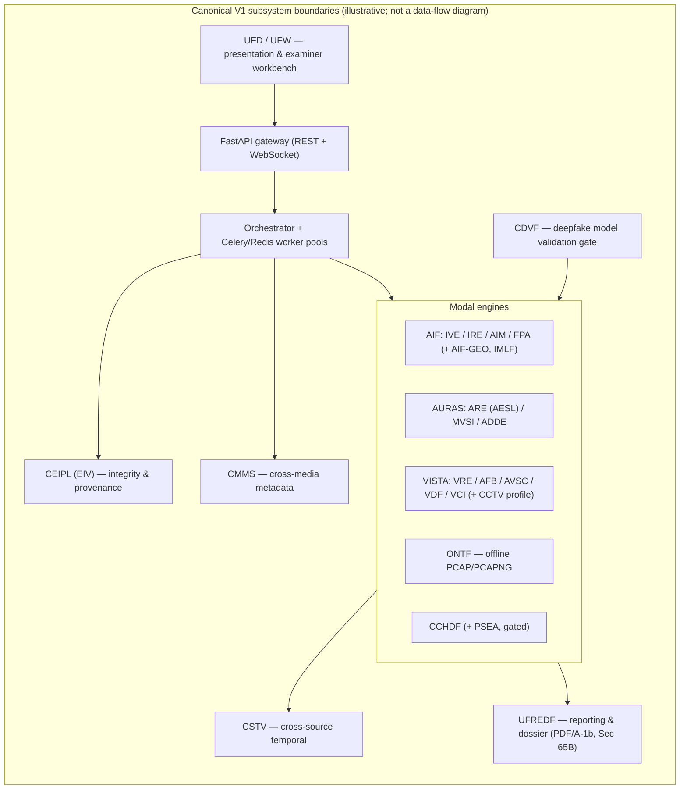
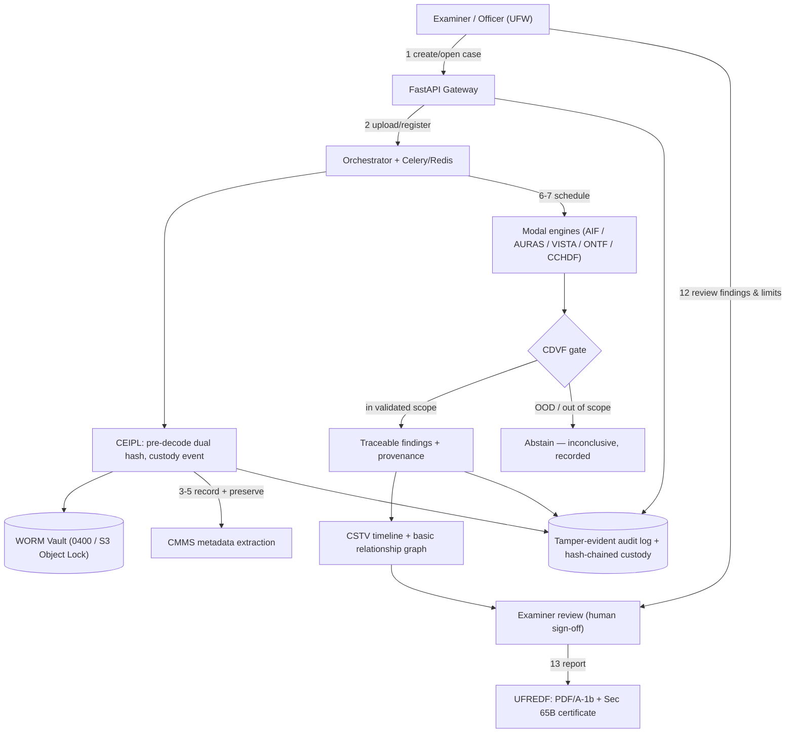

# PRODUCT_BRIEF.md — PS-05 Version 1 Product Brief

**Product:** Digital Evidence Authenticity and Integrity Verification Platform (PS-05)
**Repository:** `Subhadip-Paul2006/BHack-Docs`

---

## 1. Document Control

| Field | Value |
|---|---|
| Document | `PRODUCT_BRIEF.md` — Canonical Version 1 Product Brief |
| Status | **Draft V1.0** — for stakeholder review and reconciliation |
| Prepared | 2026 (Bihar Government Cyber Hackathon 2026 cycle) |
| Owner | PS-05 Product Owner (repository: `Subhadip-Paul2006/BHack-Docs`) |
| Audience | Technical and non-technical stakeholders; engineering, security, and examiner teams |
| Scope of authority | Product-level definition of Version 1 only. Does **not** supersede [TRD.md](TRD.md), [PRD.md](PRD.md), or [PHASES.md](PHASES.md). |
| Authority hierarchy | `TRD.md > PRD.md > PHASES.md > AI_INSTRUCTIONS.md` (per [AI_INSTRUCTIONS.md § 1](AI_INSTRUCTIONS.md)). Where this brief conflicts with any of those, that source is canonical and the discrepancy is recorded in [§ 19 Open Decisions](#19-open-decisions). |
| Diagrams | Authored as fenced ```mermaid blocks, matching the convention in [TRD.md § 2](TRD.md) and [docs/cctv_draft/01 § 6](docs/cctv_draft/01_intro_matrix_arch.md). Archify is a post-processor consumer of structured JSON IR; it is not where diagrams are authored. See [archify.config.json](archify.config.json). |

**Implementation status note (do not read as V1 delivered).** Per [PHASES.md § 2](PHASES.md) the only `IMPLEMENTED_AND_VERIFIED` items are Phase 0 (architecture baseline), AIF-IML-00, and CDVF-A0. All forensic engines, the WORM vault, reporting, and the dashboard are `PLANNED`. This brief distinguishes **planned capabilities** (V1 scope) from **implemented capabilities** throughout. Nothing in this document claims a subsystem is built.

---

## 2. Executive Summary

PS-05 is an overall digital forensics platform for authorized investigators: it preserves evidence integrity, examines multi-modal evidence, correlates findings across sources, and produces traceable forensic reports. **Version 1 delivers a reliable end-to-end evidence workflow** — case creation through report delivery — across the supported evidence categories, with integrity-first processing, case-scoped access, and structured reporting.

V1 prioritizes a coherent workflow over a large number of disconnected AI features. Deep-learning capabilities (deepfake detection, diarization, manipulation localisation, and related analyses) are included only where their model, dataset, and validation dependencies are met; they are gated by the CDVF validation framework and always carry explicit uncertainty and scope limitations. V1 is not a guarantee of detection, not an identity verifier, and not a substitute for examiner judgment or judicial process.

---

## 3. Product Vision

From [PRD.md § 3.1](PRD.md): the platform is intended to "establish India's most trustworthy, cryptographically verifiable, and technologically advanced digital forensic verification platform — empowering cyber cells and forensic laboratories to separate genuine electronic evidence from manipulated or synthetically fabricated digital artifacts with mathematical certainty, signal-level explainability, and cryptographic rigor."

V1 is the first demonstrable slice of that vision: a working, auditable, examiner-in-the-loop evidence pipeline. The platform context is the PS-05 problem statement of the Bihar Government Cyber Hackathon 2026 (C-DAC Patna / CCSU / Bihar Police), covering image/metadata forensics, ELA and compression analysis, CCTV frame integrity, timestamp anomaly detection, audio/voice tampering detection, and forensic dashboard & reporting ([PRD.md § 2.1](PRD.md), [README.md § 1](README.md)).

---

## 4. Problem Statement

Generative AI (deepfakes, voice cloning, diffusion-generated imagery, synthetic video) is producing digital artifacts that are increasingly indistinguishable from genuine ones, while manual forensic examination is slow and examiner capacity is scarce ([README.md § 1](README.md)). Investigators need a platform that:

- preserves the integrity of seized digital evidence from the moment of intake,
- examines it with explainable, reproducible methods,
- correlates findings across heterogeneous evidence (audio, video, images, documents, network captures), and
- produces reports that trace every finding back to its source evidence, tooling, and configuration.

V1 addresses this for a defined set of evidence categories and an authorized investigator audience, with explicit honesty about what analysis can and cannot conclude.

---

## 5. Intended Users and Stakeholders

Principal personas per [PRD.md § 4.1](PRD.md) (P-1…P-5):

| Persona | Principal Goals | Expected V1 Workflows | Access Boundaries |
|---|---|---|---|
| **P-1** Cyber Police Investigating Officer | Fast triage of seized phones, CCTV, and extortion-audio cases; summary authenticity certificates | Create case, register evidence, watch job status, read findings summary and report | Own assigned cases; read-only on other cases |
| **P-2** Senior Digital Forensic Examiner (FSL/CFSL) | Deep signal-level analysis, manipulation localisation, custom tuning | Intake through full engine workflows; examiner review; report | Case-scoped write on evidence/findings; advanced workbench (UFW) access |
| **P-3** Public Prosecutor / Legal Counsel | Explainable, defense-resilient reports; Section 65B / 63 BSA certificates | Read findings dossier and final report; verify hashes and provenance | Read-only on assigned cases; report review role |
| **P-4** System Administrator & Evidence Custodian | RBAC, multi-tenant case isolation, air-gapped deployment, audit | Provision users/roles, manage vault and infra, audit logs | Platform administration; custody operations with dual-control on high-impact actions |
| **P-5** Forensic ML Evaluation & Security Engineer | Reproducible benchmarking, OOD detection, model license audit | CDVF validation runs, benchmark harness, security regression | Model registry and validation workspaces; no evidence access |

**Role model.** This brief does **not** introduce a new role hierarchy. The UFD enforces the nine-role model documented in [README.md § 4.31.3](README.md) (System Admin, Case Admin, Investigating Officer, Forensic Examiner, Evidence Custodian, Technical Reviewer, Report Reviewer, Independent Auditor, Model Administrator) with the Dual-Control Invariant for high-impact operations (quarantine release, custody override, final 63 BSA report issuance). Access is case-scoped via PostgreSQL Row-Level Security ("zero cross-case leakage", [README.md § 4.31.2](README.md)). P-1…P-5 map onto that documented model, not on new roles.

---

## 6. Product Principles

Product-level commitments for V1. Detailed implementation controls remain in [TRD.md](TRD.md) and [PRD.md § 7](PRD.md).

1. **Preserve original evidence; maintain traceable provenance.** Originals are never altered; custody is hash-chained from intake.
2. **Treat uploaded files as untrusted input.** Defensive decoding, parser isolation, zero-execution of embedded payloads.
3. **Verify integrity with documented cryptographic procedures.** Pre-decode dual hashing (SHA-256 / SHA3-512) before any processing; see [TRD.md § 10.B, § 19](TRD.md).
4. **Authorized, case-scoped, auditable access.** RBAC + RLS case isolation; every significant operation is logged.
5. **Separate original evidence from derived artifacts and findings.** Lineage DAG records parent/child artifact relationships.
6. **Record engine, model, configuration, and processing versions** for every analysis (finding-level traceability via `analysis_run_id` + model + config + input hash, [PRD.md § 7.9 PLAT-NFR](PRD.md)).
7. **Communicate uncertainty and limits.** No "100% fake/authentic" claims; inconclusive verdicts are a valid, expected outcome.
8. **Human review of significant interpretations.** Findings are inputs to examiner decisions, not decisions themselves.
9. **Never equate a face match, voice similarity, anomaly score, or AI-generated indicator with verified identity, intent, or guilt.**
10. **User-provided metadata is not independently verified evidence.** It is tagged, not trusted.
11. **Protect sensitive evidence; minimize exposure.** Air-gap capability; biometric extraction only under documented authorization.
12. **Integrity ≠ authenticity.** A verified hash proves the file is unchanged since recording — it does **not** prove the recording itself is genuine ([README.md § 9, NG-7](README.md)).
13. **Distinction, always, between:** evidence integrity (cryptographic), source authenticity (forensic analysis), and analytical interpretation (examiner judgment).

---

## 7. Version 1 Goals

- A complete, demonstrable **end-to-end evidence workflow**: case → intake → integrity → metadata → asynchronous analysis → findings → examiner review → structured report.
- **Integrity-first by construction:** dual hashing and WORM custody precede all analysis, across every modality.
- **Traceability:** every finding ties to source evidence, engine, model, and configuration; every operation is auditable.
- **Case-scoped, role-bound access** with tamper-evident audit logs.
- **Structured forensic reports** (PDF/A-1b via UFREDF, with Section 65B / 63 BSA certificate generation where documented).
- **Responsible AI:** deep-learning outputs are calibrated, scope-limited by CDVF, and always paired with explicit uncertainty.
- **Failure honesty:** partial-success, unsupported-evidence, and failure states are first-class, not errors.

---

## 8. Version 1 Non-Goals

Per [README.md § 2 (NG-1…NG-9)](README.md) and [PRD.md § 9](PRD.md); each significant exclusion has a stated rationale.

| ID | Non-Goal | Rationale |
|---|---|---|
| NG-1 | No judicial verdict; no certainty of "genuine/fake" | Platform outputs probabilistic, explainable evidence; admissibility is the presiding authority's decision, not software's ([README.md § 1 item 11](README.md)) |
| NG-2 | No chip-off / JTAG physical extraction | Out of forensic scope; evidence is supplied as digital files ([PRD.md § 10.1](PRD.md)) |
| NG-3 | No live IDS / network sniffing | ONTF is an **offline** PCAP/PCAPNG subsystem by design |
| NG-4 | No end-to-end decryption claim without keys; PCAP ≠ full communication history | Key availability is external to the platform |
| NG-5 | No universal deepfake/manipulation detection guarantee | Scientifically unsupported; CDVF scopes every model to a validated domain |
| NG-6 | No proof of location from GPS/EXIF; no uploading evidence to external clouds | Metadata ≠ proof; air-gap is a required capability |
| NG-7 | Integrity verification ≠ authenticity verification | Cryptographic and forensic claims are distinct (see § 6.12) |
| NG-8 | EIV is not a new engine; it is a CEIPL capability | Canonical boundary per [TRD.md § 19, § 23.2](TRD.md) |
| NG-9 | CSTV does not establish physical causality | Temporal correlation is not causal attribution |
| NG-X1 | No automatic identity identification with certainty | 1:N biometric search is strictly prohibited; 1:1 comparison is gated behind an authorized, unexpired `case_authorization_token` ([AI_INSTRUCTIONS.md § 5.3](AI_INSTRUCTIONS.md)) |
| NG-X2 | No fully autonomous investigative decisions | Examiner-in-the-loop is a V1 invariant |
| NG-X3 | No unvalidated courtroom-admissibility claims | Platform documents evidence handling; a court decides admissibility |
| NG-X4 | No unlimited file sizes or unrestricted concurrency | Bounded resource limits are required ([PRD.md § 7.1 NFR-SEC, § 7.9 PLAT-NFR](PRD.md)) |
| NG-X5 | No universal proprietary CCTV codec support | V1 supports documented format/codec sets; gaps are reported as "unsupported" |
| NG-X6 | No unvalidated research capabilities presented as production | PSEA-class research outputs remain research-grade and explicitly labeled |
| NG-X7 | No features requiring unavailable hardware, datasets, integrations, or legal authorization | Conditional scope; see § 9.2 |

---

## 9. V1 Scope and Prioritization

Priority scheme: **P0** — essential for the V1 end-to-end workflow. **P1** — important for a credible V1 demonstration. **P2** — conditional, advanced, or deferrable.

### 9.1 V1 Core (P0)

Delivered because [PRD.md § 6.1 FR-CORE-001…007](PRD.md) and [§ 12.1 (MVP)](PRD.md) mark these core, and they form the spine of the § 12 workflow:

- Case and investigation management; evidence intake and identification (FR-CORE-001).
- Pre-write dual hashing (SHA-256 + SHA3-512) and integrity verification (FR-CORE-002, CEIPL/EIV).
- Original-evidence preservation: WORM read-only storage (FR-CORE-003); derived-artifact lineage DAG (FR-CORE-004).
- Asynchronous background processing with job-status tracking (FR-CORE-005/006; orchestrator + Celery/Redis; platform core is the one `IMPLEMENTED_AND_VERIFIED` surface today).
- Tamper-evident audit log (FR-CORE-007).
- Baseline metadata extraction across modalities (CMMS baseline; MVP § 12.1).
- Modal workflows at the **documented contract level** for audio (AURAS), image (AIF), video/CCTV (VISTA), and offline network (ONTF) — i.e., intake, scheduling, findings, and provenance wired end-to-end; advanced engine internals per § 9.2.
- Findings with source traceability; basic evidence relationship graph and **one** case-scoped RAG flow ([PRD.md § 12.1](PRD.md)).
- Basic cross-source timeline reporting (CSTV baseline; [PRD.md § 12.1](PRD.md)).
- Structured forensic report generation (UFREDF; PDF/A-1b; Section 65B certificate per FR-CORE-006 — P1-marked in the PRD and treated here as conditional for release, see § 15 AC-13).
- Authentication, authorization (RBAC + RLS), auditability.
- Failure handling: partial-success reporting, unsupported-file verdicts, retry/cancel, recovery from interruption ([PRD.md § 7.9 PLAT-NFR](PRD.md)).

### 9.2 V1 Advanced / Conditional (P1–P2)

| Capability | Documentation class | V1 stance | Condition for inclusion |
|---|---|---|---|
| Speaker diarization & multilingual speech (MVSI) | P1; [PHASES.md AURAS-A3…A5](PHASES.md) | Conditional | Models, Indian-language datasets, and validation targets (e.g., Macro-F1 > 85% per [PRD.md § 8.1 AUD-FR-013](PRD.md)) available |
| AI-generated / cloned-voice indicators (ADDE) | P1; AURAS-A6…A8 | Conditional | RawNet2/WavLM checkpoints + validation set; DER < 18% per AUD-FR-012; CDVF gate |
| Audio splice localisation (AESL within ARE) | P1; AURAS-AESL workstream | Conditional | Benchmark tIoU ≥ 0.75, MAE ≤ 15 ms targets met ([README.md § 4.30.6](README.md)) |
| A/V synchronization & correspondence (AVSC) | P1; VISTA-A5 | Conditional | SyncNet availability + validation |
| Person/face/object/vehicle analysis (VCI, IVE, FPA) | P1–P2; VISTA-A6, AIF-A3…A6 | Conditional; **1:1 biometric comparison is gated and P2**, requires valid `case_authorization_token`; 1:N prohibited | Detection/tracking targets (MOTA > 0.70, IDF1 > 0.75 per VCI-FR-004; zero character hallucination ALPR per VCI-FR-011) met |
| Cross-camera correlation (VISTA-CCTV profile) | P1; VISTA-A7…A8 | Conditional | CCTV context + adaptive questionnaire + basic timeline report is MVP (§ 12.1); advanced CCTV-FR-007…009 are P1/conditional |
| Image authenticity & manipulation analysis (AIM, IMLF) | P1; AIF-A10…A12, AIF-IML workstream | Conditional | Steganalysis AIM-FR-004 is P1; manipulation localisation IMLF-A6/A7/A8 are P1 (AIF-IML-00 is implemented) |
| Concealed-data / steganography forensics (CCHDF; PSEA within it) | P1–P2 | Conditional / deferred | PSEA requires calibrated RF/SDR/thermal lab sensors ([PRD.md § 23.2, README.md § 4.34](README.md)) — deferred unless lab capability exists |
| Offline network-capture investigation (ONTF) | P0 for basic dissection/triage; P1 for ML threat analysis | Core + conditional | Basic TShark/Zeek dissection and flow analysis are core; ML ONTF-FR-017 (F1 > 0.90 on CIC-IDS2017/UNSW-NB15) is conditional on dataset availability |
| Cross-source temporal verification (CSTV) | P0 baseline; advanced source set P1 | Core baseline | 17-source-category baseline; 27 semantic-type registration per [PRD.md § 17.4](PRD.md) is advanced |
| Evidence graph & investigation-oriented RAG | P0 basic; P2 advanced | Core basic | One case-scoped RAG flow + basic relationship graph (MVP); graph-enhanced retrieval is deferred ([PRD.md § 12.1 post-MVP list](PRD.md)) |
| AIF-GEO geospatial forensics | P1; AIF-GEO workstream | Conditional | PostGIS + reverse-geocoding + validation dataset |
| CDVF validation of deepfake models | **P0 prerequisite** | Required gate | No ADDE/VDF finding is released without passing CDVF (calibration ECE ≤ 0.05, OOD gating, 6-gate scoped approval `VALIDATED_FOR_DEFINED_SCOPE`) |

### 9.3 Prioritization Table

| ID | Capability | V1 Priority | Rationale | Dependencies | Acceptance Evidence |
|---|---|---|---|---|---|
| PV-01 | Case management + evidence intake/identification | P0 | Workflow spine; FR-CORE-001 | PostgreSQL 15+/16, API | AC-01 |
| PV-02 | Dual hashing + integrity verification (CEIPL/EIV) | P0 | "Integrity-first" invariant; FR-CORE-002 | WORM vault, cryptography stack | AC-02, AC-03 |
| PV-03 | WORM preservation + lineage DAG | P0 | Original preservation; FR-CORE-003/004 | MinIO/S3 Object Lock or POSIX 0400 | AC-04, AC-05 |
| PV-04 | CMMS baseline metadata extraction | P0 | Findings need provenance context | Metadata schemas per [TRD.md § 16](TRD.md) | AC-06 |
| PV-05 | Async processing + job status (orchestrator, Celery/Redis, checkpoints, DLQ) | P0 | Workflow + observability; FR-CORE-005/006 | Redis broker, worker pools | AC-07, AC-14 |
| PV-06 | Modal workflows (AIF, AURAS, VISTA, ONTF, CCHDF) at documented contract level | P0 | Coherent multi-modal V1 | Engine implementations per PHASES workstreams | AC-08, AC-09 |
| PV-07 | Findings + source traceability + basic relationship graph + one case-scoped RAG flow | P0 | "Correlate" objective; MVP § 12.1 | Finding records, graph storage | AC-10 |
| PV-08 | Basic CSTV timeline report | P0 | Correlation across evidence types | CMMS timestamp normalization | AC-10 |
| PV-09 | RBAC + RLS case-scoped access + tamper-evident audit | P0 | Security invariant; FR-CORE-007 | PostgreSQL RLS, audit chain | AC-11, AC-12 |
| PV-10 | UFREDF structured report (PDF/A-1b) | P0 | "Produce traceable reports" objective | Jinja2 + WeasyPrint | AC-13 |
| PV-11 | Section 65B / 63 BSA certificate generation | P1 | P0-marked legal value, P1 in PRD (FR-CORE-006) | Legal review of certificate text | AC-13 |
| PV-12 | CDVF validation gate for ADDE/VDF | P0 (as gate) | Responsible-AI invariant | Model registry, benchmark sets | AC-15 |
| PV-13 | ADDE deepfake audio (conditional) | P1 | High examiner value; gated | Checkpoints, validation data, CDVF | AC-15 (targets per AUD-FR-012/013) |
| PV-14 | VDF video deepfake (conditional) | P1 | CCTV context | SyncNet-free path + VDF-FR-001/005 targets | AC-15 |
| PV-15 | MVSI diarization/multilingual (conditional) | P1 | Indian-language scope | Datasets + models | AC-15 |
| PV-16 | VCI/IVE/FPA content + 1:1 biometric (gated) | P1 (detection) / P2 (biometric) | Value vs. governance | Token-gated 1:1; 1:N prohibited | AC-15, AC-16 |
| PV-17 | VISTA-CCTV cross-camera correlation | P1 | Profile, not engine | VRE + VCI + AVSC outputs | AC-10 (baseline) |
| PV-18 | AIM/IMLF manipulation localisation | P1 | Manipulation claims need evidence | AIF-A10…A12, AIF-IML workstream | AC-15 |
| PV-19 | ONTF basic dissection + flow analysis | P0 | Offline network evidence is in-scope evidence class | TShark/Zeek, sandbox | AC-17 |
| PV-20 | ONTF ML threat analysis (ONTF-FR-017) | P1 | Conditional on datasets | CIC-IDS2017/UNSW-NB15 | AC-15 |
| PV-21 | AIF-GEO geospatial correlation | P2 | High infra dependency (PostGIS) | PostGIS, geocoding service | Deferred unless dependency confirmed |
| PV-22 | CCHDF triage + PSEA | P1 / P2 (deferred) | Triage valuable; PSEA needs lab sensors | Sensor hardware | AC-17 (deferred label) |
| PV-23 | Graph-enhanced retrieval, advanced RAG | P2 | Post-MVP per § 12.1 | PV-07 baseline | Deferred |

---

## 10. Supported Evidence Categories

| Category | Formats documented (source) | V1 handling |
|---|---|---|
| Audio | `.wav, .mp3, .m4a, .aac, .flac` ([PHASES.md AURAS-A0](PHASES.md)); OGG/AIFF/Opus per [README.md § 4.28.1](README.md) | AURAS contract workflow; conditional advanced engines (§ 9.2) |
| Video / CCTV | MP4 / MKV / AVI / MOV / TS / DAV / native ([README.md § 4.10, § 4.12](README.md)) | VISTA contract workflow + CCTV forensic profile; codec gaps → "unsupported" verdict |
| Images / photographs | JPEG / PNG / TIFF / HEIC / WebP / RAW ([README.md § 4.8](README.md)); DNG/AVIF per § 4.28.1 | AIF contract workflow; defensive decode ceiling applies (§ 15 AC-17) |
| Documents / digital files | Per [TRD.md](TRD.md) documented file profile; OCR/document extraction beyond baseline is post-MVP ([PRD.md § 12.1](PRD.md)) | Intake + integrity + metadata; content analysis conditional |
| Network captures | PCAP / PCAPNG **only, offline** ([PRD.md § 6.5](PRD.md), [README.md § 4.16](README.md)) | ONTF subsystem; up to 2 GB standard / 10 GB streaming ingestion (ONTF-NFR-002) |
| GPS tracks | GPX, KML, NMEA, FIT, CSV ([README.md § 4.22](README.md)) | AIF-GEO; P2/conditional |
| Disk images (gated) | raw/dd, E01, VMDK, VHD(VHDX) ([PRD.md § 23](PRD.md)); standalone files blocked | CCHDF-gated |
| Metadata / provenance records | Universal CMMS schema; 14 (CMMS) / 27 (CSTV-registered) timestamp semantic types — see OD-PB-12 | CMMS baseline, P0 |

**Explicit unsupported behavior:** an unsupported file is a first-class outcome — recorded, hashed, and reported as `UNSUPPORTED` with reason; it does not fail the case.

---

## 11. Canonical Subsystem Overview

Names and boundaries verified against [TRD.md § 2, § 23.2](TRD.md) and [README.md](README.md). This section states boundaries only; detailed specs live in the linked sources.

- **AURAS — Audio Understanding, Reconstruction & Analysis System.** Exactly three engines: **ARE** (Audio Reverse Engineering Engine — signal profiling, spectral/splice candidates, ENF), **MVSI** (Multilingual Voice & Speaker Intel — VAD, neural diarization, Indian-language ID), **ADDE** (Audio Deepfake Detection Engine — waveform/graph/foundation-model ensembling). **AESL (Audio Edit and Splice Localisation) is an ARE workstream, not a fourth engine** ([TRD.md § 18.1, § 15.7](TRD.md) "Three-Engine Boundary Invariant").
- **VISTA — Video Integrity, Synchronization & Tampering Analysis.** Exactly five engines: **VRE** (Video Reverse Engineering Engine), **AFB** (Audio Forensic Bridge — lossless stream-copy extraction + async AURAS routing), **AVSC** (Audio-Visual Synchronization & Correspondence), **VDF** (Video Deepfake & AI-Generation Detection), **VCI** (Video Content Intelligence Engine — detection/tracking/counting/OCR). **CCTV is a cross-cutting forensic profile within VISTA, not a sixth engine** ([TRD.md § 11.1](TRD.md)); CFITSA is a VRE-integrated sub-branch.
- **CEIPL — Cryptographic Evidence Integrity & Provenance Layer** (`ps05.core.crypto`): pre-decode dual hashing, RFC 8785 manifests, Ed25519 signing, RFC 3161 TSA, Merkle DAG, hash-chained custody. **EIV (Evidence Integrity Verification) is a capability within CEIPL, not a separate engine** ([TRD.md § 19.1](TRD.md)).
- **AIF — Advanced Image Forensics Subsystem:** **IVE** (Image Understanding & Visual Evidence Engine), **IRE** (Image Reverse Engineering Engine), **AIM** (AI, Manipulation & Steganography Engine), **FPA** (Face, Portrait & Biometric Analysis Module). **AIF-GEO** (Geospatial Forensics & Evidence Correlation) and **IMLF** (Image Manipulation Localisation Framework) are within AIF.
- **ONTF — Offline Network Forensics.** Defensive PCAP/PCAPNG ingestion, TShark/Zeek batch dissection, flow normalisation, attribution, covert-timing analysis. **Offline by design — not a live capture engine** ([TRD.md § 23.2, § 23.16](TRD.md)).
- **CMMS — Cross-Media Metadata Service.** Cross-cutting metadata extraction/normalization without altering original bitstreams ([TRD.md § 16](TRD.md)). Package boundary: `ps05.engines.cmms` per [TRD.md § 23.2](TRD.md) (conflict with `docs/` recorded in OD-PB-06).
- **CSTV — Cross-Source Timestamp Verification & Case-Wide Timeline.** Platform-wide temporal correlation service; **not** a modality-specific detection engine ([TRD.md § 17](TRD.md)).
- **CDVF — Cross-Modal Deepfake Validation Framework.** Model evaluation, calibration (ECE ≤ 0.05), OOD evaluation, abstention taxonomy, and scoped 6-gate model approval; **gates** ADDE/VDF findings ([TRD.md § 11.B](TRD.md)).
- **UFREDF — Unified Forensic Reporting & Evidence Dossier Framework.** Shared reporting, dossier compilation, legal attestation; not a detector ([TRD.md § 21](TRD.md)).
- **UFD — user-facing presentation & workflow layer, containing UFW — the examiner-facing workbench/UI** ([TRD.md § 20](TRD.md)). Expansion conflict recorded in OD-PB-07.
- **CCHDF — Cross-Channel Concealment & Hidden-Data Forensics.** Triage scanner, finding normalizer, quarantine controller. **PSEA (Specialist Physical Side-Channel & Emissions Analysis) is a gated specialist component inside CCHDF**, not a top-level engine ([TRD.md § 22.1, § 22.10](TRD.md)).



---

## 12. Primary End-to-End User Workflow

V1 reference journey: **Case Creation → Evidence Intake → Integrity & Provenance → Metadata Extraction → Asynchronous Analysis → Findings & Correlation → Examiner Review → Forensic Report.**

1. Authorized user creates or opens a case (RBAC-checked).
2. User uploads or registers evidence via UFW.
3. Platform validates the intake request; evidence record + custody event written.
4. Pre-decode dual hashing (SHA-256 / SHA3-512) computed and recorded (CEIPL/EIV); original stored read-only in the WORM zone.
5. Original preservation verified; any derived artifact records lineage in the DAG.
6. Metadata extracted and normalized by CMMS (read-only on originals).
7. Orchestrator schedules applicable forensic workflows (Celery task queue, idempotency keys, checkpoints).
8. Suitable engines process asynchronously in isolated worker pools; CDVF gate applies to model-based findings.
9. Each analysis produces traceable findings (finding → source evidence, `analysis_run_id`, model + config + input hash), job status, and provenance.
10. Findings are associated with source evidence; duplicate submissions are detected (idempotent intake).
11. Supported cross-evidence correlations generated (CSTV timeline baseline; basic relationship graph) **with explicit uncertainty**.
12. Examiner reviews findings, limitations, and inconclusive verdicts in UFW; significant interpretations require human sign-off.
13. Platform produces a structured forensic report (UFREDF, PDF/A-1b, evidence manifest, hashes, versions, limitations; Section 65B certificate where in scope).
14. Case retains an auditable, hash-chained record of relevant operations; custody overrides and final report issuance follow the dual-control invariant.

**Failure-mode behavior (V1 contract):**

| Situation | V1 behavior |
|---|---|
| Successful processing | Findings + status + provenance recorded; report available |
| Partial success | Per-engine results preserved; case shows `PARTIAL_SUCCESS` with per-engine status; one failed optional analysis does **not** invalidate unrelated successful results ([PRD.md § 7.9](PRD.md)) |
| Unsupported evidence | Evidence recorded + hashed; verdict `UNSUPPORTED` with reason; case continues |
| Corrupt / unreadable file | Intake recorded; analysis job `FAILED(corrupt)` with diagnostics; original preserved; no silent loss |
| Failed jobs | Retry with idempotency keys; DLQ admission after bounded retries; human-visible failure record |
| Cancelled jobs | Job state transitioned to `CANCELLED`; checkpoint state retained; cancellation is an audited event |
| Duplicate submissions | Content-hash match → deduplicated (reference new case/label to existing evidence) or explicitly rejected; never double-processed |
| Missing optional engine | Workflow proceeds; affected findings reported as `NOT_RUN` with reason |
| Interruption / restart | Checkpoint + lease recovery; resume or safe re-run; exactly-once side effects per [PRD.md § 7.9 PLAT-NFR](PRD.md) |



Implementation note: steps 1–7 infrastructure (orchestrator, idempotency, checkpoints, DLQ, outbox, leases, API scaffold) is the currently verified Phase 0 surface ([PHASES.md § 2](PHASES.md)); engine internals, vault, and reporting are planned.

---

## 13. Functional Capability Summary

| Area | V1 capability (link to requirements) | Status |
|---|---|---|
| Cases & intake | Case registration; evidence ID/custody — [PRD.md § 6.1](PRD.md) FR-CORE-001/003 | Planned (core surface scaffolded) |
| Integrity | Dual hashing, WORM, lineage DAG, audit chain — FR-CORE-002…004/007, [TRD.md § 19](TRD.md) | Planned |
| Metadata | CMMS baseline schemas — [TRD.md § 16](TRD.md) | Planned |
| Audio | AURAS contract workflow; conditional ARE/MVSI/ADDE/AESL depth | Planned |
| Image | AIF contract workflow; conditional IRE/AIM/FPA/GEO/IMLF depth | Planned (AIF-IML-00 implemented) |
| Video/CCTV | VISTA contract workflow + CCTV profile; conditional VDF/AVSC depth | Planned |
| Network | ONTF offline dissection P0; ML threat analysis P1 — [PRD.md § 6.5](PRD.md) | Planned |
| Correlation | CSTV baseline timeline; basic graph + one RAG flow — [PRD.md § 12.1](PRD.md) | Planned |
| Reporting | UFREDF dossier + PDF/A-1b + 65B certificate — [TRD.md § 21](TRD.md) | Planned |
| Platform | Orchestrator, idempotency, checkpoints, DLQ, outbox/inbox, leases, API — [PHASES.md Phase 0](PHASES.md) | **Implemented and verified** |
| Presentation | UFD/UFW dashboard & workbench — [TRD.md § 20](TRD.md) | Planned |

---

## 14. Security, Evidence Integrity, and Responsible AI

Product-level commitments (implementation detail stays in [TRD.md](TRD.md), [PRD.md § 7](PRD.md), and the README § 9 invariants):

- **Integrity:** eleven evidence-integrity & security invariants documented in [README.md § 9](README.md) (zero raw alteration, pre-decode hashing, lineage DAG, append-only Merkle audit, defensive decode ceilings, zero-execution, biometric purpose limitation, decoupled audio extraction, no false certainty, air-gap, PCAP parser sandboxing).
- **Access:** RBAC + PostgreSQL RLS case isolation ([README.md § 4.31.2](README.md)); nine-role UFD model + Dual-Control Invariant for high-impact operations ([README.md § 4.31.3](README.md)); secrets management and air-gapped operation per [PRD.md § 7.1 NFR-SEC](PRD.md).
- **Resource safety:** bounded parsing/decoding (defensive decode ceilings, video worker caps per NFR-SEC, ONTF 2 GB cap), decompression-bomb defenses (ceiling value unresolved — OD-PB-01), parser sandboxing, bounded concurrency.
- **Responsible AI:** CDVF calibration/ECE ≤ 0.05, leakage-proof splits, OOD gating, 7-state abstention taxonomy (count conflict — OD-PB-03), 6-gate scoped model approval `VALIDATED_FOR_DEFINED_SCOPE`, subgroup-fairness review (disparity > 2.0× triggers scope restriction) ([TRD.md § 11.B, § 3.6](TRD.md)). Biometric extraction is purpose-limited and token-gated; 1:N search is prohibited. Every subsystem carries typed "≠" claims and mandatory inconclusive-verdict paths (e.g., [README.md § 4.5, § 4.15, § 4.20, § 4.29.5, § 4.32.4](README.md)).
- **Legal posture:** The platform documents evidence handling and reproducibility; **admissibility is determined by the presiding judicial authority** ([README.md § 1 item 11](README.md)). Biometric/health-adjacent limits per [PRD.md § 16.1](PRD.md).

---

## 15. V1 Acceptance Criteria

Measurable, testable, or explicitly TBD. No numbers are invented: every cited target carries its source requirement ID.

| ID | Criterion | Target / source | Verification method |
|---|---|---|---|
| AC-01 | Intake: every registered piece of evidence gets a unique evidence ID and custody event before processing | FR-CORE-001/003 | API + DB assertions |
| AC-02 | Dual hash (SHA-256 + SHA3-512) recorded pre-write for every artifact | FR-CORE-002 | Recompute & compare |
| AC-03 | Integrity-failure handling: post-integrity check mismatch → evidence flagged/quarantined, case shows integrity-failed, no silent success | FR-CORE-002, NFR-REL-001 | Fault-injection test |
| AC-04 | Original byte-identical after all processing | NFR-SEC zero-alteration | Hash compare vs intake |
| AC-05 | Every derived artifact carries lineage (parent/child hash, transform params) | FR-CORE-004 | DAG validation |
| AC-06 | Metadata extraction completes for supported types; unsupported types get explicit `UNSUPPORTED` verdict, no crash | § 10 table | Format matrix tests |
| AC-07 | Job lifecycle visible: queued → running → succeeded/partial/failed/cancelled; job detail includes model, config, input hash | PLAT-NFR | UI/API + DB state-machine test |
| AC-08 | Partial-failure isolation: one failed optional engine leaves other results intact; case state `PARTIAL_SUCCESS` | PLAT-NFR | Fault-injection test |
| AC-09 | Duplicate submission: same content + same case deduplicated or explicitly rejected, never double-processed | Idempotency (Phase 0) | Replay test |
| AC-10 | Correlation outputs (CSTV baseline timeline, basic relationship graph) cite source evidence IDs and carry uncertainty labels | § 12.1 MVP | Finding-traceability check |
| AC-11 | Case-scoped authorization: role X cannot read case Y evidence/findings | RLS (NFR-SEC-003) | Cross-case access test → denied |
| AC-12 | Auditability: every relevant operation logged and hash-chained; custody override + final 63 BSA issuance require dual authorization | FR-CORE-007, README § 4.31.3 | Audit-replay test |
| AC-13 | Report completeness: evidence manifest, hashes, engine/model/config versions, findings with provenance, limitations, 65B certificate; re-run on same inputs reproduces the report content | UFREDF § 21, PLAT-NFR | Diff two generated reports |
| AC-14 | Recovery: kill/restart mid-job → checkpoint/lease resume or safe re-run; exactly-once side effects | PLAT-NFR-003/004 | Kill-switch test |
| AC-15 | Model-gated capabilities meet their documented targets before release: AUD-FR-012 DER < 18%; AUD-FR-013 Macro-F1 > 85%; VDF-FR-001 ROC-AUC > 0.94 (FaceForensics++); VDF-FR-005 ECE < 0.05; VCI-FR-004 MOTA > 0.70 / IDF1 > 0.75; ONTF-FR-017 F1 > 0.90 (CIC-IDS2017/UNSW-NB15) | PRD § 8.1/§ 8.3, CDVF-NFR-003 | CDVF benchmark harness |
| AC-16 | Biometric: 1:1 comparison only with valid `case_authorization_token`; no 1:N path exists in the codebase | AI_INSTRUCTIONS § 5.3 | Code audit + negative test |
| AC-17 | Resource-bound behavior: defensive decode ceilings, video worker caps, ONTF 2 GB cap, triage time-boxes (CCHDF-NFR-007) hold under adversarial inputs | NFR-SEC, ONTF-NFR-002 | Adversarial-file suite |
| AC-18 | Performance baselines where documented: NFR-PERF-001…009 (e.g., 5-min audio profile < 3 s CPU; ADDE 60 s clip < 15 s GPU / < 60 s CPU; 12 MP image < 8 s; CCTV ≥ 2× real-time; 10 concurrent jobs; VRE ≥ 5× real-time; tiling VRAM < 4 GB); AESL tIoU ≥ 0.75, MAE ≤ 15 ms | PRD § 7.2, README § 4.30.6 | Benchmark runs |
| AC-19 | End-to-end demo wall-clock time for the 9-step demo workflow | **TBD — requires stakeholder decision**; determine by timed run of [README.md § 15](README.md) demo, then set a target | Timed demo run |
| AC-20 | Image decompression-bomb ceiling value | **TBD — OD-PB-01** (128 MP vs 100 MP must be reconciled before this criterion can be written) | Reconciliation + test |

---

## 16. Dependencies and Constraints

**Confirmed** (from [TRD.md](TRD.md), [pyproject.toml](pyproject.toml), [archify.config.json](archify.config.json)): FastAPI + uvicorn; Python ≥ 3.11 < 3.13; PostgreSQL 15 minimum / 16 target; SQLAlchemy (async) + asyncpg + Alembic; Redis + Celery task queue; MinIO or S3 Object Lock for the WORM vault (POSIX 0400 alternative); local-first/air-gap model serving with CPU/CUDA dual execution; Jinja2 + WeasyPrint → PDF/A-1b; modular-monolith + isolated worker pools architecture; Archify post-processing pipeline (JSON IR → self-contained HTML/SVG, theme `forensic-dark`, outputs to `dist/reports`).

**Assumed — still to validate (see § 17):**

| Dependency / constraint | Type |
|---|---|
| Workstation ≥ 16 GB RAM + T4/RTX 3060-class GPU ([PRD.md § 10.1](PRD.md)) | Assumption |
| Local availability of model checkpoints (RawNet2, WavLM, SyncNet, RetinaFace/ByteTrack, YOLOv8/v10, SAM 2, FTCN/VideoMAE, Xception/EfficientNet, ArcFace/MagFace) with licenses — air-gapped | Assumption |
| Validation datasets (FaceForensics++, CIC-IDS2017/UNSW-NB15, 1,000-image CDVF benchmark, Indian-language audio) — license-clean for air-gap | Assumption |
| TShark/Zeek availability for ONTF dissection in the target environment | Assumption |
| PostGIS for AIF-GEO | Deferred dependency (PV-21) |
| PSEA sensor lab (RF/SDR/thermal) | Deferred dependency (PV-22) |
| Deployment: air-gapped packaging per Phase 9 | Confirmed requirement |
| Human examiner review sign-off on significant interpretations | Confirmed requirement |

---

## 17. Assumptions

| ID | Assumption | Impact if wrong | Next action |
|---|---|---|---|
| A-PB-01 | Evidence is supplied as digital files, not physical chip dumps ([PRD.md § 10.1](PRD.md)) | Intake scope changes | Confirm with stakeholder |
| A-PB-02 | ≥ 16 GB RAM workstation available; GPU is optional with CPU fallback paths | Targets in AC-15/18 shift | Validate deployment hardware |
| A-PB-03 | All model checkpoints + validation datasets are obtainable air-gap | P1 conditional features drop to P2 | Inventory + license audit (P-5 workflow) |
| A-PB-04 | Target PostgreSQL is v15 or 16 | Minor; upgrade plan needed | Confirm ops environment |
| A-PB-05 | MinIO/S3 Object Lock available (or POSIX 0400 fallback accepted) | WORM design choice | Confirm storage |
| A-PB-06 | 1:1 biometric comparison will be used under judicial/case authorization only | Feature may stay P2/unused | Confirm examiner procedure |
| A-PB-07 | Section 65B / 63 BSA certificate text is legally reviewable in-cycle | Report completeness (AC-13) gated | Assign legal review |
| A-PB-08 | Demo workflow of [README.md § 15](README.md) is the V1 demonstration script | Release-demo scope | Stakeholder sign-off |

---

## 18. Risks and Mitigations

| ID | Risk | Impact | Mitigation |
|---|---|---|---|
| R-PB-01 | Models/datasets unavailable air-gap | P1 features cannot ship in V1 | PV-13…18 marked conditional; CDVF gating keeps released claims honest |
| R-PB-02 | GPU variance across deployment targets | AC-15/18 targets flaky | Documented CPU fallback (NFR-PERF-002 pattern); per-target baselines |
| R-PB-03 | Validation-benchmark time (CDVF 1,000-image run, diarization targets) | Slips release | CDVF-A0 harness already implemented; run early, gate late |
| R-PB-04 | Codec/format coverage gaps (esp. CCTV proprietary) | "Unsupported" verdicts on real evidence | Explicit unsupported handling (§ 12); no universal-support promise (NG-X5) |
| R-PB-05 | Documentation conflicts (OD-PB-01…12) cause scope drift | Wrong ceiling/overlap/state-count shipped | Open Decisions reconciled before Phase 7 reporting; TRD authority applied per AI_INSTRUCTIONS § 1 |
| R-PB-06 | Biometric misuse beyond governance | Legal/regulatory exposure | Token-gate + 1:N prohibition enforced at API and code level (AC-16) |
| R-PB-07 | Overclaiming admissibility | Credibility loss | § 14 legal posture; report language reviewed (A-PB-07) |
| R-PB-08 | Many workstreams `PLANNED`; milestone M-9 gates real-evidence processing | Release timing risk | Milestone gates per [PHASES.md § 9.1](PHASES.md); P0-only demo path first |
| R-PB-09 | Malicious input → parser/resource DoS | Availability | Defensive decode ceilings, sandboxing, bounded concurrency (AC-17) |
| R-PB-10 | Non-reproducible analysis | Forensic invalidity | SHA-256-pinned checkpoints, `model_registry`/`cdvf_model_registry`, finding-level versioning (AC-13/14) |

---

## 19. Open Decisions

Recorded discrepancies. None silently resolved; recommended action given.

| ID | Description | Impact | Recommended next action |
|---|---|---|---|
| OD-PB-01 | Image decompression-bomb ceiling: `MAX_IMAGE_PIXELS = 128_000_000` (PRD § 5.2, AIF-FR-002, NFR-SEC-006, RSK-08) vs **100,000,000** (PRD § 14.14 IMLF, README § 4.27-era rows) | AC-20 unwritable until fixed | Reconcile in PRD; TRD authority decides; update both docs |
| OD-PB-02 | Image tiling overlap: 15% (PRD NFR-PERF-006) vs 25% (README § 4.27, PHASES AIF-IML-06) | Affects IMLF accuracy targets | Stakeholder + IMLF owner decision; record in TRD |
| OD-PB-03 | CDVF abstention states: 7 (README § 4.26) vs 8 (PHASES CDVF-A9 row) | AC-15 harness + report text | CDVF-A0/A1 owner confirms canonical count; fix PHASES row |
| OD-PB-04 | PRD O-2 still says "four specialized forensic engines" — stale vs the current subsystem inventory | Misleads V1 scope readers | Update PRD § 3.2; this brief (§ 11) is the interim canonical list |
| OD-PB-05 | Phase vocabulary: README § 4.2/§ 10 use "Phase 2–6" labels; PHASES.md defines only Phases 0, 1, 7–10 at platform level | Roadmap ambiguity | Align README with PHASES workstream numbering |
| OD-PB-06 | CMMS package boundary: `ps05.engines.cmms` (TRD § 23.2) vs `ps05.core.*` (docs/cctv_draft/02) | Code layout conflict | TRD wins per authority hierarchy; fix docs/cctv_draft |
| OD-PB-07 | UFD expansion: "Unified Dashboard & Examiner Workbench" (TRD § 2) vs "Unified Forensic Evidence Dashboard" (TRD § 20, § 1) | Naming inconsistency | TRD § 20 (later, more specific) as working name pending TRD correction |
| OD-PB-08 | docs/cctv_draft cites CSTV spec as "TRD § 16.12"; CSTV is TRD § 17 (§ 16.12 is UFREDF integration) | Wrong cross-reference | Correct docs/cctv_draft citations |
| OD-PB-09 | CCTV as sixth VISTA engine vs cross-cutting profile (docs OD-009, `ps05.engines.vista.cctv` subpackage) | Boundary ambiguity | Keep TRD position: profile, not engine; record decision in TRD § 23 |
| OD-PB-10 | Milestone naming M-1 vs M-PS05-1; README § 10 omits AESL/CMMS/CSTV/EIV/UFREDF/UFD workstreams | Inventory drift | Sync README § 10/§ 17 with PHASES § 2/§ 9.1 |
| OD-PB-11 | "VFS / VISTA" alternate name in AI_INSTRUCTIONS § 2.4 | Naming drift | Remove "VFS"; VISTA is canonical |
| OD-PB-12 | Timestamp semantic types: CMMS "14" vs CSTV "27" (PRD § 17.4) | Quoting a single number is unsafe | State the relationship (14 baseline ⊂ 27 registered) in TRD § 16/§ 17 |
| OD-PB-13 | TRD § 3 package tree omits `ontf/`, `cdvf/`, `cmms/`, `cstv/`, `cchdf/` directories (first declared in § 23.2/§ 23.16); § 3 tree shows a `d:/NextHackathon/` root | Tree illustrative/stale | Regenerate § 3 tree from § 23.2 |

---

## 20. Release Readiness Criteria

V1 is releasable when **all** of the following hold:

1. **Milestone gates:** M-PS05-1…M-PS05-11 progression per [PHASES.md § 9.1](PHASES.md) — M-9 (P0 security) passed **before** first real-evidence processing; all P0 checkpoints `PASS` (status moves to `PASS` only after verified test execution, [AI_INSTRUCTIONS.md Rule 14](AI_INSTRUCTIONS.md)).
2. **Acceptance criteria:** AC-01…AC-20 (§ 15) pass; every P0 capability (§ 9.1) demonstrable end-to-end on the § 12 workflow; conditional P1 capabilities ship only where their § 9.2 conditions are met and CDVF gates pass — otherwise they ship as explicitly `NOT_RUN`/deferred with documentation.
3. **Reproducibility:** re-running a case on identical inputs reproduces report content (AC-13); checkpoint recovery verified (AC-14).
4. **Security baseline:** RBAC/RLS case isolation, dual-hash custody, audit chain, parser sandboxing, secrets management all verified (AC-11, AC-12, AC-17).
5. **Legal/documentation review:** report language + 65B certificate text reviewed (A-PB-07); responsible-AI claim wording checked against § 6/§ 14.
6. **Air-gapped packaging:** deployment per Phase 9 with all models, checkpoints, and dependencies bundled and pinned (SHA-256 registry).
7. **Open decisions resolved:** OD-PB-01…12 that touch shipped behavior (OD-PB-01, -02, -03, -09) closed before release; remaining doc-consistency items tracked.
8. **Demo:** the [README.md § 15](README.md) 9-step demo runs unmodified on packaged V1, with mocked components clearly labeled and AC-19 wall-clock recorded.

---

## 21. Relationship to Other Documentation

| Document | Responsibility | This brief's relationship |
|---|---|---|
| [README.md](README.md) | Project introduction, repository navigation, high-level overview, setup | Does not duplicate; links only |
| **PRODUCT_BRIEF.md (this file)** | Product vision, users, V1 scope, priorities, workflow, success criteria, assumptions, exclusions | — |
| [PRD.md](PRD.md) | Detailed functional/non-functional requirements (FR-*/NFR-* IDs) | Source for every requirement ID cited here; not copied |
| [TRD.md](TRD.md) | Technical architecture, contracts, infrastructure, data models, engineering decisions | Source for subsystem names/boundaries (§ 11); not copied |
| [PHASES.md](PHASES.md) | Implementation phases, workstreams, milestones, checkpoints, completion criteria | Source for statuses and gates (§ 20); not copied |
| [AI_INSTRUCTIONS.md](AI_INSTRUCTIONS.md) | Agent guardrails + authority hierarchy | Governs how this brief's conflicts are resolved |
| `AGENTS.md` | Repository-wide agent instructions | **Does not exist in this repository** — noted per task rule; not created by this brief |
| [docs/cctv_draft/](docs/cctv_draft/) | VISTA/CCTV deep-dive drafts | Sources of OD-PB-06/-08/-09; TRD remains authoritative |

Rules observed: no second phases file; canonical filename capitalization unchanged; relative links used; no PRD/TRD section duplication.

---

## 22. References

- [PRD.md § 2.1, § 3.1, § 4.1, § 6.1, § 7, § 8, § 9, § 12.1, § 10.1, § 16.1, § 17.4](PRD.md)
- [TRD.md § 1–§ 23 (esp. § 2, § 5–§ 11, § 16–§ 23.2, § 23.15–23.16)](TRD.md)
- [PHASES.md § 1, § 2, § 9.1](PHASES.md)
- [README.md § 1, § 2 (NG-1…9), § 4.2, § 4.31, § 9, § 10, § 15](README.md)
- [AI_INSTRUCTIONS.md § 1, § 2, § 3, § 5.3](AI_INSTRUCTIONS.md)
- [archify.config.json](archify.config.json) — post-processing report pipeline configuration
- [pyproject.toml](pyproject.toml) — dependency set (FastAPI, uvicorn, SQLAlchemy, asyncpg, Celery, Redis, MinIO client, torch stack, WeasyPrint)
- [docs/cctv_draft/01_intro_matrix_arch.md](docs/cctv_draft/01_intro_matrix_arch.md), [02_specs_contracts.md](docs/cctv_draft/02_specs_contracts.md), [03_report_security_perf_eval.md](docs/cctv_draft/03_report_security_perf_eval.md), [04_acceptance_roadmap_governance.md](docs/cctv_draft/04_acceptance_roadmap_governance.md)

*End of Product Brief V1.0 Draft. All cited requirement IDs, statuses, and conflict records are traceable to the linked source documents as of this draft.*
