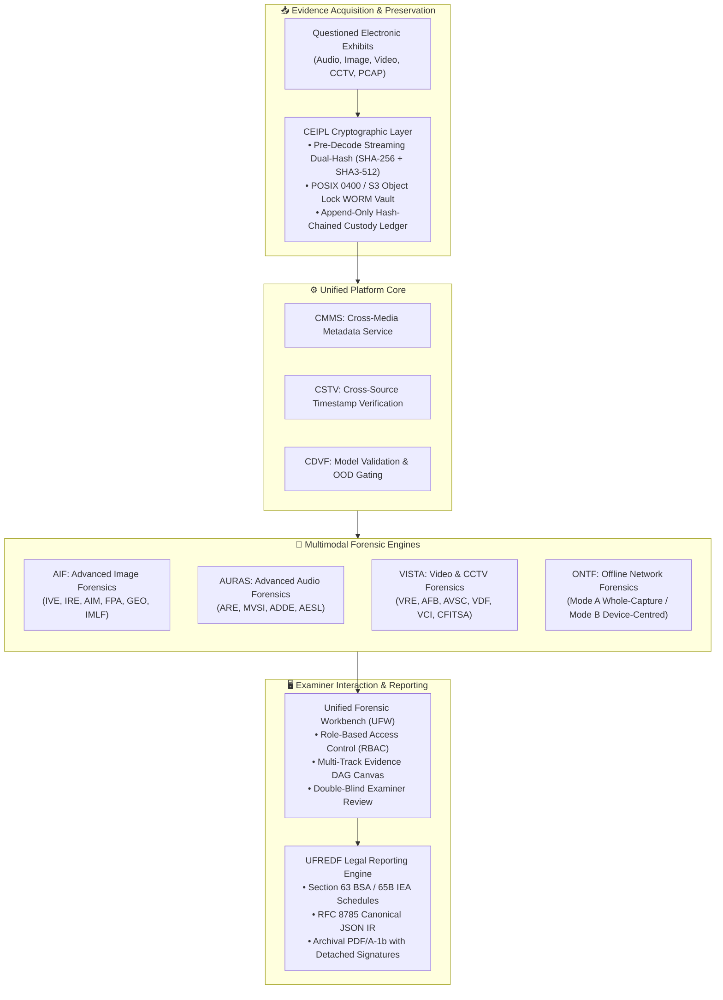

# Product Brief — Digital Evidence Authenticity & Integrity Verification Platform

**Official Product Name:** Digital Evidence Authenticity & Integrity Verification Platform  
**Document Type:** Executive Product Brief & Positioning Document  
**Status:** Approved Product Baseline  
**Version:** 1.0.0  

---

## 1. Executive Summary & Product Overview

The **Digital Evidence Authenticity & Integrity Verification Platform** is a modular, multimodal digital-forensics platform designed to assist authorized investigators and forensic examiners in examining digital evidence authenticity, integrity, provenance and consistency.

The platform integrates cryptographic evidence verification, multimedia forensics, AI-assisted manipulation detection, metadata analysis, temporal and geospatial correlation, network traffic forensics and structured forensic reporting into a unified investigation workflow.

---

## 2. The Real-World Forensic Challenge

In contemporary criminal litigation, cyber investigations, counter-espionage, and corporate fraud inquiries, digital media—such as mobile voice recordings, digital photos, surveillance video feeds, and seized endpoint network captures—serve as primary evidence. However, modern investigations face three acute structural vulnerabilities:

1. **The Proliferation of Generative AI & Deepfakes:** Off-the-shelf diffusion models, voice-cloning toolkits, and talking-head neural avatars allow malicious actors to fabricate synthetic evidence with visual and acoustic photorealism.
2. **Tool Fragmentation & Inconsistent Lineage:** Cyber cells frequently rely on ad-hoc scripts (e.g., ExifTool, generic FFmpeg commands, uncalibrated GitHub deepfake classifiers) without an immutable, auditable chain of custody. Findings generated by disparate tools cannot be systematically correlated.
3. **The Courtroom Admissibility Deficit:** Black-box machine learning outputs (such as a generic score stating "89% Fake") fail evidentiary standards under judicial cross-examination. Courts require verifiable physical proof: exact pixel coordinates, sample-accurate timestamps, physical signal anomalies, and proof that exhibits were not modified after seizure.

---

## 3. Product Vision & Value Proposition

### 3.1 Vision
To provide state-of-the-art forensic laboratories, cybercrime investigation units, and certified examiners with a mathematically defensible, local-first platform that separates genuine electronic evidence from fabricated or manipulated digital media with signal-level explainability and cryptographic non-repudiation.

### 3.2 Key Differentiators
* **Physical Signal & Frequency Grounding:** Complements neural deep learning with classical physics, sensor noise (PRNU), error level analysis (ELA), double-JPEG quantization modeling, and 50 Hz Electric Network Frequency (ENF).
* **Pre-Decode Dual Hashing & WORM Vault:** Automatically streams raw incoming bitstreams through parallel SHA-256 and SHA3-512 accumulators prior to demuxing or decompression, preserving exhibits in hardware- or filesystem-locked Write-Once Read-Many storage.
* **Anti-Averaging Multimodal Fusion:** Strictly prohibits naive score averaging. Partially manipulated media (such as cloned audio dubbed over pristine video) is highlighted through a Directed Acyclic Graph (DAG) preserving single-modality anomalies.
* **Air-Gap Operational Guarantee:** Runs 100% locally on isolated forensic servers or investigator laptops with zero external cloud dependencies or telemetry leaks.
* **Statutory Legal Compliance:** Automatically compiles certificate schedules aligned with **Section 63 of the Bharatiya Sakshya Adhiniyam, 2023 (BSA)** and Section 65B of the Indian Evidence Act (IEA).

---

## 4. Target User Personas & Operational Roles

| Persona | Primary Operational Focus | Platform Feature Requirements |
| :--- | :--- | :--- |
| **Forensic Laboratory Examiner (FSL)** | In-depth technical analysis of questioned digital exhibits for trial submission. | Full signal inspection (spectrograms, DCT grids, PRNU PCE curves), sample-accurate boundary markers, Section 63 BSA certificate compilation. |
| **Cybercrime Investigating Officer (IO)** | Rapid case triage, multi-source evidence intake, and incident timeline correlation. | Fast ingestion dual-hashing, unified case dashboard, mobile/photo EXIF location mapping, CCTV cadence sanity check. |
| **Evidence Custodian / Archivist** | Maintaining long-term evidence integrity, chain-of-custody ledgers, and vault fixity. | WORM retention lock oversight, rolling 30-day SHA-256 fixity audits, append-only Merkle ledger verification, fail-closed quarantine. |
| **Technical & Legal Reviewer** | Independent audit of examiner findings prior to judicial filing. | Cross-engine conflict verification, out-of-distribution (OOD) distance review, dual-control digital signature sign-off. |
| **Enterprise Incident Responder** | Internal corporate investigations, data exfiltration, and offline PCAP traffic analysis. | Mode B device-centric PCAP filtering, C2 beaconing analysis, DNS tunnel identification, MITRE ATT&CK mapping. |

---

## 5. Architectural Pillars & Core Subsystems

The platform is structured into modular, decoupled subsystems:

1. **CEIPL / EIV (Cryptographic Evidence Integrity Layer):** Direct raw-byte streaming dual-hashing (SHA-256 + SHA3-512), WORM vault storage (`POSIX 0400` / S3 Object Lock), RFC 8785 Canonical JSON Serialization (JCS), detached Ed25519 digital signatures, RFC 3161 Trusted Timestamp Authority (TSA) tokens, and append-only hash-chained custody ledgers.
2. **AURAS (Audio Forensics Subsystem):** Three independent engines:
   * **ARE:** Signal profiling, STFT spectral flux, PELT change-point splicing detection, 50 Hz ENF grid matching, and **AESL** sample-accurate boundary localization.
   * **MVSI:** Silero VAD, overlap-aware speaker diarization (supporting concurrent speech), and Indic language identification.
   * **ADDE:** Multi-branch deepfake detection (RawNet2, AASIST, WavLM) with Platt calibration and Mahalanobis OOD gating.
3. **AIF (Advanced Image Forensics Subsystem):**
   * **IVE:** Defensive ingestion (128 MP limit), 150-category taxonomy, YOLOv8/SAM 2 segmentation, and PaddleOCR document analysis.
   * **IRE:** EXIF/XMP auditing, 2D FFT & DCT frequency statistics, SIFT/ORB + RANSAC homography (CMFD), and camera sensor PRNU noise fingerprinting.
   * **AIM:** Synthetic AI generation detection, TruFor/CAT-Net generative inpainting localization, Face X-Ray boundary audits, and LSB/RS steganalysis.
   * **FPA:** Biometric facial analysis strictly gated behind judicial case authorization tokens (no automated 1:N surveillance).
   * **AIF-GEO:** 26 geospatial capabilities including NOAA solar/shadow angle validation ($\tan\alpha \approx h/L$), historical weather reanalysis, and location conflict graphs.
   * **IMLF:** Multi-scale tiling ($1024\times 1024$), anti-averaging fusion, and pixel localization masks.
4. **VISTA (Video & CCTV Forensics Subsystem):**
   * **VRE:** Bitstream container inspection, PTS/DTS timeline sorting, VFR cadence segmentation, and **CFITSA** temporal sequence forensics (missing, duplicated, inserted, frozen, and reordered frames).
   * **AFB:** Lossless stream-copy audio demuxing routed into AURAS.
   * **AVSC:** SyncNet talking-head lip-sync evaluation and acoustic-to-visual event correspondence.
   * **VDF:** Frame-level and temporal sequence deepfake classifiers with late-fusion calibration.
   * **VCI:** Source taxonomy, ByteTrack tracking, ALPR format validation, and hazard object triage.
   * **CCTV Profile:** Automated source classification, OSD clock OCR, clock drift regression, and ONVIF media signing audit.
5. **ONTF (Offline Network Traffic Forensics):** Post-incident analysis of seized `.pcap`/`.pcapng` files in Mode A (whole-capture) and Mode B (target-device-centred) via sandboxed TShark and offline Zeek (`zeek -r`).
6. **Platform Services (CMMS, CSTV, CDVF, CCHDF):** Shared metadata standardization, multi-source clock drift modeling, model governance, and covert-channel concealment triage.
7. **UFREDF & UFW:** The Unified Forensic Workbench presentation tier and statutory report compiler.

---

## 6. Two-Track Strategy: Research & Product Development

The initiative maintains two mutually reinforcing tracks:
* **Track A (Research Initiative):** Identifies scientific gaps, performs empirical benchmark studies across diverse datasets, investigates out-of-distribution calibration, and prepares peer-reviewed academic papers.
* **Track B (Product Engineering):** Implements robust, hardened, secure software packages conforming to open standards, providing intuitive graphical user interfaces (UFW) and automated statutory reporting (UFREDF).

---

## 7. Deployment Options & System Requirements

1. **Central Forensic Laboratory Deployment:**
   * Scalable Linux server cluster (Ubuntu 22.04 LTS / Debian 12).
   * Dual-redundant POSIX WORM storage arrays with ZFS/Ceph or MinIO S3 Object Lock.
   * Celery distributed job queue backed by Redis and PostgreSQL 15+.
   * Multi-GPU acceleration (NVIDIA RTX A6000 / A100).
2. **Air-Gapped Field Station / Laptop Deployment:**
   * Self-contained, portable field bundle running on Windows 11 Enterprise or Debian 12.
   * Local POSIX filesystem WORM partition (`chmod 0400`).
   * Lightweight in-process or local SQLite/PostgreSQL with CPU float32 and ONNX Runtime execution.
   * Zero network interface requirements (all models, libraries, and gazetteers pre-packaged locally).