# Digital Evidence Authenticity & Integrity Verification Platform (PS-05)

[](pyproject.toml)
[](TRD.md)
[](PRD.md)
[](#1-executive-overview--problem-statement)

> **Official Problem Statement PS-05:** Digital Evidence Authenticity and Integrity Verification Platform
> **Organizers:** C-DAC Patna, CCSU, Bihar Police
> **Event:** Bihar Government Cyber Hackathon 2026
> **Track:** Digital Forensics

---

## 1. Executive Overview & Problem Statement

In contemporary cyber-crime investigations, extortion cases, surveillance reviews, and court proceedings, digital artifacts—such as digital photographs, voice recordings, video files, and CCTV footage—serve as primary evidence. However, modern editing software and generative AI technologies (deepfakes, voice cloning, diffusion models) enable malicious actors to manipulate or synthesize evidence with high realism.

Manual forensic examination is time-consuming, requires scarce specialized expertise, and struggles with complex multi-modal manipulations. The **PS-05 Platform** is an enterprise-grade, modular, explainable, and auditable digital forensics system engineered for law enforcement agencies (state police departments, Bihar Police cyber cells) and Forensic Science Laboratories (FSLs). It provides:

1. **Cryptographic Chain of Custody & Evidence Integrity Verification (CEIPL / EIV):** End-to-end evidence integrity verification, Write-Once-Read-Many (WORM) storage, pre-decode streaming dual-hashing (SHA-256 and SHA3-512), RFC 8785 canonical manifests, detached Ed25519 signatures, RFC 3161 trusted timestamps, append-only hash-chained custody ledgers, derivative Merkle DAG lineage, and standalone offline verification.
2. **AIF Advanced Image Forensics Subsystem:** High-resolution image understanding (IVE), physics/frequency reverse engineering (IRE), AI generation/steganography detection (AIM), and judicial biometric comparison (FPA).
3. **AURAS Audio Forensics Subsystem:** Deep electroacoustic signal analysis and Audio Edit & Splice Localisation (ARE/AESL), multilingual voice and overlap-aware diarization (MVSI), and calibrated multi-branch audio deepfake detection (ADDE).
4. **VISTA Video & CCTV Forensics Subsystem:** Modular five-engine video forensics architecture:
   - **VRE (Video Reverse Engineering Engine):** Bitstream container, codec, PTS/DTS cadence, variable frame rates, scene cuts, and compression history.
   - **AFB (Audio Forensic Bridge):** Cryptographically bound audio extraction routing directly into AURAS without algorithm duplication.
   - **AVSC (Audio-Visual Synchronization & Correspondence Engine):** Global/local time alignment, talking-face lip-sync (SyncNet), and acoustic-to-visual event correspondence.
   - **VDF (Video Deepfake & AI-Generation Detection Engine):** Multi-branch frame-level and temporal sequence detectors (Xception, EfficientNet, FTCN, STIL, VideoMAE) with calibrated late-fusion.
   - **VCI (Video Content Intelligence Engine):** Hierarchical source taxonomy, time-segmented multi-label scene and environmental classification, generalised object inventory across configurable taxonomies, fine-grained vehicle and visible colour attribution, separately versioned ALPR/ANPR with jurisdiction format validation (HSRP), mobile device detection, candidate hazardous object triage with examiner review workflows, distinct entity tracking, and evidence-indexed visual search / Case RAG integration.
   - **Dedicated CCTV Forensic Profile:** Source classification, automatic recorder discovery, adaptive follow-up questionnaires, timeline continuity audit, and native export / digital seal verification.
5. **Offline Network Traffic Forensics Subsystem (ONTF):** Dedicated offline analysis of seized PCAP and PCAPNG traffic captures associated with PCs, mobile phones, or network endpoints. Evaluates traffic for reconnaissance scans, command-and-control (C2) beaconing, DNS exfiltration tunnels, anomalous protocol states, and MITRE ATT&CK patterns—with rigorous device attribution boundaries and zero requirement for live network sniffing.
6. **AIF-GEO Geospatial Forensics & Evidence Correlation Subsystem:** Multi-source extraction, normalisation, and verification of geographic metadata and location evidence from digital images. Features geodetic distance and uncertainty modeling, capture-time solar/shadow alignment, historical weather and terrain elevation correlation, visual location recovery without GPS (OCR, landmark retrieval, SIFT/ORB + RANSAC geometric verification), external GPS track correlation (GPX, KML, NMEA), multi-image spatial clustering (DBSCAN), and an interactive evidence-linked map and location-claim conflict graph.
7. **Cross-Modal Deepfake Validation Framework (CDVF):** Centralized scientific benchmarking, empirical confidence calibration (Platt/temperature scaling), out-of-distribution (OOD) domain shift gating, formal abstention/inconclusive decision policies, leakage-proof dataset governance, and scoped release gates governing deepfake detection models across AIF, AURAS, and VISTA without acting as a competing detector.
8. **Image Manipulation Localisation Framework (IMLF):** Shared spatial reasoning capability within AIF that localises, segments, and corroborates copy-move, splicing, inpainting, AI-generated patch, and facial manipulations into calibrated pixel masks and vector polygons with multi-scale tiling and an examiner review workbench.
9. **Cross-Media Metadata Service (CMMS):** A shared, evidence-aware metadata extraction, normalisation, validation, consistency-analysis and correlation layer supporting digital images, audio recordings, video files, CCTV exports, offline PCAP/PCAPNG captures, and geospatial evidence. CMMS preserves raw metadata values, produces canonically normalised representations, identifies anomalies and inconsistencies across fields and evidence items, and exposes structured metadata records to AIF, AURAS, VISTA, AIF-GEO, ONTF, CEIPL, and UFREDF without duplicating modality-specific forensic analysis inside each engine.
10. **Cross-Source Timestamp Verification (CSTV):** A platform-wide temporal verification and correlation capability that analyzes, compares, and cross-validates timestamps across 17 distinct evidence source categories (EXIF, audio samples, video PTS/DTS, CCTV OSD overlays, offline PCAPs, GPS tracks, device/recorder logs). CSTV estimates clock offsets and linear/piecewise drift rates in parts per million (ppm), detects clock resets, aligns multimodal event anchors, evaluates Allen's interval algebra and sequence conflict graphs, and reconstructs unified multi-tiered case timelines without overwriting source metadata.
11. **Cryptographic Evidence Package & Legal Certificate Preparation:** Automated generation of cryptographically verifiable, tamper-evident forensic evidence packages for examiner review and legal submission under **Section 65B of the Indian Evidence Act (IEA)** and **Section 63 of the Bharatiya Sakshya Adhiniyam, 2023 (BSA)** with Archify JSON Intermediate Representation (IR). Court admissibility is determined by the presiding judicial authority upon the authorized human examiner's statutory declaration — not by the platform software alone.
12. **Cross-Channel Concealment & Hidden-Data Forensics (CCHDF) & Specialist PSEA:** A shared platform-wide investigation, triage, and orchestration capability that expands concealment detection beyond conventional image steganography across 8 forensic carrier domains: universal first-stage container/structural triage, image steganalysis (AIF/AIM), audio carrier steganalysis (AURAS/ARE), video/temporal steganalysis (VISTA/VRE), text/document concealment forensics (Document Adapter), forensic disk/slack-space/ADS forensics (Filesystem Adapter), network covert timing-channel analysis (ONTF), semantic/linguistic obfuscation analysis, and specialist Physical Side-Channel & Emissions Analysis (PSEA: EMSEC/TEMPEST, acoustic emissions, thermal time-series). CCHDF normalizes findings into a unified versioned `ConcealmentFinding` contract cryptographically bound via CEIPL, enforces zero-execution inert quarantined storage, and delivers structured findings to Case RAG and UFREDF reporting.

---

## 2. Goals & Non-Goals

### Project Goals
- **G-1:** Ingest digital media and traffic captures (audio, image, video, CCTV, PCAP/PCAPNG) with zero modification to original bitstreams.
- **G-2:** Localize tampering and suspicious activities spatio-temporally (millisecond audio timestamps, frame indices, image bounding polygons, packet stream offsets) with explainable visual artifacts.
- **G-3:** Detect AI voice cloning and audio manipulation across Scheduled Indian Languages and regional Hindi dialects.
- **G-4:** Identify surveillance video tampering (missing CCTV frames, looping sequences, tampered digital clock overlays, desynchronized audio).
- **G-5:** Ingest and analyze offline network traffic captures (PCAP/PCAPNG) associated with seized PCs or mobile devices to isolate attack patterns without requiring live network monitoring.
- **G-6:** Extract, validate, enrich, and cross-correlate image location evidence (EXIF GPS, visual landmarks, external tracks, solar/shadows, terrain) while preserving raw originals and maintaining explicit uncertainty bounds.
- **G-7:** Produce cryptographically verifiable, examiner-reviewed forensic evidence PDF dossiers (prepared for legal submission under Section 65B IEA / Section 63 BSA) and Archify JSON Intermediate Representation (IR) graphs.
- **G-8:** Operate 100% offline in air-gapped forensic laboratory environments with zero external network dependencies.
- **G-9:** Extract, preserve, normalise and cross-correlate technical metadata from all evidence modalities through a shared CMMS service, eliminating duplicate extraction implementations and providing structured, field-level provenance to every forensic subsystem.

- **G-10:** Verify, correlate, and reconstruct temporal sequences across all seized digital evidence sources through CSTV, estimating clock offset and drift parameters, detecting sudden clock resets, validating causal ordering via conflict graphs, and compiling defense-resilient multi-tier case timelines.
- **G-11 (Evidence Integrity Verification):** Formally verify digital evidence across its entire lifecycle—from pre-decode streaming acquisition through WORM preservation, fixity audits, derivative lineage, and independent air-gapped verification—without declaring real-world factual truth or relying on external cloud trust.

### Non-Goals
- **NG-1:** The platform is not an automated judicial judge. It outputs probabilistic evidence, anomaly heatmaps, and confidence intervals to assist certified human forensic examiners.
- **NG-2:** It does not perform live physical memory chip extraction or hardware chip-off JTAG acquisition (evidence must be supplied as seized digital files).
- **NG-3:** It is **NOT** a live intrusion detection system (IDS), network tap, or continuous packet sniffer. It analyzes previously captured, legally seized offline PCAP/PCAPNG files.
- **NG-4:** It does not claim that a PCAP capture proves an endpoint's entire communication history or decrypts modern end-to-end encrypted payloads without authorized private keys.
- **NG-5:** It does not claim 100% detection of unseen zero-day generative architectures or encrypted evasion techniques without explicit uncertainty bounds.
- **NG-6:** It does not claim that extracting an EXIF GPS coordinate or matching an online reverse-geocoding place proves that an image was captured there, nor does it send sensitive evidence images or confidential coordinates to unauthorized external cloud APIs.
- **NG-7 (Integrity != Authenticity):** The platform does NOT claim that a cryptographic hash match proves that an acquired piece of evidence is authentic in the real world, that an officer's seizure was lawful, or that a recorded event occurred; it mathematically certifies that the stored bytes remain bit-for-bit identical to the acquired baseline.
- **NG-8 (No Standalone Engine Duplication):** EIV is NOT a new forensic analysis engine, a 6th VISTA engine, or a 4th AURAS engine. It operates within CEIPL as a shared platform integrity layer.

---

- **NG-9:** CSTV does not determine the absolute historical truth of an incident or establish physical causality merely because two events share temporal proximity. It reconstructs and evaluates temporal consistency between evidence sources.

## 3. High-Level Platform Architecture

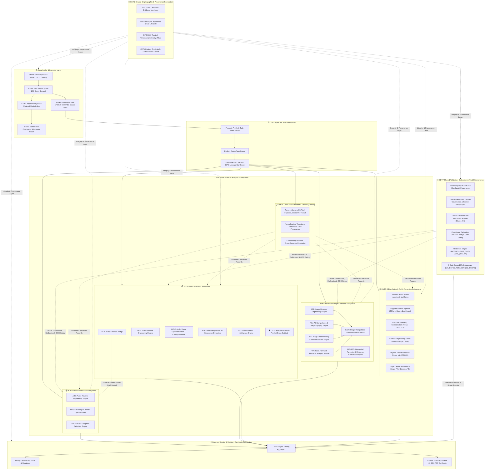

---

## 4. Subsystem Breakdown & Deepened Audio Forensics (AURAS)

> **Important Boundary Clarification:** The overall platform is the **PS-05 Digital Evidence Authenticity & Integrity Verification Platform**.
> **AURAS (Audio Understanding, Reconstruction & Analysis System)** is strictly its audio forensics subsystem. AURAS is **NOT** the entire PS-05 platform, but a modular component responsible for all acoustic, vocal, and speech-tampering investigations.

### 4.1 Audio Subsystem Overview

Audio evidence presents unique investigative challenges. Unlike static images, audio signals are temporal streams with complex electroacoustic properties, lossy codec artifacts, room reverberation acoustics, and diverse linguistic patterns. A single analytical technique cannot reliably determine audio authenticity:
- Signal-level analysis can detect splices and edits, but cannot recognize AI voice synthesis.
- Deep learning deepfake classifiers can flag synthetic vocoders, but are blind to copy-paste splicing of genuine speech.
- Speaker diarization can attribute who spoke, but cannot verify whether the speaker was cloned or imposter-simulated.

To overcome these challenges, **AURAS** employs three independent, decoupled engines operating on distinct physical and mathematical dimensions:
1. **ARE (Audio Reverse Engineering Engine):** Physics- and signal-based analysis of the recording medium, electroacoustics, edit points, and ambient noise continuity.
2. **MVSI (Multilingual Voice & Speaker Intelligence Engine):** Biometric and linguistic intelligence, isolating speakers, transcribing turns, handling simultaneous overlapping speech, and classifying Indian languages/code-switching.
3. **ADDE (Audio Deepfake Detection Engine):** Machine learning detection of synthetic, voice-converted, and vocoded speech using raw waveforms, spectrotemporal graphs, and self-supervised representations.

All three engines consume read-only, traceable working artifacts generated from the WORM vault. The cross-engine aggregation layer synthesizes these independent findings into a structured forensic evidence dossier without manufacturing artificial certainty.

### 4.2 Engine Comparison Matrix

| Dimension | ARE (Audio Reverse Engineering) | MVSI (Multilingual Voice & Speaker) | ADDE (Audio Deepfake Detection) |
| :--- | :--- | :--- | :--- |
| **Primary Responsibility** | Electroacoustic signal integrity, container metadata, splice/edit detection, ambient noise consistency, ENF analysis. | Voice activity detection, speech segmentation, overlap-aware speaker diarization, multilingual Indian language ID. | Detection of AI-synthesized speech, voice cloning, vocoder artifacts, partial manipulation localization. |
| **Input Artifacts** | Native-rate bitstream, multi-channel working WAV/FLAC, container metadata dump. | Normalized 16 kHz mono float32 WAV (downmixed copy). | Standardized 16 kHz mono float32 sliding-window segments (2.0s window, 0.5s stride). |
| **Main Modules** | ARE-01 to ARE-10 (Signal profiling, STFT, PELT change-point, noise floor, FAISS repetition, 50 Hz ENF, manifests). | MVSI-01 to MVSI-12 (Silero VAD, neural segmentation, ECAPA-TDNN, pyannote diarization, Whisper LID, MMS-LID). | ADDE-01 to ADDE-12 (RawNet2, AASIST, WavLM, LFCC/CQCC + Light-CNN, Platt calibration, late-fusion ensemble, Mahalanobis OOD). |
| **Output Findings** | Splice timestamps, SNR/clipping metrics, noise discontinuities, repeated phrase intervals, ENF frequency curves. | Speaker turn intervals, concurrent overlap timestamps, segment language tags, per-speaker duration summaries. | Calibrated deepfake probabilities, per-model logits, localized synthetic segment intervals, OOD uncertainty flags. |
| **Candidate Technologies** | Librosa, SciPy, NumPy, SoundFile, PyWavelets, FFprobe, ExifTool, Mutagen, FAISS. | PyTorch, Silero VAD, WebRTC VAD, pyannote.audio, SpeechBrain, Whisper LID, MMS-LID. | PyTorch, TorchAudio, RawNet2, AASIST, WavLM, Hugging Face Transformers, Scikit-learn (Platt calibration). |
| **Validation Standards** | Synthetic splice insertion tests, clipping threshold benchmarks, bitstream equality verification. | Diarization Error Rate (DER $< 18\%$), Jaccard Error Rate (JER), Language Macro-F1 ($> 85\%$), overlap F1. | Equal Error Rate (EER $< 5.5\%$), ROC-AUC ($> 0.96$), Expected Calibration Error (ECE $< 0.05$), minDCF. |
| **Implementation Status** | `PLANNED` (Phase 2 / AURAS-A1, A2) | `PLANNED` (Phase 3 / AURAS-A3, A4, A5) | `PLANNED` (Phase 6 / AURAS-A6, A7, A8) |

### 4.3 End-to-End Audio Processing Workflow

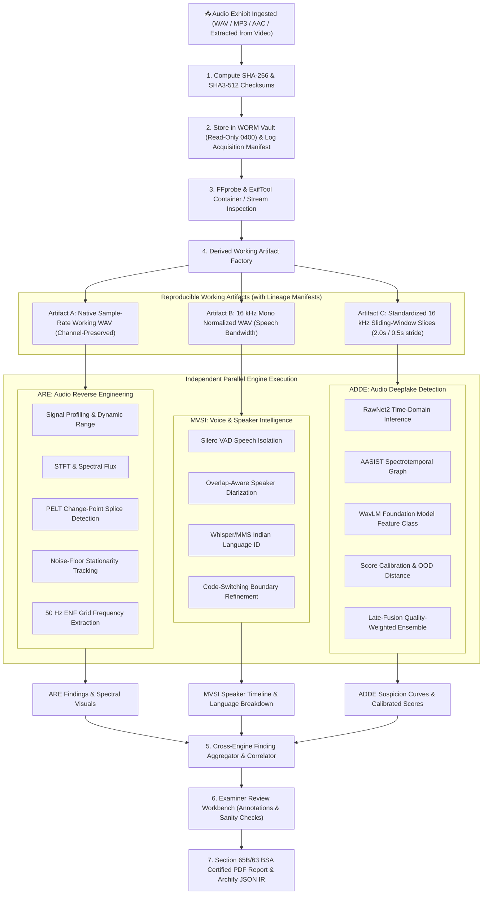

### 4.4 Audio Technologies by Purpose

| Category | Actual Implemented Dependencies | Planned Candidate Technologies |
| :--- | :--- | :--- |
| **File & Codec Inspection** | Standard Library (`hashlib`, `pathlib`, `struct`) | FFprobe, FFmpeg (>= 6.0), ExifTool, MediaInfo, Mutagen |
| **Digital Signal Processing** | NumPy (`>=1.26.0`), SciPy (`>=1.12.0`) | Librosa (`>=0.10.1`), SoundFile (`>=0.12.1`), PyWavelets, FAISS (approximate nearest neighbors) |
| **VAD & Diarization** | PyTorch (`>=2.2.0`), TorchAudio (`>=2.2.0`) | Silero VAD v4, WebRTC VAD, pyannote.audio (`>=3.1.0`), SpeechBrain (`>=0.5.16`) ECAPA-TDNN |
| **Multilingual Language ID** | — | OpenAI Whisper (Medium/Large LID head), Meta MMS-LID (1000+ languages), Faster-Whisper |
| **Audio Deepfake Detection** | PyTorch (`>=2.2.0`), TorchAudio | RawNet2, AASIST (Graph Attention), WavLM Base+ / XLS-R 300M, Light-CNN (LFCC/CQCC), Scikit-Learn |
| **Storage & Job Processing** | SQLAlchemy 2.0 (async), Pydantic v2 | MinIO (S3-compatible WORM), PostgreSQL 15+ (asyncpg), Redis 7+, Celery (`>=5.3.6`) |
| **Testing & Benchmarking** | Pytest (`>=8.0.0`), Pytest-asyncio | Pytest-benchmark, Hypothesis, ASVspoof 2019/2021 protocols, CodecFake evaluation suite |
| **Reporting & Observability** | Jinja2 (`>=3.1.3`), WeasyPrint (`>=61.0`) | Archify JSON IR visualizer, OpenTelemetry, Prometheus, Grafana |

### 4.5 Audio Forensic Limitations & Uncertainty Principles

1. **Acoustic Discontinuity $\neq$ Definite Proof of Tampering:** Background noise shifts, microphone handling noise, room transitions, or automatic gain control (AGC) pumping can cause acoustic discontinuities without manual editing. Findings must be labeled as *candidate splice points* requiring examiner verification.
2. **Metadata Fallacy:** File headers, encoder tags, and container creation dates can be trivially modified or stripped during forwarding (e.g., via WhatsApp or Telegram). Absence of DAW tags does not prove authenticity; presence of tags indicates editing history but not necessarily malicious intent.
3. **Cryptographic Hash Scope:** A matching SHA-256 hash proves bit-level identity to a trusted reference; it does **not** prove that the content was authentic when originally recorded.
4. **Generalization Boundaries in Deepfake Detection:** Detectors trained on public benchmarks (ASVspoof) may experience performance degradation when exposed to unseen vocoders, low-bitrate mobile codecs (AMR-WB, Opus 6kbps), noisy street environments, or rare regional Indian dialects.
5. **Simultaneous Overlapping Speech Uncertainty:** When multiple speakers talk at the same time, vocal tract resonances interleave, significantly increasing speaker clustering uncertainty and language identification error rates.
6. **Legitimate Inconclusive Verdicts:** When SNR $< 5\text{ dB}$, lossy re-compression is extreme, or out-of-distribution distance is high, **"Inconclusive / Insufficient Acoustic Evidence"** is the only scientifically valid and legally defensible outcome.

---

### 4.6 Advanced Image Forensics Subsystem (AIF)

> **Subsystem Boundary Definition:**
> **AIF (Advanced Image Forensics)** is the specialized image forensics subsystem of the PS-05 platform, operating in parallel with the **AURAS** audio subsystem. AIF provides research-oriented, security-conscious, implementation-ready forensic verification for static digital images, document captures, scanned certificates, and photographic evidence.

Image evidence in modern criminal and cyber investigations presents distinct forensic challenges. Digital images are subject to compression artifacts, multi-stage social media re-encoding, localized geometric tampering, generative AI synthesis, inpainting, facial manipulation, and steganographic payload concealment. To deliver mathematically defensible, rigorous, cryptographically verifiable forensic verification, **AIF** is organized into three decoupled principal engines, one cross-cutting biometric analysis module, and a unified cryptographic integrity foundation:

1. **IVE (Image Understanding & Visual Evidence Engine):** First-pass visual triage, universal ingestion profiling, hierarchical evidence classification (~150 categories across 15 parent groups), task-aware object detection and instance segmentation, people counting with crowd-density handling, face detection and landmarking (FPA), authorized reference comparison, and document OCR / layout analysis.
2. **IRE (Image Reverse Engineering Engine):** Physics-, format-, and signal-based analysis. Deep container and metadata extraction (EXIF, XMP, IPTC, ICC profiles, quantization tables, MakerNotes), colour space and frequency analysis (2D FFT, DCT coefficients, noise residuals), classical computer vision & geometric forensics (Canny edge detection, contour hierarchies, convex hulls, Hough transforms, SIFT/ORB + RANSAC homography, difference maps), copy-move forgery detection, splicing localization, camera sensor profiling (PRNU, CFA demosaicing consistency), and edit/transfer history analysis.
3. **AIM (AI, Image Manipulation & Steganography Engine):** Deep learning and statistical anomaly detection. Pluggable AI generation detectors (CNN, ViT, patch-level classifiers, frequency-domain representations, out-of-distribution uncertainty), generative inpainting and localized editing localization (object addition/removal, generative fill, mask heatmaps), dedicated face swap and morphing forensics, structural and statistical steganalysis (trailing bytes, PNG ancillary chunks, LSB chi-square, RS steganalysis, DCT coefficient analysis), and defensive image-file security (decompression bomb protection, polyglot detection, memory/time limits, isolated decoders).
4. **FPA (Face, Portrait & Biometric Evidence Analysis Module):** Cross-cutting module shared between IVE and AIM. Provides RetinaFace/SCRFD face detection, MediaPipe facial landmarks, pose/blur/occlusion assessment, face parsing masks, and strictly authorized, access-controlled ArcFace/MagFace/AdaFace 1:1 reference comparison (*Note: "ArcMSD" is tracked as an unresolved research candidate requiring empirical verification*).
5. **CEIPL (Cryptographic Evidence Integrity & Provenance Layer):** Platform-wide shared service providing direct raw-byte SHA-256 hashing before decoding, RFC 8785 Canonical JSON evidence manifests, Ed25519 digital signatures, RFC 3161 trusted timestamp tokens, append-only hash-chained custody logs, Merkle tree inclusion proofs, derived artifact DAG lineage, C2PA Content Credentials verification, and AES-256-GCM / WORM storage enforcement.

---

### 4.7 AIF Engine Comparison Matrix

| Dimension | IVE (Image Understanding & Visual Evidence) | IRE (Image Reverse Engineering) | AIM (AI, Manipulation & Steganography) | CEIPL (Crypto Evidence Integrity & Provenance) |
| :--- | :--- | :--- | :--- | :--- |
| **Primary Responsibility** | First-pass triage, ~150-category hierarchical taxonomy, object detection, people counting, FPA face analysis, OCR. | Metadata auditing, signal/frequency analysis, classical geometric vision, copy-move/splicing, PRNU camera sensor noise. | Detection of AI-synthesized images, generative fill/inpainting, face swap/morph, steganalysis, defensive file security. | Raw-byte dual-hashing, canonical manifests (RFC 8785), Ed25519 signatures, RFC 3161 TSA, hash-chains, Merkle proofs, C2PA. |
| **Input Artifacts** | Universal image ingestion profile, decoded RGB/BGR arrays, derived multi-scale crops, perspective-corrected quads. | Raw container bitstream, metadata dumps, colour-space planes (HSV/YCbCr), high-pass noise residuals, DCT blocks. | Standardized RGB patches, localized face crops, sliding windows, spatial planes, bit-planes, raw byte streams. | Seized raw bitstreams (pre-decoding), derived artifact bytes, custody event records, C2PA JUMBF boxes. |
| **Main Modules** | IVE-01 to IVE-08 (Ingestion profile, taxonomy, multi-label classification, YOLO/SAM 2, people count, FPA, OCR). | IRE-01 to IRE-06 (ExifTool/ICC, 2D FFT/DCT, Canny/Hough/RANSAC, CMFD, PRNU sensor noise, transfer history). | AIM-01 to AIM-05 (AI generation detectors, inpainting localization, face swap/morph, steganalysis, file vulnerability). | CEIPL-01 to CEIPL-11 (SHA-256, canonical manifests, Ed25519, RFC 3161 TSA, hash-chains, Merkle trees, C2PA, WORM). |
| **Output Findings** | Multi-label category tags, bounding boxes, segmentation masks, people count with confidence, text regions, face landmarks. | EXIF anomalies, quantization table mismatches, cloned region polygon pairs, PRNU correlation coefficients, RANSAC inliers. | AI generation probability, inpainting heatmap masks, face manipulation scores, steganography statistical flags, security alerts. | Cryptographic manifest, signed event hashes, inclusion proofs, C2PA claim validation status, Section 65B/63 BSA hash seals. |
| **Candidate Technologies** | Pillow, OpenCV, PyTorch, YOLOv8/v10, Grounding DINO, SAM 2, RetinaFace, MediaPipe, PaddleOCR, Tesseract. | ExifTool, OpenCV, NumPy, SciPy, scikit-image, Canny, SIFT, ORB, RANSAC homography, DCT parsers. | PyTorch, torchvision, timm, ViT, CNN detectors, TruFor / Splice localization models, SteganoGAN/RS tools, safe parsers. | `hashlib`, `cryptography` (Ed25519, AES-GCM), `canonicaljson` (RFC 8785), pyc2pa / c2pa-rs, RFC 3161 client. |
| **Validation Standards** | Multi-label Macro-F1 ($> 85\%$), mAP@50 ($> 0.70$), People Count MAE ($< 1.5$), OCR Word Error Rate ($< 8\%$). | Localization precision/recall, PRNU correlation threshold, RANSAC inlier ratio, metadata extraction accuracy. | ROC-AUC ($> 0.95$), Localization IoU ($> 0.65$), Steganalysis TPR/FPR, zero-day generator transferability bounds. | 100% bit-exact SHA-256 matching, 100% signature verification rate, zero-tamper detection on hash-chains and Merkle proofs. |
| **Implementation Status** | `PLANNED` (Phases A3, A4, A5, A6) | `PLANNED` (Phases A7, A8, A9) | `PLANNED` (Phases A10, A11, A12) | `PLANNED` (Phases A1, A2, A13) |

---

### 4.8 End-to-End Image Forensics Workflow

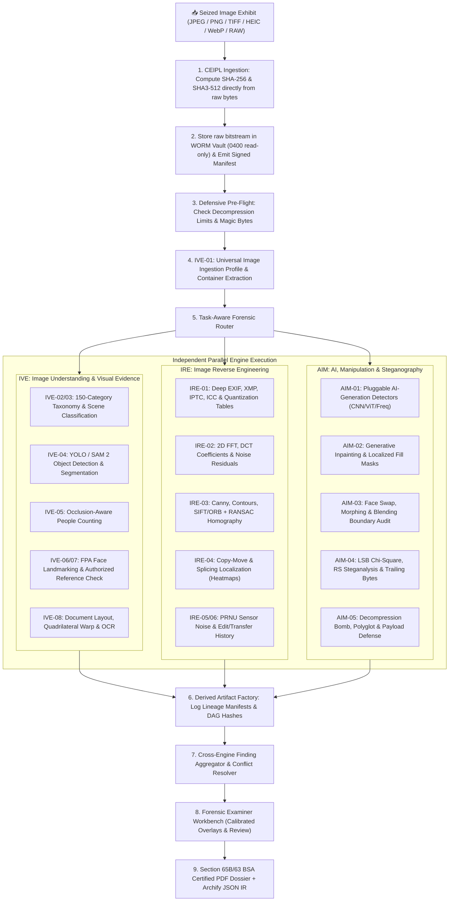

---

### 4.9 Core Forensic & Cryptographic Principles

All image forensic investigation across PS-05 is governed by nine strict architectural invariants:

1. **Absolute Traceability Invariant:** Every forensic finding must be traceable to a specific seized evidence artifact, an immutable analysis run ID, a pinned tool/model version, a reproducible processing configuration, and the concrete mathematical output supporting that finding.
2. **Separation of Forensic Concepts:** The platform strictly distinguishes:
   - *File integrity* (bitstream matches reference SHA-256).
   - *Cryptographically verified provenance* (valid digital signature on a C2PA manifest).
   - *Technical consistency* (metadata matches sensor/codec specifications).
   - *Statistical indicators of manipulation* (inconsistent noise residuals or DCT blocking).
   - *AI-generation detector outputs* (calibrated probability score under defined uncertainty bounds).
   - *Scene interpretation* (visual taxonomy classification).
   - *Biometric similarity* (vector distance between authorized reference embeddings).
   - *Investigator conclusions* (human expert adjudication).
   *These concepts are NEVER treated as interchangeable.*
3. **Cryptographic Hash Scope:** A matching SHA-256 hash proves bit-level identity to a reference hash. It does **not** prove that the photograph was taken by a camera, that the scene was real, or that the file was untampered before hashing.
4. **Digital Signature Scope:** A valid cryptographic signature proves that a signed statement was issued by the private key holder and remained unaltered in transit. It does **not** prove that the underlying assertion is factually truthful.
5. **Absence of Provenance $\neq$ Proof of Manipulation:** Missing EXIF metadata or absent C2PA credentials frequently occur due to social media stripping (WhatsApp, Telegram) and does **not** constitute proof of malicious tampering.
6. **Detector Independence & No False Certainty:** A positive AI-detector score indicates statistical anomaly relative to training distribution; it does **not** prove which commercial generator produced it. The system never outputs binary "100% Fake" or "100% Authentic" claims.
7. **Defensive Image Parsing & Zero Execution:** Uploaded image files must be parsed with strict decompression limits (`Image.MAX_IMAGE_PIXELS = 128_000_000`), bounded memory/CPU timeouts, and isolated decoders. Embedded script tags or trailing byte payloads are logged as evidentiary findings and **NEVER executed**.
8. **Biometric Privacy & Purpose Limitation:** Face embeddings (ArcFace/MagFace) must NEVER be extracted or matched by default. Biometric comparison is strictly gated behind judicial case authorization (FIR/Case ID) and purpose-limited 1:1 comparison. Raw biometric vectors are never retained in unencrypted public tables.
9. **Algorithm Verification Discipline:** Algorithms whose exact mathematical formulation or publication provenance is unverified (such as "ArcMSD") must be classified as *unresolved research candidates* and subjected to empirical validation before architectural adoption.

---

### 4.10 Video Integrity, Synchronization & Tampering Analysis Subsystem (VISTA)

> **Subsystem Boundary Definition:**
> **VISTA (Video Integrity, Synchronization & Tampering Analysis)** is the specialized video forensics subsystem of the PS-05 platform, operating alongside **AIF** (images) and **AURAS** (audio). VISTA provides research-oriented, mathematically defensible, modular, and implementable forensic verification for digital video files, CCTV/DVR/NVR surveillance exports, dashcam/bodycam footage, and multimedia broadcasts.

Video evidence combines high-volume spatial imagery, temporal motion vectors, compressed multi-stream containers, and interleaved audio tracks. Unlike single images or pure audio signals, video tampering can occur across multiple dimensions simultaneously:
- **Spatial tampering:** Localized face swaps, inpainting, object removal, or synthetic overlays within individual frames.
- **Temporal tampering:** Dropped frames to conceal events, duplicated/frozen frames to simulate stillness, spliced scene cuts, or variable frame-rate cadence manipulation.
- **Cross-Modal desynchronization:** Re-dubbed or cloned audio tracks laid over authentic video, or authentic audio spliced with AI-synthesized talking heads (lip-sync mismatches).
- **Surveillance/CCTV tampering:** Altered on-screen display (OSD) clock timestamps, camera switching artifacts, or proprietary export header rewrites.

#### Architectural Boundaries & Fundamental Principles
1. **Overall Platform Alignment:** VISTA operates within the unified PS-05 architecture, sharing the evidence intake pipeline, immutable storage, audit logging, and statutory certificate preparation infrastructure.
2. **Relationship to AURAS (Audio Subsystem):** VISTA does **not** reimplement audio forensics. Through its **Audio Forensic Bridge (AFB)**, VISTA extracts native audio streams with zero transcoding loss and routes them into **AURAS** (ARE for signal/edit analysis, MVSI for speech diarization/VAD/language ID, and ADDE for voice deepfake detection).
3. **Relationship to AIF (Image Subsystem):** VISTA maintains logical decoupling from AIF while sharing foundational computer vision paradigms (e.g., face detection landmarks, frequency domain transforms, and localized inpainting detection).
4. **Shared CEIPL Foundation:** The **Cryptographic Evidence Integrity & Provenance Layer (CEIPL)** is a shared platform core service—**not** a sixth VISTA engine. All VISTA exhibits, stream extracts, and derived artifacts are anchored in CEIPL's cryptographic DAG.
5. **Dedicated CCTV Forensic Profile:** CCTV and surveillance analysis is implemented as an integrated, source-specific forensic profile spanning all five engines—**not** an isolated sixth engine.

#### The Five Primary VISTA Engines
To resolve these multidimensional challenges without conflating independent forensic observations, **VISTA** is structured into **five decoupled primary engines** and a cross-cutting **CCTV Forensic Profile**:

1. **VRE (Video Reverse Engineering Engine):** Bitstream, container, and timeline reverse engineering. Audits MP4, MKV, AVI, MOV, TS, and raw surveillance streams using FFprobe, MediaInfo, PyAV, and ExifTool. Extracts Presentation Time Stamps (PTS), Decoding Time Stamps (DTS), GOP structures, variable frame rate (VFR) jitter, duplicate/frozen frames, scene transitions (PySceneDetect), and historical re-encoding signatures.
2. **AFB (Audio Forensic Bridge):** Extracts native audio streams with zero loss using stream-copy FFmpeg extraction. Generates derived audio artifacts bound by cryptographic SHA-256 hashes to the parent video. Routes extracted audio into **AURAS** without duplicating audio algorithms, aligning speaker intervals back to the video timeline.
3. **AVSC (Audio-Visual Synchronization & Correspondence Engine):** Investigates whether visible motion and acoustic signals are temporally and semantically consistent. Performs global container and local drift time-alignment, extracts face tracks and mouth crops (RetinaFace, SCRFD, ByteTrack), evaluates lip-sync correspondence using visual-speech models (SyncNet), and correlates environmental sound events (YAMNet, PANNs, AST) with visible visual activity (vehicles, impacts, machinery, crowds).
4. **VDF (Video Deepfake & AI-Generation Detection Engine):** Multi-branch spatial and temporal AI-generation detection. Combines frame-level classifiers (Xception, EfficientNet) with sequence-level temporal models (FTCN, STIL, TALL, TimeSformer, VideoMAE). Features calibrated late-fusion ensembles, Platt scaling, and Mahalanobis out-of-distribution (OOD) uncertainty estimation across diverse manipulation families (face swap, reenactment, facial inpainting, full generative AI).
5. **VCI (Video Content Intelligence Engine):** Semantic scene and event timeline reconstruction. Implements hierarchical source taxonomy (~15 categories), time-segmented multi-label scene and environmental classification (rural, urban, junctions, interiors, public grounds), generalised physical object inventory (bounded taxonomies with `UNKNOWN_OBJECT_CANDIDATE` abstention), fine-grained vehicle attribute and visible colour extraction, separately versioned ALPR/ANPR with MoRTH/HSRP syntax validation and zero character hallucination, mobile phone and electronic device detection, potentially hazardous object candidate triage with examiner review states, distinct unique-person and entity tracking (ByteTrack, BoT-SORT), spatio-temporal action localization (VideoMAE, SlowFast), robust OCR overlay extraction (PaddleOCR, Tesseract) for on-screen clocks, and evidence-indexed visual search / Case RAG integration.
6. **Dedicated CCTV Forensic Profile (Cross-Cutting):** Source-specific forensic workflow integrated across all five engines. Features automated source classification (`LIKELY_CCTV_FOOTAGE`, `POSSIBLE_CCTV_FOOTAGE`, `GENERAL_VIDEO`, `SCREEN_RECORDING_CANDIDATE`, `UNKNOWN_SOURCE_TYPE`), automatic recording metadata and timestamp extraction *prior* to questioning the investigator, an adaptive follow-up questionnaire (Questions A–E), timeline continuity auditing, multi-camera corroboration, and native export / digital seal verification (ONVIF Export File Format, ONVIF Media Signing, vendor manifests).

#### Canonical 16-Step Logical Processing Pipeline
Every video exhibit submitted to VISTA traverses a rigorous, legally auditable 16-step execution lifecycle:
1. **Exhibit Reception:** Receive raw video bitstream or supported CCTV/DVR/NVR container export.
2. **Evidence Identification:** Assign globally unique immutable `evidence_id` (UUIDv4) and case reference.
3. **Pre-Decode Dual Hashing:** Stream raw incoming bytes through SHA-256 and SHA3-512 accumulators prior to demuxing or decompression.
4. **WORM Preservation:** Commit unmodified bitstream to WORM immutable vault (POSIX `0400` / S3 Object Lock) and emit an RFC 8785 signed acquisition manifest.
5. **Container & Codec Identification:** Execute defensive container demuxing (PyAV/FFprobe sandbox) to catalog all video, audio, subtitle, and metadata streams.
6. **Technical Metadata & Timeline Extraction:** Extract presentation timestamps (PTS), decoding timestamps (DTS), GOP cadence, timebases, and ExifTool container tags.
7. **Automated CCTV Discovery:** Probe for CCTV characteristics (static perspective, IR night vision, OSD clocks, channel labels) and provisionally classify source type.
8. **Lossless Audio Extraction:** Demux embedded audio via FFmpeg stream-copy (`-c:a copy`) into a distinct derived artifact with independent SHA-256 DAG binding.
9. **Traceable Video Artifact Generation:** Generate timestamped working frames, normalized face crops, and analysis clips with parent-mapped coordinates and timecodes.
10. **Parallel VISTA Engine Execution:** Dispatch decoupled analysis tasks across VRE, AVSC, VDF, and VCI based on detected media properties.
11. **Asynchronous AURAS Routing:** Forward extracted audio artifact to AURAS (ARE signal analysis, MVSI diarization, ADDE voice deepfake detection).
12. **Cross-Engine Evidence Correlation:** Correlate visual scene events, speaker turns, lip-sync curves, deepfake probabilities, and OCR clock readings.
13. **Uncertainty & Calibration Preservation:** Compute empirical Platt-calibrated probabilities, Mahalanobis OOD distances, and record model disagreements.
14. **Separable Sub-Report Generation:** Compile independent, domain-specific findings for Video Technical Integrity (VRE), Audio Forensics (AURAS), Synchronization (AVSC), and CCTV Audit (CCTV).
15. **Cross-Engine Evidentiary Fusion:** Synthesize all findings into a unified, evidence-linked master forensic dossier without masking conflicting signals.
16. **Legal Verification & Custody Audit:** Verify manifest integrity, check Ed25519 digital signatures and RFC 3161 timestamps, and prepare Section 65B IEA / Section 63 BSA certificate for examiner review.

---

### 4.11 VISTA Engine Comparison Matrix

| Dimension | VRE (Video Reverse Engineering) | AFB (Audio Forensic Bridge) | AVSC (AV Sync & Correspondence) | VDF (Video Deepfake Detection) | VCI (Video Content Intelligence) | CCTV Forensic Profile (Cross-Cutting) |
| :--- | :--- | :--- | :--- | :--- | :--- | :--- |
| **Primary Responsibility** | Bitstream container, codec, PTS/DTS cadence, VFR/CFR, scene cuts, re-encoding signatures. | Lossless audio extraction, sample-to-frame mapping, routing to AURAS ARE/MVSI/ADDE. | Time alignment, mouth-motion lip-sync (SyncNet), acoustic-to-visual event correspondence. | Frame-level & temporal deepfake detection, face manipulation, AI video generation, OOD bounds. | Hierarchical source taxonomy, multi-label scene classification, object inventory, fine-grained vehicle & colour attribution, separately versioned ALPR & HSRP validation, device detection, hazard candidate triage, ByteTrack tracking, action localization, OSD clock OCR, and Case RAG search. | CCTV source triage, automated OSD extraction, adaptive questioning, native export verification. |
| **Input Artifacts** | Seized raw video bitstream, container header dump, demuxed packet streams. | Seized video bitstream, selected audio stream index ($a:0$). | Decoded frame sequences, cropped face tracks, extracted 16 kHz mono audio stream. | Standardized face crops ($224\times224$), temporal frame windows (16–32 frames), motion vectors. | Decoded RGB frames (adaptive cadence: 1 fps for scene, full fps for tracking), plate crops, candidate hazard patches. | Surveillance container/raw streams, proprietary sidecar files, signed manifests, OSD regions. |
| **Main Modules** | VRE-01 to VRE-05 (Container/codec, PTS cadence, scene cuts, ExifTool, encoding traces). | AFB-01 to AFB-04 (Stream-copy extraction, AURAS adapter, VAD/diarization, speaker evidence). | AVSC-01 to AVSC-04 (AV alignment, face tracks, SyncNet lip-sync, acoustic event matching). | VDF-01 to VDF-05 (Frame registry, temporal registry, manipulation families, AI ensemble, calibration). | VCI-01 to VCI-12 (Taxonomy, YOLO/SAM 2, ByteTrack, VideoMAE, PaddleOCR OSD, Scene Context, Object Inventory, Vehicle Attributes, ALPR & HSRP, Device Detect, Hazard Triage, Case RAG Search Index). | CCTV-01 to CCTV-08 (Source triage, auto-metadata, adaptive questions, clock audit, ONVIF/seals). |
| **Output Findings** | PTS discontinuity timestamps, GOP cadence, VFR jitter flags, duplicate frame ranges, re-compression traces. | Extracted audio SHA-256, AURAS job references, multi-speaker turn intervals, diarization links. | Global offset ($\Delta t$), localized lip-sync confidence curves, sound-event cross-modal match matrix. | Calibrated deepfake probabilities, suspicious frame ranges, manipulated face bounding boxes, OOD flags. | Source category, time-segmented scene labels, physical object inventory, vehicle types & colours, rectified plate crops & OCR strings with HSRP validation, device interaction states, candidate hazard alerts with examiner review states, unique person counts, action intervals, OSD clock log, Case RAG search index. | CCTV classification confidence, recorder model clues, clock drift curve, native seal validation status. |
| **Candidate Technologies** | FFmpeg, FFprobe, MediaInfo, PyAV, OpenCV, PySceneDetect, ExifTool. | FFmpeg (stream-copy), PyAV, SoundFile, AURAS router (ARE/MVSI/ADDE). | RetinaFace, SCRFD, ByteTrack, SyncNet, YAMNet, PANNs, AST, PyTorch. | Xception, EfficientNet-B4/B7, FTCN, STIL, TALL, TimeSformer, VideoMAE, Scikit-learn (Platt). | YOLOv8/v10, RT-DETR, SAM 2, ByteTrack, BoT-SORT, SigLIP, Places365, Grounding DINO, STN Rectifier, PP-OCRv4, Tesseract, SlowFast, VideoMAE, Qdrant/FAISS. | PyAV, FFprobe, PaddleOCR, ONVIF parser, C2PA verifier, JSON schema validator. |
| **Validation Standards** | 100% bitstream metadata match, frame timestamp mapping error $< 1\text{ ms}$, scene cut F1 $> 0.90$. | Bit-exact audio stream extraction, zero sample drift against parent video timeline ($< 0.5\text{ ms}$). | Sync offset error $< 40\text{ ms}$ on ground truth, lip-sync AUC $> 0.92$, event match precision $> 85\%$. | ROC-AUC $> 0.95$ on benchmark sets (FaceForensics++, DFDC), ECE $< 0.05$, FPR $@ 95\%$ TPR $< 5\%$. | Source classification Macro-F1 $> 88\%$, MOTA $> 0.70$, People Count MAE $< 1.5$, OCR WER $< 6\%$, baseline established for multi-label scene classification, object inventory mAP, fine-grained vehicle classification, 0% ALPR character hallucination, hazard triage recall with zero intent language. | CCTV classification accuracy $> 94\%$, clock anomaly detection recall $> 98\%$, zero false seal passes. |
| **Implementation Status** | `PLANNED` (Phase VISTA-A3) | `PLANNED` (Phase VISTA-A4) | `PLANNED` (Phase VISTA-A5) | `PLANNED` (Phases VISTA-A9, A10) | `PLANNED` (Phase VISTA-A6) | `PLANNED` (Phases VISTA-A7, A8) |

---

### 4.12 End-to-End VISTA Video Forensics Workflow

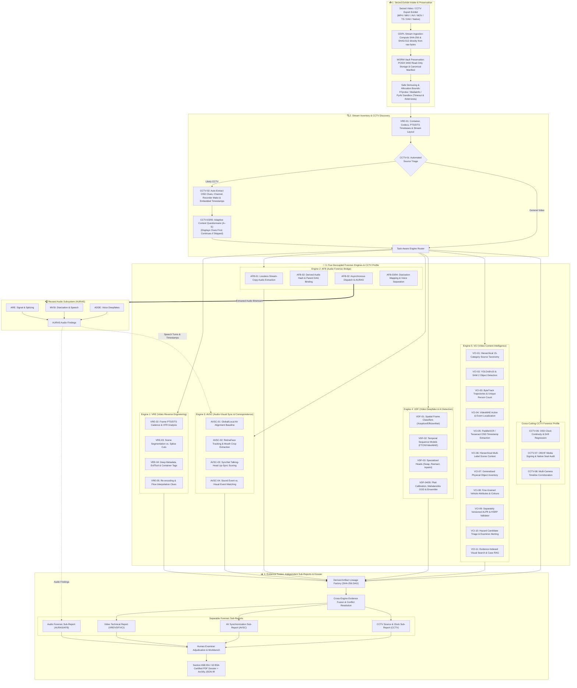

---

### 4.13 Video & CCTV Technologies by Purpose

| Category | Actual Implemented Dependencies | Planned Candidate Technologies | Primary Forensic Role |
| :--- | :--- | :--- | :--- |
| **Bitstream & Demuxing** | Standard Library (`hashlib`, `pathlib`, `struct`) | FFmpeg (>= 6.0), FFprobe, PyAV (>= 12.0), MediaInfo, ExifTool (>= 12.0) | Defensive parsing, container atom traversal, PTS/DTS cadence extraction, and zero-loss stream copy. |
| **Frame Decoding & Computer Vision** | OpenCV-Python-Headless (`>=4.9.0`), Pillow (`>=10.2.0`) | PySceneDetect (`>=0.6.2`), scikit-video, Decord, Torchvision | Timestamp-preserved frame decoding, adaptive scene cut detection, and optical flow estimation. |
| **Audio Extraction & Routing** | SoundFile (`>=0.12.1`), Librosa (`>=0.10.1`) | FFmpeg stream-copy, AURAS Adapter (ARE, MVSI, ADDE), Silero VAD v4, pyannote.audio | Lossless audio demuxing, sample-to-frame alignment, speech activity detection, and AURAS dispatch. |
| **Audio-Visual Synchronization** | — | SyncNet, RetinaFace, SCRFD, ByteTrack, MediaPipe Face Mesh, YAMNet, PANNs, AST | Container AV offset alignment, face tracking, talking-head lip-sync scoring, and sound-event matching. |
| **Video Deepfake Detection** | PyTorch (`>=2.2.0`), TorchAudio (`>=2.2.0`) | Xception, EfficientNet-B4/B7, FTCN, STIL, TALL, TimeSformer, VideoMAE, Scikit-learn | Multi-branch spatial and temporal deepfake detection, diffusion noise analysis, and Platt calibration. |
| **Content Intelligence & OCR** | Pytesseract (`>=0.3.10`) | YOLOv8/v10, RT-DETR, Grounding DINO, SAM 2, ByteTrack, BoT-SORT, PaddleOCR (>= 2.7) | Source categorization, object detection, unique person tracking, action localization, and OSD OCR. |
| **CCTV & Provenance Verification** | `cryptography` (`>=42.0.0`), `canonicaljson` | ONVIF Export File Format parser, ONVIF Media Signing verifier, pyc2pa / c2pa-rs | Digital seal verification, X.509 PKI certificate chain audit, and RFC 8785 canonical manifest signing. |
| **Testing, Benchmarks & Metrics** | Pytest (`>=8.0.0`), Pytest-asyncio | FaceForensics++, DFDC, Celeb-DF v2, WildDeepfake, UCF-Crime, CCTV test corpus | Algorithmic evaluation, ROC-AUC calibration, MOTA tracking benchmarks, and regression tests. |
| **Legal Reporting & Archify IR** | Jinja2 (`>=3.1.3`), WeasyPrint (`>=61.0`) | Archify JSON IR visualizer, Multi-track SVG Timeline generator | Section 65B/63 BSA certified PDF generation and interactive examiner timeline rendering. |

---

### 4.14 CCTV Frame Integrity, Temporal Sequence Forensics & Video Tampering Localisation (CFITSA)

> **Capability Boundary & Integration Invariant:**
> The **CCTV Frame Integrity & Temporal Sequence Analysis (CFITSA)** capability is a specialized temporal-integrity sub-engine embedded directly within the existing **Video Reverse Engineering Engine (VRE)** and the cross-cutting **CCTV Forensic Profile**. It does **NOT** constitute a sixth independent VISTA engine. It reuses core demuxing, decoding, tracking, OCR, audio extraction, and cryptographic storage pipelines to deepen temporal sequence verification across seized surveillance video and multimedia recordings.

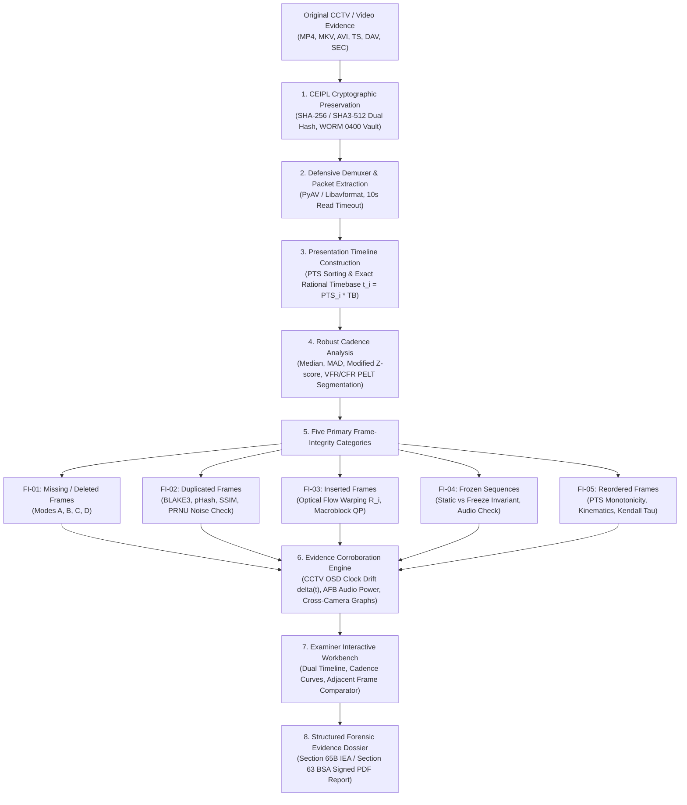

#### Why Frame Integrity & Temporal Forensics Matter
In criminal and civil litigation, electronic video evidence—particularly surveillance CCTV from banks, public spaces, and traffic intersections—is frequently challenged on grounds of missing footage, altered chronology, or selective excision. A perpetrator or insider may delete 10 critical seconds of footage and restamp container timestamps; an alibi video may be lengthened by cloning repeated frame blocks; or video frames may be frozen while audio or burned-in clocks continue.

CFITSA provides an evidence-preserving, mathematically defensible forensic workflow that investigates whether a video sequence contains anomalies consistent with:
1. Missing or deleted frames.
2. Duplicated or repeated frames.
3. Inserted foreign or synthetic frames.
4. Frozen or abnormally repeated frame sequences.
5. Reordered or shuffled frames.
6. Timestamp discontinuities and non-monotonic PTS reversals.
7. Suspicious frame-duration irregularities.
8. Inconsistent frame cadence and variable-frame-rate jitter.
9. Motion discontinuities and unphysical trajectory ruptures.
10. GOP and compression-structure inconsistencies (truncated GOPs, macroblock QP pulsing).
11. Suspicious frame-boundary transitions lacking encoder scene-cut markers.
12. Potential editing or re-encoding traces (`faststart` atom moves).
13. CCTV timestamp-overlay (OSD) contradictions against stream timestamps.
14. Timeline conflicts across related video evidence.
15. Cross-camera temporal inconsistencies across independent feeds.

#### Core Capabilities of CFITSA

| Forensic Dimension | Technical Methodology & Algorithmic Implementation | Primary Sub-Engine |
| :--- | :--- | :--- |
| **Frame & Packet Identity** | Preserves 5 decoupled coordinate dimensions: `packet_index`, `decoder_output_index`, `presentation_order_index`, `source_reference_index`, `scene_relative_index`. | VRE Demuxer Core |
| **Decode vs Presentation Order** | Enforces B-frame legal invariant: decode order $\neq$ presentation order is recognized as legitimate codec behaviour; verified via ISO/IEC 14496-12 `ctts` atom. | VRE Bitstream Parser |
| **Timebase & Timestamp Math** | Unrounded integer tick math scaled by exact rational timebase $t_i = PTS_i \times \frac{TB_{\text{num}}}{TB_{\text{den}}}$. Zero floating-point rounding drift. | VRE Cadence Core |
| **VFR-Aware Cadence Analysis** | Robust non-parametric statistics: median interval $m$, $MAD = \operatorname{median}(\|\Delta t_i - m\|)$, modified z-score $z_i$, and PELT piecewise change-point segmentation. | VRE Cadence Core |
| **Missing-Frame Detection (FI-01)** | Mode A (timing gaps), Mode B (reference sequence LCS/edit distance), Mode C (motion warping residual $R_i$), Mode D (companion DVR logs). | VRE Temporal Engine |
| **Duplicate-Frame Detection (FI-02)** | 256-bit BLAKE3 exact planar raster hash, 64-bit DCT perceptual hash ($d_H \le 2$), SSIM ($\ge 0.985$), and PRNU sensor noise check to safeguard static scenes. | VRE Duplicate Detector |
| **Inserted-Frame Detection (FI-03)** | Forward-backward optical-flow warping residual $R_i$, macroblock QP variance spikes, AI interpolation halos (RIFE/DAIN), and isolated non-cadence I-frames. | VRE Splice Detector |
| **Frozen-Sequence Detection (FI-04)** | Consecutive frame difference $D_i < 0.001$, multi-modal freeze disambiguation cross-referencing continuous audio power and advancing OSD clock strings. | VRE / CCTV Profile |
| **Reordered-Frame Detection (FI-05)** | Presentation order PTS monotonicity, optical flow vector continuity, ByteTrack kinematic momentum ($|\mathbf{a}_k(t)| \le a_{\max}$), and Kendall rank correlation $\tau$. | VRE / VCI Tracker |
| **CCTV OSD Clock Correlation** | PaddleOCR corner margin detection, robust datetime parsing, and linear drift regression $\delta(t) = T_{\text{ocr}}(t) - (T_0 + t_{\text{pts}}) = \alpha + \beta t + \epsilon(t)$. | CCTV Profile Engine |
| **Multi-Camera Alignment** | Independent WORM exhibit preservation, UTC normalization, relative clock offset estimation $\Delta t_{\text{cam1-cam2}}$, and trajectory handoff corroboration. | CCTV Multi-Cam Engine |
| **Audio-Visual Alignment** | AFB lossless audio stream-copy, ambient noise continuity during video freezes, and AVSC SyncNet talking-head lip-sync cross-correlation ($S_{\text{sync}}$). | AFB & AVSC Engines |
| **Examiner Review Workbench** | Synchronized dual-timeline canvas, interactive cadence curves, similarity heatmaps, optical flow vector overlays, and side-by-side adjacent frame comparators. | VISTA Workbench UI |
| **Structured Forensic Evidence Dossier** | Automated compilation of Section 63 BSA certificate schedules with SHA-256/SHA3-512 hashes, frame numbers, and examiner Ed25519 signatures. | CEIPL / Reporting |

#### Evidentiary Principles & Uncertainty Governance
- **Observable Anomaly vs Historical Deletion:** An isolated video file with cleanly rewritten timestamps cannot definitively prove that frames were deleted prior to acquisition. The system labels findings as `FRAME_GAP_OBSERVED` or `POSSIBLE_FRAME_DELETION` and strictly abstains from asserting uncorroborated historical events in court testimony.
- **Static Scene vs Video Freeze:** A stationary camera viewing an empty room naturally yields near-identical frames ($SSIM > 0.98$). The system verifies high-frequency PRNU sensor noise and camera motion before declaring duplication, preventing false accusations on authentic static scenes.
- **First-Class Inconclusive Verdicts:** When footage exhibits extreme network jitter, severe low-resolution optics ($< 320\times240$), or unresolvable clock drift, the platform issues typed inconclusive outcomes (`STATIC_SCENE_OR_FREEZE_INCONCLUSIVE`, `INCONCLUSIVE_VFR_JITTER`) rather than forcing a speculative verdict.

#### Actual vs. Planned Implementation Status
- **Specification & Technical Contracts:** `DOCUMENTED` — Architectural boundaries, temporal definitions, cadence formulas, Pydantic v2 schemas, and metric formulations are fully established in [PRD.md § 15 (CFI-01..CFI-22)](PRD.md), [TRD.md § 11.12, § 12.6, § 15.5](TRD.md), and [PHASES.md § 4.B, § 13](PHASES.md).
- **Execution Harness & Code:** `PLANNED` / `NOT_STARTED` — Implementation is organized across ten dedicated engineering phases (`VISTA-CFI-00` through `VISTA-CFI-09`). No temporal detector weights have been loaded, and no test runs have been executed in this architectural specification phase.

For complete technical specifications, mathematical foundations, schemas, and phase roadmaps:
- Product requirements, user journeys, and functional inventory: [PRD.md § 15 (CFI-01..CFI-22)](PRD.md)
- Technical architecture, algorithm matrices, formulas, and Pydantic schemas: [TRD.md § 11.12, § 12.6](TRD.md)
- Engineering execution playbook, tasks, and checkpoints: [PHASES.md § 4.B, § 13 (VISTA-CFI-00..VISTA-CFI-09)](PHASES.md)

---

### 4.15 Video Forensic Limitations & Uncertainty Principles

All video and CCTV forensic analysis within VISTA is governed by eight strict evidentiary principles:

1. **Audio-Visual Correspondence $\neq$ Authenticity:** A perfectly synchronized talking-face video can be an entirely synthetic generation (e.g., advanced audio-driven neural avatars). Conversely, legitimate post-production dubbing, studio voiceovers, or translation overdubs exhibit genuine desynchronization without constituting fraud.
2. **Frame Discontinuity $\neq$ Malicious Tampering:** Dropped frames, variable frame rates (VFR), duplicate frames, or clock jumps frequently occur naturally in surveillance setups due to network congestion, packet loss, RTSP transmission drops, variable illumination, motion-triggered keyframing, or storage write throttling. Findings must be reported as *temporal anomalies with alternative hypotheses*.
3. **Metadata Scope & Vulnerability:** Container tags (`encoder`, `creation_time`, `handler_name`) can be effortlessly rewritten by ordinary transcoders or video trimming tools. An encoder tag indicating `Lavf` (FFmpeg) or `Adobe Premiere` proves an export occurred, not that the underlying recording was forged.
4. **Cryptographic Hash Scope:** A matching SHA-256 hash proves bit-level identity to a reference hash; it does **not** prove that the camera was recording reality, that the timestamp was accurate, or that the file was unedited prior to seizure.
5. **Deepfake Detector Generalization Bounds:** Video deepfake detectors trained on specific benchmark corpora (e.g., FaceForensics++) exhibit substantial accuracy drops when tested against unseen generative architectures, heavy social media compression (WhatsApp, Telegram H.264/H.265 re-encoding), extreme motion blur, or low-resolution CCTV optics.
6. **Unique Track Count $\neq$ Real-World Headcount:** Computer vision multi-object tracking (ByteTrack) measures track trajectories across visible frames. Occlusions, lighting changes, camera cuts, and entering/exiting the field of view can fragment tracks, resulting in track ID switches. VCI distinguishes *visible track instances* from *biometrically verified individuals*.
7. **Burned-In OSD Text $\neq$ Ground Truth Clock:** On-screen surveillance clock text extracted via OCR represents visual display data rendered by recorder software. Hardware clock drift, unsynchronized NTP servers, manual operator misconfiguration, or battery depletion frequently cause display offsets without intentional evidence tampering.
8. **Legitimate Inconclusive Verdicts:** When resolution is below $320\times240$, compression artifacts destroy high-frequency facial textures, frame rates drop below 5 fps, or out-of-distribution distance is elevated, **"Inconclusive / Insufficient Video Evidence"** is the mandatory, legally defensible scientific verdict.

For deeper technical and implementation details, see:
- Product requirements and personas: [PRD.md § 6.3](PRD.md)
- Technical architecture, tool registry, schemas, and threat model: [TRD.md § 11](TRD.md)
- Engineering execution playbook and checkpoints: [PHASES.md § 4 (VISTA-A0..A13)](PHASES.md)

---

### 4.16 Offline Network Traffic Forensics Subsystem (ONTF)

> **Architectural Boundary Clarification:** The **ONTF (Offline Network Traffic Forensics)** subsystem is dedicated strictly to the post-incident examination of previously captured, legally seized network traffic files (`.pcap` and `.pcapng`).
> **Strict Operational Boundary:** ONTF is an **offline forensic analysis tool**, NOT an intrusion detection system (IDS), network sniffer, continuous Zeek monitor, or live packet tap. It operates entirely on static capture artifacts in air-gapped environments.

In contemporary cyber investigations—ranging from corporate espionage and ransomware outbreaks to mobile spyware and unauthorized data exfiltration—seized PCs, smartphones, or network appliances are often accompanied by historical packet captures. Investigating raw packet captures manually via generic packet viewers is labor-intensive, error-prone, and struggles to establish mathematically defensible device attribution or timeline correlation.

The ONTF subsystem automates offline evidence intake, safe parsing, telemetry normalization, multi-dimensional feature extraction, and MITRE ATT&CK mapping while strictly preserving the raw evidentiary bitstream.

#### Supported Analysis Modes
To accommodate diverse investigative scenarios, ONTF provides two distinct operational modes:
1. **Mode A — Whole-Capture Analysis:**
   - Exhaustively analyzes all packets, flows, sessions, and protocol transactions represented across the entire uploaded PCAP/PCAPNG file.
   - Generates global network conversation graphs, autonomous system (ASN) distributions, protocol breakdowns, and capture-wide anomaly scores.
2. **Mode B — Target-Device-Centred Analysis:**
   - Focuses analysis on communications directly involving a specific device of interest (e.g., a seized suspect laptop or victim Android/iOS smartphone).
   - Allows investigators to identify the candidate target device using available in-capture evidence:
     - Specific IPv4 or IPv6 addresses.
     - Hardware MAC addresses (where captured at layer 2).
     - DHCP lease transactions (`Option 12` Hostname, `Option 55` Parameter Request List).
     - ARP / IPv6 Neighbor Discovery (NDP) mappings.
     - Clear investigator-supplied device labels (flagged strictly as `USER_REPORTED`).
   - Filters and prioritizes inbound, outbound, lateral, and peer communications relative to the target entity.

---

### 4.17 ONTF Engine & Processing Architecture Matrix

The ONTF subsystem is structured into six decoupled, modular functional engines:

| Engine / Component | Primary Forensic Responsibility | Candidate Technologies | Key Input / Output Contracts |
| :--- | :--- | :--- | :--- |
| **1. Intake & Validation Engine (`ONTF-INTAKE`)** | Safe file intake, magic-byte format validation (`.pcap` / `.pcapng`), link-layer detection, truncation trapping, pre-decode dual hashing (SHA-256 / SHA3-512), and WORM storage lock. | Python `hashlib`, `scapy`, `libpcap` wrappers | **In:** Raw seized file. <br/>**Out:** `NetworkEvidenceRecord`, Dual hashes, Link type, Packet count. |
| **2. Pluggable Parser Engine (`ONTF-PARSE`)** | Sandboxed offline extraction of packet headers, transport states, and application metadata; offline Zeek log batch generation (`zeek -r`). | Wireshark / TShark 4.x, Scapy, Zeek (offline batch), PyShark | **In:** Pristine PCAP file. <br/>**Out:** Raw dissection tables, Zeek structured TSV/JSON logs. |
| **3. Telemetry Normalisation Engine (`ONTF-NORM`)** | Normalizes disparate parser outputs into the unified `NetworkFlowRecord` and protocol schemas with data minimization and payload masking. | Pydantic v2, Python `ipaddress` | **In:** Dissection streams & Zeek logs. <br/>**Out:** Normalized flows, DNS records, TLS sessions. |
| **4. Feature Engineering Engine (`ONTF-FEAT`)** | Extracts statistical flow metrics, packet length distributions, inter-arrival time (IAT) jitter, TCP flag ratios, and communication graph metrics. | NumPy, SciPy, Pandas, NetworkX | **In:** Normalized flow records. <br/>**Out:** Flow feature vectors, windowed aggregates, graph adjacency matrices. |
| **5. Threat Detection & Correlation Engine (`ONTF-DETECT`)** | Layered threat analysis: deterministic rules (scans, DGA, tunnels, beacons), ML anomaly classification, multi-stage attack correlation, and MITRE ATT&CK mapping. | Scikit-learn, LightGBM, custom rule evaluators | **In:** Feature vectors & timeline events. <br/>**Out:** Calibrated threat findings, attack narratives, ATT&CK tags. |
| **6. Target Device Attribution Engine (`ONTF-ATTR`)** | Evaluates candidate device identity, resolves DHCP/ARP bindings, correlates hostnames, and enforces attribution confidence tiering. | Custom attribution logic, Scapy DHCP/ARP | **In:** Telemetry records + investigator target criteria. <br/>**Out:** Device profile, attribution confidence tier, filtered sessions. |

---

### 4.18 End-to-End ONTF Offline Processing Workflow

The canonical 7-step offline network forensics pipeline is executed as an auditable, deterministic Directed Acyclic Graph (DAG):

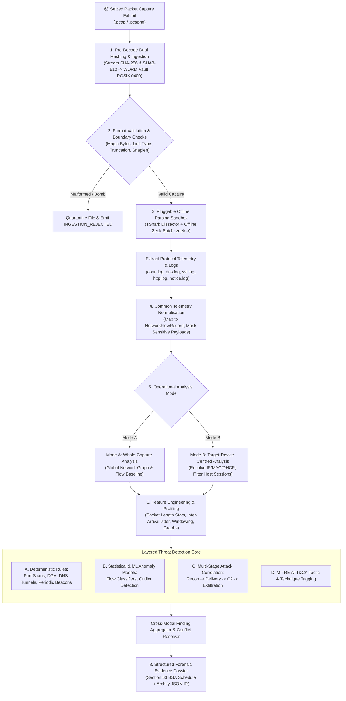

#### Detailed Execution Steps:
1. **Intake & Hashing:** Raw captured bytes are streamed through parallel SHA-256 and SHA3-512 accumulators prior to file parsing, committed to WORM immutable storage (`POSIX 0400` / S3 Object Lock), and assigned a unique `evidence_id`.
2. **Defensive Validation:** Inspects file headers (`0xa1b2c3d4` or `0x0a0d0d0a`), verifies packet link-layer types (Ethernet, Linux Cooked, Raw IP), traps capture drop counts, checks for packet-level truncation, and rejects crafted decompression bombs.
3. **Pluggable Sandboxed Parsing:** Dispatches the capture through TShark and offline Zeek (`zeek -r capture.pcap`) inside an isolated, unprivileged worker container (`uid 10001`) with strict execution timeouts (300s limit).
4. **Common Telemetry Normalisation:** Transforms raw dissections and Zeek logs into structured `NetworkFlowRecord`, `DNSActivityRecord`, and `TLSHandshakeRecord` representations. Strips or masks non-essential packet payloads to enforce privacy and data minimization.
5. **Scoping & Device Attribution:** For Mode B, resolves candidate IP and MAC addresses from DHCP, ARP, and NDP transactions. Assigns a formal attribution confidence score and isolates flows involving the target device.
6. **Feature Engineering:** Computes bidirectional flow metrics, inter-arrival time (IAT) distributions, FFT-based beacon periodicity scores, TCP flag ratios, and communication graph centrality metrics.
7. **Multi-Stage Threat Detection:** Evaluates deterministic behavioral rules, statistical anomaly detectors, and supervised flow classifiers; correlates multi-stage event sequences; and maps validated anomalies to MITRE ATT&CK techniques.
8. **Forensic Reporting:** Assembles findings into an 11-part structured electronic evidence dossier with Section 63 BSA certificate schedules, sealed with Ed25519 digital signatures and RFC 3161 timestamps.

---

### 4.19 Network Technologies by Forensic Purpose

The following candidate technologies are evaluated for the ONTF subsystem, categorized by their distinct forensic role:

| Forensic Domain | Candidate Technologies Evaluated | Selection Status | Primary Forensic Responsibility |
| :--- | :--- | :--- | :--- |
| **Bitstream Demuxing & Dissection** | Wireshark / TShark 4.x, Scapy (`>=2.5.0`), PyShark | `PLANNED` | Deep multi-protocol dissection, packet header extraction, TCP reassembly, and structured JSON packet export. |
| **Offline Protocol Logging** | Zeek 6.x (offline batch: `zeek -r`) | `PLANNED` | High-level behavioral extraction generating structured protocol logs (`conn.log`, `dns.log`, `ssl.log`, `notice.log`). |
| **Flow Feature Generation** | CICFlowMeter, custom NumPy/SciPy flow accumulator | `PLANNED` | Extraction of 80+ bidirectional flow metrics (inter-arrival times, packet length statistics, sub-flow metrics). |
| **Communication Graph Modeling** | NetworkX, igraph, PyTorch Geometric | `RESEARCH_CANDIDATE` | Bipartite host-to-host interaction graphs, degree centrality, clustering coefficients, and lateral movement paths. |
| **Rule-Based Threat Detection** | Custom deterministic rule engine, Sigma rules | `PLANNED` | Detection of horizontal/vertical port scans, DNS tunneling, DGA domains, and periodic beaconing ($CV_{\text{IAT}} < 0.15$). |
| **Machine Learning Classifiers** | Scikit-learn (Random Forest, Isolation Forest), LightGBM | `PLANNED` | Supervised flow classification against benchmark sets (CIC-IDS2017, UNSW-NB15) and unsupervised outlier detection. |
| **Threat Taxonomy & Mapping** | MITRE ATT&CK Enterprise Matrix (STIX/TAXII format) | `PLANNED` | Contextual tagging of verified network findings to standard ATT&CK Tactics (TA0001..TA0011) and Techniques (T1046, T1071, etc.). |
| **Cryptographic Evidence Sealing** | Python `hashlib`, `cryptography` (Ed25519), `canonicaljson` | `PLANNED` | SHA-256 dual-hashing, RFC 8785 canonical manifest generation, and Ed25519 digital signing. |
| **Legal Dossier & Visualization** | ReportLab, WeasyPrint, Archify JSON IR compiler | `PLANNED` | Section 65B/63 BSA certified PDF generation and interactive SVG communication graph rendering. |

---

### 4.20 Network Forensic Limitations & Device Attribution Principles

All network traffic forensic analysis within ONTF is governed by nine strict evidentiary and scientific principles:

1. **Offline Capture $\neq$ Complete Device History:** A packet capture represents only the packets that traversed a specific monitored link during the capture window. Packet drops, uncaptured network interfaces (e.g., Bluetooth, cellular data while Wi-Fi is monitored), or local host activity not generating traffic remain invisible.
2. **IP Address $\neq$ Physical Device Identity:** An IP address identifies a network interface at a specific instant in time, not a physical human or hardware device. DHCP pool churn, dynamic IP re-assignments, and NAT gateways mean an IP may be shared across multiple devices over time.
3. **MAC Address Limitations & Volatility:** Layer-2 MAC addresses are stripped by routers at the first gateway hop and are absent in routed captures. Furthermore, modern operating systems (iOS, Android, Windows, macOS) employ MAC randomisation by default on untrusted Wi-Fi networks, and MAC addresses can be easily spoofed.
4. **Encrypted Payload Opacity & Blind Spots:** Modern internet communications predominantly utilize TLS 1.3, QUIC, DoH (DNS over HTTPS), and SSH. In the absence of legally authorized server private keys or client session key logs (`SSLKEYLOGFILE`), packet payloads cannot be decrypted. Forensic analysis must rely on unencrypted transport metadata, handshake SNI, certificate validation, and flow dynamics.
5. **Vantage Point Sensitivity:** The evidentiary value of a capture depends heavily on where it was recorded (e.g., local endpoint agent, home Wi-Fi access point, mirrored switch port, corporate core gateway). Gateway captures do not see local broadcast or lateral peer-to-peer traffic.
6. **User-Reported Context $\neq$ Verified Evidence:** Information supplied by the investigator (e.g., "This PCAP is from the suspect's iPhone") is strictly categorized as `USER_REPORTED` until corroborated by independent in-capture artifacts (e.g., DHCP Hostname matching IMEI/serial records).
7. **Correlation $\neq$ Confirmed Causation or Intent:** Detecting multiple failed connections or unusual ports indicates anomalous traffic; it does not independently prove criminal intent or a confirmed breach. Legitimate software bugs, network misconfigurations, P2P applications, and cloud telemetry often mimic suspicious behavior.
8. **Forecasted States $\neq$ Historical Reality:** Where bounded temporal world-models or graph forecasting models project potential attack propagation horizons, these candidate future states are purely probabilistic simulations. They must **NEVER** be cited as historical events that actually took place.
9. **Legitimate Inconclusive Attribution:** When packet headers lack layer-2 frames, DHCP logs are missing, multiple devices share a single NAT IP, or traffic volume is insufficient, **"Attribution Inconclusive / Insufficient Network Telemetry"** is the mandatory, examiner-reviewed scientific determination.

For deeper technical and implementation details, see:
- Product requirements and personas: [PRD.md § 6.5](PRD.md)
- Engineering execution playbook and checkpoints: [PHASES.md § 7 (ONTF-A0..A13)](PHASES.md)

---

### 4.21 AIF-GEO Geospatial Forensics & Evidence Correlation Subsystem Overview

> **Subsystem Identity & Architectural Invariant:** The **AIF-GEO (Geospatial Forensics & Evidence Correlation)** subsystem is a specialized analytical capability embedded within the **AIF (Advanced Image Forensics)** platform. It does NOT replace AIF's manipulation-detection or reverse-engineering capabilities, nor does it operate as an isolated silo. It leverages shared platform services (CEIPL hashing, WORM vault, Celery dispatch, Section 65B/63 BSA reporting) while communicating cross-subsystem with VISTA (video/CCTV timestamps and camera locations) and AURAS (acoustic context).
> **Critical Evidence Invariant:** Reading metadata, parsing rational coordinates, or performing spatial analysis must **NEVER** overwrite, re-encode, retag, or modify the original seized evidence file. All analysis executes strictly on derived, cryptographically bound artifacts.

In digital forensics investigations—such as kidnappings, extortion cases, illicit trafficking, violent crimes, and disaster response—location context is critical. However, investigators frequently encounter:
1. **Metadata Stripping & Forgery:** Social media platforms (WhatsApp, Telegram) strip EXIF metadata entirely, while off-the-shelf EXIF editors allow suspects to inject fabricated coordinates.
2. **Coordinate & Timezone Fallacies:** Naive parsers fail to distinguish GPS UTC timestamps from camera local clocks, misinterpret hemisphere tags, or divide by zero on corrupted rational fields.
3. **The Reverse-Geocoding Illusion:** Finding that a coordinate resolves to a specific address does not independently prove that the photograph was physically taken at that building.
4. **Isolated Evidence Islands:** Photographs, surveillance clips, and suspect device tracking logs are analyzed in disconnected tools without cross-evidence correlation or conflict detection.

The AIF-GEO subsystem transforms seized images into an evidence-linked, map-oriented investigative workspace that rigorously tests location claims against physical, environmental, and visual realities.

---

### 4.22 The 26 AIF-GEO Capability Specifications Matrix

The AIF-GEO subsystem implements twenty-six cohesive forensic capabilities (designated **`GEO-01` through `GEO-26`**), categorized into eight functional domains:

| Domain | Capability ID & Title | Primary Forensic Function | Key Algorithms & Methods | Implementation Status |
| :--- | :--- | :--- | :--- | :--- |
| **1. Metadata & Geodesy** | **`GEO-01` Comprehensive GPS Metadata Extraction** | Recovers all EXIF, XMP, IPTC, and MakerNote location tags. | Sandboxed ExifTool array execution, Pillow `_getexif()`, raw value preservation. | `PLANNED` (AIF-GEO-01) |
| | **`GEO-02` Coordinate Validity & Anomaly Checks** | Validates $-90 \le \phi \le 90$, $-180 \le \lambda \le 180$, detects zero-denominators, conflicting tags. | Rational decoding, hemisphere validation, precision audit. | `PLANNED` (AIF-GEO-01) |
| | **`GEO-05` Capture-Time & GPS-Time Consistency** | Compares DateTimeOriginal, GPS time stamp, and local clock offsets. | Microsecond epoch normalisation, leap-second offset (18s), drift regression. | `PLANNED` (AIF-GEO-02) |
| | **`GEO-06` Accuracy & Uncertainty Representation** | Represents horizontal positioning error and dilution of precision (DOP). | Error propagation $\sigma_{\text{diff}} = \sqrt{\sigma_1^2 + \sigma_2^2}$, radial accuracy modeling. | `PLANNED` (AIF-GEO-02) |
| **2. Geocoding & Mapping** | **`GEO-03` Reverse Geocoding & Place Enrichment** | Resolves coordinates to administrative boundaries, streets, and POIs. | Local offline gazetteer, provider adapter, rate limiting, caching. | `PLANNED` (AIF-GEO-03) |
| | **`GEO-04` Interactive Geospatial Evidence Map** | Renders candidate markers, uncertainty radii, and timeline-synced tracks. | MapLibre GL JS / Leaflet vector tiles, GeoJSON overlays, offline caching. | `PLANNED` (AIF-GEO-03) |
| | **`GEO-25` Evidence-Aware Geospatial Search** | Enables bounding box, radial, polygon, and temporal case evidence searches. | PostGIS GiST spatial indexing, spatial joins, bounded queries. | `PLANNED` (AIF-GEO-08) |
| | **`GEO-26` Offline Geographic Intelligence & Enrichment** | Ensures 100% air-gapped execution with optional controlled online provider. | Local vector tiles, local DEM rasters, privacy-preserving query minimisation. | `PLANNED` (AIF-GEO-03) |
| **3. Movement & Tracks** | **`GEO-07` Cross-Image Location & Timeline Reconstruction** | Assembles groups of images into geographic travel sequences. | Geodesic distance, velocity check $v = d / \Delta t$, DBSCAN, Kalman filter. | `PLANNED` (AIF-GEO-04) |
| | **`GEO-08` External Track & Device-Log Correlation** | Ingests authorized GPS tracks (GPX, KML, NMEA, FIT, CSV). | Timestamp alignment, geodesic interpolation $p(t) = p_0 + \alpha(p_1 - p_0)$. | `PLANNED` (AIF-GEO-04) |
| **4. Visual Geolocation** | **`GEO-09` Visual Location Recovery Without GPS** | Recovers candidate locations from visible signs, roads, landmarks, and terrain. | PaddleOCR text extraction, visual embedding retrieval, GeoCLIP (candidate). | `PLANNED` (AIF-GEO-05) |
| | **`GEO-10` Direction & Landmark Geometry** | Compares camera compass heading against scene geometry and landmarks. | Circular difference $\Delta\theta$, magnetic declination, projective geometry. | `PLANNED` (AIF-GEO-05) |
| | **`GEO-21` Map & Satellite-Image Comparison** | Correlates image scene with authorized satellite / orthophoto references. | SIFT/ORB feature matching, RANSAC homography estimation ($\mathbf{x}' \sim \mathbf{H}\mathbf{x}$). | `PLANNED` (AIF-GEO-05) |
| | **`GEO-22` Landmark & Point-of-Interest Ranking** | Ranks candidate geographic landmarks matching the visual scene. | Top-k candidate accuracy, multi-stage retrieval, calibrated ranking scores. | `PLANNED` (AIF-GEO-05) |
| **5. Environmental & Terrain**| **`GEO-11` Solar Position & Shadow Consistency** | Computes expected sun angle vs visible shadows. | NOAA solar position algorithm ($\alpha, \Phi_s$), shadow geometry $\tan\alpha \approx h/L$. | `PLANNED` (AIF-GEO-06) |
| | **`GEO-12` Historical Weather Context** | Compares candidate date/place with historical weather records. | Open-Meteo historical reanalysis, temperature, precipitation, cloud cover. | `PLANNED` (AIF-GEO-06) |
| | **`GEO-13` Elevation & Terrain Correlation** | Compares GPS altitude with digital elevation models (DEM). | SRTM / Copernicus DEM, ellipsoidal $h$ vs orthometric $H$ ($h = H + N$). | `PLANNED` (AIF-GEO-06) |
| **6. Manipulation & Integrity**| **`GEO-14` GPS & Location Manipulation Indicators** | Detects coordinate-time incompatibilities and spoofed tags. | Multi-tag cross-referencing, coordinate teleportation detection. | `PLANNED` (AIF-GEO-07) |
| | **`GEO-15` EXIF-to-Visual Content Consistency** | Verifies whether depicted scene content matches claimed GPS region. | Visual feature extraction vs geographic classification, screen detection. | `PLANNED` (AIF-GEO-07) |
| | **`GEO-17` Near-Duplicate & Same-Scene Discovery** | Identifies byte-identical, re-compressed, or cropped copies of scene. | SHA-256 hashes, perceptual hashes, deep visual embeddings. | `PLANNED` (AIF-GEO-07) |
| | **`GEO-18` Camera & Device Consistency Analysis** | Evaluates camera make/model, lens, and serial metadata across case files. | ExifTool MakerNotes, sensor specifications cross-referencing. | `PLANNED` (AIF-GEO-07) |
| | **`GEO-19` Sensor & Image-Processing Correlation** | Evaluates camera sensor noise compatibility with suspect device. | PRNU wavelet denoising, normalized cross-correlation $\rho(W, K_{\text{ref}})$. | `PLANNED` (AIF-GEO-07) |
| **7. Cross-Evidence & Graph** | **`GEO-16` Cross-Evidence Geospatial Correlation** | Links image findings to related CCTV, audio, network, and case incident data. | Spatio-temporal matching, explicit evidence relationship links. | `PLANNED` (AIF-GEO-08) |
| | **`GEO-20` Signed Provenance & Content Credentials** | Validates C2PA / Content Credentials manifests and location claims. | C2PA claim validation, Ed25519/ECDSA signature verification, trust chain audit. | `PLANNED` (AIF-GEO-08) |
| | **`GEO-23` Multi-Image Geospatial Clustering** | Clusters case images by geographic distance and capture timestamp. | DBSCAN / HDBSCAN on geodesic distance matrices with temporal constraints. | `PLANNED` (AIF-GEO-08) |
| | **`GEO-24` Location-Claim Conflict Graph** | Relates evidence, coordinates, tracks, and findings in an interactive graph. | Typed node/edge graph (`CLAIMS_LOCATION`, `CONTRADICTS`, `CORROBORATES`). | `PLANNED` (AIF-GEO-08) |

---

### 4.23 End-to-End AIF-GEO 7-Stage Geospatial Processing Workflow

The AIF-GEO engine executes as an auditable, deterministic 7-stage pipeline:

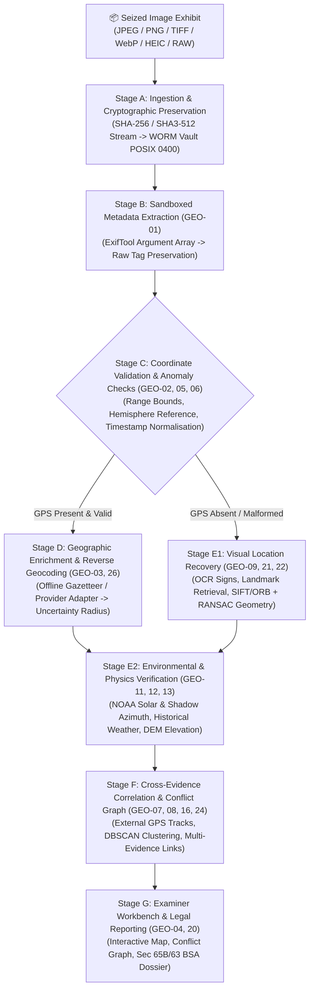

---

### 4.24 Candidate Geospatial & Vision Technologies Matrix

| Technology / Library | Forensic Purpose | Selection Status | Compatibility & Licensing Rationale |
| :--- | :--- | :--- | :--- |
| **`ExifTool` (12.x)** | Deep EXIF/GPS/XMP extraction | `PLANNED` | Industry standard; executed via sandboxed argument arrays without shell interpolation. Artistic/GPL license. |
| **`pyproj` (>=3.6.0)** | Geodesy, WGS84 ellipsoidal distance, CRS conversion | `PLANNED` | PROJ C-library bindings; exact ellipsoidal geodesic calculations. Permissive MIT license. |
| **`geopy` (>=2.4.0)** | Geocoding provider adapters & distance utilities | `PLANNED` | Lightweight abstraction over geocoding providers; permissive MIT license. |
| **`shapely` (>=2.0.0)** | Spatial geometry operations & bounding polygons | `PLANNED` | Fast GEOS-backed geometry engine; permissive BSD license. |
| **`geopandas` (>=0.14.0)** | Spatial dataframes & spatial joins | `PLANNED` | Tabular geospatial analysis; BSD license. |
| **`rasterio` (>=1.3.0)** | Digital Elevation Model (DEM) raster access | `PLANNED` | GDAL-backed GeoTIFF reader for terrain elevation lookups. BSD license. |
| **`PostgreSQL / PostGIS`** | Spatial persistence & GiST spatial indexing | `PLANNED` | Enterprise spatial database; fallback to indexed latitude/longitude columns if PostGIS is not enabled. |
| **`MapLibre GL JS`** | Interactive vector map visualization | `PLANNED` | Open-source fork of Mapbox GL; supports offline vector tiles and WebGL rendering. 3-Clause BSD. |
| **`Leaflet`** | Lightweight map interactions & GeoJSON overlays | `PLANNED` | Fast, mobile-friendly map library; permissive BSD-2. |
| **`PaddleOCR` (>=2.7.0)** | Text extraction from signs, street names, overlays | `PLANNED` | High-accuracy multilingual Indian script & English OCR; Apache 2.0 license. |
| **`OpenCV SIFT / ORB`** | Local feature matching & homography estimation | `PLANNED` | Deterministic keypoint matching with RANSAC geometric verification. Apache 2.0 license. |
| **`GeoCLIP` / `StreetCLIP`**| Image-to-location candidate retrieval | `CANDIDATE_NOT_YET_VALIDATED` | Research-grade model; requires benchmark evaluation, geographic coverage audit (Indian regions), and license verification. |
| **`pvlib-python` / NOAA** | Solar position, elevation, and azimuth calculation | `PLANNED` | Validated astronomical formulas matching NOAA Solar Calculator. BSD 3-Clause. |
| **`Open-Meteo Historical`**| Historical weather reanalysis context | `PLANNED` | Open-access non-commercial weather data with local caching and offline fallback. |

---

### 4.25 The 10 Geospatial Forensic Limitations & Location Attribution Principles

All geospatial forensic analysis within AIF-GEO is governed by ten strict evidentiary principles:

1. **GPS Metadata $\neq$ Physical Ground Truth:** An embedded EXIF GPS tag indicates what the recording device's software recorded into the file header. Software bugs, fake-GPS mock apps, manual tagging tools, and post-capture editing can inject false coordinates into genuine photos.
2. **Reverse Geocoding $\neq$ Location Verification:** Resolving a coordinate to a street address confirms that the coordinate maps to that place in a database; it does **not** prove the camera was physically there.
3. **Missing GPS Metadata $\neq$ Manipulation:** The vast majority of social media platforms (WhatsApp, Telegram, Facebook, X) strip all EXIF metadata by default to protect user privacy. The absence of GPS tags is expected on web-sourced media and must **never** be cited as standalone proof of fraud.
4. **Device Heading $\neq$ Photographed Subject Bearing:** Camera compass metadata (`GPSImgDirection`) records the orientation of the physical phone/camera at the instant of capture. It does not prove the bearing of the subject depicted in the frame (e.g. telephoto zoom, tilted camera, aerial viewpoint).
5. **GPS Uncertainty Bounds Are Mandatory:** GPS receivers experience dilution of precision (DOP), urban canyon multipath reflections, and atmospheric delays. Every coordinate finding must state its uncertainty radius; map zoom levels must not imply false pinpoint accuracy.
6. **Interpolated Positions $\neq$ Measured GPS Fixes:** When correlating images against external GPS tracks (GPX, KML), interpolated points are mathematical estimates. They must be clearly labeled as `MODEL_INFERRED` and never represented as recorded satellite fixes.
7. **Visual Similarity $\neq$ Geographic Proof:** Architectural similarities (e.g. colonial buildings, standard highway signs, retail chain storefronts) do not establish an exact location without location-specific verification (street names, unique landmarks, geometric homography).
8. **Solar/Shadow Consistency Is a Compatibility Test:** A solar position check indicates whether the observed shadow angle is *physically consistent* with the claimed time and place. It cannot pinpoint a location uniquely, because identical sun angles occur at many locations and dates globally.
9. **No Confidential Evidence Transmission:** Uploaded case images and confidential coordinates must **NEVER** be transmitted to unvetted third-party commercial geolocation APIs. External enrichment must use local offline databases or administrator-whitelisted, privacy-preserving adapters.
10. **Mandatory Inconclusive Verdicts:** When image resolution is inadequate, scene geometry is ambiguous, terrain is flat/featureless, or metadata is stripped without visual clues, **"Location Inconclusive / Insufficient Geospatial Evidence"** is the legally required scientific finding.

For deeper technical and implementation details, see:
- Product requirements and personas: [PRD.md § 6.6](PRD.md)
- Technical architecture, geodesy math, schemas, and API contracts: [TRD.md § 10.10](TRD.md)
- Engineering execution playbook and checkpoints: [PHASES.md § 6 (AIF-GEO-00..AIF-GEO-10)](PHASES.md)

---

### 4.26 Cross-Modal Deepfake Validation Framework (CDVF)

> **Architectural Boundary Clarification:** The **Cross-Modal Deepfake Validation Framework (CDVF)** is a shared scientific evaluation, calibration, out-of-distribution (OOD) gating, and model-governance capability within PS-05.
> CDVF does **NOT** act as a fourth standalone media-detection engine. It does not replace or compete with **AIF (Image)**, **AURAS (Audio)**, or **VISTA (Video/CCTV)**. Instead, it provides the common mathematical, statistical, and evidentiary validation backbone that governs, stress-tests, calibrates, and certifies the detection models operating within those subsystems.

#### Why Shared Cross-Modal Validation is Necessary
In judicial criminal proceedings governed by **Section 65B of the Indian Evidence Act (IEA)** and **Section 63 of the Bharatiya Sakshya Adhiniyam, 2023 (BSA)**, unverified or overconfident machine learning predictions represent a fatal evidentiary risk:
1. **Benchmark Scores Do Not Prove Universal Reliability:** A detector achieving $98\%$ AUC on a clean academic dataset (e.g. FaceForensics++) frequently degrades below chance on real-world exhibits subject to multi-generation social media recompression (WhatsApp, Telegram) or novel diffusion architectures.
2. **Uncalibrated Model Logits Manufacture False Courtroom Certainty:** Raw neural network sigmoid outputs cluster near $0.0$ or $1.0$ due to overparameterisation, misrepresenting arbitrary decision margins as statistical certainty.
3. **Data Contamination Inflates Performance:** When video frames or speech segments derived from the same source clip or speaker identity cross between training and test sets, reported accuracy reflects memorization rather than forensic generalisation.
4. **Naive Score Averaging Conceals Targeted Tampering:** Blindly averaging image, audio, and video scores into a monolithic "authenticity percentage" conceals realistic attacks where an adversary splices an audio track while leaving genuine video untouched.

CDVF establishes an end-to-end scientific framework ensuring that every forensic detection result is reproducible, calibrated, bounded by explicit out-of-distribution thresholds, and traceable to the exact model checkpoint and data split that produced it.

#### End-to-End CDVF Validation, Calibration & Approval Workflow

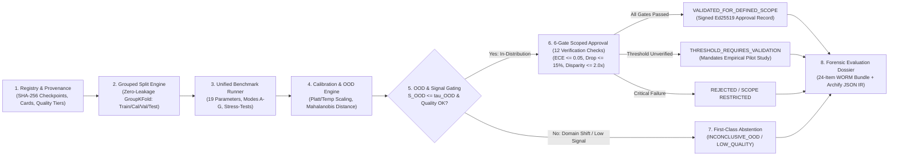

#### Core Architectural Capabilities of CDVF

| Dimension | Architectural Specification & Forensic Invariant | Governing Subsystems |
| :--- | :--- | :--- |
| **Model Registry & Provenance** | Immutable registration of all candidate checkpoints with unique model IDs, architecture family, source commit SHA, license terms, fixed input tensor geometries, and streaming SHA-256 digests. Changes to weights, preprocessors, precision, or dependencies trigger immediate state transition to `REVALIDATION_REQUIRED`. | AIF, AURAS, VISTA |
| **Dataset Governance & Quality Tiers** | Structured `DatasetCard` schemas tracking acquisition source, collection hardware, license permissions, and 4 ground-truth quality tiers (`DIRECT_PHYSICAL`, `PIPELINE_GENERATED`, `HUMAN_VERIFIED`, `WEAK_DISPUTED`). Disputed or weak labels are strictly segregated from primary validation test sets. | AIF, AURAS, VISTA |
| **Leakage-Resistant Data Splitting** | Hierarchical group splitting partitioned strictly at the root source grouping key (source video ID, actor identity, recording session, derivative family). Disjoint-set intersection assertions mathematically enforce zero leakage ($\operatorname{Intersection} = \emptyset$) across Train, Calibration, Validation, and Test sets. | AIF, AURAS, VISTA |
| **Unified 19-Parameter Benchmark Protocol** | Standardised, reproducible evaluation runs capturing 19 mandatory execution parameters (model revision, checkpoint SHA-256, dataset ID, split manifest, PRNG seed, hardware, precision, metrics). Grouped stratified bootstrap ($B=1,000$) yields empirical 95% confidence intervals $[p_{0.025}, p_{0.975}]$. | AIF, AURAS, VISTA |
| **Modality-Specific Task Decoupling** | **Image:** Decouples AI generation, splicing, and facial tampering; evaluates spatial mask IoU. <br/>**Audio:** Decouples synthetic vocoders, voice conversion, and acoustic splicing; evaluates temporal tIoU. <br/>**Video:** Decouples frame-level from video-level temporal aggregation (mean, top-$k$, attention) and SyncNet lip-sync $\Delta t$. <br/>**CCTV Domain:** Dedicated surveillance benchmark (IR night-vision, analog CIF, macroblock QP, dropped frames, OSD clock glare). | AIF (Image)<br/>AURAS (Audio)<br/>VISTA (Video/CCTV) |
| **Cross-Dataset & Unseen-Generator Testing** | Seven mandatory evaluation modes: Mode A (In-Domain), Mode B (Cross-Dataset), Mode C (Unseen-Generator), Mode D (Cross-Compression), Mode E (Cross-Source/Device), Mode F (Realistic Degraded Evidence), Mode G (Temporal Sequence). Quantifies transfer drop $\Delta\operatorname{AUC}_{\text{transfer}}$ and unseen generator vulnerability. | AIF, AURAS, VISTA |
| **Confidence Calibration Lifecycle** | Post-hoc probability calibration (Platt scaling, temperature scaling, isotonic regression) fitted strictly on isolated calibration partitions (zero test overlap). Enforces Expected Calibration Error $\operatorname{ECE} \le 0.05$ across 15 equal-width bins and Brier score $\le 0.10$. | AIF, AURAS, VISTA |
| **Out-of-Distribution (OOD) Gating** | Quantifies distribution shift relative to validated training manifolds using penultimate-layer Mahalanobis distance, free energy scores, and prediction entropy. **Forensic Invariant:** High OOD indicates calibration uncertainty and triggers abstention; an OOD score must NEVER be reported as proof of manipulation. | AIF, AURAS, VISTA |
| **First-Class Inconclusive & Selective Risk** | Formal 7-state decision taxonomy (`CLASSIFIED_WITHIN_VALIDATED_SCOPE`, `INCONCLUSIVE_OOD`, `INCONCLUSIVE_LOW_QUALITY`, `INCONCLUSIVE_MODEL_DISAGREEMENT`, `INSUFFICIENT_EVIDENCE`, `UNSUPPORTED_INPUT`, `ANALYSIS_FAILED`). Evaluates risk-coverage trade-off curves ($\operatorname{SelectiveRisk}$ vs $\operatorname{Coverage}$). | AIF, AURAS, VISTA |
| **Spatio-Temporal Localisation Metrics** | Measures where manipulation occurred: spatial mask Intersection-over-Union ($\operatorname{IoU}$) with safe zero-union division handling ($\operatorname{IoU}=1.0$ if both clean), temporal interval intersection ($\operatorname{tIoU}$), and boundary transition error ($\Delta t_{\text{boundary}}$). Localisation is evaluated independently from detection. | AIF, AURAS, VISTA |
| **Cross-Modal Fusion & Anti-Averaging Invariant** | Strictly prohibits naive score averaging ($\text{Authenticity} \neq \frac{\text{Image} + \text{Audio} + \text{Video}}{3}$). Traces shared pixel and audio dependencies in a Directed Acyclic Graph (DAG) and highlights cross-modal contradictions (`SELECTIVE_VIDEO_MANIPULATION_WITH_GENUINE_AUDIO`). | Cross-Engine Aggregator |
| **Subgroup Fairness & Disparity Audit** | Evaluates performance disparities across demographic groups (skin tone, gender/age where labeled), device tiers, illumination levels, and regional dialects/languages. Disparity ratios $> 2.0\times$ trigger mandatory scope restrictions. | AIF, AURAS, VISTA |
| **6-Gate Scoped Model Approval** | Models are promoted to active investigation triage only after satisfying 6 formal sequential release gates (Gate 1 Registration → Gate 2 Functional Validation → Gate 3 Performance Benchmarking → Gate 4 Calibration & OOD → Gate 5 Forensic Expert Review → Gate 6 Scoped Release). Unverified thresholds are marked `THRESHOLD_REQUIRES_VALIDATION`. Approved models receive status `VALIDATED_FOR_DEFINED_SCOPE` sealed with an examiner Ed25519 signature. | Platform Governance |
| **24-Item WORM Evaluation Bundle** | Emits an immutable 24-item artifact bundle archived in the WORM storage vault with POSIX `0400` permissions, generating structured Section 65B/63 BSA validation dossiers for examiner review and Archify JSON IR graphs. | CEIPL / Reporting |

#### Modality Validation Protocols at a Glance

```
┌────────────────────────────────────────────────────────────────────────────────────────────────────────┐
│                              CDVF MODALITY-SPECIFIC TASK TAXONOMY                                      │
├──────────────────────────┬──────────────────────────┬──────────────────────────┬───────────────────────┤
│    AIF (Image Suite)     │   AURAS (Audio Suite)    │   VISTA (Video Suite)    │   CCTV Domain Suite   │
├──────────────────────────┼──────────────────────────┼──────────────────────────┼───────────────────────┤
│ • Task IMG-1: AI-Gen     │ • Task AUD-1: Vocoded    │ • Task VID-1: Frame Deep-│ • Task CCTV-1: IR /   │
│   (Diffusion, GAN, AR)   │   TTS (Tacotron, VITS)   │   fake (Spatial Heads)   │   Monochrome Night    │
│ • Task IMG-2: Splicing / │ • Task AUD-2: Voice Con- │ • Task VID-2: Video-     │ • Task CCTV-2: Analog │
│   Inpainting (TruFor)    │   version & Voice Clone  │   Level (Temporal Agg)   │   CIF / Low-Res Scale │
│ • Task IMG-3: Face Tam-  │ • Task AUD-3: Partial    │ • Task VID-3: Synthetic  │ • Task CCTV-3: Macro- │
│   pering (Face X-Ray)    │   Acoustic Splicing      │   Video (Sora, Wan2.1)   │   block QP >= 38      │
│ • Task IMG-4: Spatial    │ • Task AUD-4: Temporal   │ • Task VID-4: AV Sync    │ • Task CCTV-4: Jitter │
│   Mask IoU Localisation  │   Segment tIoU Match     │   (SyncNet Lip Discont.) │   & RTSP Packet Drops │
│ • 10 Robustness Grids    │ • 8 Robustness Grids     │ • Task VID-5: Spatio-    │ • Task CCTV-5: Burned │
│   (JPEG Q20-95, Blur,    │   (Codecs, Bitrates,     │   Temporal Localisation  │   OSD Clock Glare     │
│   Noise, Social Media)   │   Noise, RIR, Clipping)  │ • Face-Crop & FPS Policy │ • No Audio Invariant  │
└──────────────────────────┴──────────────────────────┴──────────────────────────┴───────────────────────┘
```

#### Actual vs. Planned Implementation Status
- **Specification & Technical Contracts:** `DOCUMENTED` — Complete architectural specifications, mathematical definitions, Pydantic v2 schemas, and test suite blueprints are established in [PRD.md](PRD.md), [TRD.md](TRD.md), and [PHASES.md](PHASES.md).
- **Execution Harness & Code:** `PLANNED` / `NOT_STARTED` — Model checkpoints, dataset files, test suites, and calibration pipelines are structured across 12 implementation phases (`CDVF-A0` through `CDVF-A11`). No external model weights have been downloaded, and no benchmark runs have been executed in this architectural specification phase.

For comprehensive technical specifications, mathematical formulas, Pydantic schemas, and phase roadmaps:
- Product requirements, objectives, and user journeys: [PRD.md § 3.6, § 5.6, § 6.7, § 7.7, § 8.7, § 12](PRD.md)
- Technical architecture, metrics math, calibration, OOD, and Pydantic schemas: [TRD.md § 11.B, § 12, § 13.5, § 15.4](TRD.md)
- Engineering execution playbook, tasks, and checkpoints: [PHASES.md § 1, § 2, § 8 (CDVF-A0..CDVF-A11)](PHASES.md)
### 4.27 Image Manipulation Localisation Framework (IMLF)

> **Architectural Boundary Clarification:** The **Image Manipulation Localisation Framework (IMLF)** is a shared spatial reasoning, coordinate normalisation, and evidence fusion capability embedded directly within the **Advanced Image Forensics (AIF)** subsystem.
> IMLF does **NOT** replace the specialized detection engines of AIF (**IRE**, **AIM**, **IVE**, or **FPA**). Instead, it coordinates their spatial findings, normalizes coordinate reference frames across geometric transforms, resolves multi-detector conflicts, evaluates pixel-level localization uncertainty, and compiles examiner-reviewed forensic masks.

#### Why Image-Level Classification $\neq$ Pixel-Level Localisation
In court testimony under **Section 63 of Bharatiya Sakshya Adhiniyam, 2023 (BSA)**, an assertion that an image is *"likely manipulated"* without spatial evidence is legally fragile:
1. **Separation of Detection and Localisation:** A classifier may correctly identify global tampering traces while completely failing to isolate which pixels were altered. Conversely, a weak anomaly map may highlight a small regional edit without elevating the whole-frame classification score. Both capabilities must be evaluated and reported independently.
2. **Attribution of Method & Forensic Traces:** Courts require technical proof: was an object cloned from within the same frame (copy-move), spliced from a foreign camera sensor (splicing), erased and filled (inpainting), locally synthesized (generative diffusion patch), or swapped (face-swap)?
3. **Zero Mask Fabrication Invariant:** If an image classifier outputs only a whole-frame scalar score, IMLF strictly forbids fabricating a synthetic heatmap. Spatial masks are emitted only when substantiated by genuine pixel-level or block-level feature extractions.
4. **Preservation of Raw Engine Evidence:** Merged consensus masks never erase individual detector outputs. Every candidate region preserves pointers to the underlying raw probability matrices, model versions, and SHA-256 checkpoint hashes.

#### End-to-End IMLF Spatial Localisation & Review Workflow

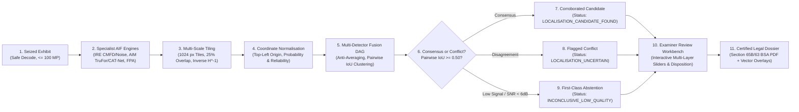

#### Core Capabilities of IMLF

| Capability | Forensic Method & Technical Implementation | Primary Engine |
| :--- | :--- | :--- |
| **Copy-Move Localisation** | SIFT & RootSIFT keypoints, $k$-d tree 2-NN ratio matching ($r < 0.75$), RANSAC homography $\mathbf{x}' \sim \mathbf{H}\mathbf{x}$ ($\ge 12$ inliers), $8\times 8$ block-DCT sorting, and repeating texture false-positive filtering. | IRE CMFD Engine |
| **Splicing & Sensor Inconsistency** | 2D wavelet residual extraction $R=I-D(I)$, $16\times 16$ block variance anomaly mapping, boundary orthogonal gradient profiling, and camera PRNU sensor cross-correlation (PCE $< 15$). | IRE Noise & Splicing |
| **Compression Splicing** | JPEG DCT coefficient stream analysis, double-quantization $8\times 8$ grid shift detection, and Error Level Analysis (ELA). | IRE & AIM CAT-Net v2 |
| **Inpainting & Generative Patches** | High-frequency noise-floor annihilation detection, latent diffusion upsampling spectral rolloff, and unlocalised manipulation fallback (`GLOBAL_MANIPULATION_CANDIDATE`). | AIM Inpainting & TruFor |
| **Face & Portrait Manipulation** | RetinaFace face detection, 68 MediaPipe biometric landmarks, convex hull perimeter extraction, and $16\text{ px}$ boundary blending seam analysis ($\Delta E_{00}$ color jump). | FPA & AIM Face X-Ray |
| **Multi-Scale Tiling Core** | Overlapping $1024\times 1024\text{ px}$ tile grid with $25\%$ overlap, 2D distance-weighted Hann canvas stitching, and inverse affine transformation matrices $\mathbf{H}_k^{-1}$ supporting up to 100 MP images. | AIF Tiling Core |
| **Unified Data Contracts** | Strict Pydantic v2 schemas: `IMLRegionCandidate`, `IMLMaskMetadata`, `IMLLocalizationResult`, and `IMLCoordinateTransform` with lossless WORM array storage. | IMLF Core |
| **Multi-Detector Evidence DAG** | Spatial overlap clustering ($\operatorname{IoU} \ge 0.50$), Bayesian consensus scoring, co-dependent backbone tracking, and strict anti-averaging invariant enforcement. | IMLF Fusion Core |
| **Mathematical Evaluation Suite** | Independent image-level ROC-AUC / CDR @ 0.01 FAR and pixel-level metrics: $\operatorname{IoU}$, Dice coefficient, Matthews Correlation Coefficient (MCC), and boundary $F_1$ ($\tau = 2\text{ px}$). | CDVF / IMLF Benchmark |
| **Examiner Review Workbench** | Interactive multi-layer canvas, real-time threshold and reliability sliders ($< 50\text{ ms}$ latency), synchronized split-view panning, and examiner disposition audit trails. | Archify IR / UI |
| **Structured Forensic Evidence Dossier** | Automated compilation of Section 63 BSA certificate schedules with bitstream SHA-256 hashes, vector polygon overlays, and examiner Ed25519 signatures. | CEIPL / Reporting |

#### Actual vs. Planned Implementation Status
- **Specification & Technical Contracts:** `DOCUMENTED` — Architectural specifications, manipulation taxonomy, Pydantic v2 schemas, and metric formulations are established in [PRD.md § 14](PRD.md), [TRD.md § 10.11, § 12.4](TRD.md), and [PHASES.md § 5.B](PHASES.md).
- **Execution Harness & Code:** `PLANNED` / `NOT_STARTED` — Implementation is organized across eleven engineering phases (`AIF-IML-00` through `AIF-IML-10`). No detector weights have been loaded, and no test runs have been executed in this architectural specification phase.

For complete technical specifications, mathematical foundations, schemas, and phase roadmaps:
- Product requirements, user journeys, and functional inventory: [PRD.md § 14 (IML-01..IML-22)](PRD.md)
- Technical architecture, algorithm matrices, formulas, and Pydantic schemas: [TRD.md § 10.11, § 12.4](TRD.md)
- Engineering execution playbook, tasks, and checkpoints: [PHASES.md § 5.B (AIF-IML-00..AIF-IML-10)](PHASES.md)

---

### 4.28 Cross-Media Metadata Service (CMMS)

> **Shared Platform Service — Not a Modality-Specific Detection Engine**

CMMS is the PS-05 unified metadata pipeline. It extracts technical and embedded metadata from every evidence modality, preserves raw values, produces canonically normalised records, performs rule-based consistency analysis, and exposes structured metadata objects to consuming forensic engines — all without replacing specialised detection engines.

**Evidence Metadata Pipeline:**

```
Evidence Reference --> Media Identification --> Parser Selection --> Extraction
--> Raw Preservation --> Normalisation --> Validation --> Consistency Analysis
--> Cross-Evidence Correlation --> Structured Metadata Record --> Subsystem / UFREDF
```

CMMS does **not** perform deepfake detection, audio classification, video forgery analysis, speaker identification, or cryptographic custody. Those responsibilities remain with AIF, AURAS, VISTA, and CEIPL respectively.

### 4.28.1 Supported Evidence Categories

| Category | Parser Candidates | Key Metadata Standards |
| :--- | :--- | :--- |
| Digital images (JPEG, PNG, TIFF, HEIC, WebP, RAW, DNG, AVIF) | ExifTool, Pillow | EXIF, XMP, IPTC, GPS, ICC, C2PA presence |
| Audio recordings (WAV, MP3, FLAC, AAC, OGG, AIFF, Opus) | FFprobe, ExifTool | ID3v1/v2, Vorbis comments, BWF bext, iXML, stream metadata |
| Video files (MP4, MOV, MKV, AVI, WebM, TS/M2TS, 3GP) | FFprobe, MediaInfo | Container atoms, stream descriptors, PTS/timebase, encoder tags |
| CCTV / DVR / NVR exports | FFprobe, MediaInfo, sidecar parsers | Recorder metadata, channel maps, export timestamps, sidecar XML/JSON |
| Offline PCAP/PCAPNG captures | PyShark/TShark, Scapy | Link type, snap length, timestamp precision, capture statistics |
| Geospatial metadata | ExifTool (via AIF-GEO) | EXIF GPS, XMP location, IPTC location, DMS/decimal coordinates |

### 4.28.2 Core Design Principles

1. **Raw Value Immutability:** Every extracted field retains its original raw value and source block. Raw values are never overwritten.
2. **Field-Level Provenance:** Each record includes parser identifier, parser version, source evidence ID, source block location, extraction timestamp, and transformation history.
3. **Explicit Timestamp Semantics:** CMMS distinguishes at least 14 timestamp semantic types (CAPTURE_TIME, RECORDING_START, CONTAINER_CREATION_TIME, GPS_TIME, PACKET_CAPTURE_TIME, OVERLAY_DISPLAY_TIME, etc.). Timezone inference is explicit and traceable.
4. **Metadata Categories are Never Merged:** Embedded metadata (EXIF), filesystem metadata, container metadata, and operator-supplied values remain separate. A filesystem modification timestamp is never presented as the verified image capture time.
5. **Consistency Indicators, Not Authenticity Verdicts:** CMMS emits machine-readable finding codes (e.g. `META_TIMESTAMP_CONFLICT`, `META_DEVICE_FIELD_INCONSISTENCY`) as forensic indicators. It does not issue authenticity judgements.
6. **Parser Failure Transparency:** A parser failure never silently produces an empty successful record. Partial extraction, warnings, and errors are preserved in the extraction status.

### 4.28.3 Integration Points

| Consuming Subsystem | Metadata Supplied by CMMS |
| :--- | :--- |
| **AIF (IRE, AIM, IVE)** | EXIF/XMP/IPTC/GPS fields, image structure, consistency findings, field provenance |
| **AURAS** | Audio stream metadata, BWF/iXML origination tags, encoder strings, recording timestamps |
| **VISTA (VRE, VCI, CCTV)** | Container/stream metadata, PTS/timebase, CCTV recorder context, sidecar association |
| **AIF-GEO** | Extracted GPS coordinates, altitude, direction, DOP indicators, original DMS values |
| **ONTF** | PCAP/PCAPNG capture-level metadata: link type, snap length, timestamp resolution, interface list |
| **CEIPL** | Evidence hash binding, extraction activity provenance, derived artifact registration |
| **UFREDF** | Structured metadata summaries, consistency findings, provenance references, timestamp uncertainty |

### 4.28.4 Finding Taxonomy (Proposed)

```
META_FORMAT_MISMATCH                META_PARSE_FAILURE
META_TRUNCATED_BLOCK                META_DUPLICATE_BLOCK
META_CONFLICTING_VALUES             META_TIMESTAMP_CONFLICT
META_TIMEZONE_UNKNOWN               META_TIMESTAMP_ORDER_ANOMALY
META_DEVICE_FIELD_INCONSISTENCY     META_SOFTWARE_FIELD_INCONSISTENCY
META_GPS_REFERENCE_INVALID          META_GPS_TIME_CONFLICT
META_CONTAINER_STREAM_INCONSISTENCY META_CCTV_SIDECAR_MISMATCH
META_CAPTURE_CLOCK_UNCERTAINTY      META_CROSS_EVIDENCE_CONFLICT
META_INCOMPLETE_EXTRACTION          META_EXTERNAL_ENRICHMENT_REQUIRED
```

### 4.28.5 Explicit Forensic Limitations

- Metadata can be modified, removed, fabricated, or copied by any party with file access.
- Valid metadata consistency does **not** prove evidence authenticity.
- Missing metadata does **not** prove tampering.
- A camera model field does **not** independently identify a physical device.
- Filesystem timestamps do **not** automatically represent capture time.
- Timezone inference must be explicit and traceable; silent UTC conversion of unknown-timezone timestamps is prohibited.
- External enrichment must not be triggered by embedded metadata URLs and must be recorded separately from extracted evidence values.
- Cross-evidence temporal correlation does not independently establish causality.

### 4.28.6 Implementation Status

| Capability | Phase | Status |
| :--- | :--- | :--- |
| CMMS architecture and shared-service specification (CMMS-01..05) | CMMS-A0 | `PLANNED` |
| Image metadata adapters: EXIF, XMP, IPTC, GPS (CMMS-06..12) | CMMS-A2 | `PLANNED` |
| Audio metadata adapters: stream, BWF/iXML, ID3 (CMMS-13..18) | CMMS-A3 | `PLANNED` |
| Video and CCTV metadata adapters (CMMS-19..30) | CMMS-A4 | `PLANNED` |
| Offline PCAP/PCAPNG metadata adapters (CMMS-31..35) | CMMS-A5 | `PLANNED` |
| Normalisation and timestamp framework (CMMS-40..52) | CMMS-A6 | `PLANNED` |
| Consistency analysis and cross-evidence correlation (CMMS-47..57) | CMMS-A7 | `PLANNED` |
| CEIPL provenance, reporting, and security integration (CMMS-58..72) | CMMS-A8 | `PLANNED` |
| Benchmarking and release readiness (CMMS-73..78) | CMMS-A9 | `PLANNED` |

Source code implementation is **explicitly out of scope** for this documentation release.
See `PRD.md Section 16`, `TRD.md Section 16`, and `PHASES.md Section 8.B` for full specifications.


### 4.29 Cross-Source Timestamp Verification (CSTV)

> **Platform-Wide Temporal Verification & Timeline Correlation Capability — Not a Modality-Specific Engine**

Cross-Source Timestamp Verification (CSTV) is the PS-05 platform-wide temporal verification, clock drift analysis, and multi-source timeline reconstruction capability. It analyzes, compares, correlates, and validates temporal records across multiple independent or related digital evidence sources seized within a forensic case.

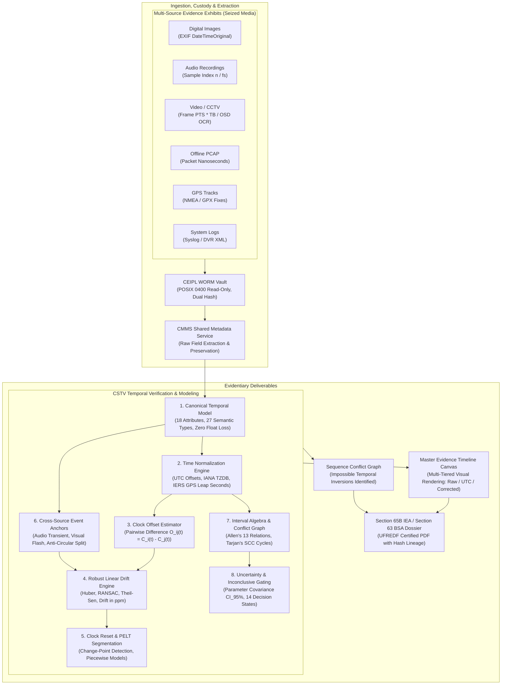

### 4.29.1 Why Cross-Source Timestamp Verification Matters
In multi-device criminal investigations, digital evidence rarely arrives with synchronized clocks:
1. **Uncalibrated Real-Time Clocks (RTC):** Surveillance CCTV DVRs frequently drift by seconds or minutes per week, or reset to factory defaults (e.g. 1970-01-01) following power outages.
2. **Burned-In OSD vs. Stream PTS Conflicts:** Video frame presentation timestamps (PTS) routinely contradict human-readable on-screen display (OSD) clock text due to manual DVR tampering or encoder clock latency.
3. **Timezone Ambiguity:** Mobile photos, dashcam footage, and voice recordings often store local wall-clock times without embedded UTC offsets, creating multi-hour errors when cross-referenced across jurisdictions or daylight saving transitions.
4. **Conflation of Metadata Fields:** Novice tools often treat filesystem modification dates (`st_mtime`), container headers (`mvhd`), and sensor exposure dates (`DateTimeOriginal`) interchangeably, leading to catastrophic evidentiary errors in court.
5. **Cross-Media Desynchronization:** Audio recordings, cellular phone extractions, offline PCAP packet captures, and GPS track logs seized from the same physical incident cannot be reliably synthesized without mathematical offset and drift calibration.

### 4.29.2 Supported Temporal Source Registry (17 Categories)
CSTV registers and analyzes temporal records across 17 distinct categories:
- **Image Metadata:** `EXIF.DateTimeOriginal`, `SubSecTimeOriginal`, XMP capture dates.
- **Image File Properties:** Filesystem timestamps (`ctime`, `mtime`, `crtime`).
- **Audio Metadata:** BWF `bext` origination timestamp, iXML chunks, ID3 tags.
- **Audio Signal Timeline:** Sample-accurate continuous timeline ($t = t_0 + n/f_s$).
- **Video Container:** MP4 `mvhd` creation atom, MKV segment header date.
- **Video Stream:** Elementary stream start time, timebase ($TB$), `ctts` offset.
- **Video Frame:** Presentation timestamp (PTS), decode timestamp (DTS).
- **CCTV Recorder Clock:** Internal DVR/NVR hardware clock setting, OSD text overlay.
- **CCTV Logs:** Companion DVR export XML/JSON logs, motion events, alarm logs.
- **Network Capture:** Microsecond and nanosecond packet header timestamps in PCAP/PCAPNG.
- **GPS Fix:** Satellite constellation date/time, sentence fix epochs (NMEA, GPX).
- **Geospatial Track:** Trackpoint timestamps from KML, NMEA, and FIT logs.
- **Operating System:** Windows Event Logs, Linux syslog, auth.log records.
- **Recorder Clock Config:** Hardware RTC registers, NTP sync configuration files.
- **Acquisition Process:** Forensic imager hardware timestamp, write-block log.
- **Processing System:** Platform parser and analysis execution timestamps.
- **External Reference:** Independently verified ground-truth reference instant.

### 4.29.3 Core Mathematical Foundations

1. **Clock Offset:** Instantaneous difference between source clock $C_i(t)$ and reference timeline $R(t)$:
   $$O_i(t) = C_i(t) - R(t)$$
2. **Linear Clock Drift Model:** For paired event observations over an unperturbed operational interval:
   $$t_i = a_i + b_i T + \epsilon_i$$
   where $t_i$ is observed clock time, $T$ is reference time, $a_i$ is base offset, and $b_i$ is relative clock rate. Estimated drift in parts per million:
   $$\text{Drift}_{\text{ppm}} = (b_i - 1) \times 10^6$$
3. **Derived Reference Correction:** When the clock model is validated across $[T_{\min}, T_{\max}]$:
   $$\hat{T} = \frac{t_i - a_i}{b_i}$$
4. **Uncertainty Propagation:** For independent measurement errors $\sigma_1$ and $\sigma_2$:
   $$\sigma_{\text{diff}} = \sqrt{\sigma_1^2 + \sigma_2^2}$$
5. **Piecewise Change-Point Segmentation:** When PELT change-point detection flags a clock jump $|\Delta O| > \tau$, CSTV fits piecewise linear models with non-overlapping validity bounds, strictly prohibiting a single global regression across a reset.

### 4.29.4 Integration with Existing Subsystems

| Consuming Subsystem | Integration Point with CSTV |
| :--- | :--- |
| **CMMS** | CSTV consumes raw and normalized metadata records, timestamp semantics, and field provenance. |
| **CEIPL** | CSTV anchors derived clock models, timeline snapshots, and conflict graphs in the CEIPL Merkle DAG. |
| **AIF** | Supplies image capture timestamps, multi-image sequences, and visual event landmarks. |
| **AURAS** | Supplies sample-accurate audio timelines ($t = t_0 + n/f_s$) and acoustic transient onsets. |
| **VISTA** | Supplies frame presentation timestamps ($t = \text{PTS} \times TB$), OCR clock strings, and AV sync offsets. |
| **AIF-GEO** | Supplies GPS fix epochs, leap-second tables, and geodesic track intervals. |
| **ONTF** | Supplies packet capture timestamps, network flow timelines, and connection event windows. |
| **UFREDF** | Consumes master evidence timelines, clock calibration certificates, and Section 65B/63 BSA annexures. |

### 4.29.5 Explicit Forensic Limitations & Uncertainty Principles
1. A timestamp is an electronically recorded claim about time, not autonomous proof of physical reality.
2. Uncalibrated quartz real-time clocks routinely exhibit non-linear drift under thermal stress.
3. Filesystem timestamps (`mtime`, `ctime`) change trivially during file copying or ingestion.
4. Embedded EXIF tags can be modified without altering image raster pixels.
5. Unknown timezone values must remain `UNKNOWN`; silent conversion to local workstation time is prohibited.
6. GPS time and UTC differ by leap seconds; conversion requires validated historical tables.
7. A single event anchor establishes relative offset only; clock drift cannot be extrapolated.
8. A mathematical clock model does not prove the chosen reference clock was accurate.
9. High regression $R^2$ does not prove the selected event anchors were correctly identified.
10. Audiovisual lip-sync does not establish the absolute time of day the recording occurred.
11. Network packet timestamps reflect gateway capture timing, not remote application creation time.
12. CCTV on-screen display (OSD) clocks may lag or advance relative to internal presentation timestamps.
13. Legitimate video remuxing or transcoding rewrites container atoms while preserving video frames.
14. Video B-frame decode order ($\text{DTS}$) naturally precedes presentation order ($\text{PTS}$); this is legitimate codec behaviour.
15. Power outages, battery removals, or NTP steps cause legitimate discontinuous clock jumps.
16. Missing metadata does not constitute affirmative proof of malicious tampering.
17. Cross-source temporal agreement does not prove common authorship or causation.
18. Corrected timestamps are model-derived estimates and must always be labeled as such.
19. All calibrations must be accompanied by explicit uncertainty intervals ($CI_{95\%}$).
20. Inconclusive outcomes are legally and scientifically valid forensic determinations.

### 4.29.6 Implementation Status

| Capability | Phase | Status |
| :--- | :--- | :--- |
| Temporal architecture baseline & specialist subsystem delegation (CSTV-01..05) | CSTV-A0 | `PLANNED` |
| 17-source registry, 27-state semantics, and PostgreSQL persistence (CSTV-06..19) | CSTV-A1 | `PLANNED` |
| Time normalization, timezone framework, and GPS leap-second handling (CSTV-20..25) | CSTV-A2 | `PLANNED` |
| Canonical event timeline, interval algebra, and multi-tier rendering (CSTV-57..59, 69..72) | CSTV-A3 | `PLANNED` |
| Pairwise clock offset estimation and reference clock hierarchy (CSTV-26..27) | CSTV-A4 | `PLANNED` |
| Robust linear drift modeling (Huber/RANSAC/Theil-Sen) and PELT resets (CSTV-28..42) | CSTV-A5 | `PLANNED` |
| Cross-source event anchors and anti-circular calibration protocols (CSTV-51..56) | CSTV-A6 | `PLANNED` |
| Multi-source cross-media correlation (Image, Audio, Video, CCTV, PCAP, GPS) (CSTV-43..50) | CSTV-A7 | `PLANNED` |
| Sequence conflict graph, Tarjan cycle detection, and 22 findings (CSTV-60..68) | CSTV-A8 | `PLANNED` |
| CEIPL Merkle provenance, WORM vault locking, and Section 65B/63 BSA dossiers (CSTV-73..78) | CSTV-A9 | `PLANNED` |
| 500-fixture benchmarking, false-positive suppression, and release gates (CSTV-79..84) | CSTV-A10 | `PLANNED` |

Source code implementation is **explicitly out of scope** for this documentation release.
See `PRD.md Section 17`, `TRD.md Section 17`, and `PHASES.md Section 15` for full specifications.


### 4.30 Audio Edit and Splice Localisation (AESL)

> **Localized Audio Temporal Integrity Engine — Embedded Inside ARE (Audio Reverse Engineering Engine)**

The Audio Edit and Splice Localisation (AESL) capability is a specialized temporal-integrity sub-engine embedded directly within the **Audio Reverse Engineering Engine (ARE)** of the AURAS subsystem.

AESL is **not** a fourth AURAS engine. It does not replace or duplicate voice cloning classification (ADDE) or speaker diarization (MVSI). Its specific mission is to detect, isolate, and localise suspicious audio edit regions, candidate splice boundaries, and cloned sequences with exact native sample coordinates ($t = n/f_s$) and quantified millisecond uncertainty intervals.

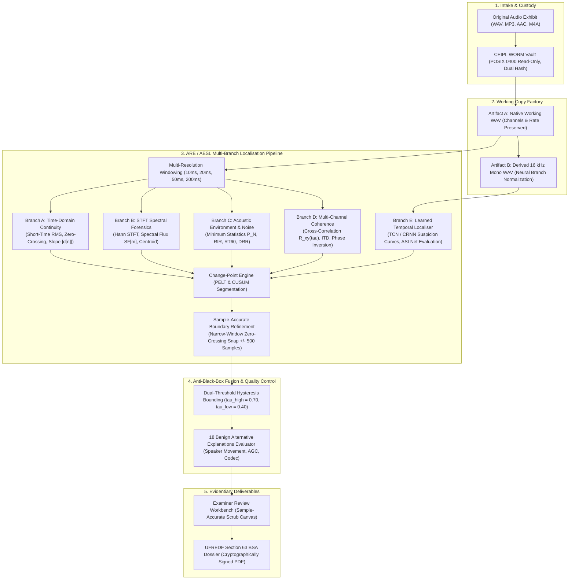

### 4.30.1 Why Audio Splice Localisation Matters
In digital criminal trials, a bare binary verdict such as "78% Fake" is legally vulnerable under judicial cross-examination. A court requires concrete physical and acoustic answers:
- *Where in the audio was the edit made?*
- *Exactly which sample indices and timestamps bound the altered phrase?*
- *Which audio channel was spliced?*
- *Did the background room reverberation (RT60) or ambient noise floor change discontinuously?*
- *Can the acoustic discontinuity be explained by natural speaker movement, automatic gain control (AGC), or legitimate mobile transcoding?*

AESL answers these questions by producing evidence-linked suspicious-region candidates with sample coordinates ($t = n/f_s$) and quantified uncertainty intervals ($\pm \sigma_{\text{ms}}$).

### 4.30.2 Six Supported Manipulation Topologies
1. **Audio Splicing:** Audio from an external recording inserted into a carrier recording, flagged via background-noise jumps and acoustic room mismatch.
2. **Segment Deletion:** An interval excised to alter meaning, flagged via severed reverberation tails and non-cadence zero-crossing discontinuities.
3. **Segment Insertion:** Foreign speech or sound introduced into a recording pause, flagged via twin splice boundaries and double-compression traces.
4. **Audio Replacement:** A legitimate word replaced with an alternative word or synthesized sound, flagged via phase and room-impulse response (RIR) discontinuities.
5. **Copy-Move Manipulation:** Content duplicated from within the same recording, flagged via acoustic fingerprint collision and dynamic time warping (DTW).
6. **Concealed Edits:** Manipulations smoothed via crossfades ($\ge 20\text{ ms}$), noise-bed mixing, or lossy recompression (e.g. WhatsApp Opus at 16 kbps), flagged via multi-scale spectral flux and MDCT quantization anomalies.

### 4.30.3 Core Mathematical Formulations
1. **Sample Coordinate Preservation:**
   $$t = \frac{n}{f_s}, \quad t_{\text{start}} = \frac{n_{\text{start}}}{f_s}, \quad t_{\text{end}} = \frac{n_{\text{end}}}{f_s}$$
2. **STFT Spectral Flux Discontinuity:**
   $$SF[m] = \sum_{k=0}^{K-1} H(|X(m,k)| - |X(m-1,k)|)^2$$
3. **Reverberation Decay ($RT60$) Step:** Energy decay curve evaluated via Schroeder backward integration:
   $$EDC(t) = \int_t^\infty h^2(\tau) d\tau$$
4. **Inter-Channel Cross-Correlation (Stereo):**
   $$R_{xy}(\tau) = \sum_{n=0}^{N-1} x[n] y[n + \tau], \quad \rho_{\max} = \frac{\max_\tau R_{xy}(\tau)}{\sqrt{\sum x^2[n] \sum y^2[n]}}$$
5. **PELT Change-Point Segmentation:**
   $$\min_{\tau} \sum_{i=1}^{M+1} \left[ \mathcal{C}(y_{(\tau_{i-1}+1):\tau_i}) + \beta \right]$$

### 4.30.4 Relationship with MVSI and ADDE
- **ARE/AESL:** Owns temporal integrity, edit localisation, splice boundaries, copy-move detection, and physical signal continuity.
- **MVSI (Voice & Speaker Intel):** Supplies speaker diarization intervals, VAD speech boundaries, and Indian language identification context.
- **ADDE (Audio Deepfake Detection):** Supplies independent AI-generated and cloned-voice suspicion scores.
- *Evidentiary Invariant:* Splicing findings and AI-voice findings remain strictly decoupled. A splice can occur in authentic human speech, between two genuine speakers, or inside an unvoiced environmental recording.

### 4.30.5 Explicit Forensic Limitations
1. An acoustic discontinuity does not independently prove fraudulent tampering.
2. A continuous, smooth waveform does not prove that an audio recording is unedited.
3. Background noise changes occur naturally in mobile and outdoor recording environments.
4. Speaker head rotation alters room reverberation and high-frequency spectral rolloff.
5. Microphone handling produces low-frequency thumps mimicking edit boundaries.
6. Legitimate lossy compression introduces frame-boundary blocking and high-frequency cutoff artifacts.
7. Professional crossfading ($\ge 50\text{ ms}$) and noise-bed smoothing can conceal splice boundaries.
8. Copy-move detection can flag naturally repeated speech words, refrains, or machine cycles.
9. Neural network suspicion scores are uncalibrated heuristics, not mathematical probabilities of guilt.
10. Reconstructed boundary intervals have finite temporal precision bounded by the sampling theorem.
11. Content deletions cannot be recovered or proven without an independent authentic reference recording.
12. A single forensic detector must never form the sole basis of an affirmative tampering verdict.
13. Model generalisation degrades on unseen mobile codecs, low-quality microphones, or rare dialects.
14. All forensic findings must document tested alternative explanations and unresolved hypotheses.
15. Splicing indicators must be reported independently from AI-generated voice cloning indicators.
16. Speaker diarization identifies vocal characteristics, not who performed an audio edit.
17. Original evidence bitstreams must remain strictly immutable; enhancements are derived artifacts.
18. Resampled or denoised audio files represent derived working copies, not original evidence.
19. Inconclusive outcomes are legally and scientifically valid forensic determinations.
20. Final courtroom interpretations require evaluation by a certified forensic human examiner.

### 4.30.6 Implementation Status

| Capability | Phase | Status |
| :--- | :--- | :--- |
| ARE architecture baseline & three-engine preservation (AESL-01..05) | AURAS-AESL-00 | `PLANNED` |
| Evidence intake, Artifact A/B factory, and sample-index tracking (AESL-06..13) | AURAS-AESL-01 | `PLANNED` |
| Multi-resolution segmentation, time/spectral/channel analysis (AESL-14..27, 36..48) | AURAS-AESL-02 | `PLANNED` |
| Noise floor tracking, RIR modeling, and acoustic environment distance (AESL-28..35) | AURAS-AESL-03 | `PLANNED` |
| Codec bitstream inspection, MP3/AAC quantization, and re-encoding traces (AESL-49..54) | AURAS-AESL-04 | `PLANNED` |
| Copy-move acoustic fingerprinting and DTW syllable alignment (AESL-55..60) | AURAS-AESL-05 | `PLANNED` |
| Statistical change-point detection (PELT, CUSUM, Kernel MMD) (AESL-61..64) | AURAS-AESL-06 | `PLANNED` |
| Learned temporal localisation models (TCN/CRNN) & ASLNet evaluation (AESL-65..67) | AURAS-AESL-07 | `PLANNED` |
| Dual-threshold hysteresis, sample-level refinement, and 20 findings (AESL-68..73, 79..81) | AURAS-AESL-08 | `PLANNED` |
| CEIPL WORM vault, MVSI context binding, and Section 65B/63 BSA dossier (AESL-74..78, 82..88) | AURAS-AESL-09 | `PLANNED` |
| 500-fixture benchmark corpus, tIoU $\ge 0.75$, boundary MAE $\le 15\text{ms}$ (AESL-89..90) | AURAS-AESL-10 | `PLANNED` |

Source code implementation is **explicitly out of scope** for this documentation release.
See `PRD.md Section 18`, `TRD.md Section 18`, and `PHASES.md Section 17` for full specifications.


### 4.31 Unified Forensic Evidence Dashboard & Examiner Workbench (UFD / UFW)

> **Shared Presentation, Navigation & Examiner Workflow Layer — Not a Forensic Engine**

The **Unified Forensic Dashboard (UFD)** and its practitioner interface, the **Unified Forensic Workbench (UFW)**, provide the shared, secure, examiner-oriented presentation and workflow tier for the entire PS-05 platform. UFD unifies the investigation lifecycle into an unbroken, auditable operational chain:

$$\text{Case Creation} \longrightarrow \text{Evidence Registration} \longrightarrow \text{Integrity Verification} \longrightarrow \text{Forensic Processing} \longrightarrow \text{Findings Review} \longrightarrow \text{Cross-Modal Correlation} \longrightarrow \text{Examiner Assessment} \longrightarrow \text{Report Issuance}$$

UFD does **not** execute forensic detection algorithms, perform deepfake classifications, or store authoritative evidence bitstreams. Instead, it securely consumes, coordinates, and visualizes authoritative data from existing platform subsystems: **CEIPL** (custody, hashing, WORM fixity), **CMMS** (metadata extraction & normalization), **CSTV** (cross-source timeline verification), **AIF** (image tampering maps & masks), **AURAS** (audio waveform/spectrogram & voice spoofing), **VISTA** (video/CCTV frame cadence & temporal anomalies), **ONTF** (offline network capture flows), **AIF-GEO** (geospatial evidence mapping), **CDVF** (detector calibration, OOD gating & model governance), and **UFREDF** (structured Section 63 BSA dossier preparation).

### 4.31.1 Architecture & Subsystem Integration

```mermaid
flowchart TD
    subgraph PRACTITIONER["Authorised Forensic Practitioner Roles"]
        INVESTIGATOR["Investigating Officer\n(Case Context & Registration)"]
        EXAMINER["Forensic Examiner\n(Technical Analysis & Annotations)"]
        CUSTODIAN["Evidence Custodian\n(Fixity, Custody & WORM Oversight)"]
        REVIEWER["Technical / Legal Reviewer\n(Independent Audit & Approval)"]
    end

    subgraph UFW_CORE["Unified Forensic Workbench (UFW / UFD Application Shell)"]
        AUTH_RBAC["Role-Based Access Control & Case Scoping\n(JWT, Session Guard, Zero Cross-Case Leakage)"]

        subgraph WORKSPACES["Unified Investigation Workspaces"]
            WS_CASE["Case Management Workspace\n(Metadata, Assignment, Progress)"]
            WS_EVID["Evidence Inventory & Registry\n(Hash Verification, Modality Filter)"]
            WS_MODAL["Modality-Specific Workspaces\n(AIF Image, AURAS Audio, VISTA Video, ONTF Network)"]
            WS_FIND["Unified Findings Review\n(10-State Review Lifecycle, Examiner Annotations)"]
            WS_TIME["Unified Timeline Workspace\n(CSTV Multi-Source Intervals, Clock Drift delta_t)"]
            WS_GEO["Geospatial Workspace\n(AIF-GEO Location Mapping, Track Analysis)"]
            WS_INTEG["Evidence Integrity & Custody\n(CEIPL WORM Fixity, Merkle DAG Audit)"]
            WS_CROSS["Cross-Modal Investigation\n(CDVF Anti-Averaging DAG, Disagreement Analysis)"]
            WS_REP["Report & Dossier Workspace\n(UFREDF Section 65B/63 BSA Approval Lifecycle)"]
            WS_QUEUE["Review Queue & Task Dispatch\n(Prioritized Examiner Tasking)"]
        end
    end

    subgraph BACKEND_SERVICES["PS-05 Authoritative Forensic Subsystems"]
        CEIPL_SVC["CEIPL: Hashing, Fixity & Custody"]
        CMMS_SVC["CMMS: Cross-Media Metadata Service"]
        CSTV_SVC["CSTV: Cross-Source Temporal Verification"]
        AIF_SVC["AIF: Advanced Image Forensics"]
        AURAS_SVC["AURAS: Advanced Audio Forensics"]
        VISTA_SVC["VISTA: Video & CCTV Forensics"]
        ONTF_SVC["ONTF: Offline Network Forensics"]
        GEO_SVC["AIF-GEO: Geospatial Forensics"]
        CDVF_SVC["CDVF: Model Calibration & Governance"]
        UFREDF_SVC["UFREDF: Forensic Dossier Framework"]
    end

    INVESTIGATOR & EXAMINER & CUSTODIAN & REVIEWER --> AUTH_RBAC
    AUTH_RBAC --> WORKSPACES

    WS_CASE & WS_EVID --> CEIPL_SVC & CMMS_SVC
    WS_MODAL --> AIF_SVC & AURAS_SVC & VISTA_SVC & ONTF_SVC
    WS_FIND --> AIF_SVC & AURAS_SVC & VISTA_SVC & CDVF_SVC
    WS_TIME --> CSTV_SVC
    WS_GEO --> GEO_SVC
    WS_INTEG --> CEIPL_SVC
    WS_CROSS --> CDVF_SVC
    WS_REP --> UFREDF_SVC
```

### 4.31.2 Core Investigation Workspaces

| Workspace Module | Primary Capabilities & Integrated Subsystem | Evidentiary Guardrails |
| :--- | :--- | :--- |
| **Global Overview** | Platform health, pending analysis jobs, unassigned tasks, urgent integrity incidents. | Zero hardcoded demo metrics; counts derived strictly from live backend database. |
| **Case Management** | Case creation, jurisdictional assignment, priority queues, chain-of-custody overview. | Case identifiers validated; cross-case data leakage strictly prevented via PostgreSQL RLS. |
| **Evidence Inventory** | Multi-modal registry (Image, Audio, Video, CCTV, PCAP, Sidecars), fixity status, file size, ingestion timestamps. | Distinguishes acquisition timestamp from filesystem modification time; read-only mounts. |
| **Image Workspace (AIF)** | Synchronized dual-canvas viewer, ELA, noise residual heatmaps, spatial masks (IoU), EXIF/DQT inspection. | Overlays bound to original image coordinate space; master pixels are never mutated. |
| **Audio Workspace (AURAS)** | WebAudio waveform, interactive mel-spectrogram, Silero VAD speech intervals, ECAPA diarization, splice markers. | Autoplay strictly disabled; derived denoised audio clearly flagged from original exhibit. |
| **Video Workspace (VISTA)** | Frame-accurate scrubber, presentation timestamp (PTS) mapping, B-frame decode order separation, CCTV sidecar binding. | PTS/DTS timing preserved; normal B-frame reordering never reported as temporal tampering. |
| **Network Workspace (ONTF)** | Offline PCAP packet timeline, protocol distribution, IP 5-tuple flow summaries, Zeek connection states. | Sensitive payload bodies excluded by default; 100% offline air-gap processing. |
| **Geospatial Workspace (AIF-GEO)** | Offline Leaflet/MapLibre map canvas, GPS EXIF coordinates, uncertainty bounding ellipses, trajectory tracking. | Map markers indicate recorded metadata claims, not verified ground truth. |
| **Unified Findings Review** | Multi-engine finding aggregator, severity tags, calibrated probabilities, 10-state review lifecycle. | Uncalibrated scores watermarked; severity never conflated with mathematical probability. |
| **Unified Timeline (CSTV)** | Multi-source event intervals, clock drift regression $\delta(t)$, NTP desynchronization markers, Allen algebra relations. | Corrected timestamps displayed alongside raw timestamps; non-causality disclaimer active. |
| **Cross-Modal Review (CDVF)** | Cross-modal correlation matrix, lip-sync mismatch analysis, speaker correspondence, 7 conflict taxonomy codes. | Anti-averaging invariant enforced; separate modality findings preserved in DAG. |
| **Integrity & Custody (CEIPL)** | WORM storage fixity log, pre/post-write SHA-256 checks, Ed25519 signatures, Merkle DAG lineage tree. | Prominent quarantine banner on integrity mismatch; normal workflows locked out. |
| **Reports & Dossiers (UFREDF)**| Section 65B IEA / Section 63 BSA dossier preview, examiner annotation editor, approval & issuance workflow. | PDF generation delegated strictly to UFREDF backend; no client-side report assembly. |

### 4.31.3 Role-Based Access Control & Separation of Duties

UFD enforces fine-grained permissions across nine specialized practitioner roles:
1. **System Administrator:** Platform infrastructure, worker cgroup quotas, air-gap network policy.
2. **Case Administrator:** Case creation, officer assignment, case-level permission scoping.
3. **Investigating Officer:** Evidence registration, acquisition context, investigator notes.
4. **Forensic Examiner:** In-depth media analysis, tool execution, candidate finding annotation.
5. **Evidence Custodian:** Evidence intake hashing, WORM vault custody, fixity incident resolution.
6. **Technical Reviewer:** Independent verification of examiner methodology and calibration bounds.
7. **Report Reviewer:** Formal review and sign-off on draft forensic dossiers.
8. **Independent Auditor:** Read-only access to immutable Merkle audit trails and access logs.
9. **Model Administrator:** Model registry curation, checkpoint SHA-256 verification, 6-gate promotion.

**Dual-Control Invariant:** High-impact operations—including evidence quarantine release, chain-of-custody overrides, and final Section 63 BSA report issuance—mandate cryptographically signed dual-authorization from two independent authorized roles.

### 4.31.4 Accessibility & Forensic Usability (WCAG 2.2 AA)

UFD is engineered to comply with **W3C WCAG 2.2 Level AA** standards:
- **Non-Colour Dependent Status:** Every status indicator pairs semantic colours with explicit textual labels and distinct geometric iconography (e.g. green circle for `VERIFIED`, amber triangle for `WARNING`, red octagon for `FAILED`).
- **Complete Keyboard Operability:** All scrubber controls, zoom canvases, modal dialogs, and table filters are fully operable via standard keyboard sequences (`Tab`, `Shift+Tab`, `Space`, `Enter`, arrow keys).
- **Tabular Alternatives for Media Visualisations:** Complex visual graphs (waveforms, spectrograms, cadence plots) provide accessible, tabular data alternatives accessible to screen readers.
- **Strict Information Density & Contrast:** Enforces a minimum contrast ratio of $4.5:1$ for body text and $3:1$ for UI components, maintaining high information density without visual clutter.

### 4.31.5 Twenty Scientific, Security & Operational Invariants

1. **Presentation Layer Invariant:** The dashboard is strictly a presentation and workflow layer; it never computes forensic algorithms or alters evidentiary data.
2. **Backend Authority Invariant:** Backend subsystems remain the sole authoritative sources of truth for hashes, metadata, timestamps, and findings.
3. **Honest Data State Invariant:** An unavailable service is never represented as a passed check; missing findings are never presented as authentic media.
4. **Zero Silent Inconclusive Mutation:** An `INCONCLUSIVE` finding must never be converted or displayed as an affirmative `AUTHENTIC` verdict.
5. **Score Semantic Integrity:** Model scores are strictly displayed according to their true semantic type; uncalibrated logits are never presented as calibrated probabilities.
6. **Anti-Averaging Invariant:** Cross-modal agreement does not prove authenticity; multi-modal findings are presented as distinct nodes in an evidence DAG.
7. **Master Evidence Immutability:** Interactive dashboard annotations, zoom operations, or filters never modify underlying WORM storage bitstreams.
8. **Derived Artefact Lineage:** Every visualized derived representation (e.g. spectrogram, crop, denoised audio) links directly to its parent exhibit SHA-256.
9. **Prominent Integrity Quarantine:** An exhibit failing CEIPL fixity displays an un-dismissible quarantine banner, disabling routine analysis workflows.
10. **Custody Audit Independence:** The UI activity log does not replace the immutable, append-only CEIPL custody ledger.
11. **Dual Timestamp Presentation:** Corrected timestamps from CSTV drift models are always presented alongside exact raw timestamps.
12. **Metadata Attribution Transparency:** Externally enriched metadata is visually distinct from embedded binary tags.
13. **Separation of Examiner Notes:** Human examiner annotations are stored in separate, immutable audit records, never overwriting automated findings.
14. **Dual-Control Authorization:** Sensitive operational overrides require dual independent cryptographic sign-offs.
15. **Backend-Enforced Authorization:** All permissions are validated on backend API endpoints; frontend UI element hiding is never treated as security.
16. **Zero Cross-Case Data Leakage:** Search indexing, cache stores, and push notifications are strictly scoped by case authorization tokens.
17. **Graceful Subsystem Degradation:** Failure of a single subsystem renders a localized error state without disabling the broader case workbench.
18. **UFREDF Report Sovereignty:** Report compilation, signing, and issuance remain strictly governed by UFREDF backend lifecycle gates.
19. **Air-Gap Operational Guarantee:** All workbench modules, map tiles, and waveform renderers execute 100% locally with zero external network calls.
20. **OWASP ASVS Level 2 Compliance:** All endpoints enforce strict anti-CSRF, anti-XSS, parameterized queries, and secure session termination.

### 4.31.6 Implementation Status

| Capability / Module | Implementation Phase | Current Status |
| :--- | :--- | :--- |
| UFD UX Architecture & Shared Shell Specifications (`UFD-01`..`06`) | UFD-A0 / UFD-A1 | `PLANNED` |
| Authentication, RBAC & Case Management Workspace (`UFD-07`..`28`) | UFD-A2 | `PLANNED` |
| Evidence Inventory & Modality-Specific Workspaces (`UFD-29`..`48`) | UFD-A3 / UFD-A4 | `PLANNED` |
| Unified Findings Review & Examiner Annotation (`UFD-49`..`55`) | UFD-A5 | `PLANNED` |
| Unified Timeline & Geospatial Workspaces (`UFD-56`..`62`) | UFD-A6 | `PLANNED` |
| Evidence Integrity & Cross-Modal Workspaces (`UFD-63`..`76`) | UFD-A7 | `PLANNED` |
| UFREDF Report Dossier & Review Lifecycle (`UFD-77`..`82`) | UFD-A8 | `PLANNED` |
| Search, Notifications & Prioritized Review Queue (`UFD-83`..`87`) | UFD-A9 | `PLANNED` |
| Security Hardening, WCAG 2.2 AA & Air-Gap Compliance (`UFD-88`..`97`) | UFD-A10 | `PLANNED` |
| End-to-End Workbench Validation & Release Readiness (`UFD-98`..`100`) | UFD-A11 | `PLANNED` |

Source code implementation is **explicitly out of scope** for this documentation release.
See `PRD.md Section 20`, `TRD.md Section 20`, and `PHASES.md Section 21` for full specifications.

### 4.32 Evidence Integrity Verification (EIV)

> **Shared Cryptographic Evidence Integrity, Immutability & Provenance Layer — Residing Inside CEIPL**

The **Evidence Integrity Verification (EIV)** subsystem is an enterprise-grade cryptographic integrity and provenance assurance capability embedded directly within the **Cryptographic Evidence Integrity and Provenance Layer (CEIPL)**—the shared platform foundation of the PS-05 forensic architecture.

EIV is **not** an independent forensic detection engine, a sixth VISTA engine, or a fourth AURAS engine. It does not evaluate deepfakes or perform signal reverse engineering. Rather, its singular mission is to ensure that original digital evidence, derived forensic representations, metadata snapshots, and chain-of-custody ledgers remain cryptographically verifiable, bit-for-bit immutable, and defense-resilient throughout their entire legal lifecycle.

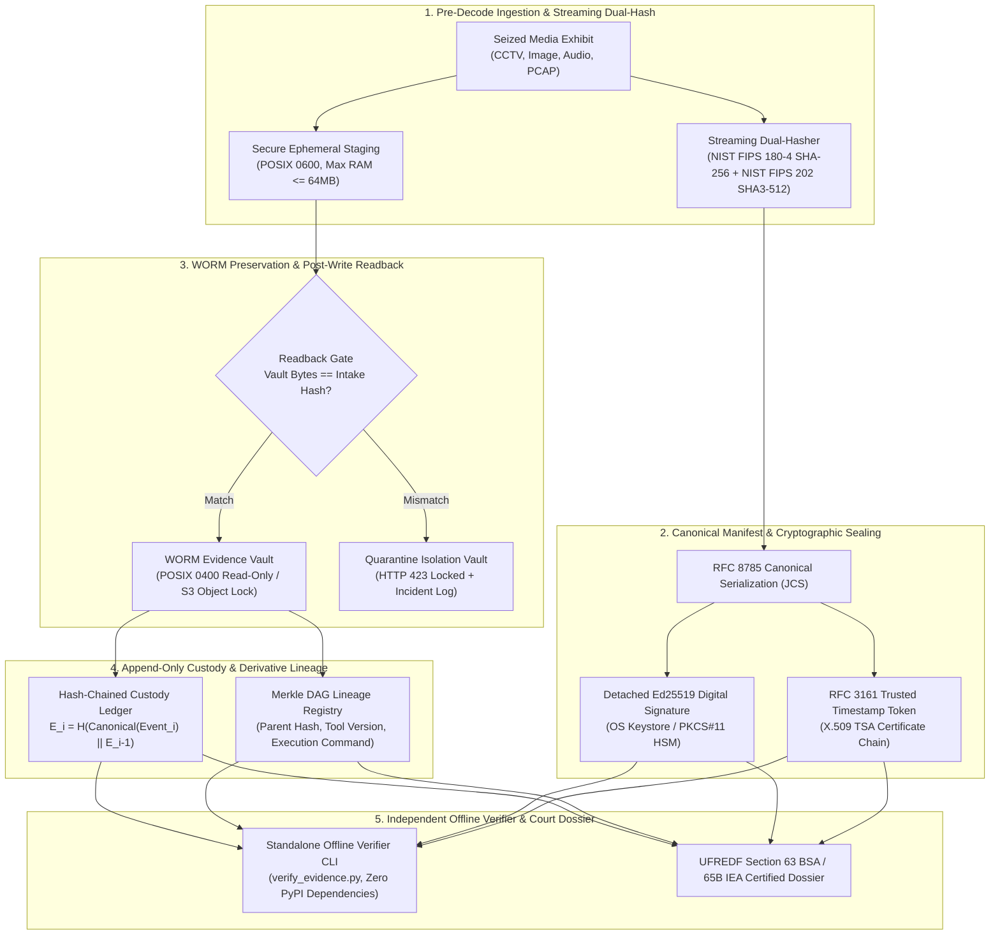

### 4.32.1 The Ten Core Evidentiary Questions Answered by EIV
1. **Acquisition Identity:** What exact file or evidence object was acquired, under what initial parameters, and by whom?
2. **Intake Digest:** What cryptographic digests (SHA-256 and SHA3-512) were computed over the raw bitstream prior to decoding?
3. **Post-Acquisition Immutability:** Was the original evidence modified, truncated, or substituted in any way after acquisition?
4. **Storage Fixity:** Does the stored physical file in the vault match its original baseline integrity reference?
5. **Transfer Fidelity:** Does the evidence object match bit-for-bit after network transfer or inter-agency retrieval?
6. **Derivative Traceability:** Can every derived audio snippet, video frame, face crop, or report be mathematically traced back to its parent exhibit?
7. **Custody Auditability:** Can the complete handling history be independently inspected without sequence gaps or backdated entries?
8. **Attestation Validity:** Are the digital signatures and trusted timestamp tokens cryptographically valid and unexpired?
9. **Storage Immutability:** Has the storage subsystem actively maintained its promised Write-Once Read-Many (WORM) retention locks?
10. **Independent Verifiability:** Can a complete evidence package be independently verified by defense counsel on an air-gapped machine without trusting the platform software?

### 4.32.2 Core Architectural Principles & Invariants
1. **Pre-Decode Streaming Dual-Hashing:** Ingested media is piped directly into concurrent streaming SHA-256 (NIST FIPS 180-4) and SHA3-512 (NIST FIPS 202 Keccak sponge) hashers before any decoder, demuxer, or metadata parser opens the file. Peak memory is bounded to $\le 64 \text{ MB}$ even for 50 GB exhibits.
2. **Decoupled 10-Entity Identity Model:** Evidence identity is completely decoupled from filenames, directory paths, storage keys, and algorithms across 10 distinct entities (`case_id`, `evidence_id`, `acquisition_id`, `file_id`, `hash_id`, `metadata_snapshot_id`, `derivative_id`, `custody_event_id`, `manifest_id`, `verification_id`).
3. **Duplicate Provenance Preservation:** Distinct seizures of identical files retain independent `evidence_id`, `acquisition_id`, and custody ledgers; storage-level deduplication never merges legal provenance.
4. **RFC 8785 Canonical Manifests:** Metadata and hash references are sealed into versioned JSON manifests canonicalized via RFC 8785 (JCS) for cross-platform deterministic byte reproducibility.
5. **Detached Ed25519 Signatures & RFC 3161 TSA:** Manifests are sealed with detached Ed25519 signatures (RFC 8032) and RFC 3161 trusted timestamp tokens, providing non-repudiation and proof-of-existence.
6. **WORM Storage Enforcement:** Exhibits are preserved in hardware-enforced or filesystem-enforced Write-Once Read-Many vaults (POSIX `0400` read-only mode, Linux `chattr +i`, S3 Object Lock Compliance Mode).
7. **Twelve-Gate Verification Lifecycle & Continuous Fixity:** Hash checks execute at 12 mandatory lifecycle gates, backed by automated Celery rolling 30-day fixity audits ($\ge 200 \text{ MB/s}$ throughput).
8. **Fail-Closed Quarantine & Zero Silent Repair:** Corrupted files immediately transition to `QUARANTINED` (HTTP 423 Locked); automatic digest recalculation or overwriting is strictly blocked by database constraints.
9. **Append-Only Hash-Chained Custody Ledger:** Every custody event cryptographically chains to its predecessor ($E_i = H(\text{Canonical}(Event_i) \parallel E_{i-1})$) with strictly monotonic sequence numbers.
10. **Multi-Generational Merkle Lineage DAG:** Every output artifact references its parent exhibit ID, pre-transformation parent hash, execution command string, and software commit hash.
11. **Standalone Portable Offline Verifier:** Export packages include `verify_evidence.py`—a self-contained, zero-dependency Python script executing 14 sequential integrity checks in air-gapped environments.

### 4.32.3 Ten-Dimension Verification Result Model & Eleven Outcome States
EIV rejects monolithic `authentic: true/false` flags, evaluating ten distinct dimensions:
- `BYTE_INTEGRITY`: Current vault bytes match intake SHA-256 and SHA3-512 baseline digests.
- `MANIFEST_INTEGRITY`: Canonical JCS bytes match manifest SHA-256 fingerprint.
- `SIGNATURE_VALIDITY`: Detached Ed25519 digital signature is mathematically valid.
- `SIGNER_TRUST`: Signer key recognized, authorized, and unrevoked in KMS.
- `TIMESTAMP_VALIDITY`: RFC 3161 TSA token valid and matches message imprint.
- `CUSTODY_CONTINUITY`: Hash-chained custody ledger is unbroken with monotonic sequence numbers.
- `STORAGE_IMMUTABILITY`: POSIX `0400` / S3 Object Lock retention locks actively enforced.
- `DERIVATIVE_LINEAGE`: Derived artifacts cryptographically trace to parent exhibit hashes.
- `PACKAGE_INTEGRITY`: All files in multi-file package match manifest paths and digests.
- `VERIFICATION_SCOPE`: All requested verification checks completed without skips.

Synthesis yields eleven canonical outcome states:
`VERIFIED`, `VERIFIED_WITH_WARNINGS`, `PARTIALLY_VERIFIED`, `INTEGRITY_MISMATCH`, `SIGNATURE_FAILURE`, `CUSTODY_GAP`, `LINEAGE_FAILURE`, `REFERENCE_MISSING`, `UNVERIFIABLE`, `QUARANTINED`, `UNDER_EXAMINER_REVIEW`.

### 4.32.4 Explicit Forensic & Cryptographic Limitations
1. A hash match confirms byte-level consistency relative to intake; it does *not* prove that recorded real-world events occurred.
2. Hashing cannot detect manipulations executed on the recording medium *prior* to forensic acquisition.
3. An Ed25519 signature confirms the signing key; it does *not* prove the operator personally witnessed the incident.
4. An RFC 3161 TSA token proves existence no later than the token time; it does *not* prove the real-world capture time.
5. WORM storage prevents unauthorized modification within the vault; it does *not* prevent capture-stage tampering.
6. A custody ledger verifies recorded actions; it cannot automatically record physical unmonitored handling outside the system.
7. Technical integrity verification does *not* automatically confer judicial admissibility under Section 63 BSA / 65B IEA.
8. The primary SHA-256 and the SHA3-512 secondary are from structurally independent algorithm families (Merkle-Damgard vs. Keccak sponge), providing dual-hash independence; however, neither can detect pre-acquisition tampering or prove real-world event authenticity.
9. Merkle inclusion proofs certify specific chunk slices; they never replace whole-file digests as the primary legal reference.
10. A valid hash of a derived artifact confirms byte integrity of the output; it does *not* certify that the transformation was scientifically valid.
11. A successful storage backup operation is meaningless without verified post-backup restoration readback.
12. Under no circumstances may a newly computed hash of a corrupted file overwrite the established baseline hash reference.
13. Cryptographic security collapses if private signing keys are compromised, shared, or stored insecurely.
14. Migrating to newer hash algorithms must preserve historical digest records for ongoing verification.
15. Local hardware clocks in air-gapped deployments lack independent trust and must be labeled `LOCAL_UNTRUSTED_CLOCK`.
16. Damaged evidence must never be silently healed, interpolated, or replaced without an auditable recovery incident.
17. Storage deduplication must never collapse independent chain-of-custody ledgers into a single provenance history.
18. Statutory forensic certificates must be issued by authorized human examiners, never autonomously by platform software.
19. TLS transport security does not guarantee evidence integrity if server endpoint memory is unverified.
20. All mathematical outputs, hashes, and verification outcomes must be accompanied by plain-language explanations in court dossiers.

### 4.32.5 Implementation Status

| Capability / Module | Implementation Phase | Current Status |
| :--- | :--- | :--- |
| CEIPL Architecture Baseline & Boundary Mapping (`EIV-01`..`06`) | CEIPL-EIV-00 | `PLANNED` |
| Decoupled 10-Entity Identity & Ingestion Contracts (`EIV-07`..`14`) | CEIPL-EIV-01 | `PLANNED` |
| Pre-Decode Streaming Dual-Hasher & Chunk Merkle Trees (`EIV-15`..`29`) | CEIPL-EIV-02 | `PLANNED` |
| RFC 8785 Manifests, Ed25519 Signatures & RFC 3161 TSA (`EIV-30`..`52`) | CEIPL-EIV-03 | `PLANNED` |
| WORM Storage Vault, POSIX 0400 & S3 Object Lock (`EIV-53`..`61`) | CEIPL-EIV-04 | `PLANNED` |
| 12-Gate Verification Lifecycle, Fixity & Quarantine Engine (`EIV-62`..`78`) | CEIPL-EIV-05 | `PLANNED` |
| Tamper-Evident Append-Only Custody Ledger & Triggers (`EIV-79`..`85`) | CEIPL-EIV-06 | `PLANNED` |
| Derivative Merkle Lineage DAG & Multi-File Packages (`EIV-86`..`91`) | CEIPL-EIV-07 | `PLANNED` |
| Standalone Zero-PyPI Offline Verifier CLI & REST APIs (`EIV-92`..`96`) | CEIPL-EIV-08 | `PLANNED` |
| Cross-Subsystem Engine Adapters & Section 63 BSA PDF (`EIV-97`..`98`) | CEIPL-EIV-09 | `PLANNED` |
| 16-Mutation Suite, 500-Fixture Benchmark & Air-Gap Image (`EIV-99`..`100`) | CEIPL-EIV-10 | `PLANNED` |

Source code implementation is **explicitly out of scope** for this documentation release.
See `PRD.md Section 19`, `TRD.md Section 19`, and `PHASES.md Section 19` for full specifications.

### 4.33 Unified Forensic Reporting & Evidence Dossier Framework (UFREDF)

> **Shared Reporting, Synthesis & Statutory Attestation Layer — Not a Detection Engine**

The **Unified Forensic Reporting & Evidence Dossier Framework (UFREDF)** serves as the authoritative legal synthesis and reporting layer for the entire PS-05 platform. UFREDF consumes structured findings, metadata, timelines, and custody records from all forensic subsystems, validates them against strict mathematical schemas, and compiles structured electronic evidence dossiers with certificate schedules prepared under **Section 63 of the Bharatiya Sakshya Adhiniyam, 2023 (BSA)** and legacy Section 65B IEA.

#### 4.33.1 High-Level Architecture & Integration

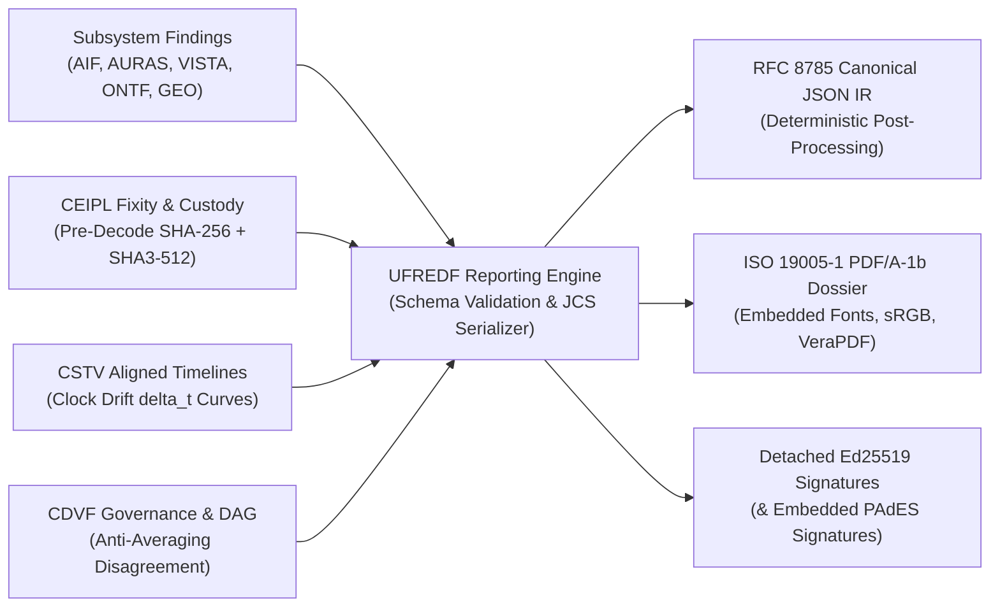

#### 4.33.2 Core Evidentiary & Legal Capabilities

| Capability Module | Primary Responsibilities & Evidentiary Value | Legal / Forensic Guardrail |
| :--- | :--- | :--- |
| **Section 63 BSA Schedule** | Automated statutory certificate detailing device operating conditions, lawful control, and custody. | Dual-control sign-off required (`ROLE-EXAMINER` + `ROLE-REPREV`); bilingual Hindi/English headers. |
| **RFC 8785 JSON IR** | Bit-identical, canonical machine-readable snapshot conforming to JSON Canonicalization Scheme (JCS). | Schema-validated against Pydantic v2 contracts; deterministic hashing across OS runtimes. |
| **Archival PDF/A-1b** | Long-term archival document generation using local Typst / WeasyPrint engines. | 100% offline air-gapped compilation; zero dynamic scripts; VeraPDF automated compliance gate. |
| **Detached Ed25519 Signatures** | RFC 8032 detached digital signatures for lightweight, zero-dependency courtroom verification. | Strictly separated from embedded PAdES PDF signatures; public keys embedded in export bundle. |
| **Anti-Averaging DAG** | Preserves individual modality probabilities as separate nodes in an evidence DAG. | Strictly forbids deceptive scalar score averaging; highlights cross-modal conflicts prominently. |
| **Stand-Alone Export Bundle** | Compiles PDF, JSON IR, signatures, and zero-PyPI Python verifier into an air-gapped zip package. | Zip-slip and path traversal defenses enforced; self-contained verification without platform connectivity. |

#### 4.33.3 Implementation Status

| Milestone | Implementation Phase | Target Deliverable | Status |
| :--- | :--- | :--- | :---: |
| Legal Standards & JSON IR Schema | `UFREDF-A0` / `UFREDF-A1` | Section 63 BSA checklist, RFC 8785 serializer | `PLANNED` |
| Inventory, Fixity & Provenance | `UFREDF-A2` / `UFREDF-A3` | Dual-hash schedules, checkpoint SHA-256 registry | `PLANNED` |
| Findings Ingestion & Fusion | `UFREDF-A4` | Modality findings, CSTV timebase, CDVF DAG | `PLANNED` |
| Review Workflow & Signatures | `UFREDF-A5` | Two-tier review gate, detached Ed25519 signer | `PLANNED` |
| PDF/A-1b & Section 63 Schedule | `UFREDF-A6` / `UFREDF-A7` | VeraPDF compliance, bilingual statutory headers | `PLANNED` |
| Standalone Package & Release | `UFREDF-A8` .. `A10` | Courtroom zip bundle, 50-case benchmark suite | `PLANNED` |

See `PRD.md Section 21`, `TRD.md Section 21`, and `PHASES.md Section 23` for full technical specifications.

### 4.34 Cross-Channel Concealment & Hidden-Data Forensics (CCHDF) & Specialist Physical Emissions Analysis (PSEA)

> **Shared Cross-Platform Concealment Orchestrator — Not a Replacement for Modality Engines**

The **Cross-Channel Concealment & Hidden-Data Forensics (CCHDF)** subsystem provides platform-wide orchestration, baseline triage, adapter dispatch, finding normalization, and inert quarantine management for covert communications, steganographic payloads, and concealed data structures across all supported digital and physical carrier modalities.

Rather than duplicating modality-specific forensic algorithms, CCHDF acts as an evidentiary router and normalizer. It identifies the evidence carrier, executes a universal first-stage structural triage, selects and invokes the appropriate modality adapter, normalizes disparate detector outputs into a versioned `ConcealmentFinding` contract cryptographically anchored via CEIPL, and delivers structured findings to Case RAG and UFREDF reporting.

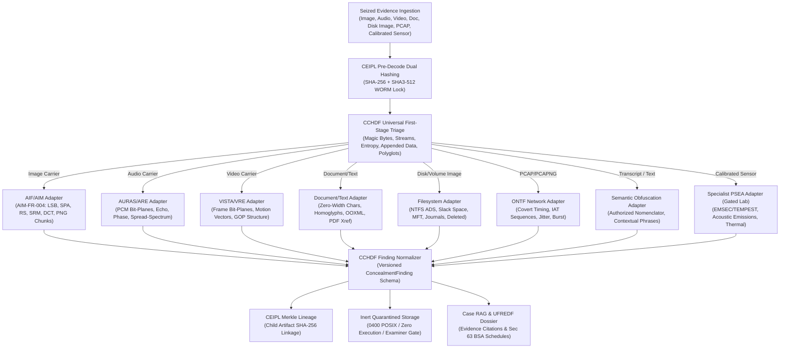

#### 4.34.1 Architectural Ownership Boundaries

To eliminate capability overlap and maintain judicial defensibility, CCHDF enforces strict subsystem boundaries:

| Subsystem / Component | Architectural Ownership & Responsibilities | Boundary Invariant & Strict Limitation |
| :--- | :--- | :--- |
| **AIF / AIM** | Owns image-carrier steganalysis: LSB Chi-Square, Sample Pair Analysis (SPA), Regular-Singular (RS), Spatial Rich Models (SRM), JPEG DCT coefficient histograms, PNG ancillary chunks, and EXIF/XMP trailing bytes. | Preserves `AIM-FR-004` and zero-execution policy. Does not analyze non-image carriers. |
| **AURAS / ARE** | Owns audio-carrier steganalysis: PCM bit-plane statistical analysis, echo-hiding anomaly detection, phase-coding indicators, spread-spectrum/watermark anomalies, and spectral phase inconsistencies. | Integrates with ARE signal contracts. Decoupled from ordinary audio watermarking and ADDE deepfake detection. |
| **VISTA / VRE / VCI** | Owns video-carrier steganalysis: frame-level bit-plane anomalies, temporal distribution of pixel anomalies, keyframe vs non-keyframe structure, motion-vector field anomalies, GOP/compression-aware checks, and independent audio/video stream checks. | Decoupled from VDF deepfake detection and VCI scene classification. |
| **Document Adapter** | Owns document and text-carrier examination: zero-width Unicode characters, homoglyphs/confusables, invisible whitespace, hidden text layers, OOXML unreferenced parts/revisions, and PDF hidden xref objects/streams. | Sandboxed non-executing parsers only; never evaluates dynamic macro code. |
| **Filesystem Adapter** | Owns storage forensics on forensic disk/volume images: NTFS Alternate Data Streams (ADS), RAM/drive file slack space, unallocated clusters, deleted file remnants, MFT `$DATA` attributes, and `$LogFile`/`$UsnJrnl` reconstruction. | **Critical Acquisition Invariant:** Requires validated disk/volume images (raw/dd, E01, VMDK, VHD); cannot run on standalone uploaded files. |
| **ONTF** | Owns network covert-channel investigation: packet inter-arrival time (IAT) sequence distributions, directional timing skew, packet-burst entropy, autocorrelation, jitter vs baseline, and protocol-state correlation. | Analyzes original PCAP/PCAPNG evidence. Distinct from periodic C2 beacon detection; does not label regular traffic as covert. |
| **Semantic Adapter** | Owns semantic/linguistic obfuscation analysis: text/speech transcript examination against case-scoped authorized glossaries, nomenclators, contextual repeated phrase patterns, and alternative ordinary interpretations. | Must not assert innocent phrases are codewords without independent contextual corroboration or an authorized codebook. |
| **Specialist PSEA** | Optional gated laboratory capability: EMSEC/TEMPEST compromising emanations, unintended acoustic emissions, and thermal time-series sensor anomalies. | **Prerequisite Invariant:** Requires calibrated RF/SDR/thermal sensors with calibration reports; never proven via CCTV or PCAP. |
| **CEIPL** | Owns master evidence bitstream fixity (SHA-256/SHA3-512 dual hashing), WORM vaulting, and derived payload Merkle DAG lineage. | Does not perform forensic or steganographic interpretation of extracted data. |
| **CMMS & CSTV** | CMMS extracts container/carrier metadata; CSTV normalizes timestamps and models clock offset/drift across multi-channel streams. | Provide metadata and temporal alignment to CCHDF without performing carrier payload decoding. |
| **Case RAG & UFREDF** | Ingests normalized `ConcealmentFinding` records, provides evidence-indexed search, and formats Section 63 BSA legal annexures. | Enforces prompt-injection barriers: untrusted extracted text must never become LLM system instructions. |

#### 4.34.2 Universal First-Stage Concealment & Structural Triage

Every evidence exhibit accepted by the PS-05 platform must pass a universal 10-step triage before being routed to deep modality-specific detectors:

1. **Magic-Byte & Actual Type Identification:** Inspects leading header magic bytes against a forensic signature database, establishing true MIME type regardless of reported filename.
2. **Container & Stream Inventory:** Enumerates all elementary container tracks, multiplexed streams, channels, and structural partitions.
3. **Extension/Content Mismatch Detection:** Flags discrepancies between declared file extension and verified magic-byte container structure.
4. **Trailing & Appended Data Identification:** Audits bytes beyond logical end-of-file markers (JPEG `FF D9`, PNG `IEND`, PDF `%%EOF`, ZIP central directory end).
5. **Embedded-File & Archive Discovery:** Scans internal bitstream for nested signatures (embedded PKZIP, 7z, GZIP, ELF, PE, tar, or script headers).
6. **Metadata & Unusual Structural-Field Inspection:** Audits container metadata blocks for anomalous chunk types, unindexed tags, private EXIF tags, and malformed length fields.
7. **Suspicious Entropy & Byte-Distribution Indicators:** Computes block-level Shannon entropy ($H \in [0, 8]$) and sliding-window byte histograms, flagging localized high-entropy regions indicative of encrypted or compressed payloads.
8. **Polyglot & Malformed-Container Indicators:** Detects dual-format polyglot structures (e.g., valid JPEG + valid ZIP) and deliberately malformed headers intended to bypass perimeter filters.
9. **File-Specific Static Steganalysis Adapter Routing:** Selects and dispatches candidate evidence to appropriate modality adapters based on verified container and stream characteristics.
10. **Safe Quarantine & Evidence Lineage:** Encapsulates detected anomalies, generates a preliminary triage finding, and records lineage under CEIPL with zero payload execution.

#### 4.34.3 Unified Finding Contract (`ConcealmentFinding`)

All concealment findings emit a standardized, versioned contract containing 20 mandatory fields with modality-aware spatial/temporal source locations:

```json
{
  "finding_id": "fnd-cchdf-20261101-00129",
  "case_id": "CASE-2026-BH-0082",
  "evidence_id": "EVID-IMG-20261101-0044",
  "parent_artifact_id": null,
  "carrier_type": "image",
  "analysis_domain": "image_steganalysis",
  "detector_id": "aim.steganalysis.lsb_rs",
  "detector_version": "1.4.0",
  "checkpoint_sha256": "e3b0c44298fc1c149afbf4c8996fb92427ae41e4649b934ca495991b7852b855",
  "method_family": "statistical_regular_singular",
  "source_location": {
    "carrier": "image",
    "x": 0,
    "y": 0,
    "width": 1920,
    "height": 1080,
    "color_planes": ["R", "G", "B"]
  },
  "temporal_location": null,
  "observed_indicators": [
    "RS curve slope inversion: f_R(-P) != f_R(P)",
    "Estimated LSB embedding rate: 0.142 bpp (+/- 0.018 bpp)"
  ],
  "raw_metrics": {
    "regular_groups_pos": 0.284,
    "singular_groups_pos": 0.112,
    "regular_groups_neg": 0.219,
    "singular_groups_neg": 0.178,
    "chi_square_p_value": 0.000041
  },
  "calibrated_confidence_or_rank": 0.884,
  "ood_status": "in_distribution",
  "limitations": [
    "LSB RS analysis assumes natural continuous-tone imagery; high ISO noise may elevate false positives.",
    "Detection of statistical anomaly does not guarantee the existence of readable decrypted plaintext."
  ],
  "alternative_explanations": [
    "High camera sensor gain / thermal noise floor in low-light capture.",
    "Custom RAW demosaicing algorithm introducing subtle color channel correlations."
  ],
  "review_status": "flagged_for_examiner_review",
  "derived_artifact_ids": [
    "art-rs-curve-0044",
    "art-quarantined-payload-0044"
  ]
}
```

#### 4.34.4 Core Evidentiary, Security & Legal Invariants

1. **Detection $\neq$ Intentional Concealment:** The platform records statistical and structural anomalies; it never asserts criminal intent or knowledge, which remains the sole province of the court.
2. **Negative Result $\neq$ Absence of Concealment:** Negative detector findings mean no anomalies were observed under evaluated models; they do not mathematically prove absence of covert channels using unknown keys or sub-threshold embedding rates.
3. **Recovered Payload $\neq$ Proof of Authorship:** Recovering an embedded file or byte stream establishes presence within the carrier; it does not establish who created or transmitted the payload.
4. **Inert Quarantined Storage:** All extracted bitstreams, payloads, and derivative fragments are stored with POSIX `0400` read-only permissions in sandboxed WORM storage.
5. **Zero Execution Policy:** The platform never executes recovered binaries, shell scripts, Python files, Office macros, or HTML/JavaScript payloads. Static, unprivileged dissection is strictly enforced.
6. **Examiner-Gated Payload Extraction:** Raw payload extraction to disk is disabled by default and requires explicit cryptographic authorization by an authenticated examiner (`ROLE-EXAMINER`).
7. **Prompt-Injection Defense:** Untrusted text extracted from carriers or recovered payloads is strictly quarantined as data payloads and never passed into LLM system prompts or agent instructions.
8. **Filesystem Acquisition Gate:** Slack-space and ADS examination are strictly blocked on standalone file uploads and require authenticated forensic disk images (E01, raw dd, VMDK).
9. **PSEA Specialist Calibration Gate:** Physical side-channel analysis requires accredited laboratory measurement reports, calibrated sensor hardware metadata, and environmental baseline controls.

#### 4.34.5 Implementation Status

| Milestone | Implementation Phase | Target Deliverable | Status |
| :--- | :--- | :--- | :---: |
| Architecture Baseline & Triage Scanner | `CCHDF-A0` | Universal 10-step triage engine, Pydantic schemas | `PLANNED` |
| Image Steganalysis Calibration | `CCHDF-A1` | AIM-04 calibration, SPA, RS, SRM, DCT models | `PLANNED` |
| Audio Steganalysis & Phase Forensics | `CCHDF-A2` | PCM bit-plane, echo hiding, phase anomaly detectors | `PLANNED` |
| Video & Temporal Steganalysis | `CCHDF-A3` | Frame bit-plane, motion-vector, GOP structure engine | `PLANNED` |
| Document & Unicode Concealment | `CCHDF-A4` | Zero-width, homoglyph, OOXML & PDF hidden object parsers | `PLANNED` |
| Filesystem Slack & ADS Forensics | `CCHDF-A5` | Raw/E01 parser, NTFS ADS, RAM/drive slack analyzer | `PLANNED` |
| Network Covert Timing Channels | `CCHDF-A6` | ONTF IAT distribution, burst entropy, jitter correlator | `PLANNED` |
| Semantic & Linguistic Obfuscation | `CCHDF-A7` | Nomenclator matcher, context phrase anomaly engine | `PLANNED` |
| Specialist Physical Side-Channel (PSEA) | `CCHDF-A8` | Calibrated EMSEC/Acoustic/Thermal lab evaluation gate | `PLANNED` |

See `PRD.md Section 23`, `TRD.md Section 22`, and `PHASES.md Section 25` for full specifications.

## 5. Implementation Status

The project architecture is finalized; core foundation artifacts and behavioral specifications have been authored, with engine implementations planned across structured engineering phases:

| Component / Subsystem | Current Status | Milestone Reference | Target Tech Stack |
| :--- | :--- | :--- | :--- |
| **Foundational Docs & Architecture** | `SPECIFICATION_COMPLETE` (docs); `NOT_STARTED` (software) | Phase 0 | Markdown, Mermaid, pyproject.toml |
| **Archify Configuration Schema** | `SPECIFICATION_COMPLETE` (docs); `NOT_STARTED` (software) | Phase 0 | `archify.config.json` |
| **Shared Core & Ingestion (WORM)** | `PLANNED` | Phase 1 / AURAS-A0 / AIF-A1 | Python, hashlib, SQLAlchemy, Redis |
| **CEIPL Cryptographic Foundation** | `PLANNED` | Phase 1 / AIF-A1, A13 / VISTA-A1 | Ed25519, RFC 8785, RFC 3161, Merkle |
| **AIF: Ingestion & Defensive Parsing** | `PLANNED` | Phase 4 / AIF-A2 | Pillow (safe limits), OpenCV, magic |
| **AIF: Taxonomy & Classification** | `PLANNED` | Phase 4 / AIF-A3 | CLIP / SigLIP, ViT, multi-label |
| **AIF: Detection, SAM 2 & People Count** | `PLANNED` | Phase 4 / AIF-A4 | YOLOv8/v10, SAM 2, Grounding DINO |
| **AIF: FPA Face & Biometric Analysis** | `PLANNED` | Phase 4 / AIF-A5 | RetinaFace, MediaPipe, ArcFace |
| **AIF: OCR & Document Layouts** | `PLANNED` | Phase 4 / AIF-A6 | PaddleOCR, Tesseract, Hough quads |
| **AIF: Reverse Engineering & Metadata** | `PLANNED` | Phase 4 / AIF-A7 | ExifTool, DQT/SOF parsers, ICC profile |
| **AIF: Classical Vision & RANSAC** | `PLANNED` | Phase 4 / AIF-A8 | Canny, Sobel, SIFT/ORB, RANSAC |
| **AIF: Manipulation Localization** | `PLANNED` | Phase 4 / AIF-A9 | TruFor, CMFD, PRNU sensor noise |
| **AIF-IML: Baseline Contracts & Taxonomy** | `SPECIFICATION_COMPLETE` (docs); `NOT_STARTED` (software) | AIF-IML-00 | Pydantic v2, Coordinate Invariants, Schemas |
| **AIF-IML: Copy-Move Forgery Engine (CMFD)** | `PLANNED` | AIF-IML-01 | SIFT/RootSIFT, RANSAC H, Block-DCT, COVERAGE |
| **AIF-IML: Splicing, Noise & PRNU Inconsistency**| `PLANNED` | AIF-IML-02 | 2D Wavelet Residuals, Boundary Seams, Columbia |
| **AIF-IML: Deep Localisation Baselines (TruFor/CAT-Net)**| `PLANNED` | AIF-IML-03 | TruFor RGB+Noise, CAT-Net v2 DCT, SHA-256 |
| **AIF-IML: Inpainting & Generative Diffusion Patch**| `PLANNED` | AIF-IML-04 | Noise Floor Annihilation, DEFACTO, Fallback |
| **AIF-IML: Face-Swap & Biometric Perimeter Seams**| `PLANNED` | AIF-IML-05 | RetinaFace 68 Landmarks, 16 px Seam Ribbon, CIEDE2000 |
| **AIF-IML: Multi-Scale Tiling & Invertible Mapping**| `PLANNED` | AIF-IML-06 | 1024 px Tiles, 25% Overlap, Inverse Affine H^-1 |
| **AIF-IML: Spatial Fusion DAG & Conflict Gate**| `PLANNED` | AIF-IML-07 | NetworkX DAG, Anti-Averaging, 7 Outcome States |
| **AIF-IML: Ground-Truth Benchmarks & Metrics**| `PLANNED` | AIF-IML-08 | Zero-Leakage Splits, IoU, Dice, MCC, NIST |
| **AIF-IML: Examiner Workbench & Sec 65B/63 Dossier**| `PLANNED` | AIF-IML-09 | Archify IR, Multi-Layer Sliders, Certified PDF |
| **AIF-IML: Security Safeguards & Release Audit**| `PLANNED` | AIF-IML-10 | 100 MP Bomb Defense, cgroups (16GB RAM), Air-Gap |
| **AIF: AI-Generated Image Detection** | `PLANNED` | Phase 4 / AIF-A10 | Pluggable CNN/ViT, Frequency FFT |
| **AIF: Face Swap & Morphing Forensics** | `PLANNED` | Phase 4 / AIF-A11 | Boundary blending, texture analysis |
| **AIF: Steganalysis & File Security** | `PLANNED` | Phase 4 / AIF-A12 | LSB Chi-Square, RS, polyglot scanner |
| **AIF: Evidence Fusion & Reporting** | `PLANNED` | Phase 4 / AIF-A14 | Finding Aggregator, Archify IR, WeasyPrint |
| **AIF: End-to-End Validation & Release**| `PLANNED` | Phase 4 / AIF-A15 | Pytest, Image benchmark corpus |
| **AIF-GEO: Metadata & Geodesy Engine** | `PLANNED` | Phase 4 / AIF-GEO-01, 02 | ExifTool, pyproj, WGS84, NumPy |
| **AIF-GEO: Geocoding & Mapping Engine** | `PLANNED` | Phase 4 / AIF-GEO-03 | Local gazetteers, geopy, MapLibre, PostGIS |
| **AIF-GEO: Track & Timeline Engine** | `PLANNED` | Phase 4 / AIF-GEO-04 | GPX/KML parsers, Kalman, DBSCAN |
| **AIF-GEO: Visual Geolocation Engine** | `PLANNED` | Phase 4 / AIF-GEO-05 | PaddleOCR, SIFT/ORB, RANSAC, GeoCLIP |
| **AIF-GEO: Solar, Weather & Terrain** | `PLANNED` | Phase 4 / AIF-GEO-06 | NOAA solar, Open-Meteo, Rasterio DEM |
| **AIF-GEO: Manipulation & Conflict Graph**| `PLANNED`| Phase 4 / AIF-GEO-07, 08 | Evidence Graph, C2PA, PRNU, Hashicorp |
| **AIF-GEO: Workbench & Reporting** | `PLANNED` | Phase 4 / AIF-GEO-09, 10 | WeasyPrint, Archify IR, Test corpus |
| **AURAS: ARE Engine** | `PLANNED` | Phase 2 / AURAS-A1, A2 | Librosa, SciPy, NumPy, SoundFile |
| **AURAS: MVSI Engine** | `PLANNED` | Phase 3 / AURAS-A3, A4, A5 | Silero VAD, PyAnnote, SpeechBrain |
| **AURAS: ADDE Engine** | `PLANNED` | Phase 6 / AURAS-A6, A7, A8 | PyTorch, RawNet2, AASIST, WavLM |
| **VISTA: Ingestion & Safe Parsing** | `PLANNED` | Phase 5 / VISTA-A2 | PyAV, FFmpeg, FFprobe, MediaInfo |
| **VISTA: VRE Reverse Engineering** | `PLANNED` | Phase 5 / VISTA-A3 | PySceneDetect, PTS Cadence, ExifTool |
| **VISTA: AFB Audio Bridge & AURAS** | `PLANNED` | Phase 5 / VISTA-A4 | FFmpeg stream-copy, AURAS Adapter |
| **VISTA: AVSC AV Synchronization** | `PLANNED` | Phase 5 / VISTA-A5 | SyncNet, RetinaFace, YAMNet, AST |
| **VISTA: VCI Content & Scene Intelligence** | `PLANNED` | Phase 5 / VISTA-A6 | YOLOv8/v10, SAM 2, ByteTrack, SigLIP, ALPR, HSRP, Case RAG |
| **VISTA: CCTV Triage & Discovery** | `PLANNED` | Phase 5 / VISTA-A7 | Adaptive Questionnaire, OSD OCR |
| **VISTA: CCTV Timeline & Native Seal**| `PLANNED` | Phase 5 / VISTA-A8 | ONVIF Parser, Clock Drift Correlator |
| **VISTA: VDF Deepfake Detection** | `PLANNED` | Phase 5 / VISTA-A9, A10 | Xception, EfficientNet, FTCN, VideoMAE |
| **VISTA: Cross-Engine Fusion & Report**| `PLANNED` | Phase 5 / VISTA-A11, A12 | Finding Merger, Archify IR, WeasyPrint |
| **VISTA: End-to-End Video Validation** | `PLANNED` | Phase 5 / VISTA-A13 | Pytest, FaceForensics++, CCTV Corpus |
| **ONTF: Ingestion & Defensive Parsing** | `PLANNED` | Phase 6 / ONTF-A1, A2 | Python, scapy, libpcap, hashlib |
| **ONTF: Telemetry Normalisation & Zeek Batch** | `PLANNED` | Phase 6 / ONTF-A3, A4 | TShark, Zeek (offline -r), Pydantic v2 |
| **ONTF: Feature Engineering & Flow Profiling** | `PLANNED` | Phase 6 / ONTF-A5 | NumPy, SciPy, CICFlowMeter, NetworkX |
| **ONTF: Device Attribution & Scoping (Mode A/B)** | `PLANNED` | Phase 6 / ONTF-A6 | DHCP/ARP Correlator, Scapy |
| **ONTF: Threat Detection & ATT&CK Mapping** | `PLANNED` | Phase 6 / ONTF-A7..A10 | Rule Engine, Scikit-learn, LightGBM, ATT&CK |
| **ONTF: Forensic Dossier & Legal Export** | `PLANNED` | Phase 6 / ONTF-A12 | Archify JSON IR, WeasyPrint, Ed25519 |
| **ONTF: End-to-End Network Validation** | `PLANNED` | Phase 6 / ONTF-A13 | Pytest, PCAP Corpus, Air-Gap Runner |
| **CDVF: Model Registry & Checkpoint Hashing** | `PLANNED` | CDVF-A1 | Python, hashlib, Pydantic v2, PostgreSQL |
| **CDVF: Dataset Cards & Leakage Prevention** | `PLANNED` | CDVF-A2 | GroupKFold, hashlib, WORM Vault |
| **CDVF: 19-Parameter Benchmark Runner** | `PLANNED` | CDVF-A3 | Pytest, Celery, Torch Benchmark Harness |
| **CDVF: Modality Suites (Image/Audio/Video/CCTV)**| `PLANNED` | CDVF-A4..A6 | Scikit-learn, SciPy, Librosa, PyAV |
| **CDVF: Cross-Dataset & Unseen Generators** | `PLANNED` | CDVF-A7 | DeepfakeBench, Diffusers, Hugging Face |
| **CDVF: Confidence Calibration & OOD Gating** | `PLANNED` | CDVF-A8 | Scikit-learn, Platt/Temp Scaling, Mahalanobis |
| **CDVF: Abstention & Cross-Modal Fusion DAG** | `PLANNED` | CDVF-A9 | NetworkX, Pydantic v2, CEIPL DAG |
| **CDVF: Subgroup Fairness & 6-Gate Scoped Approval** | `PLANNED` | CDVF-A10 | Fairlearn concepts, Ed25519 Signer |
| **CDVF: Continuous Regression & Evaluation Dossier**| `PLANNED`| CDVF-A11 | WeasyPrint, Jinja2, Archify JSON IR |
| **CCHDF: Universal Triage & Adapter Router** | `PLANNED` | CCHDF-A0 | Python, libmagic, entropy calc, Pydantic v2 |
| **CCHDF: Image Steganalysis (AIF/AIM-04)** | `PLANNED` | CCHDF-A1 | LSB Chi-Square, RS, SPA, SRM, JPEG DCT |
| **CCHDF: Audio Steganalysis (AURAS/ARE)** | `PLANNED` | CCHDF-A2 | Librosa, SciPy, PCM bit-planes, phase coding |
| **CCHDF: Video & Temporal Steganalysis (VISTA)**| `PLANNED` | CCHDF-A3 | PyAV, motion vectors, bit-plane sequence, GOP |
| **CCHDF: Document & Unicode Concealment** | `PLANNED` | CCHDF-A4 | PyMuPDF, python-docx, Unicode homoglyphs, ZIP |
| **CCHDF: Filesystem Slack Space & ADS Forensics**| `PLANNED` | CCHDF-A5 | Raw/E01 parsers, NTFS ADS, RAM/drive slack, MFT |
| **CCHDF: Network Covert Timing Channels (ONTF)**| `PLANNED` | CCHDF-A6 | Scapy, TShark, IAT variance, burst patterns |
| **CCHDF: Semantic Obfuscation & Nomenclators** | `PLANNED` | CCHDF-A7 | Case-scoped glossary, Levenshtein, semantic graph |
| **CCHDF: Specialist Physical Emissions (PSEA)** | `PLANNED` | CCHDF-A8 | Calibrated RF/IQ, acoustic & thermal sensors (lab) |
| **Platform Legal Reporting & Archify IR** | `PLANNED` | Phase 7 / AURAS-A9 / AIF-A14 / VISTA-A12 / ONTF-A12 | Jinja2, WeasyPrint, Archify |
| **Web Dashboard & Workbench** | `PLANNED` | Phase 8 | Next.js, React, TailwindCSS |
| **Air-Gapped Deployment Package** | `PLANNED` | Phase 9 | Docker, Docker Compose |
| **Final Platform Demonstration & Release**| `PLANNED` | Phase 10 / AURAS-A10 / AIF-A15 / VISTA-A13 | Pytest, Full Test Corpus, Demo CLI |

---

## 6. Technology Stack (Actual vs. Planned)

### 6.1 Actual Implemented Foundation (Phase 0)
- **Documentation & Architecture Standards:** Markdown, Mermaid.js, Archify IR specification.
- **Packaging & Configuration:** `pyproject.toml` (PEP 621), `.env.example`, `archify.config.json`.
- **System Testing Framework:** Pytest configuration with async, benchmark, and hypothesis plugins.

### 6.2 Planned Implementation Technologies
- **Runtime Environment:** Python 3.11 / 3.12 (Strictly pinned).
- **API Framework:** FastAPI, Pydantic v2, Uvicorn.
- **Database & Queue:** PostgreSQL 15+ (asyncpg), SQLAlchemy 2.0, Redis 7+, Celery.
- **Storage & Vault:** MinIO (S3-compatible Object Lock) or Local POSIX WORM partition (`chmod 0400`), AES-256-GCM.
- **Audio Processing:** NumPy, SciPy, Librosa, SoundFile, PyWavelets, Mutagen, FAISS.
- **Image Processing & Classical CV:** Pillow (safe limits), OpenCV (Headless), scikit-image, NumPy, SciPy, ExifTool.
- **Video & Bitstream Processing:** FFmpeg (>= 6.0), FFprobe, PyAV (>= 12.0), MediaInfo, PySceneDetect.
- **Concealment & Storage Forensics Tools:** StegoX research models, The A-Files evaluation suites, The Sleuth Kit (TSK) / Autopsy forensic concepts, PyMuPDF (safe parsing), python-docx (non-executing OOXML), raw/E01 forensic image readers, SciPy signal statistics.
- **Deep Learning / AI Runtimes:** PyTorch 2.2+, TorchAudio, torchvision, timm, Hugging Face Transformers, SpeechBrain.
- **Computer Vision & Tracking Models:** YOLOv8/v10, Grounding DINO, SAM 2, RetinaFace, SCRFD, ByteTrack, BoT-SORT, PaddleOCR, Tesseract OCR.
- **Audio-Visual & Temporal Models:** SyncNet, FTCN, STIL, TALL, TimeSformer, VideoMAE, SlowFast, YAMNet, PANNs, AST.
- **Offline Network Traffic Forensics Tools:** Wireshark / TShark (>= 4.0), Scapy (>= 2.5), Zeek 6.x (offline batch), PyShark, CICFlowMeter, NetworkX, igraph.
- **Geospatial & Geodesy Libraries:** `pyproj` (WGS84 ellipsoidal geodesy), `geopy` (geocoding provider adapters), `shapely` (spatial geometries), `geopandas` (spatial dataframes), `rasterio` (DEM terrain GeoTIFFs), `MapLibre GL JS` / `Leaflet` (vector map interfaces), `pvlib-python` / NOAA (solar positions).
- **Cryptographic & Provenance Standards:** `cryptography` (Ed25519, SHA-256), `canonicaljson` (RFC 8785), RFC 3161 client, pyc2pa / c2pa-rs, ONVIF Export File Format parser.
- **Reporting & Legal Export:** Jinja2, WeasyPrint, Archify JSON IR, PyOpenSSL.

---

## 7. Installation & Setup

### Prerequisites
- Python 3.11 or 3.12
- Git
- FFmpeg and FFprobe installed and available in system `PATH`
- ExifTool (>= 12.0) for deep image and video container metadata extraction
- Tesseract OCR (>= 5.0) and PaddleOCR for CCTV timestamp and document text extraction

### Setup Steps
```bash
# 1. Clone repository
git clone https://github.com/bihar-cyber-hackathon/ps05-forensics.git
cd ps05-forensics

# 2. Create and activate virtual environment
python -m venv .venv
# On Windows (PowerShell):
.venv\Scripts\Activate.ps1
# On Linux / macOS:
source .venv/bin/activate

# 3. Install dependencies in editable mode
pip install --upgrade pip
pip install -e ".[dev]"

# 4. Copy and configure environment variables
cp .env.example .env
```

---

## 8. Development & Verification Workflow

### Running Tests
```bash
# Execute unit test suites
pytest tests/unit

# Execute integration tests
pytest tests/integration

# Run code style and lint checks
ruff check .
mypy src
```

### Starting the Platform (Planned Core Service)
```bash
# Start background workers (Celery)
celery -A ps05.workers.celery_app worker --loglevel=info

# Start FastAPI application server
uvicorn ps05.api.main:app --host 127.0.0.1 --port 8000 --reload
```

---

## 9. Evidentiary Integrity & Security Invariants

The platform enforces eleven strict forensic and security invariants across all media formats:
1. **Zero Raw Alteration:** Master exhibits are written once and locked with read-only permissions (`0400`). Original files are never modified, renamed, or overwritten.
2. **Direct Raw Hashing:** Primary SHA-256 hashes are computed directly from seized raw bytes during stream ingestion before any decoding, format conversion, or resizing.
3. **Artifact Lineage DAG:** All resampled files, crops, frequency maps, extracted video frames, and audio tracks are stored as derived working artifacts linked to parent exhibits via deterministic transformation manifests.
4. **Append-Only Merkle Audit Trail:** Every user action, exhibit access, and engine run is appended to an immutable, hash-chained custody log with Merkle tree checkpoints.
5. **Defensive Media Decoding:** Unrestricted allocations are strictly prevented via decompression limits (`Image.MAX_IMAGE_PIXELS = 128_000_000`, max video dimensions $8192\times8192$, max duration 4 hours per chunk), memory limits, and isolated parser processes.
6. **Zero-Execution of Payloads:** Embedded scripts, macros, or trailing data discovered during container inspection or steganalysis are logged as evidence and **never executed**.
7. **Biometric Purpose Limitation:** Biometric facial representations are strictly isolated, access-controlled, and evaluated only under authorized 1:1 judicial comparison mandates.
8. **Decoupled Audio Extraction:** Video audio streams are extracted via lossless stream-copy and forwarded to AURAS without duplicating audio algorithms or conflating audio findings with video verdicts.
9. **No False Certainty:** Machine learning models output calibrated confidence intervals, anomaly heatmaps, and explicit out-of-distribution uncertainty bounds; the system never outputs binary "100% Fake" or "100% Authentic" claims.
10. **Air-Gap Capability:** The platform does not depend on external cloud APIs; all models, algorithms, and cryptographic verification routines operate locally.
11. **Offline Network Capture Bitstream Preservation:** Seized PCAP/PCAPNG captures are ingested into WORM storage with POSIX `0400` permissions. All dissections and Zeek extractions run strictly read-only; packet parsers execute in sandboxed unprivileged containers with hard memory caps (<= 4GB) to eliminate network-borne parser exploits.

---

## 10. Development Roadmap & Project Phases

Refer to [PHASES.md](PHASES.md) for full phase gates and definitions of done:
- **Phase 0:** Architecture Baseline & Repository Foundation (`SPECIFICATION_COMPLETE` in docs; software `NOT_STARTED`)
- **Shared Ingestion & Crypto Track:**
  - **AIF-A1 / Phase 1:** Shared Evidence Contracts & Cryptographic Foundation (CEIPL)
  - **AIF-A2:** Secure Image Intake & File Validation
  - **AIF-A13:** Cryptographic Provenance & Custody Hardening
- **AIF Image Forensics Workstream:**
  - **AIF-A3:** Hierarchical Taxonomy & Visual Classification (IVE-02/03)
  - **AIF-A4:** Object Detection, Segmentation & People Counting (IVE-04/05)
  - **AIF-A5:** FPA Face, Portrait & Biometric Analysis (IVE-06/07)
  - **AIF-A6:** OCR, Document & Specialized Image Workflows (IVE-08)
  - **AIF-A7:** Metadata & Image Reverse Engineering (IRE-01)
  - **AIF-A8:** Classical Vision & Geometric Forensics (IRE-02/03)
  - **AIF-A9:** Manipulation Localization & Camera Forensics (IRE-04/05/06)
  - **AIF-A10:** AI-Generated Image & AI-Editing Detection (AIM-01/02)
  - **AIF-A11:** Face Manipulation & Portrait Forensics (AIM-03)
  - **AIF-A12:** Steganalysis & Image-File Security (AIM-04/05)
  - **AIF-A14:** Evidence Fusion, Reporting & Reviewer Workflow
  - **AIF-A15:** End-to-End Image Validation & Release Readiness
- **CEIPL-EIV Evidence Integrity Verification Workstream:**
  - **CEIPL-EIV-00:** Repository and Integrity Architecture Discovery (`PLANNED`)
  - **CEIPL-EIV-01:** Evidence Identity, Ingestion Contracts & Decoupled Model (`PLANNED`)
  - **CEIPL-EIV-02:** Pre-Decode Streaming Dual-Hashing & Chunk Merkle Trees (`PLANNED`)
  - **CEIPL-EIV-03:** Canonical Manifests (RFC 8785), Ed25519 Signatures & RFC 3161 TSA (`PLANNED`)
  - **CEIPL-EIV-04:** WORM Vault, POSIX 0400 & S3 Object Lock Compliance Mode (`PLANNED`)
  - **CEIPL-EIV-05:** Twelve-Gate Verification Lifecycle, Fixity & Quarantine Engine (`PLANNED`)
  - **CEIPL-EIV-06:** Append-Only Hash-Chained Custody Ledger & Daily Anchors (`PLANNED`)
  - **CEIPL-EIV-07:** Derivative Merkle Lineage DAG & Multi-File Package Manifests (`PLANNED`)
  - **CEIPL-EIV-08:** Standalone Zero-PyPI Offline Verifier CLI & 15 REST APIs (`PLANNED`)
  - **CEIPL-EIV-09:** Cross-Subsystem Engine Adapters & Section 63 BSA PDF Dossier (`PLANNED`)
  - **CEIPL-EIV-10:** 16-Case Mutation Testing, 500-Fixture Benchmark & Air-Gap Image (`PLANNED`)
- **AIF-IML Image Manipulation Localisation Workstream:**
  - **AIF-IML-00:** Repository Audit, Localisation Contracts & Baseline Gap Matrix (`SPECIFICATION_COMPLETE` in docs; software `NOT_STARTED`)
  - **AIF-IML-01:** Classical Copy-Move Forgery Localisation Engine (SIFT/RootSIFT/RANSAC)
  - **AIF-IML-02:** Image Splicing, Noise Residual & Sensor Inconsistency Engine
  - **AIF-IML-03:** Deep-Learning Manipulation Localisation Baselines (TruFor & CAT-Net v2)
  - **AIF-IML-04:** Inpainting, Object Removal & AI-Modified Region Localisation
  - **AIF-IML-05:** Face-Swap, Morphing & Facial Region Localisation (Biometric Seams)
  - **AIF-IML-06:** Multi-Scale Tiling & Invertible Coordinate Mapping Engine (50 MP)
  - **AIF-IML-07:** Unified Mask Architecture, Multi-Detector Fusion & Lineage Graph
  - **AIF-IML-08:** Localisation Benchmarking, Ground-Truth Datasets & Metric Harness
  - **AIF-IML-09:** Forensic Examiner Review Workbench & Section 65B/63 BSA Dossier
  - **AIF-IML-10:** Security Hardening, Resource Ceilings & Release Readiness
- **AURAS Audio Forensics Workstream:**
  - **AURAS-A0:** Shared Core, Immutable WORM Ingestion & Audio Evidence Contracts
  - **AURAS-A1, A2:** ARE Baseline & Advanced Signal Reverse Engineering
  - **AURAS-A3, A4, A5:** MVSI VAD, Overlap Diarization & Multilingual Language Analytics
  - **AURAS-A6, A7, A8:** ADDE Deepfake Detection, Foundation Models & Calibrated Ensemble
  - **AURAS-A9:** Cross-Engine Orchestration & Section 65B/63 BSA Legal Reporting
  - **AURAS-A10:** End-to-End Audio Validation, Benchmarking & Hackathon Demonstration
- **VISTA Video & CCTV Forensics Workstream:**
  - **VISTA-A0:** Repository Discovery & Architecture Baseline Integration
  - **VISTA-A1:** Shared Video Evidence Contracts & Cryptographic Foundation (CEIPL)
  - **VISTA-A2:** Video Intake, Container Metadata & Defensive Media Parsing
  - **VISTA-A3:** Timestamp-Aware Video Reverse Engineering (VRE)
  - **VISTA-A4:** Audio Extraction & AURAS Subsystem Integration (AFB)
  - **VISTA-A5:** Audio-Visual Synchronization & Event Correspondence (AVSC)
  - **VISTA-A6:** Video Content & Scene Intelligence Engine (VCI)
  - **VISTA-A7:** CCTV Source Discovery & Adaptive Context Questionnaire
  - **VISTA-A8:** CCTV Timeline Integrity & Native Export Verification
  - **VISTA-A9:** Video Deepfake & AI-Generation Baselines (VDF)
  - **VISTA-A10:** Temporal Manipulation, Optical Flow & Robustness (VDF)
  - **VISTA-A11:** Cross-Engine Video Evidence Fusion & Conflict Resolution
  - **VISTA-A12:** Video Reporting, Examiner Review & Section 65B/63 BSA Dossier
  - **VISTA-A13:** End-to-End Video Validation, Security Audit & Release Readiness
- **ONTF Offline Network Traffic Forensics Workstream:**
  - **ONTF-A0:** Network Architecture Baseline, Repository Audit & Parser Sandboxing
  - **ONTF-A1:** Shared Network Evidence Contracts & CEIPL Cryptographic Foundation
  - **ONTF-A2:** PCAP/PCAPNG Format Validation, Defensive Demuxing & Header Parsing
  - **ONTF-A3:** Offline Telemetry Extraction (TShark, Scapy & Offline Zeek Logs)
  - **ONTF-A4:** Common Network Telemetry Schema Normalisation & Data Minimisation
  - **ONTF-A5:** Flow, Packet & Temporal Feature Engineering Pipeline
  - **ONTF-A6:** Target-Device Identification, Scoping & Attribution Analytics (Mode A & B)
  - **ONTF-A7:** Deterministic Threat Detection (Scans, Beacons, DNS Tunnels & DGA)
  - **ONTF-A8:** Machine Learning Traffic Classification & Statistical Anomaly Baselines
  - **ONTF-A9:** Temporal Behaviour Modelling & Communication Graph Analytics
  - **ONTF-A10:** Multi-Stage Attack Correlation & MITRE ATT&CK Mapping
  - **ONTF-A11:** Threat Forecasting & World-Model Integration (Bounded State Projections)
  - **ONTF-A12:** Network Forensic Dossier, Archify JSON IR & Sec 65B/63 BSA Certification
  - **ONTF-A13:** End-to-End Network Validation, Forensic Benchmark Corpus & Release Readiness
- **CDVF Cross-Modal Deepfake Validation Workstream:**
  - **CDVF-A0:** Repository Audit & Cross-Modal Validation Requirements
  - **CDVF-A1:** Model Registry & Checkpoint Provenance Contracts
  - **CDVF-A2:** Dataset Governance, Quality Tiers & Leakage Prevention
  - **CDVF-A3:** Unified Benchmark Runner & 19-Parameter Execution Protocol
  - **CDVF-A4:** Image Deepfake & Manipulation Detection Validation (AIF)
  - **CDVF-A5:** Audio Deepfake & Speech Manipulation Validation (AURAS)
  - **CDVF-A6:** Video & CCTV Deepfake Detection Validation (VISTA)
  - **CDVF-A7:** Cross-Dataset (Modes A-G) & Unseen-Generator Evaluation
  - **CDVF-A8:** Confidence Calibration & Out-of-Distribution Gating
  - **CDVF-A9:** Abstention Policy & Cross-Modal Evidence Fusion DAG
  - **CDVF-A10:** Subgroup Fairness, Robustness & 6-Gate Scoped Model Approval
  - **CDVF-A11:** Continuous Regression, Evaluation Dossier & Release Readiness
- **CCHDF Cross-Channel Concealment & Hidden-Data Forensics Workstream:**
  - **CCHDF-A0:** Architecture Baseline, Adapter Contracts & Universal Triage Scanner (`PLANNED`)
  - **CCHDF-A1:** Image Steganalysis Deepening & AIM-04 Calibration (LSB, SPA, RS, SRM, DCT) (`PLANNED`)
  - **CCHDF-A2:** Audio Steganalysis & Acoustic Signal Anomaly Engine (PCM, Echo, Phase) (`PLANNED`)
  - **CCHDF-A3:** Video Temporal, Motion Vector & GOP Steganalysis (VISTA/VRE) (`PLANNED`)
  - **CCHDF-A4:** Document, Unicode & Polyglot Concealment Forensics (Zero-Width, OOXML, PDF) (`PLANNED`)
  - **CCHDF-A5:** Forensic Disk Image, Slack Space & NTFS ADS Forensics (Raw/E01, Invariant Gate) (`PLANNED`)
  - **CCHDF-A6:** Network Covert Timing Channel & Inter-Arrival Analysis (ONTF IAT, Jitter) (`PLANNED`)
  - **CCHDF-A7:** Semantic, Nomenclator & Linguistic Obfuscation Engine (Glossary Matcher) (`PLANNED`)
  - **CCHDF-A8:** Physical Side-Channel & Emissions Analysis (PSEA Specialist Lab Milestone) (`PLANNED`)
- **Platform Delivery Track:**
  - **Phase 7:** Platform Cross-Engine Reporting (Section 65B/63 BSA Dossier)
  - **Phase 8:** Web Dashboard & Forensic Examiner Workbench
  - **Phase 9:** Security Hardening & Air-Gapped Packaging
  - **Phase 10:** Final Hackathon Demonstration & Release

---

## 11. Canonical Documentation Index

- [PRD.md](PRD.md) — Product Requirements Document (Personas, Requirements AIF-FR, IVE-FR, IRE-FR, AIM-FR, CEIPL-FR, AUD-FR, VISTA-FR, VRE-FR, AFB-FR, AVSC-FR, VDF-FR, VCI-FR, CCTV-FR, ONTF-FR, CDVF-01..20, CCHDF-FR-001..011, CCHDF-01..35, NFRs)
- [TRD.md](TRD.md) — Technical Requirements Document (Component boundaries, DB schemas, API contracts, threat model, five-engine VISTA specifications, CDVF § 11.B validation framework, CCHDF § 22 technical architecture & ConcealmentFinding schemas, Pydantic v2 schemas § 12)
- [PHASES.md](PHASES.md) — Canonical Implementation Roadmap & Milestone Acceptance Gates (Phases 0–10, AURAS-A0..A10, AIF-A0..A15, VISTA-A0..A13, CDVF-A0..A11, CCHDF-A0..A8, Checkpoints CCHDF-CP-00-01..08-04)
- [AI_INSTRUCTIONS.md](AI_INSTRUCTIONS.md) — Highest-authority behavioral specification for AI coding agents
- [archify.config.json](archify.config.json) — Archify JSON IR and report configuration
- [pyproject.toml](pyproject.toml) — Project packaging and dependency manifest
- [.env.example](.env.example) — Documented configuration template

---

## 12. Document & Medical-Report Analysis (PROPOSED)

> **Status:** `PLANNED` — Architecture defined in this document. No source-code implementation exists yet.

The PS-05 platform extends its forensic capability to paper-origin and digital documents submitted as evidence — including prescriptions, doctor consultation reports, laboratory reports, medical certificates, identity documents, scanned contracts, and PDF/image-embedded records. This capability is coordinated by a cross-cutting **Document Intelligence & Authenticity** layer that reuses AIF IVE/IRE/AIM components for image-based analysis and CEIPL for provenance.

### 12.1 Supported document types (subject to actual parser capability)

- Prescription images and scans.
- Doctor consultation and clinical reports.
- Laboratory, diagnostic, and discharge summaries.
- Medical certificates and referrals.
- Invoices, receipts, and government-issued identity documents.
- Scanned pages and photographed documents.
- PDFs containing embedded images, signatures, seals, QR codes, or barcodes.

### 12.2 What it does

| Capability | Description |
| :--- | :--- |
| Safe document parsing | Format detection, stream-safe parsing, page extraction via PyMuPDF / pypdf |
| OCR & layout analysis | PaddleOCR / Tesseract, LayoutLM-family layout detection |
| Structured field extraction | Names, dates, identifiers, medications, test values |
| Signature / QR / seal inspection | Detect presence; verify linked cryptographic or QR payloads |
| Cross-document comparison | Field-level comparison of related documents within the same case |
| Alteration indicators | Layout breaks, font inconsistencies, pixel-level anomalies via AIF IRE/AIM |
| Provenance via CEIPL | Every document page hashed, lineage-tracked, signed |

### 12.3 What it does NOT do

- It does not diagnose disease or recommend treatment.
- It does not verify a doctor's medical judgment.
- It does not automatically declare a document "fake" because it differs from a template.
- A consistent prescription text does not prove the prescription is genuine.
- A missing digital signature does not prove a paper-origin document is fraudulent.
- A valid digital signature verifies the cryptographic binding but does not prove every medical statement in the document is true.

For the complete specification, see [PRD.md § 22 (Supplementary Proposed Capabilities — Document Intelligence & Authenticity, § 22.1)](PRD.md). No dedicated TRD section yet exists for this proposed capability.

---

## 13. Evidence Relationship Graph (PROPOSED)

> **Status:** `PLANNED` — Architecture defined. Not yet implemented.

Each forensic case maintains a structured evidence graph connecting exhibits, extracted facts, timestamps, people references, documents, media segments, and findings.

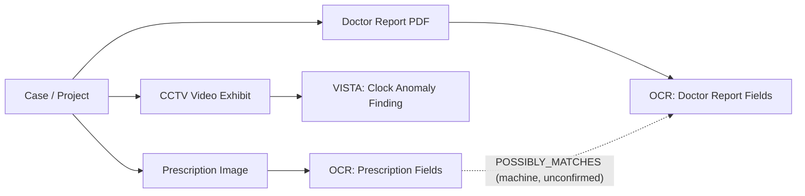

**Key design rules:**

- Every graph edge records its provenance, method, and whether machine-suggested or reviewer-confirmed.
- Machine-suggested relations remain distinguishable from confirmed findings.
- Two documents are never merged solely because their OCR text is similar.
- No cross-case data is ever combined.
- The graph is reconstructable from persisted source records.
- Text similarity is not proof of shared genuine origin.

For the complete specification, see [PRD.md § 22 (Supplementary Proposed Capabilities — Evidence Relationship Graph, § 22.2)](PRD.md). No dedicated TRD section yet exists for this proposed capability.

---

## 14. Guarded Investigator Evidence Assistant (PROPOSED)

> **Status:** `PLANNED` — Architecture defined. No source-code implementation exists yet.

A case-scoped Retrieval-Augmented Generation (RAG) assistant that answers authorized investigators' questions using only the active case's uploaded and indexed evidence and an approved forensic knowledge base.

### 14.1 Example questions it can answer

- *"What evidence files are present in this case?"*
- *"Summarize the technical findings for this CCTV video."*
- *"Do any uploaded documents have conflicting dates?"*
- *"Which findings remain pending human review?"*
- *"Show the relationship between this prescription and the doctor report."*

### 14.2 Mandatory security boundaries

| Guardrail | Enforcement |
| :--- | :--- |
| Case isolation | No cross-case retrieval under any circumstances |
| Source citations | Every factual claim cites a verified indexed source |
| No legal / medical conclusions | Explicitly refused; returns uncertainty notice |
| No credential disclosure | Passwords, keys, tokens, source code never returned |
| Prompt injection defense | Uploaded document content treated as evidence text, never commands |
| Audit logging | All queries, authorized sources, and outputs logged |

### 14.3 What the assistant does NOT do

- It cannot alter or delete evidence.
- It cannot access another case's documents.
- It does not issue legal verdicts or medical diagnoses.
- Its responses are not new sources of evidence.
- A RAG-generated summary does not replace a certified forensic examiner report.

For the complete specification, see [PRD.md § 22 (Supplementary Proposed Capabilities — Case-Scoped RAG Investigator Assistant, § 22.3)](PRD.md). No dedicated TRD section yet exists for this proposed capability.

---

## 15. MVP Demonstration Workflow

> **Status:** MVP scope is defined. Implementation is `PLANNED`.

The hackathon demonstration targets a reliable, end-to-end vertical slice using a single representative case.

**Demo scenario:** An investigator opens a case containing one CCTV/video clip, one image or screenshot, and one PDF/prescription-related document.

| Step | What happens | Capability |
| :--- | :--- | :--- |
| 1. Evidence intake | Upload exhibits; compute SHA-256 / SHA3-512; store in WORM vault | CEIPL |
| 2. Metadata extraction | Container, EXIF, page structure, stream inventory | AIF IRE / VISTA VRE |
| 3. Image / audio / video analysis | Per-exhibit forensic engine results | AIF / AURAS / VISTA |
| 4. Document OCR | Page extraction, field identification, alteration indicators | DOC-A0/A1 (PROPOSED) |
| 5. Evidence relationship | Link related exhibits; propose candidate relationships | EGRAPH-A0 (PROPOSED) |
| 6. Evidence graph view | Interactive visualization of connected exhibits and findings | EGRAPH-A1 (PROPOSED) |
| 7. RAG question | Ask a case-scoped question; receive cited answer with sources | RAG-A0/A1 (PROPOSED) |
| 8. Contradiction view | Show conflicting timestamps or fields with source evidence | Cross-engine aggregator |
| 9. Dossier export | Structured PDF and JSON dossier with hashes and signature | Archify / CEIPL |

**Mocked components must be clearly labeled.** No mocked signature or fabricated model score may appear as a real finding.

---

## 16. Privacy, Security & Legal Boundaries

### 16.1 Health & biometric data
- Extracted medical document fields are subject to restricted access, role-based redaction, and purpose limitation.
- Only fields necessary for the documented investigation are extracted.
- Biometric face embeddings are never extracted or matched by default. A judicial Case Authorization Token is required.
- Medical records are not used to train models automatically without separate explicit authorization and a defined process.

### 16.2 Legal certificate scope
The platform can generate a structured certificate containing SHA-256 / SHA3-512 hashes, examiner identity, environment manifest, and Ed25519 signature in a format aligned with **Section 65B of the Indian Evidence Act** and **Section 63 of the Bharatiya Sakshya Adhiniyam, 2023**.

> **Important:** Whether a generated certificate satisfies court admissibility requirements in a specific proceeding depends on the applicable law, facts, process, and qualified legal review. The software does not guarantee court admissibility. Legal templates in this documentation are subject to verification by a qualified legal reviewer.

### 16.3 What the platform cannot guarantee
- It cannot conclusively prove any document or media artifact is authentic.
- A valid hash does not prove factual authenticity of the recorded event.
- A positive deepfake indicator is not a legal verdict.
- A consistent prescription is not medical proof.
- Cross-document text similarity is not proof of shared genuine origin.
- The platform is not a substitute for a qualified forensic examiner.

---

## 17. Implementation Status Summary

| Capability | Status | Phase Reference |
| :--- | :--- | :--- |
| Architecture & documentation baseline | `SPECIFICATION_COMPLETE` (docs); `NOT_STARTED` (software) | Phase 0 |
| CEIPL cryptographic foundation | `PLANNED` | Phase 1 / AIF-A1 / VISTA-A1 |
| AIF image forensics (IVE / IRE / AIM / FPA) | `PLANNED` | AIF-A2..A15 |
| AURAS audio forensics (ARE / MVSI / ADDE) | `PLANNED` | AURAS-A0..A10 |
| VISTA video forensics (VRE / AFB / AVSC / VDF / VCI / CCTV) | `PLANNED` | VISTA-A0..A13 |
| Cross-Modal Deepfake Validation Framework (CDVF) | `PLANNED` | CDVF-A0..A11 (governs AIF, AURAS, VISTA) |
| Document & medical-report intelligence | `PLANNED` | DOC-A0..A2 (proposed this release) |
| Evidence relationship graph | `PLANNED` | EGRAPH-A0..A1 (proposed this release) |
| Guarded RAG investigator assistant | `PLANNED` | RAG-A0..A2 (proposed this release) |
| Integrated MVP demonstration | `PLANNED` | INT-A0..A1 (proposed this release) |
| Web dashboard & examiner workbench | `PLANNED` | Phase 8 |
| Air-gapped deployment package | `PLANNED` | Phase 9 |

---
