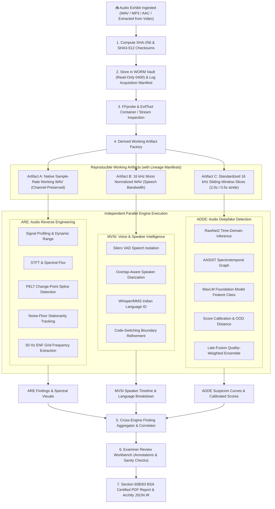
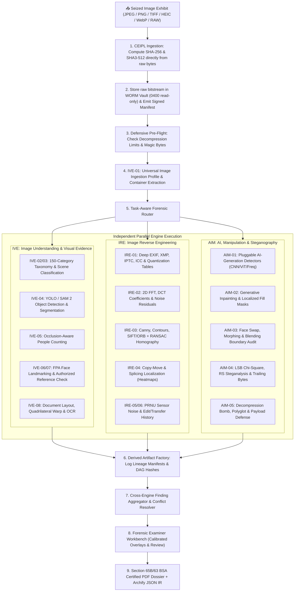
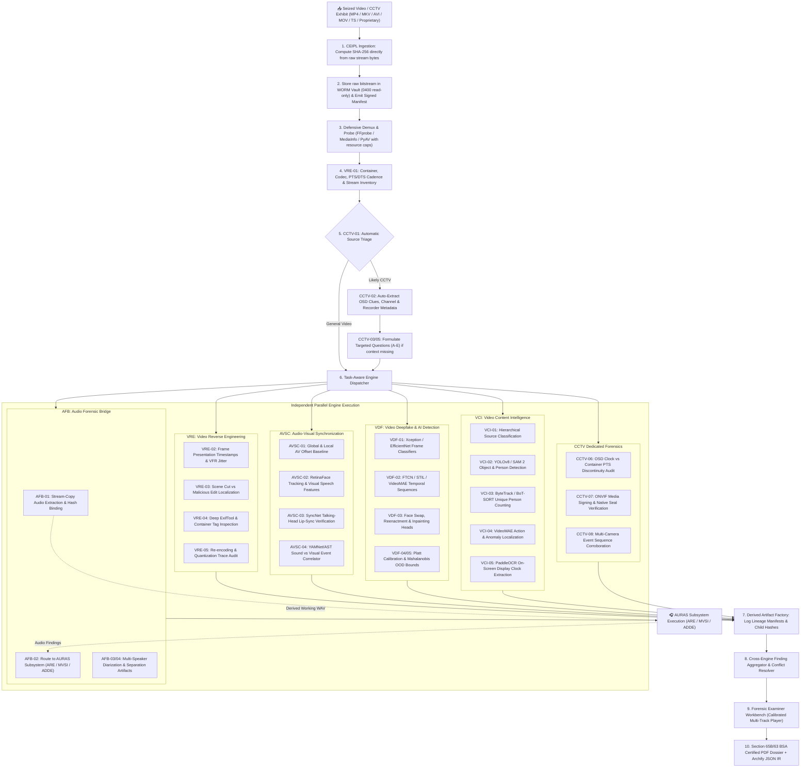

# Digital Evidence Authenticity & Integrity Verification Platform (PS-05)

[](pyproject.toml)
[](TRD.md)
[](PRD.md)
[](#hackathon-context)

> **Official Problem Statement PS-05:** Digital Evidence Authenticity and Integrity Verification Platform  
> **Organizers:** C-DAC Patna, CCSU, Bihar Police  
> **Event:** Bihar Government Cyber Hackathon 2026  
> **Track:** Digital Forensics  

---

## 1. Executive Overview & Problem Statement

In contemporary cyber-crime investigations, extortion cases, surveillance reviews, and court proceedings, digital artifacts—such as digital photographs, voice recordings, video files, and CCTV footage—serve as primary evidence. However, modern editing software and generative AI technologies (deepfakes, voice cloning, diffusion models) enable malicious actors to manipulate or synthesize evidence with high realism.

Manual forensic examination is time-consuming, requires scarce specialized expertise, and struggles with complex multi-modal manipulations. The **PS-05 Platform** is an enterprise-grade, modular, explainable, and auditable digital forensics system engineered for law enforcement agencies (state police departments, Bihar Police cyber cells) and Forensic Science Laboratories (FSLs). It provides:

1. **Cryptographic Chain of Custody (CEIPL):** Write-Once-Read-Many (WORM) storage, instant raw-byte dual-hashing (SHA-256 and SHA3-512), RFC 8785 canonical manifests, Ed25519 signatures, RFC 3161 timestamps, and an append-only Merkle tree audit log.
2. **AIF Advanced Image Forensics Subsystem:** High-resolution image understanding (IVE), physics/frequency reverse engineering (IRE), AI generation/steganography detection (AIM), and judicial biometric comparison (FPA).
3. **AURAS Audio Forensics Subsystem:** Deep electroacoustic signal analysis (ARE), multilingual voice and overlap-aware diarization (MVSI), and calibrated multi-branch audio deepfake detection (ADDE).
4. **VISTA Video & CCTV Forensics Subsystem:** Modular five-engine video forensics architecture:
   - **VRE (Video Reverse Engineering Engine):** Bitstream container, codec, PTS/DTS cadence, variable frame rates, scene cuts, and compression history.
   - **AFB (Audio Forensic Bridge):** Cryptographically bound audio extraction routing directly into AURAS without algorithm duplication.
   - **AVSC (Audio-Visual Synchronization & Correspondence Engine):** Global/local time alignment, talking-face lip-sync (SyncNet), and acoustic-to-visual event correspondence.
   - **VDF (Video Deepfake & AI-Generation Detection Engine):** Multi-branch frame-level and temporal sequence detectors (Xception, EfficientNet, FTCN, STIL, VideoMAE) with calibrated late-fusion.
   - **VCI (Video Content Intelligence Engine):** Hierarchical source taxonomy, object/person detection (YOLO/SAM 2), ByteTrack tracking, and PaddleOCR timestamp overlay parsing.
   - **Dedicated CCTV Forensic Profile:** Source classification, automatic recorder discovery, adaptive follow-up questionnaires, timeline continuity audit, and native export / digital seal verification.
5. **Court-Admissible Legal Certification:** Automated generation of tamper-evident electronic evidence certificates under **Section 65B of the Indian Evidence Act (IEA)** and **Section 63 of the Bharatiya Sakshya Adhiniyam, 2023 (BSA)** with Archify JSON Intermediate Representation (IR).

---

## 2. Goals & Non-Goals

### Project Goals
- **G-1:** Ingest digital media (audio, image, video, CCTV) with zero modification to original bitstreams.
- **G-2:** Localize tampering spatio-temporally (millisecond audio timestamps, frame indices, image bounding polygons) with explainable visual artifacts.
- **G-3:** Detect AI voice cloning and audio manipulation across Scheduled Indian Languages and regional Hindi dialects.
- **G-4:** Identify surveillance video tampering (missing CCTV frames, looping sequences, tampered digital clock overlays, desynchronized audio).
- **G-5:** Produce verifiable, court-ready PDF certificates and Archify JSON Intermediate Representation (IR) graphs.
- **G-6:** Operate 100% offline in air-gapped forensic laboratory environments.

### Non-Goals
- **NG-1:** The platform is not an automated judicial judge. It outputs probabilistic evidence, anomaly heatmaps, and confidence intervals to assist certified human forensic examiners.
- **NG-2:** It does not perform live physical memory chip extraction or hardware chip-off JTAG acquisition (evidence must be supplied as seized digital files).
- **NG-3:** It does not claim 100% detection of unseen zero-day generative architectures without explicit uncertainty bounds.

---

## 3. High-Level Platform Architecture

```mermaid
flowchart TB
    subgraph INTAKE["📥 Case Intake & Ingestion Layer"]
        SEIZED["Seized Exhibits (Photo / Audio / CCTV / Video)"]
        CEIPL_HASH["CEIPL Raw Hasher (SHA-256 Direct Stream)"]
        WORM["WORM Immutable Vault (POSIX 0400 / S3 Object Lock)"]
        CEIPL_CHAIN["CEIPL Append-Only Hash-Chained Custody Log"]
        CEIPL_MERKLE["CEIPL Merkle Tree Checkpoint & Inclusion Proofs"]
    end

    subgraph ORCHESTRATOR["⚙️ Core Dispatcher & Worker Queue"]
        ROUTER["Forensic Profile & Task-Aware Router"]
        QUEUE["Redis + Celery Task Queue"]
        DERIVE["Derived Artifact Factory (DAG Lineage Manifests)"]
    end

    subgraph ENGINES["🔬 Specialized Forensic Analysis Subsystems"]
        direction TB
        subgraph AURAS["🎧 AURAS Audio Forensics Subsystem"]
            ARE["ARE: Audio Reverse Engineering Engine"]
            MVSI["MVSI: Multilingual Voice & Speaker Intel"]
            ADDE["ADDE: Audio Deepfake Detection Engine"]
        end
        subgraph AIF["🖼️ AIF Advanced Image Forensics Subsystem"]
            IVE["IVE: Image Understanding & Visual Evidence Engine"]
            IRE["IRE: Image Reverse Engineering Engine"]
            AIM["AIM: AI, Manipulation & Steganography Engine"]
            FPA["FPA: Face, Portrait & Biometric Analysis Module"]
        end
        subgraph VISTA["📹 VISTA Video Forensics Subsystem"]
            VRE["VRE: Video Reverse Engineering Engine"]
            AFB["AFB: Audio Forensic Bridge"]
            AVSC["AVSC: Audio-Visual Synchronization & Correspondence"]
            VDF["VDF: Video Deepfake & AI-Generation Detection"]
            VCI["VCI: Video Content Intelligence Engine"]
            CCTV_PROF["🛡️ CCTV Adaptive Forensic Profile (Cross-Cutting)"]
        end
    end

    subgraph CRYPTO["🔐 CEIPL Shared Cryptographic & Provenance Foundation"]
        MANIFEST["RFC 8785 Canonical Evidence Manifests"]
        SIG["Ed25519 Digital Signatures & Key Lifecycle"]
        TSA["RFC 3161 Trusted Timestamp Authority (TSA)"]
        C2PA["C2PA Content Credentials & Provenance Parser"]
    end

    subgraph REPORT["📜 Forensic Dossier & Legal Certification"]
        AGG["Cross-Engine Finding Aggregator"]
        ARCHIFY["Archify Forensic JSON IR & Visualizer"]
        PDF["Section 65B IEA / Section 63 BSA PDF Certificate"]
    end

    SEIZED --> CEIPL_HASH
    CEIPL_HASH --> WORM
    CEIPL_HASH --> CEIPL_CHAIN
    CEIPL_CHAIN --> CEIPL_MERKLE
    WORM --> ROUTER
    ROUTER --> QUEUE
    QUEUE --> DERIVE
    DERIVE --> AURAS
    DERIVE --> AIF
    DERIVE --> VISTA
    CRYPTO -.->|Integrity & Provenance Layer| INTAKE & AIF & AURAS & VISTA & REPORT
    AFB -.->|Extracted Audio Stream (DAG Linked)| AURAS
    AURAS & AIF & VISTA --> AGG
    AGG --> ARCHIFY
    AGG --> PDF
```

---

## 4. Subsystem Breakdown & Deepened Audio Forensics (AURAS)

> **Important Boundary Clarification:** The overall platform is the **PS-05 Digital Evidence Authenticity & Integrity Verification Platform**.  
> **AURAS (Audio Understanding, Reconstruction & Analysis System)** is strictly its audio forensics subsystem. AURAS is **NOT** the entire PS-05 platform, but a modular component responsible for all acoustic, vocal, and speech-tampering investigations.

### 4.1 Audio Subsystem Overview

Audio evidence presents unique investigative challenges. Unlike static images, audio signals are temporal streams with complex electroacoustic properties, lossy codec artifacts, room reverberation acoustics, and diverse linguistic patterns. A single analytical technique cannot reliably determine audio authenticity:
- Signal-level analysis can detect splices and edits, but cannot recognize AI voice synthesis.
- Deep learning deepfake classifiers can flag synthetic vocoders, but are blind to copy-paste splicing of genuine speech.
- Speaker diarization can attribute who spoke, but cannot verify whether the speaker was cloned or imposter-simulated.

To overcome these challenges, **AURAS** employs three independent, decoupled engines operating on distinct physical and mathematical dimensions:
1. **ARE (Audio Reverse Engineering Engine):** Physics- and signal-based analysis of the recording medium, electroacoustics, edit points, and ambient noise continuity.
2. **MVSI (Multilingual Voice & Speaker Intelligence Engine):** Biometric and linguistic intelligence, isolating speakers, transcribing turns, handling simultaneous overlapping speech, and classifying Indian languages/code-switching.
3. **ADDE (Audio Deepfake Detection Engine):** Machine learning detection of synthetic, voice-converted, and vocoded speech using raw waveforms, spectrotemporal graphs, and self-supervised representations.

All three engines consume read-only, traceable working artifacts generated from the WORM vault. The cross-engine aggregation layer synthesizes these independent findings into a court-admissible forensic dossier without manufacturing artificial certainty.

### 4.2 Engine Comparison Matrix

| Dimension | ARE (Audio Reverse Engineering) | MVSI (Multilingual Voice & Speaker) | ADDE (Audio Deepfake Detection) |
| :--- | :--- | :--- | :--- |
| **Primary Responsibility** | Electroacoustic signal integrity, container metadata, splice/edit detection, ambient noise consistency, ENF analysis. | Voice activity detection, speech segmentation, overlap-aware speaker diarization, multilingual Indian language ID. | Detection of AI-synthesized speech, voice cloning, vocoder artifacts, partial manipulation localization. |
| **Input Artifacts** | Native-rate bitstream, multi-channel working WAV/FLAC, container metadata dump. | Normalized 16 kHz mono float32 WAV (downmixed copy). | Standardized 16 kHz mono float32 sliding-window segments (2.0s window, 0.5s stride). |
| **Main Modules** | ARE-01 to ARE-10 (Signal profiling, STFT, PELT change-point, noise floor, FAISS repetition, 50 Hz ENF, manifests). | MVSI-01 to MVSI-12 (Silero VAD, neural segmentation, ECAPA-TDNN, pyannote diarization, Whisper LID, MMS-LID). | ADDE-01 to ADDE-12 (RawNet2, AASIST, WavLM, LFCC/CQCC + Light-CNN, Platt calibration, late-fusion ensemble, Mahalanobis OOD). |
| **Output Findings** | Splice timestamps, SNR/clipping metrics, noise discontinuities, repeated phrase intervals, ENF frequency curves. | Speaker turn intervals, concurrent overlap timestamps, segment language tags, per-speaker duration summaries. | Calibrated deepfake probabilities, per-model logits, localized synthetic segment intervals, OOD uncertainty flags. |
| **Candidate Technologies** | Librosa, SciPy, NumPy, SoundFile, PyWavelets, FFprobe, ExifTool, Mutagen, FAISS. | PyTorch, Silero VAD, WebRTC VAD, pyannote.audio, SpeechBrain, Whisper LID, MMS-LID. | PyTorch, TorchAudio, RawNet2, AASIST, WavLM, Hugging Face Transformers, Scikit-learn (Platt calibration). |
| **Validation Standards** | Synthetic splice insertion tests, clipping threshold benchmarks, bitstream equality verification. | Diarization Error Rate (DER $< 18\%$), Jaccard Error Rate (JER), Language Macro-F1 ($> 85\%$), overlap F1. | Equal Error Rate (EER $< 5.5\%$), ROC-AUC ($> 0.96$), Expected Calibration Error (ECE $< 0.05$), minDCF. |
| **Implementation Status** | `PLANNED` (Phase 2 / AURAS-A1, A2) | `PLANNED` (Phase 3 / AURAS-A3, A4, A5) | `PLANNED` (Phase 6 / AURAS-A6, A7, A8) |

### 4.3 End-to-End Audio Processing Workflow



### 4.4 Audio Technologies by Purpose

| Category | Actual Implemented Dependencies | Planned Candidate Technologies |
| :--- | :--- | :--- |
| **File & Codec Inspection** | Standard Library (`hashlib`, `pathlib`, `struct`) | FFprobe, FFmpeg (>= 6.0), ExifTool, MediaInfo, Mutagen |
| **Digital Signal Processing** | NumPy (`>=1.26.0`), SciPy (`>=1.12.0`) | Librosa (`>=0.10.1`), SoundFile (`>=0.12.1`), PyWavelets, FAISS (approximate nearest neighbors) |
| **VAD & Diarization** | PyTorch (`>=2.2.0`), TorchAudio (`>=2.2.0`) | Silero VAD v4, WebRTC VAD, pyannote.audio (`>=3.1.0`), SpeechBrain (`>=0.5.16`) ECAPA-TDNN |
| **Multilingual Language ID** | — | OpenAI Whisper (Medium/Large LID head), Meta MMS-LID (1000+ languages), Faster-Whisper |
| **Audio Deepfake Detection** | PyTorch (`>=2.2.0`), TorchAudio | RawNet2, AASIST (Graph Attention), WavLM Base+ / XLS-R 300M, Light-CNN (LFCC/CQCC), Scikit-Learn |
| **Storage & Job Processing** | SQLAlchemy 2.0 (async), Pydantic v2 | MinIO (S3-compatible WORM), PostgreSQL 15+ (asyncpg), Redis 7+, Celery (`>=5.3.6`) |
| **Testing & Benchmarking** | Pytest (`>=8.0.0`), Pytest-asyncio | Pytest-benchmark, Hypothesis, ASVspoof 2019/2021 protocols, CodecFake evaluation suite |
| **Reporting & Observability** | Jinja2 (`>=3.1.3`), WeasyPrint (`>=61.0`) | Archify JSON IR visualizer, OpenTelemetry, Prometheus, Grafana |

### 4.5 Audio Forensic Limitations & Uncertainty Principles

1. **Acoustic Discontinuity $\neq$ Definite Proof of Tampering:** Background noise shifts, microphone handling noise, room transitions, or automatic gain control (AGC) pumping can cause acoustic discontinuities without manual editing. Findings must be labeled as *candidate splice points* requiring examiner verification.
2. **Metadata Fallacy:** File headers, encoder tags, and container creation dates can be trivially modified or stripped during forwarding (e.g., via WhatsApp or Telegram). Absence of DAW tags does not prove authenticity; presence of tags indicates editing history but not necessarily malicious intent.
3. **Cryptographic Hash Scope:** A matching SHA-256 hash proves bit-level identity to a trusted reference; it does **not** prove that the content was authentic when originally recorded.
4. **Generalization Boundaries in Deepfake Detection:** Detectors trained on public benchmarks (ASVspoof) may experience performance degradation when exposed to unseen vocoders, low-bitrate mobile codecs (AMR-WB, Opus 6kbps), noisy street environments, or rare regional Indian dialects.
5. **Simultaneous Overlapping Speech Uncertainty:** When multiple speakers talk at the same time, vocal tract resonances interleave, significantly increasing speaker clustering uncertainty and language identification error rates.
6. **Legitimate Inconclusive Verdicts:** When SNR $< 5\text{ dB}$, lossy re-compression is extreme, or out-of-distribution distance is high, **"Inconclusive / Insufficient Acoustic Evidence"** is the only scientifically valid and legally defensible outcome.

---

### 4.6 Advanced Image Forensics Subsystem (AIF)

> **Subsystem Boundary Definition:**  
> **AIF (Advanced Image Forensics)** is the specialized image forensics subsystem of the PS-05 platform, operating in parallel with the **AURAS** audio subsystem. AIF provides research-oriented, security-conscious, implementation-ready forensic verification for static digital images, document captures, scanned certificates, and photographic evidence.

Image evidence in modern criminal and cyber investigations presents distinct forensic challenges. Digital images are subject to compression artifacts, multi-stage social media re-encoding, localized geometric tampering, generative AI synthesis, inpainting, facial manipulation, and steganographic payload concealment. To deliver mathematically defensible, court-admissible forensic verification, **AIF** is organized into three decoupled principal engines, one cross-cutting biometric analysis module, and a unified cryptographic integrity foundation:

1. **IVE (Image Understanding & Visual Evidence Engine):** First-pass visual triage, universal ingestion profiling, hierarchical evidence classification (~150 categories across 15 parent groups), task-aware object detection and instance segmentation, people counting with crowd-density handling, face detection and landmarking (FPA), authorized reference comparison, and document OCR / layout analysis.
2. **IRE (Image Reverse Engineering Engine):** Physics-, format-, and signal-based analysis. Deep container and metadata extraction (EXIF, XMP, IPTC, ICC profiles, quantization tables, MakerNotes), colour space and frequency analysis (2D FFT, DCT coefficients, noise residuals), classical computer vision & geometric forensics (Canny edge detection, contour hierarchies, convex hulls, Hough transforms, SIFT/ORB + RANSAC homography, difference maps), copy-move forgery detection, splicing localization, camera sensor profiling (PRNU, CFA demosaicing consistency), and edit/transfer history analysis.
3. **AIM (AI, Image Manipulation & Steganography Engine):** Deep learning and statistical anomaly detection. Pluggable AI generation detectors (CNN, ViT, patch-level classifiers, frequency-domain representations, out-of-distribution uncertainty), generative inpainting and localized editing localization (object addition/removal, generative fill, mask heatmaps), dedicated face swap and morphing forensics, structural and statistical steganalysis (trailing bytes, PNG ancillary chunks, LSB chi-square, RS steganalysis, DCT coefficient analysis), and defensive image-file security (decompression bomb protection, polyglot detection, memory/time limits, isolated decoders).
4. **FPA (Face, Portrait & Biometric Evidence Analysis Module):** Cross-cutting module shared between IVE and AIM. Provides RetinaFace/SCRFD face detection, MediaPipe facial landmarks, pose/blur/occlusion assessment, face parsing masks, and strictly authorized, access-controlled ArcFace/MagFace/AdaFace 1:1 reference comparison (*Note: "ArcMSD" is tracked as an unresolved research candidate requiring empirical verification*).
5. **CEIPL (Cryptographic Evidence Integrity & Provenance Layer):** Platform-wide shared service providing direct raw-byte SHA-256 hashing before decoding, RFC 8785 Canonical JSON evidence manifests, Ed25519 digital signatures, RFC 3161 trusted timestamp tokens, append-only hash-chained custody logs, Merkle tree inclusion proofs, derived artifact DAG lineage, C2PA Content Credentials verification, and AES-256-GCM / WORM storage enforcement.

---

### 4.7 AIF Engine Comparison Matrix

| Dimension | IVE (Image Understanding & Visual Evidence) | IRE (Image Reverse Engineering) | AIM (AI, Manipulation & Steganography) | CEIPL (Crypto Evidence Integrity & Provenance) |
| :--- | :--- | :--- | :--- | :--- |
| **Primary Responsibility** | First-pass triage, ~150-category hierarchical taxonomy, object detection, people counting, FPA face analysis, OCR. | Metadata auditing, signal/frequency analysis, classical geometric vision, copy-move/splicing, PRNU camera sensor noise. | Detection of AI-synthesized images, generative fill/inpainting, face swap/morph, steganalysis, defensive file security. | Raw-byte dual-hashing, canonical manifests (RFC 8785), Ed25519 signatures, RFC 3161 TSA, hash-chains, Merkle proofs, C2PA. |
| **Input Artifacts** | Universal image ingestion profile, decoded RGB/BGR arrays, derived multi-scale crops, perspective-corrected quads. | Raw container bitstream, metadata dumps, colour-space planes (HSV/YCbCr), high-pass noise residuals, DCT blocks. | Standardized RGB patches, localized face crops, sliding windows, spatial planes, bit-planes, raw byte streams. | Seized raw bitstreams (pre-decoding), derived artifact bytes, custody event records, C2PA JUMBF boxes. |
| **Main Modules** | IVE-01 to IVE-08 (Ingestion profile, taxonomy, multi-label classification, YOLO/SAM 2, people count, FPA, OCR). | IRE-01 to IRE-06 (ExifTool/ICC, 2D FFT/DCT, Canny/Hough/RANSAC, CMFD, PRNU sensor noise, transfer history). | AIM-01 to AIM-05 (AI generation detectors, inpainting localization, face swap/morph, steganalysis, file vulnerability). | CEIPL-01 to CEIPL-11 (SHA-256, canonical manifests, Ed25519, RFC 3161 TSA, hash-chains, Merkle trees, C2PA, WORM). |
| **Output Findings** | Multi-label category tags, bounding boxes, segmentation masks, people count with confidence, text regions, face landmarks. | EXIF anomalies, quantization table mismatches, cloned region polygon pairs, PRNU correlation coefficients, RANSAC inliers. | AI generation probability, inpainting heatmap masks, face manipulation scores, steganography statistical flags, security alerts. | Cryptographic manifest, signed event hashes, inclusion proofs, C2PA claim validation status, Section 65B/63 BSA hash seals. |
| **Candidate Technologies** | Pillow, OpenCV, PyTorch, YOLOv8/v10, Grounding DINO, SAM 2, RetinaFace, MediaPipe, PaddleOCR, Tesseract. | ExifTool, OpenCV, NumPy, SciPy, scikit-image, Canny, SIFT, ORB, RANSAC homography, DCT parsers. | PyTorch, torchvision, timm, ViT, CNN detectors, TruFor / Splice localization models, SteganoGAN/RS tools, safe parsers. | `hashlib`, `cryptography` (Ed25519, AES-GCM), `canonicaljson` (RFC 8785), pyc2pa / c2pa-rs, RFC 3161 client. |
| **Validation Standards** | Multi-label Macro-F1 ($> 85\%$), mAP@50 ($> 0.70$), People Count MAE ($< 1.5$), OCR Word Error Rate ($< 8\%$). | Localization precision/recall, PRNU correlation threshold, RANSAC inlier ratio, metadata extraction accuracy. | ROC-AUC ($> 0.95$), Localization IoU ($> 0.65$), Steganalysis TPR/FPR, zero-day generator transferability bounds. | 100% bit-exact SHA-256 matching, 100% signature verification rate, zero-tamper detection on hash-chains and Merkle proofs. |
| **Implementation Status** | `PLANNED` (Phases A3, A4, A5, A6) | `PLANNED` (Phases A7, A8, A9) | `PLANNED` (Phases A10, A11, A12) | `PLANNED` (Phases A1, A2, A13) |

---

### 4.8 End-to-End Image Forensics Workflow



---

### 4.9 Core Forensic & Cryptographic Principles

All image forensic investigation across PS-05 is governed by nine strict architectural invariants:

1. **Absolute Traceability Invariant:** Every forensic finding must be traceable to a specific seized evidence artifact, an immutable analysis run ID, a pinned tool/model version, a reproducible processing configuration, and the concrete mathematical output supporting that finding.
2. **Separation of Forensic Concepts:** The platform strictly distinguishes:
   - *File integrity* (bitstream matches reference SHA-256).
   - *Cryptographically verified provenance* (valid digital signature on a C2PA manifest).
   - *Technical consistency* (metadata matches sensor/codec specifications).
   - *Statistical indicators of manipulation* (inconsistent noise residuals or DCT blocking).
   - *AI-generation detector outputs* (calibrated probability score under defined uncertainty bounds).
   - *Scene interpretation* (visual taxonomy classification).
   - *Biometric similarity* (vector distance between authorized reference embeddings).
   - *Investigator conclusions* (human expert adjudication).  
   *These concepts are NEVER treated as interchangeable.*
3. **Cryptographic Hash Scope:** A matching SHA-256 hash proves bit-level identity to a reference hash. It does **not** prove that the photograph was taken by a camera, that the scene was real, or that the file was untampered before hashing.
4. **Digital Signature Scope:** A valid cryptographic signature proves that a signed statement was issued by the private key holder and remained unaltered in transit. It does **not** prove that the underlying assertion is factually truthful.
5. **Absence of Provenance $\neq$ Proof of Manipulation:** Missing EXIF metadata or absent C2PA credentials frequently occur due to social media stripping (WhatsApp, Telegram) and does **not** constitute proof of malicious tampering.
6. **Detector Independence & No False Certainty:** A positive AI-detector score indicates statistical anomaly relative to training distribution; it does **not** prove which commercial generator produced it. The system never outputs binary "100% Fake" or "100% Authentic" claims.
7. **Defensive Image Parsing & Zero Execution:** Uploaded image files must be parsed with strict decompression limits (`Image.MAX_IMAGE_PIXELS = 128_000_000`), bounded memory/CPU timeouts, and isolated decoders. Embedded script tags or trailing byte payloads are logged as evidentiary findings and **NEVER executed**.
8. **Biometric Privacy & Purpose Limitation:** Face embeddings (ArcFace/MagFace) must NEVER be extracted or matched by default. Biometric comparison is strictly gated behind judicial case authorization (FIR/Case ID) and purpose-limited 1:1 comparison. Raw biometric vectors are never retained in unencrypted public tables.
9. **Algorithm Verification Discipline:** Algorithms whose exact mathematical formulation or publication provenance is unverified (such as "ArcMSD") must be classified as *unresolved research candidates* and subjected to empirical validation before architectural adoption.

---

### 4.10 Video Integrity, Synchronization & Tampering Analysis Subsystem (VISTA)

> **Subsystem Boundary Definition:**  
> **VISTA (Video Integrity, Synchronization & Tampering Analysis)** is the specialized video forensics subsystem of the PS-05 platform, operating alongside **AIF** (images) and **AURAS** (audio). VISTA provides research-oriented, mathematically defensible, modular, and implementable forensic verification for digital video files, CCTV/DVR/NVR surveillance exports, dashcam/bodycam footage, and broadcast streams.

Video evidence combines high-volume spatial imagery, temporal motion vectors, compressed multi-stream containers, and interleaved audio tracks. Unlike single images or pure audio signals, video tampering can occur across multiple dimensions simultaneously:
- **Spatial tampering:** Localized face swaps, inpainting, object removal, or synthetic overlays within individual frames.
- **Temporal tampering:** Dropped frames to conceal events, duplicated/frozen frames to simulate stillness, spliced scene cuts, or variable frame-rate cadence manipulation.
- **Cross-Modal desynchronization:** Re-dubbed or cloned audio tracks laid over authentic video, or authentic audio spliced with AI-synthesized talking heads (lip-sync mismatches).
- **Surveillance/CCTV tampering:** Altered on-screen display (OSD) clock timestamps, camera switching artifacts, or proprietary export header rewrites.

To resolve these multidimensional challenges without conflating independent forensic observations, **VISTA** is structured into **five decoupled primary engines**, a dedicated **CCTV Forensic Profile**, and deep integration with the shared **CEIPL** cryptographic core and the **AURAS** audio subsystem:

1. **VRE (Video Reverse Engineering Engine):** Bitstream, container, and timeline reverse engineering. Audits MP4, MKV, AVI, MOV, TS, and raw surveillance streams using FFprobe, MediaInfo, PyAV, and ExifTool. Extracts Presentation Time Stamps (PTS), Decoding Time Stamps (DTS), GOP structures, variable frame rate (VFR) jitter, duplicate/frozen frames, scene transitions (PySceneDetect), and historical re-encoding signatures.
2. **AFB (Audio Forensic Bridge):** Extracts native audio streams with zero loss using stream-copy FFmpeg extraction. Generates derived audio artifacts bound by cryptographic SHA-256 hashes to the parent video. Routes extracted audio into **AURAS** (ARE for signal/edit analysis, MVSI for speech diarization/VAD/language ID, and ADDE for voice deepfake detection) without duplicating audio algorithms.
3. **AVSC (Audio-Visual Synchronization & Correspondence Engine):** Investigates whether visible motion and acoustic signals are temporally and semantically consistent. Performs global and local drift time-alignment, extracts face tracks and mouth crops (RetinaFace, SCRFD, ByteTrack), evaluates lip-sync correspondence using visual-speech models (SyncNet), and correlates environmental sound events (YAMNet, PANNs, AST) with visible visual activity (vehicles, impacts, machinery, crowds).
4. **VDF (Video Deepfake & AI-Generation Detection Engine):** Multi-branch spatial and temporal AI-generation detection. Combines frame-level classifiers (Xception, EfficientNet) with sequence-level temporal models (FTCN, STIL, TALL, TimeSformer, VideoMAE). Features calibrated late-fusion ensembles, Platt scaling, and Mahalanobis out-of-distribution (OOD) uncertainty estimation across diverse manipulation families (face swap, reenactment, facial inpainting, full generative AI).
5. **VCI (Video Content Intelligence Engine):** Semantic scene and event timeline reconstruction. Implements hierarchical source classification (~15 categories), task-aware object/person detection (YOLOv8/v10, RT-DETR, SAM 2), multi-object tracking (ByteTrack, BoT-SORT) for distinct unique-person counts vs. frame-level counts, action/event localization (VideoMAE, SlowFast), and robust OCR overlay extraction (PaddleOCR, Tesseract) for on-screen surveillance clocks.
6. **Dedicated CCTV Forensic Profile:** Source-specific forensic workflow integrated across all five engines. Features automated source classification (`LIKELY_CCTV_FOOTAGE`, `GENERAL_VIDEO`, etc.), automatic recording metadata and timestamp extraction *prior* to questioning the investigator, an adaptive follow-up questionnaire (Questions A–E), timeline continuity auditing, multi-camera corroboration, and native export / digital seal verification (ONVIF Export File Format, ONVIF Media Signing, vendor manifests).

---

### 4.11 VISTA Engine Comparison Matrix

| Dimension | VRE (Video Reverse Engineering) | AFB (Audio Forensic Bridge) | AVSC (AV Sync & Correspondence) | VDF (Video Deepfake Detection) | VCI (Video Content Intelligence) | CCTV Forensic Profile (Cross-Cutting) |
| :--- | :--- | :--- | :--- | :--- | :--- | :--- |
| **Primary Responsibility** | Bitstream container, codec, PTS/DTS cadence, VFR/CFR, scene cuts, re-encoding signatures. | Lossless audio extraction, sample-to-frame mapping, routing to AURAS ARE/MVSI/ADDE. | Time alignment, mouth-motion lip-sync (SyncNet), acoustic-to-visual event correspondence. | Frame-level & temporal deepfake detection, face manipulation, AI video generation, OOD bounds. | Scene classification, object detection, ByteTrack person tracking, action localization, OCR. | CCTV source triage, automated OSD extraction, adaptive questioning, native export verification. |
| **Input Artifacts** | Seized raw video bitstream, container header dump, demuxed packet streams. | Seized video bitstream, selected audio stream index ($a:0$). | Decoded frame sequences, cropped face tracks, extracted 16 kHz mono audio stream. | Standardized face crops (224x224), temporal frame windows (16-32 frames), motion vectors. | Decoded RGB frames (sampled at adaptive cadence: 1 fps for scene, full fps for tracking). | Surveillance container/raw streams, proprietary sidecar files, signed manifests, OSD regions. |
| **Main Modules** | VRE-01 to VRE-05 (Container/codec, PTS cadence, scene cuts, ExifTool, encoding traces). | AFB-01 to AFB-04 (Stream-copy extraction, AURAS adapter, VAD/diarization, speaker evidence). | AVSC-01 to AVSC-04 (AV alignment, face tracks, SyncNet lip-sync, acoustic event matching). | VDF-01 to VDF-05 (Frame registry, temporal registry, manipulation families, AI ensemble, calibration). | VCI-01 to VCI-05 (Source taxonomy, YOLO/SAM 2, ByteTrack counts, VideoMAE actions, PaddleOCR). | CCTV-01 to CCTV-08 (Source triage, auto-metadata, adaptive questions, clock audit, ONVIF/seals). |
| **Output Findings** | PTS discontinuity timestamps, GOP cadence, VFR jitter flags, duplicate frame ranges, re-compression traces. | Extracted audio SHA-256, AURAS job references, multi-speaker turn intervals, diarization links. | Global offset ($\Delta t$), localized lip-sync confidence curves, sound-event cross-modal match matrix. | Calibrated deepfake probabilities, suspicious frame ranges, manipulated face bounding boxes, OOD flags. | Video source category, unique person count, object track trajectories, action intervals, OCR clock log. | CCTV classification confidence, recorder model clues, clock drift curve, native seal validation status. |
| **Candidate Technologies** | FFmpeg, FFprobe, MediaInfo, PyAV, OpenCV, PySceneDetect, ExifTool. | FFmpeg (stream-copy), PyAV, SoundFile, AURAS router (ARE/MVSI/ADDE). | RetinaFace, SCRFD, ByteTrack, SyncNet, YAMNet, PANNs, AST, PyTorch. | Xception, EfficientNet, FTCN, STIL, TALL, TimeSformer, VideoMAE, Scikit-learn (Platt). | YOLOv8/v10, RT-DETR, SAM 2, ByteTrack, BoT-SORT, SlowFast, PaddleOCR, Tesseract. | PyAV, FFprobe, PaddleOCR, ONVIF parser, C2PA verifier, JSON schema validator. |
| **Validation Standards** | 100% bitstream metadata match, frame timestamp mapping error $< 1\text{ ms}$, scene cut F1 $> 0.90$. | Bit-exact audio stream extraction, zero sample drift against parent video timeline ($< 0.5\text{ ms}$). | Sync offset error $< 40\text{ ms}$ on ground truth, lip-sync AUC $> 0.92$, event match precision $> 85\%$. | ROC-AUC $> 0.95$ on benchmark sets (FaceForensics++, DFDC), ECE $< 0.05$, FPR $@ 95\%$ TPR $< 5\%$. | Source classification Macro-F1 $> 88\%$, MOTA $> 0.70$, People Count MAE $< 1.5$, OCR WER $< 6\%$. | CCTV classification accuracy $> 94\%$, clock anomaly detection recall $> 98\%$, zero false seal passes. |
| **Implementation Status** | `PLANNED` (Phase VISTA-A3) | `PLANNED` (Phase VISTA-A4) | `PLANNED` (Phase VISTA-A5) | `PLANNED` (Phases VISTA-A9, A10) | `PLANNED` (Phase VISTA-A6) | `PLANNED` (Phases VISTA-A7, A8) |

---

### 4.12 End-to-End VISTA Video Forensics Workflow



---

### 4.13 Video & CCTV Technologies by Purpose

| Category | Actual Implemented Dependencies | Planned Candidate Technologies |
| :--- | :--- | :--- |
| **Bitstream & Demuxing** | Standard Library (`hashlib`, `pathlib`, `struct`) | FFmpeg (>= 6.0), FFprobe, PyAV (>= 12.0), MediaInfo, ExifTool (>= 12.0) |
| **Frame Decoding & Computer Vision** | OpenCV-Python-Headless (`>=4.9.0`), Pillow (`>=10.2.0`) | PySceneDetect (`>=0.6.2`), scikit-video, Decord, Torchvision |
| **Audio Extraction & Routing** | SoundFile (`>=0.12.1`), Librosa (`>=0.10.1`) | FFmpeg stream-copy, AURAS Adapter (ARE, MVSI, ADDE), Silero VAD v4, pyannote.audio |
| **Audio-Visual Synchronization** | — | SyncNet, RetinaFace, SCRFD, ByteTrack, MediaPipe Face Mesh, YAMNet, PANNs, AST |
| **Video Deepfake Detection** | PyTorch (`>=2.2.0`), TorchAudio (`>=2.2.0`) | Xception, EfficientNet-B4/B7, FTCN, STIL, TALL, TimeSformer, VideoMAE, Scikit-learn |
| **Content Intelligence & OCR** | Pytesseract (`>=0.3.10`) | YOLOv8/v10, RT-DETR, Grounding DINO, SAM 2, ByteTrack, BoT-SORT, PaddleOCR (>= 2.7) |
| **CCTV & Provenance Verification** | `cryptography` (`>=42.0.0`), `canonicaljson` | ONVIF Export File Format parser, ONVIF Media Signing verifier, pyc2pa / c2pa-rs |
| **Testing, Benchmarks & Metrics** | Pytest (`>=8.0.0`), Pytest-asyncio | FaceForensics++, DFDC, Celeb-DF v2, WildDeepfake, UCF-Crime, CCTV test corpus |
| **Legal Reporting & Archify IR** | Jinja2 (`>=3.1.3`), WeasyPrint (`>=61.0`) | Archify JSON IR visualizer, Multi-track SVG Timeline generator |

---

### 4.14 Video Forensic Limitations & Uncertainty Principles

All video and CCTV forensic analysis within VISTA is governed by eight strict evidentiary principles:

1. **Audio-Visual Correspondence $\neq$ Authenticity:** A perfectly synchronized talking-face video can be an entirely synthetic generation (e.g., advanced audio-driven neural avatars). Conversely, legitimate post-production dubbing, studio voiceovers, or translation overdubs exhibit genuine desynchronization without constituting fraud.
2. **Frame Discontinuity $\neq$ Malicious Tampering:** Dropped frames, variable frame rates (VFR), duplicate frames, or clock jumps frequently occur naturally in surveillance setups due to network congestion, packet loss, RTSP transmission drops, variable illumination, motion-triggered keyframing, or storage write throttling. Findings must be reported as *temporal anomalies with alternative hypotheses*.
3. **Metadata Scope & Vulnerability:** Container tags (`encoder`, `creation_time`, `handler_name`) can be effortlessly rewritten by ordinary transcoders or video trimming tools. An encoder tag indicating `Lavf` (FFmpeg) or `Adobe Premiere` proves an export occurred, not that the underlying recording was forged.
4. **Cryptographic Hash Scope:** A matching SHA-256 hash proves bit-level identity to a reference hash; it does **not** prove that the camera was recording reality, that the timestamp was accurate, or that the file was unedited prior to seizure.
5. **Deepfake Detector Generalization Bounds:** Video deepfake detectors trained on specific benchmark corpora (e.g., FaceForensics++) exhibit substantial accuracy drops when tested against unseen generative architectures, heavy social media compression (WhatsApp, Telegram H.264/H.265 re-encoding), extreme motion blur, or low-resolution CCTV optics.
6. **Unique Track Count $\neq$ Real-World Headcount:** Computer vision multi-object tracking (ByteTrack) measures track trajectories across visible frames. Occlusions, lighting changes, camera cuts, and entering/exiting the field of view can fragment tracks, resulting in track ID switches. VCI distinguishes *visible track instances* from *biometrically verified individuals*.
7. **Burned-In OSD Text $\neq$ Ground Truth Clock:** On-screen surveillance clock text extracted via OCR represents visual display data rendered by recorder software. Hardware clock drift, unsynchronized NTP servers, manual operator misconfiguration, or battery depletion frequently cause display offsets without intentional evidence tampering.
8. **Legitimate Inconclusive Verdicts:** When resolution is below $320\times240$, compression artifacts destroy high-frequency facial textures, frame rates drop below 5 fps, or out-of-distribution distance is elevated, **"Inconclusive / Insufficient Video Evidence"** is the mandatory, legally defensible scientific verdict.

---

## 5. Implementation Status

The project architecture is finalized; core foundation artifacts and behavioral specifications have been authored, with engine implementations planned across structured engineering phases:

| Component / Subsystem | Current Status | Milestone Reference | Target Tech Stack |
| :--- | :--- | :--- | :--- |
| **Foundational Docs & Architecture** | `IMPLEMENTED_AND_VERIFIED` | Phase 0 | Markdown, Mermaid, pyproject.toml |
| **Archify Configuration Schema** | `IMPLEMENTED_AND_VERIFIED` | Phase 0 | `archify.config.json` |
| **Shared Core & Ingestion (WORM)** | `PLANNED` | Phase 1 / AURAS-A0 / AIF-A1 | Python, hashlib, SQLAlchemy, Redis |
| **CEIPL Cryptographic Foundation** | `PLANNED` | Phase 1 / AIF-A1, A13 / VISTA-A1 | Ed25519, RFC 8785, RFC 3161, Merkle |
| **AIF: Ingestion & Defensive Parsing** | `PLANNED` | Phase 4 / AIF-A2 | Pillow (safe limits), OpenCV, magic |
| **AIF: Taxonomy & Classification** | `PLANNED` | Phase 4 / AIF-A3 | CLIP / SigLIP, ViT, multi-label |
| **AIF: Detection, SAM 2 & People Count** | `PLANNED` | Phase 4 / AIF-A4 | YOLOv8/v10, SAM 2, Grounding DINO |
| **AIF: FPA Face & Biometric Analysis** | `PLANNED` | Phase 4 / AIF-A5 | RetinaFace, MediaPipe, ArcFace |
| **AIF: OCR & Document Layouts** | `PLANNED` | Phase 4 / AIF-A6 | PaddleOCR, Tesseract, Hough quads |
| **AIF: Reverse Engineering & Metadata** | `PLANNED` | Phase 4 / AIF-A7 | ExifTool, DQT/SOF parsers, ICC profile |
| **AIF: Classical Vision & RANSAC** | `PLANNED` | Phase 4 / AIF-A8 | Canny, Sobel, SIFT/ORB, RANSAC |
| **AIF: Manipulation Localization** | `PLANNED` | Phase 4 / AIF-A9 | TruFor, CMFD, PRNU sensor noise |
| **AIF: AI-Generated Image Detection** | `PLANNED` | Phase 4 / AIF-A10 | Pluggable CNN/ViT, Frequency FFT |
| **AIF: Face Swap & Morphing Forensics** | `PLANNED` | Phase 4 / AIF-A11 | Boundary blending, texture analysis |
| **AIF: Steganalysis & File Security** | `PLANNED` | Phase 4 / AIF-A12 | LSB Chi-Square, RS, polyglot scanner |
| **AIF: Evidence Fusion & Reporting** | `PLANNED` | Phase 4 / AIF-A14 | Finding Aggregator, Archify IR, WeasyPrint |
| **AIF: End-to-End Validation & Release**| `PLANNED` | Phase 4 / AIF-A15 | Pytest, Image benchmark corpus |
| **AURAS: ARE Engine** | `PLANNED` | Phase 2 / AURAS-A1, A2 | Librosa, SciPy, NumPy, SoundFile |
| **AURAS: MVSI Engine** | `PLANNED` | Phase 3 / AURAS-A3, A4, A5 | Silero VAD, PyAnnote, SpeechBrain |
| **AURAS: ADDE Engine** | `PLANNED` | Phase 6 / AURAS-A6, A7, A8 | PyTorch, RawNet2, AASIST, WavLM |
| **VISTA: Ingestion & Safe Parsing** | `PLANNED` | Phase 5 / VISTA-A2 | PyAV, FFmpeg, FFprobe, MediaInfo |
| **VISTA: VRE Reverse Engineering** | `PLANNED` | Phase 5 / VISTA-A3 | PySceneDetect, PTS Cadence, ExifTool |
| **VISTA: AFB Audio Bridge & AURAS** | `PLANNED` | Phase 5 / VISTA-A4 | FFmpeg stream-copy, AURAS Adapter |
| **VISTA: AVSC AV Synchronization** | `PLANNED` | Phase 5 / VISTA-A5 | SyncNet, RetinaFace, YAMNet, AST |
| **VISTA: VCI Content Intelligence** | `PLANNED` | Phase 5 / VISTA-A6 | YOLOv8/v10, SAM 2, ByteTrack, PaddleOCR |
| **VISTA: CCTV Triage & Discovery** | `PLANNED` | Phase 5 / VISTA-A7 | Adaptive Questionnaire, OSD OCR |
| **VISTA: CCTV Timeline & Native Seal**| `PLANNED` | Phase 5 / VISTA-A8 | ONVIF Parser, Clock Drift Correlator |
| **VISTA: VDF Deepfake Detection** | `PLANNED` | Phase 5 / VISTA-A9, A10 | Xception, EfficientNet, FTCN, VideoMAE |
| **VISTA: Cross-Engine Fusion & Report**| `PLANNED` | Phase 5 / VISTA-A11, A12 | Finding Merger, Archify IR, WeasyPrint |
| **VISTA: End-to-End Video Validation** | `PLANNED` | Phase 5 / VISTA-A13 | Pytest, FaceForensics++, CCTV Corpus |
| **Platform Legal Reporting & Archify IR** | `PLANNED` | Phase 7 / AURAS-A9 / AIF-A14 / VISTA-A12 | Jinja2, WeasyPrint, Archify |
| **Web Dashboard & Workbench** | `PLANNED` | Phase 8 | Next.js, React, TailwindCSS |
| **Air-Gapped Deployment Package** | `PLANNED` | Phase 9 | Docker, Docker Compose |
| **Final Platform Demonstration & Release**| `PLANNED` | Phase 10 / AURAS-A10 / AIF-A15 / VISTA-A13 | Pytest, Full Test Corpus, Demo CLI |

---

## 6. Technology Stack (Actual vs. Planned)

### 6.1 Actual Implemented Foundation (Phase 0)
- **Documentation & Architecture Standards:** Markdown, Mermaid.js, Archify IR specification.
- **Packaging & Configuration:** `pyproject.toml` (PEP 621), `.env.example`, `archify.config.json`.
- **System Testing Framework:** Pytest configuration with async, benchmark, and hypothesis plugins.

### 6.2 Planned Implementation Technologies
- **Runtime Environment:** Python 3.11 / 3.12 (Strictly pinned).
- **API Framework:** FastAPI, Pydantic v2, Uvicorn.
- **Database & Queue:** PostgreSQL 15+ (asyncpg), SQLAlchemy 2.0, Redis 7+, Celery.
- **Storage & Vault:** MinIO (S3-compatible Object Lock) or Local POSIX WORM partition (`chmod 0400`), AES-256-GCM.
- **Audio Processing:** NumPy, SciPy, Librosa, SoundFile, PyWavelets, Mutagen, FAISS.
- **Image Processing & Classical CV:** Pillow (safe limits), OpenCV (Headless), scikit-image, NumPy, SciPy, ExifTool.
- **Video & Bitstream Processing:** FFmpeg (>= 6.0), FFprobe, PyAV (>= 12.0), MediaInfo, PySceneDetect.
- **Deep Learning / AI Runtimes:** PyTorch 2.2+, TorchAudio, torchvision, timm, Hugging Face Transformers, SpeechBrain.
- **Computer Vision & Tracking Models:** YOLOv8/v10, Grounding DINO, SAM 2, RetinaFace, SCRFD, ByteTrack, BoT-SORT, PaddleOCR, Tesseract OCR.
- **Audio-Visual & Temporal Models:** SyncNet, FTCN, STIL, TALL, TimeSformer, VideoMAE, SlowFast, YAMNet, PANNs, AST.
- **Cryptographic & Provenance Standards:** `cryptography` (Ed25519, SHA-256), `canonicaljson` (RFC 8785), RFC 3161 client, pyc2pa / c2pa-rs, ONVIF Export File Format parser.
- **Reporting & Legal Export:** Jinja2, WeasyPrint, Archify JSON IR, PyOpenSSL.

---

## 7. Installation & Setup

### Prerequisites
- Python 3.11 or 3.12
- Git
- FFmpeg and FFprobe installed and available in system `PATH`
- ExifTool (>= 12.0) for deep image and video container metadata extraction
- Tesseract OCR (>= 5.0) and PaddleOCR for CCTV timestamp and document text extraction

### Setup Steps
```bash
# 1. Clone repository
git clone https://github.com/bihar-cyber-hackathon/ps05-forensics.git
cd ps05-forensics

# 2. Create and activate virtual environment
python -m venv .venv
# On Windows (PowerShell):
.venv\Scripts\Activate.ps1
# On Linux / macOS:
source .venv/bin/activate

# 3. Install dependencies in editable mode
pip install --upgrade pip
pip install -e ".[dev]"

# 4. Copy and configure environment variables
cp .env.example .env
```

---

## 8. Development & Verification Workflow

### Running Tests
```bash
# Execute unit test suites
pytest tests/unit

# Execute integration tests
pytest tests/integration

# Run code style and lint checks
ruff check .
mypy src
```

### Starting the Platform (Planned Core Service)
```bash
# Start background workers (Celery)
celery -A ps05.workers.celery_app worker --loglevel=info

# Start FastAPI application server
uvicorn ps05.api.main:app --host 127.0.0.1 --port 8000 --reload
```

---

## 9. Evidentiary Integrity & Security Invariants

The platform enforces ten strict forensic and security invariants across all media formats:
1. **Zero Raw Alteration:** Master exhibits are written once and locked with read-only permissions (`0400`). Original files are never modified, renamed, or overwritten.
2. **Direct Raw Hashing:** Primary SHA-256 hashes are computed directly from seized raw bytes during stream ingestion before any decoding, format conversion, or resizing.
3. **Artifact Lineage DAG:** All resampled files, crops, frequency maps, extracted video frames, and audio tracks are stored as derived working artifacts linked to parent exhibits via deterministic transformation manifests.
4. **Append-Only Merkle Audit Trail:** Every user action, exhibit access, and engine run is appended to an immutable, hash-chained custody log with Merkle tree checkpoints.
5. **Defensive Media Decoding:** Unrestricted allocations are strictly prevented via decompression limits (`Image.MAX_IMAGE_PIXELS = 128_000_000`, max video dimensions $8192\times8192$, max duration 4 hours per chunk), memory limits, and isolated parser processes.
6. **Zero-Execution of Payloads:** Embedded scripts, macros, or trailing data discovered during container inspection or steganalysis are logged as evidence and **never executed**.
7. **Biometric Purpose Limitation:** Biometric facial representations are strictly isolated, access-controlled, and evaluated only under authorized 1:1 judicial comparison mandates.
8. **Decoupled Audio Extraction:** Video audio streams are extracted via lossless stream-copy and forwarded to AURAS without duplicating audio algorithms or conflating audio findings with video verdicts.
9. **No False Certainty:** Machine learning models output calibrated confidence intervals, anomaly heatmaps, and explicit out-of-distribution uncertainty bounds; the system never outputs binary "100% Fake" or "100% Authentic" claims.
10. **Air-Gap Capability:** The platform does not depend on external cloud APIs; all models, algorithms, and cryptographic verification routines operate locally.

---

## 10. Development Roadmap & Project Phases

Refer to [PHASES.md](PHASES.md) for full phase gates and definitions of done:
- **Phase 0:** Architecture Baseline & Repository Foundation (`IMPLEMENTED_AND_VERIFIED`)
- **Shared Ingestion & Crypto Track:**
  - **AIF-A1 / Phase 1:** Shared Evidence Contracts & Cryptographic Foundation (CEIPL)
  - **AIF-A2:** Secure Image Intake & File Validation
  - **AIF-A13:** Cryptographic Provenance & Custody Hardening
- **AIF Image Forensics Workstream:**
  - **AIF-A3:** Hierarchical Taxonomy & Visual Classification (IVE-02/03)
  - **AIF-A4:** Object Detection, Segmentation & People Counting (IVE-04/05)
  - **AIF-A5:** FPA Face, Portrait & Biometric Analysis (IVE-06/07)
  - **AIF-A6:** OCR, Document & Specialized Image Workflows (IVE-08)
  - **AIF-A7:** Metadata & Image Reverse Engineering (IRE-01)
  - **AIF-A8:** Classical Vision & Geometric Forensics (IRE-02/03)
  - **AIF-A9:** Manipulation Localization & Camera Forensics (IRE-04/05/06)
  - **AIF-A10:** AI-Generated Image & AI-Editing Detection (AIM-01/02)
  - **AIF-A11:** Face Manipulation & Portrait Forensics (AIM-03)
  - **AIF-A12:** Steganalysis & Image-File Security (AIM-04/05)
  - **AIF-A14:** Evidence Fusion, Reporting & Reviewer Workflow
  - **AIF-A15:** End-to-End Image Validation & Release Readiness
- **AURAS Audio Forensics Workstream:**
  - **AURAS-A0:** Shared Core, Immutable WORM Ingestion & Audio Evidence Contracts
  - **AURAS-A1, A2:** ARE Baseline & Advanced Signal Reverse Engineering
  - **AURAS-A3, A4, A5:** MVSI VAD, Overlap Diarization & Multilingual Language Analytics
  - **AURAS-A6, A7, A8:** ADDE Deepfake Detection, Foundation Models & Calibrated Ensemble
  - **AURAS-A9:** Cross-Engine Orchestration & Section 65B/63 BSA Legal Reporting
  - **AURAS-A10:** End-to-End Audio Validation, Benchmarking & Hackathon Demonstration
- **VISTA Video & CCTV Forensics Workstream:**
  - **VISTA-A0:** Repository Discovery & Architecture Baseline Integration
  - **VISTA-A1:** Shared Video Evidence Contracts & Cryptographic Foundation (CEIPL)
  - **VISTA-A2:** Video Intake, Container Metadata & Defensive Media Parsing
  - **VISTA-A3:** Timestamp-Aware Video Reverse Engineering (VRE)
  - **VISTA-A4:** Audio Extraction & AURAS Subsystem Integration (AFB)
  - **VISTA-A5:** Audio-Visual Synchronization & Event Correspondence (AVSC)
  - **VISTA-A6:** Video Content Intelligence, Detection & Tracking (VCI)
  - **VISTA-A7:** CCTV Source Discovery & Adaptive Context Questionnaire
  - **VISTA-A8:** CCTV Timeline Integrity & Native Export Verification
  - **VISTA-A9:** Video Deepfake & AI-Generation Baselines (VDF)
  - **VISTA-A10:** Temporal Manipulation, Optical Flow & Robustness (VDF)
  - **VISTA-A11:** Cross-Engine Video Evidence Fusion & Conflict Resolution
  - **VISTA-A12:** Video Reporting, Examiner Review & Section 65B/63 BSA Dossier
  - **VISTA-A13:** End-to-End Video Validation, Security Audit & Release Readiness
- **Platform Delivery Track:**
  - **Phase 7:** Platform Cross-Engine Reporting (Section 65B/63 BSA Dossier)
  - **Phase 8:** Web Dashboard & Forensic Examiner Workbench
  - **Phase 9:** Security Hardening & Air-Gapped Packaging
  - **Phase 10:** Final Hackathon Demonstration & Release

---

## 11. Canonical Documentation Index

- [PRD.md](PRD.md) — Product Requirements Document (Personas, Requirements AIF-FR, IVE-FR, IRE-FR, AIM-FR, CEIPL-FR, AUD-FR, VISTA-FR, VRE-FR, AFB-FR, AVSC-FR, VDF-FR, VCI-FR, CCTV-FR, NFRs)
- [TRD.md](TRD.md) — Technical Requirements Document (Component boundaries, DB schemas, API contracts, threat model, five-engine VISTA specifications)
- [PHASES.md](PHASES.md) — Canonical Implementation Roadmap & Milestone Acceptance Gates (Phases 0–10, AURAS-A0..A10, AIF-A0..A15, VISTA-A0..A13)
- [AI_INSTRUCTIONS.md](AI_INSTRUCTIONS.md) — Highest-authority behavioral specification for AI coding agents
- [archify.config.json](archify.config.json) — Archify JSON IR and report configuration
- [pyproject.toml](pyproject.toml) — Project packaging and dependency manifest
- [.env.example](.env.example) — Documented configuration template
# BHack-Docs

# BHack-Docs

# BHack-Docs

