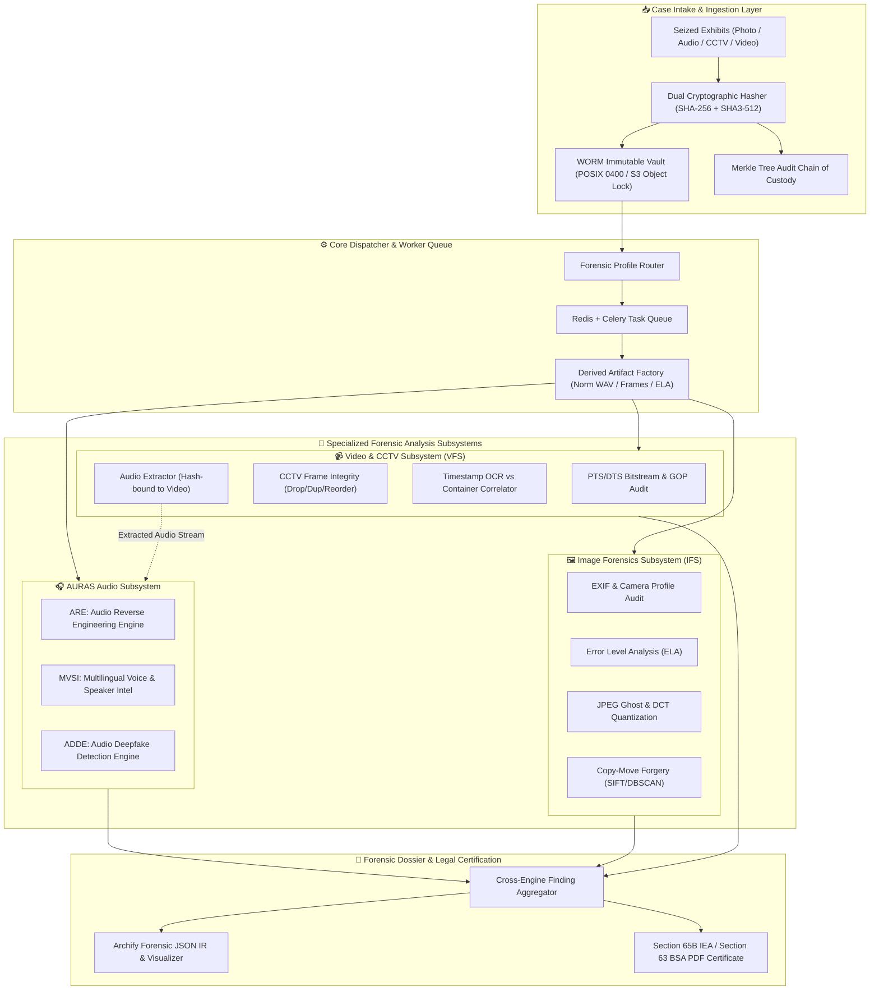
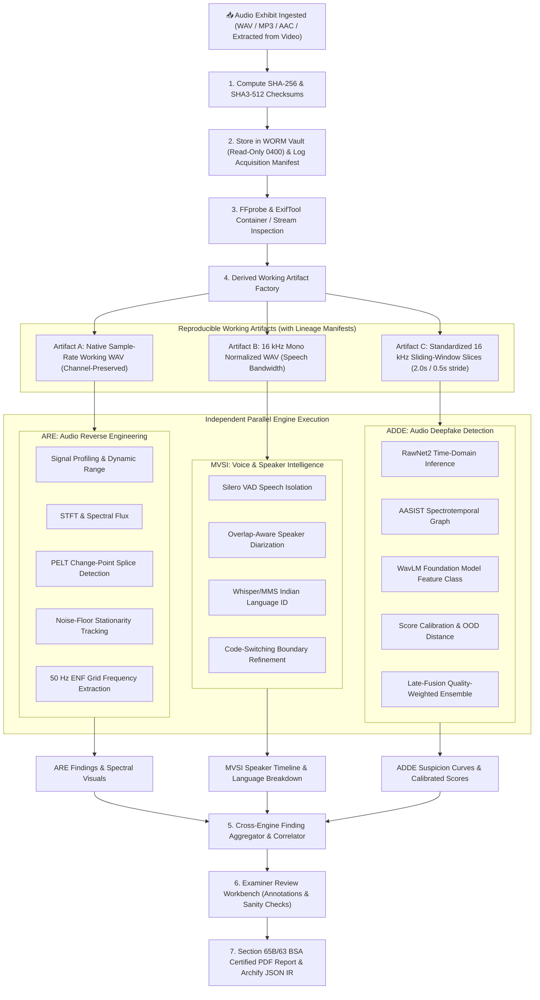

# Digital Evidence Authenticity & Integrity Verification Platform (PS-05)

[](pyproject.toml)
[](TRD.md)
[](PRD.md)
[](#hackathon-context)

> **Official Problem Statement PS-05:** Digital Evidence Authenticity and Integrity Verification Platform  
> **Organizers:** C-DAC Patna, CCSU, Bihar Police  
> **Event:** Bihar Government Cyber Hackathon 2026  
> **Track:** Digital Forensics  

---

## 1. Executive Overview & Problem Statement

In contemporary cyber-crime investigations, extortion cases, surveillance reviews, and court proceedings, digital artifacts—such as digital photographs, voice recordings, video files, and CCTV footage—serve as primary evidence. However, modern editing software and generative AI technologies (deepfakes, voice cloning, diffusion models) enable malicious actors to manipulate or synthesize evidence with high realism.

Manual forensic examination is time-consuming, requires scarce specialized expertise, and struggles with complex multi-modal manipulations. The **PS-05 Platform** is an enterprise-grade, modular, explainable, and auditable digital forensics system engineered for law enforcement agencies (state police departments, Bihar Police cyber cells) and Forensic Science Laboratories (FSLs). It provides:

1. **Cryptographic Chain of Custody:** Write-Once-Read-Many (WORM) storage, instant dual-hashing (SHA-256 and SHA3-512), and an append-only Merkle tree audit log.
2. **Multi-Modal Forensic Engines:** Specialized analysis pipelines for digital images, CCTV surveillance video, and audio recordings.
3. **AURAS Audio Forensics Subsystem:** Deep electroacoustic analysis (ARE), multilingual voice and overlap-aware diarization (MVSI), and calibrated multi-branch deepfake detection (ADDE).
4. **CCTV Frame & Timestamp Integrity:** Automated detection of dropped, duplicated, inserted, or reordered frames and OCR cross-checking against PTS video cadence.
5. **Court-Admissible Legal Certification:** Automated generation of tamper-evident electronic evidence certificates under **Section 65B of the Indian Evidence Act (IEA)** and **Section 63 of the Bharatiya Sakshya Adhiniyam, 2023 (BSA)**.

---

## 2. Goals & Non-Goals

### Project Goals
- **G-1:** Ingest digital media (audio, image, video, CCTV) with zero modification to original bitstreams.
- **G-2:** Localize tampering spatio-temporally (millisecond audio timestamps, frame indices, image bounding polygons) with explainable visual artifacts.
- **G-3:** Detect AI voice cloning and audio manipulation across Scheduled Indian Languages and regional Hindi dialects.
- **G-4:** Identify surveillance video tampering (missing CCTV frames, looping sequences, tampered digital clock overlays).
- **G-5:** Produce verifiable, court-ready PDF certificates and Archify JSON Intermediate Representation (IR) graphs.
- **G-6:** Operate 100% offline in air-gapped forensic laboratory environments.

### Non-Goals
- **NG-1:** The platform is not an automated judicial judge. It outputs probabilistic evidence, anomaly heatmaps, and confidence intervals to assist certified human forensic examiners.
- **NG-2:** It does not perform live physical memory chip extraction or hardware chip-off JTAG acquisition (evidence must be supplied as seized digital files).
- **NG-3:** It does not claim 100% detection of unseen zero-day generative architectures without explicit uncertainty bounds.

---

## 3. High-Level Platform Architecture



---

## 4. Subsystem Breakdown & Deepened Audio Forensics (AURAS)

> **Important Boundary Clarification:** The overall platform is the **PS-05 Digital Evidence Authenticity & Integrity Verification Platform**.  
> **AURAS (Audio Understanding, Reconstruction & Analysis System)** is strictly its audio forensics subsystem. AURAS is **NOT** the entire PS-05 platform, but a modular component responsible for all acoustic, vocal, and speech-tampering investigations.

### 4.1 Audio Subsystem Overview

Audio evidence presents unique investigative challenges. Unlike static images, audio signals are temporal streams with complex electroacoustic properties, lossy codec artifacts, room reverberation acoustics, and diverse linguistic patterns. A single analytical technique cannot reliably determine audio authenticity:
- Signal-level analysis can detect splices and edits, but cannot recognize AI voice synthesis.
- Deep learning deepfake classifiers can flag synthetic vocoders, but are blind to copy-paste splicing of genuine speech.
- Speaker diarization can attribute who spoke, but cannot verify whether the speaker was cloned or imposter-simulated.

To overcome these challenges, **AURAS** employs three independent, decoupled engines operating on distinct physical and mathematical dimensions:
1. **ARE (Audio Reverse Engineering Engine):** Physics- and signal-based analysis of the recording medium, electroacoustics, edit points, and ambient noise continuity.
2. **MVSI (Multilingual Voice & Speaker Intelligence Engine):** Biometric and linguistic intelligence, isolating speakers, transcribing turns, handling simultaneous overlapping speech, and classifying Indian languages/code-switching.
3. **ADDE (Audio Deepfake Detection Engine):** Machine learning detection of synthetic, voice-converted, and vocoded speech using raw waveforms, spectrotemporal graphs, and self-supervised representations.

All three engines consume read-only, traceable working artifacts generated from the WORM vault. The cross-engine aggregation layer synthesizes these independent findings into a court-admissible forensic dossier without manufacturing artificial certainty.

### 4.2 Engine Comparison Matrix

| Dimension | ARE (Audio Reverse Engineering) | MVSI (Multilingual Voice & Speaker) | ADDE (Audio Deepfake Detection) |
| :--- | :--- | :--- | :--- |
| **Primary Responsibility** | Electroacoustic signal integrity, container metadata, splice/edit detection, ambient noise consistency, ENF analysis. | Voice activity detection, speech segmentation, overlap-aware speaker diarization, multilingual Indian language ID. | Detection of AI-synthesized speech, voice cloning, vocoder artifacts, partial manipulation localization. |
| **Input Artifacts** | Native-rate bitstream, multi-channel working WAV/FLAC, container metadata dump. | Normalized 16 kHz mono float32 WAV (downmixed copy). | Standardized 16 kHz mono float32 sliding-window segments (2.0s window, 0.5s stride). |
| **Main Modules** | ARE-01 to ARE-10 (Signal profiling, STFT, PELT change-point, noise floor, FAISS repetition, 50 Hz ENF, manifests). | MVSI-01 to MVSI-12 (Silero VAD, neural segmentation, ECAPA-TDNN, pyannote diarization, Whisper LID, MMS-LID). | ADDE-01 to ADDE-12 (RawNet2, AASIST, WavLM, LFCC/CQCC + Light-CNN, Platt calibration, late-fusion ensemble, Mahalanobis OOD). |
| **Output Findings** | Splice timestamps, SNR/clipping metrics, noise discontinuities, repeated phrase intervals, ENF frequency curves. | Speaker turn intervals, concurrent overlap timestamps, segment language tags, per-speaker duration summaries. | Calibrated deepfake probabilities, per-model logits, localized synthetic segment intervals, OOD uncertainty flags. |
| **Candidate Technologies** | Librosa, SciPy, NumPy, SoundFile, PyWavelets, FFprobe, ExifTool, Mutagen, FAISS. | PyTorch, Silero VAD, WebRTC VAD, pyannote.audio, SpeechBrain, Whisper LID, MMS-LID. | PyTorch, TorchAudio, RawNet2, AASIST, WavLM, Hugging Face Transformers, Scikit-learn (Platt calibration). |
| **Validation Standards** | Synthetic splice insertion tests, clipping threshold benchmarks, bitstream equality verification. | Diarization Error Rate (DER $< 18\%$), Jaccard Error Rate (JER), Language Macro-F1 ($> 85\%$), overlap F1. | Equal Error Rate (EER $< 5.5\%$), ROC-AUC ($> 0.96$), Expected Calibration Error (ECE $< 0.05$), minDCF. |
| **Implementation Status** | `PLANNED` (Phase 2 / AURAS-A1, A2) | `PLANNED` (Phase 3 / AURAS-A3, A4, A5) | `PLANNED` (Phase 6 / AURAS-A6, A7, A8) |

### 4.3 End-to-End Audio Processing Workflow



### 4.4 Audio Technologies by Purpose

| Category | Actual Implemented Dependencies | Planned Candidate Technologies |
| :--- | :--- | :--- |
| **File & Codec Inspection** | Standard Library (`hashlib`, `pathlib`, `struct`) | FFprobe, FFmpeg (>= 6.0), ExifTool, MediaInfo, Mutagen |
| **Digital Signal Processing** | NumPy (`>=1.26.0`), SciPy (`>=1.12.0`) | Librosa (`>=0.10.1`), SoundFile (`>=0.12.1`), PyWavelets, FAISS (approximate nearest neighbors) |
| **VAD & Diarization** | PyTorch (`>=2.2.0`), TorchAudio (`>=2.2.0`) | Silero VAD v4, WebRTC VAD, pyannote.audio (`>=3.1.0`), SpeechBrain (`>=0.5.16`) ECAPA-TDNN |
| **Multilingual Language ID** | — | OpenAI Whisper (Medium/Large LID head), Meta MMS-LID (1000+ languages), Faster-Whisper |
| **Audio Deepfake Detection** | PyTorch (`>=2.2.0`), TorchAudio | RawNet2, AASIST (Graph Attention), WavLM Base+ / XLS-R 300M, Light-CNN (LFCC/CQCC), Scikit-Learn |
| **Storage & Job Processing** | SQLAlchemy 2.0 (async), Pydantic v2 | MinIO (S3-compatible WORM), PostgreSQL 15+ (asyncpg), Redis 7+, Celery (`>=5.3.6`) |
| **Testing & Benchmarking** | Pytest (`>=8.0.0`), Pytest-asyncio | Pytest-benchmark, Hypothesis, ASVspoof 2019/2021 protocols, CodecFake evaluation suite |
| **Reporting & Observability** | Jinja2 (`>=3.1.3`), WeasyPrint (`>=61.0`) | Archify JSON IR visualizer, OpenTelemetry, Prometheus, Grafana |

### 4.5 Audio Forensic Limitations & Uncertainty Principles

1. **Acoustic Discontinuity $\neq$ Definite Proof of Tampering:** Background noise shifts, microphone handling noise, room transitions, or automatic gain control (AGC) pumping can cause acoustic discontinuities without manual editing. Findings must be labeled as *candidate splice points* requiring examiner verification.
2. **Metadata Fallacy:** File headers, encoder tags, and container creation dates can be trivially modified or stripped during forwarding (e.g., via WhatsApp or Telegram). Absence of DAW tags does not prove authenticity; presence of tags indicates editing history but not necessarily malicious intent.
3. **Cryptographic Hash Scope:** A matching SHA-256 hash proves bit-level identity to a trusted reference; it does **not** prove that the content was authentic when originally recorded.
4. **Generalization Boundaries in Deepfake Detection:** Detectors trained on public benchmarks (ASVspoof) may experience performance degradation when exposed to unseen vocoders, low-bitrate mobile codecs (AMR-WB, Opus 6kbps), noisy street environments, or rare regional Indian dialects.
5. **Simultaneous Overlapping Speech Uncertainty:** When multiple speakers talk at the same time, vocal tract resonances interleave, significantly increasing speaker clustering uncertainty and language identification error rates.
6. **Legitimate Inconclusive Verdicts:** When SNR $< 5\text{ dB}$, lossy re-compression is extreme, or out-of-distribution distance is high, **"Inconclusive / Insufficient Acoustic Evidence"** is the only scientifically valid and legally defensible outcome.

---

### 4.6 Image Forensics Subsystem (IFS)
- **EXIF & Metadata Audit:** Detects editing software tags (Photoshop, GIMP) and validates camera make/model sensor compatibility and GPS sanity.
- **Error Level Analysis (ELA):** Multi-quality re-compression revealing localized compression error discrepancies.
- **JPEG Double-Compression & DCT Ghosting:** Quantization table analysis identifying multiple compression passes.
- **Copy-Move Forgery Detection (CMFD):** SIFT/ORB keypoint matching combined with DBSCAN spatial clustering to localize cloned regions.

### 4.7 Video & CCTV Forensics Subsystem (VFS)
- **Container & Stream Audit:** Validates Presentation Time Stamps (PTS) and Decoding Time Stamps (DTS) for monotonicity and frame skips.
- **CCTV Frame Integrity Validator:** Analyzes structural similarity (SSIM) and dense optical flow vectors to detect dropped frames, frozen loops, and inserted frames.
- **Timestamp OCR Correlator:** Extracts on-screen burned-in surveillance clock timestamps via OCR and cross-references them against internal container timestamps.
- **Cryptographically Bound Audio Extraction:** Automatically extracts audio tracks from video files and submits them to AURAS while preserving parent video timecode mappings.

---

## 5. Implementation Status

The project architecture is finalized; core foundation artifacts and behavioral specifications have been authored, with engine implementations planned across 10 structured milestones:

| Component / Subsystem | Current Status | Milestone Reference | Target Tech Stack |
| :--- | :--- | :--- | :--- |
| **Foundational Docs & Architecture** | `IMPLEMENTED_AND_VERIFIED` | Phase 0 | Markdown, Mermaid, pyproject.toml |
| **Archify Configuration Schema** | `IMPLEMENTED_AND_VERIFIED` | Phase 0 | `archify.config.json` |
| **Shared Core & Ingestion (WORM)** | `PLANNED` | Phase 1 / AURAS-A0 | Python, hashlib, SQLAlchemy, Redis |
| **AURAS: ARE Engine** | `PLANNED` | Phase 2 / AURAS-A1, A2 | Librosa, SciPy, NumPy, SoundFile |
| **AURAS: MVSI Engine** | `PLANNED` | Phase 3 / AURAS-A3, A4, A5 | Silero VAD, PyAnnote, SpeechBrain |
| **Image Forensics Subsystem (IFS)** | `PLANNED` | Phase 4 | Pillow, OpenCV, Piexif |
| **Video & CCTV Subsystem (VFS)** | `PLANNED` | Phase 5 | PyAV, FFmpeg, Tesseract OCR |
| **AURAS: ADDE Engine** | `PLANNED` | Phase 6 / AURAS-A6, A7, A8 | PyTorch, RawNet2, AASIST, WavLM |
| **Legal Reporting & Archify IR** | `PLANNED` | Phase 7 / AURAS-A9 | Jinja2, WeasyPrint, Archify |
| **Web Dashboard & Workbench** | `PLANNED` | Phase 8 | Next.js, React, TailwindCSS |
| **Air-Gapped Deployment Package** | `PLANNED` | Phase 9 | Docker, Docker Compose |
| **End-to-End Validation & Release** | `PLANNED` | Phase 10 / AURAS-A10 | Pytest, Benchmarks, Datasets |

---

## 6. Technology Stack (Actual vs. Planned)

### 6.1 Actual Implemented Foundation (Phase 0)
- **Documentation & Architecture Standards:** Markdown, Mermaid.js, Archify IR specification.
- **Packaging & Configuration:** `pyproject.toml` (PEP 621), `.env.example`, `archify.config.json`.
- **System Testing Framework:** Pytest configuration with async, benchmark, and hypothesis plugins.

### 6.2 Planned Implementation Technologies
- **Runtime Environment:** Python 3.11 / 3.12 (Strictly pinned).
- **API Framework:** FastAPI, Pydantic v2, Uvicorn.
- **Database & Queue:** PostgreSQL 15+ (asyncpg), SQLAlchemy 2.0, Redis 7+, Celery.
- **Storage:** MinIO (S3-compatible) or Local POSIX WORM partition (`chmod 0400`).
- **Signal & Image Processing:** NumPy, SciPy, Librosa, SoundFile, OpenCV (Headless), Pillow.
- **Deep Learning / AI Runtimes:** PyTorch 2.2+, TorchAudio, Hugging Face Transformers, SpeechBrain.
- **Surveillance & Media Decoding:** FFmpeg (>= 6.0), FFprobe, PyAV, Tesseract OCR.
- **Reporting & Legal Export:** Jinja2, WeasyPrint, PyOpenSSL / Cryptography.

---

## 7. Installation & Setup

### Prerequisites
- Python 3.11 or 3.12
- Git
- FFmpeg and FFprobe installed and available in system `PATH`
- Tesseract OCR (>= 5.0) for CCTV timestamp extraction

### Setup Steps
```bash
# 1. Clone repository
git clone https://github.com/bihar-cyber-hackathon/ps05-forensics.git
cd ps05-forensics

# 2. Create and activate virtual environment
python -m venv .venv
# On Windows (PowerShell):
.venv\Scripts\Activate.ps1
# On Linux / macOS:
source .venv/bin/activate

# 3. Install dependencies in editable mode
pip install --upgrade pip
pip install -e ".[dev]"

# 4. Copy and configure environment variables
cp .env.example .env
```

---

## 8. Development & Verification Workflow

### Running Tests
```bash
# Execute unit test suites
pytest tests/unit

# Execute integration tests
pytest tests/integration

# Run code style and lint checks
ruff check .
mypy src
```

### Starting the Platform (Planned Core Service)
```bash
# Start background workers (Celery)
celery -A ps05.workers.celery_app worker --loglevel=info

# Start FastAPI application server
uvicorn ps05.api.main:app --host 127.0.0.1 --port 8000 --reload
```

---

## 9. Evidentiary Integrity & Security Invariants

The platform enforces five strict forensic invariants:
1. **Zero Raw Alteration:** Master exhibits are written once and locked with read-only permissions (`0400`).
2. **Dual-Hash Binding:** SHA-256 and SHA3-512 hashes are computed before writing to disk; any bit-level divergence immediately halts processing.
3. **Artifact Lineage (DAG):** All resampled files, extracted video frames, or audio slices are stored as derived working artifacts linked to parent exhibits via deterministic transformation manifests.
4. **Append-Only Merkle Audit Trail:** Every user action, exhibit access, and engine run is appended to a cryptographic hash chain, preventing backdated alteration.
5. **Air-Gap Capability:** The platform does not depend on external cloud APIs; all models and libraries run on local hardware.

---

## 10. Development Roadmap & Project Phases

Refer to [PHASES.md](PHASES.md) for full phase gates and definitions of done:
- **Phase 0:** Architecture Baseline & Repository Foundation (`IMPLEMENTED_AND_VERIFIED`)
- **Phase 1 / AURAS-A0:** Shared Core, Immutable WORM Ingestion & Audio Evidence Contracts
- **Phase 2 / AURAS-A1, A2:** ARE Baseline & Advanced Signal Reverse Engineering
- **Phase 3 / AURAS-A3, A4, A5:** MVSI VAD, Overlap Diarization & Multilingual Language Analytics
- **Phase 4:** Image Forensics Subsystem (IFS)
- **Phase 5:** Video & CCTV Forensics Subsystem (VFS)
- **Phase 6 / AURAS-A6, A7, A8:** ADDE Deepfake Detection, Foundation Models & Calibrated Ensemble
- **Phase 7 / AURAS-A9:** Cross-Engine Orchestration & Section 65B/63 BSA Legal Reporting
- **Phase 8:** Web Dashboard & Forensic Examiner Workbench
- **Phase 9:** Security Hardening & Air-Gapped Packaging
- **Phase 10 / AURAS-A10:** End-to-End Validation, Benchmarking & Hackathon Demonstration

---

## 11. Canonical Documentation Index

- [PRD.md](PRD.md) — Product Requirements Document (Personas, Requirements FR-xxx, AUD-FR-xxx, NFR-xxx, RTM)
- [TRD.md](TRD.md) — Technical Requirements Document (Component boundaries, DB DDL, API contracts, threat model)
- [PHASES.md](PHASES.md) — Canonical Implementation Roadmap & Milestone Acceptance Gates (Phases 0–10 & AURAS-A0..A10)
- [AI_INSTRUCTIONS.md](AI_INSTRUCTIONS.md) — Highest-authority behavioral specification for AI coding agents
- [archify.config.json](archify.config.json) — Archify JSON IR and report configuration
- [pyproject.toml](pyproject.toml) — Project packaging and dependency manifest
- [.env.example](.env.example) — Documented configuration template
# BHack-Docs

# BHack-Docs

# BHack-Docs

