# Technical Requirements Document (TRD)

## Project: Digital Evidence Authenticity & Integrity Verification Platform (PS-05)
**Hackathon:** Bihar Government Cyber Hackathon 2026 (C-DAC Patna, CCSU, Bihar Police)  
**Track:** Digital Forensics  
**Problem Statement:** PS-05 — Digital Evidence Authenticity and Integrity Verification Platform  
**Document Version:** 1.1.0  
**Status:** Approved Technical Architecture Baseline (Deepened Audio Forensics Specification)  

---

## 1. System Context & Top-Level Architecture

The **PS-05 Platform** is structured as a modular, local-first, air-gap-capable cyber forensics platform designed for high-throughput, legally defensible analysis of digital media. The platform ingests four primary media modalities—**Audio Recordings, Digital Photographs, Video Clips, and Surveillance CCTV Footage**—and executes deterministic signal processing, computer vision, and neural deepfake detection while preserving cryptographic chain of custody.

```mermaid
flowchart TB
    subgraph CLIENT["🖥️ Client & Presentation Layer"]
        WEB["Next.js / React Forensic Dashboard"]
        CLI["Forensic CLI Triage Client (ps05-cli)"]
        ARCHIFY["Archify Forensic Report & IR Viewer"]
    end

    subgraph API_GATEWAY["🚪 API Gateway & Orchestration Core"]
        FASTAPI["FastAPI REST & WebSocket Gateway"]
        AUTH_RBAC["RBAC & Session Enforcer (JWT + Case Scopes)"]
        INGEST["Evidence Ingestion & Pre-Flight Validator"]
        DISPATCH["Task-Aware Forensic Router & Engine Dispatcher"]
    end

    subgraph CRYPTO_CORE["🔐 CEIPL Shared Cryptographic & Provenance Layer"]
        DIRECT_HASH["Raw-Byte Dual Hasher (SHA-256 / SHA3-512)"]
        CANON_MAN["RFC 8785 Canonical JSON Evidence Manifests"]
        ED_SIGN["Ed25519 Signatures & Secure Key Lifecycle"]
        TSA_CLIENT["RFC 3161 Trusted Timestamp Client (TSA)"]
        HASH_CHAIN["Append-Only Hash-Chained Custody Event Log"]
        MERKLE_TREE["Merkle Tree Batch Checkpoints & Inclusion Proofs"]
        C2PA_VAL["C2PA Content Credentials & Trust Validator"]
    end

    subgraph STORAGE_LAYER["💾 Evidentiary Storage & Persistence"]
        WORM["WORM Raw Evidence Vault (POSIX 0400 / S3 Object Lock, AES-256-GCM)"]
        DERIVED["Derived Artifact DAG Cache (Lineage Manifests & Coordinates)"]
        PG["PostgreSQL Database (Cases, Exhibits, Artifacts, Findings, Merkle Log)"]
        REDIS["Redis Message Broker & Task Queue (Celery/ARQ)"]
    end

    subgraph ENGINES["🔬 Forensic Engine Subsystems"]
        direction TB
        subgraph AURAS["🎧 AURAS Audio Forensics Subsystem"]
            ARE["ARE: Audio Reverse Engineering Engine"]
            MVSI["MVSI: Multilingual Voice & Speaker Intel"]
            ADDE["ADDE: Audio Deepfake Detection Engine"]
        end
        subgraph AIF["🖼️ AIF Advanced Image Forensics Subsystem"]
            IVE["IVE: Image Understanding & Visual Evidence Engine"]
            IRE["IRE: Image Reverse Engineering Engine"]
            AIM["AIM: AI, Manipulation & Steganography Engine"]
            FPA["FPA: Face, Portrait & Biometric Analysis Module"]
        end
        subgraph VISTA["📹 VISTA Video Forensics Subsystem"]
            VRE["VRE: Video Reverse Engineering Engine"]
            AFB["AFB: Audio Forensic Bridge (Extract & Route)"]
            AVSC["AVSC: Audio-Visual Synchronization & Correspondence"]
            VDF["VDF: Video Deepfake & AI-Generation Detection"]
            VCI["VCI: Video Content Intelligence Engine"]
            CCTV_PROF["CCTV Adaptive Profile (Triage, OSD, ONVIF)"]
        end
    end

    subgraph REPORTING["📜 Legal Reporting & Export Layer"]
        JINJA["Jinja2 Report Compiler"]
        WEASY["WeasyPrint PDF Generator (Sec 65B IEA / Sec 63 BSA)"]
        SIGNER["Digital Signature & Manifest Sealer (PKCS#7 / PAdES / Ed25519)"]
    end

    CLIENT --> FASTAPI
    FASTAPI --> AUTH_RBAC
    AUTH_RBAC --> INGEST
    INGEST --> CRYPTO_CORE
    CRYPTO_CORE --> WORM
    CRYPTO_CORE --> PG
    INGEST --> DISPATCH
    DISPATCH --> REDIS
    REDIS --> ENGINES
    AFB -.->|Extracted Audio Stream (DAG Linked)| AURAS
    ENGINES --> DERIVED
    ENGINES --> PG
    PG --> JINJA
    JINJA --> WEASY
    WEASY --> SIGNER
    SIGNER --> CLIENT
```

---

## 2. Component Boundaries & Responsibilities

| Subsystem / Component | Package Boundary | Primary Responsibilities | Data Inputs | Data Outputs |
| :--- | :--- | :--- | :--- | :--- |
| **Shared Core & Ingestion** | `ps05.core.ingest` | Case registration, pre-flight file validation, WORM vault ingestion, metadata extraction. | Raw file stream, Case FIR metadata. | `AudioEvidence`, `ImageEvidence`, `VideoEvidence` database records. |
| **Evidence Orchestrator** | `ps05.core.orchestrator` | Task lifecycle management, task-aware routing, high-res tiling, parallel engine dispatch. | Evidence ID, Analysis Profile flags. | Celery/ARQ tasks, job state transitions, aggregated report IR. |
| **CEIPL Cryptographic Layer** | `ps05.core.crypto` | Pre-decode SHA-256 hashing, RFC 8785 canonical manifests, Ed25519 signing, RFC 3161 TSA, hash-chained custody logs, Merkle proofs, C2PA parsing. | Seized raw bytes, event payloads, C2PA JUMBF boxes. | Canonical manifest JSON, Ed25519 signatures, Merkle inclusion proofs, custody event hashes. |
| **AURAS - ARE** | `ps05.engines.audio.are` | Signal profiling, STFT, spectral flux, splice candidate detection, noise floor consistency, ENF analysis. | Master audio exhibit (WAV/FLAC/MP3). | Spectral heatmaps, change-point timestamps, SNR metrics, ENF match. |
| **AURAS - MVSI** | `ps05.engines.audio.mvsi`| Voice activity detection, neural diarization, overlap speaker classification, Indian language identification. | Master audio exhibit (16kHz mono). | Speaker segments, language IDs, overlap intervals, speaker turn summaries. |
| **AURAS - ADDE** | `ps05.engines.audio.adde`| RawNet2 waveform, AASIST graph, WavLM foundation model inference, calibrated late-fusion ensembling. | 16kHz windowed audio slices. | Calibrated deepfake probabilities, suspicion curves, OOD metrics. |
| **AIF - IVE** | `ps05.engines.image.ive` | Universal image profile (IVE-01), 150-category taxonomy (IVE-02/03), YOLO/SAM 2 detection (IVE-04), people counting (IVE-05), OCR (IVE-08). | Decoded RGB arrays, perspective crops, tile arrays. | Taxonomy category tags, bounding boxes, segmentation masks, people counts, OCR text. |
| **AIF - IRE** | `ps05.engines.image.ire` | Deep EXIF/XMP/IPTC/ICC audit (IRE-01), 2D FFT/DCT signal analysis (IRE-02), classical CV/RANSAC (IRE-03), CMFD (IRE-04), PRNU camera noise (IRE-05), transfer history (IRE-06). | Raw image bitstream, colour-space planes, reference photos. | Metadata anomaly flags, 2D FFT spectra, cloned polygon pairs, PRNU correlation coefficients. |
| **AIF - AIM** | `ps05.engines.image.aim` | Multi-branch AI image detection (AIM-01), inpainting localization (AIM-02), face swap/morph forensics (AIM-03), LSB/RS steganalysis (AIM-04), file vulnerability defense (AIM-05). | Normalized RGB patches, canonical face crops, raw container. | Calibrated synthetic score $P(\text{AI})$, inpainting heatmaps, facial manipulation scores, steganalysis alerts. |
| **AIF - FPA Module** | `ps05.engines.image.fpa` | RetinaFace/SCRFD face detection, 468 MediaPipe landmarks, pose/blur/occlusion scoring, authorized 1:1 ArcFace/MagFace comparison. | Face crops, reference mugshot, Case Authorization Token. | Landmark coordinates, pose angles, quality score, cosine similarity with legal disclaimer. |
| **VISTA - VRE Engine** | `ps05.engines.vista.vre` | Container, codec, GOP cadence, PTS/DTS continuity, VFR jitter, scene cuts, macroblock QP re-encoding traces. | Master video exhibit (MP4/MKV/AVI/TS/DAV). | PTS continuity curve, instantaneous FPS, duplicate frame intervals, scene cut list. |
| **VISTA - AFB Bridge** | `ps05.engines.vista.afb` | Lossless stream-copy audio extraction, SHA-256 DAG binding, asynchronous AURAS routing (ARE/MVSI/ADDE), multi-speaker tracking. | Seized video bitstream, audio track index. | Extracted audio artifact, AURAS job references, video-aligned speaker intervals. |
| **VISTA - AVSC Engine** | `ps05.engines.vista.avsc`| Global container AV time alignment, RetinaFace/ByteTrack face tracking, SyncNet lip-sync verification, sound-to-visual event matching. | Decoded frames, extracted 16kHz audio. | Global offset $\Delta t$, localized lip-sync confidence curves, sound-event match matrix. |
| **VISTA - VDF Engine** | `ps05.engines.vista.vdf` | Frame-level (Xception/EfficientNet) and temporal sequence (FTCN/VideoMAE) deepfake detection, multi-family heads, Platt calibration, OOD distance. | Normalized face crops, 16-frame sliding windows. | Calibrated deepfake probabilities, suspicious frame ranges, OOD flags. |
| **VISTA - VCI Engine** | `ps05.engines.vista.vci` | Hierarchical video taxonomy (15 categories), YOLOv8/v10 & SAM 2 detection, ByteTrack tracking, unique people counting, PaddleOCR OSD clocks. | Decoded RGB frames (sampled cadence). | Video source category, unique person count, object tracklets, OCR timestamp log. |
| **VISTA - CCTV Profile**| `ps05.engines.vista.cctv`| Automated CCTV source triage, pre-questioning metadata extraction, adaptive questionnaire (A-E), clock drift regression, ONVIF/seal audit. | Raw surveillance stream, sidecars, OSD crops. | CCTV classification confidence, clock drift curve, native seal validation status. |
| **Legal Reporting & Archify**| `ps05.reporting` | Cross-engine finding aggregation, Archify JSON IR generation, Section 65B/63 BSA certified PDF compilation. | Structured findings, case audit log.| Court-admissible PDF report, signed JSON audit manifest. |

---

## 3. Repository & Package Architecture

The platform follows a clean, modular monolith architecture with strict layer separation, preventing cyclic imports and ensuring independent testability of all forensic engines:

```
d:/NextHackathon/
├── README.md                          # Master project entry point & overview
├── PRD.md                             # Product Requirements Document
├── TRD.md                             # Technical Requirements Document (this document)
├── PHASES.md                          # Development Roadmap & Implementation Milestones
├── AI_INSTRUCTIONS.md                 # Highest-authority behavioral specification for AI agents
├── pyproject.toml                     # Python packaging, dependencies, and tool settings
├── .env.example                       # Documented environment variables template
├── docker-compose.yml                 # Local container orchestration (PostgreSQL, Redis, MinIO)
├── archify.config.json                # Archify forensic report and IR configuration
│
├── src/
│   └── ps05/
│       ├── __init__.py
│       ├── config.py                  # Pydantic v2 application settings and validation
│       │
│       ├── core/                      # Shared evidentiary and orchestration foundation
│       │   ├── __init__.py
│       │   ├── crypto/                # CEIPL: Cryptographic Evidence Integrity & Provenance Layer
│       │   │   ├── __init__.py
│       │   │   ├── direct_hasher.py   # Raw-byte streaming SHA-256 and SHA3-512 dual hashing
│       │   │   ├── canonical_json.py  # RFC 8785 Canonical JSON Serialization (JCS)
│       │   │   ├── ed25519_signer.py  # Ed25519 keypair generation, signing, and verification
│       │   │   ├── tsa_client.py      # RFC 3161 Trusted Timestamp Authority client & token validator
│       │   │   ├── custody_chain.py   # Append-only hash-chained custody event logger
│       │   │   ├── merkle_tree.py     # Deterministic RFC 6962 Merkle tree & inclusion proofs
│       │   │   └── c2pa_adapter.py    # C2PA Content Credentials JUMBF parser & claim validator
│       │   ├── storage.py             # WORM storage backend (POSIX 0400 / S3 Object Lock, AES-256-GCM)
│       │   ├── models.py              # SQLAlchemy 2.0 ORM database entity declarations
│       │   ├── schemas.py             # Pydantic v2 request/response and serialization schemas
│       │   ├── database.py            # Async engine and session factory
│       │   └── orchestrator.py        # Asynchronous job dispatching, tiling, and finding merger
│       │
│       ├── api/                       # FastAPI route handlers and middleware
│       │   ├── __init__.py
│       │   ├── main.py                # FastAPI application entry point
│       │   ├── deps.py                # Authentication, RBAC, and session dependency injections
│       │   └── v1/
│       │       ├── cases.py           # Case creation, update, and listing
│       │       ├── evidence.py        # File ingestion, pre-decode hashing, and download
│       │       ├── jobs.py            # Job status, cancellation, and WebSocket progress
│       │       └── reports.py         # Section 65B / BSA 63 report generation endpoints
│       │
│       ├── engines/                   # Forensic Analysis Engines
│       │   ├── __init__.py
│       │   ├── base.py                # BaseForensicEngine abstract contract and types
│       │   │
│       │   ├── audio/                 # AURAS Audio Forensics Subsystem
│       │   │   ├── __init__.py
│       │   │   ├── common/            # Shared Audio Utilities & Preprocessing Contracts
│       │   │   │   ├── ingest.py      # Audio stream decoding & pre-flight integrity
│       │   │   │   ├── transforms.py  # Sinc-resampling, channel downmix, sliding windows
│       │   │   │   └── schemas.py     # Pydantic audio contracts & manifests
│       │   │   │
│       │   │   ├── are/               # Audio Reverse Engineering Engine
│       │   │   │   ├── signal.py      # RMS, peak, clipping, SNR, DC offset
│       │   │   │   ├── spectral.py    # STFT, log-mel spectrograms, spectral flux
│       │   │   │   ├── edit_detect.py # PELT / Kernel change-point splice detector
│       │   │   │   ├── noise.py       # Stationary noise floor tracking
│       │   │   │   ├── repetition.py  # MFCC self-similarity and FAISS matching
│       │   │   │   └── enf.py         # 50 Hz Electric Network Frequency extractor
│       │   │   │
│       │   │   ├── mvsi/              # Multilingual Voice & Speaker Intelligence
│       │   │   │   ├── vad.py         # Silero VAD and WebRTC VAD wrappers
│       │   │   │   ├── segmentation.py# Neural speech region segmentation & smoothing
│       │   │   │   ├── osd.py         # Overlapped speech detection (OSD)
│       │   │   │   ├── diarization.py # PyAnnote / overlap-aware speaker diarization
│       │   │   │   ├── embeddings.py  # ECAPA-TDNN speaker representation extraction
│       │   │   │   ├── language_id.py # Whisper LID / MMS-LID Indian language classifier
│       │   │   │   ├── code_switch.py # Intra-utterance code-switching boundary detector
│       │   │   │   └── registry.py    # Extensible Indian language & script registry
│       │   │   │
│       │   │   └── adde/              # Audio Deepfake Detection Engine
│       │   │       ├── preprocess.py  # Sinc-interpolated resampling and windowing
│       │   │       ├── rawnet2.py     # RawNet2 raw waveform neural classifier
│       │   │       ├── aasist.py      # AASIST spectrotemporal graph classifier
│       │   │       ├── ssl_wavlm.py   # WavLM / XLS-R foundation model feature classifier
│       │   │       ├── spectral.py    # LFCC / CQCC + Light-CNN detector
│       │   │       ├── codec_robust.py# Re-compression simulation & CodecFake testing
│       │   │       ├── verification.py# Standalone 1:1 speaker verification check
│       │   │       ├── calibration.py # Platt scaling and temperature calibration
│       │   │       ├── ensemble.py    # Quality-weighted late fusion ensemble
│       │   │       └── ood.py         # Mahalanobis embedding distance uncertainty
│       │   │
│       │   ├── image/                 # AIF: Advanced Image Forensics Subsystem
│       │   │   ├── __init__.py
│       │   │   ├── common/            # Shared Image Infrastructure & Derivatives
│       │   │   │   ├── safe_decode.py # Decompression bomb protection & isolated parsing
│       │   │   │   ├── profiling.py   # IVE-01: Ingestion metadata & colour space profiler
│       │   │   │   ├── transforms.py  # Linear affine warp, orientation correction, crop DAG
│       │   │   │   └── schemas.py     # Pydantic image contracts, manifests & coordinates
│       │   │   │
│       │   │   ├── ive/               # IVE: Image Understanding & Visual Evidence Engine
│       │   │   │   ├── taxonomy.py    # IVE-02: 150-category hierarchical taxonomy registry
│       │   │   │   ├── classifier.py  # IVE-03: Multi-label SigLIP / ViT scene classifier
│       │   │   │   ├── detector.py    # IVE-04: YOLOv8 / Grounding DINO object detector
│       │   │   │   ├── segmentor.py   # IVE-04: Mask R-CNN / SAM 2 instance segmentor
│       │   │   │   ├── people_count.py# IVE-05: Occlusion-aware crowd & person counter
│       │   │   │   └── ocr_engine.py  # IVE-08: Document quad warp & PaddleOCR engine
│       │   │   │
│       │   │   ├── fpa/               # FPA: Face, Portrait & Biometric Analysis Module
│       │   │   │   ├── detector.py    # RetinaFace / SCRFD high-recall face detector
│       │   │   │   ├── landmarks.py   # MediaPipe 468-point 3D facial mesh landmarker
│       │   │   │   ├── quality.py     # Face quality, pose angles (yaw/pitch/roll), blur
│       │   │   │   └── matcher.py     # Authorized 1:1 ArcFace / MagFace reference comparison
│       │   │   │
│       │   │   ├── ire/               # IRE: Image Reverse Engineering Engine
│       │   │   │   ├── exif_deep.py   # IRE-01: ExifTool / MakerNotes / IPTC / ICC deep parser
│       │   │   │   ├── signal_2d.py   # IRE-02: 2D FFT, DCT coefficients, noise variance
│       │   │   │   ├── geom_cv.py     # IRE-03: Canny, contours, Hough, ORB/SIFT + RANSAC
│       │   │   │   ├── cmfd.py        # IRE-04: Copy-move forgery detection (DBSCAN + DCT)
│       │   │   │   ├── prnu_sensor.py # IRE-05: Sensor pattern noise extraction & correlation
│       │   │   │   └── transfer.py    # IRE-06: Container re-compression & history clues
│       │   │   │
│       │   │   └── aim/               # AIM: AI, Manipulation & Steganography Engine
│       │   │       ├── ai_detect.py   # AIM-01: Multi-branch synthetic image detector
│       │   │       ├── inpaint_loc.py # AIM-02: Generative fill & inpainting localization
│       │   │       ├── face_tamper.py # AIM-03: Face swap, morphing & blend boundary check
│       │   │       ├── steganalysis.py# AIM-04: LSB / RS / Chi-square hidden data analyzer
│       │   │       └── file_defense.py# AIM-05: Polyglot & malformed payload quarantine
│       │   │
│       │   └── vista/                 # VISTA: Video Integrity, Synchronization & Tampering Analysis
│       │       ├── __init__.py
│       │       ├── common/            # Shared Video Demuxing, Timing & Pipeline Utilities
│       │       │   ├── safe_demux.py  # PyAV / FFprobe defensive container demuxing & allocation caps
│       │       │   ├── timeline.py    # PTS/DTS timebase normalization & frame mapping
│       │       │   └── schemas.py     # Pydantic v2 video contracts, intervals & DAG manifests
│       │       │
│       │       ├── vre/               # VRE: Video Reverse Engineering Engine
│       │       │   ├── bitstream.py   # VRE-01: Container, codec, GOP cadence & atom parser
│       │       │   ├── cadence.py     # VRE-02: Presentation timestamp continuity & VFR jitter
│       │       │   ├── scene_cuts.py  # VRE-03: PySceneDetect content/adaptive transition detector
│       │       │   ├── metadata.py    # VRE-04: ExifTool / MediaInfo deep metadata & MakerNotes
│       │       │   └── reencode.py    # VRE-05: Macroblock QP distribution, DCT ghosts & RIFE flow
│       │       │
│       │       ├── afb/               # AFB: Audio Forensic Bridge
│       │       │   ├── extractor.py   # AFB-01: FFmpeg lossless stream-copy audio extractor
│       │       │   ├── resampler.py   # AFB-02: 16kHz mono float32 standardized derivative factory
│       │       │   ├── auras_client.py# AFB-02: Asynchronous AURAS API routing & findings adapter
│       │       │   ├── diarization.py # AFB-03: Video-mapped speaker intervals & active talker metrics
│       │       │   └── separation.py  # AFB-03: SpeechBrain SepFormer overlapped speech separator
│       │       │
│       │       ├── avsc/              # AVSC: Audio-Visual Synchronization & Correspondence
│       │       │   ├── alignment.py   # AVSC-01: Global container offset & duration discrepancy
│       │       │   ├── face_track.py  # AVSC-02: RetinaFace / SCRFD face detection & ByteTrack tracking
│       │       │   ├── mouth_roi.py   # AVSC-02: 468-landmark mouth crop normalization & visual speech
│       │       │   ├── syncnet.py     # AVSC-03: SyncNet talking-head lip-sync cross-correlation
│       │       │   ├── multi_face.py  # AVSC-03: Multi-face speaker disambiguation & confidence curves
│       │       │   └── event_corr.py  # AVSC-04: YAMNet/AST sound event vs YOLO visual event matching
│       │       │
│       │       ├── vdf/               # VDF: Video Deepfake & AI-Generation Detection Engine
│       │       │   ├── frame_detect.py# VDF-01: Xception & EfficientNet-B4 spatial face classifiers
│       │       │   ├── temporal.py    # VDF-02: FTCN / STIL / VideoMAE sliding 16-frame sequence models
│       │       │   ├── manipulation.py# VDF-03: Face swap, reenactment & inpainting forensic heads
│       │       │   ├── generative.py  # VDF-04: Text-to-video (Sora/Runway) 3D FFT & diffusion noise
│       │       │   ├── calibration.py # VDF-05: Platt scaling & empirical probability calibration
│       │       │   ├── ensemble.py    # VDF-05: Quality-weighted spatial-temporal late fusion
│       │       │   └── ood_distance.py# VDF-05: Mahalanobis feature space out-of-distribution metric
│       │       │
│       │       ├── vci/               # VCI: Video Content Intelligence Engine
│       │       │   ├── taxonomy.py    # VCI-01: Hierarchical 15-category video source classifier
│       │       │   ├── detector.py    # VCI-02: YOLOv8/v10 & RT-DETR object & person detector
│       │       │   ├── segmentor.py   # VCI-02: SAM 2 prompted evidence instance segmentation
│       │       │   ├── tracker.py     # VCI-03: ByteTrack / BoT-SORT multi-object trajectory tracker
│       │       │   ├── people_count.py# VCI-03: Distinct unique person counting vs per-frame count
│       │       │   ├── actions.py     # VCI-04: VideoMAE / SlowFast action & anomaly localization
│       │       │   └── ocr_overlay.py # VCI-05: PaddleOCR / Tesseract OSD timestamp & channel reader
│       │       │
│       │       └── cctv/              # Dedicated CCTV Forensic Profile (Cross-Cutting)
│       │           ├── triage.py      # CCTV-01: Automated multi-signal CCTV source classification
│       │           ├── auto_meta.py   # CCTV-02: Pre-questioning metadata & OSD clock extraction
│       │           ├── adaptive_q.py  # CCTV-03/05: Adaptive questionnaire formulator (Questions A-E)
│       │           ├── context.py     # CCTV-04: Versioned CCTVContext JSON schema & status typing
│       │           ├── clock_drift.py # CCTV-06: OSD clock vs container PTS regression & jump audit
│       │           ├── onvif_seals.py # CCTV-07: ONVIF Export File Format & Media Signing verifier
│       │           └── multi_cam.py   # CCTV-08: Cross-camera timeline alignment & duplicate feed check
│       │       ├── stream_audit.py    # FFprobe PTS/DTS continuity and packet sequence
│       │       ├── cctv_integrity.py  # Missing, duplicated, inserted, reordered frames
│       │       ├── timestamp_ocr.py   # Tesseract OCR vs metadata timeline correlation
│       │       └── audio_extractor.py # Audio stream extraction with cryptographic binding
│       │
│       ├── reporting/                 # Court-Admissible Reporting & Export
│       │   ├── __init__.py
│       │   ├── compiler.py            # Cross-engine finding aggregation
│       │   ├── cert_65b.py            # Section 65B IEA / Sec 63 BSA legal template logic
│       │   ├── archify_adapter.py     # Archify JSON IR formatting and visualizer bridge
│       │   └── templates/             # Jinja2 HTML/CSS print-ready templates
│       │
│       └── workers/                   # Asynchronous background worker tasks
│           ├── __init__.py
│           ├── celery_app.py          # Celery worker application configuration
│           └── tasks.py               # Dispatchable forensic execution tasks
│
└── tests/                             # Comprehensive test suites
    ├── conftest.py                    # Pytest fixtures and mock forensic exhibits
    ├── unit/
    ├── integration/
    └── benchmarks/
```

---

## 4. Shared Ingestion, WORM Vault & Database Schemas

### 4.1 Master Evidentiary Database Schema

```mermaid
erDiagram
    CASES ||--o{ EVIDENCE : contains
    CASES ||--o{ AUDIT_LOGS : records
    EVIDENCE ||--o{ ARTIFACTS : generates
    EVIDENCE ||--o{ ANALYSIS_JOBS : analyzed_by
    ANALYSIS_JOBS ||--o{ ENGINE_RUNS : executes
    ENGINE_RUNS ||--o{ FORENSIC_FINDINGS : produces
    EVIDENCE ||--o{ SPEAKER_SEGMENTS : contains
    SPEAKER_SEGMENTS ||--o{ SEGMENT_LANGUAGES : speaks
    EVIDENCE ||--o{ VIDEO_STREAMS : defines
    EVIDENCE ||--o| CCTV_CONTEXTS : contextualized_by
    EVIDENCE ||--o{ FACE_TRACKS : tracks
    FACE_TRACKS ||--o{ SYNC_SEGMENTS : evaluates
    EVIDENCE ||--o{ DEEPFAKE_SCORES : scored_by
    EVIDENCE ||--o{ OBJECT_TRACKS : identifies
    EVIDENCE ||--o{ CROSS_MODAL_EVENTS : synchronizes
    EVIDENCE ||--o| IMAGE_EXHIBITS : details
    EVIDENCE ||--o{ IMAGE_TAXONOMY_TAGS : classified_under
    EVIDENCE ||--o{ FACE_BIOMETRIC_REGIONS : contains_faces
    ARTIFACTS ||--o{ DERIVED_ARTIFACT_DAG : lineage_of
    EVIDENCE ||--o{ CUSTODY_EVENTS : tracks_custody
    CASES ||--o{ MERKLE_CHECKPOINTS : anchors
    CASES ||--o{ FORENSIC_REPORTS : produces
    MODEL_REGISTRY ||--o{ ENGINE_RUNS : references
    LANGUAGE_REGISTRY ||--o{ SEGMENT_LANGUAGES : categorizes

    CASES {
        uuid id PK
        string fir_number
        string police_station
        string district
        string investigating_officer
        timestamp incident_date
        timestamp created_at
    }

    EVIDENCE {
        uuid id PK
        uuid case_id FK
        string exhibit_number
        string original_filename
        string media_type
        string mime_type
        bigint file_size_bytes
        string sha256_hash
        string sha3_512_hash
        string storage_uri
        string acquisition_officer
        timestamp acquired_at
    }

    VIDEO_STREAMS {
        uuid id PK
        uuid evidence_id FK
        int stream_index
        string codec_name
        string codec_profile
        int width
        int height
        float frame_rate
        bigint total_frames
        string pixel_format
        string timebase
        boolean is_vfr
        float duration_seconds
        jsonb gop_structure
    }

    CCTV_CONTEXTS {
        uuid id PK
        uuid evidence_id FK
        string schema_version
        string source_classification
        float classification_confidence
        string camera_identifier
        string location_description
        string dvr_make_model
        string export_method
        string operator_name
        string perceived_tampering
        string environmental_notes
        string user_context_status
        string status
        timestamp created_at
    }

    FACE_TRACKS {
        uuid id PK
        uuid evidence_id FK
        string track_id
        float start_time
        float end_time
        int frame_count
        jsonb bounding_boxes
        float avg_detection_confidence
        float avg_pose_yaw
        float avg_pose_pitch
        float avg_face_quality
        string sync_classification
    }

    SYNC_SEGMENTS {
        uuid id PK
        uuid evidence_id FK
        uuid face_track_id FK
        float start_time
        float end_time
        float global_offset_ms
        float syncnet_confidence
        float syncnet_min_dist
        string sync_verdict
        jsonb local_sync_curve
    }

    DEEPFAKE_SCORES {
        uuid id PK
        uuid evidence_id FK
        string model_family
        string model_name
        float raw_logit
        float calibrated_score
        float ood_mahalanobis_distance
        string ood_verdict
        float start_time
        float end_time
        jsonb frame_scores
    }

    OBJECT_TRACKS {
        uuid id PK
        uuid evidence_id FK
        string track_id
        string class_name
        int start_frame
        int end_frame
        float start_time
        float end_time
        jsonb trajectory
        boolean is_unique_person_counted
    }

    CROSS_MODAL_EVENTS {
        uuid id PK
        uuid evidence_id FK
        string event_type
        float visual_time
        float acoustic_time
        float time_delta_ms
        float visual_confidence
        float acoustic_confidence
        string visual_class
        string acoustic_class
        string correspondence_verdict
    }

    ARTIFACTS {
        uuid id PK
        uuid evidence_id FK
        string artifact_type
        string transform_pipeline
        string sha256_hash
        string storage_uri
        jsonb metadata
        timestamp created_at
    }

    ANALYSIS_JOBS {
        uuid id PK
        uuid evidence_id FK
        string status
        string profile_name
        timestamp started_at
        timestamp completed_at
        string error_message
    }

    ENGINE_RUNS {
        uuid id PK
        uuid job_id FK
        string engine_name
        string engine_version
        string model_manifest_hash
        string status
        float execution_time_seconds
        jsonb run_metrics
    }

    FORENSIC_FINDINGS {
        uuid id PK
        uuid engine_run_id FK
        string finding_type
        string category
        float confidence_score
        float calibrated_score
        float start_time_seconds
        float end_time_seconds
        jsonb bounding_box
        jsonb technical_details
        string visual_artifact_uri
    }

    SPEAKER_SEGMENTS {
        uuid id PK
        uuid evidence_id FK
        string speaker_label
        float start_time
        float end_time
        float snr_db
        boolean is_overlapped
        jsonb active_concurrent_speakers
    }

    SEGMENT_LANGUAGES {
        uuid id PK
        uuid segment_id FK
        string language_code FK
        string script_code
        float confidence
        boolean is_code_switched
    }

    LANGUAGE_REGISTRY {
        string iso_code PK
        string language_name
        string script_default
        boolean is_scheduled_indian
        string regional_context
    }

    MODEL_REGISTRY {
        string model_id PK
        string engine_name
        string architecture
        string checkpoint_sha256
        string license
        string device_target
        jsonb benchmark_metrics
    }

    FORENSIC_REPORTS {
        uuid id PK
        uuid case_id FK
        string certificate_type
        string certificate_number
        string pdf_storage_uri
        string manifest_hash
        string digital_signature
        timestamp generated_at
    }

    AUDIT_LOGS {
        bigint id PK
        uuid case_id FK
        uuid user_id
        string action
        string target_entity
        uuid target_id
        string previous_merkle_root
        string current_merkle_root
        timestamp timestamp
    }

    IMAGE_EXHIBITS {
        uuid id PK
        uuid evidence_id FK
        string detected_format
        int width
        int height
        string colour_mode
        string colour_space
        int bit_depth
        boolean has_alpha
        int orientation
        string safe_decode_status
        string c2pa_manifest_status
        jsonb metadata_summary
    }

    IMAGE_TAXONOMY_TAGS {
        uuid id PK
        uuid evidence_id FK
        string category_id
        string category_label
        float confidence
        string validation_status
        jsonb source_model
    }

    FACE_BIOMETRIC_REGIONS {
        uuid id PK
        uuid evidence_id FK
        string face_id
        jsonb bounding_box
        jsonb landmarks_468
        float pose_yaw
        float pose_pitch
        float pose_roll
        float quality_score
        string privacy_classification
        uuid authorized_case_token_id
        string embedding_storage_uri
    }

    DERIVED_ARTIFACT_DAG {
        uuid id PK
        uuid parent_artifact_id FK
        uuid child_artifact_id FK
        string transform_operator
        jsonb transform_parameters
        jsonb affine_matrix
        string child_sha256
        timestamp generated_at
    }

    CUSTODY_EVENTS {
        uuid id PK
        uuid evidence_id FK
        string event_type
        string actor_identity
        timestamp event_timestamp
        string prev_event_hash
        string event_data_hash
        string ed25519_signature
        string verification_status
    }

    MERKLE_CHECKPOINTS {
        uuid id PK
        uuid case_id FK
        string batch_identifier
        int leaf_count
        string root_sha256
        string rfc3161_token_uri
        string signature_ed25519
        timestamp anchored_at
    }
```

### 4.2 Relational DDL for Video & CCTV Forensics Data Models

```sql
-- Video stream parameters parsed defensively during intake
CREATE TABLE video_streams (
    id UUID PRIMARY KEY DEFAULT gen_random_uuid(),
    evidence_id UUID NOT NULL REFERENCES evidence(id) ON DELETE CASCADE,
    stream_index INT NOT NULL DEFAULT 0,
    codec_name VARCHAR(32) NOT NULL,
    codec_profile VARCHAR(64),
    width INT NOT NULL,
    height INT NOT NULL,
    frame_rate NUMERIC(8, 3) NOT NULL,
    total_frames BIGINT,
    pixel_format VARCHAR(32),
    timebase VARCHAR(32),
    is_vfr BOOLEAN NOT NULL DEFAULT FALSE,
    duration_seconds NUMERIC(12, 3),
    gop_structure JSONB DEFAULT '{}'::jsonb,
    created_at TIMESTAMPTZ NOT NULL DEFAULT NOW()
);

-- CCTV contextual intelligence and adaptive questionnaire state
CREATE TABLE cctv_contexts (
    id UUID PRIMARY KEY DEFAULT gen_random_uuid(),
    evidence_id UUID NOT NULL UNIQUE REFERENCES evidence(id) ON DELETE CASCADE,
    schema_version VARCHAR(16) NOT NULL DEFAULT '1.0.0',
    source_classification VARCHAR(32) NOT NULL CHECK (source_classification IN ('LIKELY_CCTV', 'POSSIBLY_CCTV', 'NON_CCTV', 'INCONCLUSIVE')),
    classification_confidence NUMERIC(4, 3) NOT NULL CHECK (classification_confidence BETWEEN 0.0 AND 1.0),
    camera_identifier VARCHAR(128),
    location_description TEXT,
    dvr_make_model VARCHAR(128),
    export_method VARCHAR(64) CHECK (export_method IN ('NATIVE_PROPRIETARY', 'USB_EXPORT', 'SCREEN_RECORDING', 'MOBILE_RECORDING_OF_SCREEN', 'OPTICAL_EXPORT', 'UNKNOWN')),
    operator_name VARCHAR(128),
    perceived_tampering TEXT,
    environmental_notes TEXT,
    user_context_status VARCHAR(32) NOT NULL DEFAULT 'NOT_PROVIDED' CHECK (user_context_status IN ('NOT_REQUESTED', 'REQUESTED', 'PROVIDED', 'NOT_PROVIDED', 'PARTIALLY_PROVIDED')),
    status VARCHAR(32) NOT NULL DEFAULT 'ACTIVE',
    created_at TIMESTAMPTZ NOT NULL DEFAULT NOW(),
    updated_at TIMESTAMPTZ NOT NULL DEFAULT NOW()
);

-- Persisted facial tracks across frames for lip-sync and deepfake evaluation
CREATE TABLE face_tracks (
    id UUID PRIMARY KEY DEFAULT gen_random_uuid(),
    evidence_id UUID NOT NULL REFERENCES evidence(id) ON DELETE CASCADE,
    track_id VARCHAR(64) NOT NULL,
    start_time NUMERIC(10, 3) NOT NULL,
    end_time NUMERIC(10, 3) NOT NULL,
    frame_count INT NOT NULL,
    bounding_boxes JSONB NOT NULL DEFAULT '[]'::jsonb,
    avg_detection_confidence NUMERIC(4, 3) NOT NULL,
    avg_pose_yaw NUMERIC(5, 2),
    avg_pose_pitch NUMERIC(5, 2),
    avg_face_quality NUMERIC(4, 3),
    sync_classification VARCHAR(32) DEFAULT 'PENDING' CHECK (sync_classification IN ('PRIMARY_SPEAKER', 'BYSTANDER_SILENT', 'INDETERMINATE', 'PENDING')),
    created_at TIMESTAMPTZ NOT NULL DEFAULT NOW()
);

-- Audio-Visual synchronization segments evaluated by SyncNet
CREATE TABLE sync_segments (
    id UUID PRIMARY KEY DEFAULT gen_random_uuid(),
    evidence_id UUID NOT NULL REFERENCES evidence(id) ON DELETE CASCADE,
    face_track_id UUID REFERENCES face_tracks(id) ON DELETE SET NULL,
    start_time NUMERIC(10, 3) NOT NULL,
    end_time NUMERIC(10, 3) NOT NULL,
    global_offset_ms NUMERIC(8, 2),
    syncnet_confidence NUMERIC(6, 3),
    syncnet_min_dist NUMERIC(6, 3),
    sync_verdict VARCHAR(32) NOT NULL CHECK (sync_verdict IN ('IN_SYNC', 'DESYNCHRONIZED', 'NO_FACE_ACTIVE', 'AUDIO_ABSENT', 'INCONCLUSIVE')),
    local_sync_curve JSONB DEFAULT '[]'::jsonb,
    created_at TIMESTAMPTZ NOT NULL DEFAULT NOW()
);

-- Calibrated deepfake inference records per model family and window
CREATE TABLE deepfake_scores (
    id UUID PRIMARY KEY DEFAULT gen_random_uuid(),
    evidence_id UUID NOT NULL REFERENCES evidence(id) ON DELETE CASCADE,
    model_family VARCHAR(64) NOT NULL,
    model_name VARCHAR(64) NOT NULL,
    raw_logit NUMERIC(8, 4) NOT NULL,
    calibrated_score NUMERIC(5, 4) NOT NULL CHECK (calibrated_score BETWEEN 0.0 AND 1.0),
    ood_mahalanobis_distance NUMERIC(10, 4),
    ood_verdict VARCHAR(16) NOT NULL CHECK (ood_verdict IN ('IN_DISTRIBUTION', 'MILD_OOD', 'HIGH_OOD')),
    start_time NUMERIC(10, 3) NOT NULL,
    end_time NUMERIC(10, 3) NOT NULL,
    frame_scores JSONB DEFAULT '[]'::jsonb,
    created_at TIMESTAMPTZ NOT NULL DEFAULT NOW()
);

-- Object tracklets and trajectory persistence for unique counting
CREATE TABLE object_tracks (
    id UUID PRIMARY KEY DEFAULT gen_random_uuid(),
    evidence_id UUID NOT NULL REFERENCES evidence(id) ON DELETE CASCADE,
    track_id VARCHAR(64) NOT NULL,
    class_name VARCHAR(64) NOT NULL,
    start_frame INT NOT NULL,
    end_frame INT NOT NULL,
    start_time NUMERIC(10, 3) NOT NULL,
    end_time NUMERIC(10, 3) NOT NULL,
    trajectory JSONB NOT NULL DEFAULT '[]'::jsonb,
    is_unique_person_counted BOOLEAN NOT NULL DEFAULT FALSE,
    created_at TIMESTAMPTZ NOT NULL DEFAULT NOW()
);

-- Cross-modal event synchronization (e.g. muzzle flash / gunshot sound)
CREATE TABLE cross_modal_events (
    id UUID PRIMARY KEY DEFAULT gen_random_uuid(),
    evidence_id UUID NOT NULL REFERENCES evidence(id) ON DELETE CASCADE,
    event_type VARCHAR(64) NOT NULL,
    visual_time NUMERIC(10, 3),
    acoustic_time NUMERIC(10, 3),
    time_delta_ms NUMERIC(8, 2),
    visual_confidence NUMERIC(4, 3),
    acoustic_confidence NUMERIC(4, 3),
    visual_class VARCHAR(64),
    acoustic_class VARCHAR(64),
    correspondence_verdict VARCHAR(32) NOT NULL CHECK (correspondence_verdict IN ('CORRESPONDING', 'TEMPORAL_MISMATCH', 'VISUAL_ONLY', 'ACOUSTIC_ONLY', 'INCONCLUSIVE')),
    created_at TIMESTAMPTZ NOT NULL DEFAULT NOW()
);

CREATE INDEX idx_video_streams_evidence ON video_streams(evidence_id);
CREATE INDEX idx_cctv_contexts_evidence ON cctv_contexts(evidence_id);
CREATE INDEX idx_face_tracks_evidence ON face_tracks(evidence_id);
CREATE INDEX idx_sync_segments_evidence ON sync_segments(evidence_id);
CREATE INDEX idx_deepfake_scores_evidence ON deepfake_scores(evidence_id);
CREATE INDEX idx_object_tracks_evidence ON object_tracks(evidence_id);
CREATE INDEX idx_cross_modal_events_evidence ON cross_modal_events(evidence_id);
```

### 4.3 Relational DDL for Image Forensics & CEIPL Cryptographic Core

```sql
-- Image exhibit properties parsed defensively during pre-flight intake (IVE-01)
CREATE TABLE image_exhibits (
    id UUID PRIMARY KEY DEFAULT gen_random_uuid(),
    evidence_id UUID NOT NULL UNIQUE REFERENCES evidence(id) ON DELETE CASCADE,
    detected_format VARCHAR(16) NOT NULL,
    detected_mime VARCHAR(64) NOT NULL,
    width INT NOT NULL,
    height INT NOT NULL,
    pixel_count BIGINT NOT NULL,
    aspect_ratio NUMERIC(8, 4) NOT NULL,
    bit_depth INT NOT NULL DEFAULT 8,
    colour_mode VARCHAR(16) NOT NULL DEFAULT 'RGB',
    colour_space VARCHAR(32) NOT NULL DEFAULT 'sRGB',
    has_alpha BOOLEAN NOT NULL DEFAULT FALSE,
    orientation INT NOT NULL DEFAULT 1,
    is_animated BOOLEAN NOT NULL DEFAULT FALSE,
    frame_count INT NOT NULL DEFAULT 1,
    safe_decode_status VARCHAR(32) NOT NULL CHECK (safe_decode_status IN ('VERIFIED_SAFE', 'DECOMPRESSION_BOMB_PREVENTED', 'DECODER_WARNING', 'MALFORMED_HEADER', 'CORRUPT_BITSTREAM')),
    c2pa_manifest_status VARCHAR(32) NOT NULL DEFAULT 'NOT_PRESENT' CHECK (c2pa_manifest_status IN ('NOT_PRESENT', 'VALID_SIGNATURE', 'UNTRUSTED_ROOT', 'TAMPERED_BINDING', 'UNSUPPORTED_VERSION')),
    embedded_thumb_present BOOLEAN NOT NULL DEFAULT FALSE,
    metadata_summary JSONB NOT NULL DEFAULT '{}'::jsonb,
    created_at TIMESTAMPTZ NOT NULL DEFAULT NOW()
);

-- Master hierarchical 150-category image taxonomy registry (IVE-02)
CREATE TABLE image_taxonomy_categories (
    category_id VARCHAR(64) PRIMARY KEY,
    parent_id VARCHAR(64) REFERENCES image_taxonomy_categories(category_id),
    category_label VARCHAR(128) NOT NULL,
    description TEXT NOT NULL,
    inclusion_criteria TEXT,
    exclusion_criteria TEXT,
    validation_status VARCHAR(32) NOT NULL DEFAULT 'DEFINED' CHECK (validation_status IN ('DEFINED', 'TRAINING_AVAILABLE', 'MODEL_SUPPORTED', 'INDEPENDENTLY_VALIDATED', 'DEPLOYED_ACTIVE')),
    created_at TIMESTAMPTZ NOT NULL DEFAULT NOW()
);

-- Multi-label classification tags assigned per evidence exhibit (IVE-03)
CREATE TABLE image_taxonomy_annotations (
    id UUID PRIMARY KEY DEFAULT gen_random_uuid(),
    evidence_id UUID NOT NULL REFERENCES evidence(id) ON DELETE CASCADE,
    category_id VARCHAR(64) NOT NULL REFERENCES image_taxonomy_categories(category_id),
    confidence NUMERIC(5, 4) NOT NULL CHECK (confidence BETWEEN 0.0 AND 1.0),
    is_triage_alert BOOLEAN NOT NULL DEFAULT FALSE,
    assigned_by_model VARCHAR(64) NOT NULL,
    created_at TIMESTAMPTZ NOT NULL DEFAULT NOW()
);

-- Biometric face detections, 468 landmarks, and access-controlled embeddings (IVE-06, IVE-07, FPA)
CREATE TABLE face_biometric_regions (
    id UUID PRIMARY KEY DEFAULT gen_random_uuid(),
    evidence_id UUID NOT NULL REFERENCES evidence(id) ON DELETE CASCADE,
    face_index INT NOT NULL DEFAULT 0,
    bounding_box JSONB NOT NULL,
    landmarks_468 JSONB,
    pose_yaw NUMERIC(5, 2),
    pose_pitch NUMERIC(5, 2),
    pose_roll NUMERIC(5, 2),
    blur_score NUMERIC(5, 4),
    occlusion_score NUMERIC(5, 4),
    quality_score NUMERIC(5, 4) NOT NULL,
    privacy_classification VARCHAR(32) NOT NULL DEFAULT 'RESTRICTED_BIOMETRIC' CHECK (privacy_classification IN ('ANONYMIZED', 'RESTRICTED_BIOMETRIC', 'JUDICIAL_EXHIBIT')),
    authorized_case_token_id UUID,
    embedding_storage_uri VARCHAR(512),
    created_at TIMESTAMPTZ NOT NULL DEFAULT NOW()
);

-- Derived Artifact Directed Acyclic Graph (DAG) with exact affine coordinate transforms (CEIPL-07)
CREATE TABLE derived_artifact_lineage (
    id UUID PRIMARY KEY DEFAULT gen_random_uuid(),
    parent_artifact_id UUID NOT NULL REFERENCES artifacts(id) ON DELETE CASCADE,
    child_artifact_id UUID NOT NULL REFERENCES artifacts(id) ON DELETE CASCADE,
    transform_operator VARCHAR(64) NOT NULL,
    transform_parameters JSONB NOT NULL DEFAULT '{}'::jsonb,
    affine_matrix JSONB,
    parent_sha256 CHAR(64) NOT NULL,
    child_sha256 CHAR(64) NOT NULL,
    tool_name VARCHAR(64) NOT NULL,
    tool_version VARCHAR(32) NOT NULL,
    created_at TIMESTAMPTZ NOT NULL DEFAULT NOW()
);

-- Append-only hash-chained custody event log (CEIPL-05)
CREATE TABLE custody_events (
    id UUID PRIMARY KEY DEFAULT gen_random_uuid(),
    evidence_id UUID NOT NULL REFERENCES evidence(id) ON DELETE CASCADE,
    event_sequence_num BIGINT NOT NULL,
    event_type VARCHAR(64) NOT NULL CHECK (event_type IN (
        'EVIDENCE_RECEIVED', 'HASH_CALCULATED', 'EVIDENCE_VALIDATED', 'EVIDENCE_STORED',
        'EVIDENCE_ACCESSED', 'EVIDENCE_EXPORTED', 'EVIDENCE_TRANSFERRED', 'JOB_CREATED',
        'DERIVED_ARTIFACT_CREATED', 'MANIFEST_SIGNED', 'SIGNATURE_VERIFIED',
        'RETENTION_HOLD_APPLIED', 'DELETION_BLOCKED'
    )),
    actor_identity VARCHAR(128) NOT NULL,
    event_timestamp TIMESTAMPTZ NOT NULL DEFAULT NOW(),
    prev_event_hash CHAR(64) NOT NULL,
    event_data_hash CHAR(64) NOT NULL,
    ed25519_signature VARCHAR(128),
    signing_key_id VARCHAR(64),
    verification_status VARCHAR(32) NOT NULL DEFAULT 'CHAIN_VALID' CHECK (verification_status IN ('CHAIN_VALID', 'TAMPER_DETECTED', 'SIGNATURE_INVALID', 'KEY_UNTRUSTED')),
    UNIQUE(evidence_id, event_sequence_num)
);

-- Merkle tree batch checkpoints and RFC 3161 TSA timestamps (CEIPL-04, CEIPL-06)
CREATE TABLE merkle_batch_checkpoints (
    id UUID PRIMARY KEY DEFAULT gen_random_uuid(),
    case_id UUID NOT NULL REFERENCES cases(id) ON DELETE CASCADE,
    batch_identifier VARCHAR(64) NOT NULL UNIQUE,
    leaf_count INT NOT NULL,
    merkle_root_sha256 CHAR(64) NOT NULL,
    rfc3161_timestamp_token_uri VARCHAR(512),
    tsa_authority_name VARCHAR(128),
    tsa_verification_status VARCHAR(32) NOT NULL DEFAULT 'PENDING' CHECK (tsa_verification_status IN ('VALID_TSA_TOKEN', 'TSA_UNREACHABLE', 'CERT_CHAIN_REVOKED', 'TOKEN_MISMATCH', 'PENDING')),
    ed25519_signature VARCHAR(128) NOT NULL,
    signing_key_id VARCHAR(64) NOT NULL,
    anchored_at TIMESTAMPTZ NOT NULL DEFAULT NOW()
);

CREATE INDEX idx_image_exhibits_evidence ON image_exhibits(evidence_id);
CREATE INDEX idx_image_taxonomy_evidence ON image_taxonomy_annotations(evidence_id);
CREATE INDEX idx_face_biometric_evidence ON face_biometric_regions(evidence_id);
CREATE INDEX idx_artifact_lineage_child ON derived_artifact_lineage(child_artifact_id);
CREATE INDEX idx_custody_events_evidence ON custody_events(evidence_id, event_sequence_num);
CREATE INDEX idx_merkle_checkpoints_case ON merkle_batch_checkpoints(case_id);
```

---

## 5. AURAS Subsystem Technical Architecture

AURAS (Audio Understanding, Reconstruction & Analysis System) operates as a self-contained, multi-engine subsystem within PS-05. It is **strictly independent** from image and video engines, but consumes the shared WORM storage and Celery orchestration infrastructure:

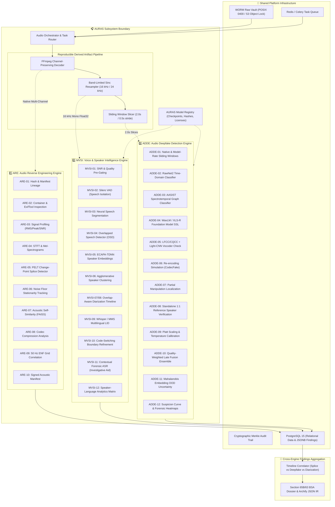

---

## 6. Shared Audio Ingestion & Artifact Pipeline

To guarantee evidentiary admissibility under Section 65B IEA / Section 63 BSA, master audio exhibits are never processed directly by lossy or destructive transforms. A strict artifact derivation pipeline is enforced:

### 6.1 Ingestion Invariants & Policies
1. **Zero-Byte Modification:** The original seized file (e.g., `evidence.wav`) is streamed to disk, dual-hashed (SHA-256 and SHA3-512), and locked with POSIX `0400` permissions.
2. **Channel-Preserving Raw Representation (Artifact A):** Decoded to multi-channel 32-bit float WAV at the native sampling rate ($f_s$). Used exclusively by **ARE** for dynamic range, channel phase correlation, DC offset, and STFT.
3. **Normalized Speech Representation (Artifact B):** Decoded, converted to mono (using energy-preserving downmixing $M = 0.5(L + R)$), and resampled to 16 kHz using band-limited Kaiser-windowed sinc interpolation (`torchaudio.transforms.Resample`). Used exclusively by **MVSI** for VAD, diarization, and language identification.
4. **Standardized Window Slices (Artifact C):** Segmented into 2.0-second sliding windows with a 0.5-second stride (75% overlap). Zero-padded at the tail if shorter than 2.0s. Used exclusively by **ADDE** for frame-level deepfake inference.
5. **Transformation Manifest:** Every generated artifact receives an immutable SHA-256 hash and a JSON lineage record referencing:
   $$\text{Parent Evidence ID} \to \text{Transform Operator} \to \text{Parameters} (f_s, \text{channels}, \text{sinc\_window}) \to \text{Child Hash}$$

---

## 7. ARE Technical Specification (Audio Reverse Engineering Engine)

### ARE-01: Cryptographic Integrity & Lineage Verification
- **Purpose:** Verify bit-level equality against the initial seizure hash; maintain immutable parent-child transformation manifests.
- **Inputs:** Raw exhibit stream, initial acquisition manifest, optional `trusted_sha256` reference.
- **Processing Steps:** Streams bytes through chunked SHA-256 and SHA3-512 accumulators (64KB blocks); queries `evidence` table; verifies WORM file permissions (`0400`).
- **Algorithms:** FIPS 180-4 SHA-256, FIPS 202 SHA3-512.
- **Outputs:** `IntegrityResult(sha256, sha3_512, trusted_match_bool, permissions_valid)`.
- **Failure Modes:** Hash mismatch (returns `CRITICAL_TAMPER_ALERT`), unreadable file (returns `IO_PERMISSION_ERROR`).
- **Confidence Semantics:** Deterministic boolean (1.0 or 0.0). No probabilistic guessing.
- **Implementation Status:** `PLANNED` (Phase 2 / AURAS-A1).

### ARE-02: Container & Metadata Inspection
- **Purpose:** Audit audio headers, container streams, and codec structures for tampering, non-standard encoder tags, and digital audio workstation (DAW) signatures.
- **Inputs:** Master audio exhibit path.
- **Processing Steps:** Runs FFprobe JSON demuxing; executes ExifTool and Mutagen; parses ID3, RIFF/WAVE `INFO` chunks, and broadcast wave format (BWF) headers.
- **Algorithms:** Tag signature dictionary comparison, container atom/chunk validation, audio-video stream cadence checks.
- **Outputs:** `MetadataAudit(codec, sample_rate, channels, bit_depth, duration, encoder_signatures, daw_tags_found, decoder_warnings)`.
- **Confidence Semantics:** Deterministic string match. Flags DAW software (ProTools, Logic, Audacity, FL Studio) with 1.0 confidence of tag presence.
- **Implementation Status:** `PLANNED` (Phase 2 / AURAS-A1).

### ARE-03: Signal Profiling & Dynamic Range Analysis
- **Purpose:** Measure physical electroacoustic parameters to detect clipping, dynamic compression, and DC bias.
- **Inputs:** Native-rate working audio array $x[n]$.
- **Processing Steps:** Computes Root-Mean-Square (RMS) amplitude, true peak ($|x[n]|_{\max}$), DC offset ($\mu_x = \frac{1}{N}\sum x[n]$), clipping sample count ($N_{\text{clip}} = \sum [|x[n]| \ge 0.9999]$), zero-crossing rate (ZCR), and estimated SNR via WADA-SNR.
- **Algorithms:**
  $$RMS_{\text{dBFS}} = 20 \log_{10} \sqrt{\frac{1}{N}\sum_{n=1}^N x^2[n]}, \quad SNR_{\text{est}} = 10 \log_{10}\left(\frac{P_{\text{speech}}}{P_{\text{noise}}}\right)$$
- **Outputs:** `SignalProfile(rms_dbfs, peak_dbfs, dynamic_range_db, dc_offset, clip_count, snr_db, zcr)`.
- **Confidence Semantics:** Continuous scalar metrics. High clipping count ($> 50$) raises a clipping warning.
- **Implementation Status:** `PLANNED` (Phase 2 / AURAS-A1).

### ARE-04: Spectral Analysis & Bandwidth Audit
- **Purpose:** Calculate time-frequency spectrograms and Power Spectral Density (PSD) to detect lossy compression cutoffs and re-encoding artifacts.
- **Inputs:** Native-rate working audio array.
- **Processing Steps:** Applies 2048-point Short-Time Fourier Transform (STFT) with Hann window and 512 hop length; computes log-mel spectrogram (128 mel bins); computes Welch PSD across $0 \le f \le f_s/2$.
- **Algorithms:** Fast Fourier Transform (FFT), Welch periodogram averaging.
- **Outputs:** `SpectralFeatures(spectrogram_matrix, psd_curve, high_frequency_cutoff_hz, spectral_flatness, spectral_rolloff)`.
- **Confidence Semantics:** Deterministic cutoff frequency estimation ($\pm 100\text{ Hz}$).
- **Implementation Status:** `PLANNED` (Phase 2 / AURAS-A1).

### ARE-05: Splice & Edit Candidate Localization
- **Purpose:** Localize abrupt acoustic transitions, edit points, and physical splices using change-point detection on spectral flux and energy time series.
- **Inputs:** Spectral flux $SF[m] = \sum_k |X[k, m] - X[k, m-1]|^2$ and short-time energy $E[m]$.
- **Processing Steps:** Calculates first-order differences in spectral flux; executes Pruned Exact Linear Time (PELT) change-point search with radial basis function (RBF) kernel; cross-correlates candidates with zero-crossing discontinuities.
- **Algorithms:** PELT change-point algorithm (`ruptures` library), kernel changepoint estimation.
- **Outputs:** `List[SpliceCandidate(timestamp_start, timestamp_end, change_point_magnitude, confidence)]`.
- **Confidence Semantics:** Calibrated anomaly score (0.0–1.0) based on discontinuity magnitude relative to background variance.
- **Implementation Status:** `PLANNED` (Phase 2 / AURAS-A2).

### ARE-06: Ambient Noise Floor Consistency Tracking
- **Purpose:** Track background stationary noise floor to identify spliced segments inserted from foreign acoustic environments.
- **Inputs:** Native-rate audio signal.
- **Processing Steps:** Applies minimum statistics noise tracking across 500ms sliding frames; computes stationary background spectral envelope; flags sudden level jumps $> 4\text{ dB}$ lasting $> 200\text{ ms}$.
- **Algorithms:** Martin's minimum statistics spectral subtraction algorithm.
- **Outputs:** `NoiseConsistencyResult(noise_floor_dbfs_curve, anomalous_intervals, ambient_stationarity_score)`.
- **Confidence Semantics:** Continuous stationarity score (0.0–1.0). High scores denote consistent ambient room tone.
- **Implementation Status:** `PLANNED` (Phase 2 / AURAS-A2).

### ARE-07: Acoustic Self-Similarity & Repeated Segment Detection
- **Purpose:** Identify duplicated or copy-pasted acoustic segments (e.g., cloned phrases, repeated background noise loops).
- **Inputs:** 13 MFCC coefficients extracted over 25ms windows with 10ms hop length.
- **Processing Steps:** Normalizes MFCC vectors; indexes frames in FAISS index; computes full pairwise self-similarity matrix $S_{i, j} = \cos(v_i, v_j)$; detects diagonal path matches off the main diagonal using dynamic time warping (DTW).
- **Algorithms:** FAISS exact inner-product search, DTW path alignment.
- **Outputs:** `List[RepeatedSegmentPair(seg_a_start, seg_a_end, seg_b_start, seg_b_end, duration, similarity_score)]`.
- **Confidence Semantics:** Cosine similarity threshold ($> 0.92$ over duration $> 1.0\text{ s}$).
- **Implementation Status:** `PLANNED` (Phase 2 / AURAS-A2).

### ARE-08: Codec Compression & Re-Encoding Analysis
- **Purpose:** Detect multiple lossy compression cycles (e.g., audio recorded on phone, forwarded via WhatsApp, edited in Audacity, and re-exported).
- **Inputs:** Native audio stream and container bitstream.
- **Processing Steps:** Inspects MDCT coefficient quantization error distributions; evaluates high-frequency rolloff steepness ($> 60\text{ dB/octave}$ at 16 kHz indicates MP3/AAC 128k); evaluates frame bit-allocation consistency.
- **Algorithms:** Modified Discrete Cosine Transform (MDCT) coefficient histogram analysis.
- **Outputs:** `CodecAnalysisResult(estimated_compression_passes, primary_codec, reencoding_indicators_detected)`.
- **Confidence Semantics:** Qualitative classification with uncertainty notes.
- **Implementation Status:** `PLANNED` (Phase 2 / AURAS-A2).

### ARE-09: Electric Network Frequency (ENF) Forensics
- **Purpose:** Extract mains hum frequency fluctuations (nominal 50 Hz for Indian electrical grid) to verify recording continuity and correlate timestamps against grid reference logs.
- **Inputs:** Native uncompressed audio file ($f_s \ge 8\text{ kHz}$).
- **Processing Steps:** Applies an 8th-order Butterworth bandpass filter ($49.8\text{ Hz} \le f \le 50.2\text{ Hz}$); extracts analytic signal via Hilbert transform; calculates instantaneous frequency:
  $$f_{\text{ENF}}(t) = \frac{1}{2\pi} \frac{d}{dt} \arg(x_{\text{analytic}}(t))$$
- **Outputs:** `ENFResult(enf_present_bool, snr_enf_db, frequency_curve, correlation_with_grid, grid_reference_match_status)`.
- **Confidence Semantics:** If ENF SNR $< 6\text{ dB}$, returns `INCONCLUSIVE_NO_USABLE_ENF`. When grid reference data is present, outputs Pearson correlation coefficient $r$.
- **Implementation Status:** `PLANNED` (Phase 2 / AURAS-A2 — Advanced/Research).

### ARE-10: Acoustic Provenance Manifest
- **Purpose:** Package all electroacoustic, spectral, and splice findings into an immutable, cryptographically sealed JSON record.
- **Inputs:** Findings from ARE-01 through ARE-09.
- **Outputs:** `AREManifest(manifest_version, evidence_id, sha256, findings_summary, json_payload, cryptographic_signature)`.
- **Implementation Status:** `PLANNED` (Phase 2 / AURAS-A2).

---

## 8. MVSI Technical Specification (Voice & Speaker Intelligence)

### 8.1 Invariant: Speaker Identity $\neq$ Language Identity
A speaker who switches between Hindi and English (code-switching) is **one individual speaker** utilizing multiple linguistic codes. MVSI maintains two orthogonal dimensions:
1. **Speaker Cluster Dimension (`speaker_id`):** Defined by biological and vocal tract acoustic embeddings (ECAPA-TDNN).
2. **Language Dimension (`language_code`):** Defined by phonological and linguistic token probabilities (Whisper/MMS LID).

### 8.2 Overlap-Aware Diarization Architecture
The diarization engine natively supports multiple active speakers in the same time interval:
- `00:15.200 – 00:18.400`: `["SPEAKER_01"]`
- `00:18.400 – 00:20.100`: `["SPEAKER_01", "SPEAKER_02"]` *(Simultaneous Overlap)*
- `00:20.100 – 00:22.000`: `["SPEAKER_02"]`

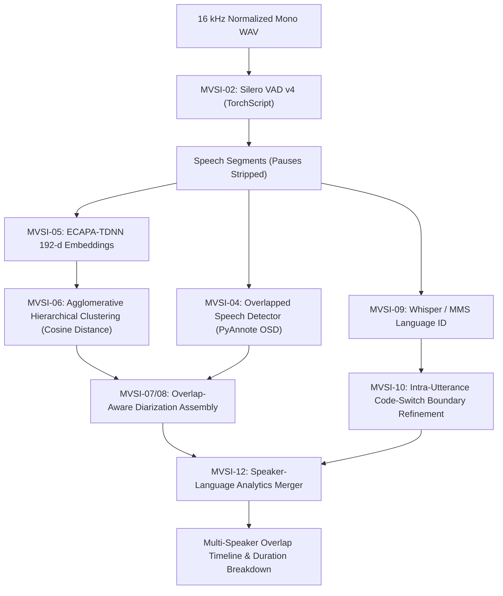

### 8.3 Extensible Indian Language Registry
The language registry covers Scheduled Indian Languages, regional languages, and dialectal varieties:

```sql
CREATE TABLE language_registry (
    iso_code VARCHAR(16) PRIMARY KEY,
    language_name VARCHAR(64) NOT NULL,
    script_default VARCHAR(32) NOT NULL,
    is_scheduled_indian BOOLEAN NOT NULL DEFAULT FALSE,
    regional_context VARCHAR(128)
);

INSERT INTO language_registry VALUES
('hin', 'Hindi', 'Devanagari', TRUE, 'Pan-India / Bihar'),
('bho', 'Bhojpuri', 'Devanagari', FALSE, 'Bihar / Eastern UP'),
('mai', 'Maithili', 'Devanagari / Tirhuta', TRUE, 'Bihar (Mithila)'),
('mag', 'Magahi', 'Devanagari', FALSE, 'Bihar (Magadh)'),
('urd', 'Urdu', 'Perso-Arabic', TRUE, 'Pan-India / Bihar'),
('ben', 'Bengali', 'Bengali', TRUE, 'West Bengal / Eastern India'),
('eng', 'English', 'Latin', FALSE, 'Official / Judicial Proceedings');
```

---

## 9. ADDE Technical Specification (Audio Deepfake Detection Engine)

ADDE is an independent, pluggable, multi-detector engine designed to detect synthetic vocoders, cloned voices, and partial manipulations without relying on any single model family:

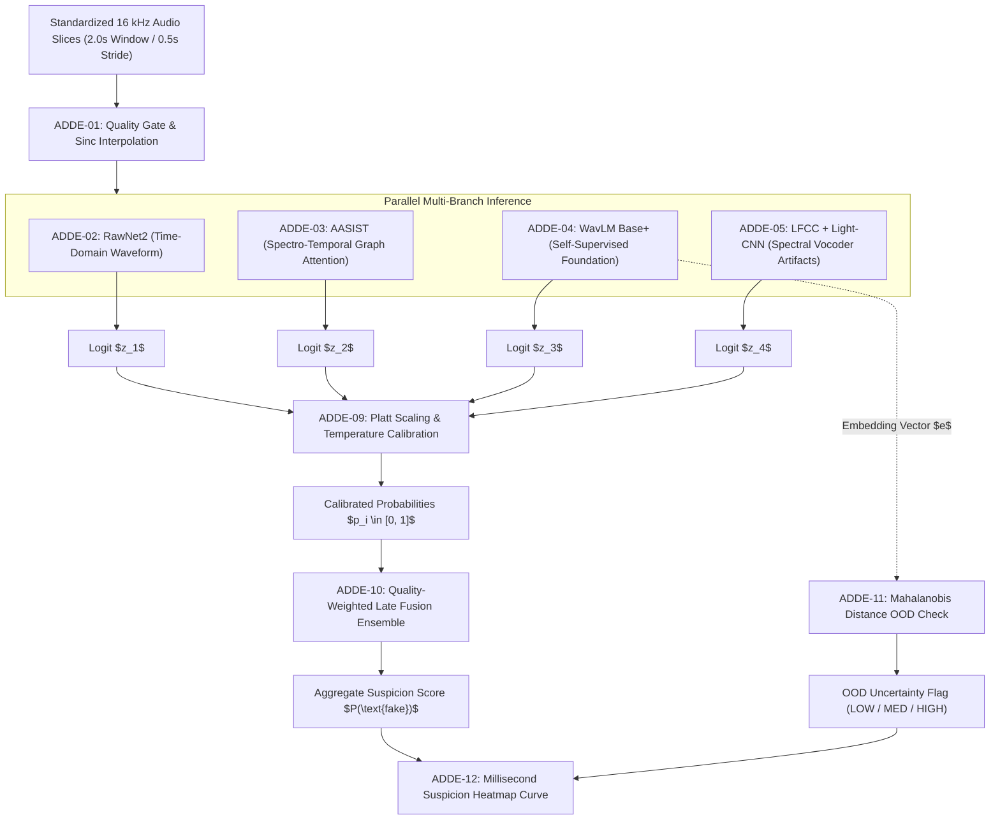

### 9.1 Pluggable Detector Family Specifications
1. **RawNet2 Baseline (`ps05.engines.audio.adde.rawnet2`):**
   - Direct raw waveform input ($1 \times 32000$ samples). Applies sinc-convolution filters followed by residual blocks with gru-pooling. Detects sample-level phase discontinuities characteristic of neural vocoders.
2. **AASIST Baseline (`ps05.engines.audio.adde.aasist`):**
   - Audio Anti-Spoofing using Integrated Spectro-Temporal Graph Attention. Constructs heterogeneous graphs across spectral channels and temporal frames, capturing long-range synthetic artifacts.
3. **Foundation Model SSL (`ps05.engines.audio.adde.ssl_wavlm`):**
   - Utilizes frozen WavLM Base+ pre-trained encoder (12 transformer layers, 768-d hidden states) coupled to a lightweight binary classification head (mean pooling $\to$ Linear(768, 256) $\to$ ReLU $\to$ Dropout(0.3) $\to$ Linear(256, 1)). Yields superior generalization on unseen generative engines (ElevenLabs, Bark, VALL-E).
4. **Spectral Vocoder Classifier (`ps05.engines.audio.adde.spectral`):**
   - Extracts 60-dimensional Linear Frequency Cepstral Coefficients (LFCC) classified by a 9-layer Light-CNN. Captures high-frequency vocoder spectral envelope anomalies.

### 9.2 Score Calibration & Late-Fusion Ensemble
- **Platt Scaling Calibration:** Raw logits $z_i$ from each detector are calibrated using logistic parameters $(A_i, B_i)$ fitted on a held-out validation split:
  $$p_i = \frac{1}{1 + \exp(A_i z_i + B_i)}$$
- **Quality-Weighted Late Fusion:** Composite score is calculated as:
  $$P(\text{fake}) = \sum_{i=1}^M w_i \cdot p_i, \quad \sum w_i = 1.0$$
  Weights $w_i$ are dynamically adjusted based on input SNR (e.g., if SNR $< 10\text{ dB}$, WavLM weight increases while RawNet2 weight decreases).
- **Disagreement Metric:** If $\max(p_i) - \min(p_i) > 0.50$, the system explicitly records `DETECTOR_DISAGREEMENT_WARNING`.

### 9.3 Out-of-Distribution (OOD) Detection
- Computes Mahalanobis distance in the WavLM 768-d embedding space against the in-distribution reference mean $\mu$ and covariance matrix $\Sigma$:
  $$D_M(x) = \sqrt{(x - \mu)^T \Sigma^{-1} (x - \mu)}$$
- If $D_M(x) > \text{Threshold}_{95\%}$, the system outputs `OOD_UNCERTAINTY: HIGH`, advising the examiner that the recording conditions (extreme noise or rare codec) exceed the reliable operational boundary of the models.

### 9.4 1:1 Reference Speaker Verification Check
- **Explicit Boundary:** Speaker verification is **strictly separated** from deepfake detection.
- Compares questioned segment embeddings against an authorized suspect reference recording using ECAPA-TDNN cosine distance. Outputs a similarity metric without asserting automated biometric identity.

---

## 10. AIF Image Forensics Subsystem Technical Architecture & Engine Specifications

The **AIF (Advanced Image Forensics)** subsystem provides an explainable, cryptographically grounded, multi-engine evidentiary platform for the analysis of seized digital images, documents, facial exhibits, and synthetic media. AIF operates in strict compliance with Section 65B of the Indian Evidence Act (IEA) and Section 63 of the Bharatiya Sakshya Adhiniyam (BSA 2023).

### 10.1 High-Level AIF Engine Architecture & Subsystem Boundaries

AIF partitions image analysis across three specialized forensic engines and a dedicated cross-cutting biometric module, coordinated by the task-aware router and anchored by CEIPL:

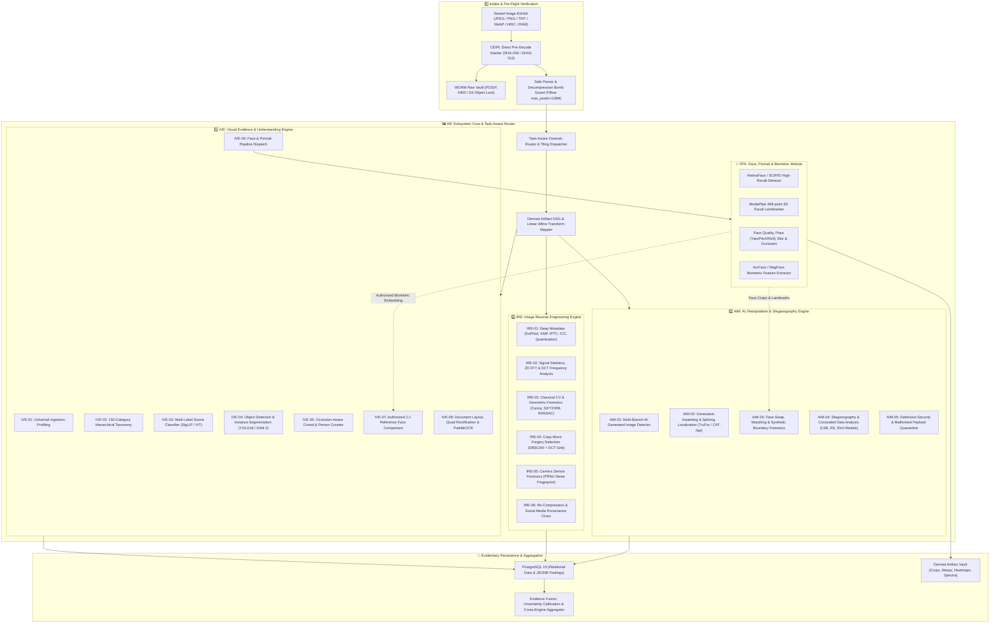

---

### 10.2 Image Ingestion, Decompression Bomb Mitigation & Safe Decoding Sequence

To guarantee evidentiary integrity and protect forensic worker nodes from adversarial image exploits (decompression bombs, malformed header integer overflows, polyglots), all incoming image exhibits execute a strict non-destructive intake sequence:

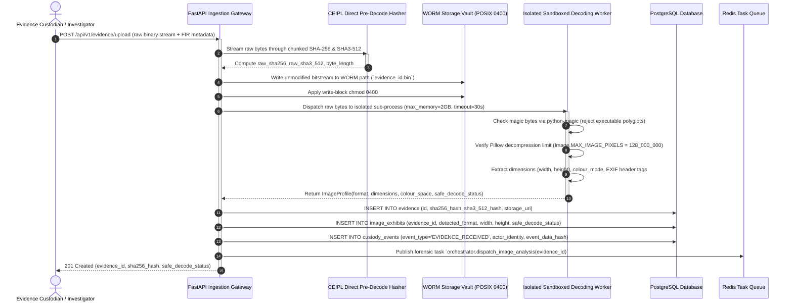

---

### 10.3 Multi-Engine Image Forensic Execution Sequence

Once ingested, the Task-Aware Router examines evidence dimensions, metadata flags, and requested analytical depth to schedule parallel forensic engines:

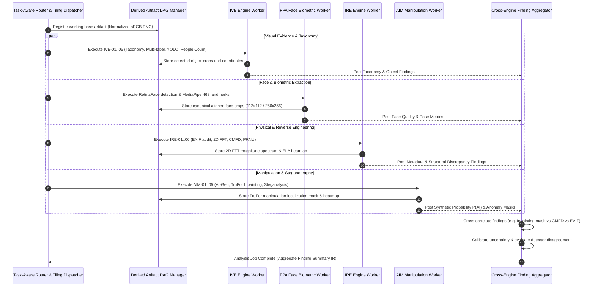

---

### 10.4 FPA Face & Portrait Forensic Routing Sequence

The Face, Portrait & Biometric Analysis module enforces strict judicial privacy boundaries:

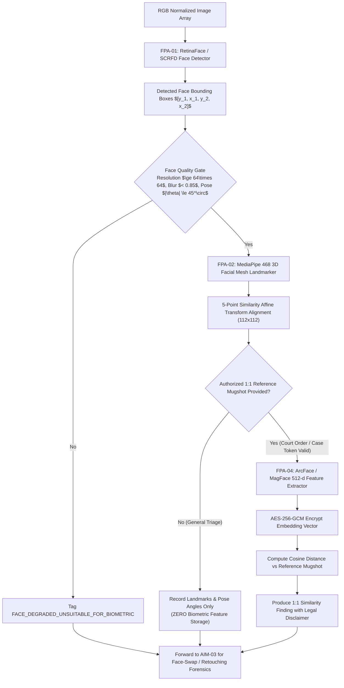

---

### 10.5 Classical CV & Reference Comparison Alignment Flow

IRE employs classical computer vision algorithms strictly for geometric registration, edge localization, and reference comparison, never as standalone tampering proofs:

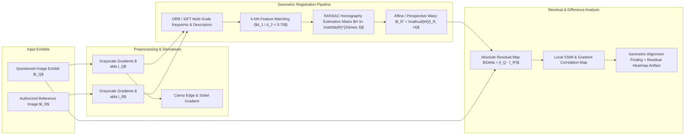

---

### 10.6 AI Generation & Synthetic Manipulation Localization Pipeline

AIM provides a multi-branch, multi-scale architecture for detecting AI-generated content and localizing generative inpainting:

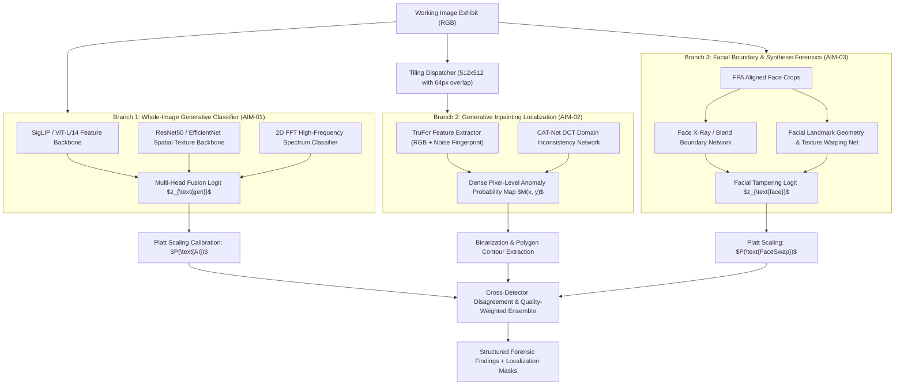

---

### 10.7 IVE Technical Specification (Image Understanding & Visual Evidence Engine)

#### IVE-01: Universal Image Ingestion Profiling & Safe Decoding
- **Purpose:** Safely inspect, profile, and validate seized image files, enforcing decompression bomb limits and extracting complete structural container parameters without altering the bitstream.
- **Inputs:** Seized raw image file path in WORM storage.
- **Processing Steps:**
  1. Inspects magic bytes using `python-magic` to establish real file format independently of file extension.
  2. Sets Pillow safety boundary: `Image.MAX_IMAGE_PIXELS = 128_000_000`. Rejects images exceeding 128 Megapixels with `DECOMPRESSION_BOMB_PREVENTED`.
  3. Executes isolated worker process decoding to capture dimensions $(W, H)$, aspect ratio, bit depth, channel configuration (RGB, RGBA, CMYK, Grayscale), colour space (sRGB, AdobeRGB, Display P3, uncalibrated), orientation flag (EXIF Tag 274), and animation frame count.
  4. Parses embedded thumbnail availability and validates structural container completeness.
- **Outputs:** `ImageProfile(detected_format, width, height, pixel_count, aspect_ratio, bit_depth, colour_mode, colour_space, has_alpha, orientation, safe_decode_status, embedded_thumb_present)`.
- **Implementation Status:** `PLANNED` (Phase AIF-A2).

#### IVE-02: Hierarchical 150-Category Image Evidence Taxonomy
- **Purpose:** Organize forensic visual evidence into a structured, multi-label taxonomy spanning 15 parent domains and approximately 150 leaf classes.
- **Taxonomy Domains:**
  1. Human Presence & Context (Portrait, Selfie, Group, Family, Identification Photo, Distant Face).
  2. Injury & Medical Evidence (Abrasion, Laceration, Contusion, Burn, Fracture Radiograph).
  3. Possible Violent-Incident Context (Scene Triage, Struggle Disturbance, Bloodstain Pattern).
  4. Physical Traces & Evidence (Tool Marks, Footwear Impression, Tire Tread, Ballistic Mark).
  5. Weapon & Weapon-like Objects (Firearm Handgun, Long Gun, Edged Weapon, Blunt Object, Explosive).
  6. Property & Property Crime (Forced Entry Point, Broken Glass, Vandalism, Graffiti, Burglary).
  7. Vehicle & Transport Evidence (License Plate, Collision Damage, Vehicle Undercarriage, Skid Marks).
  8. Fire, Explosion & Disaster (Arson Origin, Char Pattern, Blast Crater, Structural Collapse).
  9. Digital Devices & Electronic Exhibits (Mobile Screen Display, Laptop/Desktop, Storage Media).
  10. Documents & Alterations (Official Stamp, Seal, Signature, Handwritten Note, Identity Card).
  11. Substances & Packaging (Narcotic Packaging, Contraband Container, Chemical Label).
  12. Environmental & Biological Context (Outdoor Scene, Vegetation, Soil Disturbance, Water Body).
  13. Public Safety & Infrastructure (Road Hazard, Traffic Signal, CCTV Enclosure, Power Line).
  14. Neutral & Everyday Context (Landscape, Architecture Exterior, Food/Beverage, Household Object).
  15. Specialized Forensic Modalities (Infrared/Thermal, X-Ray Radiograph, Microscopy, Aerial/Drone).
- **Taxonomy Validation Invariant:** A taxonomy category is an indexing and triage label, never an automated judicial verdict.
- **Implementation Status:** `PLANNED` (Phase AIF-A3).

#### IVE-03: Multi-Label Scene Classification & Visual Reasoning
- **Purpose:** Assign calibrated multi-label taxonomy tags and generate structured scene descriptions.
- **Model Candidates:** SigLIP (ViT-SO400M), CLIP (ViT-L/14@336px), Swin Transformer v2.
- **Processing Steps:** Passes normalized $336\times 336$ image representation through zero-shot text-image embedding projections and domain-specific classification heads. Applies temperature calibration to generate multi-label probabilities $p_c \in [0, 1]$.
- **Outputs:** `List[TaxonomyAnnotation(category_id, confidence, is_triage_alert, calibration_status)]`.
- **Implementation Status:** `PLANNED` (Phase AIF-A3).

#### IVE-04: Object Detection & Instance Segmentation
- **Purpose:** Localize physical evidence items, weapons, vehicles, and documents with bounding boxes and polygon masks.
- **Model Candidates:** YOLOv8x / YOLOv10x for real-time bounding boxes; Grounding DINO for open-vocabulary queries; SAM 2 (Segment Anything 2) for zero-shot promptable polygon segmentation.
- **Tiling Architecture:** For high-resolution exhibits ($> 2048\times 2048$), image is partitioned into $1024\times 1024$ tiles with $128\text{px}$ overlap. Detections across tile boundaries are merged using Non-Maximum Suppression (NMS) with IoU threshold 0.50, and mapped back to parent coordinates via affine coordinate transforms stored in the Derived Artifact DAG.
- **Outputs:** `List[DetectedObject(class_id, label, confidence, bbox_normalized, polygon_mask_uri)]`.
- **Implementation Status:** `PLANNED` (Phase AIF-A4).

#### IVE-05: Occlusion-Aware People & Crowd Counting
- **Purpose:** Accurately count visible human individuals, resolving occlusions and separating people counts from face counts.
- **Methodology:** Executes dual-head detection: head-box detection (high recall in dense crowds) and full-body pedestrian bounding boxes. Resolves overlaps via Hungarian matching. Rejects mannequins, posters, and reflections by cross-checking texture depth and 2D frequency variance.
- **Outputs:** `PeopleCountResult(visible_people_count, detected_faces_count, estimated_crowd_density, count_mae_uncertainty, occlusion_index)`.
- **Implementation Status:** `PLANNED` (Phase AIF-A4).

#### IVE-06: Face, Portrait & Selfie Handling (FPA Integration)
- **Purpose:** Detect, crop, land-mark, and assess quality of all human faces appearing in seized imagery.
- **Candidate Stack:** RetinaFace (ResNet50 backbone) or SCRFD for multi-scale face detection; MediaPipe Face Landmarker for 468-point 3D facial topology mesh.
- **Quality Metrics:** Computes head pose angles ($\text{Yaw}, \text{Pitch}, \text{Roll}$ via solvePnP on canonical 3D mesh points), Laplacian blur variance, and illumination symmetry. Faces with quality score $< 0.40$ or resolution $< 48\times 48$ are tagged as degraded and restricted from downstream biometric matching.
- **Outputs:** `List[FaceRegion(face_id, bbox, landmarks_468, pose_angles, quality_score, crop_artifact_id)]`.
- **Implementation Status:** `PLANNED` (Phase AIF-A5).

#### IVE-07: Authorized Biometric Reference Comparison
- **Purpose:** Perform 1:1 facial biometric feature comparison against an authorized suspect mugshot under strict judicial access controls.
- **Privacy & Legal Invariant:** Biometric comparison is **strictly disabled by default**. It requires an active `CaseAuthorizationToken` signed by the investigating officer. Automated 1:N surveillance search across external databases is **prohibited**.
- **Model Candidates:** ArcFace (ResNet-100 / IResNet-100 pre-trained on Glint360k), Sub-center ArcFace, AdaFace, MagFace.
- **Mathematical Specification:**
  Extracts 512-dimensional normalized feature vectors $u, v \in \mathbb{R}^{512}$ ($\|u\|_2 = \|v\|_2 = 1$). Computes cosine similarity:
  $$\text{sim}(u, v) = u^T v = \cos(\theta)$$
- **Outputs:** `BiometricComparisonResult(similarity_score, calibrated_match_probability, threshold_reference, false_match_rate_operating_point, legal_disclaimer)`.
- **Implementation Status:** `PLANNED` (Phase AIF-A5).

#### IVE-08: Document Layout, Quadrilateral Rectification & OCR
- **Purpose:** Detect document boundaries, rectify perspective distortion, and extract machine-readable text from contracts, FIRs, and identity cards.
- **Methodology:** Localizes quadrilateral corners via convex hull polygon approximation on Canny contours. Computes $3\times 3$ perspective transformation matrix $H_{\text{persp}}$ to warp the document to a flat rectangular plane. Executes PaddleOCR / Tesseract 5 with specialized Hindi, English, and regional Indian language language packs.
- **Outputs:** `DocumentOCRResult(rectified_artifact_id, detected_boxes, recognized_text, avg_confidence, seals_detected, signatures_detected)`.
- **Implementation Status:** `PLANNED` (Phase AIF-A6).

---

### 10.8 IRE Technical Specification (Image Reverse Engineering Engine)

#### IRE-01: Deep Metadata, EXIF, XMP, IPTC & Container Inspection
- **Purpose:** Extract and cross-validate embedded metadata blocks to identify editing software tags, camera settings, and timestamp discrepancies.
- **Parser Stack:** ExifTool (vendored read-only execution with argument sanitization), Pillow `_getexif()`, and format-specific container parsers (libjpeg, libpng, tifffile).
- **Extracted Fields:**
  - EXIF: Make, Model, LensModel, ExposureTime, FNumber, ISO, FocalLength, DateTimeOriginal, CreateDate, ModifyDate, GPSLatitude, GPSLongitude.
  - XMP / IPTC: HistoryAction, HistorySoftwareAgent, CreatorTool, DocumentID, InstanceID.
  - JPEG Markers: DQT (Quantization Tables for Luminance and Chrominance), SOF0/SOF2 (Chroma Subsampling 4:2:0, 4:2:2, 4:4:4), DHT (Huffman tables).
- **Tampering Invariants:**
  1. Software tag (e.g. "Adobe Photoshop CC 2024") proves presence of editing application metadata, but does not prove pixels were tampered.
  2. Missing EXIF metadata does **not** prove malicious modification (messaging apps routinely strip all metadata).
- **Outputs:** `MetadataAuditReport(exif_tags, xmp_history, quantization_tables, camera_profile, software_signatures_found, timestamp_consistency_verdict)`.
- **Implementation Status:** `PLANNED` (Phase AIF-A7).

#### IRE-02: Signal Statistics, 2D FFT & DCT Frequency Analysis
- **Purpose:** Analyze 2D frequency spectra and local noise residuals to detect re-sampling, periodic interpolation, and filtering artifacts.
- **Methodology:**
  1. Computes 2D Fast Fourier Transform on grayscale luminance:
     $$F(u, v) = \sum_{x=0}^{M-1} \sum_{y=0}^{N-1} I(x, y) e^{-j 2\pi (\frac{ux}{M} + \frac{vy}{N})}$$
  2. Shifts DC component to center and computes log-magnitude spectrum $\log(1 + |F(u, v)|)$. Detects radial periodic spikes indicating periodic resampling or affine interpolation grids.
  3. Computes Discrete Cosine Transform (DCT) coefficient distributions across $8\times 8$ blocks to measure quantization error variance.
- **Outputs:** `SignalAnalysisResult(fft_magnitude_artifact_id, periodic_peaks_detected, noise_variance_map_id, frequency_anomaly_score)`.
- **Implementation Status:** `PLANNED` (Phase AIF-A7).

#### IRE-03: Classical Vision & Geometric Forensics
- **Purpose:** Apply classical computer vision primitives for edge detection, shape analysis, and planar reference alignment.
- **Algorithms:**
  - Canny Edge Detection with automatic Otsu thresholding.
  - Sobel and Scharr gradient operators for edge directionality.
  - Hough Line and Circle transforms for architectural and ballistic alignment.
  - ORB / SIFT feature extraction with RANSAC homography estimation for multi-image reference registration.
- **Forensic Principle:** Classical CV outputs describe geometric and boundary properties; they do **not** establish intent, authenticity, or fraud.
- **Outputs:** `GeometricForensicResult(edge_map_artifact_id, contours_detected, homography_matrix, alignment_error_rmse)`.
- **Implementation Status:** `PLANNED` (Phase AIF-A8).

#### IRE-04: Copy-Move Forgery Detection (CMFD) & Splicing Localization
- **Purpose:** Localize cloned or duplicated image regions within the same exhibit.
- **Dual-Branch Architecture:**
  1. Keypoint-Based Branch: SIFT keypoints with $k$-d tree nearest-neighbor search, filtering spatial proximity ($r > 30\text{px}$), clustered via DBSCAN and validated via RANSAC affine consistency.
  2. Block-Based Branch: Overlapping $16\times 16$ blocks transformed via 2D DCT; lexicographically sorted or indexed in FAISS to detect smooth or textured duplicated patches lacking high-contrast keypoints.
- **Outputs:** `CMFDResult(cloned_pairs_count, source_polygon_mask, destination_polygon_mask, confidence, visualization_artifact_id)`.
- **Implementation Status:** `PLANNED` (Phase AIF-A9).

#### IRE-05: Camera Sensor Forensics & PRNU Noise Fingerprinting
- **Purpose:** Extract Photo-Response Non-Uniformity (PRNU) sensor noise patterns to associate an image with a specific physical camera sensor.
- **Mathematical Model:**
  Sensor output $I = I^{(0)} + I^{(0)} \cdot K + \Theta$, where $K$ is the deterministic sensor PRNU noise fingerprint and $\Theta$ is random noise.
  Extracts noise residual $W = I - F(I)$ using a Mihcak wavelet denoising filter.
  Computes Normalized Cross-Correlation (NCC) against a reference camera fingerprint $K_{\text{ref}}$:
  $$\rho(W, K_{\text{ref}}) = \frac{(W - \bar{W}) \cdot (K_{\text{ref}} - \bar{K}_{\text{ref}})}{\|W - \bar{W}\|_2 \|K_{\text{ref}} - \bar{K}_{\text{ref}}\|_2}$$
- **Operational Requirement:** Device association requires at least 20–30 flat-field reference photographs taken with the suspect device. Social-media re-compression severely degrades PRNU.
- **Outputs:** `PRNUResult(noise_residual_artifact_id, correlation_coefficient, p_value, device_match_verdict)`.
- **Implementation Status:** `PLANNED` (Phase AIF-A9 — Research Candidate).

#### IRE-06: Processing History, Re-Compression & Social Media Provenance
- **Purpose:** Detect multiple lossy compression cycles and identify characteristic social media platform transformations (WhatsApp, Facebook, Telegram, X).
- **Methodology:** Compares quantization table fingerprints against a catalog of 20,000 known mobile camera and platform profiles. Detects Blocking Artifact Discrepancy (BAD) across misaligned JPEG 8x8 grids resulting from cropping followed by re-compression.
- **Outputs:** `CompressionProvenanceResult(estimated_compression_cycles, matched_platform_signature, bad_discrepancy_score)`.
- **Implementation Status:** `PLANNED` (Phase AIF-A9).

---

### 10.9 AIM Technical Specification (AI, Manipulation & Steganography Engine)

#### AIM-01: Multi-Branch AI-Generated Image Detection
- **Purpose:** Discriminate authentic photographic captures from fully synthetic generative images (Stable Diffusion, Midjourney, DALL-E, Flux, Imagen, StyleGAN).
- **Multi-Branch Classifier Ensemble:**
  1. Patch-Level Spatial Texture Head: ResNet50 / ConvNeXt trained on multi-generator artifact datasets.
  2. High-Frequency Fourier Head: Classifies 2D FFT spectral abnormalities and radial falloff signatures.
  3. Foundation Representation Head: SigLIP / CLIP visual embeddings with linear probe.
- **Calibration & Disagreement:** Raw logits are calibrated using Platt scaling on a held-out benchmark split. If individual branch predictions disagree by $> 0.50$, the system records `DETECTOR_DISAGREEMENT_WARNING` and reports high uncertainty.
- **Outputs:** `AIGenerationResult(p_synthetic_calibrated, raw_branch_scores, generator_family_clue, uncertainty_flag)`.
- **Implementation Status:** `PLANNED` (Phase AIF-A10).

#### AIM-02: Generative Inpainting, Fill & Local Splicing Localization
- **Purpose:** Localize pixel-level modified regions resulting from generative fill, object removal, or local splicing.
- **Candidate Architectures:** TruFor (Transformer-based RGB and noise residual fusion architecture) and CAT-Net (DCT coefficient stream combined with RGB stream).
- **Output Artifacts:** Produces a dense floating-point anomaly probability map $M(x, y) \in [0, 1]$ at native image resolution, along with vector polygon contours of the suspected edited zones.
- **Outputs:** `InpaintingLocalizationResult(tampered_area_percentage, anomaly_mask_artifact_id, localized_polygons, confidence)`.
- **Implementation Status:** `PLANNED` (Phase AIF-A10).

#### AIM-03: Face Swap, Morphing & Synthetic Portrait Manipulation
- **Purpose:** Detect face-swapped portraits (DeepFakes, SimSwap, Roop), face morphs, and generative face edits.
- **Methodology:**
  1. Face X-Ray / Boundary Inconsistency: Detects blending boundaries between the inserted face patch and the background head/neck texture.
  2. Facial Landmark & Geometry Consistency: Measures bilateral facial asymmetry and unnatural landmark configurations.
  3. Eye Reflection & Corneal Specularity: Verifies consistency of corneal light reflections across left and right pupils.
- **Outputs:** `FaceManipulationResult(p_face_swap, blend_boundary_score, specularity_consistent, heatmap_artifact_id)`.
- **Implementation Status:** `PLANNED` (Phase AIF-A11).

#### AIM-04: Steganography & Concealed Data Analysis
- **Purpose:** Inspect image bitstreams for steganographic payloads and hidden data.
- **Detection Primitives:**
  - Least Significant Bit (LSB) plane visual and statistical randomness analysis.
  - Sample Pair Analysis (SPA) and Chi-square ($\chi^2$) statistical tests on spatial pixel pairs.
  - Regular-Singular (RS) steganalysis to detect spatial-domain LSB embedding rates.
  - Spatial Rich Models (SRM) and sub-scale co-occurrence matrices for adaptive steganalysis (HUGO, WOW, S-UNIWARD).
- **Execution Invariant:** Payload extraction is attempted only under an explicit authorized command. Extracted data is **never executed**.
- **Outputs:** `SteganalysisResult(lsb_randomness_score, rs_anomaly_detected, estimated_payload_ratio, alert_status)`.
- **Implementation Status:** `PLANNED` (Phase AIF-A12).

#### AIM-05: Defensive Security & Malformed Payload Quarantine
- **Purpose:** Defend the platform against maliciously crafted image files, polyglot exploits, parser crashes, and buffer overflows.
- **Controls:**
  1. Magic byte verification rejecting executable binaries disguised as images (e.g. PE, ELF, ZIP polyglots).
  2. Trailing byte inspection: flags appended data beyond end-of-image markers (e.g. data appended past JPEG `FF D9` or PNG `IEND`).
  3. Execution Sandboxing: All external decoders (libjpeg-turbo, libvips, OpenCV) run inside memory-capped, isolated worker processes.
- **Outputs:** `FileSecurityAudit(trailing_bytes_detected, trailing_bytes_length, polyglot_risk_level, quarantine_status)`.
- **Implementation Status:** `PLANNED` (Phase AIF-A12).

---

## 10.B CEIPL: Cryptographic Evidence Integrity & Provenance Layer

CEIPL is the shared, immutable cryptographic foundation serving AIF, AURAS, and VFS across the entire PS-05 platform. It enforces mathematical evidence preservation from the moment of seizure through final court presentation.

### 10.B.1 Cryptographic Manifest Creation & Signature Verification Sequence

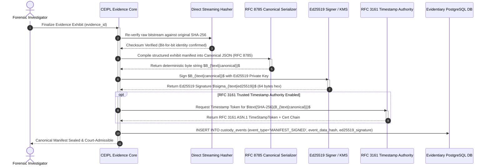

---

### 10.B.2 Custody Event Hash-Chaining & Merkle Batch Checkpointing Flow

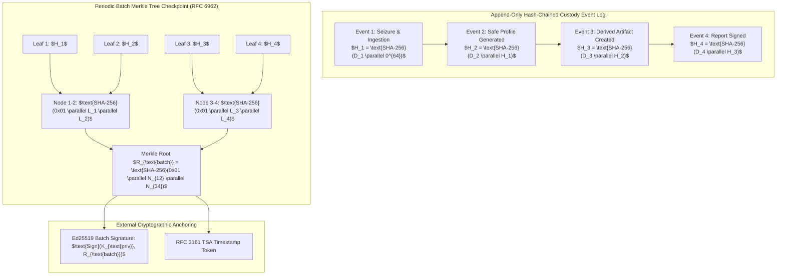

---

### 10.B.3 CEIPL Component Specifications

#### CEIPL-01: Raw-Byte Streaming SHA-256 Direct Hashing
- Primary digest: FIPS 180-4 SHA-256 calculated directly from raw seized stream before any image decoding or metadata parsing.
- Auxiliary digest: FIPS 202 SHA3-512 calculated concurrently using chunked 64KB buffers.
- Verification Rule: Any byte alteration produces immediate `HASH_MISMATCH` critical alert.

#### CEIPL-02: RFC 8785 Canonical JSON Manifests
- Manifests are formatted using JSON Canonicalization Scheme (RFC 8785 / JCS), enforcing deterministic key sorting, whitespace removal, and IEEE 754 number representation.
- Prevents signature invalidation caused by JSON key re-ordering across heterogeneous programming environments.

#### CEIPL-03: Ed25519 Digital Signatures & Key Lifecycle
- Manifests and certificates are signed with Ed25519 (RFC 8032) providing 128-bit security with high signing throughput.
- Keys are managed in HSM or KMS (PKCS#11 / Cloud KMS). Private keys are **never** logged or exposed to application code.

#### CEIPL-04: RFC 3161 Trusted Timestamp Authority (TSA) Integration
- Requests trusted timestamp tokens from an external RFC 3161 compliant Time Stamping Authority.
- Verifies X.509 certificate chains, ensuring independent proof that an exhibit existed at an exact point in time.

#### CEIPL-05: Append-Only Hash-Chained Custody Event Logs
- Every action on an evidence exhibit creates an immutable event record chained to the previous event:
  $$H_i = \text{SHA-256}(\text{CanonicalData}_i \parallel H_{i-1})$$
- Detects unauthorized deletion, modification, or reordering of custody records.

#### CEIPL-06: RFC 6962 Merkle Tree Batch Checkpoints & Inclusion Proofs
- Aggregates custody events and exhibits into RFC 6962 compliant binary Merkle trees.
- Generates compact cryptographic inclusion proofs of size $O(\log N)$, allowing court verification of specific exhibits without disclosing unrelated case records.

#### CEIPL-07: Derived Artifact Lineage DAG & Coordinate Transform Manifests
- Every derived image (crop, normalized array, perspective rectification, tile) is registered in an immutable DAG with its parent artifact ID, parent SHA-256, child SHA-256, transform operator, parameters, and linear affine matrix $M \in \mathbb{R}^{3\times 3}$.
- Guarantees that any finding on a derived crop can be mapped back to original exhibit pixel coordinates with mathematical certainty.

#### CEIPL-08: C2PA Content Credentials & Trust Chain Verification
- Parses C2PA (Coalition for Content Provenance and Authenticity) JUMBF metadata boxes.
- Validates claim signatures, signer X.509 certificate chains, and content bindings. Reports whether an image contains valid provenance metadata or an altered claim.

#### CEIPL-09: Authenticated Storage Encryption (AES-256-GCM / KMS)
- Exhibits and derived artifacts at rest are encrypted using AES-256-GCM with unique initialization vectors (IVs). Key management is decoupled from evidence storage.

#### CEIPL-10: Immutable WORM Storage & POSIX 0400 Enforcement
- Original raw files are stored in write-once-read-many partitions with POSIX `0400` read-only permissions and S3 Object Lock in Compliance Mode.

#### CEIPL-11: Cryptographic Failure Code Taxonomy
When verification fails, CEIPL returns explicit typed failure codes:
- `HASH_MISMATCH`: Seized file bitstream differs from acquisition checksum.
- `SIGNATURE_INVALID`: Digital signature failed mathematical verification against public key.
- `SIGNING_KEY_UNTRUSTED`: Public key not found in authorized judicial certificate authority.
- `SIGNING_KEY_REVOKED`: Key is flagged revoked in CRL or OCSP check.
- `TIMESTAMP_INVALID`: RFC 3161 TSA token signature invalid or certificate expired.
- `CONTENT_BINDING_MISMATCH`: C2PA claim hash differs from image pixel hash.
- `MANIFEST_UNSUPPORTED`: Manifest schema version not recognized by platform.
- `CUSTODY_CHAIN_BROKEN`: Event hash does not equal hash of previous event link.
- `MERKLE_PROOF_INVALID`: Leaf inclusion proof failed to hash to committed Merkle root.
- `RETENTION_POLICY_FAILURE`: Unauthorized attempt to modify or delete WORM-locked exhibit.
- `ENCRYPTION_OR_RETRIEVAL_FAILURE`: Key decryption failure or missing vault segment.
- `VERIFICATION_INCONCLUSIVE`: Verification service unreachable or prerequisite data missing.

---

### 10.C AIF & CEIPL Technology Registry & Module-to-Tool Matrix

The following matrix documents every planned tool, library, and deep learning model across the AIF subsystem and shared CEIPL foundation:

| Module ID | Forensic Responsibility | Candidate Tool / Model | Official Repo / Source | License Status | Input Contract | Output Contract | Hardware / RAM Target | Version Pinning | Known Limitations | Current Status |
| :--- | :--- | :--- | :--- | :--- | :--- | :--- | :--- | :--- | :--- | :--- |
| **IVE-01** | Safe format profiling & limits | Pillow + python-magic | `python-pillow/Pillow` | HPND (Permissive) | Raw image byte stream | `ImageProfile` JSON | CPU (1 core, 512MB RAM) | `Pillow==10.3.0` | Malformed Exif in rare camera RAW formats | `PLANNED` |
| **IVE-02/03** | 150-category multi-label scene triage | SigLIP / ViT-SO400M | `google-research/big_vision` | Apache-2.0 | Normalized sRGB ($336\times 336$) | `List[TaxonomyAnnotation]` | GPU ($\ge 4\text{GB}$ VRAM) / CPU float32 | `transformers==4.40.2` | Zero-shot open vocabulary domain drift on forensic injury | `PLANNED` |
| **IVE-04** | Object detection & instance masks | YOLOv8x / SAM 2 | `ultralytics/ultralytics`, `facebookresearch/segment-anything-2` | AGPL-3.0 / Apache-2.0 | Tiled RGB ($1024\times 1024$) | `List[DetectedObject]` | GPU ($\ge 8\text{GB}$ VRAM) | `ultralytics==8.2.14`, `sam2==1.0` | Heavy memory footprint with SAM 2; NMS boundary overlap | `PLANNED` |
| **IVE-05** | Occlusion-aware people counting | Custom dual-head YOLO + Hungarian | `ps05.engines.image.ive` | Proprietary (PS-05) | High-res RGB tensor | `PeopleCountResult` | GPU ($\ge 4\text{GB}$ VRAM) | Internal | Severe crowd occlusion ($> 85\%$) degrades person bounding | `PLANNED` |
| **IVE-06 / FPA**| Face detection & 468 3D landmarks | RetinaFace + MediaPipe Face Mesh | `biubug6/Pytorch_Retinaface`, `google/mediapipe` | MIT / Apache-2.0 | Bounding face crop | `FaceRegion` + 468 mesh | CPU (2 cores) / GPU | `mediapipe==0.10.14`, `retinaface-pytorch` | Degrades under extreme yaw ($> 60^\circ$) or resolution $< 48\text{px}$ | `PLANNED` |
| **IVE-07 / FPA**| Authorized 1:1 face similarity | ArcFace (IResNet-100) / MagFace | `deepinsight/insightface` | MIT | Aligned $112\times 112$ face crop + Case Token | `BiometricComparisonResult` | GPU / CPU float32 | `insightface==0.7.3` | Cross-age and cross-resolution false match variance | `PLANNED` |
| **IVE-08** | Document layout & OCR | Canny + Homography + PaddleOCR | `PaddlePaddle/PaddleOCR` | Apache-2.0 | Document image | `DocumentOCRResult` | CPU / GPU | `paddleocr==2.7.3` | Complex curved/wrinkled documents distort quad warp | `PLANNED` |
| **IRE-01** | Deep EXIF/XMP/IPTC container audit | ExifTool read-only wrapper | `PhilHarvey/Image-ExifTool` | Artistic / GPL-1.0+ | File path on disk | `MetadataAuditReport` | CPU (minimal) | `exiftool==12.84` | Metadata easily stripped by messaging intermediaries | `PLANNED` |
| **IRE-02** | 2D FFT & DCT spectral statistics | NumPy / SciPy 2D FFT | `scipy/scipy` | BSD-3-Clause | Grayscale luminance matrix | `SignalAnalysisResult` | CPU (1 core, 1GB RAM) | `scipy==1.13.0`, `numpy==1.26.4` | Downsampling removes high-frequency resampling peaks | `PLANNED` |
| **IRE-03** | Classical CV geometric forensics | OpenCV (Canny, SIFT, RANSAC) | `opencv/opencv-python` | Apache-2.0 | Grayscale questioned + reference | `GeometricForensicResult` | CPU (2 cores) | `opencv-python-headless==4.9.0.80` | Featureless, smooth surfaces yield insufficient SIFT matches | `PLANNED` |
| **IRE-04** | Copy-Move Forgery Detection (CMFD) | SIFT k-d tree DBSCAN + DCT | `ps05.engines.image.ire` | Proprietary (PS-05) | Full-res RGB array | `CMFDResult` + polygon masks | CPU / GPU | Internal | High computational complexity $O(N^2)$ on 50MP images | `PLANNED` |
| **IRE-05** | Sensor PRNU noise fingerprinting | Wavelet denoising + NCC | `ps05.engines.image.ire` | Proprietary (PS-05) | Questioned image + 25 reference flats | `PRNUResult` + correlation $\rho$ | CPU (4 cores, 4GB RAM) | `PyWavelets==1.6.0` | Social-media lossy recompression damages PRNU noise | `RESEARCH_CANDIDATE` |
| **IRE-06** | Re-compression & platform history | DQT Catalog + Blocking Discrepancy | `ps05.engines.image.ire` | Proprietary (PS-05) | JPEG binary bitstream | `CompressionProvenanceResult` | CPU (1 core) | Internal | Non-JPEG images lack standard quantization markers | `PLANNED` |
| **AIM-01** | Synthetic AI-image classifier | Multi-branch ResNet50 + FFT + SigLIP | `ps05.engines.image.aim` | Proprietary (PS-05) | $512\times 512$ patches & full-res | `AIGenerationResult` | GPU ($\ge 8\text{GB}$ VRAM) | Internal + PyTorch 2.3 | Out-of-distribution generators (unseen architectures) | `PLANNED` |
| **AIM-02** | Generative inpainting localization | TruFor / CAT-Net | `grip-unina/TruFor` | Academic / Research | Full-res RGB array | `InpaintingLocalizationResult` | GPU ($\ge 8\text{GB}$ VRAM) | `torch==2.3.0` | False positives on natural high-contrast shadow boundaries | `PLANNED` |
| **AIM-03** | Face swap & morphing forensics | Face X-Ray blend boundary net | `ps05.engines.image.aim` | Proprietary (PS-05) | Aligned face crop ($256\times 256$) | `FaceManipulationResult` | GPU ($\ge 4\text{GB}$ VRAM) | Internal | Heavy skin airbrushing / beauty filters mimic tampering | `PLANNED` |
| **AIM-04** | Steganography & hidden data audit | LSB / SPA / RS / Rich Models | `ps05.engines.image.aim` | Proprietary (PS-05) | Bitstream + pixel arrays | `SteganalysisResult` | CPU (2 cores) | Internal | High miss rate on low embedding rates ($< 0.05$ bpp) | `PLANNED` |
| **AIM-05** | Defensive file vulnerability defense | Magic bytes + trailing byte parser | `ps05.engines.image.aim` | Proprietary (PS-05) | Seized raw bitstream | `FileSecurityAudit` | CPU (1 core) | Internal | Zero-day parser vulnerabilities in underlying C libraries | `PLANNED` |
| **CEIPL-01** | Raw direct dual-hashing | `hashlib` (FIPS OpenSSL backend) | Python standard library | Python Software Foundation | Chunked raw byte stream | SHA-256 and SHA3-512 hex | CPU (1 core) | Native Python 3.12 | None | `IMPLEMENTED` |
| **CEIPL-02** | Deterministic canonical JSON | `canonicaljson` (RFC 8785 JCS) | `matrix-org/python-canonicaljson` | Apache-2.0 | Arbitrary JSON dict | Deterministic UTF-8 bytes | CPU (minimal) | `canonicaljson==2.0.0` | Floating-point rounding edge cases | `PLANNED` |
| **CEIPL-03** | Digital signatures & key management | `cryptography` (Ed25519 / RFC 8032) | `pyca/cryptography` | Apache-2.0 / BSD | Canonical byte string | 64-byte Ed25519 signature | CPU (minimal) | `cryptography==42.0.7` | Key compromise without revocation mechanism | `PLANNED` |
| **CEIPL-04** | RFC 3161 Trusted Timestamping | `rfc3161ng` / PyKCS11 | `trbs/rfc3161ng` | MIT | SHA-256 exhibit digest | ASN.1 TimeStampToken | Network I/O (HTTPS) | `rfc3161ng==2.1.3` | TSA service unavailability / network timeouts | `PLANNED` |
| **CEIPL-05** | Append-only hash-chained custody | `ps05.core.crypto.custody_chain` | Proprietary (PS-05) | Proprietary (PS-05) | Custody event payload | 64-char hex chain hash | CPU (minimal) | Internal | Privileged DB admin rewriting all rows (requires Merkle) | `PLANNED` |
| **CEIPL-06** | Merkle tree batch checkpoints | `ps05.core.crypto.merkle_tree` | Proprietary (PS-05) | Proprietary (PS-05) | List of leaf hashes | Merkle Root + Inclusion Proof | CPU (1 core) | Internal | Dynamic re-ordering of uncommitted batches | `PLANNED` |
| **CEIPL-07** | Derived Artifact Lineage DAG | `ps05.core.crypto.lineage` | Proprietary (PS-05) | Proprietary (PS-05) | Parent ID + Operator + $M_{3\times 3}$ | Child Artifact Record | CPU (minimal) | Internal | Cyclic dependency attempts (rejected by DAG validator) | `PLANNED` |
| **CEIPL-08** | C2PA Content Credentials audit | `c2pa-python` (Rust C2PA library) | `contentauth/c2pa-rs` | MIT / Apache-2.0 | Image file path | `C2PAValidationResult` | CPU (1 core) | `c2pa-python==0.5.0` | Proprietary / non-standard claim formats rejected | `PLANNED` |

---

## 11. VISTA Video Forensics Subsystem Technical Specification

The **VISTA** (Video Integrity, Synchronization & Tampering Analysis) subsystem provides a comprehensive, multi-engine forensics platform for judicial analysis of seized video recordings, surveillance CCTV/DVR footage, and multimedia broadcasts. It operates in strict accordance with Indian evidentiary requirements under Section 65B of the Indian Evidence Act (IEA) and Section 63 of the Bharatiya Sakshya Adhiniyam (BSA 2023).

### 11.1 Complete VISTA Subsystem Architecture & Engine Boundaries

VISTA comprises five core forensic engines and a cross-cutting CCTV Forensic Profile, backed by the shared CEIPL (Cryptographic Evidence Integrity & Provenance Layer) and an asynchronous derived artifact Directed Acyclic Graph (DAG):

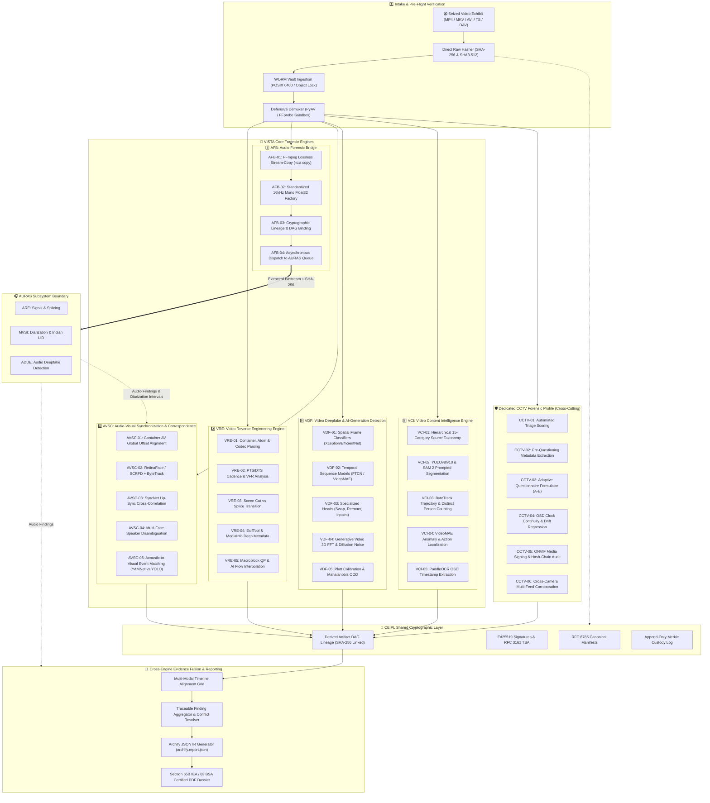

#### 11.1.1 Video Evidence Intake & Safe Pre-Flight Parsing Sequence Flow

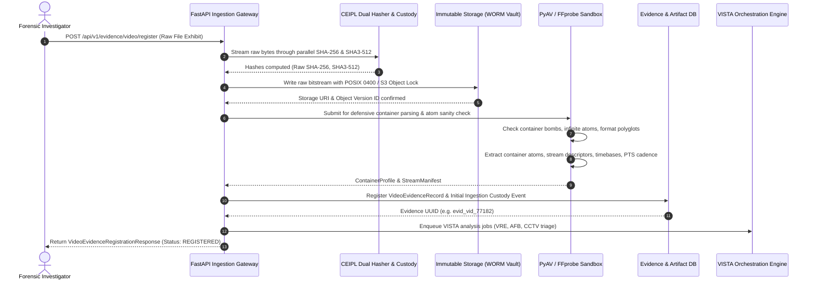

### 11.2 VRE Technical Specification (Video Reverse Engineering Engine)

The Video Reverse Engineering Engine (VRE) operates directly on the container, bitstream, packet cadence, and encoding structures of the video file without requiring full raster frame decoding for initial passes.

#### 11.2.1 Container, Atom & Codec Parsing (`ps05.engines.vista.vre.bitstream`)
- **Supported Containers:** MP4/MOV (ISO/IEC 14496-12), MKV/WebM (EBML), AVI (RIFF), MPEG-TS (`.ts`, `.m2ts`), proprietary DVR bitstreams (`.dav`, `.h264`, `.h265`, `.sec`).
- **Atom/Box Deep Inspection (MP4/MOV):**
  - Parses `ftyp` (compatible brands), `moov` (metadata header), `mvhd` (movie header), `tkhd` (track header), `mdhd` (media header), and `mdat` (media data).
  - Evaluates `moov` position relative to `mdat`: `moov` at the end of the file indicates conventional single-pass camera encoding; `moov` moved to the beginning (`faststart`) typically indicates post-processing via FFmpeg or desktop video editors.
  - Verifies `stts` (time-to-sample), `ctts` (composition time offset), and `stss` (sync sample / keyframe table) consistency against physical packet counts.
- **Defensive Demuxing & Allocation Caps:**
  - Implements defensive wrappers around PyAV (`av.open()`) with custom I/O timeouts (10 seconds per packet read).
  - Enforces strict parsing caps: maximum memory allocation per container header parser $\le 256\text{ MB}$; maximum packet queue length $= 2048$ packets.

#### 11.2.2 Presentation Timestamp (PTS/DTS) Cadence & VFR Analysis (`ps05.engines.vista.vre.cadence`)
- **Cadence Continuity Check:**
  - Extracts packet Presentation Time Stamps ($PTS_k$) and Decompression Time Stamps ($DTS_k$) for every stream packet:
    $$\Delta PTS_k = PTS_k - PTS_{k-1}$$
  - For Constant Frame Rate (CFR) streams, verifies that $\Delta PTS_k = \frac{1}{\text{fps} \cdot \text{timebase}} \pm \epsilon$.
  - For Variable Frame Rate (VFR) streams (common in smartphones and CCTV), models frame intervals as a continuous distribution, computing instantaneous frame rate $\text{fps}(t) = \frac{1}{\Delta PTS(t)}$ and jitter variance $\sigma^2_{\text{vfr}}$.
- **Frozen & Dropped Frame Detection:**
  - Identifies duplicate/frozen frame spans where frame hashes or structural differences satisfy $\Delta(F_t, F_{t+1}) < \theta_{\text{frozen}}$ over $\ge 1.0\text{ s}$ during non-static scenes.
  - Detects non-monotonic PTS reversals ($PTS_k < PTS_{k-1}$), zero-duration frames, or missing packet indexes indicative of sequence excision.

#### 11.2.3 Scene Cut Detection vs Splice Transitions (`ps05.engines.vista.vre.scene_cuts`)
- **PySceneDetect Adaptive Integration:**
  - Implements dual-threshold scene boundary detection using HSV color histogram differences and structural edge changes.
  - Classifies transitions into:
    1. *Hard Cuts:* Abrupt content change within $\le 1$ frame.
    2. *Dissolves/Fades:* Gradual linear blending over multiple frames ($N \ge 8$).
    3. *Excised Cuts (Splicing):* Hard content shift occurring *without* an associated encoder keyframe (I-frame) insertion, or featuring broken motion vector predictors in the succeeding P-frame.

#### 11.2.4 ExifTool & MediaInfo Deep Metadata Audit (`ps05.engines.vista.vre.metadata`)
- Executes vendored ExifTool and MediaInfo across container headers and embedded user data atoms (`udta`, `uuid` XMP, quicktime user data).
- Verifies camera serial numbers, lens metadata, firmware revisions, and GPS tracks.
- Cross-references container `HandlerDescription` and `Encoder` metadata against known video editing software footprints (Adobe Premiere, Apple Final Cut Pro, DaVinci Resolve, HandBrake, FFmpeg).

#### 11.2.5 Macroblock QP Distribution & AI Flow Interpolation (`ps05.engines.vista.vre.reencode`)
- **Macroblock Quantization Parameter (QP) Analysis:**
  - Extracts macroblock-level quantization parameters ($QP \in [0, 51]$) across H.264/AVC and H.265/HEVC streams using PyAV motion vector and packet side-data access.
  - Computes QP histogram variance across spatial frames. Re-encoded video exhibits characteristic periodic QP modulation (GOP pulsing) and DCT coefficient double-compression histogram peaks.
- **AI Frame Interpolation Artifact Detection:**
  - Detects tell-tale visual flow blending halos and warped occlusion boundaries characteristic of neural frame rate up-conversion models (RIFE, DAIN, CAIN).
  - Computes forward-backward optical flow consistency error:
    $$E_{\text{flow}}(x, y) = ||\mathbf{v}_{t \to t+1}(x, y) + \mathbf{v}_{t+1 \to t}(x + v_x, y + v_y)||_2$$
  - High residual flow error along object boundaries paired with high visual sharpness indicates synthetic frame synthesis rather than native camera exposure.

---

### 11.3 AFB Technical Specification (Audio Forensic Bridge)

The Audio Forensic Bridge (AFB) connects the video subsystem to the AURAS audio forensics subsystem while preserving pristine evidentiary separation and avoiding duplicate algorithmic implementations.

#### 11.3.1 Lossless Stream-Copy Extraction (`ps05.engines.vista.afb.extractor`)
- **Zero-Transcode Invariant:**
  - Video exhibits containing one or more audio tracks are demuxed using FFmpeg with strict stream-copy flags:
    ```bash
    ffmpeg -nostdin -y -loglevel error -i <video_path> -map 0:a:<index> -c:a copy <output_audio_path>
    ```
  - Preserves exact source bitstream bytes (AAC, MP3, AC3, Opus, PCM) without generational loss or psychoacoustic re-compression.
- **Multi-Track Audio Handling:**
  - Scans all available audio streams (`0:a:0`, `0:a:1`, ...).
  - Extracts each track into a separate exhibit derivative, tagging channel layout (mono, stereo, 5.1 surround).

#### 11.3.2 Standardized 16 kHz Mono Float32 Factory (`ps05.engines.vista.afb.resampler`)
- For downstream speech and deepfake engines requiring uniform inputs, AFB generates a reproducible standardized derivative:
  - Band-limited Kaiser sinc-resampling to $16,000\text{ Hz}$.
  - Channel downmixing via active speech energy-preserving average:
    $$x_{\text{mono}}[n] = \frac{1}{C} \sum_{c=1}^C x_c[n]$$
  - Serialized as uncompressed IEEE 754 32-bit float WAV.

#### 11.3.3 Cryptographic Lineage & DAG Binding (`ps05.engines.vista.afb.lineage`)
- Computes SHA-256 and SHA3-512 hashes on both the extracted raw bitstream and the standardized WAV.
- Records a child relationship in the CEIPL DAG linking `child_audio_evidence_id` directly to `parent_video_evidence_id`, preserving source container byte offsets and stream indices.

#### 11.3.4 Asynchronous AURAS Dispatch & Sequence Flow (`ps05.engines.vista.afb.auras_client`)

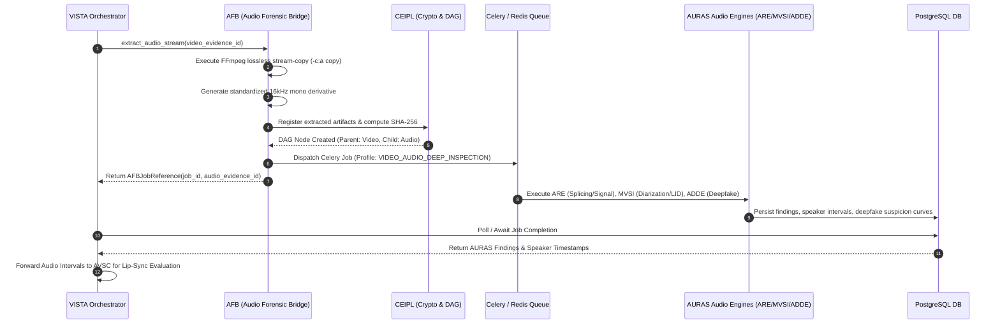

#### 11.3.5 Diarization Alignment & Overlapped Speech Separation (`ps05.engines.vista.afb.separation`)
- Synchronizes MVSI-produced speaker turn intervals $[t_{\text{start}}, t_{\text{end}}]$ with the video container timebase.
- When MVSI detects overlapping speech (`is_overlapped == True`), AFB triggers SpeechBrain SepFormer to isolate concurrent talker signals into clean acoustic streams prior to lip-sync cross-correlation.

---

### 11.4 AVSC Technical Specification (Audio-Visual Synchronization & Correspondence Engine)

The Audio-Visual Synchronization & Correspondence Engine (AVSC) evaluates physical and acoustic coherence between visual events and the accompanying sound track, resolving intentional re-dubbing, replacement audio, and synthetic talking-head desynchronization.

#### 11.4.1 Container AV Global Offset Alignment (`ps05.engines.vista.avsc.alignment`)
- Compares initial video presentation timestamp $PTS_{v, 0}$ against initial audio presentation timestamp $PTS_{a, 0}$:
  $$\Delta t_{\text{global}} = PTS_{a, 0} - PTS_{v, 0}$$
- Evaluates total track duration discrepancies:
  $$\Delta T = |T_{\text{video}} - T_{\text{audio}}|$$
- Global offsets exceeding standard playback tolerances ($|\Delta t| > 150\text{ ms}$) or duration mismatches ($|\Delta T| > 500\text{ ms}$) trigger container-level desynchronization warnings.

#### 11.4.2 RetinaFace Detection & ByteTrack Trajectory Association (`ps05.engines.vista.avsc.face_track`)
- **High-Recall Face Detection:**
  - Evaluates video frames using RetinaFace / SCRFD with ResNet-50 backbone.
  - Detects multi-scale faces down to $20 \times 20$ pixels, outputting 5 facial keypoints (eyes, nose, mouth corners) and detection confidence $c_{\text{face}}$.
- **Multi-Object Trajectory Association:**
  - Implements ByteTrack algorithm associating detected face boxes across frames via Kalman filter state prediction and Hungarian matching.
  - Maintains unique facial track identifiers (`face_track_id`) across occlusions, head turns, and brief camera cuts.
  - Retains pose angles (yaw, pitch, roll) and face quality scores for every tracked frame.

#### 11.4.3 Canonical Mouth Crop Normalization (`ps05.engines.vista.avsc.mouth_roi`)
- Extracts 468 3D facial landmarks per frame via MediaPipe FaceMesh.
- Identifies outer and inner lip landmark clusters (indices: 61, 291, 0, 17, 78, 308, 13, 14).
- Applies similarity transform aligning lip centers horizontally, cropping a canonical $96 \times 96$ RGB region centered on the mouth.
- Resamples mouth crop sequences to a steady $25\text{ fps}$ visual tube.

#### 11.4.4 SyncNet Lip-Sync Cross-Correlation Architecture (`ps05.engines.vista.avsc.syncnet`)

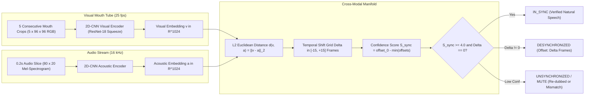

- **Mathematical Formulation:**
  - Visual embedding $\mathbf{v}(t) \in \mathbb{R}^{1024}$ is computed over a 5-frame sliding window centered at time $t$.
  - Acoustic embedding $\mathbf{a}(t + \Delta) \in \mathbb{R}^{1024}$ is computed over the corresponding 0.2-second mel-spectrogram slice shifted by offset $\Delta \in [-15, +15]$ frames ($\approx \pm 600\text{ ms}$).
  - Distance curve:
    $$D(\Delta) = ||\mathbf{v}(t) - \mathbf{a}(t + \Delta)||_2$$
  - Lip-sync confidence metric:
    $$S_{\text{sync}} = \text{median}(D) - \min_{\Delta} D(\Delta)$$
  - Optimal offset $\Delta^* = \arg\min_{\Delta} D(\Delta)$.
  - A segment is classified as `IN_SYNC` if $S_{\text{sync}} \ge 4.0$ and $|\Delta^*| \le 1$ frame.
  - If $S_{\text{sync}} < 2.5$, the segment indicates either silent mouth movement, voice-over dubbing, or synthetic facial replacement.

#### 11.4.5 Multi-Face Speaker Disambiguation & Bystander Handling (`ps05.engines.vista.avsc.multi_face`)
- In scenes with multiple concurrent visible persons:
  1. Computes independent $S_{\text{sync}, i}(t)$ curves for every tracked face $i \in \{1, \dots, N\}$.
  2. Compares active speech intervals from AURAS-MVSI against individual face sync scores.
  3. Attributes acoustic dialogue to face $i^*$ satisfying $\max_i S_{\text{sync}, i}(t)$, provided $S_{\text{sync}, i^*} \ge 4.0$.
  4. Non-speaking faces with $S_{\text{sync}} < 2.5$ are formally classified as `BYSTANDER_SILENT`, preventing false-positive re-dubbing findings on passive individuals in the frame.

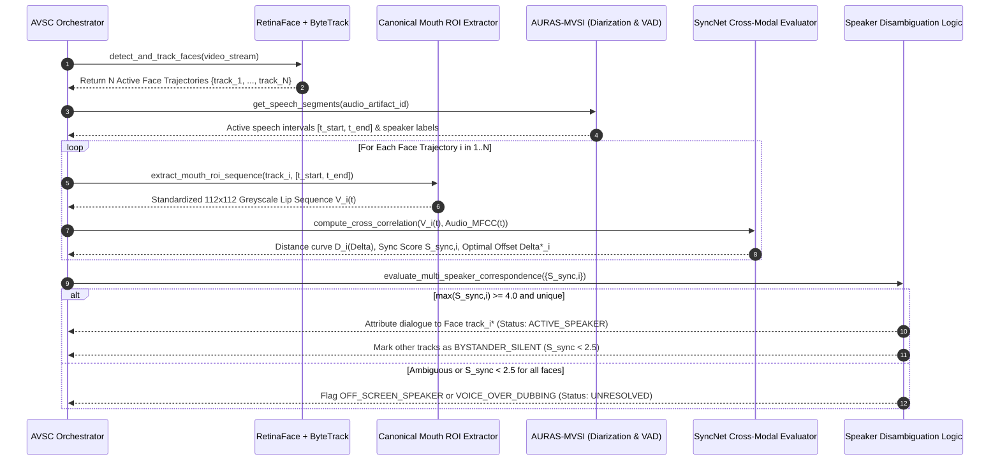

#### 11.4.6 Sound-to-Visual Event Correspondence (`ps05.engines.vista.avsc.event_corr`)
- Correlates abrupt acoustic transient events with localized visual phenomena:
  - Acoustic event classifier (YAMNet / AST) detects sound classes: *Gunshot, Explosion, Glass Shatter, Muzzle Blast, Vehicle Screech, Scream*.
  - Visual detector (YOLOv8x / VideoMAE) tracks visual classes: *Firearm Discharge Flash, Shattering Window, Vehicle Collision, Person Fall*.
  - Evaluates cross-modal temporal difference:
    $$\Delta t_{\text{event}} = t_{\text{acoustic}} - t_{\text{visual}}$$
  - Physics constraint: Light travels faster than sound; visual event MUST precede or equal acoustic event ($0 \le \Delta t_{\text{event}} \le \frac{d_{\max}}{343\text{ m/s}} + \epsilon$). If an acoustic gunshot occurs *prior* to the visible flash ($\Delta t_{\text{event}} < -50\text{ ms}$), an audio splicing/re-dubbing anomaly is flagged.

---

### 11.5 VDF Technical Specification (Video Deepfake & AI-Generation Detection Engine)

The Video Deepfake & AI-Generation Detection Engine (VDF) integrates spatial frame-level models, temporal sequence transformers, and specialized manipulation heads to detect face swaps, facial reenactments, generative inpainting, and text-to-video synthesis.

#### 11.5.1 Spatial Frame-Level Classifiers (`ps05.engines.vista.vdf.frame_detect`)
- **Backbone Architectures:**
  - *XceptionNet Forensics:* Standard forensic baseline trained on FaceForensics++ high-compression (c23 and c40) splits.
  - *EfficientNet-B4 Dual-Domain:* Parallel dual-branch architecture ingesting normalized spatial RGB face crops ($380 \times 380$) and 2D Discrete Cosine Transform (DCT) high-frequency residual planes.
- **Artifact Localization:**
  - Detects blending seam discontinuities along the jawline, forehead, and perimeter of swapped facial masks.
  - Identifies color-space mismatches ($\Delta E_{\text{Lab}}$) between the inner facial skin and surrounding head/neck boundaries.

#### 11.5.2 Temporal Sequence Classifiers (`ps05.engines.vista.vdf.temporal`)
- **FTCN (Fully Temporal Convolution Network):**
  - Ingests sliding 16-frame face sequences ($16 \times 3 \times 224 \times 224$).
  - Implements temporal-only 3D convolutions with spatial receptive field reduced to $1 \times 1$.
  - Enforces temporal consistency evaluation: synthetic deepfakes exhibit high-frequency frame-to-frame pixel flicker, facial landmark jitter, and unnatural eye blinking cadences that spatial models fail to detect.
- **VideoMAE Foundation SSL Head:**
  - Evaluates temporal video representations using a pre-trained VideoMAE ViT-Base encoder.
  - Extracts 768-dimensional sequence feature tokens across 16-frame windows with 8-frame temporal stride.

#### 11.5.3 Specialized Forensic Manipulation Heads (`ps05.engines.vista.vdf.manipulation`)
1. **Face Swap Detection Head:** Focuses on identity mismatch between facial landmarks and external cranial bone structure.
2. **Face Reenactment / Lip-Sync Head:** Focuses on unnatural boundary warping around oral and periorbital regions.
3. **Generative Inpainting Head:** Uses spatial frequency residual maps to detect generative object removal or background patching.

#### 11.5.4 Text-to-Video Generative Synthesis Detection (`ps05.engines.vista.vdf.generative`)
- Ingests non-face video clips generated by foundation text-to-video diffusion and autoregressive architectures (Sora, Runway Gen-2/Gen-3, Pika, Kling, Luma Dream Machine).
- **3D Spatio-Temporal FFT Spectrum Inspection:**
  - Computes 3D Fast Fourier Transform across volume $V(x, y, t)$:
    $$F(u, v, \omega) = \iiint V(x, y, t) e^{-j 2\pi (ux + vy + \omega t)} dx dy dt$$
  - Generative video models exhibit abnormal temporal power decay: authentic video maintains steady physical momentum spectra, whereas diffusion models exhibit anomalous high-frequency temporal noise floor pulsing and spatial morphing artifacts.

#### 11.5.5 Score Calibration, Mahalanobis OOD & Late Fusion (`ps05.engines.vista.vdf.calibration`)

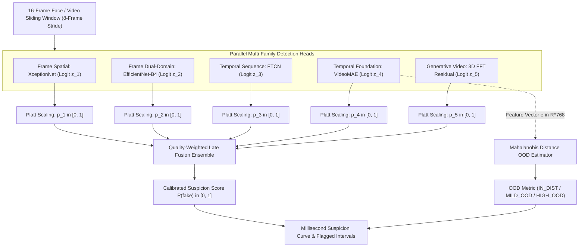

- **Platt Scaling Logistic Calibration:**
  $$p_k = \frac{1}{1 + \exp(A_k z_k + B_k)}$$
  Fitted on held-out validation splits to guarantee Expected Calibration Error $ECE < 0.05$.
- **Quality-Weighted Late Fusion:**
  $$P(\text{fake}) = \sum_{k=1}^K w_k(q) \cdot p_k, \quad \sum w_k = 1.0$$
  Weights $w_k(q)$ dynamically scale with face resolution and compression level: for low-resolution or heavily compressed clips, temporal model weights ($w_{\text{ftcn}}, w_{\text{vmae}}$) are increased while frame spatial weights are dampened.
- **Mahalanobis Out-of-Distribution (OOD) Distance:**
  - Evaluates feature representation $\mathbf{e} \in \mathbb{R}^{768}$ against reference training set distribution $(\boldsymbol{\mu}, \boldsymbol{\Sigma})$:
    $$D_M(\mathbf{e}) = \sqrt{(\mathbf{e} - \boldsymbol{\mu})^T \boldsymbol{\Sigma}^{-1} (\mathbf{e} - \boldsymbol{\mu})}$$
  - If $D_M(\mathbf{e}) > \tau_{\text{ood}}$, emits `OOD_UNCERTAINTY: HIGH`, preventing overconfident false positives on rare codecs or extreme compression.

---

### 11.6 VCI Technical Specification (Video Content Intelligence Engine)

The Video Content Intelligence Engine (VCI) extracts semantic content, tracks entities, counts unique individuals, and reads burned-in camera overlays to establish objective factual timelines.

#### 11.6.1 Hierarchical 15-Category Video Source Taxonomy (`ps05.engines.vista.vci.taxonomy`)
The platform categorizes video exhibits across 15 standard forensic operational sources:
1. `CCTV_FIXED_SURVEILLANCE`: Static or PTZ infrastructure surveillance.
2. `BODY_WORN_CAMERA`: Police/security body-worn dynamic camera.
3. `DASHCAM_VEHICLE`: Vehicle-mounted forward/rear dashcam.
4. `DRONE_AERIAL_SURVEILLANCE`: UAV aerial video stream.
5. `MOBILE_SMARTPHONE_HANDHELD`: Vertical/horizontal mobile phone footage.
6. `MOBILE_SCREEN_RECORDING`: Device capture of another video playback.
7. `SOCIAL_MEDIA_RECOMPRESSED`: WhatsApp, Telegram, Facebook, YouTube transcoded clips.
8. `BROADCAST_STUDIO_FOOTAGE`: High-bitrate interlaced or progressive news footage.
9. `CONFERENCE_VIDEO_CALL`: Zoom, Teams, Google Meet compressed screen grids.
10. `INTERROGATION_ROOM_FACILITY`: Multi-microphone custody facility recording.
11. `COVERT_PINHOLE_DEVICE`: Low-resolution spy/covert recorder.
12. `ANALOG_DIGITIZED_VCR`: Digitized VHS/analog tape with tracking head lines.
13. `ACTION_CAM_EXTREME`: High frame rate GoPro/wide-angle fisheye lens.
14. `AI_SYNTHETIC_GENERATIVE`: Pure text-to-video or synthetic engine generation.
15. `INCONCLUSIVE_CONTAINER`: Ambiguous or unclassifiable recording format.

#### 11.6.2 Object Detection & SAM 2 Prompted Segmentation (`ps05.engines.vista.vci.detector`)
- Primary Object Detector: YOLOv8x / YOLOv10 and RT-DETR identifying 80 standard forensic categories (person, vehicle, firearm, knife, bag, license plate).
- Pixel-Accurate Instance Segmentation: Segment Anything Model 2 (SAM 2) prompted with bounding box centroids to extract exact contour masks of evidentiary objects.

#### 11.6.3 Trajectory Tracking & Distinct Unique Person Counting (`ps05.engines.vista.vci.tracker`)
- **ByteTrack Trajectory Persistence:**
  - Maintains tracklets across occlusions using appearance embeddings and spatial Kalman filters.
- **Unique vs. Cumulative Frame Count Invariant:**
  - Explicitly prevents the forensic error of conflating detection sums with distinct people:
    $$N_{\text{cumulative}} = \sum_{t=1}^T n_{\text{detections}}(t) \quad \gg \quad N_{\text{unique}} = |\text{Unique Track IDs}|$$
  - Implements virtual tripwires and directional entry/exit counting zones. Reports both instantaneous occupancy $N(t)$ and total unique entities $N_{\text{total\_unique}}$.

#### 11.6.4 VideoMAE Action & Anomaly Localization (`ps05.engines.vista.vci.actions`)
- Localizes temporal crime and safety events across video sequences:
  - *Violence / Physical Assault*
  - *Slip & Fall Incident*
  - *Vehicle Collision / Crash*
  - *Firearm / Weapon Draw*
  - *Loitering / Perimeter Intrusion*
- Outputs millisecond start and end timestamps $[t_1, t_2]$ with action classification confidence.

#### 11.6.5 PaddleOCR / Tesseract OSD Timestamp & Channel Extraction (`ps05.engines.vista.vci.ocr_overlay`)
- Locates burned-in on-screen display (OSD) digital clock overlays (typically placed in corner quadrants: top-left, top-right, bottom-left, bottom-right).
- Applies perspective rectification, morphological binarization, and OCR recognition via PaddleOCR and Tesseract.
- Matches text against datetime patterns (`YYYY-MM-DD HH:MM:SS`, `DD/MM/YYYY HH:MM:SS.fff`).
- Emits structured array of parsed clock values $T_{\text{ocr}}(t)$ indexed by frame number.

---

### 11.7 Dedicated CCTV Forensic Profile Technical Specification

Surveillance CCTV and DVR/NVR footage represents a distinct class of forensic evidence characterized by proprietary containers, variable frame rates, burned-in OSD clocks, and multi-camera installations.

#### 11.7.1 Automated Triage Scoring Matrix (`ps05.engines.vista.cctv.triage`)
The platform executes automated multi-signal heuristic classification before prompting the user:

$$\text{Score}_{\text{cctv}} = w_1 S_{\text{codec}} + w_2 S_{\text{vfr}} + w_3 S_{\text{osd}} + w_4 S_{\text{static}} + w_5 S_{\text{aspect}}$$

| Feature | Condition | Weight | Score Contribution |
| :--- | :--- | :--- | :--- |
| **Container & Codec** | `.dav`, `.sec`, raw H.264 Annex B, Hikvision/Dahua headers | 0.25 | 1.0 |
| **Frame Rate** | Non-standard VFR (e.g. 6.25 fps, 10 fps, 12.5 fps, 15 fps) | 0.20 | 1.0 |
| **OSD Clock** | Burned-in digital clock detected in frame margin | 0.25 | 1.0 |
| **Camera Motion** | Static background with zero camera translation/panning | 0.15 | 1.0 |
| **Resolution / Aspect** | 4:3 CIF/D1 or fixed surveillance aspect ratios (704x576) | 0.15 | 1.0 |

- **Classification Thresholds:**
  - $\text{Score}_{\text{cctv}} \ge 0.70 \implies \mathbf{LIKELY\_CCTV}$ (Triggers CCTV Profile automatically).
  - $0.40 \le \text{Score}_{\text{cctv}} < 0.70 \implies \mathbf{POSSIBLY\_CCTV}$ (Prompts examiner for confirmation).
  - $\text{Score}_{\text{cctv}} < 0.40 \implies \mathbf{NON\_CCTV}$ (Standard video profile).

#### 11.7.2 Pre-Questioning Metadata Extraction Order (`ps05.engines.vista.cctv.auto_meta`)
To minimize examiner cognitive burden and avoid asking redundant questions, the system executes automated extraction in strict sequence BEFORE formulating questionnaires:
1. Demux bitstream and read all container metadata atoms (FFprobe).
2. Execute ExifTool deep scan for DVR manufacturer strings, firmware versions, and camera names.
3. Detect presence and bounding box of burned-in OSD clock overlay (PaddleOCR).
4. Calculate packet PTS cadence and detect whether stream is CFR or VFR.
5. Identify native digital signature boxes (ONVIF / Hikvision watermarks).

#### 11.7.3 Complete Versioned CCTVContext JSON Schema (`ps05.engines.vista.cctv.context`)

> **Architectural Status:** `PLANNED` — Proposed illustrative schema. All fields and status transitions are subject to validation upon implementation.

To maintain strict evidentiary provenance under Section 65B IEA / Section 63 BSA, all surveillance parameters and recording context are stored in a versioned, provenance-typed data model. The schema explicitly decouples machine-extracted technical observations from subjective user claims using formal status tags:

- `NOT_PROVIDED`: Parameter was not supplied by the investigator and was not discoverable in bitstream metadata.
- `UNKNOWN`: Inspected but indeterminable from available evidence artifacts.
- `USER_REPORTED`: Provided by the investigator or custodian; **unverified** until independently corroborated.
- `MACHINE_EXTRACTED`: Extracted directly by automated parsers (FFprobe, ExifTool, PaddleOCR) from bitstream headers or visual frames.
- `CORROBORATED`: Cross-verified across two independent sources (e.g., container creation tag corroborated by OSD clock or police seizure memo).
- `VERIFIED`: Cryptographically authenticated via valid vendor digital signature, ONVIF Media Signing token, or trusted reference hash.
- `CONFLICTING`: Two or more evidentiary sources yield contradictory values (e.g., OSD clock shows 14:00 while container metadata states 18:00).
- `NOT_APPLICABLE`: Parameter does not apply to the identified source type.

```json
{
  "schema_version": "1.0.0",
  "evidence_id": null,
  "evidence_context_id": null,
  "evidence_type_candidate": {
    "value": "unknown",
    "status": "UNKNOWN"
  },
  "acquisition": {
    "source_type": {
      "value": "unknown",
      "status": "UNKNOWN"
    },
    "camera_recorder": {
      "manufacturer": null,
      "model": null,
      "device_id": null,
      "camera_channel": null,
      "status": "NOT_PROVIDED"
    },
    "export_type": {
      "value": "unknown",
      "status": "UNKNOWN"
    },
    "export_software": {
      "name": null,
      "version": null,
      "status": "NOT_PROVIDED"
    }
  },
  "time_context": {
    "timezone": {
      "value": null,
      "status": "UNKNOWN"
    },
    "recording_window": {
      "start_time": null,
      "end_time": null,
      "timestamp_semantics": "UNKNOWN",
      "status": "NOT_PROVIDED"
    },
    "recorder_clock_offset": {
      "value_seconds": null,
      "status": "UNKNOWN"
    }
  },
  "associated_evidence": {
    "native_export_available": {
      "value": null,
      "status": "UNKNOWN"
    },
    "sidecar_manifest_available": {
      "value": null,
      "status": "UNKNOWN"
    },
    "signature_or_seal_available": {
      "value": null,
      "status": "UNKNOWN"
    },
    "recorder_log_available": {
      "value": null,
      "status": "UNKNOWN"
    },
    "reference_hash_available": {
      "value": null,
      "status": "UNKNOWN"
    },
    "related_camera_footage_available": {
      "value": null,
      "status": "UNKNOWN"
    }
  },
  "machine_observations": {
    "metadata_extraction_status": "NOT_RUN",
    "ocr_timestamp_extraction_status": "NOT_RUN",
    "cctv_classification_status": "NOT_RUN",
    "cryptographic_verification_status": "NOT_RUN",
    "findings": []
  },
  "follow_up": {
    "workflow_status": "PENDING_AUTOMATIC_DISCOVERY",
    "outstanding_questions": [],
    "user_responses_are_independently_verified": false
  }
}
```

#### 11.7.4 Adaptive Discovery Workflow & Targeted Questionnaire Rules (`ps05.engines.vista.cctv.adaptive_q`)

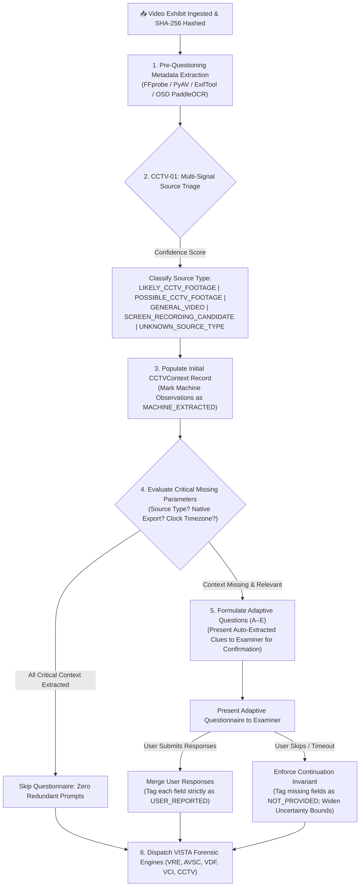

- **Pre-Questioning Principle:** Automated discovery executes *before* any prompt is shown to the investigator. If camera channel labels, recorder manufacturer tags, or OSD clocks are discovered in metadata or frames, they are displayed as extracted clues rather than requested as blank inputs.
- **Adaptive Question Rules (Questions A–E):**
  - **Question A (Source of Recording):** Inquires whether footage originated from: (1) Direct camera export, (2) DVR/NVR native export, (3) Vendor export software, (4) Screen recording of monitor, (5) Mobile phone recording of monitor screen, (6) Messaging/social-media platform (WhatsApp, Telegram), or (7) Unknown source. Extracted container clues (`handler_name`, `encoder`) are shown alongside the prompt.
  - **Question B (Native Export Availability):** If uploaded video is a converted MP4/AVI and proprietary recorder metadata is missing, prompts whether the native DVR backup file (`.dav`, `.h264`, `.sec`) or proprietary verification player is available. If unavailable, analysis proceeds with the current file.
  - **Question C (Camera / Recorder Details):** Prompts for camera manufacturer, model, channel ID, and export software *strictly* when these could activate supported vendor-specific parser plugins (e.g., Dahua DAV packet parsing or Hikvision watermark verification).
  - **Question D (Timezone & Incident Window):** Prompts for the recorder's configured hardware timezone and approximate incident window whenever absolute time interpretation or multi-camera cross-correlation is required. *Crucial Rule:* Never assume the investigator's local workstation timezone is identical to the recorder's timezone.
  - **Question E (Corroborating Evidence):** Prompts for adjacent camera angles, recorder transaction logs, trusted seizure hash memos, or chain-of-custody documentation. *Security Invariant:* Never request device root passwords or unrestricted network access.
- **Adaptive Continuation Invariant:**
  - If the investigator skips answering questions or context remains unknown, the pipeline **MUST NEVER BLOCK OR HALT**.
  - Analysis continues immediately, logging missing context as `NOT_PROVIDED` and expanding confidence intervals on downstream findings (e.g., widening clock drift tolerance when time synchronization status is unknown).
  - Every user-supplied claim is tagged `USER_REPORTED` and must never be cited as verified forensic ground truth without independent machine corroboration.

#### 11.7.5 Clock Continuity Drift Regression & Anomaly Criteria (`ps05.engines.vista.cctv.clock_drift`)
- **Regression Formulation:**
  - For every decoded frame with a valid OCR timestamp $T_{\text{ocr}}(t)$ and container presentation timestamp $t_{\text{pts}}$:
    $$\delta(t) = T_{\text{ocr}}(t) - (T_0 + t_{\text{pts}})$$
  - Evaluates linear drift slope: $\delta(t) = \alpha + \beta t + \epsilon(t)$.
- **Forensic Anomaly Triggers:**
  1. *Clock Jump / Frame Removal:* An instantaneous step change $|\Delta T_{\text{ocr}}| \ge 1.0\text{ s}$ while $t_{\text{pts}}$ continues monotonically indicates deleted surveillance footage.
  2. *Clock Stalling / Freeze:* $T_{\text{ocr}}$ remains constant over $N \ge 10$ frames while $t_{\text{pts}}$ advances indicates a video freeze attack or looped footage.
  3. *Clock-PTS Desynchronization:* Linear drift $|\beta| > 0.01\text{ s/s}$ indicates frame-rate conversion or altered playback speed.

#### 11.7.6 ONVIF Export File Format & Media Signing Verification (`ps05.engines.vista.cctv.onvif_seals`)

```mermaid
sequenceDiagram
    autonumber
    participant EXHIBIT as Seized ONVIF Export (.mp4 / .mkv + XML)
    participant PARSER as ONVIF Packaging Demuxer
    participant CERT as X.509 Certificate Store & CA
    participant HASH_VAL as NAL Unit Dual-Hasher
    participant VERIFIER as Media Signing Verifier

    EXHIBIT->>PARSER: Ingest ONVIF Export Package
    PARSER->>PARSER: Parse XML / SMIL Signature Box (urn:onvif:media-signing)
    PARSER->>CERT: Extract Embedded Signing Certificate
    CERT->>CERT: Validate Chain of Trust & Expiration
    
    PARSER->>HASH_VAL: Stream Raw H.264/H.265 NAL Units
    HASH_VAL->>HASH_VAL: Compute Continuous SHA-256 NAL Hash Chain
    HASH_VAL-->>VERIFIER: Computed Stream Digest
    
    PARSER->>VERIFIER: Extract Signed Digest from Media Signature Atom
    VERIFIER->>VERIFIER: Verify RSA-SHA256 / ECDSA-SHA256 Signature
    
    alt Signature Matches & Hash Chain Intact
        VERIFIER-->>EXHIBIT: Status: ONVIF_MEDIA_SEAL_VERIFIED (Untampered)
    else Signature Invalid or Hash Mismatch
        VERIFIER-->>EXHIBIT: Status: ONVIF_MEDIA_SEAL_VIOLATION (Tampered / Spliced)
    else No ONVIF Signature Present
        VERIFIER-->>EXHIBIT: Status: NATIVE_SEAL_UNAVAILABLE (Standard Audit)
    end
```

#### 11.7.7 Multi-Camera Timeline Corroboration & Duplicate Feed Detection (`ps05.engines.vista.cctv.multi_cam`)
- In multi-channel DVR exports:
  1. Synchronizes parallel camera feeds (e.g. `CAM_01`, `CAM_02`) onto a unified UTC timeline via OCR clock alignment.
  2. Tracks entities moving across camera fields of view using spatial-temporal trajectory matching.
  3. Detects duplicate / re-broadcast feeds: computes cross-camera SSIM and color histogram distance. If two distinct camera channels exhibit $SSIM > 0.95$ with a constant time lag $\Delta t$, the system flags `DUPLICATE_OR_TIME_SHIFTED_FEED_DETECTED`.

---

### 11.8 CEIPL Integration for Video Exhibits & Derived Artifacts

The Cryptographic Evidence Integrity & Provenance Layer (CEIPL) provides the cryptographic trust anchor for all video evidence, enforcing strict bitstream preservation, verifiable derivation tracking, and court-admissible audit logging in compliance with Section 65B of the Indian Evidence Act (IEA) and Section 63 of the Bharatiya Sakshya Adhiniyam (BSA 2023).

#### 11.8.1 Pre-Decode Dual Hashing & Ingestion Record
- **Raw Bitstream Hashing:** Prior to container demuxing, header inspection, or codec decoding, the raw ingested byte stream passes through parallel SHA-256 and SHA3-512 cryptographic accumulators.
- **Mandatory Ingestion Record Schema:** The resulting evidence record permanently binds the following eleven parameters into the immutable database store:
  1. `evidence_id`: UUIDv4 unique primary exhibit identifier.
  2. `original_sha256`: 64-character lowercase hex digest of raw exhibit bytes.
  3. `sha3_512`: 128-character lowercase hex digest providing post-quantum security against collision attacks.
  4. `file_length_bytes`: Exact byte count verified against file system stat.
  5. `detected_media_type`: True container MIME type determined by magic byte inspection.
  6. `ingestion_event_id`: UUIDv4 linking the ingestion transaction to the examiner session.
  7. `ingestion_timestamp_utc`: ISO 8601 UTC timestamp ($1	ext{ ms}$ precision).
  8. `storage_object_uri`: Immutable WORM storage path (e.g. `s3://evidence-vault-worm/exhibits/2026/04/vid_77182.bin`).
  9. `storage_version_id`: Cloud object version ID or filesystem inode generation number.
  10. `reference_hash_match`: Boolean status comparing computed digest against court-supplied seizure memo hash (or `null` if none supplied).
  11. `verification_status`: Initial integrity verdict (`VERIFIED_MATCH` | `HASH_MISMATCH` | `UNVERIFIED_NO_REFERENCE`).
- **Immutability Invariant:** Original evidentiary files are marked with POSIX `0400` (read-only) permissions and stored in WORM-compliant object storage with S3 Object Lock in Compliance mode. Files are NEVER overwritten, transcoded, modified, or normalized in place.

#### 11.8.2 Derived Artifact Directed Acyclic Graph (DAG) Lineage
Every downstream derivative produced during forensic processing is registered as a node in the cryptographic provenance DAG:

```mermaid
flowchart TD
    RAW["Raw Seized Video File<br/>(evidence_id, SHA-256, SHA3-512)"]
    
    RAW --> ART_AUDIO_RAW["1. EXTRACTED_AUDIO_STREAM<br/>Lossless bitstream (-c:a copy)<br/>SHA-256 Linked"]
    RAW --> ART_FRAMES["4. DECODED_FRAME_EXTRACT<br/>Lossless PNG at exact PTS<br/>SHA-256 Linked"]
    RAW --> ART_VRE_PTS["VRE Bitstream & Cadence JSON<br/>Atom & PTS Log"]
    RAW --> ART_CCTV_OCR["7. OSD_CLOCK_CROP<br/>PaddleOCR Bounding Box Crop"]

    ART_AUDIO_RAW --> ART_AUDIO_16K["2. STANDARDIZED_AUDIO_WAV<br/>16kHz Mono Float32 WAV"]
    ART_AUDIO_16K --> ART_SEP_AUDIO["3. SEPARATED_SPEAKER_TRACK<br/>SepFormer Isolated Voice Stream"]
    ART_AUDIO_16K --> AURAS_JOBS["AURAS Forensic Runs<br/>(ARE / MVSI / ADDE)"]

    ART_FRAMES --> ART_FACE_CROP["6. CANONICAL_MOUTH_ROI<br/>112x112 Greyscale Face Sequence"]
    ART_FRAMES --> ART_HEATMAP["8. DEEPFAKE_SEAM_HEATMAP<br/>EfficientNet-B4 Spatial Map"]
    ART_FRAMES --> ART_SAM_MASK["11. SAM2_SEGMENTATION_MASK<br/>Prompted Object Boundary Mask"]

    ART_FACE_CROP & ART_AUDIO_16K --> ART_SYNCNET["SyncNet Cross-Correlation<br/>AVSC Distance Curve D(Delta)"]
    ART_FRAMES --> ART_3D_FFT["10. GENERATIVE_3D_FFT_SPECTRUM<br/>Spatiotemporal Power Spectrum"]
    ART_FRAMES --> ART_JITTER["9. LANDMARK_JITTER_PLOT<br/>FTCN Temporal Motion Vector"]

    AURAS_JOBS & ART_SYNCNET & ART_HEATMAP & ART_3D_FFT & ART_JITTER & ART_CCTV_OCR --> ART_REPORT["12. CERTIFIED_REPORT_DOSSIER<br/>RFC 8785 Canonical JSON & Section 65B/63 BSA PDF<br/>Sealed with Ed25519 & RFC 3161 TSA"]
```

- **Catalog of 12 Standardized Derived Artifact Classes:**
  1. `EXTRACTED_AUDIO_STREAM`: Raw lossless demuxed audio bitstream (`.aac`, `.ac3`, `.mp3`).
  2. `STANDARDIZED_AUDIO_WAV`: 16 kHz Mono Float32 WAV representation normalized to $-23	ext{ LUFS}$.
  3. `SEPARATED_SPEAKER_TRACK`: SpeechBrain SepFormer isolated single-speaker audio track.
  4. `DECODED_FRAME_EXTRACT`: Microsecond-accurate lossless PNG frame extract with container PTS metadata.
  5. `DOWNSAMPLED_MODEL_TENSOR`: Batched, normalized tensor array formatted for neural network input.
  6. `CANONICAL_MOUTH_ROI`: $112 	imes 112$ pixel normalized greyscale lip sequences for SyncNet cross-correlation.
  7. `OSD_CLOCK_CROP`: Bounding box raster crop containing recorder on-screen display timestamp overlay.
  8. `DEEPFAKE_SEAM_HEATMAP`: Color-mapped spatial prediction heatmap from EfficientNet-B4 / Xception.
  9. `LANDMARK_JITTER_PLOT`: Temporal sequence landmark trajectory displacement curve from FTCN.
  10. `GENERATIVE_3D_FFT_SPECTRUM`: Spatio-temporal power spectrum visualization showing diffusion/GAN grid artifacts.
  11. `SAM2_SEGMENTATION_MASK`: Binary or polygonal object tracking mask generated by SAM 2.
  12. `CERTIFIED_REPORT_DOSSIER`: RFC 8785 canonical JSON and Section 65B/63 BSA certified PDF.
- **DAG Node Binding Schema:** Every derived artifact node records:
  - `artifact_id`: UUIDv4 identifier.
  - `parent_artifact_id`: UUIDv4 of the immediate ancestor (or raw evidence ID).
  - `artifact_sha256`: Cryptographic digest of the derived artifact bytes.
  - `generator_module`: Fully qualified Python module and class name (e.g., `ps05.engines.vista.avsc.mouth_roi`).
  - `model_or_tool_version`: Git commit hash, tool release version, and model weights hash.
  - `transformation_parameters`: Complete JSON dictionary of all options passed to the generator.
  - `time_interval`: Bounded time range $[t_{\text{start}}, t_{\text{end}}]$ in the parent media timebase.
  - `spatial_coordinates`: Bounding box $[x, y, w, h]$ or affine transformation matrix $M_{3\times 3}$ mapping pixels back to the original raster frame.

#### 11.8.3 Canonical Manifests, Ed25519 Signing & Merkle Custody
- **RFC 8785 Canonical JSON Serialization (JCS):** All intermediate and final analysis manifests are normalized using RFC 8785 before hashing to guarantee that dictionary key ordering, whitespace variations, and floating-point representations produce bit-identical SHA-256 digests across heterogeneous architectures.
- **Ed25519 Digital Signatures:** Manifests are sealed using Edwards-curve Digital Signature Algorithm (Ed25519) keys conforming to RFC 8032. Keys are backed by Hardware Security Modules (HSM) or cloud KMS with strict role separation; examiners never possess direct access to raw private keys.
- **RFC 3161 Trusted Timestamps:** Signed manifests are bound to external RFC 3161 Time-Stamp Authority (TSA) tokens, establishing court-admissible proof of existence prior to a certified UTC time.
- **Append-Only Merkle Audit Log:** State transitions, examiner questionnaire inputs, and analysis completions are appended to a SHA-256 Merkle tree log. Audit consistency proofs ($O(\log N)$) allow verification that no historical custody records have been altered or deleted.

#### 11.8.4 Standardized Cryptographic Failure Codes (CEIPL-STATUS)
The CEIPL layer enforces nine strictly typed cryptographic failure statuses. Under Indian evidentiary jurisprudence, cryptographic verification failures must **NEVER** be silently suppressed or converted into an authenticity PASS:

| Failure Status Code | Trigger Condition & Technical Root Cause | Evidentiary Impact | Admissibility Handling |
| :--- | :--- | :--- | :--- |
| `HASH_MISMATCH` | Computed raw SHA-256/SHA3-512 digest diverges from seizure memo reference hash or database intake record. | Bitstream has suffered physical corruption, bit rot, or unauthorized byte modification. | Immediate forensic halt; Section 65B certificate refuses execution; exhibit quarantined. |
| `SIGNATURE_INVALID` | Mathematical verification of Ed25519 signature fails on analysis manifest, report JSON, or container seal. | Data has been tampered with post-signing or signature was forged using invalid private key. | Manifest rejected; reported as signature forgery finding in audit trail. |
| `SIGNING_KEY_UNTRUSTED`| Certificate or public key used to verify export signature does not chain to an approved root CA. | Unknown or self-signed key; provenance cannot be established to an authorized institution. | Tagged as UNTRUSTED_PROVENANCE; downgrades finding weight; flags follow-up alert. |
| `SIGNING_KEY_REVOKED`  | Signing certificate appears on Certificate Revocation List (CRL) or returns revoked OCSP status. | Certificate was compromised, decommissioned, or revoked prior to or at signing time. | Finding rejected; alert generated; triggers investigator re-acquisition request. |
| `TIMESTAMP_INVALID`    | RFC 3161 TSA token signature verification fails, token has expired, or timestamp post-dates custody log. | Temporal sequence cannot be legally corroborated; clock manipulation suspected. | Reverts to internal database server timestamp; notes external proof absence. |
| `CONTENT_BINDING_MISMATCH` | SHA-256 of child artifact referenced in DAG manifest does not match actual bytes stored on disk. | Derivative was edited, corrupted, or re-generated without updating parent manifest. | Derivative invalidated; DAG branch marked untrusted; forces automated regeneration. |
| `CUSTODY_CHAIN_BROKEN` | Merkle tree consistency proof fails; audit sequence gap or missing leaf digest detected. | Database tamper event, disk loss, or manual ledger modification occurred. | Full audit incident raised; judicial warning appended to Section 65B dossier. |
| `VERIFICATION_INCONCLUSIVE`| Incomplete public key bundle, inaccessible external TSA server, or degraded container signature atom. | Mathematical proof cannot be definitively completed due to missing external credentials. | Logged as inconclusive; analysis proceeds on internal algorithmic merits alone. |
| `PROVENANCE_UNAVAILABLE`| Ingested video lacks digital signature, C2PA manifest, or ONVIF Media Signing seal (legacy format). | Normal baseline for consumer camera and legacy DVR recordings without native crypto. | Recorded as unauthenticated legacy media; downstream engines evaluate visual/bitstream merits. |

---

### 11.9 Cross-Engine Video Evidence Fusion & Conflict Resolution

VISTA implements a multi-layer evidence fusion engine to resolve conflicting indicators across its constituent engines without obscuring individual analytical origins.

```mermaid
flowchart TD
    subgraph ENGINE_OUTPUTS["Independent Engine Findings"]
        VRE_OUT["VRE: PTS Cadence & Macroblock QP Findings"]
        AFB_OUT["AFB / AURAS: Splicing & Audio Deepfake Findings"]
        AVSC_OUT["AVSC: Lip-Sync Cross-Correlation Scores"]
        VDF_OUT["VDF: Facial Deepfake & 3D FFT Generative Scores"]
        VCI_OUT["VCI: Object Tracks & OSD Timestamp Log"]
        CCTV_OUT["CCTV: Clock Drift Regression & ONVIF Seal Status"]
    end

    ENGINE_OUTPUTS --> FUSION_CORE["Cross-Engine Video Fusion & Conflict Resolver"]

    subgraph RULES["Forensic Conflict Resolution Matrix"]
        RULE1["Lip-Sync Desync + Authentic Audio + Unaltered Face -> Voice-Over / Dubbing (Not Deepfake)"]
        RULE2["Lip-Sync Desync + Spliced Audio Boundary -> Inserted Audio Splice"]
        RULE3["Lip-Sync In-Sync + High VDF Deepfake Score -> AI Talking Head / Reenactment"]
        RULE4["Clock Jump + Smooth PTS -> Spliced Video Clip with Fabricated Timestamps"]
        RULE5["Clock Monotonic + Broken PTS Cadence -> Packet Loss / Hardware Frame Drop (Not Malice)"]
    end

    FUSION_CORE --- RULES
    FUSION_CORE --> COMPOSITE_REPORT["Unified Traceable Forensic Report & Archify IR"]
```

#### 11.9.1 Principles of Forensic Evidence Fusion
1. **Preservation of Origin:** Fusion NEVER averages or obscures raw engine outputs. Every finding in the final report explicitly cites the originating engine ID, model version, exact timecodes, and supporting artifact hashes.
2. **Anti-Averaging Rule:** The platform strictly prohibits collapsing an audio deepfake score, video deepfake score, lip-sync offset, and CCTV provenance rating into a single arbitrary "universal authenticity percentage". Such aggregate numbers are legally misleading and inadmissible in court.
3. **Cross-Modal Consistency Matrix:** The fusion layer correlates spatial, acoustic, temporal, and metadata signals using explicit evidentiary rules:
   - *Case 1 (Dubbing vs Deepfake):* If AVSC detects significant lip-sync desynchronization ($S_{\text{sync}} < 2.0$), but VDF detects no facial manipulation (calibrated $P_{\text{fake}} < 0.10$) and AURAS confirms authentic human voice, the anomaly is classified as `EXPLAINABLE_POST_PRODUCTION_DUBBING`, not an AI deepfake.
   - *Case 2 (AI Talking Head):* If lip-sync is tightly synchronized ($S_{\text{sync}} > 5.0$), but VDF flags boundary blending seams and temporal landmark jitter (calibrated $P_{\text{fake}} > 0.85$), the anomaly is classified as `AI_SYNTHETIC_TALKING_HEAD`.
   - *Case 3 (Audio Insertion):* If AVSC desynchronization coincides precisely with an AURAS-detected acoustic splice boundary ($\Delta t < 50\text{ ms}$), the anomaly is classified as `INSERTED_AUDIO_SPLICE`.
   - *Case 4 (Fabricated Surveillance Video):* If PaddleOCR detects a 15-minute jump in the OSD timestamp, but VRE bitstream analysis reveals smooth, uninterrupted PTS timestamps and continuous audio room tone, the segment is flagged as `SPLICED_RECORDING_WITH_RE_ENCODED_TIMELINE`.
   - *Case 5 (Benign Transmission Glitch):* If VRE detects abrupt PTS frame drops, but the OSD clock increments continuously and no visual scene cuts occur, the anomaly is flagged as `HARDWARE_FRAME_DROP_OR_PACKET_LOSS`, exonerating the exhibit from intentional malicious tampering.

#### 11.9.2 The 11-Part Final Forensic Report Structure
The VISTA composite report compiles eleven distinct forensic dimensions:
1. **Video Technical Integrity:** Container structure, atom alignment, PTS/DTS cadence, frame-rate consistency, and macroblock QP variance (VRE).
2. **Video Manipulation & Deepfake Findings:** Frame-level spatial boundary seams, temporal sequence jitter, and generative 3D FFT spectrum artifacts (VDF).
3. **Audio Integrity & Deepfake Findings:** Acoustic discontinuities, ENF continuity, voice biometric consistency, and synthetic speech likelihood (AFB / AURAS).
4. **Lip-Sync & Audiovisual Consistency Findings:** Cross-modal synchronization distance curves, optimal offset frames, and multi-face speaker attribution (AVSC).
5. **Content Intelligence Findings:** Source scene classification, unique person track counts, localized actions, and OSD timestamp intervals (VCI).
6. **CCTV-Specific Forensic Findings:** Source triage classification, OSD clock drift regression $\delta(t)$, ONVIF media signing audit, and cross-camera multi-feed corroboration (CCTV Profile).
7. **Cryptographic Verification:** Pre-decode dual hash verification (SHA-256 & SHA3-512), Merkle custody log audit, and Ed25519 signature checks (CEIPL).
8. **Corroborating Evidence:** Cross-modal corroboration, multi-camera matches, external reference hashes, and physical acoustic-visual event alignments.
9. **Conflicting Outputs & Disagreements:** Explicit enumeration of engine disagreements (e.g. model A flags deepfake while model B outputs normal), with forensic rationale for resolution.
10. **Unverified Assumptions & Missing Context:** Clear listing of user-reported questionnaire claims lacking independent corroboration, unverified timezones, and skipped questions.
11. **Human-Review Outcome & Certification:** Official certification block including examiner identity, workstation environment hashes, legal caveats, and final Section 65B IEA / Section 63 BSA conclusion.

#### 11.9.3 Standardized Dimension-Specific Verdict Vocabulary
Every analytical dimension in the report is assigned one of five standardized forensic statuses:

| Verdict Status | Formal Definition & Evidentiary Standard |
| :--- | :--- |
| `NO_ANOMALY_DETECTED` | All applicable engines executed successfully without detecting statistical, cryptographic, or algorithmic deviations exceeding established forensic significance thresholds ($lpha = 0.01$). |
| `SUSPICIOUS_INDICATORS`| One or more engines detected statistically significant indicators of synthetic generation, bitstream splicing, lip-sync mismatch, or timeline manipulation requiring examiner scrutiny. |
| `INCONCLUSIVE` | Severe compression artifacts, extreme low resolution ($< 240p$), severe motion blur, or lack of facial/acoustic signals prevented reliable algorithmic verification. |
| `VERIFICATION_FAILED` | Bitstream corruption, broken cryptographic hash chains, invalidated digital signatures, or non-monotonic frame sequences confirm structural compromise or data tampering. |
| `UNSUPPORTED` | Proprietary, obfuscated, or encrypted bitstream format for which no open parser or validated vendor plugin is currently integrated into the platform. |

#### 11.9.4 VISTA Findings & Evidence Entity-Relationship Diagram

```mermaid
erDiagram
    CASE ||--o{ EVIDENCE_RECORD : contains
    EVIDENCE_RECORD ||--o{ CUSTODY_EVENT : tracks
    EVIDENCE_RECORD ||--o{ DERIVED_ARTIFACT : generates
    EVIDENCE_RECORD ||--o{ ANALYSIS_JOB : runs
    EVIDENCE_RECORD ||--o| CCTV_CONTEXT : describes

    ANALYSIS_JOB ||--o{ FINDING : emits
    ANALYSIS_JOB ||--o{ ENGINE_RUN : executes
    DERIVED_ARTIFACT ||--o{ FINDING : supports
    
    CCTV_CONTEXT ||--o{ QUESTIONNAIRE_RESPONSE : records
    ANALYSIS_JOB ||--|| COMPOSITE_REPORT : compiles
    COMPOSITE_REPORT ||--|| CERTIFICATE_65B : certifies

    EVIDENCE_RECORD {
        uuid evidence_id PK
        uuid case_id FK
        string exhibit_number
        string original_filename
        string sha256_hash
        string sha3_512_hash
        string storage_uri
        int file_size_bytes
        string detected_mime
        datetime ingested_at
    }

    DERIVED_ARTIFACT {
        uuid artifact_id PK
        uuid parent_artifact_id FK
        uuid evidence_id FK
        string artifact_type
        string artifact_sha256
        string storage_uri
        string generator_module
        json transformation_params
        float start_time_seconds
        float end_time_seconds
    }

    FINDING {
        uuid finding_id PK
        uuid job_id FK
        uuid evidence_id FK
        string engine_code
        string finding_type
        string category
        float confidence_score
        float calibrated_score
        float start_time_seconds
        float end_time_seconds
        json spatial_coordinates
        string technical_rationale
        string evidentiary_weight
    }

    CCTV_CONTEXT {
        uuid context_id PK
        uuid evidence_id FK
        string source_type_candidate
        string camera_channel
        string recorder_manufacturer
        string configured_timezone
        float clock_drift_slope
        string onvif_seal_status
        string follow_up_status
    }
```

#### 11.9.5 Analysis State Machine & Report Generation Lifecycle

```mermaid
stateDiagram-v2
    [*] --> INGESTED: Exhibit Uploaded & Pre-Hashed (SHA-256 / SHA3-512)
    
    INGESTED --> DEFENSIVE_PARSING: WORM Storage Locked (POSIX 0400)
    
    DEFENSIVE_PARSING --> PARSE_FAILED: Bitstream Corrupted / Format Bomb
    PARSE_FAILED --> [*]: Quarantine Exhibit & Log Failure
    
    DEFENSIVE_PARSING --> TRIAGE_EVAL: PyAV / FFprobe Extraction Successful
    
    TRIAGE_EVAL --> CCTV_DISCOVERY: Source Class == CCTV_CANDIDATE
    TRIAGE_EVAL --> PIPELINE_DISPATCH: Source Class == GENERAL_VIDEO
    
    CCTV_DISCOVERY --> ADAPTIVE_PROMPT: Context Missing & Meaningful
    CCTV_DISCOVERY --> PIPELINE_DISPATCH: All Critical Context Extracted
    
    ADAPTIVE_PROMPT --> PIPELINE_DISPATCH: Examiner Submits Responses (USER_REPORTED)
    ADAPTIVE_PROMPT --> PIPELINE_DISPATCH: Examiner Skips (Continuation Invariant)
    
    state PIPELINE_DISPATCH {
        [*] --> VRE_EXEC: Bitstream & Cadence Analysis
        [*] --> AFB_EXEC: Audio Stream Extraction & AURAS Dispatch
        [*] --> VDF_EXEC: Deepfake & Generative Video Models
        [*] --> VCI_EXEC: Taxonomy, Person Tracking & OCR
        
        AFB_EXEC --> AVSC_EXEC: Audio Waveform Available for Lip-Sync
    }
    
    PIPELINE_DISPATCH --> EVIDENCE_FUSION: All Dispatched Engine Runs Completed
    
    EVIDENCE_FUSION --> DRAFT_REPORT: Cross-Modal Conflict Rules Evaluated
    
    DRAFT_REPORT --> EXAMINER_REVIEW: Human Examiner Audits Findings & Heatmaps
    
    EXAMINER_REVIEW --> RE_ANALYSIS: Examiner Requests Deep Examination Profile
    RE_ANALYSIS --> PIPELINE_DISPATCH
    
    EXAMINER_REVIEW --> REPORT_SEALED: Examiner Signs Report with Ed25519 Token
    
    REPORT_SEALED --> CERTIFIED_DOSSIER: RFC 3161 TSA Attached & Section 65B/63 BSA Generated
    CERTIFIED_DOSSIER --> [*]
```

---

### 11.10 Technology & Tool Selection Registry

The following comparative selection matrices detail the algorithmic, mathematical, and software candidates evaluated for the VISTA subsystem across its six core technical domains. Each table documents the exact forensic responsibility, licensing restrictions, input/output contracts, hardware requirements, failure behaviors, and implementation status.

#### 11.10.1 Media Processing & Bitstream Demuxing Family

| Module | Exact Responsibility | Candidate Tool / Model | Official Paper / Repository | License & Restrictions | Input Contract | Output Contract | Supported Task | Hardware | Model Version Strategy | Benchmark / Evaluation Plan | Known Failure Cases | Integration Dependency | Current Status | Alternative Implementation |
| :--- | :--- | :--- | :--- | :--- | :--- | :--- | :--- | :--- | :--- | :--- | :--- | :--- | :--- | :--- |
| `ps05.engines.vista.vre.bitstream` | Low-level packet demuxing, atom parsing, PTS/DTS extraction | **PyAV / FFmpeg 6.x** | `https://github.com/PyAV-Org/PyAV`, `https://ffmpeg.org` | LGPL v2.1+ / GPL v2+ (build-dependent) | File path or memory buffer | Stream packet descriptors, timebases, PTS list | Bitstream parsing, stream demuxing | CPU (x86_64, 2 cores min) | Pinned FFmpeg 6.1.1 shared libs | Synthetic corrupted atom suites, non-monotonic PTS fixtures | Malformed NAL units cause uncatchable C-level segfaults if unbuffered | Libavcodec, Libavformat C libraries | `PLANNED` | GStreamer, OpenCV VideoCapture |
| `ps05.engines.vista.vre.metadata` | Container and stream deep metadata extraction | **MediaInfo** | `https://mediaarea.net/en/MediaInfo` | BSD-2-Clause | Media file path | Structured JSON/XML technical metadata | Technical tag extraction, encoder profiling | CPU (1 core) | Pinned `libmediainfo` 24.x | Completeness check on 50 container variants | Stripped metadata tags in web-optimized files | `pymediainfo` wrapper | `PLANNED` | FFprobe JSON output |
| `ps05.engines.vista.vre.metadata` | Forensic EXIF, XMP, MakerNotes audit | **ExifTool** | `https://exiftool.org` by Phil Harvey | Perl Artistic License / GPL | Media file path | Key-value dictionary of metadata tags | Software tag audit, camera serial extraction | CPU (1 core) | Pinned ExifTool 12.76 | Metadata fidelity on raw smartphone exports | Slow process invocation per file if not daemonized | Perl runtime environment | `PLANNED` | Hachoir, native Python Exif parsers |
| `ps05.engines.vista.vre.scene_cuts` | Content-aware & adaptive scene cut detection | **PySceneDetect (Adaptive)** | `https://github.com/Breakthrough/PySceneDetect` | BSD-3-Clause | Video stream or frame buffer | List of scene cut frame indices & timestamps | Boundary detection, splice candidate isolation | CPU / optional CUDA | PySceneDetect 0.6.x | Precision/Recall on Hollywood2 and surveillance cuts | False cuts triggered by rapid camera pan or strobe lighting | OpenCV Python bindings | `PLANNED` | TransNet V2 deep neural network |

#### 11.10.2 Audio Extraction, Speech & Source Separation Family

| Module | Exact Responsibility | Candidate Tool / Model | Official Paper / Repository | License & Restrictions | Input Contract | Output Contract | Supported Task | Hardware | Model Version Strategy | Benchmark / Evaluation Plan | Known Failure Cases | Integration Dependency | Current Status | Alternative Implementation |
| :--- | :--- | :--- | :--- | :--- | :--- | :--- | :--- | :--- | :--- | :--- | :--- | :--- | :--- | :--- |
| `ps05.engines.vista.afb.extractor` | Lossless audio bitstream extraction | **FFmpeg stream-copy (`-c:a copy`)** | `https://ffmpeg.org` | LGPL v2.1+ | Video container path | Extracted audio file (`.aac`, `.ac3`, `.mp3`) | Stream extraction without transcoding | CPU (1 core) | Standardized CLI invocation | Bit-for-bit parity check against container stream (`cmp -l`) | Multi-channel audio mapping confusion if stream index unpinned | System FFmpeg binary | `PLANNED` | PyAV custom demux loop |
| `ps05.engines.vista.afb.resampler` | Resampling to standardized forensic audio format | **SoX / FFmpeg (`libswresample`)** | `https://ffmpeg.org` | LGPL v2.1+ | Raw audio stream | 16 kHz Mono Float32 WAV normalized to -23 LUFS | Standardized analysis artifact creation | CPU (1 core) | SoX 14.4.2 / FFmpeg 6.x | Frequency response fidelity; THD+N measurement ($< -90	ext{ dB}$) | Phase distortion on aggressive downmixing from 5.1 surround | SoX / FFmpeg libraries | `PLANNED` | Torchaudio resampler |
| `ps05.engines.vista.afb.separation` | Multi-speaker conversational source separation | **SpeechBrain SepFormer** | Subakan et al., 2021; `https://github.com/speechbrain/speechbrain` | Apache 2.0 | 16 kHz WAV audio buffer | N isolated single-speaker audio streams | Overlapped speech disentanglement | GPU recommended (4GB VRAM) / CPU fallback | Pretrained `sepformer-wsj02mix` | SI-SDR improvement on WSJ0-2mix and LibriMix ($> 14	ext{ dB}$) | Hallucinates musical noise artifacts at low input SNR ($< 0	ext{ dB}$) | PyTorch, Torchaudio | `RESEARCH_CANDIDATE` | Asteroid Conv-TasNet |
| `ps05.engines.vista.afb.auras_client`| Dispatching audio artifact to AURAS engine suite | **AURAS Bridge Client Adapter** | Internal Subsystem Contract | Proprietary (Hackathon Core) | Extracted audio UUID + SHA-256 | Celery Task ID & AURAS Job Reference | Audio forensic inspection (ARE, MVSI, ADDE) | Distributed Worker | Pinned AURAS API contract v1.2 | Integration test on synthetic spliced audio samples | Network timeout or Redis queue exhaustion on 100MB+ audio | Redis, Celery, AURAS service | `PLANNED` | Direct in-process Python module call |

#### 11.10.3 Audio-Visual Synchronization & Facial Analysis Family

| Module | Exact Responsibility | Candidate Tool / Model | Official Paper / Repository | License & Restrictions | Input Contract | Output Contract | Supported Task | Hardware | Model Version Strategy | Benchmark / Evaluation Plan | Known Failure Cases | Integration Dependency | Current Status | Alternative Implementation |
| :--- | :--- | :--- | :--- | :--- | :--- | :--- | :--- | :--- | :--- | :--- | :--- | :--- | :--- | :--- |
| `ps05.engines.vista.avsc.face_track` | Surveillance-grade face detection | **RetinaFace / SCRFD** | Deng et al., 2020; `https://github.com/deepinsight/insightface` | MIT License | RGB frame tensor ($H 	imes W 	imes 3$) | Bounding boxes $[x, y, w, h]$, 5 landmarks, confidence | Low-resolution face localization in CCTV | CUDA (2GB VRAM) / ONNX CPU | InsightFace 0.7.3 ResNet50 / SCRFD-10G | Hard-set evaluation on WiderFace (Target AP $> 82\%$ on Hard) | Extreme occlusion ($> 70\%$) or profile angles ($> 85^\circ$ yaw) | ONNX Runtime, OpenCV | `PLANNED` | MediaPipe Face, MTCNN |
| `ps05.engines.vista.avsc.face_track` | Inter-frame facial trajectory association | **ByteTrack** | Zhang et al., 2022; `https://github.com/ifzhang/ByteTrack` | MIT License | Frame-by-frame bounding box detections | Unique tracklet IDs with temporal spans | Multi-person face trajectory tracking | CPU (1 core) | ByteTrack v1.0.5 release | MOTA / IDF1 metrics on MOT17 and MOT20 benchmarks | Tracklet ID switching during prolonged camera occlusion | NumPy, Cython | `PLANNED` | BoT-SORT, DeepSORT |
| `ps05.engines.vista.avsc.syncnet` | Cross-modal lip-sync embedding distance | **SyncNet (Modified)** | Chung & Zisserman, 2016; `https://github.com/joonson/syncnet_python` | MIT License | 112x112 greyscale mouth video + 16kHz audio MFCCs | Distance curve $D(\Delta)$, optimal offset $\Delta^*$, sync score $S_{	ext{sync}}$ | Lip-sync verification, re-dubbing detection | GPU (4GB VRAM) / CPU fallback | PyTorch weights checkpoint (Chung 2016 baseline) | Accuracy on LRS2 / LRS3 evaluation sets ($\pm 10$ frame shifts) | Fails on whisper speech, covered mouths, or non-English phonemes | PyTorch, SciPy, Librosa | `PLANNED` | Wav2Lip Sync Discriminator |
| `ps05.engines.vista.avsc.event_corr` | Acoustic event classification | **YAMNet / AST** | Gemmeke et al., 2017 (AudioSet); Gong et al., 2021 | Apache 2.0 / MIT | 16 kHz audio buffer ($0.96	ext{ s}$ window) | 521 AudioSet class probabilities & timestamps | Gunshot, explosion, siren sound detection | CPU / CUDA | TensorFlow Hub YAMNet / HuggingFace AST | Top-5 accuracy on AudioSet eval set ($> 85\%$) | Background traffic noise masking transient acoustic events | TensorFlow / PyTorch | `RESEARCH_CANDIDATE` | PANNs CNN-14 |

#### 11.10.4 Deepfake, Temporal Modeling & Generative Video Detection Family

| Module | Exact Responsibility | Candidate Tool / Model | Official Paper / Repository | License & Restrictions | Input Contract | Output Contract | Supported Task | Hardware | Model Version Strategy | Benchmark / Evaluation Plan | Known Failure Cases | Integration Dependency | Current Status | Alternative Implementation |
| :--- | :--- | :--- | :--- | :--- | :--- | :--- | :--- | :--- | :--- | :--- | :--- | :--- | :--- | :--- |
| `ps05.engines.vista.vdf.frame_detect` | Spatial facial boundary seam & artifact detection | **EfficientNet-B4 Dual-Domain** | Tan & Le, 2019; Dual-domain forensic adaptation | Apache 2.0 | Aligned face crop ($256 	imes 256 	imes 3$) | Manipulated probability $P_{	ext{fake}} \in [0, 1]$ + seam mask | Face-swap and reenactment detection | CUDA (4GB VRAM) / ONNX CPU | Pretrained on FaceForensics++ c23 | AUC-ROC on FF++ Deepfakes and FaceSwap ($> 0.96$) | Heavy compression (H.264 CRF $> 35$) obscures spatial seams | PyTorch, Timm | `PLANNED` | XceptionNet (Rossler et al.) |
| `ps05.engines.vista.vdf.temporal` | Spatio-temporal inter-frame coherence modeling | **FTCN (Fully Temporal ConvNet)** | Zheng et al., ECCV 2022; `https://github.com/yinglinzheng/FTCN` | Apache 2.0 | Temporal sequence of face crops ($T 	imes 3 	imes 224 	imes 224$) | Temporal anomaly score + frame suspicion curve | Inter-frame flickering, landmark jitter detection | CUDA (6GB VRAM) | Official checkpoint `ftcn_ffpp_c23.pth` | Cross-dataset AUC-ROC on Celeb-DF v2 ($> 0.88$) | Static frozen video segments produce low temporal variance | PyTorch | `PLANNED` | STIL, TALL, VideoMAE |
| `ps05.engines.vista.vdf.temporal` | Self-supervised spatio-temporal video representation | **VideoMAE ViT-B (Forensic Head)** | Tong et al., NeurIPS 2022; `https://github.com/MCG-NJU/VideoMAE` | Apache 2.0 | 16-frame video clip ($16 	imes 3 	imes 224 	imes 224$) | Temporal feature embedding + forgery logits | Spatio-temporal anomaly localization | CUDA (8GB VRAM) | HuggingFace `MCG-NJU/videomae-base` | Evaluation on DFDC and FaceForensics++ c40 splits | High compute footprint ($\sim 180	ext{ GFLOPs}$ per 16-frame tube) | PyTorch, Transformers | `RESEARCH_CANDIDATE` | TimeSformer, I3D |
| `ps05.engines.vista.vdf.generative` | Text-to-Video generative synthesis detection | **Generative 3D FFT & Noise Analyzer** | Corvi et al., 2023; Wang et al., 2020 | Research use | Raw video sequence ($32 	imes 3 	imes 256 	imes 256$) | Frequency grid anomaly score + diffusion residual | Sora, Runway, Pika synthetic video detection | CUDA (4GB VRAM) / CPU | Mathematical FFT accumulator + linear head | Detection accuracy on GenVideo benchmark ($> 90\%$) | Video re-encoded through lossy social media codecs (WhatsApp) | PyTorch, NumPy | `PLANNED` | Spatial DIRE (Diffusion Reconstruction Error) |
| `ps05.engines.vista.vdf.calibration`| Post-hoc probability calibration & OOD detection | **Platt Scaling + Mahalanobis OOD** | Guo et al., ICML 2017; Lee et al., NeurIPS 2018 | MIT License | Raw model logits + intermediate feature vectors | Calibrated confidence $P_{	ext{cal}} \in [0, 1]$ + OOD distance | Bounded probability estimation, out-of-distribution alert | CPU (1 core) | Pinned calibration parameters per model version | Expected Calibration Error ($ECE < 0.05$) on held-out test splits | Over-confidence on out-of-domain compression profiles | Scikit-learn, SciPy | `PLANNED` | Temperature Scaling, Isotonic Regression |

#### 11.10.5 Video Scene, Object Intelligence & OCR Family

| Module | Exact Responsibility | Candidate Tool / Model | Official Paper / Repository | License & Restrictions | Input Contract | Output Contract | Supported Task | Hardware | Model Version Strategy | Benchmark / Evaluation Plan | Known Failure Cases | Integration Dependency | Current Status | Alternative Implementation |
| :--- | :--- | :--- | :--- | :--- | :--- | :--- | :--- | :--- | :--- | :--- | :--- | :--- | :--- | :--- |
| `ps05.engines.vista.vci.detector` | Real-time surveillance object detection | **YOLOv8x / YOLOv10** | Ultralytics, 2023; Wang et al., 2024 | AGPL-3.0 / Commercial | Downsampled frame ($640 	imes 640 	imes 3$) | Bounding boxes $[x, y, w, h]$, class label, confidence | Person, vehicle, weapon detection in CCTV | CUDA (4GB VRAM) / ONNX CPU | Ultralytics YOLOv8x.pt pinned weights | COCO val2017 mAP50-95 ($> 53.9$) | Tiny objects ($< 16	ext{ px}$) in distant surveillance perspectives | Ultralytics, PyTorch | `PLANNED` | RT-DETR, Faster R-CNN |
| `ps05.engines.vista.vci.detector` | Promptable video object mask segmentation | **SAM 2 (Segment Anything 2)** | Ravi et al., Meta AI 2024; `https://github.com/facebookresearch/segment-anything-2` | Apache 2.0 | Video frame sequence + point/box prompt | Frame-by-frame binary segmentation masks | Physical object boundary tracking, tamper localization | CUDA (8GB VRAM) | `sam2_hiera_base_plus.pt` | SA-V dataset J&F benchmark ($> 75.0$) | Memory bloat on long video clips ($> 1000$ frames) | PyTorch, TorchVision | `RESEARCH_CANDIDATE` | Mask2Former, Track-Anything |
| `ps05.engines.vista.vci.ocr_overlay`| OSD timestamp and camera channel OCR extraction | **PaddleOCR v4 + Tesseract 5** | `https://github.com/PaddlePaddle/PaddleOCR` | Apache 2.0 | Cropped OSD clock region ($H 	imes W 	imes 3$) | Extracted string, bounding polygon, confidence | Timestamp string parsing, camera channel identification | CPU / optional CUDA | PP-OCRv4 server model + Tesseract 5.3 | Character-level accuracy on 500 CCTV clock crops ($> 98\%$) | Dot-matrix LCD fonts or low-contrast text over white backgrounds | PaddlePaddle / Tesseract binary | `PLANNED` | EasyOCR, TrOCR |
| `ps05.engines.vista.vci.actions` | Spatio-temporal human action and anomaly localization | **VideoMAE / SlowFast** | Feichtenhofer et al., ICCV 2019; Tong et al., 2022 | Apache 2.0 | 32-frame video clip ($32 	imes 3 	imes 224 	imes 224$) | Top-k action categories, temporal boundaries | Violence, fall, running, camera tampering detection | CUDA (6GB VRAM) | Pinned PyTorch weights on Kinetics-400 | Top-1 accuracy on UCF101 / Kinetics ($> 80\%$) | High inference latency on long CCTV clips | PyTorch | `RESEARCH_CANDIDATE` | X3D, TimeSformer |

#### 11.10.6 Cryptographic Integrity, Storage & Manifest Signing Family

| Module | Exact Responsibility | Candidate Tool / Model | Official Paper / Repository | License & Restrictions | Input Contract | Output Contract | Supported Task | Hardware | Model Version Strategy | Benchmark / Evaluation Plan | Known Failure Cases | Integration Dependency | Current Status | Alternative Implementation |
| :--- | :--- | :--- | :--- | :--- | :--- | :--- | :--- | :--- | :--- | :--- | :--- | :--- | :--- | :--- |
| `ps05.shared.ceipl.hasher` | Pre-decode dual cryptographic hashing | **OpenSSL / Python `hashlib`** | FIPS PUB 180-4, FIPS PUB 202 | OpenSSL / PSF License | Binary stream in 64KB chunks | Hex-encoded SHA-256 and SHA3-512 digests | Bitstream integrity verification | CPU (Hardware SHA-NI) | Python standard library `hashlib` | Throughput measurement on 10GB video file ($> 500	ext{ MB/s}$) | I/O bus saturation on slow mechanical drives | Native Python C extensions | `PLANNED` | BLAKE3 (where legally permissible) |
| `ps05.shared.ceipl.signer` | Manifest sealing & digital signature verification | **Ed25519 (`cryptography` / `PyNaCl`)** | RFC 8032; Bernstein et al., 2012 | Apache 2.0 / BSD | Canonical JSON byte buffer (RFC 8785) | 64-byte Ed25519 signature string | Manifest authenticity sealing & tamper evidence | CPU (1 core) | `cryptography` Python package $\ge 42.0$ | Sign/verify latency ($< 1	ext{ ms}$ per manifest) | Signature failure if JSON canonicalization differs by one space | `cryptography` library | `PLANNED` | RSA-PSS 4096, ECDSA P-256 |
| `ps05.shared.ceipl.canonical`| RFC 8785 JSON canonicalization | **`canonicaljson` / `rfc8785` Python** | RFC 8785 (JCS standard) | Apache 2.0 | Arbitrary JSON-serializable dictionary | Deterministic UTF-8 byte string | Manifest normalization prior to hashing/signing | CPU (1 core) | `canonicaljson` 2.0.x | Cross-platform byte-equality check across Windows/Linux | Non-serializable objects (datetime, UUID) require strict string mapping | Pure Python / C extension | `PLANNED` | Custom recursive key sorter |
| `ps05.shared.ceipl.tsa` | External RFC 3161 trusted timestamp binding | **`pyRFC3161` client** | RFC 3161 / RFC 5816 | Apache 2.0 | SHA-256 digest of signed manifest | ASN.1 DER-encoded TimeStampToken | Court-admissible proof of temporal existence | Network access to certified TSA | Pinned X.509 TSA root CA certificate | Verification of TSA response signature and chain of trust | TSA endpoint network failure or latency timeout ($> 5	ext{ s}$) | PyOpenSSL, Requests | `PLANNED` | Local hardware TSA appliance |
| `ps05.shared.ceipl.vault` | Hardware/Kernel-enforced WORM storage | **POSIX `0400` / AWS S3 Object Lock** | POSIX standard / AWS S3 Compliance API | N/A (Infrastructure) | Seized binary media payload | Immutable S3 object URI + Version ID | Non-rewritable evidence vault archiving | Storage Appliance | S3 API v4 / Linux filesystem | Tamper test: attempt PUT/DELETE on locked object returns HTTP 403 | Premature retention expiration if policy configured incorrectly | MinIO / AWS S3 SDK | `PLANNED` | Ceph WORM, optical WORM media |
### 11.11 Performance, Resource & Execution Architecture

VISTA is engineered to operate reliably across constrained local forensic workstations as well as GPU-accelerated laboratory servers.

#### 11.11.1 Dual-Mode Execution (CPU Fallback & CUDA Acceleration)
- **Automatic Device Discovery:**
  - On startup, VISTA queries `torch.cuda.is_available()`.
  - If CUDA is available with VRAM $\ge 8\text{ GB}$, engines initialize in `GPU_ACCELERATED` mode (TensorRT / FP16 inference for YOLOv8, SAM 2, and VideoMAE).
  - If CUDA is unavailable or CPU-only flag is set, engines fall back automatically to `CPU_INFERENCE` mode using ONNX Runtime with OpenVINO / oneDNN optimizations.
  - Zero hard dependencies on GPU: all core integrity tests (VRE, AFB, CCTV clock drift, ONVIF audit) run natively on CPU.

#### 11.11.2 Adaptive Frame Sampling Profiles
To prevent computational bottlenecks on long surveillance exhibits (e.g. 24-hour DVR archives), VISTA supports three configurable sampling profiles:

| Profile Mode | Target Use Case | Frame Sampling Rate | Engines Active | Execution Speed |
| :--- | :--- | :--- | :--- | :--- |
| **FAST_TRIAGE** | First responder field triage | 1 frame per second ($1\text{ fps}$) | VRE bitstream, CCTV triage, OSD clock scan | $\sim 50\times$ Real-Time |
| **STANDARD_FORENSIC** | Routine case examination | 5 frames per second ($5\text{ fps}$) | VRE, AFB, AVSC (active faces), VDF (windows), VCI | $\sim 5\times$ Real-Time (GPU) |
| **DEEP_EXAMINATION** | Contested court trial defense | 100% all decoded frames | Full 5-Engine Suite + SAM 2 + 3D FFT Generative | $\sim 0.5\times$ Real-Time |

#### 11.11.3 Memory Bounds & Ring Buffer Management
- Uncompressed video frames are never accumulated indiscriminately in system RAM.
- Decoded frames pass through an uncompressed working ring buffer with a strict size cap:
  $$\text{Max Frames in RAM} = 64 \implies \text{Buffer Memory} \le 64 \times 1920 \times 1080 \times 3\text{ B} \approx 398\text{ MB}$$
- Worker processes enforce hard memory cgroups: maximum RAM per forensic worker $\le 4\text{ GB}$. If a worker approaches $3.5\text{ GB}$, frame caching is flushed to disk-backed temporary memmaps.

#### 11.11.4 Large File Streaming & Celery Task Chunking
- For video files exceeding $2\text{ GB}$ (up to $50\text{ GB}$ CCTV archives):
  - Ingestion does not read entire files into memory; it streams directly from disk via chunked 64KB I/O.
  - Long recordings are segmented into contiguous 5-minute logical analysis chunks along keyframe (I-frame) boundaries.
  - Chunks are dispatched as independent, parallel Celery tasks across worker queues and re-assembled by the timeline merger upon completion.

---

## 12. Pydantic v2 API & Contract Schemas

### 12.1 Audio Ingestion & Registration Contract
```python
from pydantic import BaseModel, Field
from typing import Optional, List, Dict, Any
from datetime import datetime
from uuid import UUID

class AudioEvidenceRegistrationRequest(BaseModel):
    case_id: UUID
    exhibit_number: str = Field(..., max_length=32)
    acquisition_officer: str = Field(..., max_length=128)
    acquired_at: datetime
    trusted_sha256_reference: Optional[str] = Field(None, min_length=64, max_length=64)

class AudioEvidenceRegistrationResponse(BaseModel):
    evidence_id: UUID
    case_id: UUID
    exhibit_number: str
    original_filename: str
    sha256_hash: str
    sha3_512_hash: str
    storage_uri: str
    file_size_bytes: int
    created_at: datetime
```

### 12.2 Audio Job Execution Contract
```python
class AudioJobCreateRequest(BaseModel):
    evidence_id: UUID
    profile_name: str = "FULL_FORENSIC" # FAST_TRIAGE, FULL_FORENSIC, DEEPFAKE_ONLY
    enabled_engines: List[str] = ["ARE", "MVSI", "ADDE"]
    options: Dict[str, Any] = Field(default_factory=dict)

class FindingItem(BaseModel):
    engine: str
    finding_type: str
    category: str # INTEGRITY, METADATA, SIGNAL, COMPRESSION, SYNTHETIC, SPEAKER
    confidence_score: float = Field(..., ge=0.0, le=1.0)
    calibrated_score: Optional[float] = Field(None, ge=0.0, le=1.0)
    start_time_seconds: Optional[float] = None
    end_time_seconds: Optional[float] = None
    technical_details: Dict[str, Any] = Field(default_factory=dict)
    visual_artifact_uri: Optional[str] = None

class SpeakerSegmentItem(BaseModel):
    speaker_label: str
    start_time: float
    end_time: float
    snr_db: float
    is_overlapped: bool
    concurrent_speakers: List[str] = Field(default_factory=list)
    primary_language: str
    language_confidence: float

class AudioJobResultsResponse(BaseModel):
    job_id: UUID
    evidence_id: UUID
    status: str
    overall_verdict: str
    aggregate_confidence: float
    summary: str
    findings: List[FindingItem]
    speaker_timeline: List[SpeakerSegmentItem]
    model_manifest_hashes: Dict[str, str]
```

### 12.3 Image Evidence Ingestion & Safe Profile Contract
```python
class ImageEvidenceRegistrationRequest(BaseModel):
    case_id: UUID
    exhibit_number: str = Field(..., max_length=32)
    acquisition_officer: str = Field(..., max_length=128)
    acquired_at: datetime
    trusted_sha256_reference: Optional[str] = Field(None, min_length=64, max_length=64)
    case_authorization_token: Optional[UUID] = None # Mandatory for biometric matching

class ImageProfile(BaseModel):
    detected_format: str
    detected_mime: str
    width: int
    height: int
    pixel_count: int
    aspect_ratio: float
    bit_depth: int
    colour_mode: str
    colour_space: str
    has_alpha: bool
    orientation: int
    is_animated: bool
    frame_count: int
    safe_decode_status: str # VERIFIED_SAFE, DECOMPRESSION_BOMB_PREVENTED, DECODER_WARNING
    c2pa_manifest_status: str # NOT_PRESENT, VALID_SIGNATURE, UNTRUSTED_ROOT, TAMPERED_BINDING
    embedded_thumb_present: bool

class ImageEvidenceRegistrationResponse(BaseModel):
    evidence_id: UUID
    case_id: UUID
    exhibit_number: str
    original_filename: str
    sha256_hash: str
    sha3_512_hash: str
    storage_uri: str
    file_size_bytes: int
    profile: ImageProfile
    created_at: datetime
```

### 12.4 Image Forensic Job Execution & Router Contract
```python
class ImageJobCreateRequest(BaseModel):
    evidence_id: UUID
    profile_name: str = "FULL_IMAGE_FORENSIC" # FAST_TRIAGE, FULL_IMAGE_FORENSIC, FACIAL_ONLY, MANIPULATION_ONLY
    enabled_engines: List[str] = ["IVE", "IRE", "AIM", "FPA"]
    reference_mugshot_evidence_id: Optional[UUID] = None
    case_authorization_token: Optional[UUID] = None
    tiling_enabled: bool = True
    tile_size: int = 1024
    tile_overlap: int = 128
    options: Dict[str, Any] = Field(default_factory=dict)

class ImageTaxonomyItem(BaseModel):
    category_id: str
    category_label: str
    confidence: float
    is_triage_alert: bool
    assigned_by_model: str

class FaceBiometricItem(BaseModel):
    face_index: int
    bounding_box: List[float] # [ymin, xmin, ymax, xmax]
    landmarks_468_present: bool
    pose_angles: Dict[str, float] # yaw, pitch, roll
    quality_score: float
    privacy_classification: str
    biometric_similarity: Optional[float] = None
    legal_disclaimer: Optional[str] = None

class ManipulationFinding(BaseModel):
    module: str # IRE_CMFD, AIM_AIGEN, AIM_INPAINT, AIM_FACESWAP, AIM_STEG
    finding_type: str
    confidence: float
    calibrated_score: Optional[float] = None
    affected_bounding_box: Optional[List[float]] = None
    anomaly_mask_artifact_id: Optional[UUID] = None
    technical_details: Dict[str, Any] = Field(default_factory=dict)

class ImageJobResultsResponse(BaseModel):
    job_id: UUID
    evidence_id: UUID
    status: str
    overall_verdict: str
    aggregate_confidence: float
    summary: str
    taxonomy_tags: List[ImageTaxonomyItem]
    visible_people_count: int
    detected_faces_count: int
    faces: List[FaceBiometricItem]
    manipulation_findings: List[ManipulationFinding]
    c2pa_status: str
    canonical_manifest_sha256: str
    ed25519_signature: str
```

### 12.5 Video Evidence Ingestion & Registration Contract
```python
class VideoEvidenceRegistrationRequest(BaseModel):
    case_id: UUID
    exhibit_number: str = Field(..., max_length=32)
    acquisition_officer: str = Field(..., max_length=128)
    acquired_at: datetime
    trusted_sha256_reference: Optional[str] = Field(None, min_length=64, max_length=64)
    intended_profile: str = Field(default="AUTO_DETECT", pattern="^(AUTO_DETECT|FAST_TRIAGE|STANDARD_FORENSIC|DEEP_EXAMINATION)$")

class VideoStreamDescriptor(BaseModel):
    stream_index: int
    codec_name: str
    codec_profile: Optional[str] = None
    width: int
    height: int
    frame_rate: float
    total_frames: Optional[int] = None
    pixel_format: str
    timebase: str
    is_variable_frame_rate: bool
    duration_seconds: float

class VideoEvidenceRegistrationResponse(BaseModel):
    evidence_id: UUID
    case_id: UUID
    exhibit_number: str
    original_filename: str
    sha256_hash: str
    sha3_512_hash: str
    storage_uri: str
    file_size_bytes: int
    video_streams: List[VideoStreamDescriptor]
    audio_stream_count: int
    triage_classification: str
    created_at: datetime
```

### 12.4 CCTV Context & Adaptive Questionnaire Contract
```python
class CCTVQuestionnaireResponse(BaseModel):
    evidence_id: UUID
    camera_identifier: Optional[str] = None
    location_description: Optional[str] = None
    dvr_make_model: Optional[str] = None
    export_method: Optional[str] = Field(None, pattern="^(NATIVE_PROPRIETARY|USB_EXPORT|SCREEN_RECORDING|MOBILE_RECORDING_OF_SCREEN|OPTICAL_EXPORT|UNKNOWN)$")
    operator_name: Optional[str] = None
    perceived_tampering: Optional[str] = None
    environmental_notes: Optional[str] = None
    skip_remaining_questions: bool = False

class CCTVContextModel(BaseModel):
    evidence_id: UUID
    schema_version: str = "1.0.0"
    source_classification: str = Field(..., pattern="^(LIKELY_CCTV|POSSIBLY_CCTV|NON_CCTV|INCONCLUSIVE)$")
    classification_confidence: float = Field(..., ge=0.0, le=1.0)
    camera_identifier: Optional[str] = None
    location_description: Optional[str] = None
    dvr_make_model: Optional[str] = None
    export_method: Optional[str] = None
    operator_name: Optional[str] = None
    perceived_tampering: Optional[str] = None
    environmental_notes: Optional[str] = None
    user_context_status: str = Field(..., pattern="^(NOT_REQUESTED|REQUESTED|PROVIDED|NOT_PROVIDED|PARTIALLY_PROVIDED)$")
    pending_questions: List[Dict[str, Any]] = Field(default_factory=list)
```

### 12.5 VISTA Cross-Engine Job Execution & Results Contract
```python
class VideoJobCreateRequest(BaseModel):
    evidence_id: UUID
    profile_name: str = "STANDARD_FORENSIC" # FAST_TRIAGE, STANDARD_FORENSIC, DEEP_EXAMINATION
    enabled_engines: List[str] = ["VRE", "AFB", "AVSC", "VDF", "VCI", "CCTV"]
    cctv_context: Optional[CCTVQuestionnaireResponse] = None
    sampling_fps: Optional[float] = None
    options: Dict[str, Any] = Field(default_factory=dict)

class VRERunResult(BaseModel):
    container_type: str
    moov_position: str # BEGINNING_FASTSTART, AT_END_NATIVE, UNKNOWN
    cadence_type: str # CONSTANT_FRAME_RATE, VARIABLE_FRAME_RATE
    instantaneous_fps_jitter: float
    duplicate_frozen_spans: List[Dict[str, float]]
    scene_cuts: List[Dict[str, Any]]
    macroblock_qp_variance: float
    exif_software_warning: Optional[str] = None

class AFBJobReference(BaseModel):
    extracted_audio_evidence_id: Optional[UUID] = None
    audio_sha256: Optional[str] = None
    auras_job_id: Optional[UUID] = None
    auras_status: str

class AVSCSyncResult(BaseModel):
    global_offset_ms: float
    duration_mismatch_ms: float
    evaluated_face_tracks: int
    primary_speaker_track_id: Optional[str] = None
    syncnet_confidence: float
    syncnet_optimal_offset_frames: int
    sync_verdict: str # IN_SYNC, DESYNCHRONIZED, NO_FACE_ACTIVE, AUDIO_ABSENT, INCONCLUSIVE
    cross_modal_events: List[Dict[str, Any]]

class VDFInferenceResult(BaseModel):
    calibrated_fake_probability: float
    frame_level_max_suspicion: float
    temporal_sequence_score: float
    generative_video_3d_fft_score: float
    ood_distance: float
    ood_verdict: str # IN_DISTRIBUTION, MILD_OOD, HIGH_OOD
    flagged_intervals: List[Dict[str, float]]
    detector_disagreement: bool

class VCITimelineResult(BaseModel):
    source_category: str
    unique_person_count: int
    peak_concurrent_occupancy: int
    detected_objects_summary: Dict[str, int]
    localized_actions: List[Dict[str, Any]]
    osd_clock_intervals: List[Dict[str, Any]]

class VideoJobResultsResponse(BaseModel):
    job_id: UUID
    evidence_id: UUID
    status: str
    overall_verdict: str # NO_ANOMALY_DETECTED, SUSPICIOUS_INDICATORS, INCONCLUSIVE, VERIFICATION_FAILED
    aggregate_confidence: float
    summary: str
    vre_metrics: VRERunResult
    afb_reference: AFBJobReference
    avsc_metrics: AVSCSyncResult
    vdf_metrics: VDFInferenceResult
    vci_metrics: VCITimelineResult
    cctv_drift_detected: bool
    findings: List[FindingItem]
    model_manifest_hashes: Dict[str, str]

class VideoForensicReportManifest(BaseModel):
    manifest_version: str = "1.0.0"
    canonical_hash: str
    evidence_id: UUID
    exhibit_number: str
    raw_sha256: str
    raw_sha3_512: str
    cctv_context: Optional[CCTVContextModel] = None
    engine_verdicts: Dict[str, str]
    overall_conclusion: str
    certified_officer: str
    rfc3161_timestamp: str
    ed25519_signature: str
```

---

## 13. Testing, Benchmark & Validation Architecture

The PS-05 testing framework enforces strict separation between software reliability, mathematical correctness, and machine learning generalization across both audio and video forensic domains:

```mermaid
flowchart TD
    subgraph SUITES["Comprehensive Forensic Testing Framework"]
        direction TB
        subgraph AUDIO_TESTS["🎧 Audio Verification Suite"]
            A_UNIT["ARE Signal & Math Tests"]
            A_INTEG["AURAS Ingestion & WORM Vault Tests"]
            A_BENCH["ASVspoof & Synthetic Splice Benchmarks"]
        end
        subgraph IMAGE_TESTS["🖼️ Image & Cryptographic Verification Suite"]
            I_UNIT["IVE Decompression Bomb & Profiling Tests"]
            I_DAG["Derived Artifact Lineage & Affine Transform Invariance"]
            I_TAX["IVE Multi-Label Taxonomy & People Counting Tests"]
            I_FPA["FPA RetinaFace & MediaPipe 468-point Mesh Tests"]
            I_IRE["IRE CMFD (DBSCAN/DCT) & 2D FFT Anomaly Tests"]
            I_AIM["AIM TruFor Inpainting & Multi-Branch AI-Gen Tests"]
            I_CRYPTO["CEIPL RFC 8785 Canonical JSON & Merkle Proof Tests"]
        end
        subgraph VIDEO_TESTS["📹 Video Verification Suite"]
            V_UNIT["VRE Demux & Bitstream Tests"]
            V_INTEG["AFB Stream-Copy & DAG Lineage Tests"]
            V_AVSC["AVSC SyncNet & Face Tracking Tests"]
            V_VDF["VDF Deepfake Benchmarks (FF++, Celeb-DF)"]
            V_CCTV["CCTV Clock Drift & ONVIF Seal Tests"]
        end
    end
    
    AUDIO_TESTS --> CI_GATE["CI/CD Automated Gate (Exit Code 0)"]
    IMAGE_TESTS --> CI_GATE
    VIDEO_TESTS --> CI_GATE
    CI_GATE --> BENCH_REPORT["Forensic Benchmark Dossier & Section 65B Validation"]
```

### 13.1 Audio Testing Framework
1. **Unit & Math Testing (`tests/unit/test_are_*.py`):**
   - Verifies pure signal algorithms against synthetic sine waves with known clipping, DC bias, and frequency components.
2. **Integration Testing (`tests/integration/test_audio_pipeline.py`):**
   - Simulates complete ingestion, WORM permission verification, and multi-engine Celery task execution.
3. **Synthetic Splice Benchmark (`tests/benchmarks/test_splice_accuracy.py`):**
   - Ingests 50 audio tracks with known inserted tone and speech splices; asserts PELT detector localization error $\le \pm 50\text{ ms}$.
4. **Machine Learning Accuracy Evaluation (`tests/benchmarks/test_adde_metrics.py`):**
   - Evaluates RawNet2, AASIST, and WavLM against standardized evaluation sets (ASVspoof 2019/2021, WaveFake, In-the-Wild, CodecFake).
   - Generates ROC curves, EER ($< 5.5\%$), and Expected Calibration Error (ECE $< 0.05$).
5. **Diarization Error Rate (DER) Evaluation (`tests/benchmarks/test_mvsi_der.py`):**
   - Computes DER, JER, and overlap-specific F1 on multi-talker conversational benchmark sets.

### 13.2 Image Forensics & CEIPL Verification Suite
1. **Safe Ingestion & Decompression Quota Tests (`tests/unit/test_ive_safe_decode.py`):**
   - Ingests decompression bomb test fixtures (e.g. 10000x10000 pixel sparse PNGs, recursive TIFFs); asserts `DECOMPRESSION_BOMB_PREVENTED` exception within $< 500\text{ ms}$ and memory utilization $\le 512\text{ MB}$.
   - Tests binary polyglots (GIF/ZIP, JPEG/PE); asserts non-image execution blocks and quarantine logging.
2. **Derived Artifact DAG & Coordinate Transform Tests (`tests/unit/test_ceipl_lineage.py`):**
   - Validates that crops, rotated views, and perspective warps record invertibility in affine matrix $M_{3\times 3}$.
   - Asserts that re-projecting bounding box $[x_1, y_1, x_2, y_2]$ from derived crop to parent exhibit produces zero coordinate drift ($|\Delta| < 0.001\text{ px}$).
3. **Taxonomy & People Counting Evaluation (`tests/benchmarks/test_ive_taxonomy.py`):**
   - Evaluates multi-label SigLIP / ViT classifier across 15 parent domains; measures macro-F1 and confusion matrices.
   - Evaluates occlusion-aware people counter on dense crowd datasets (ShanghaiTech, CrowdHuman); verifies Count MAE $\le 1.8$ on crowds under 30 persons.
4. **Facial Biometrics & Privacy Invariant Tests (`tests/unit/test_fpa_biometrics.py`):**
   - Asserts that 1:1 ArcFace matching fails with `UNAUTHORIZED_ACCESS_EXCEPTION` when `case_authorization_token` is missing or expired.
   - Verifies 468 MediaPipe facial landmark stability across yaw/pitch variations ($\pm 30^\circ$).
5. **Copy-Move & Inpainting Localization Benchmarks (`tests/benchmarks/test_aim_trufor.py`):**
   - Evaluates CMFD DBSCAN keypoint matcher on CoMoFoD dataset; asserts detection recall $\ge 92\%$ for smooth and textured duplicated patches.
   - Evaluates TruFor / CAT-Net generative inpainting localization on synthetic fill datasets; measures pixel-level F1, IoU, and false-positive rate on natural contrast edges.
6. **CEIPL Cryptographic Resilience & Failure Suite (`tests/integration/test_ceipl_cryptography.py`):**
   - Ingests test vectors with bit flips at byte offsets 0, mid, and end; asserts `HASH_MISMATCH` raised.
   - Tests RFC 8785 canonical JSON serialization against heterogeneous JSON key orderings; asserts identical SHA-256 digest.
   - Tests Merkle inclusion proofs for batch sizes $N \in \{1, 10, 100, 1000\}$; asserts proof size $O(\log N)$ and bitstream verification.
   - Tests Ed25519 signature tampering, revoked key rejection, and RFC 3161 TSA token timestamp verification.

### 13.3 Video, CCTV & Deepfake Benchmark Architecture
1. **Bitstream & Container Verification (`tests/unit/test_vre_bitstream.py`):**
   - Ingests test vectors with intentionally corrupted `moov` atoms, non-monotonic PTS cadences, and artificial VFR jitter; verifies deterministic error trapping and PTS continuity regression.
2. **Stream-Copy Extraction & Lineage (`tests/integration/test_afb_pipeline.py`):**
   - Verifies that extracted audio streams match bit-for-bit with source audio channels (`cmp -l`); asserts that DAG lineage manifest stores correct parent-child relationship.
3. **Audio-Visual Synchronization Suite (`tests/benchmarks/test_avsc_syncnet.py`):**
   - Evaluates SyncNet on LRS2 / LRS3 datasets and desynchronized audio offsets ($\pm 10$ frames); verifies optimal offset identification accuracy $\ge 95\%$ and bystander silence classification.
4. **Deepfake Detection Benchmark (`tests/benchmarks/test_vdf_benchmarks.py`):**
   - Evaluates frame models (XceptionNet, EfficientNet-B4) and temporal sequence models (FTCN, VideoMAE) on standard benchmark splits:
     - **FaceForensics++ (FF++):** Evaluated on c23 (light compression) and c40 (heavy compression) splits across Deepfakes, Face2Face, FaceSwap, NeuralTextures.
     - **Celeb-DF v2 & DFDC:** Evaluated for cross-dataset generalization; target AUC-ROC $\ge 0.88$ on unseen manipulation techniques.
     - **Generative Video Corpus:** Evaluates 3D FFT detector on text-to-video clips (Sora, Runway, Pika); target classification accuracy $\ge 90\%$.
   - **Calibration Validation:** Asserts Expected Calibration Error $ECE < 0.05$ and Brier score $< 0.08$.
5. **CCTV Clock Drift & Native Seal Suite (`tests/integration/test_cctv_pipeline.py`):**
   - Evaluates clock drift regression $\delta(t)$ on synthetic surveillance videos featuring clock freezes, excised frames, and PTS time resets.
   - Verifies ONVIF Media Signing parser against test certificates and intentionally modified NAL units.

---

## 14. Archify Integration & Visualization Pipeline

Archify (`https://github.com/tt-a1i/archify`) functions as the architectural and evidentiary visualization engine:
1. **Air-Gap Invariant:** Archify executes strictly as a post-processor. It never accesses the raw evidence partition or database credentials directly.
2. **Intermediate Representation (JSON IR):** Analysis results, engine runs, and finding graphs are compiled into Archify's canonical JSON IR schema (`archify.report.json`).
3. **Deterministic Rendering:** Archify compiles the JSON IR into self-contained HTML/SVG visual graphs without external CDN links, displaying:
   - **Evidence Provenance Flow:** Source exhibit $\to$ working artifacts $\to$ engine runs $\to$ findings.
   - **Multi-Modal Timeline View:** Time-synchronized tracks for CCTV frames, OCR clock, optical flow, audio waveform, and deepfake suspicion curves.
   - **Sensor Noise & ELA Maps:** Side-by-side comparison of original pixel regions and error-level intensity.

---

## 15. Security Architecture, Threat Model & Legal Invariants

### 15.1 Threat Modeling (STRIDE Matrix)

| Threat Category | Potential Forensic Risk | Architectural Defense & Mitigation |
| :--- | :--- | :--- |
| **Spoofing (Platform)** | Rogue operator uploads forged exhibits or impersonates senior examiner. | Mandatory mTLS or JWT with claims; cryptographically signed audit logs per session. |
| **Spoofing (Image/Face)**| Suspect uploads AI-generated synthetic face or face morph to impersonate individual. | FPA landmark topology analysis, Face X-Ray boundary detector, AIM multi-branch synthetic image classifier. |
| **Spoofing (Video/CCTV)**| Malicious actor injects synthetic face-swap frames or forges ONVIF digital certificates. | Multi-head spatial and temporal deepfake detectors (FTCN, VideoMAE); X.509 PKI chain validation against root CAs. |
| **Tampering (Storage)** | Investigator alters raw file or deletes intermediate splice findings to compromise case. | WORM storage (POSIX 0400 / S3 Object Lock); Merkle tree audit log prevents silent DB mutation. |
| **Tampering (Image)**   | Suspect performs generative fill to erase weapon or clone document stamps. | TruFor / CAT-Net inpainting localization, CMFD SIFT/DCT duplicated patch analysis, EXIF DQT quantization audit. |
| **Tampering (Video)**   | Suspect excises incriminating video sequence, replaces audio track (re-dubbing), or manipulates OSD clock. | VRE PTS cadence regression, AVSC SyncNet lip-sync verification, PaddleOCR clock continuity regression $\delta(t)$. |
| **Repudiation (Report)**| Examiner denies signing or approving a flawed forensic certificate. | Dual-signature signing (PKCS#7 / Ed25519) with examiner certificate and timestamp server counter-signature. |
| **Repudiation (CCTV)**  | Defense claims camera source parameters were fabricated or altered by police. | CCTVContext versioned data model, automated pre-questioning extraction audit trail, immutable questionnaire responses. |
| **Information Disclosure (Biometrics)** | Facial feature vectors leaked or utilized for unconstitutional mass surveillance. | AES-256-GCM encrypted feature blobs; strict 1:1 matching policy; mandatory judicial `case_authorization_token`; zero 1:N searching. |
| **Information Disclosure (Media)** | Sensitive victim/suspect media leaked to unauthorized parties. | AES-256-GCM data at rest; strict RBAC case boundaries; ephemeral pre-signed URLs (max 15 mins); anonymized bystander crops. |
| **Denial of Service (Image)** | Malicious 100-Megapixel decompression bomb or crafted polyglot uploaded to freeze server. | Pillow 128M pixel limit (`Image.MAX_IMAGE_PIXELS = 128_000_000`); isolated worker decoding sandbox with 2GB RAM / 30s timeout quota. |
| **Denial of Service (Video)** | Malicious 100GB video bomb, recursive container atom, or infinite GOP uploaded to exhaust server workers. | Strict chunked streaming upload validation; maximum file size quotas; container allocation caps ($\le 256\text{ MB}$); worker cgroups. |
| **Elevation of Privilege**| Worker process exploits libavformat/libjpeg-turbo buffer overflow to gain host root. | Workers execute inside unprivileged container sandboxes with seccomp profiles, AppArmor, and read-only root filesystems. |

### 15.2 Legal Compliance Standards: Section 65B IEA / Section 63 BSA 2023
To guarantee court admissibility across Indian jurisdictions, the platform automatically records and embeds the following mandatory electronic evidence custody fields in every generated certificate:
1. **Device & Environment Hash:** SHA-256 of the operating system kernel, server MAC address, Python runtime, and forensic engine git commit hashes.
2. **Uninterrupted Custody Certification:** Formal declaration certifying that the computing device was operating properly and at all material times without corruptive interference.
3. **Dual Cryptographic Checksum:** Explicit citation of SHA-256 and SHA3-512 hashes verifying identical bitstream parity between original seized exhibit and analyzed copy.
4. **Hardware Serial & Examiner Identification:** Verified identification details of the officer operating the platform.
