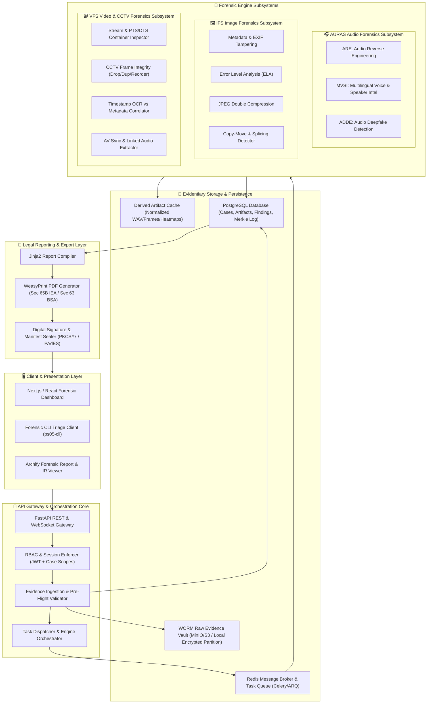
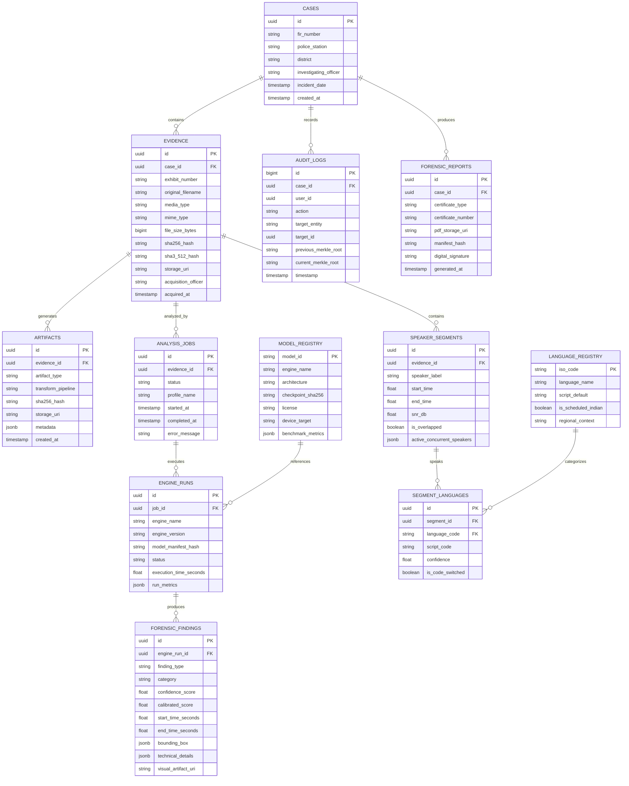
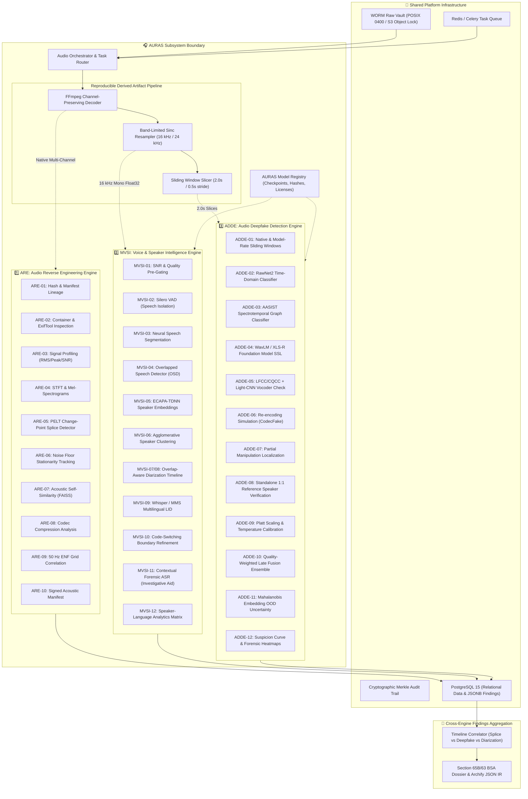
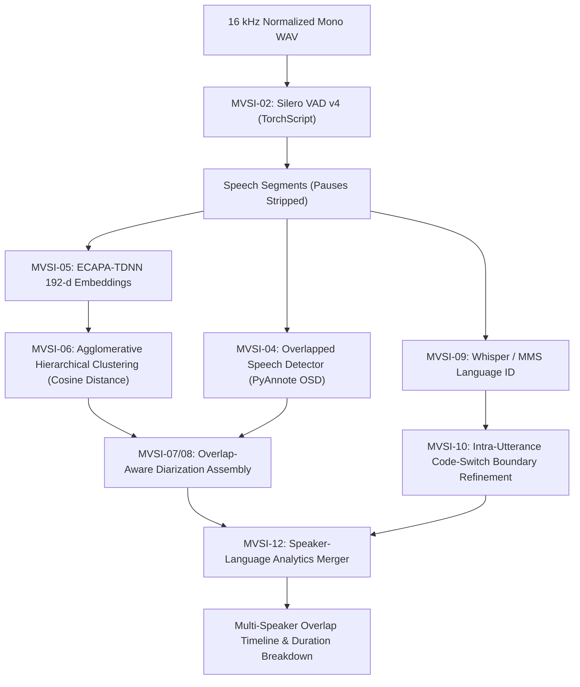
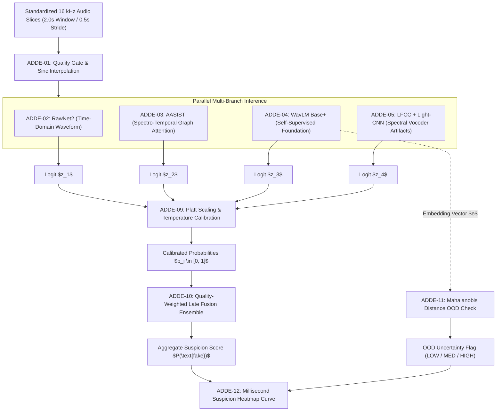
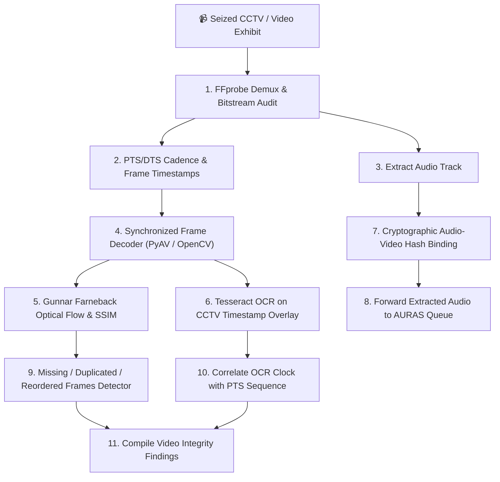
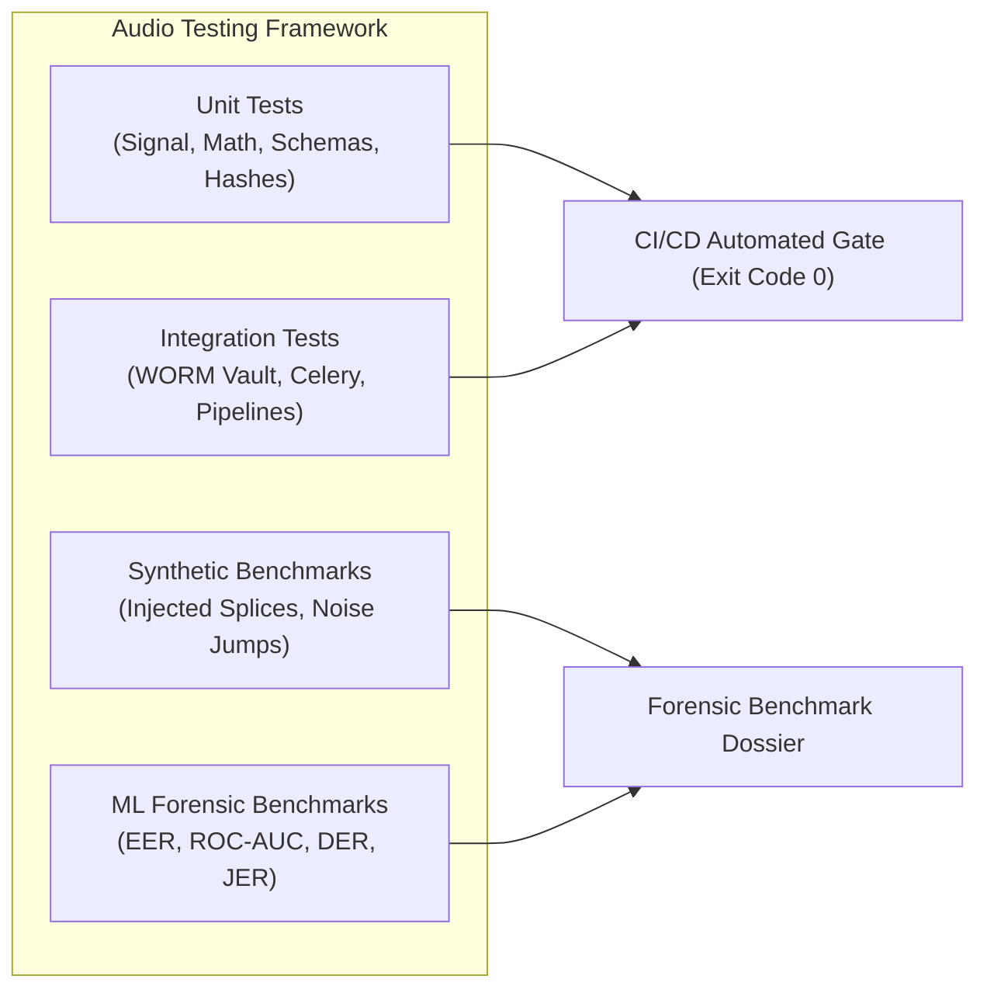

# Technical Requirements Document (TRD)

## Project: Digital Evidence Authenticity & Integrity Verification Platform (PS-05)
**Hackathon:** Bihar Government Cyber Hackathon 2026 (C-DAC Patna, CCSU, Bihar Police)  
**Track:** Digital Forensics  
**Problem Statement:** PS-05 — Digital Evidence Authenticity and Integrity Verification Platform  
**Document Version:** 1.1.0  
**Status:** Approved Technical Architecture Baseline (Deepened Audio Forensics Specification)  

---

## 1. System Context & Top-Level Architecture

The **PS-05 Platform** is structured as a modular, local-first, air-gap-capable cyber forensics platform designed for high-throughput, legally defensible analysis of digital media. The platform ingests four primary media modalities—**Audio Recordings, Digital Photographs, Video Clips, and Surveillance CCTV Footage**—and executes deterministic signal processing, computer vision, and neural deepfake detection while preserving cryptographic chain of custody.



---

## 2. Component Boundaries & Responsibilities

| Subsystem / Component | Package Boundary | Primary Responsibilities | Data Inputs | Data Outputs |
| :--- | :--- | :--- | :--- | :--- |
| **Shared Core & Ingestion** | `ps05.core.ingest` | Case registration, dual-hashing (SHA-256/SHA3-512), write-blocking raw storage, metadata extraction. | Raw file stream, Case FIR metadata. | `AudioEvidence`, `ImageEvidence`, `VideoEvidence` database records. |
| **Evidence Orchestrator** | `ps05.core.orchestrator` | Task lifecycle management, parallel engine dispatch, timeout handling, partial-failure recovery. | Evidence ID, Analysis Profile flags. | Celery/ARQ tasks, job state transitions, aggregated report IR. |
| **AURAS - ARE** | `ps05.engines.audio.are` | Signal profiling, STFT, spectral flux, splice candidate detection, noise floor consistency, ENF analysis. | Master audio exhibit (WAV/FLAC/MP3). | Spectral heatmaps, change-point timestamps, SNR metrics, ENF match. |
| **AURAS - MVSI** | `ps05.engines.audio.mvsi`| Voice activity detection, neural diarization, overlap speaker classification, Indian language identification. | Master audio exhibit (16kHz mono). | Speaker segments, language IDs, overlap intervals, speaker turn summaries. |
| **AURAS - ADDE** | `ps05.engines.audio.adde`| RawNet2 waveform, AASIST graph, WavLM foundation model inference, calibrated late-fusion ensembling. | 16kHz windowed audio slices. | Calibrated deepfake probabilities, suspicion curves, OOD metrics. |
| **Image Forensics (IFS)** | `ps05.engines.image` | EXIF/IPTC audit, Error Level Analysis (ELA), JPEG re-compression ghosting, SIFT copy-move detection. | Master image exhibit (JPEG/PNG/TIFF).| ELA heatmaps, double-compression masks, cloned polygon pairs. |
| **Video & CCTV (VFS)** | `ps05.engines.video` | Bitstream PTS/DTS continuity, missing/duplicate/reordered CCTV frame detection, timestamp OCR comparison. | Master video exhibit (MP4/MKV/AVI). | Frame drop intervals, timeline discrepancy logs, extracted audio. |
| **Legal Reporting & Archify**| `ps05.reporting` | Cross-engine finding aggregation, Archify JSON IR generation, Section 65B/63 BSA certified PDF compilation. | Structured findings, case audit log.| Court-admissible PDF report, signed JSON audit manifest. |

---

## 3. Repository & Package Architecture

The platform follows a clean, modular monolith architecture with strict layer separation, preventing cyclic imports and ensuring independent testability of all forensic engines:

```
d:/NextHackathon/
├── README.md                          # Master project entry point & overview
├── PRD.md                             # Product Requirements Document
├── TRD.md                             # Technical Requirements Document (this document)
├── PHASES.md                          # Development Roadmap & Implementation Milestones
├── AI_INSTRUCTIONS.md                 # Highest-authority behavioral specification for AI agents
├── pyproject.toml                     # Python packaging, dependencies, and tool settings
├── .env.example                       # Documented environment variables template
├── docker-compose.yml                 # Local container orchestration (PostgreSQL, Redis, MinIO)
├── archify.config.json                # Archify forensic report and IR configuration
│
├── src/
│   └── ps05/
│       ├── __init__.py
│       ├── config.py                  # Pydantic v2 application settings and validation
│       │
│       ├── core/                      # Shared evidentiary and orchestration foundation
│       │   ├── __init__.py
│       │   ├── crypto.py              # SHA-256, SHA3-512, HMAC, Merkle tree chain-of-custody
│       │   ├── storage.py             # WORM storage backend (MinIO / Local POSIX read-only)
│       │   ├── models.py              # SQLAlchemy 2.0 ORM database entity declarations
│       │   ├── schemas.py             # Pydantic v2 request/response and serialization schemas
│       │   ├── database.py            # Async engine and session factory
│       │   └── orchestrator.py        # Asynchronous job dispatching and finding merger
│       │
│       ├── api/                       # FastAPI route handlers and middleware
│       │   ├── __init__.py
│       │   ├── main.py                # FastAPI application entry point
│       │   ├── deps.py                # Authentication and session dependency injections
│       │   └── v1/
│       │       ├── cases.py           # Case creation, update, and listing
│       │       ├── evidence.py        # File ingestion, hashing, and download
│       │       ├── jobs.py            # Job status, cancellation, and WebSocket progress
│       │       └── reports.py         # Section 65B / BSA 63 report generation endpoints
│       │
│       ├── engines/                   # Forensic Analysis Engines
│       │   ├── __init__.py
│       │   ├── base.py                # BaseForensicEngine abstract contract and types
│       │   │
│       │   ├── audio/                 # AURAS Audio Forensics Subsystem
│       │   │   ├── __init__.py
│       │   │   ├── common/            # Shared Audio Utilities & Preprocessing Contracts
│       │   │   │   ├── ingest.py      # Audio stream decoding & pre-flight integrity
│       │   │   │   ├── transforms.py  # Sinc-resampling, channel downmix, sliding windows
│       │   │   │   └── schemas.py     # Pydantic audio contracts & manifests
│       │   │   │
│       │   │   ├── are/               # Audio Reverse Engineering Engine
│       │   │   │   ├── signal.py      # RMS, peak, clipping, SNR, DC offset
│       │   │   │   ├── spectral.py    # STFT, log-mel spectrograms, spectral flux
│       │   │   │   ├── edit_detect.py # PELT / Kernel change-point splice detector
│       │   │   │   ├── noise.py       # Stationary noise floor tracking
│       │   │   │   ├── repetition.py  # MFCC self-similarity and FAISS matching
│       │   │   │   └── enf.py         # 50 Hz Electric Network Frequency extractor
│       │   │   │
│       │   │   ├── mvsi/              # Multilingual Voice & Speaker Intelligence
│       │   │   │   ├── vad.py         # Silero VAD and WebRTC VAD wrappers
│       │   │   │   ├── segmentation.py# Neural speech region segmentation & smoothing
│       │   │   │   ├── osd.py         # Overlapped speech detection (OSD)
│       │   │   │   ├── diarization.py # PyAnnote / overlap-aware speaker diarization
│       │   │   │   ├── embeddings.py  # ECAPA-TDNN speaker representation extraction
│       │   │   │   ├── language_id.py # Whisper LID / MMS-LID Indian language classifier
│       │   │   │   ├── code_switch.py # Intra-utterance code-switching boundary detector
│       │   │   │   └── registry.py    # Extensible Indian language & script registry
│       │   │   │
│       │   │   └── adde/              # Audio Deepfake Detection Engine
│       │   │       ├── preprocess.py  # Sinc-interpolated resampling and windowing
│       │   │       ├── rawnet2.py     # RawNet2 raw waveform neural classifier
│       │   │       ├── aasist.py      # AASIST spectrotemporal graph classifier
│       │   │       ├── ssl_wavlm.py   # WavLM / XLS-R foundation model feature classifier
│       │   │       ├── spectral.py    # LFCC / CQCC + Light-CNN detector
│       │   │       ├── codec_robust.py# Re-compression simulation & CodecFake testing
│       │   │       ├── verification.py# Standalone 1:1 speaker verification check
│       │   │       ├── calibration.py # Platt scaling and temperature calibration
│       │   │       ├── ensemble.py    # Quality-weighted late fusion ensemble
│       │   │       └── ood.py         # Mahalanobis embedding distance uncertainty
│       │   │
│       │   ├── image/                 # Image Forensics Subsystem (IFS)
│       │   │   ├── __init__.py
│       │   │   ├── exif_audit.py      # EXIF, XMP, IPTC, and camera sensor profiling
│       │   │   ├── ela.py             # Multi-quality Error Level Analysis
│       │   │   ├── double_jpeg.py     # Quantization table and DCT ghost analysis
│       │   │   ├── copy_move.py       # SIFT/ORB keypoint and DBSCAN patch detector
│       │   │   └── splicing.py        # PRNU sensor pattern and noise variance check
│       │   │
│       │   └── video/                 # Video & CCTV Forensics Subsystem (VFS)
│       │       ├── __init__.py
│       │       ├── stream_audit.py    # FFprobe PTS/DTS continuity and packet sequence
│       │       ├── cctv_integrity.py  # Missing, duplicated, inserted, reordered frames
│       │       ├── timestamp_ocr.py   # Tesseract OCR vs metadata timeline correlation
│       │       └── audio_extractor.py # Audio stream extraction with cryptographic binding
│       │
│       ├── reporting/                 # Court-Admissible Reporting & Export
│       │   ├── __init__.py
│       │   ├── compiler.py            # Cross-engine finding aggregation
│       │   ├── cert_65b.py            # Section 65B IEA / Sec 63 BSA legal template logic
│       │   ├── archify_adapter.py     # Archify JSON IR formatting and visualizer bridge
│       │   └── templates/             # Jinja2 HTML/CSS print-ready templates
│       │
│       └── workers/                   # Asynchronous background worker tasks
│           ├── __init__.py
│           ├── celery_app.py          # Celery worker application configuration
│           └── tasks.py               # Dispatchable forensic execution tasks
│
└── tests/                             # Comprehensive test suites
    ├── conftest.py                    # Pytest fixtures and mock forensic exhibits
    ├── unit/
    ├── integration/
    └── benchmarks/
```

---

## 4. Shared Ingestion, WORM Vault & Database Schemas

### 4.1 Master Evidentiary Database Schema



---

## 5. AURAS Subsystem Technical Architecture

AURAS (Audio Understanding, Reconstruction & Analysis System) operates as a self-contained, multi-engine subsystem within PS-05. It is **strictly independent** from image and video engines, but consumes the shared WORM storage and Celery orchestration infrastructure:



---

## 6. Shared Audio Ingestion & Artifact Pipeline

To guarantee evidentiary admissibility under Section 65B IEA / Section 63 BSA, master audio exhibits are never processed directly by lossy or destructive transforms. A strict artifact derivation pipeline is enforced:

### 6.1 Ingestion Invariants & Policies
1. **Zero-Byte Modification:** The original seized file (e.g., `evidence.wav`) is streamed to disk, dual-hashed (SHA-256 and SHA3-512), and locked with POSIX `0400` permissions.
2. **Channel-Preserving Raw Representation (Artifact A):** Decoded to multi-channel 32-bit float WAV at the native sampling rate ($f_s$). Used exclusively by **ARE** for dynamic range, channel phase correlation, DC offset, and STFT.
3. **Normalized Speech Representation (Artifact B):** Decoded, converted to mono (using energy-preserving downmixing $M = 0.5(L + R)$), and resampled to 16 kHz using band-limited Kaiser-windowed sinc interpolation (`torchaudio.transforms.Resample`). Used exclusively by **MVSI** for VAD, diarization, and language identification.
4. **Standardized Window Slices (Artifact C):** Segmented into 2.0-second sliding windows with a 0.5-second stride (75% overlap). Zero-padded at the tail if shorter than 2.0s. Used exclusively by **ADDE** for frame-level deepfake inference.
5. **Transformation Manifest:** Every generated artifact receives an immutable SHA-256 hash and a JSON lineage record referencing:
   $$\text{Parent Evidence ID} \to \text{Transform Operator} \to \text{Parameters} (f_s, \text{channels}, \text{sinc\_window}) \to \text{Child Hash}$$

---

## 7. ARE Technical Specification (Audio Reverse Engineering Engine)

### ARE-01: Cryptographic Integrity & Lineage Verification
- **Purpose:** Verify bit-level equality against the initial seizure hash; maintain immutable parent-child transformation manifests.
- **Inputs:** Raw exhibit stream, initial acquisition manifest, optional `trusted_sha256` reference.
- **Processing Steps:** Streams bytes through chunked SHA-256 and SHA3-512 accumulators (64KB blocks); queries `evidence` table; verifies WORM file permissions (`0400`).
- **Algorithms:** FIPS 180-4 SHA-256, FIPS 202 SHA3-512.
- **Outputs:** `IntegrityResult(sha256, sha3_512, trusted_match_bool, permissions_valid)`.
- **Failure Modes:** Hash mismatch (returns `CRITICAL_TAMPER_ALERT`), unreadable file (returns `IO_PERMISSION_ERROR`).
- **Confidence Semantics:** Deterministic boolean (1.0 or 0.0). No probabilistic guessing.
- **Implementation Status:** `PLANNED` (Phase 2 / AURAS-A1).

### ARE-02: Container & Metadata Inspection
- **Purpose:** Audit audio headers, container streams, and codec structures for tampering, non-standard encoder tags, and digital audio workstation (DAW) signatures.
- **Inputs:** Master audio exhibit path.
- **Processing Steps:** Runs FFprobe JSON demuxing; executes ExifTool and Mutagen; parses ID3, RIFF/WAVE `INFO` chunks, and broadcast wave format (BWF) headers.
- **Algorithms:** Tag signature dictionary comparison, container atom/chunk validation, audio-video stream cadence checks.
- **Outputs:** `MetadataAudit(codec, sample_rate, channels, bit_depth, duration, encoder_signatures, daw_tags_found, decoder_warnings)`.
- **Confidence Semantics:** Deterministic string match. Flags DAW software (ProTools, Logic, Audacity, FL Studio) with 1.0 confidence of tag presence.
- **Implementation Status:** `PLANNED` (Phase 2 / AURAS-A1).

### ARE-03: Signal Profiling & Dynamic Range Analysis
- **Purpose:** Measure physical electroacoustic parameters to detect clipping, dynamic compression, and DC bias.
- **Inputs:** Native-rate working audio array $x[n]$.
- **Processing Steps:** Computes Root-Mean-Square (RMS) amplitude, true peak ($|x[n]|_{\max}$), DC offset ($\mu_x = \frac{1}{N}\sum x[n]$), clipping sample count ($N_{\text{clip}} = \sum [|x[n]| \ge 0.9999]$), zero-crossing rate (ZCR), and estimated SNR via WADA-SNR.
- **Algorithms:**
  $$RMS_{\text{dBFS}} = 20 \log_{10} \sqrt{\frac{1}{N}\sum_{n=1}^N x^2[n]}, \quad SNR_{\text{est}} = 10 \log_{10}\left(\frac{P_{\text{speech}}}{P_{\text{noise}}}\right)$$
- **Outputs:** `SignalProfile(rms_dbfs, peak_dbfs, dynamic_range_db, dc_offset, clip_count, snr_db, zcr)`.
- **Confidence Semantics:** Continuous scalar metrics. High clipping count ($> 50$) raises a clipping warning.
- **Implementation Status:** `PLANNED` (Phase 2 / AURAS-A1).

### ARE-04: Spectral Analysis & Bandwidth Audit
- **Purpose:** Calculate time-frequency spectrograms and Power Spectral Density (PSD) to detect lossy compression cutoffs and re-encoding artifacts.
- **Inputs:** Native-rate working audio array.
- **Processing Steps:** Applies 2048-point Short-Time Fourier Transform (STFT) with Hann window and 512 hop length; computes log-mel spectrogram (128 mel bins); computes Welch PSD across $0 \le f \le f_s/2$.
- **Algorithms:** Fast Fourier Transform (FFT), Welch periodogram averaging.
- **Outputs:** `SpectralFeatures(spectrogram_matrix, psd_curve, high_frequency_cutoff_hz, spectral_flatness, spectral_rolloff)`.
- **Confidence Semantics:** Deterministic cutoff frequency estimation ($\pm 100\text{ Hz}$).
- **Implementation Status:** `PLANNED` (Phase 2 / AURAS-A1).

### ARE-05: Splice & Edit Candidate Localization
- **Purpose:** Localize abrupt acoustic transitions, edit points, and physical splices using change-point detection on spectral flux and energy time series.
- **Inputs:** Spectral flux $SF[m] = \sum_k |X[k, m] - X[k, m-1]|^2$ and short-time energy $E[m]$.
- **Processing Steps:** Calculates first-order differences in spectral flux; executes Pruned Exact Linear Time (PELT) change-point search with radial basis function (RBF) kernel; cross-correlates candidates with zero-crossing discontinuities.
- **Algorithms:** PELT change-point algorithm (`ruptures` library), kernel changepoint estimation.
- **Outputs:** `List[SpliceCandidate(timestamp_start, timestamp_end, change_point_magnitude, confidence)]`.
- **Confidence Semantics:** Calibrated anomaly score (0.0–1.0) based on discontinuity magnitude relative to background variance.
- **Implementation Status:** `PLANNED` (Phase 2 / AURAS-A2).

### ARE-06: Ambient Noise Floor Consistency Tracking
- **Purpose:** Track background stationary noise floor to identify spliced segments inserted from foreign acoustic environments.
- **Inputs:** Native-rate audio signal.
- **Processing Steps:** Applies minimum statistics noise tracking across 500ms sliding frames; computes stationary background spectral envelope; flags sudden level jumps $> 4\text{ dB}$ lasting $> 200\text{ ms}$.
- **Algorithms:** Martin's minimum statistics spectral subtraction algorithm.
- **Outputs:** `NoiseConsistencyResult(noise_floor_dbfs_curve, anomalous_intervals, ambient_stationarity_score)`.
- **Confidence Semantics:** Continuous stationarity score (0.0–1.0). High scores denote consistent ambient room tone.
- **Implementation Status:** `PLANNED` (Phase 2 / AURAS-A2).

### ARE-07: Acoustic Self-Similarity & Repeated Segment Detection
- **Purpose:** Identify duplicated or copy-pasted acoustic segments (e.g., cloned phrases, repeated background noise loops).
- **Inputs:** 13 MFCC coefficients extracted over 25ms windows with 10ms hop length.
- **Processing Steps:** Normalizes MFCC vectors; indexes frames in FAISS index; computes full pairwise self-similarity matrix $S_{i, j} = \cos(v_i, v_j)$; detects diagonal path matches off the main diagonal using dynamic time warping (DTW).
- **Algorithms:** FAISS exact inner-product search, DTW path alignment.
- **Outputs:** `List[RepeatedSegmentPair(seg_a_start, seg_a_end, seg_b_start, seg_b_end, duration, similarity_score)]`.
- **Confidence Semantics:** Cosine similarity threshold ($> 0.92$ over duration $> 1.0\text{ s}$).
- **Implementation Status:** `PLANNED` (Phase 2 / AURAS-A2).

### ARE-08: Codec Compression & Re-Encoding Analysis
- **Purpose:** Detect multiple lossy compression cycles (e.g., audio recorded on phone, forwarded via WhatsApp, edited in Audacity, and re-exported).
- **Inputs:** Native audio stream and container bitstream.
- **Processing Steps:** Inspects MDCT coefficient quantization error distributions; evaluates high-frequency rolloff steepness ($> 60\text{ dB/octave}$ at 16 kHz indicates MP3/AAC 128k); evaluates frame bit-allocation consistency.
- **Algorithms:** Modified Discrete Cosine Transform (MDCT) coefficient histogram analysis.
- **Outputs:** `CodecAnalysisResult(estimated_compression_passes, primary_codec, reencoding_indicators_detected)`.
- **Confidence Semantics:** Qualitative classification with uncertainty notes.
- **Implementation Status:** `PLANNED` (Phase 2 / AURAS-A2).

### ARE-09: Electric Network Frequency (ENF) Forensics
- **Purpose:** Extract mains hum frequency fluctuations (nominal 50 Hz for Indian electrical grid) to verify recording continuity and correlate timestamps against grid reference logs.
- **Inputs:** Native uncompressed audio file ($f_s \ge 8\text{ kHz}$).
- **Processing Steps:** Applies an 8th-order Butterworth bandpass filter ($49.8\text{ Hz} \le f \le 50.2\text{ Hz}$); extracts analytic signal via Hilbert transform; calculates instantaneous frequency:
  $$f_{\text{ENF}}(t) = \frac{1}{2\pi} \frac{d}{dt} \arg(x_{\text{analytic}}(t))$$
- **Outputs:** `ENFResult(enf_present_bool, snr_enf_db, frequency_curve, correlation_with_grid, grid_reference_match_status)`.
- **Confidence Semantics:** If ENF SNR $< 6\text{ dB}$, returns `INCONCLUSIVE_NO_USABLE_ENF`. When grid reference data is present, outputs Pearson correlation coefficient $r$.
- **Implementation Status:** `PLANNED` (Phase 2 / AURAS-A2 — Advanced/Research).

### ARE-10: Acoustic Provenance Manifest
- **Purpose:** Package all electroacoustic, spectral, and splice findings into an immutable, cryptographically sealed JSON record.
- **Inputs:** Findings from ARE-01 through ARE-09.
- **Outputs:** `AREManifest(manifest_version, evidence_id, sha256, findings_summary, json_payload, cryptographic_signature)`.
- **Implementation Status:** `PLANNED` (Phase 2 / AURAS-A2).

---

## 8. MVSI Technical Specification (Voice & Speaker Intelligence)

### 8.1 Invariant: Speaker Identity $\neq$ Language Identity
A speaker who switches between Hindi and English (code-switching) is **one individual speaker** utilizing multiple linguistic codes. MVSI maintains two orthogonal dimensions:
1. **Speaker Cluster Dimension (`speaker_id`):** Defined by biological and vocal tract acoustic embeddings (ECAPA-TDNN).
2. **Language Dimension (`language_code`):** Defined by phonological and linguistic token probabilities (Whisper/MMS LID).

### 8.2 Overlap-Aware Diarization Architecture
The diarization engine natively supports multiple active speakers in the same time interval:
- `00:15.200 – 00:18.400`: `["SPEAKER_01"]`
- `00:18.400 – 00:20.100`: `["SPEAKER_01", "SPEAKER_02"]` *(Simultaneous Overlap)*
- `00:20.100 – 00:22.000`: `["SPEAKER_02"]`



### 8.3 Extensible Indian Language Registry
The language registry covers Scheduled Indian Languages, regional languages, and dialectal varieties:

```sql
CREATE TABLE language_registry (
    iso_code VARCHAR(16) PRIMARY KEY,
    language_name VARCHAR(64) NOT NULL,
    script_default VARCHAR(32) NOT NULL,
    is_scheduled_indian BOOLEAN NOT NULL DEFAULT FALSE,
    regional_context VARCHAR(128)
);

INSERT INTO language_registry VALUES
('hin', 'Hindi', 'Devanagari', TRUE, 'Pan-India / Bihar'),
('bho', 'Bhojpuri', 'Devanagari', FALSE, 'Bihar / Eastern UP'),
('mai', 'Maithili', 'Devanagari / Tirhuta', TRUE, 'Bihar (Mithila)'),
('mag', 'Magahi', 'Devanagari', FALSE, 'Bihar (Magadh)'),
('urd', 'Urdu', 'Perso-Arabic', TRUE, 'Pan-India / Bihar'),
('ben', 'Bengali', 'Bengali', TRUE, 'West Bengal / Eastern India'),
('eng', 'English', 'Latin', FALSE, 'Official / Judicial Proceedings');
```

---

## 9. ADDE Technical Specification (Audio Deepfake Detection Engine)

ADDE is an independent, pluggable, multi-detector engine designed to detect synthetic vocoders, cloned voices, and partial manipulations without relying on any single model family:



### 9.1 Pluggable Detector Family Specifications
1. **RawNet2 Baseline (`ps05.engines.audio.adde.rawnet2`):**
   - Direct raw waveform input ($1 \times 32000$ samples). Applies sinc-convolution filters followed by residual blocks with gru-pooling. Detects sample-level phase discontinuities characteristic of neural vocoders.
2. **AASIST Baseline (`ps05.engines.audio.adde.aasist`):**
   - Audio Anti-Spoofing using Integrated Spectro-Temporal Graph Attention. Constructs heterogeneous graphs across spectral channels and temporal frames, capturing long-range synthetic artifacts.
3. **Foundation Model SSL (`ps05.engines.audio.adde.ssl_wavlm`):**
   - Utilizes frozen WavLM Base+ pre-trained encoder (12 transformer layers, 768-d hidden states) coupled to a lightweight binary classification head (mean pooling $\to$ Linear(768, 256) $\to$ ReLU $\to$ Dropout(0.3) $\to$ Linear(256, 1)). Yields superior generalization on unseen generative engines (ElevenLabs, Bark, VALL-E).
4. **Spectral Vocoder Classifier (`ps05.engines.audio.adde.spectral`):**
   - Extracts 60-dimensional Linear Frequency Cepstral Coefficients (LFCC) classified by a 9-layer Light-CNN. Captures high-frequency vocoder spectral envelope anomalies.

### 9.2 Score Calibration & Late-Fusion Ensemble
- **Platt Scaling Calibration:** Raw logits $z_i$ from each detector are calibrated using logistic parameters $(A_i, B_i)$ fitted on a held-out validation split:
  $$p_i = \frac{1}{1 + \exp(A_i z_i + B_i)}$$
- **Quality-Weighted Late Fusion:** Composite score is calculated as:
  $$P(\text{fake}) = \sum_{i=1}^M w_i \cdot p_i, \quad \sum w_i = 1.0$$
  Weights $w_i$ are dynamically adjusted based on input SNR (e.g., if SNR $< 10\text{ dB}$, WavLM weight increases while RawNet2 weight decreases).
- **Disagreement Metric:** If $\max(p_i) - \min(p_i) > 0.50$, the system explicitly records `DETECTOR_DISAGREEMENT_WARNING`.

### 9.3 Out-of-Distribution (OOD) Detection
- Computes Mahalanobis distance in the WavLM 768-d embedding space against the in-distribution reference mean $\mu$ and covariance matrix $\Sigma$:
  $$D_M(x) = \sqrt{(x - \mu)^T \Sigma^{-1} (x - \mu)}$$
- If $D_M(x) > \text{Threshold}_{95\%}$, the system outputs `OOD_UNCERTAINTY: HIGH`, advising the examiner that the recording conditions (extreme noise or rare codec) exceed the reliable operational boundary of the models.

### 9.4 1:1 Reference Speaker Verification Check
- **Explicit Boundary:** Speaker verification is **strictly separated** from deepfake detection.
- Compares questioned segment embeddings against an authorized suspect reference recording using ECAPA-TDNN cosine distance. Outputs a similarity metric without asserting automated biometric identity.

---

## 10. Image Forensics Subsystem (IFS) Technical Boundary

The Image Forensics Subsystem detects both conventional structural tampering (splicing, copy-move, compression anomalies) and modern generative synthesis:

### 10.1 EXIF & Metadata Audit Module (`ps05.engines.image.exif_audit`)
- **Library Stack:** `piexif`, `exiftool-vendored` (wrapper), `PIL.ExifTags`.
- **Methodology:**
  1. Recursively extracts all tags across EXIF, MakerNote, IPTC, and XMP blocks.
  2. Compares embedded EXIF software strings against an allowlist/blocklist of common image editors (Adobe Photoshop, GIMP, Pixelmator, Canva).
  3. Verifies internal timestamp consistency: `DateTimeOriginal` vs `DateTimeDigitized` vs `FileModifyDate`.
  4. Camera Fingerprint Matching: Compares embedded camera model (e.g., iPhone 13 Pro) with focal length, 35mm equivalent, aperture, and sensor dimensions.

### 10.2 Error Level Analysis (ELA) Module (`ps05.engines.image.ela`)
- **Methodology:**
  1. Re-compresses the input image at a known quality level (nominal $Q_1 = 95\%$) using PIL/OpenCV JPEG encoder.
  2. Computes the absolute per-pixel error magnitude between the original image $I(x, y)$ and the recompressed image $I_{\text{recomp}}(x, y)$:
     $$\Delta(x, y) = |I(x, y) - I_{\text{recomp}}(x, y)|$$
  3. Scales the error dynamically by an amplification factor $S = 10\times$ to $20\times$.
  4. Generates a multi-channel normalized heatmap. Untampered regions exhibit homogeneous error levels, whereas foreign spliced regions display stark high-contrast boundaries.

### 10.3 JPEG Double Compression & Ghost Detection (`ps05.engines.image.double_jpeg`)
- **Methodology:**
  1. Inspects Quantization Tables (Luminance and Chrominance 8x8 matrices) in DQT markers.
  2. Analyzes discrete cosine transform (DCT) coefficients across 8x8 pixel grids for histogram periodicity.
  3. Computes the blocking artifact discrepancy (BAD) metric to detect non-aligned 8x8 grid splicing.

### 10.4 Copy-Move Forgery Detection (CMFD) (`ps05.engines.image.copy_move`)
- **Methodology:**
  1. Extracts Scale-Invariant Feature Transform (SIFT) keypoints and descriptors across the image.
  2. Applies $k$-d tree nearest neighbor matching to identify descriptor pairs with Euclidean distance $d < 0.6 \cdot d_{\text{second}}$.
  3. Filters trivial self-matches with a minimum spatial distance threshold ($r > 20$ pixels).
  4. Groups matching keypoints using DBSCAN and evaluates affine transformation matrices via RANSAC.
  5. Outputs polygon bounding boxes enclosing the source cloned patch and destination pasted patch.

---

## 11. Video & CCTV Forensics Subsystem (VFS) Technical Boundary

The Video and CCTV Forensics Subsystem focuses on surveillance footage integrity, resolving dropped packets from malicious tampering:



### 11.1 Container & Stream Bitstream Validation (`ps05.engines.video.stream_audit`)
- Validates container headers against truncation and non-monotonic Presentation Time Stamps (PTS).
- Inspects Group of Pictures (GOP) structure: verifies distance between Keyframes (I-frames) and predictive frames (P/B-frames).
- Detects Variable Frame Rate (VFR) jitter and timestamps resetting mid-stream.

### 11.2 CCTV Frame Integrity & Missing Frame Detection (`ps05.engines.video.cctv_integrity`)
- Decodes video frames sequentially into an uncompressed working ring buffer.
- Calculates Structural Similarity Index Measure (SSIM) and dense optical flow vector magnitude.
- **Duplicate / Frozen Frame Identification:** When $SSIM(F_t, F_{t+1}) > 0.998$ and optical flow variance $\approx 0$ over $> 1.0$ seconds during active scenes, a video freeze/loop alert is raised.
- **Dropped / Cut Frame Identification:** Sudden discontinuities where optical flow vectors exhibit catastrophic collapse or scene energy spikes without an I-frame scene change marker flag an edited or excised sequence.

### 11.3 Timestamp OCR vs. Metadata Correlation (`ps05.engines.video.timestamp_ocr`)
- Detects bounding box of the burned-in on-screen digital clock display.
- Executes Tesseract OCR with a specialized digital clock pattern whitelist (`[0-9]{2}:[0-9]{2}:[0-9]{2}`).
- Calculates drift $\delta(t) = T_{\text{ocr}}(t) - (T_0 + t \cdot \Delta t_{\text{pts}})$.
- If $|\delta(t)| > 1.0$ second or if the visible clock jumps while PTS remains smooth (or vice-versa), an evidence manipulation finding is immediately generated.

---

## 12. Pydantic v2 API & Contract Schemas

### 12.1 Audio Ingestion & Registration Contract
```python
from pydantic import BaseModel, Field
from typing import Optional, List, Dict, Any
from datetime import datetime
from uuid import UUID

class AudioEvidenceRegistrationRequest(BaseModel):
    case_id: UUID
    exhibit_number: str = Field(..., max_length=32)
    acquisition_officer: str = Field(..., max_length=128)
    acquired_at: datetime
    trusted_sha256_reference: Optional[str] = Field(None, min_length=64, max_length=64)

class AudioEvidenceRegistrationResponse(BaseModel):
    evidence_id: UUID
    case_id: UUID
    exhibit_number: str
    original_filename: str
    sha256_hash: str
    sha3_512_hash: str
    storage_uri: str
    file_size_bytes: int
    created_at: datetime
```

### 12.2 Audio Job Execution Contract
```python
class AudioJobCreateRequest(BaseModel):
    evidence_id: UUID
    profile_name: str = "FULL_FORENSIC" # FAST_TRIAGE, FULL_FORENSIC, DEEPFAKE_ONLY
    enabled_engines: List[str] = ["ARE", "MVSI", "ADDE"]
    options: Dict[str, Any] = Field(default_factory=dict)

class FindingItem(BaseModel):
    engine: str
    finding_type: str
    category: str # INTEGRITY, METADATA, SIGNAL, COMPRESSION, SYNTHETIC, SPEAKER
    confidence_score: float = Field(..., ge=0.0, le=1.0)
    calibrated_score: Optional[float] = Field(None, ge=0.0, le=1.0)
    start_time_seconds: Optional[float] = None
    end_time_seconds: Optional[float] = None
    technical_details: Dict[str, Any] = Field(default_factory=dict)
    visual_artifact_uri: Optional[str] = None

class SpeakerSegmentItem(BaseModel):
    speaker_label: str
    start_time: float
    end_time: float
    snr_db: float
    is_overlapped: bool
    concurrent_speakers: List[str] = Field(default_factory=list)
    primary_language: str
    language_confidence: float

class AudioJobResultsResponse(BaseModel):
    job_id: UUID
    evidence_id: UUID
    status: str
    overall_verdict: str
    aggregate_confidence: float
    summary: str
    findings: List[FindingItem]
    speaker_timeline: List[SpeakerSegmentItem]
    model_manifest_hashes: Dict[str, str]
```

---

## 13. Testing, Benchmark & Validation Architecture

The audio testing suite enforces separation between software reliability and machine learning accuracy:



1. **Unit & Math Testing (`tests/unit/test_are_*.py`):**
   - Verifies pure signal algorithms against synthetic sine waves with known clipping, DC bias, and frequency components.
2. **Integration Testing (`tests/integration/test_audio_pipeline.py`):**
   - Simulates complete ingestion, WORM permission verification, and multi-engine Celery task execution.
3. **Synthetic Splice Benchmark (`tests/benchmarks/test_splice_accuracy.py`):**
   - Ingests 50 audio tracks with known inserted tone and speech splices; asserts PELT detector localization error $\le \pm 50\text{ ms}$.
4. **Machine Learning Accuracy Evaluation (`tests/benchmarks/test_adde_metrics.py`):**
   - Evaluates RawNet2, AASIST, and WavLM against standardized evaluation sets (ASVspoof 2019/2021, WaveFake, In-the-Wild, CodecFake).
   - Generates ROC curves, EER ($< 5.5\%$), and Expected Calibration Error (ECE $< 0.05$).
5. **Diarization Error Rate (DER) Evaluation (`tests/benchmarks/test_mvsi_der.py`):**
   - Computes DER, JER, and overlap-specific F1 on multi-talker conversational benchmark sets.

---

## 14. Archify Integration & Visualization Pipeline

Archify (`https://github.com/tt-a1i/archify`) functions as the architectural and evidentiary visualization engine:
1. **Air-Gap Invariant:** Archify executes strictly as a post-processor. It never accesses the raw evidence partition or database credentials directly.
2. **Intermediate Representation (JSON IR):** Analysis results, engine runs, and finding graphs are compiled into Archify's canonical JSON IR schema (`archify.report.json`).
3. **Deterministic Rendering:** Archify compiles the JSON IR into self-contained HTML/SVG visual graphs without external CDN links, displaying:
   - **Evidence Provenance Flow:** Source exhibit $\to$ working artifacts $\to$ engine runs $\to$ findings.
   - **Multi-Modal Timeline View:** Time-synchronized tracks for CCTV frames, OCR clock, optical flow, audio waveform, and deepfake suspicion curves.
   - **Sensor Noise & ELA Maps:** Side-by-side comparison of original pixel regions and error-level intensity.

---

## 15. Security Architecture, Threat Model & Legal Invariants

### 15.1 Threat Modeling (STRIDE Matrix)

| Threat Category | Potential Forensic Risk | Architectural Defense & Mitigation |
| :--- | :--- | :--- |
| **Spoofing** | Rogue operator uploads forged exhibits or impersonates senior examiner. | Mandatory mTLS or JWT with claims; cryptographically signed audit logs per session. |
| **Tampering** | Investigator alters raw file or deletes intermediate splice findings to compromise case. | WORM storage (POSIX 0400 / S3 Object Lock); Merkle tree audit log prevents silent DB mutation. |
| **Repudiation** | Examiner denies signing or approving a flawed forensic certificate. | Dual-signature signing (PKCS#7) with examiner certificate and timestamp server counter-signature. |
| **Information Disclosure** | Sensitive victim/suspect media leaked or viewed by unauthorized officers. | AES-256-GCM data at rest; strict RBAC case boundaries; pre-signed ephemeral URLs (max 15 mins). |
| **Denial of Service** | Malicious 100GB video bomb uploaded to freeze forensic server workers. | Strict chunked streaming upload validation; maximum file size quotas; worker CPU/RAM cgroups. |
| **Elevation of Privilege** | Forensic engine worker process exploits libavformat buffer overflow to gain host root. | Workers execute inside unprivileged container sandboxes with seccomp and read-only root filesystems. |

### 15.2 Legal Compliance Standards: Section 65B IEA / Section 63 BSA 2023
To guarantee court admissibility across Indian jurisdictions, the platform automatically records and embeds the following mandatory electronic evidence custody fields in every generated certificate:
1. **Device & Environment Hash:** SHA-256 of the operating system kernel, server MAC address, Python runtime, and forensic engine git commit hashes.
2. **Uninterrupted Custody Certification:** Formal declaration certifying that the computing device was operating properly and at all material times without corruptive interference.
3. **Dual Cryptographic Checksum:** Explicit citation of SHA-256 and SHA3-512 hashes verifying identical bitstream parity between original seized exhibit and analyzed copy.
4. **Hardware Serial & Examiner Identification:** Verified identification details of the officer operating the platform.
