# Technical Requirements Document (TRD)

## Project: Digital Evidence Authenticity & Integrity Verification Platform (PS-05)
**Hackathon:** Bihar Government Cyber Hackathon 2026 (C-DAC Patna, CCSU, Bihar Police)
**Track:** Digital Forensics
**Problem Statement:** PS-05 — Digital Evidence Authenticity and Integrity Verification Platform
**Document Version:** 1.1.0
**Status:** Approved Technical Architecture Baseline (Deepened Audio Forensics Specification)

---

## 1. System Context & Top-Level Architecture

The **PS-05 Platform** is structured as a modular, local-first, air-gap-capable cyber forensics platform designed for high-throughput, legally defensible analysis of digital media. The platform ingests four primary media modalities—**Audio Recordings, Digital Photographs, Video Clips, and Surveillance CCTV Footage**—and executes deterministic signal processing, computer vision, and neural deepfake detection while preserving cryptographic chain of custody.

```mermaid
flowchart TB
    subgraph CLIENT["🖥️ Client & Presentation Layer"]
        WEB["Next.js / React Forensic Dashboard"]
        CLI["Forensic CLI Triage Client (ps05-cli)"]
        ARCHIFY["Archify Forensic Report & IR Viewer"]
    end

    subgraph API_GATEWAY["🚪 API Gateway & Orchestration Core"]
        FASTAPI["FastAPI REST & WebSocket Gateway"]
        AUTH_RBAC["RBAC & Session Enforcer (JWT + Case Scopes)"]
        INGEST["Evidence Ingestion & Pre-Flight Validator"]
        DISPATCH["Task-Aware Forensic Router & Engine Dispatcher"]
    end

    subgraph CRYPTO_CORE["🔐 CEIPL Shared Cryptographic & Provenance Layer"]
        DIRECT_HASH["Raw-Byte Dual Hasher (SHA-256 / SHA3-512)"]
        CANON_MAN["RFC 8785 Canonical JSON Evidence Manifests"]
        ED_SIGN["Ed25519 Signatures & Secure Key Lifecycle"]
        TSA_CLIENT["RFC 3161 Trusted Timestamp Client (TSA)"]
        HASH_CHAIN["Append-Only Hash-Chained Custody Event Log"]
        MERKLE_TREE["Merkle Tree Batch Checkpoints & Inclusion Proofs"]
        C2PA_VAL["C2PA Content Credentials & Trust Validator"]
    end

    subgraph STORAGE_LAYER["💾 Evidentiary Storage & Persistence"]
        WORM["WORM Raw Evidence Vault (POSIX 0400 / S3 Object Lock, AES-256-GCM)"]
        DERIVED["Derived Artifact DAG Cache (Lineage Manifests & Coordinates)"]
        PG["PostgreSQL Database (Cases, Exhibits, Artifacts, Findings, Merkle Log)"]
        REDIS["Redis Message Broker & Task Queue (Celery/ARQ)"]
    end

    subgraph ENGINES["🔬 Forensic Engine Subsystems"]
        direction TB
        subgraph AURAS["🎧 AURAS Audio Forensics Subsystem"]
            ARE["ARE: Audio Reverse Engineering Engine"]
            MVSI["MVSI: Multilingual Voice & Speaker Intel"]
            ADDE["ADDE: Audio Deepfake Detection Engine"]
        end
        subgraph AIF["🖼️ AIF Advanced Image Forensics Subsystem"]
            IVE["IVE: Image Understanding & Visual Evidence Engine"]
            IRE["IRE: Image Reverse Engineering Engine"]
            AIM["AIM: AI, Manipulation & Steganography Engine"]
            FPA["FPA: Face, Portrait & Biometric Analysis Module"]
            GEO["GEO: Geospatial Forensics & Evidence Correlation"]
        end
        subgraph VISTA["📹 VISTA Video Forensics Subsystem"]
            VRE["VRE: Video Reverse Engineering Engine"]
            AFB["AFB: Audio Forensic Bridge (Extract & Route)"]
            AVSC["AVSC: Audio-Visual Synchronization & Correspondence"]
            VDF["VDF: Video Deepfake & AI-Generation Detection"]
            VCI["VCI: Video Content Intelligence Engine"]
            CCTV_PROF["CCTV Adaptive Profile (Triage, OSD, ONVIF)"]
        end
    end

    subgraph REPORTING["📜 Legal Reporting & Export Layer"]
        JINJA["Jinja2 Report Compiler"]
        WEASY["WeasyPrint PDF Generator (Sec 65B IEA / Sec 63 BSA)"]
        SIGNER["Digital Signature & Manifest Sealer (PKCS#7 / PAdES / Ed25519)"]
    end

    CLIENT --> FASTAPI
    FASTAPI --> AUTH_RBAC
    AUTH_RBAC --> INGEST
    INGEST --> CRYPTO_CORE
    CRYPTO_CORE --> WORM
    CRYPTO_CORE --> PG
    INGEST --> DISPATCH
    DISPATCH --> REDIS
    REDIS --> ENGINES
    AFB -.->|Extracted Audio Stream (DAG Linked)| AURAS
    ENGINES --> DERIVED
    ENGINES --> PG
    PG --> JINJA
    JINJA --> WEASY
    WEASY --> SIGNER
    SIGNER --> CLIENT
```

---

## 2. Component Boundaries & Responsibilities

| Subsystem / Component | Package Boundary | Primary Responsibilities | Data Inputs | Data Outputs |
| :--- | :--- | :--- | :--- | :--- |
| **Shared Core & Ingestion** | `ps05.core.ingest` | Case registration, pre-flight file validation, WORM vault ingestion, metadata extraction. | Raw file stream, Case FIR metadata. | `AudioEvidence`, `ImageEvidence`, `VideoEvidence` database records. |
| **Evidence Orchestrator** | `ps05.core.orchestrator` | Task lifecycle management, task-aware routing, high-res tiling, parallel engine dispatch. | Evidence ID, Analysis Profile flags. | Celery/ARQ tasks, job state transitions, aggregated report IR. |
| **CEIPL Cryptographic Layer** | `ps05.core.crypto` | Pre-decode SHA-256 hashing, RFC 8785 canonical manifests, Ed25519 signing, RFC 3161 TSA, hash-chained custody logs, Merkle proofs, C2PA parsing. | Seized raw bytes, event payloads, C2PA JUMBF boxes. | Canonical manifest JSON, Ed25519 signatures, Merkle inclusion proofs, custody event hashes. |
| **AURAS - ARE** | `ps05.engines.audio.are` | Signal profiling, STFT, spectral flux, splice candidate detection, noise floor consistency, ENF analysis. | Master audio exhibit (WAV/FLAC/MP3). | Spectral heatmaps, change-point timestamps, SNR metrics, ENF match. |
| **AURAS - MVSI** | `ps05.engines.audio.mvsi`| Voice activity detection, neural diarization, overlap speaker classification, Indian language identification. | Master audio exhibit (16kHz mono). | Speaker segments, language IDs, overlap intervals, speaker turn summaries. |
| **AURAS - ADDE** | `ps05.engines.audio.adde`| RawNet2 waveform, AASIST graph, WavLM foundation model inference, calibrated late-fusion ensembling. | 16kHz windowed audio slices. | Calibrated deepfake probabilities, suspicion curves, OOD metrics. |
| **AIF - IVE** | `ps05.engines.image.ive` | Universal image profile (IVE-01), 150-category taxonomy (IVE-02/03), YOLO/SAM 2 detection (IVE-04), people counting (IVE-05), OCR (IVE-08). | Decoded RGB arrays, perspective crops, tile arrays. | Taxonomy category tags, bounding boxes, segmentation masks, people counts, OCR text. |
| **AIF - IRE** | `ps05.engines.image.ire` | Deep EXIF/XMP/IPTC/ICC audit (IRE-01), 2D FFT/DCT signal analysis (IRE-02), classical CV/RANSAC (IRE-03), CMFD (IRE-04), PRNU camera noise (IRE-05), transfer history (IRE-06). | Raw image bitstream, colour-space planes, reference photos. | Metadata anomaly flags, 2D FFT spectra, cloned polygon pairs, PRNU correlation coefficients. |
| **AIF - AIM** | `ps05.engines.image.aim` | Multi-branch AI image detection (AIM-01), inpainting localization (AIM-02), face swap/morph forensics (AIM-03), LSB/RS steganalysis (AIM-04), file vulnerability defense (AIM-05). | Normalized RGB patches, canonical face crops, raw container. | Calibrated synthetic score $P(\text{AI})$, inpainting heatmaps, facial manipulation scores, steganalysis alerts. |
| **AIF - FPA Module** | `ps05.engines.image.fpa` | RetinaFace/SCRFD face detection, 468 MediaPipe landmarks, pose/blur/occlusion scoring, authorized 1:1 ArcFace/MagFace comparison. | Face crops, reference mugshot, Case Authorization Token. | Landmark coordinates, pose angles, quality score, cosine similarity with legal disclaimer. |
| **AIF - GEO** | `ps05.engines.image.geo` | Deep EXIF/XMP/IPTC GPS extraction, coordinate range/rational validation, reverse geocoding & place enrichment, geodesic calculations, GPS track log correlation, visual location recovery, camera heading & landmark geometry, NOAA solar/shadow validation, historical weather reanalysis, DEM terrain elevation correlation, location spoofing/teleportation detection, multi-image spatio-temporal clustering, and location conflict graphs. | Questioned image exhibits (JPEG/TIFF/HEIC/PNG/RAW), authorized GPS tracks (GPX/KML/NMEA/FIT/CSV), offline gazetteer/DEM rasters, local weather cache. | Extracted GPS coordinates, normalized WGS84 point/bounding polygon, reverse geocode candidates, movement velocity anomalies, solar shadow consistency metrics, cross-evidence conflict graph. |
| **VISTA - VRE Engine** | `ps05.engines.vista.vre` | Container, codec, GOP cadence, PTS/DTS continuity, VFR jitter, scene cuts, macroblock QP re-encoding traces. | Master video exhibit (MP4/MKV/AVI/TS/DAV). | PTS continuity curve, instantaneous FPS, duplicate frame intervals, scene cut list. |
| **VISTA - AFB Bridge** | `ps05.engines.vista.afb` | Lossless stream-copy audio extraction, SHA-256 DAG binding, asynchronous AURAS routing (ARE/MVSI/ADDE), multi-speaker tracking. | Seized video bitstream, audio track index. | Extracted audio artifact, AURAS job references, video-aligned speaker intervals. |
| **VISTA - AVSC Engine** | `ps05.engines.vista.avsc`| Global container AV time alignment, RetinaFace/ByteTrack face tracking, SyncNet lip-sync verification, sound-to-visual event matching. | Decoded frames, extracted 16kHz audio. | Global offset $\Delta t$, localized lip-sync confidence curves, sound-event match matrix. |
| **VISTA - VDF Engine** | `ps05.engines.vista.vdf` | Frame-level (Xception/EfficientNet) and temporal sequence (FTCN/VideoMAE) deepfake detection, multi-family heads, Platt calibration, OOD distance. | Normalized face crops, 16-frame sliding windows. | Calibrated deepfake probabilities, suspicious frame ranges, OOD flags. |
| **VISTA - VCI Engine** | `ps05.engines.vista.vci` | Hierarchical video taxonomy (15 categories), YOLOv8/v10 & SAM 2 detection, ByteTrack tracking, unique people counting, PaddleOCR OSD clocks. | Decoded RGB frames (sampled cadence). | Video source category, unique person count, object tracklets, OCR timestamp log. |
| **VISTA - CCTV Profile**| `ps05.engines.vista.cctv`| Automated CCTV source triage, pre-questioning metadata extraction, adaptive questionnaire (A-E), clock drift regression, ONVIF/seal audit. | Raw surveillance stream, sidecars, OSD crops. | CCTV classification confidence, clock drift curve, native seal validation status. |
| **Legal Reporting & Archify**| `ps05.reporting` | Cross-engine finding aggregation, Archify JSON IR generation, Section 65B/63 BSA certified PDF compilation. | Structured findings, case audit log.| Court-admissible PDF report, signed JSON audit manifest. |

---

## 3. Repository & Package Architecture

The platform follows a clean, modular monolith architecture with strict layer separation, preventing cyclic imports and ensuring independent testability of all forensic engines:

```
d:/NextHackathon/
├── README.md                          # Master project entry point & overview
├── PRD.md                             # Product Requirements Document
├── TRD.md                             # Technical Requirements Document (this document)
├── PHASES.md                          # Development Roadmap & Implementation Milestones
├── AI_INSTRUCTIONS.md                 # Highest-authority behavioral specification for AI agents
├── pyproject.toml                     # Python packaging, dependencies, and tool settings
├── .env.example                       # Documented environment variables template
├── docker-compose.yml                 # Local container orchestration (PostgreSQL, Redis, MinIO)
├── archify.config.json                # Archify forensic report and IR configuration
│
├── src/
│   └── ps05/
│       ├── __init__.py
│       ├── config.py                  # Pydantic v2 application settings and validation
│       │
│       ├── core/                      # Shared evidentiary and orchestration foundation
│       │   ├── __init__.py
│       │   ├── crypto/                # CEIPL: Cryptographic Evidence Integrity & Provenance Layer
│       │   │   ├── __init__.py
│       │   │   ├── direct_hasher.py   # Raw-byte streaming SHA-256 and SHA3-512 dual hashing
│       │   │   ├── canonical_json.py  # RFC 8785 Canonical JSON Serialization (JCS)
│       │   │   ├── ed25519_signer.py  # Ed25519 keypair generation, signing, and verification
│       │   │   ├── tsa_client.py      # RFC 3161 Trusted Timestamp Authority client & token validator
│       │   │   ├── custody_chain.py   # Append-only hash-chained custody event logger
│       │   │   ├── merkle_tree.py     # Deterministic RFC 6962 Merkle tree & inclusion proofs
│       │   │   └── c2pa_adapter.py    # C2PA Content Credentials JUMBF parser & claim validator
│       │   ├── storage.py             # WORM storage backend (POSIX 0400 / S3 Object Lock, AES-256-GCM)
│       │   ├── models.py              # SQLAlchemy 2.0 ORM database entity declarations
│       │   ├── schemas.py             # Pydantic v2 request/response and serialization schemas
│       │   ├── database.py            # Async engine and session factory
│       │   └── orchestrator.py        # Asynchronous job dispatching, tiling, and finding merger
│       │
│       ├── api/                       # FastAPI route handlers and middleware
│       │   ├── __init__.py
│       │   ├── main.py                # FastAPI application entry point
│       │   ├── deps.py                # Authentication, RBAC, and session dependency injections
│       │   └── v1/
│       │       ├── cases.py           # Case creation, update, and listing
│       │       ├── evidence.py        # File ingestion, pre-decode hashing, and download
│       │       ├── jobs.py            # Job status, cancellation, and WebSocket progress
│       │       └── reports.py         # Section 65B / BSA 63 report generation endpoints
│       │
│       ├── engines/                   # Forensic Analysis Engines
│       │   ├── __init__.py
│       │   ├── base.py                # BaseForensicEngine abstract contract and types
│       │   │
│       │   ├── audio/                 # AURAS Audio Forensics Subsystem
│       │   │   ├── __init__.py
│       │   │   ├── common/            # Shared Audio Utilities & Preprocessing Contracts
│       │   │   │   ├── ingest.py      # Audio stream decoding & pre-flight integrity
│       │   │   │   ├── transforms.py  # Sinc-resampling, channel downmix, sliding windows
│       │   │   │   └── schemas.py     # Pydantic audio contracts & manifests
│       │   │   │
│       │   │   ├── are/               # Audio Reverse Engineering Engine
│       │   │   │   ├── signal.py      # RMS, peak, clipping, SNR, DC offset
│       │   │   │   ├── spectral.py    # STFT, log-mel spectrograms, spectral flux
│       │   │   │   ├── edit_detect.py # PELT / Kernel change-point splice detector
│       │   │   │   ├── noise.py       # Stationary noise floor tracking
│       │   │   │   ├── repetition.py  # MFCC self-similarity and FAISS matching
│       │   │   │   └── enf.py         # 50 Hz Electric Network Frequency extractor
│       │   │   │
│       │   │   ├── mvsi/              # Multilingual Voice & Speaker Intelligence
│       │   │   │   ├── vad.py         # Silero VAD and WebRTC VAD wrappers
│       │   │   │   ├── segmentation.py# Neural speech region segmentation & smoothing
│       │   │   │   ├── osd.py         # Overlapped speech detection (OSD)
│       │   │   │   ├── diarization.py # PyAnnote / overlap-aware speaker diarization
│       │   │   │   ├── embeddings.py  # ECAPA-TDNN speaker representation extraction
│       │   │   │   ├── language_id.py # Whisper LID / MMS-LID Indian language classifier
│       │   │   │   ├── code_switch.py # Intra-utterance code-switching boundary detector
│       │   │   │   └── registry.py    # Extensible Indian language & script registry
│       │   │   │
│       │   │   └── adde/              # Audio Deepfake Detection Engine
│       │   │       ├── preprocess.py  # Sinc-interpolated resampling and windowing
│       │   │       ├── rawnet2.py     # RawNet2 raw waveform neural classifier
│       │   │       ├── aasist.py      # AASIST spectrotemporal graph classifier
│       │   │       ├── ssl_wavlm.py   # WavLM / XLS-R foundation model feature classifier
│       │   │       ├── spectral.py    # LFCC / CQCC + Light-CNN detector
│       │   │       ├── codec_robust.py# Re-compression simulation & CodecFake testing
│       │   │       ├── verification.py# Standalone 1:1 speaker verification check
│       │   │       ├── calibration.py # Platt scaling and temperature calibration
│       │   │       ├── ensemble.py    # Quality-weighted late fusion ensemble
│       │   │       └── ood.py         # Mahalanobis embedding distance uncertainty
│       │   │
│       │   ├── image/                 # AIF: Advanced Image Forensics Subsystem
│       │   │   ├── __init__.py
│       │   │   ├── common/            # Shared Image Infrastructure & Derivatives
│       │   │   │   ├── safe_decode.py # Decompression bomb protection & isolated parsing
│       │   │   │   ├── profiling.py   # IVE-01: Ingestion metadata & colour space profiler
│       │   │   │   ├── transforms.py  # Linear affine warp, orientation correction, crop DAG
│       │   │   │   └── schemas.py     # Pydantic image contracts, manifests & coordinates
│       │   │   │
│       │   │   ├── ive/               # IVE: Image Understanding & Visual Evidence Engine
│       │   │   │   ├── taxonomy.py    # IVE-02: 150-category hierarchical taxonomy registry
│       │   │   │   ├── classifier.py  # IVE-03: Multi-label SigLIP / ViT scene classifier
│       │   │   │   ├── detector.py    # IVE-04: YOLOv8 / Grounding DINO object detector
│       │   │   │   ├── segmentor.py   # IVE-04: Mask R-CNN / SAM 2 instance segmentor
│       │   │   │   ├── people_count.py# IVE-05: Occlusion-aware crowd & person counter
│       │   │   │   └── ocr_engine.py  # IVE-08: Document quad warp & PaddleOCR engine
│       │   │   │
│       │   │   ├── fpa/               # FPA: Face, Portrait & Biometric Analysis Module
│       │   │   │   ├── detector.py    # RetinaFace / SCRFD high-recall face detector
│       │   │   │   ├── landmarks.py   # MediaPipe 468-point 3D facial mesh landmarker
│       │   │   │   ├── quality.py     # Face quality, pose angles (yaw/pitch/roll), blur
│       │   │   │   └── matcher.py     # Authorized 1:1 ArcFace / MagFace reference comparison
│       │   │   │
│       │   │   ├── ire/               # IRE: Image Reverse Engineering Engine
│       │   │   │   ├── exif_deep.py   # IRE-01: ExifTool / MakerNotes / IPTC / ICC deep parser
│       │   │   │   ├── signal_2d.py   # IRE-02: 2D FFT, DCT coefficients, noise variance
│       │   │   │   ├── geom_cv.py     # IRE-03: Canny, contours, Hough, ORB/SIFT + RANSAC
│       │   │   │   ├── cmfd.py        # IRE-04: Copy-move forgery detection (DBSCAN + DCT)
│       │   │   │   ├── prnu_sensor.py # IRE-05: Sensor pattern noise extraction & correlation
│       │   │   │   └── transfer.py    # IRE-06: Container re-compression & history clues
│       │   │   │
│       │   │   ├── aim/               # AIM: AI, Manipulation & Steganography Engine
│       │   │   │   ├── ai_detect.py   # AIM-01: Multi-branch synthetic image detector
│       │   │   │   ├── inpaint_loc.py # AIM-02: Generative fill & inpainting localization
│       │   │   │   ├── face_tamper.py # AIM-03: Face swap, morphing & blend boundary check
│       │   │   │   ├── steganalysis.py# AIM-04: LSB / RS / Chi-square hidden data analyzer
│       │   │   │   └── file_defense.py# AIM-05: Polyglot & malformed payload quarantine
│       │   │   │
│       │   │   └── geo/                   # GEO: Geospatial Forensics & Evidence Correlation (AIF-GEO)
│       │   │       ├── __init__.py
│       │   │       ├── metadata_parser.py # GEO-01: ExifTool / XMP / IPTC comprehensive GPS extraction
│       │   │       ├── validator.py       # GEO-02: Coordinate bounds, hemisphere, rational validation
│       │   │       ├── geocoder.py        # GEO-03 / GEO-26: Offline gazetteer & rate-limited provider adapter
│       │   │       ├── map_interface.py   # GEO-04: MapLibre / Leaflet GeoJSON layer generation
│       │   │       ├── geodesy.py         # GEO-05 / GEO-06: Haversine, WGS84 Karney geodesic & uncertainty
│       │   │       ├── track_correlator.py# GEO-07 / GEO-08: GPX/KML/NMEA parser, timeline & track interpolation
│       │   │       ├── visual_locator.py  # GEO-09 / GEO-22: Visual OCR, scene clue retrieval & landmark ranker
│       │   │       ├── orientation.py     # GEO-10 / GEO-21: Camera heading, solar azimuth & satellite homography
│       │   │       ├── environment.py     # GEO-11 / GEO-12 / GEO-13: NOAA solar/shadow, weather & DEM terrain
│       │   │       ├── manipulation.py    # GEO-14 / GEO-15: EXIF-to-visual consistency & location spoof flags
│       │   │       ├── clustering.py      # GEO-17 / GEO-23: Near-duplicate scenes & multi-image DBSCAN
│       │   │       ├── conflict_graph.py  # GEO-16 / GEO-24 / GEO-25: Cross-evidence graph & PostGIS spatial search
│       │   │       └── provenance.py      # GEO-18 / GEO-19 / GEO-20: Camera hardware, PRNU & C2PA credentials
│       │   │
│       │   └── vista/                 # VISTA: Video Integrity, Synchronization & Tampering Analysis
│       │       ├── __init__.py
│       │       ├── common/            # Shared Video Demuxing, Timing & Pipeline Utilities
│       │       │   ├── safe_demux.py  # PyAV / FFprobe defensive container demuxing & allocation caps
│       │       │   ├── timeline.py    # PTS/DTS timebase normalization & frame mapping
│       │       │   └── schemas.py     # Pydantic v2 video contracts, intervals & DAG manifests
│       │       │
│       │       ├── vre/               # VRE: Video Reverse Engineering Engine
│       │       │   ├── bitstream.py   # VRE-01: Container, codec, GOP cadence & atom parser
│       │       │   ├── cadence.py     # VRE-02: Presentation timestamp continuity & VFR jitter
│       │       │   ├── scene_cuts.py  # VRE-03: PySceneDetect content/adaptive transition detector
│       │       │   ├── metadata.py    # VRE-04: ExifTool / MediaInfo deep metadata & MakerNotes
│       │       │   └── reencode.py    # VRE-05: Macroblock QP distribution, DCT ghosts & RIFE flow
│       │       │
│       │       ├── afb/               # AFB: Audio Forensic Bridge
│       │       │   ├── extractor.py   # AFB-01: FFmpeg lossless stream-copy audio extractor
│       │       │   ├── resampler.py   # AFB-02: 16kHz mono float32 standardized derivative factory
│       │       │   ├── auras_client.py# AFB-02: Asynchronous AURAS API routing & findings adapter
│       │       │   ├── diarization.py # AFB-03: Video-mapped speaker intervals & active talker metrics
│       │       │   └── separation.py  # AFB-03: SpeechBrain SepFormer overlapped speech separator
│       │       │
│       │       ├── avsc/              # AVSC: Audio-Visual Synchronization & Correspondence
│       │       │   ├── alignment.py   # AVSC-01: Global container offset & duration discrepancy
│       │       │   ├── face_track.py  # AVSC-02: RetinaFace / SCRFD face detection & ByteTrack tracking
│       │       │   ├── mouth_roi.py   # AVSC-02: 468-landmark mouth crop normalization & visual speech
│       │       │   ├── syncnet.py     # AVSC-03: SyncNet talking-head lip-sync cross-correlation
│       │       │   ├── multi_face.py  # AVSC-03: Multi-face speaker disambiguation & confidence curves
│       │       │   └── event_corr.py  # AVSC-04: YAMNet/AST sound event vs YOLO visual event matching
│       │       │
│       │       ├── vdf/               # VDF: Video Deepfake & AI-Generation Detection Engine
│       │       │   ├── frame_detect.py# VDF-01: Xception & EfficientNet-B4 spatial face classifiers
│       │       │   ├── temporal.py    # VDF-02: FTCN / STIL / VideoMAE sliding 16-frame sequence models
│       │       │   ├── manipulation.py# VDF-03: Face swap, reenactment & inpainting forensic heads
│       │       │   ├── generative.py  # VDF-04: Text-to-video (Sora/Runway) 3D FFT & diffusion noise
│       │       │   ├── calibration.py # VDF-05: Platt scaling & empirical probability calibration
│       │       │   ├── ensemble.py    # VDF-05: Quality-weighted spatial-temporal late fusion
│       │       │   └── ood_distance.py# VDF-05: Mahalanobis feature space out-of-distribution metric
│       │       │
│       │       ├── vci/               # VCI: Video Content Intelligence Engine
│       │       │   ├── taxonomy.py    # VCI-01: Hierarchical 15-category video source classifier
│       │       │   ├── detector.py    # VCI-02: YOLOv8/v10 & RT-DETR object & person detector
│       │       │   ├── segmentor.py   # VCI-02: SAM 2 prompted evidence instance segmentation
│       │       │   ├── tracker.py     # VCI-03: ByteTrack / BoT-SORT multi-object trajectory tracker
│       │       │   ├── people_count.py# VCI-03: Distinct unique person counting vs per-frame count
│       │       │   ├── actions.py     # VCI-04: VideoMAE / SlowFast action & anomaly localization
│       │       │   └── ocr_overlay.py # VCI-05: PaddleOCR / Tesseract OSD timestamp & channel reader
│       │       │
│       │       └── cctv/              # Dedicated CCTV Forensic Profile (Cross-Cutting)
│       │           ├── triage.py      # CCTV-01: Automated multi-signal CCTV source classification
│       │           ├── auto_meta.py   # CCTV-02: Pre-questioning metadata & OSD clock extraction
│       │           ├── adaptive_q.py  # CCTV-03/05: Adaptive questionnaire formulator (Questions A-E)
│       │           ├── context.py     # CCTV-04: Versioned CCTVContext JSON schema & status typing
│       │           ├── clock_drift.py # CCTV-06: OSD clock vs container PTS regression & jump audit
│       │           ├── onvif_seals.py # CCTV-07: ONVIF Export File Format & Media Signing verifier
│       │           └── multi_cam.py   # CCTV-08: Cross-camera timeline alignment & duplicate feed check
│       │       ├── stream_audit.py    # FFprobe PTS/DTS continuity and packet sequence
│       │       ├── cctv_integrity.py  # Missing, duplicated, inserted, reordered frames
│       │       ├── timestamp_ocr.py   # Tesseract OCR vs metadata timeline correlation
│       │       └── audio_extractor.py # Audio stream extraction with cryptographic binding
│       │
│       ├── reporting/                 # Court-Admissible Reporting & Export
│       │   ├── __init__.py
│       │   ├── compiler.py            # Cross-engine finding aggregation
│       │   ├── cert_65b.py            # Section 65B IEA / Sec 63 BSA legal template logic
│       │   ├── archify_adapter.py     # Archify JSON IR formatting and visualizer bridge
│       │   └── templates/             # Jinja2 HTML/CSS print-ready templates
│       │
│       └── workers/                   # Asynchronous background worker tasks
│           ├── __init__.py
│           ├── celery_app.py          # Celery worker application configuration
│           └── tasks.py               # Dispatchable forensic execution tasks
│
└── tests/                             # Comprehensive test suites
    ├── conftest.py                    # Pytest fixtures and mock forensic exhibits
    ├── unit/
    ├── integration/
    └── benchmarks/
```

---

## 4. Shared Ingestion, WORM Vault & Database Schemas

### 4.1 Master Evidentiary Database Schema

```mermaid
erDiagram
    CASES ||--o{ EVIDENCE : contains
    CASES ||--o{ AUDIT_LOGS : records
    EVIDENCE ||--o{ ARTIFACTS : generates
    EVIDENCE ||--o{ ANALYSIS_JOBS : analyzed_by
    ANALYSIS_JOBS ||--o{ ENGINE_RUNS : executes
    ENGINE_RUNS ||--o{ FORENSIC_FINDINGS : produces
    EVIDENCE ||--o{ SPEAKER_SEGMENTS : contains
    SPEAKER_SEGMENTS ||--o{ SEGMENT_LANGUAGES : speaks
    EVIDENCE ||--o{ VIDEO_STREAMS : defines
    EVIDENCE ||--o| CCTV_CONTEXTS : contextualized_by
    EVIDENCE ||--o{ FACE_TRACKS : tracks
    FACE_TRACKS ||--o{ SYNC_SEGMENTS : evaluates
    EVIDENCE ||--o{ DEEPFAKE_SCORES : scored_by
    EVIDENCE ||--o{ OBJECT_TRACKS : identifies
    EVIDENCE ||--o{ CROSS_MODAL_EVENTS : synchronizes
    EVIDENCE ||--o| IMAGE_EXHIBITS : details
    EVIDENCE ||--o{ IMAGE_TAXONOMY_TAGS : classified_under
    EVIDENCE ||--o{ FACE_BIOMETRIC_REGIONS : contains_faces
EVIDENCE ||--o{ GEOSPATIAL_OBSERVATIONS : contains_geo_obs
EVIDENCE ||--o{ GEOSPATIAL_CANDIDATES : localized_by
EVIDENCE ||--o{ GEOSPATIAL_TRACKS : associates_track
CASES ||--o{ GEOSPATIAL_CONFLICT_GRAPHS : maps_conflicts
    ARTIFACTS ||--o{ DERIVED_ARTIFACT_DAG : lineage_of
    EVIDENCE ||--o{ CUSTODY_EVENTS : tracks_custody
    CASES ||--o{ MERKLE_CHECKPOINTS : anchors
    CASES ||--o{ FORENSIC_REPORTS : produces
    MODEL_REGISTRY ||--o{ ENGINE_RUNS : references
    LANGUAGE_REGISTRY ||--o{ SEGMENT_LANGUAGES : categorizes

    CASES {
        uuid id PK
        string fir_number
        string police_station
        string district
        string investigating_officer
        timestamp incident_date
        timestamp created_at
    }

    EVIDENCE {
        uuid id PK
        uuid case_id FK
        string exhibit_number
        string original_filename
        string media_type
        string mime_type
        bigint file_size_bytes
        string sha256_hash
        string sha3_512_hash
        string storage_uri
        string acquisition_officer
        timestamp acquired_at
    }

    VIDEO_STREAMS {
        uuid id PK
        uuid evidence_id FK
        int stream_index
        string codec_name
        string codec_profile
        int width
        int height
        float frame_rate
        bigint total_frames
        string pixel_format
        string timebase
        boolean is_vfr
        float duration_seconds
        jsonb gop_structure
    }

    CCTV_CONTEXTS {
        uuid id PK
        uuid evidence_id FK
        string schema_version
        string source_classification
        float classification_confidence
        string camera_identifier
        string location_description
        string dvr_make_model
        string export_method
        string operator_name
        string perceived_tampering
        string environmental_notes
        string user_context_status
        string status
        timestamp created_at
    }

    FACE_TRACKS {
        uuid id PK
        uuid evidence_id FK
        string track_id
        float start_time
        float end_time
        int frame_count
        jsonb bounding_boxes
        float avg_detection_confidence
        float avg_pose_yaw
        float avg_pose_pitch
        float avg_face_quality
        string sync_classification
    }

    SYNC_SEGMENTS {
        uuid id PK
        uuid evidence_id FK
        uuid face_track_id FK
        float start_time
        float end_time
        float global_offset_ms
        float syncnet_confidence
        float syncnet_min_dist
        string sync_verdict
        jsonb local_sync_curve
    }

    DEEPFAKE_SCORES {
        uuid id PK
        uuid evidence_id FK
        string model_family
        string model_name
        float raw_logit
        float calibrated_score
        float ood_mahalanobis_distance
        string ood_verdict
        float start_time
        float end_time
        jsonb frame_scores
    }

    OBJECT_TRACKS {
        uuid id PK
        uuid evidence_id FK
        string track_id
        string class_name
        int start_frame
        int end_frame
        float start_time
        float end_time
        jsonb trajectory
        boolean is_unique_person_counted
    }

    CROSS_MODAL_EVENTS {
        uuid id PK
        uuid evidence_id FK
        string event_type
        float visual_time
        float acoustic_time
        float time_delta_ms
        float visual_confidence
        float acoustic_confidence
        string visual_class
        string acoustic_class
        string correspondence_verdict
    }

    ARTIFACTS {
        uuid id PK
        uuid evidence_id FK
        string artifact_type
        string transform_pipeline
        string sha256_hash
        string storage_uri
        jsonb metadata
        timestamp created_at
    }

    ANALYSIS_JOBS {
        uuid id PK
        uuid evidence_id FK
        string status
        string profile_name
        timestamp started_at
        timestamp completed_at
        string error_message
    }

    ENGINE_RUNS {
        uuid id PK
        uuid job_id FK
        string engine_name
        string engine_version
        string model_manifest_hash
        string status
        float execution_time_seconds
        jsonb run_metrics
    }

    FORENSIC_FINDINGS {
        uuid id PK
        uuid engine_run_id FK
        string finding_type
        string category
        float confidence_score
        float calibrated_score
        float start_time_seconds
        float end_time_seconds
        jsonb bounding_box
        jsonb technical_details
        string visual_artifact_uri
    }

    SPEAKER_SEGMENTS {
        uuid id PK
        uuid evidence_id FK
        string speaker_label
        float start_time
        float end_time
        float snr_db
        boolean is_overlapped
        jsonb active_concurrent_speakers
    }

    SEGMENT_LANGUAGES {
        uuid id PK
        uuid segment_id FK
        string language_code FK
        string script_code
        float confidence
        boolean is_code_switched
    }

    LANGUAGE_REGISTRY {
        string iso_code PK
        string language_name
        string script_default
        boolean is_scheduled_indian
        string regional_context
    }

    MODEL_REGISTRY {
        string model_id PK
        string engine_name
        string architecture
        string checkpoint_sha256
        string license
        string device_target
        jsonb benchmark_metrics
    }

    FORENSIC_REPORTS {
        uuid id PK
        uuid case_id FK
        string certificate_type
        string certificate_number
        string pdf_storage_uri
        string manifest_hash
        string digital_signature
        timestamp generated_at
    }

    AUDIT_LOGS {
        bigint id PK
        uuid case_id FK
        uuid user_id
        string action
        string target_entity
        uuid target_id
        string previous_merkle_root
        string current_merkle_root
        timestamp timestamp
    }

    IMAGE_EXHIBITS {
        uuid id PK
        uuid evidence_id FK
        string detected_format
        int width
        int height
        string colour_mode
        string colour_space
        int bit_depth
        boolean has_alpha
        int orientation
        string safe_decode_status
        string c2pa_manifest_status
        jsonb metadata_summary
    }

    IMAGE_TAXONOMY_TAGS {
        uuid id PK
        uuid evidence_id FK
        string category_id
        string category_label
        float confidence
        string validation_status
        jsonb source_model
    }

    FACE_BIOMETRIC_REGIONS {
        uuid id PK
        uuid evidence_id FK
        string face_id
        jsonb bounding_box
        jsonb landmarks_468
        float pose_yaw
        float pose_pitch
        float pose_roll
        float quality_score
        string privacy_classification
        uuid authorized_case_token_id
        string embedding_storage_uri
    }

    DERIVED_ARTIFACT_DAG {
        uuid id PK
        uuid parent_artifact_id FK
        uuid child_artifact_id FK
        string transform_operator
        jsonb transform_parameters
        jsonb affine_matrix
        string child_sha256
        timestamp generated_at
    }

    CUSTODY_EVENTS {
        uuid id PK
        uuid evidence_id FK
        string event_type
        string actor_identity
        timestamp event_timestamp
        string prev_event_hash
        string event_data_hash
        string ed25519_signature
        string verification_status
    }

    MERKLE_CHECKPOINTS {
        uuid id PK
        uuid case_id FK
        string batch_identifier
        int leaf_count
        string root_sha256
        string rfc3161_token_uri
        string signature_ed25519
        timestamp anchored_at
    }
```

### 4.2 Relational DDL for Video & CCTV Forensics Data Models

```sql
-- Video stream parameters parsed defensively during intake
CREATE TABLE video_streams (
    id UUID PRIMARY KEY DEFAULT gen_random_uuid(),
    evidence_id UUID NOT NULL REFERENCES evidence(id) ON DELETE CASCADE,
    stream_index INT NOT NULL DEFAULT 0,
    codec_name VARCHAR(32) NOT NULL,
    codec_profile VARCHAR(64),
    width INT NOT NULL,
    height INT NOT NULL,
    frame_rate NUMERIC(8, 3) NOT NULL,
    total_frames BIGINT,
    pixel_format VARCHAR(32),
    timebase VARCHAR(32),
    is_vfr BOOLEAN NOT NULL DEFAULT FALSE,
    duration_seconds NUMERIC(12, 3),
    gop_structure JSONB DEFAULT '{}'::jsonb,
    created_at TIMESTAMPTZ NOT NULL DEFAULT NOW()
);

-- CCTV contextual intelligence and adaptive questionnaire state
CREATE TABLE cctv_contexts (
    id UUID PRIMARY KEY DEFAULT gen_random_uuid(),
    evidence_id UUID NOT NULL UNIQUE REFERENCES evidence(id) ON DELETE CASCADE,
    schema_version VARCHAR(16) NOT NULL DEFAULT '1.0.0',
    source_classification VARCHAR(32) NOT NULL CHECK (source_classification IN ('LIKELY_CCTV', 'POSSIBLY_CCTV', 'NON_CCTV', 'INCONCLUSIVE')),
    classification_confidence NUMERIC(4, 3) NOT NULL CHECK (classification_confidence BETWEEN 0.0 AND 1.0),
    camera_identifier VARCHAR(128),
    location_description TEXT,
    dvr_make_model VARCHAR(128),
    export_method VARCHAR(64) CHECK (export_method IN ('NATIVE_PROPRIETARY', 'USB_EXPORT', 'SCREEN_RECORDING', 'MOBILE_RECORDING_OF_SCREEN', 'OPTICAL_EXPORT', 'UNKNOWN')),
    operator_name VARCHAR(128),
    perceived_tampering TEXT,
    environmental_notes TEXT,
    user_context_status VARCHAR(32) NOT NULL DEFAULT 'NOT_PROVIDED' CHECK (user_context_status IN ('NOT_REQUESTED', 'REQUESTED', 'PROVIDED', 'NOT_PROVIDED', 'PARTIALLY_PROVIDED')),
    status VARCHAR(32) NOT NULL DEFAULT 'ACTIVE',
    created_at TIMESTAMPTZ NOT NULL DEFAULT NOW(),
    updated_at TIMESTAMPTZ NOT NULL DEFAULT NOW()
);

-- Persisted facial tracks across frames for lip-sync and deepfake evaluation
CREATE TABLE face_tracks (
    id UUID PRIMARY KEY DEFAULT gen_random_uuid(),
    evidence_id UUID NOT NULL REFERENCES evidence(id) ON DELETE CASCADE,
    track_id VARCHAR(64) NOT NULL,
    start_time NUMERIC(10, 3) NOT NULL,
    end_time NUMERIC(10, 3) NOT NULL,
    frame_count INT NOT NULL,
    bounding_boxes JSONB NOT NULL DEFAULT '[]'::jsonb,
    avg_detection_confidence NUMERIC(4, 3) NOT NULL,
    avg_pose_yaw NUMERIC(5, 2),
    avg_pose_pitch NUMERIC(5, 2),
    avg_face_quality NUMERIC(4, 3),
    sync_classification VARCHAR(32) DEFAULT 'PENDING' CHECK (sync_classification IN ('PRIMARY_SPEAKER', 'BYSTANDER_SILENT', 'INDETERMINATE', 'PENDING')),
    created_at TIMESTAMPTZ NOT NULL DEFAULT NOW()
);

-- Audio-Visual synchronization segments evaluated by SyncNet
CREATE TABLE sync_segments (
    id UUID PRIMARY KEY DEFAULT gen_random_uuid(),
    evidence_id UUID NOT NULL REFERENCES evidence(id) ON DELETE CASCADE,
    face_track_id UUID REFERENCES face_tracks(id) ON DELETE SET NULL,
    start_time NUMERIC(10, 3) NOT NULL,
    end_time NUMERIC(10, 3) NOT NULL,
    global_offset_ms NUMERIC(8, 2),
    syncnet_confidence NUMERIC(6, 3),
    syncnet_min_dist NUMERIC(6, 3),
    sync_verdict VARCHAR(32) NOT NULL CHECK (sync_verdict IN ('IN_SYNC', 'DESYNCHRONIZED', 'NO_FACE_ACTIVE', 'AUDIO_ABSENT', 'INCONCLUSIVE')),
    local_sync_curve JSONB DEFAULT '[]'::jsonb,
    created_at TIMESTAMPTZ NOT NULL DEFAULT NOW()
);

-- Calibrated deepfake inference records per model family and window
CREATE TABLE deepfake_scores (
    id UUID PRIMARY KEY DEFAULT gen_random_uuid(),
    evidence_id UUID NOT NULL REFERENCES evidence(id) ON DELETE CASCADE,
    model_family VARCHAR(64) NOT NULL,
    model_name VARCHAR(64) NOT NULL,
    raw_logit NUMERIC(8, 4) NOT NULL,
    calibrated_score NUMERIC(5, 4) NOT NULL CHECK (calibrated_score BETWEEN 0.0 AND 1.0),
    ood_mahalanobis_distance NUMERIC(10, 4),
    ood_verdict VARCHAR(16) NOT NULL CHECK (ood_verdict IN ('IN_DISTRIBUTION', 'MILD_OOD', 'HIGH_OOD')),
    start_time NUMERIC(10, 3) NOT NULL,
    end_time NUMERIC(10, 3) NOT NULL,
    frame_scores JSONB DEFAULT '[]'::jsonb,
    created_at TIMESTAMPTZ NOT NULL DEFAULT NOW()
);

-- Object tracklets and trajectory persistence for unique counting
CREATE TABLE object_tracks (
    id UUID PRIMARY KEY DEFAULT gen_random_uuid(),
    evidence_id UUID NOT NULL REFERENCES evidence(id) ON DELETE CASCADE,
    track_id VARCHAR(64) NOT NULL,
    class_name VARCHAR(64) NOT NULL,
    start_frame INT NOT NULL,
    end_frame INT NOT NULL,
    start_time NUMERIC(10, 3) NOT NULL,
    end_time NUMERIC(10, 3) NOT NULL,
    trajectory JSONB NOT NULL DEFAULT '[]'::jsonb,
    is_unique_person_counted BOOLEAN NOT NULL DEFAULT FALSE,
    created_at TIMESTAMPTZ NOT NULL DEFAULT NOW()
);

-- Cross-modal event synchronization (e.g. muzzle flash / gunshot sound)
CREATE TABLE cross_modal_events (
    id UUID PRIMARY KEY DEFAULT gen_random_uuid(),
    evidence_id UUID NOT NULL REFERENCES evidence(id) ON DELETE CASCADE,
    event_type VARCHAR(64) NOT NULL,
    visual_time NUMERIC(10, 3),
    acoustic_time NUMERIC(10, 3),
    time_delta_ms NUMERIC(8, 2),
    visual_confidence NUMERIC(4, 3),
    acoustic_confidence NUMERIC(4, 3),
    visual_class VARCHAR(64),
    acoustic_class VARCHAR(64),
    correspondence_verdict VARCHAR(32) NOT NULL CHECK (correspondence_verdict IN ('CORRESPONDING', 'TEMPORAL_MISMATCH', 'VISUAL_ONLY', 'ACOUSTIC_ONLY', 'INCONCLUSIVE')),
    created_at TIMESTAMPTZ NOT NULL DEFAULT NOW()
);

CREATE INDEX idx_video_streams_evidence ON video_streams(evidence_id);
CREATE INDEX idx_cctv_contexts_evidence ON cctv_contexts(evidence_id);
CREATE INDEX idx_face_tracks_evidence ON face_tracks(evidence_id);
CREATE INDEX idx_sync_segments_evidence ON sync_segments(evidence_id);
CREATE INDEX idx_deepfake_scores_evidence ON deepfake_scores(evidence_id);
CREATE INDEX idx_object_tracks_evidence ON object_tracks(evidence_id);
CREATE INDEX idx_cross_modal_events_evidence ON cross_modal_events(evidence_id);
```

### 4.3 Relational DDL for Image Forensics & CEIPL Cryptographic Core

```sql
-- Image exhibit properties parsed defensively during pre-flight intake (IVE-01)
CREATE TABLE image_exhibits (
    id UUID PRIMARY KEY DEFAULT gen_random_uuid(),
    evidence_id UUID NOT NULL UNIQUE REFERENCES evidence(id) ON DELETE CASCADE,
    detected_format VARCHAR(16) NOT NULL,
    detected_mime VARCHAR(64) NOT NULL,
    width INT NOT NULL,
    height INT NOT NULL,
    pixel_count BIGINT NOT NULL,
    aspect_ratio NUMERIC(8, 4) NOT NULL,
    bit_depth INT NOT NULL DEFAULT 8,
    colour_mode VARCHAR(16) NOT NULL DEFAULT 'RGB',
    colour_space VARCHAR(32) NOT NULL DEFAULT 'sRGB',
    has_alpha BOOLEAN NOT NULL DEFAULT FALSE,
    orientation INT NOT NULL DEFAULT 1,
    is_animated BOOLEAN NOT NULL DEFAULT FALSE,
    frame_count INT NOT NULL DEFAULT 1,
    safe_decode_status VARCHAR(32) NOT NULL CHECK (safe_decode_status IN ('VERIFIED_SAFE', 'DECOMPRESSION_BOMB_PREVENTED', 'DECODER_WARNING', 'MALFORMED_HEADER', 'CORRUPT_BITSTREAM')),
    c2pa_manifest_status VARCHAR(32) NOT NULL DEFAULT 'NOT_PRESENT' CHECK (c2pa_manifest_status IN ('NOT_PRESENT', 'VALID_SIGNATURE', 'UNTRUSTED_ROOT', 'TAMPERED_BINDING', 'UNSUPPORTED_VERSION')),
    embedded_thumb_present BOOLEAN NOT NULL DEFAULT FALSE,
    metadata_summary JSONB NOT NULL DEFAULT '{}'::jsonb,
    created_at TIMESTAMPTZ NOT NULL DEFAULT NOW()
);

-- Master hierarchical 150-category image taxonomy registry (IVE-02)
CREATE TABLE image_taxonomy_categories (
    category_id VARCHAR(64) PRIMARY KEY,
    parent_id VARCHAR(64) REFERENCES image_taxonomy_categories(category_id),
    category_label VARCHAR(128) NOT NULL,
    description TEXT NOT NULL,
    inclusion_criteria TEXT,
    exclusion_criteria TEXT,
    validation_status VARCHAR(32) NOT NULL DEFAULT 'DEFINED' CHECK (validation_status IN ('DEFINED', 'TRAINING_AVAILABLE', 'MODEL_SUPPORTED', 'INDEPENDENTLY_VALIDATED', 'DEPLOYED_ACTIVE')),
    created_at TIMESTAMPTZ NOT NULL DEFAULT NOW()
);

-- Multi-label classification tags assigned per evidence exhibit (IVE-03)
CREATE TABLE image_taxonomy_annotations (
    id UUID PRIMARY KEY DEFAULT gen_random_uuid(),
    evidence_id UUID NOT NULL REFERENCES evidence(id) ON DELETE CASCADE,
    category_id VARCHAR(64) NOT NULL REFERENCES image_taxonomy_categories(category_id),
    confidence NUMERIC(5, 4) NOT NULL CHECK (confidence BETWEEN 0.0 AND 1.0),
    is_triage_alert BOOLEAN NOT NULL DEFAULT FALSE,
    assigned_by_model VARCHAR(64) NOT NULL,
    created_at TIMESTAMPTZ NOT NULL DEFAULT NOW()
);

-- Biometric face detections, 468 landmarks, and access-controlled embeddings (IVE-06, IVE-07, FPA)
CREATE TABLE face_biometric_regions (
    id UUID PRIMARY KEY DEFAULT gen_random_uuid(),
    evidence_id UUID NOT NULL REFERENCES evidence(id) ON DELETE CASCADE,
    face_index INT NOT NULL DEFAULT 0,
    bounding_box JSONB NOT NULL,
    landmarks_468 JSONB,
    pose_yaw NUMERIC(5, 2),
    pose_pitch NUMERIC(5, 2),
    pose_roll NUMERIC(5, 2),
    blur_score NUMERIC(5, 4),
    occlusion_score NUMERIC(5, 4),
    quality_score NUMERIC(5, 4) NOT NULL,
    privacy_classification VARCHAR(32) NOT NULL DEFAULT 'RESTRICTED_BIOMETRIC' CHECK (privacy_classification IN ('ANONYMIZED', 'RESTRICTED_BIOMETRIC', 'JUDICIAL_EXHIBIT')),
    authorized_case_token_id UUID,
    embedding_storage_uri VARCHAR(512),
    created_at TIMESTAMPTZ NOT NULL DEFAULT NOW()
);

-- Derived Artifact Directed Acyclic Graph (DAG) with exact affine coordinate transforms (CEIPL-07)
CREATE TABLE derived_artifact_lineage (
    id UUID PRIMARY KEY DEFAULT gen_random_uuid(),
    parent_artifact_id UUID NOT NULL REFERENCES artifacts(id) ON DELETE CASCADE,
    child_artifact_id UUID NOT NULL REFERENCES artifacts(id) ON DELETE CASCADE,
    transform_operator VARCHAR(64) NOT NULL,
    transform_parameters JSONB NOT NULL DEFAULT '{}'::jsonb,
    affine_matrix JSONB,
    parent_sha256 CHAR(64) NOT NULL,
    child_sha256 CHAR(64) NOT NULL,
    tool_name VARCHAR(64) NOT NULL,
    tool_version VARCHAR(32) NOT NULL,
    created_at TIMESTAMPTZ NOT NULL DEFAULT NOW()
);

-- Append-only hash-chained custody event log (CEIPL-05)
CREATE TABLE custody_events (
    id UUID PRIMARY KEY DEFAULT gen_random_uuid(),
    evidence_id UUID NOT NULL REFERENCES evidence(id) ON DELETE CASCADE,
    event_sequence_num BIGINT NOT NULL,
    event_type VARCHAR(64) NOT NULL CHECK (event_type IN (
        'EVIDENCE_RECEIVED', 'HASH_CALCULATED', 'EVIDENCE_VALIDATED', 'EVIDENCE_STORED',
        'EVIDENCE_ACCESSED', 'EVIDENCE_EXPORTED', 'EVIDENCE_TRANSFERRED', 'JOB_CREATED',
        'DERIVED_ARTIFACT_CREATED', 'MANIFEST_SIGNED', 'SIGNATURE_VERIFIED',
        'RETENTION_HOLD_APPLIED', 'DELETION_BLOCKED'
    )),
    actor_identity VARCHAR(128) NOT NULL,
    event_timestamp TIMESTAMPTZ NOT NULL DEFAULT NOW(),
    prev_event_hash CHAR(64) NOT NULL,
    event_data_hash CHAR(64) NOT NULL,
    ed25519_signature VARCHAR(128),
    signing_key_id VARCHAR(64),
    verification_status VARCHAR(32) NOT NULL DEFAULT 'CHAIN_VALID' CHECK (verification_status IN ('CHAIN_VALID', 'TAMPER_DETECTED', 'SIGNATURE_INVALID', 'KEY_UNTRUSTED')),
    UNIQUE(evidence_id, event_sequence_num)
);

-- Merkle tree batch checkpoints and RFC 3161 TSA timestamps (CEIPL-04, CEIPL-06)
CREATE TABLE merkle_batch_checkpoints (
    id UUID PRIMARY KEY DEFAULT gen_random_uuid(),
    case_id UUID NOT NULL REFERENCES cases(id) ON DELETE CASCADE,
    batch_identifier VARCHAR(64) NOT NULL UNIQUE,
    leaf_count INT NOT NULL,
    merkle_root_sha256 CHAR(64) NOT NULL,
    rfc3161_timestamp_token_uri VARCHAR(512),
    tsa_authority_name VARCHAR(128),
    tsa_verification_status VARCHAR(32) NOT NULL DEFAULT 'PENDING' CHECK (tsa_verification_status IN ('VALID_TSA_TOKEN', 'TSA_UNREACHABLE', 'CERT_CHAIN_REVOKED', 'TOKEN_MISMATCH', 'PENDING')),
    ed25519_signature VARCHAR(128) NOT NULL,
    signing_key_id VARCHAR(64) NOT NULL,
    anchored_at TIMESTAMPTZ NOT NULL DEFAULT NOW()
);

CREATE INDEX idx_image_exhibits_evidence ON image_exhibits(evidence_id);
CREATE INDEX idx_image_taxonomy_evidence ON image_taxonomy_annotations(evidence_id);
CREATE INDEX idx_face_biometric_evidence ON face_biometric_regions(evidence_id);
CREATE INDEX idx_artifact_lineage_child ON derived_artifact_lineage(child_artifact_id);
CREATE INDEX idx_custody_events_evidence ON custody_events(evidence_id, event_sequence_num);
CREATE INDEX idx_merkle_checkpoints_case ON merkle_batch_checkpoints(case_id);
```

---

### 4.4 Relational DDL for AIF-GEO Geospatial Observations, Tracks & Conflict Graphs

```sql
-- Enable PostGIS extension if available in the PostgreSQL environment
CREATE EXTENSION IF NOT EXISTS postgis;

-- 1. Geospatial Observations Table
CREATE TABLE IF NOT EXISTS geospatial_observations (
    id UUID PRIMARY KEY DEFAULT gen_random_uuid(),
    case_id UUID NOT NULL REFERENCES cases(id) ON DELETE CASCADE,
    evidence_id UUID NOT NULL REFERENCES evidence(id) ON DELETE CASCADE,
    artifact_id UUID REFERENCES artifacts(id) ON DELETE SET NULL,
    analysis_id UUID,
    observation_type VARCHAR(64) NOT NULL, -- 'EXIF_GPS', 'XMP_LOCATION', 'TRACK_LOG', 'OCR_SIGN', 'MODEL_INFERRED'
    source_type VARCHAR(64) NOT NULL,      -- 'USER_REPORTED', 'MACHINE_EXTRACTED', 'EXTERNALLY_ENRICHED', 'MODEL_INFERRED'
    source_field VARCHAR(128) NOT NULL,    -- 'GPS:GPSLatitude', 'XMP:Location', 'GPX:trkpt'
    raw_value TEXT,                        -- Exact string / rational value as extracted from bitstream
    normalized_value JSONB,                -- Canonical structured representation
    latitude DOUBLE PRECISION,             -- Signed WGS84 decimal degrees [-90.0, 90.0]
    longitude DOUBLE PRECISION,            -- Signed WGS84 decimal degrees [-180.0, 180.0]
    altitude DOUBLE PRECISION,             -- Altitude value in meters
    coordinate_reference_system VARCHAR(32) DEFAULT 'EPSG:4326',
    altitude_reference VARCHAR(32),        -- 'ABOVE_SEA_LEVEL', 'BELOW_SEA_LEVEL', 'ELLIPSOIDAL'
    observed_at TIMESTAMPTZ,               -- Original recorded timestamp
    observed_at_utc TIMESTAMPTZ,           -- Normalized UTC instant
    timezone_status VARCHAR(32),           -- 'EXPLICIT_OFFSET', 'UTC_GPS', 'AMBIGUOUS_LOCAL', 'UNKNOWN'
    uncertainty_value DOUBLE PRECISION,    -- Estimated horizontal positioning error
    uncertainty_unit VARCHAR(16) DEFAULT 'METERS',
    uncertainty_semantics VARCHAR(64),     -- 'MEASURED_HPE', 'HDOP_DERIVED', 'BOUNDING_RADIUS'
    validation_status VARCHAR(64) NOT NULL,-- 'VALID', 'INVALID_OR_MALFORMED', 'CONFLICTING', 'UNVERIFIED'
    provenance_status VARCHAR(64) NOT NULL,-- 'CORROBORATED', 'INDEPENDENTLY_VERIFIED', 'UNVERIFIED'
    source_provider VARCHAR(128),          -- 'ExifTool 12.70', 'Nominatim-OSM', 'Copernicus-DEM'
    source_record_id VARCHAR(128),
    extractor_version VARCHAR(64) NOT NULL,
    limitations TEXT,
    created_at TIMESTAMPTZ NOT NULL DEFAULT NOW()
);

-- Conditional PostGIS Geometry column and spatial GiST index
DO $$
BEGIN
    IF EXISTS (SELECT 1 FROM pg_extension WHERE extname = 'postgis') THEN
        ALTER TABLE geospatial_observations ADD COLUMN IF NOT EXISTS geom GEOMETRY(Point, 4326);
        CREATE INDEX IF NOT EXISTS idx_geo_obs_geom ON geospatial_observations USING GIST(geom);
    END IF;
END $$;

CREATE INDEX IF NOT EXISTS idx_geo_obs_case_id ON geospatial_observations(case_id);
CREATE INDEX IF NOT EXISTS idx_geo_obs_evidence_id ON geospatial_observations(evidence_id);
CREATE INDEX IF NOT EXISTS idx_geo_obs_coords ON geospatial_observations(latitude, longitude);
CREATE INDEX IF NOT EXISTS idx_geo_obs_utc_time ON geospatial_observations(observed_at_utc);

-- 2. Geospatial Candidate Locations Table
CREATE TABLE IF NOT EXISTS geospatial_candidates (
    id UUID PRIMARY KEY DEFAULT gen_random_uuid(),
    case_id UUID NOT NULL REFERENCES cases(id) ON DELETE CASCADE,
    evidence_id UUID NOT NULL REFERENCES evidence(id) ON DELETE CASCADE,
    candidate_region_name VARCHAR(255) NOT NULL,
    granularity VARCHAR(32) NOT NULL,      -- 'COUNTRY', 'STATE', 'DISTRICT', 'CITY', 'LOCALITY', 'LANDMARK'
    latitude DOUBLE PRECISION,             -- Representative centroid coordinate
    longitude DOUBLE PRECISION,
    uncertainty_radius_meters DOUBLE PRECISION,
    bounding_box JSONB,                    -- [min_lon, min_lat, max_lon, max_lat]
    generation_method VARCHAR(64) NOT NULL,-- 'OCR_GAZETTEER', 'SIGLIP_RETRIEVAL', 'HOMOGRAPHY_MATCH'
    ranking_score DOUBLE PRECISION,        -- Uncalibrated raw rank score
    calibrated_probability DOUBLE PRECISION,-- Platt-calibrated probability (if benchmarked)
    calibration_status VARCHAR(32) NOT NULL,-- 'CALIBRATED', 'UNCALIBRATED_RANK_ONLY'
    supporting_clues JSONB,                -- List of visual/text clues supporting candidate
    contradictory_clues JSONB,             -- List of conflicting clues
    reference_dataset VARCHAR(128) NOT NULL,
    review_disposition VARCHAR(32) NOT NULL DEFAULT 'PENDING_REVIEW', -- 'ACCEPTED', 'REJECTED', 'INCONCLUSIVE'
    created_at TIMESTAMPTZ NOT NULL DEFAULT NOW()
);

CREATE INDEX IF NOT EXISTS idx_geo_cand_evidence_id ON geospatial_candidates(evidence_id);
CREATE INDEX IF NOT EXISTS idx_geo_cand_score ON geospatial_candidates(ranking_score DESC);

-- 3. Geospatial Track Logs Table
CREATE TABLE IF NOT EXISTS geospatial_tracks (
    id UUID PRIMARY KEY DEFAULT gen_random_uuid(),
    case_id UUID NOT NULL REFERENCES cases(id) ON DELETE CASCADE,
    evidence_id UUID NOT NULL REFERENCES evidence(id) ON DELETE CASCADE,
    track_format VARCHAR(16) NOT NULL,     -- 'GPX', 'KML', 'NMEA', 'FIT', 'CSV'
    device_model VARCHAR(128),
    point_count INTEGER NOT NULL,
    start_time TIMESTAMPTZ NOT NULL,
    end_time TIMESTAMPTZ NOT NULL,
    bounding_box JSONB NOT NULL,
    track_points JSONB NOT NULL,           -- Array of [lat, lon, ele, time_utc, hpe]
    lineage_manifest_id UUID,
    created_at TIMESTAMPTZ NOT NULL DEFAULT NOW()
);

CREATE INDEX IF NOT EXISTS idx_geo_tracks_case_id ON geospatial_tracks(case_id);
CREATE INDEX IF NOT EXISTS idx_geo_tracks_times ON geospatial_tracks(start_time, end_time);

-- 4. Geospatial Conflict Graphs Table
CREATE TABLE IF NOT EXISTS geospatial_conflict_graphs (
    id UUID PRIMARY KEY DEFAULT gen_random_uuid(),
    case_id UUID NOT NULL REFERENCES cases(id) ON DELETE CASCADE,
    graph_nodes JSONB NOT NULL,            -- Typed evidentiary nodes
    graph_edges JSONB NOT NULL,            -- Typed evidentiary relationships (CLAIMS, CONTRADICTS)
    contradiction_count INTEGER NOT NULL DEFAULT 0,
    corroboration_count INTEGER NOT NULL DEFAULT 0,
    graph_summary JSONB,
    generated_at TIMESTAMPTZ NOT NULL DEFAULT NOW()
);

CREATE INDEX IF NOT EXISTS idx_geo_conflict_case ON geospatial_conflict_graphs(case_id);

-- ============================================================================
-- 4.5 CDVF Master Relational DDL: Model Registry, Datasets, Benchmarks & Governance
-- ============================================================================

-- 1. Model Registry Table (Tracks all deepfake detection models, checkpoints & licenses)
CREATE TABLE IF NOT EXISTS cdvf_model_registry (
    id UUID PRIMARY KEY DEFAULT gen_random_uuid(),
    model_id VARCHAR(100) UNIQUE NOT NULL,
    model_family VARCHAR(50) NOT NULL,            -- RAWNET2, AASIST, WAVLM, EFFICIENTNET, XCEPTION, TRUFOR, VIDEOMAE
    model_version VARCHAR(50) NOT NULL,
    checkpoint_sha256 CHAR(64) NOT NULL,           -- Immutable byte-level SHA-256
    source_repo VARCHAR(255),
    source_commit CHAR(40),
    author_org VARCHAR(150),
    weights_license VARCHAR(100) NOT NULL,         -- Apache-2.0, MIT, Research-Only, CC-BY-NC
    intended_task VARCHAR(100) NOT NULL,          -- SPEECH_SYNTHESIS, IMAGE_INPAINTING, VIDEO_DEEPFAKE, FACE_SWAP
    supported_modality VARCHAR(20) NOT NULL,       -- IMAGE, AUDIO, VIDEO
    input_spec JSONB NOT NULL,                     -- Tensor shape, sample rate, channels, normalization
    preprocessing_spec JSONB NOT NULL,             -- Preprocessor version, transforms, cropping policy
    class_label_mapping JSONB NOT NULL,            -- e.g. {"0": "AUTHENTIC", "1": "MANIPULATED"}
    approval_state VARCHAR(50) NOT NULL DEFAULT 'CANDIDATE', -- CANDIDATE, EVALUATION_PENDING, VALIDATED_FOR_DEFINED_SCOPE, REJECTED, DEPRECATED, REVALIDATION_REQUIRED
    known_limitations TEXT[] DEFAULT ARRAY[]::TEXT[],
    last_validated_at TIMESTAMPTZ,
    created_at TIMESTAMPTZ NOT NULL DEFAULT NOW()
);

CREATE INDEX IF NOT EXISTS idx_cdvf_models_modality ON cdvf_model_registry(supported_modality);
CREATE INDEX IF NOT EXISTS idx_cdvf_models_state ON cdvf_model_registry(approval_state);
CREATE INDEX IF NOT EXISTS idx_cdvf_models_hash ON cdvf_model_registry(checkpoint_sha256);

-- 2. Dataset Cards Table (Official provenance, quality tiers & acquisition metadata)
CREATE TABLE IF NOT EXISTS cdvf_datasets (
    id UUID PRIMARY KEY DEFAULT gen_random_uuid(),
    dataset_id VARCHAR(100) UNIQUE NOT NULL,
    official_name VARCHAR(150) NOT NULL,
    official_source_url TEXT,
    dataset_license VARCHAR(100) NOT NULL,
    modality VARCHAR(20) NOT NULL,                -- IMAGE, AUDIO, VIDEO, MULTIMODAL
    sample_count INTEGER NOT NULL,
    quality_tier VARCHAR(50) NOT NULL,            -- DIRECT_PHYSICAL, PIPELINE_INFERRED, HUMAN_VERIFIED, WEAK_DISPUTED
    source_group_schema JSONB NOT NULL,           -- Hierarchy keys (root_video_id, subject_id, session_id)
    dataset_card_json JSONB NOT NULL,             -- Complete standardized dataset card manifest
    created_at TIMESTAMPTZ NOT NULL DEFAULT NOW()
);

CREATE INDEX IF NOT EXISTS idx_cdvf_datasets_modality ON cdvf_datasets(modality);
CREATE INDEX IF NOT EXISTS idx_cdvf_datasets_tier ON cdvf_datasets(quality_tier);

-- 3. Dataset Split Manifests Table (Leakage-resistant source-group partition isolation)
CREATE TABLE IF NOT EXISTS cdvf_split_manifests (
    id UUID PRIMARY KEY DEFAULT gen_random_uuid(),
    dataset_id UUID NOT NULL REFERENCES cdvf_datasets(id) ON DELETE RESTRICT,
    manifest_version VARCHAR(50) NOT NULL,
    split_algorithm VARCHAR(100) NOT NULL,         -- GROUPED_STRATIFIED_K_FOLD, LEAVE_ONE_GROUP_OUT
    random_seed INTEGER NOT NULL,
    grouping_key VARCHAR(100) NOT NULL,           -- e.g. root_video_id, speaker_identity
    partition_hashes JSONB NOT NULL,              -- {"train_sha256": "...", "cal_sha256": "...", "val_sha256": "...", "test_sha256": "..."}
    sample_counts JSONB NOT NULL,                 -- {"train": 10000, "calibration": 2000, "validation": 2000, "test": 4000}
    leakage_asserted BOOLEAN NOT NULL DEFAULT TRUE,
    manifest_sha256 CHAR(64) NOT NULL,
    created_at TIMESTAMPTZ NOT NULL DEFAULT NOW()
);

CREATE INDEX IF NOT EXISTS idx_cdvf_splits_dataset ON cdvf_split_manifests(dataset_id);
CREATE INDEX IF NOT EXISTS idx_cdvf_splits_hash ON cdvf_split_manifests(manifest_sha256);

-- 4. Benchmark Execution Runs Table (Captures 19 operational parameters & raw results)
CREATE TABLE IF NOT EXISTS cdvf_benchmark_runs (
    id UUID PRIMARY KEY DEFAULT gen_random_uuid(),
    model_id UUID NOT NULL REFERENCES cdvf_model_registry(id) ON DELETE RESTRICT,
    split_manifest_id UUID NOT NULL REFERENCES cdvf_split_manifests(id) ON DELETE RESTRICT,
    protocol_mode VARCHAR(50) NOT NULL,           -- IN_DOMAIN, CROSS_DATASET, UNSEEN_GENERATOR, ROBUSTNESS, CCTV_DOMAIN
    operational_params JSONB NOT NULL,            -- Complete 19-parameter execution capture
    raw_aggregate_metrics JSONB NOT NULL,         -- ROC_AUC, PR_AUC, Balanced_Accuracy, EER, Brier, ECE
    per_class_metrics JSONB NOT NULL,
    confidence_intervals JSONB NOT NULL,          -- Stratified bootstrap bounds [p025, p975]
    subgroup_metrics JSONB,                       -- Disaggregated metrics by demographic, device, illumination
    runtime_stats JSONB NOT NULL,                 -- Mean latency per item, peak VRAM MB, peak RAM MB
    run_status VARCHAR(50) NOT NULL,              -- RUN_COMPLETED, RUN_FAILED, LEAKAGE_DETECTED
    run_hash CHAR(64) NOT NULL,                   -- RFC 8785 hash of complete run manifest
    executed_at TIMESTAMPTZ NOT NULL DEFAULT NOW()
);

CREATE INDEX IF NOT EXISTS idx_cdvf_runs_model ON cdvf_benchmark_runs(model_id);
CREATE INDEX IF NOT EXISTS idx_cdvf_runs_protocol ON cdvf_benchmark_runs(protocol_mode);
CREATE INDEX IF NOT EXISTS idx_cdvf_runs_status ON cdvf_benchmark_runs(run_status);

-- 5. Calibration Artifacts Table (Platt / Temperature scaling / Isotonic transforms)
CREATE TABLE IF NOT EXISTS cdvf_calibration_artifacts (
    id UUID PRIMARY KEY DEFAULT gen_random_uuid(),
    model_id UUID NOT NULL REFERENCES cdvf_model_registry(id) ON DELETE RESTRICT,
    calibration_split_id UUID NOT NULL REFERENCES cdvf_split_manifests(id) ON DELETE RESTRICT,
    method VARCHAR(50) NOT NULL,                  -- PLATT_SCALING, TEMPERATURE_SCALING, ISOTONIC_REGRESSION
    parameters JSONB NOT NULL,                    -- {"temperature": 1.42} or {"slope": 1.12, "intercept": -0.34}
    binning_strategy VARCHAR(50) NOT NULL,        -- EQUAL_WIDTH_15, EQUAL_FREQUENCY_15
    pre_calibration_ece DOUBLE PRECISION NOT NULL,
    post_calibration_ece DOUBLE PRECISION NOT NULL,
    pre_calibration_brier DOUBLE PRECISION NOT NULL,
    post_calibration_brier DOUBLE PRECISION NOT NULL,
    artifact_sha256 CHAR(64) NOT NULL,
    created_at TIMESTAMPTZ NOT NULL DEFAULT NOW()
);

CREATE INDEX IF NOT EXISTS idx_cdvf_cal_model ON cdvf_calibration_artifacts(model_id);

-- 6. Model Validation Approvals Table (12-gate release governance & signed scope bounds)
CREATE TABLE IF NOT EXISTS cdvf_validation_approvals (
    id UUID PRIMARY KEY DEFAULT gen_random_uuid(),
    model_id UUID NOT NULL REFERENCES cdvf_model_registry(id) ON DELETE RESTRICT,
    benchmark_run_id UUID NOT NULL REFERENCES cdvf_benchmark_runs(id) ON DELETE RESTRICT,
    calibration_artifact_id UUID REFERENCES cdvf_calibration_artifacts(id) ON DELETE RESTRICT,
    approval_state VARCHAR(50) NOT NULL,          -- VALIDATED_FOR_DEFINED_SCOPE, REJECTED, REVALIDATION_REQUIRED
    approved_scope JSONB NOT NULL,                -- Allowed tasks, min quality SNR/JPEG Q, valid codecs, max OOD threshold
    operating_decision_threshold DOUBLE PRECISION NOT NULL,
    ood_gating_threshold DOUBLE PRECISION NOT NULL,
    examiner_id VARCHAR(100) NOT NULL,
    digital_signature_ed25519 TEXT NOT NULL,      -- Cryptographically sealed by approving examiner
    dossier_pdf_sha256 CHAR(64) NOT NULL,
    signed_at TIMESTAMPTZ NOT NULL DEFAULT NOW()
);

CREATE INDEX IF NOT EXISTS idx_cdvf_approvals_model ON cdvf_validation_approvals(model_id);
CREATE INDEX IF NOT EXISTS idx_cdvf_approvals_state ON cdvf_validation_approvals(approval_state);
```

---

## 5. AURAS Subsystem Technical Architecture

AURAS (Audio Understanding, Reconstruction & Analysis System) operates as a self-contained, multi-engine subsystem within PS-05. It is **strictly independent** from image and video engines, but consumes the shared WORM storage and Celery orchestration infrastructure:

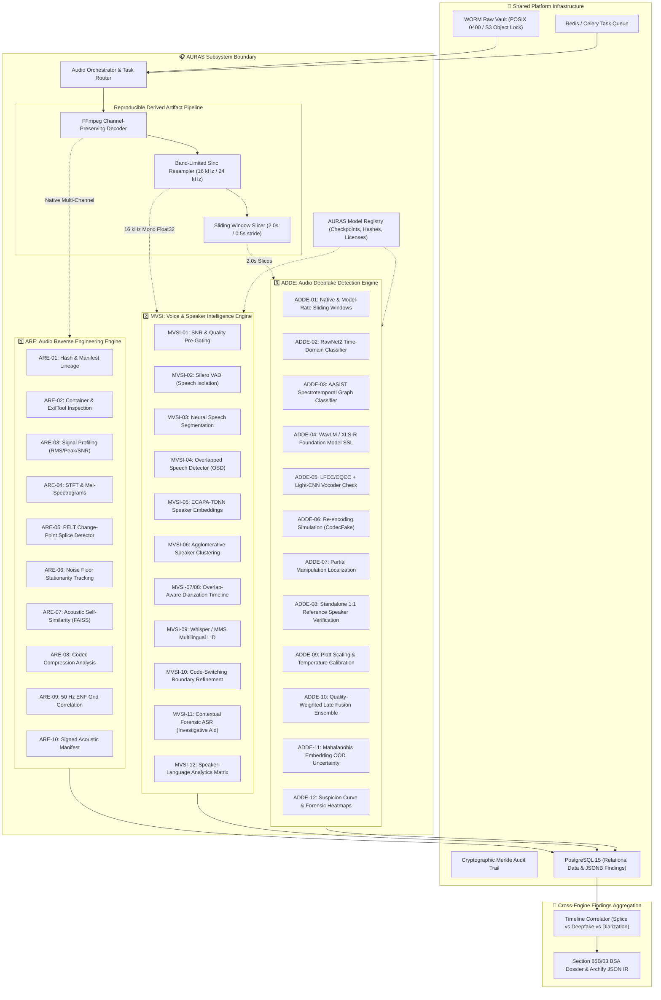

---

## 6. Shared Audio Ingestion & Artifact Pipeline

To guarantee evidentiary admissibility under Section 65B IEA / Section 63 BSA, master audio exhibits are never processed directly by lossy or destructive transforms. A strict artifact derivation pipeline is enforced:

### 6.1 Ingestion Invariants & Policies
1. **Zero-Byte Modification:** The original seized file (e.g., `evidence.wav`) is streamed to disk, dual-hashed (SHA-256 and SHA3-512), and locked with POSIX `0400` permissions.
2. **Channel-Preserving Raw Representation (Artifact A):** Decoded to multi-channel 32-bit float WAV at the native sampling rate ($f_s$). Used exclusively by **ARE** for dynamic range, channel phase correlation, DC offset, and STFT.
3. **Normalized Speech Representation (Artifact B):** Decoded, converted to mono (using energy-preserving downmixing $M = 0.5(L + R)$), and resampled to 16 kHz using band-limited Kaiser-windowed sinc interpolation (`torchaudio.transforms.Resample`). Used exclusively by **MVSI** for VAD, diarization, and language identification.
4. **Standardized Window Slices (Artifact C):** Segmented into 2.0-second sliding windows with a 0.5-second stride (75% overlap). Zero-padded at the tail if shorter than 2.0s. Used exclusively by **ADDE** for frame-level deepfake inference.
5. **Transformation Manifest:** Every generated artifact receives an immutable SHA-256 hash and a JSON lineage record referencing:
   $$\text{Parent Evidence ID} \to \text{Transform Operator} \to \text{Parameters} (f_s, \text{channels}, \text{sinc\_window}) \to \text{Child Hash}$$

---

## 7. ARE Technical Specification (Audio Reverse Engineering Engine)

### ARE-01: Cryptographic Integrity & Lineage Verification
- **Purpose:** Verify bit-level equality against the initial seizure hash; maintain immutable parent-child transformation manifests.
- **Inputs:** Raw exhibit stream, initial acquisition manifest, optional `trusted_sha256` reference.
- **Processing Steps:** Streams bytes through chunked SHA-256 and SHA3-512 accumulators (64KB blocks); queries `evidence` table; verifies WORM file permissions (`0400`).
- **Algorithms:** FIPS 180-4 SHA-256, FIPS 202 SHA3-512.
- **Outputs:** `IntegrityResult(sha256, sha3_512, trusted_match_bool, permissions_valid)`.
- **Failure Modes:** Hash mismatch (returns `CRITICAL_TAMPER_ALERT`), unreadable file (returns `IO_PERMISSION_ERROR`).
- **Confidence Semantics:** Deterministic boolean (1.0 or 0.0). No probabilistic guessing.
- **Implementation Status:** `PLANNED` (Phase 2 / AURAS-A1).

### ARE-02: Container & Metadata Inspection
- **Purpose:** Audit audio headers, container streams, and codec structures for tampering, non-standard encoder tags, and digital audio workstation (DAW) signatures.
- **Inputs:** Master audio exhibit path.
- **Processing Steps:** Runs FFprobe JSON demuxing; executes ExifTool and Mutagen; parses ID3, RIFF/WAVE `INFO` chunks, and broadcast wave format (BWF) headers.
- **Algorithms:** Tag signature dictionary comparison, container atom/chunk validation, audio-video stream cadence checks.
- **Outputs:** `MetadataAudit(codec, sample_rate, channels, bit_depth, duration, encoder_signatures, daw_tags_found, decoder_warnings)`.
- **Confidence Semantics:** Deterministic string match. Flags DAW software (ProTools, Logic, Audacity, FL Studio) with 1.0 confidence of tag presence.
- **Implementation Status:** `PLANNED` (Phase 2 / AURAS-A1).

### ARE-03: Signal Profiling & Dynamic Range Analysis
- **Purpose:** Measure physical electroacoustic parameters to detect clipping, dynamic compression, and DC bias.
- **Inputs:** Native-rate working audio array $x[n]$.
- **Processing Steps:** Computes Root-Mean-Square (RMS) amplitude, true peak ($|x[n]|_{\max}$), DC offset ($\mu_x = \frac{1}{N}\sum x[n]$), clipping sample count ($N_{\text{clip}} = \sum [|x[n]| \ge 0.9999]$), zero-crossing rate (ZCR), and estimated SNR via WADA-SNR.
- **Algorithms:**
  $$RMS_{\text{dBFS}} = 20 \log_{10} \sqrt{\frac{1}{N}\sum_{n=1}^N x^2[n]}, \quad SNR_{\text{est}} = 10 \log_{10}\left(\frac{P_{\text{speech}}}{P_{\text{noise}}}\right)$$
- **Outputs:** `SignalProfile(rms_dbfs, peak_dbfs, dynamic_range_db, dc_offset, clip_count, snr_db, zcr)`.
- **Confidence Semantics:** Continuous scalar metrics. High clipping count ($> 50$) raises a clipping warning.
- **Implementation Status:** `PLANNED` (Phase 2 / AURAS-A1).

### ARE-04: Spectral Analysis & Bandwidth Audit
- **Purpose:** Calculate time-frequency spectrograms and Power Spectral Density (PSD) to detect lossy compression cutoffs and re-encoding artifacts.
- **Inputs:** Native-rate working audio array.
- **Processing Steps:** Applies 2048-point Short-Time Fourier Transform (STFT) with Hann window and 512 hop length; computes log-mel spectrogram (128 mel bins); computes Welch PSD across $0 \le f \le f_s/2$.
- **Algorithms:** Fast Fourier Transform (FFT), Welch periodogram averaging.
- **Outputs:** `SpectralFeatures(spectrogram_matrix, psd_curve, high_frequency_cutoff_hz, spectral_flatness, spectral_rolloff)`.
- **Confidence Semantics:** Deterministic cutoff frequency estimation ($\pm 100\text{ Hz}$).
- **Implementation Status:** `PLANNED` (Phase 2 / AURAS-A1).

### ARE-05: Splice & Edit Candidate Localization
- **Purpose:** Localize abrupt acoustic transitions, edit points, and physical splices using change-point detection on spectral flux and energy time series.
- **Inputs:** Spectral flux $SF[m] = \sum_k |X[k, m] - X[k, m-1]|^2$ and short-time energy $E[m]$.
- **Processing Steps:** Calculates first-order differences in spectral flux; executes Pruned Exact Linear Time (PELT) change-point search with radial basis function (RBF) kernel; cross-correlates candidates with zero-crossing discontinuities.
- **Algorithms:** PELT change-point algorithm (`ruptures` library), kernel changepoint estimation.
- **Outputs:** `List[SpliceCandidate(timestamp_start, timestamp_end, change_point_magnitude, confidence)]`.
- **Confidence Semantics:** Calibrated anomaly score (0.0–1.0) based on discontinuity magnitude relative to background variance.
- **Implementation Status:** `PLANNED` (Phase 2 / AURAS-A2).

### ARE-06: Ambient Noise Floor Consistency Tracking
- **Purpose:** Track background stationary noise floor to identify spliced segments inserted from foreign acoustic environments.
- **Inputs:** Native-rate audio signal.
- **Processing Steps:** Applies minimum statistics noise tracking across 500ms sliding frames; computes stationary background spectral envelope; flags sudden level jumps $> 4\text{ dB}$ lasting $> 200\text{ ms}$.
- **Algorithms:** Martin's minimum statistics spectral subtraction algorithm.
- **Outputs:** `NoiseConsistencyResult(noise_floor_dbfs_curve, anomalous_intervals, ambient_stationarity_score)`.
- **Confidence Semantics:** Continuous stationarity score (0.0–1.0). High scores denote consistent ambient room tone.
- **Implementation Status:** `PLANNED` (Phase 2 / AURAS-A2).

### ARE-07: Acoustic Self-Similarity & Repeated Segment Detection
- **Purpose:** Identify duplicated or copy-pasted acoustic segments (e.g., cloned phrases, repeated background noise loops).
- **Inputs:** 13 MFCC coefficients extracted over 25ms windows with 10ms hop length.
- **Processing Steps:** Normalizes MFCC vectors; indexes frames in FAISS index; computes full pairwise self-similarity matrix $S_{i, j} = \cos(v_i, v_j)$; detects diagonal path matches off the main diagonal using dynamic time warping (DTW).
- **Algorithms:** FAISS exact inner-product search, DTW path alignment.
- **Outputs:** `List[RepeatedSegmentPair(seg_a_start, seg_a_end, seg_b_start, seg_b_end, duration, similarity_score)]`.
- **Confidence Semantics:** Cosine similarity threshold ($> 0.92$ over duration $> 1.0\text{ s}$).
- **Implementation Status:** `PLANNED` (Phase 2 / AURAS-A2).

### ARE-08: Codec Compression & Re-Encoding Analysis
- **Purpose:** Detect multiple lossy compression cycles (e.g., audio recorded on phone, forwarded via WhatsApp, edited in Audacity, and re-exported).
- **Inputs:** Native audio stream and container bitstream.
- **Processing Steps:** Inspects MDCT coefficient quantization error distributions; evaluates high-frequency rolloff steepness ($> 60\text{ dB/octave}$ at 16 kHz indicates MP3/AAC 128k); evaluates frame bit-allocation consistency.
- **Algorithms:** Modified Discrete Cosine Transform (MDCT) coefficient histogram analysis.
- **Outputs:** `CodecAnalysisResult(estimated_compression_passes, primary_codec, reencoding_indicators_detected)`.
- **Confidence Semantics:** Qualitative classification with uncertainty notes.
- **Implementation Status:** `PLANNED` (Phase 2 / AURAS-A2).

### ARE-09: Electric Network Frequency (ENF) Forensics
- **Purpose:** Extract mains hum frequency fluctuations (nominal 50 Hz for Indian electrical grid) to verify recording continuity and correlate timestamps against grid reference logs.
- **Inputs:** Native uncompressed audio file ($f_s \ge 8\text{ kHz}$).
- **Processing Steps:** Applies an 8th-order Butterworth bandpass filter ($49.8\text{ Hz} \le f \le 50.2\text{ Hz}$); extracts analytic signal via Hilbert transform; calculates instantaneous frequency:
  $$f_{\text{ENF}}(t) = \frac{1}{2\pi} \frac{d}{dt} \arg(x_{\text{analytic}}(t))$$
- **Outputs:** `ENFResult(enf_present_bool, snr_enf_db, frequency_curve, correlation_with_grid, grid_reference_match_status)`.
- **Confidence Semantics:** If ENF SNR $< 6\text{ dB}$, returns `INCONCLUSIVE_NO_USABLE_ENF`. When grid reference data is present, outputs Pearson correlation coefficient $r$.
- **Implementation Status:** `PLANNED` (Phase 2 / AURAS-A2 — Advanced/Research).

### ARE-10: Acoustic Provenance Manifest
- **Purpose:** Package all electroacoustic, spectral, and splice findings into an immutable, cryptographically sealed JSON record.
- **Inputs:** Findings from ARE-01 through ARE-09.
- **Outputs:** `AREManifest(manifest_version, evidence_id, sha256, findings_summary, json_payload, cryptographic_signature)`.
- **Implementation Status:** `PLANNED` (Phase 2 / AURAS-A2).

---

## 8. MVSI Technical Specification (Voice & Speaker Intelligence)

### 8.1 Invariant: Speaker Identity $\neq$ Language Identity
A speaker who switches between Hindi and English (code-switching) is **one individual speaker** utilizing multiple linguistic codes. MVSI maintains two orthogonal dimensions:
1. **Speaker Cluster Dimension (`speaker_id`):** Defined by biological and vocal tract acoustic embeddings (ECAPA-TDNN).
2. **Language Dimension (`language_code`):** Defined by phonological and linguistic token probabilities (Whisper/MMS LID).

### 8.2 Overlap-Aware Diarization Architecture
The diarization engine natively supports multiple active speakers in the same time interval:
- `00:15.200 – 00:18.400`: `["SPEAKER_01"]`
- `00:18.400 – 00:20.100`: `["SPEAKER_01", "SPEAKER_02"]` *(Simultaneous Overlap)*
- `00:20.100 – 00:22.000`: `["SPEAKER_02"]`

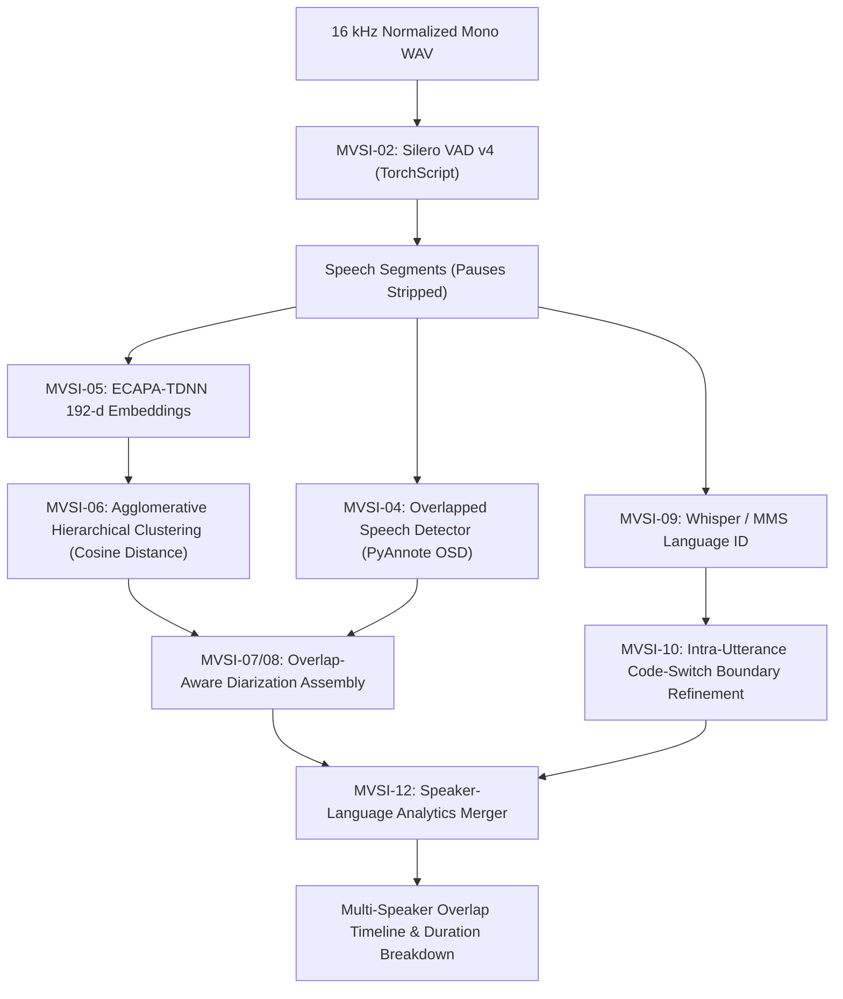

### 8.3 Extensible Indian Language Registry
The language registry covers Scheduled Indian Languages, regional languages, and dialectal varieties:

```sql
CREATE TABLE language_registry (
    iso_code VARCHAR(16) PRIMARY KEY,
    language_name VARCHAR(64) NOT NULL,
    script_default VARCHAR(32) NOT NULL,
    is_scheduled_indian BOOLEAN NOT NULL DEFAULT FALSE,
    regional_context VARCHAR(128)
);

INSERT INTO language_registry VALUES
('hin', 'Hindi', 'Devanagari', TRUE, 'Pan-India / Bihar'),
('bho', 'Bhojpuri', 'Devanagari', FALSE, 'Bihar / Eastern UP'),
('mai', 'Maithili', 'Devanagari / Tirhuta', TRUE, 'Bihar (Mithila)'),
('mag', 'Magahi', 'Devanagari', FALSE, 'Bihar (Magadh)'),
('urd', 'Urdu', 'Perso-Arabic', TRUE, 'Pan-India / Bihar'),
('ben', 'Bengali', 'Bengali', TRUE, 'West Bengal / Eastern India'),
('eng', 'English', 'Latin', FALSE, 'Official / Judicial Proceedings');
```

---

## 9. ADDE Technical Specification (Audio Deepfake Detection Engine)

ADDE is an independent, pluggable, multi-detector engine designed to detect synthetic vocoders, cloned voices, and partial manipulations without relying on any single model family:

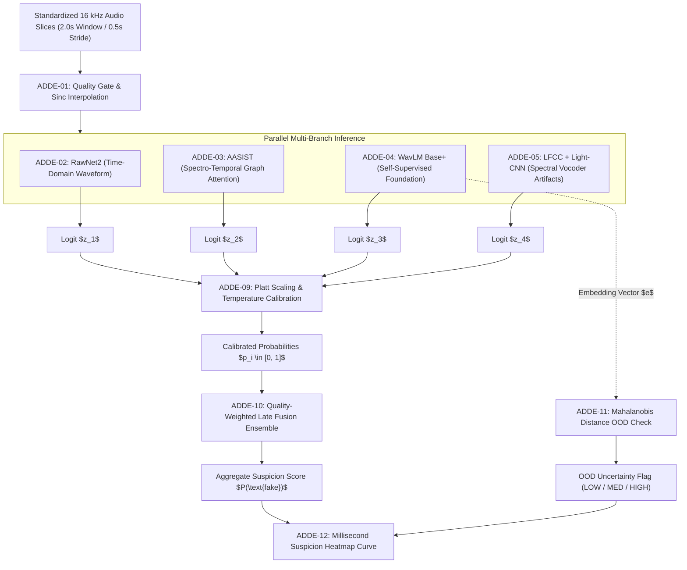

### 9.1 Pluggable Detector Family Specifications
1. **RawNet2 Baseline (`ps05.engines.audio.adde.rawnet2`):**
   - Direct raw waveform input ($1 \times 32000$ samples). Applies sinc-convolution filters followed by residual blocks with gru-pooling. Detects sample-level phase discontinuities characteristic of neural vocoders.
2. **AASIST Baseline (`ps05.engines.audio.adde.aasist`):**
   - Audio Anti-Spoofing using Integrated Spectro-Temporal Graph Attention. Constructs heterogeneous graphs across spectral channels and temporal frames, capturing long-range synthetic artifacts.
3. **Foundation Model SSL (`ps05.engines.audio.adde.ssl_wavlm`):**
   - Utilizes frozen WavLM Base+ pre-trained encoder (12 transformer layers, 768-d hidden states) coupled to a lightweight binary classification head (mean pooling $\to$ Linear(768, 256) $\to$ ReLU $\to$ Dropout(0.3) $\to$ Linear(256, 1)). Yields superior generalization on unseen generative engines (ElevenLabs, Bark, VALL-E).
4. **Spectral Vocoder Classifier (`ps05.engines.audio.adde.spectral`):**
   - Extracts 60-dimensional Linear Frequency Cepstral Coefficients (LFCC) classified by a 9-layer Light-CNN. Captures high-frequency vocoder spectral envelope anomalies.

### 9.2 Score Calibration & Late-Fusion Ensemble
- **Platt Scaling Calibration:** Raw logits $z_i$ from each detector are calibrated using logistic parameters $(A_i, B_i)$ fitted on a held-out validation split:
  $$p_i = \frac{1}{1 + \exp(A_i z_i + B_i)}$$
- **Quality-Weighted Late Fusion:** Composite score is calculated as:
  $$P(\text{fake}) = \sum_{i=1}^M w_i \cdot p_i, \quad \sum w_i = 1.0$$
  Weights $w_i$ are dynamically adjusted based on input SNR (e.g., if SNR $< 10\text{ dB}$, WavLM weight increases while RawNet2 weight decreases).
- **Disagreement Metric:** If $\max(p_i) - \min(p_i) > 0.50$, the system explicitly records `DETECTOR_DISAGREEMENT_WARNING`.

### 9.3 Out-of-Distribution (OOD) Detection
- Computes Mahalanobis distance in the WavLM 768-d embedding space against the in-distribution reference mean $\mu$ and covariance matrix $\Sigma$:
  $$D_M(x) = \sqrt{(x - \mu)^T \Sigma^{-1} (x - \mu)}$$
- If $D_M(x) > \text{Threshold}_{95\%}$, the system outputs `OOD_UNCERTAINTY: HIGH`, advising the examiner that the recording conditions (extreme noise or rare codec) exceed the reliable operational boundary of the models.

### 9.4 1:1 Reference Speaker Verification Check
- **Explicit Boundary:** Speaker verification is **strictly separated** from deepfake detection.
- Compares questioned segment embeddings against an authorized suspect reference recording using ECAPA-TDNN cosine distance. Outputs a similarity metric without asserting automated biometric identity.

---

## 10. AIF Image Forensics Subsystem Technical Architecture & Engine Specifications

The **AIF (Advanced Image Forensics)** subsystem provides an explainable, cryptographically grounded, multi-engine evidentiary platform for the analysis of seized digital images, documents, facial exhibits, and synthetic media. AIF operates in strict compliance with Section 65B of the Indian Evidence Act (IEA) and Section 63 of the Bharatiya Sakshya Adhiniyam (BSA 2023).

### 10.1 High-Level AIF Engine Architecture & Subsystem Boundaries

AIF partitions image analysis across three specialized forensic engines and a dedicated cross-cutting biometric module, coordinated by the task-aware router and anchored by CEIPL:

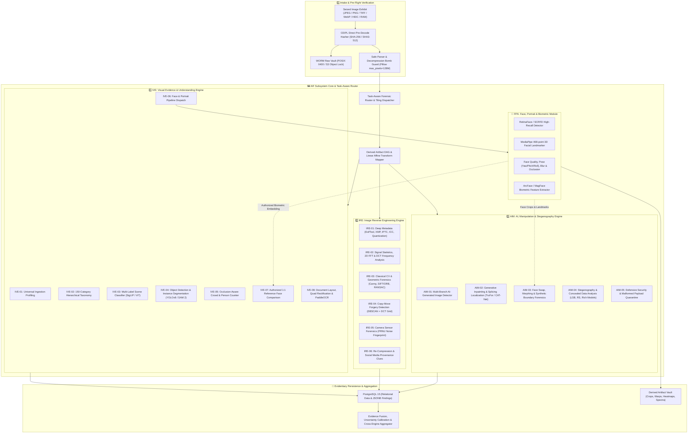

---

### 10.2 Image Ingestion, Decompression Bomb Mitigation & Safe Decoding Sequence

To guarantee evidentiary integrity and protect forensic worker nodes from adversarial image exploits (decompression bombs, malformed header integer overflows, polyglots), all incoming image exhibits execute a strict non-destructive intake sequence:

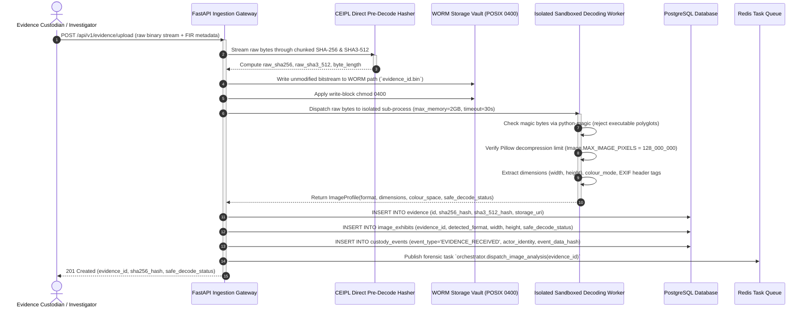

---

### 10.3 Multi-Engine Image Forensic Execution Sequence

Once ingested, the Task-Aware Router examines evidence dimensions, metadata flags, and requested analytical depth to schedule parallel forensic engines:

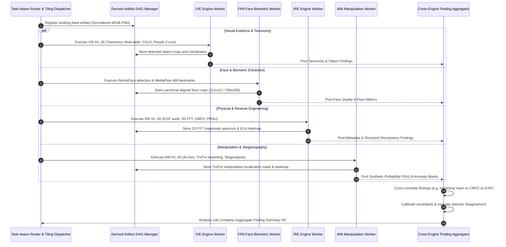

---

### 10.4 FPA Face & Portrait Forensic Routing Sequence

The Face, Portrait & Biometric Analysis module enforces strict judicial privacy boundaries:

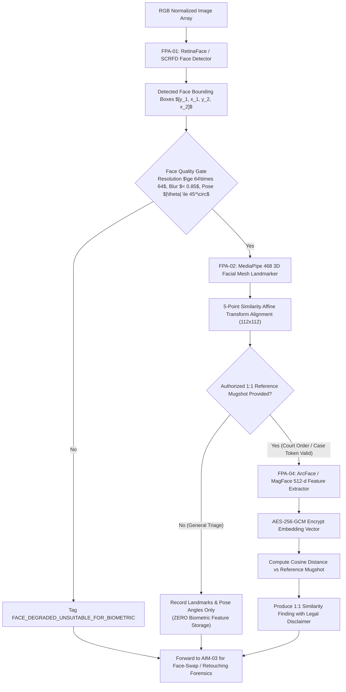

---

### 10.5 Classical CV & Reference Comparison Alignment Flow

IRE employs classical computer vision algorithms strictly for geometric registration, edge localization, and reference comparison, never as standalone tampering proofs:

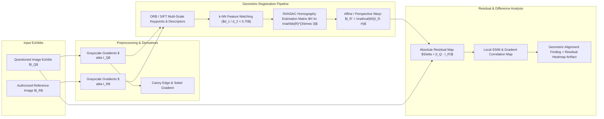

---

### 10.6 AI Generation & Synthetic Manipulation Localization Pipeline

AIM provides a multi-branch, multi-scale architecture for detecting AI-generated content and localizing generative inpainting:

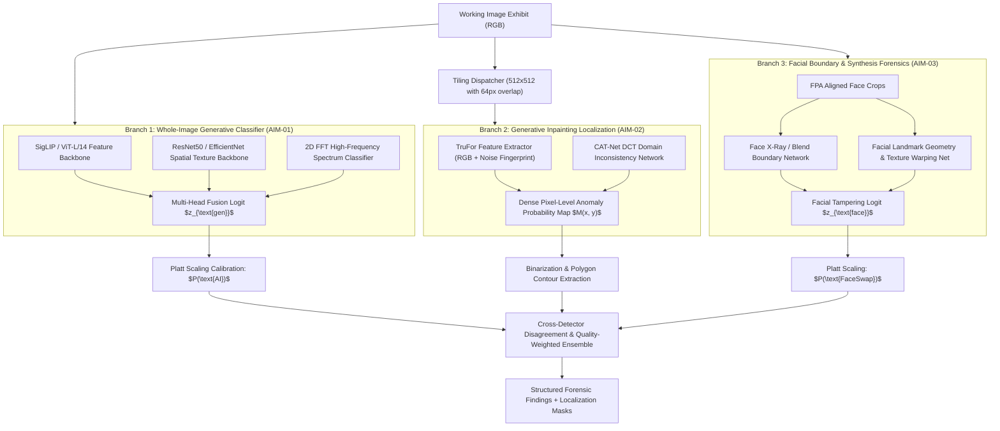

---

### 10.7 IVE Technical Specification (Image Understanding & Visual Evidence Engine)

#### IVE-01: Universal Image Ingestion Profiling & Safe Decoding
- **Purpose:** Safely inspect, profile, and validate seized image files, enforcing decompression bomb limits and extracting complete structural container parameters without altering the bitstream.
- **Inputs:** Seized raw image file path in WORM storage.
- **Processing Steps:**
  1. Inspects magic bytes using `python-magic` to establish real file format independently of file extension.
  2. Sets Pillow safety boundary: `Image.MAX_IMAGE_PIXELS = 128_000_000`. Rejects images exceeding 128 Megapixels with `DECOMPRESSION_BOMB_PREVENTED`.
  3. Executes isolated worker process decoding to capture dimensions $(W, H)$, aspect ratio, bit depth, channel configuration (RGB, RGBA, CMYK, Grayscale), colour space (sRGB, AdobeRGB, Display P3, uncalibrated), orientation flag (EXIF Tag 274), and animation frame count.
  4. Parses embedded thumbnail availability and validates structural container completeness.
- **Outputs:** `ImageProfile(detected_format, width, height, pixel_count, aspect_ratio, bit_depth, colour_mode, colour_space, has_alpha, orientation, safe_decode_status, embedded_thumb_present)`.
- **Implementation Status:** `PLANNED` (Phase AIF-A2).

#### IVE-02: Hierarchical 150-Category Image Evidence Taxonomy
- **Purpose:** Organize forensic visual evidence into a structured, multi-label taxonomy spanning 15 parent domains and approximately 150 leaf classes.
- **Taxonomy Domains:**
  1. Human Presence & Context (Portrait, Selfie, Group, Family, Identification Photo, Distant Face).
  2. Injury & Medical Evidence (Abrasion, Laceration, Contusion, Burn, Fracture Radiograph).
  3. Possible Violent-Incident Context (Scene Triage, Struggle Disturbance, Bloodstain Pattern).
  4. Physical Traces & Evidence (Tool Marks, Footwear Impression, Tire Tread, Ballistic Mark).
  5. Weapon & Weapon-like Objects (Firearm Handgun, Long Gun, Edged Weapon, Blunt Object, Explosive).
  6. Property & Property Crime (Forced Entry Point, Broken Glass, Vandalism, Graffiti, Burglary).
  7. Vehicle & Transport Evidence (License Plate, Collision Damage, Vehicle Undercarriage, Skid Marks).
  8. Fire, Explosion & Disaster (Arson Origin, Char Pattern, Blast Crater, Structural Collapse).
  9. Digital Devices & Electronic Exhibits (Mobile Screen Display, Laptop/Desktop, Storage Media).
  10. Documents & Alterations (Official Stamp, Seal, Signature, Handwritten Note, Identity Card).
  11. Substances & Packaging (Narcotic Packaging, Contraband Container, Chemical Label).
  12. Environmental & Biological Context (Outdoor Scene, Vegetation, Soil Disturbance, Water Body).
  13. Public Safety & Infrastructure (Road Hazard, Traffic Signal, CCTV Enclosure, Power Line).
  14. Neutral & Everyday Context (Landscape, Architecture Exterior, Food/Beverage, Household Object).
  15. Specialized Forensic Modalities (Infrared/Thermal, X-Ray Radiograph, Microscopy, Aerial/Drone).
- **Taxonomy Validation Invariant:** A taxonomy category is an indexing and triage label, never an automated judicial verdict.
- **Implementation Status:** `PLANNED` (Phase AIF-A3).

#### IVE-03: Multi-Label Scene Classification & Visual Reasoning
- **Purpose:** Assign calibrated multi-label taxonomy tags and generate structured scene descriptions.
- **Model Candidates:** SigLIP (ViT-SO400M), CLIP (ViT-L/14@336px), Swin Transformer v2.
- **Processing Steps:** Passes normalized $336\times 336$ image representation through zero-shot text-image embedding projections and domain-specific classification heads. Applies temperature calibration to generate multi-label probabilities $p_c \in [0, 1]$.
- **Outputs:** `List[TaxonomyAnnotation(category_id, confidence, is_triage_alert, calibration_status)]`.
- **Implementation Status:** `PLANNED` (Phase AIF-A3).

#### IVE-04: Object Detection & Instance Segmentation
- **Purpose:** Localize physical evidence items, weapons, vehicles, and documents with bounding boxes and polygon masks.
- **Model Candidates:** YOLOv8x / YOLOv10x for real-time bounding boxes; Grounding DINO for open-vocabulary queries; SAM 2 (Segment Anything 2) for zero-shot promptable polygon segmentation.
- **Tiling Architecture:** For high-resolution exhibits ($> 2048\times 2048$), image is partitioned into $1024\times 1024$ tiles with $128\text{px}$ overlap. Detections across tile boundaries are merged using Non-Maximum Suppression (NMS) with IoU threshold 0.50, and mapped back to parent coordinates via affine coordinate transforms stored in the Derived Artifact DAG.
- **Outputs:** `List[DetectedObject(class_id, label, confidence, bbox_normalized, polygon_mask_uri)]`.
- **Implementation Status:** `PLANNED` (Phase AIF-A4).

#### IVE-05: Occlusion-Aware People & Crowd Counting
- **Purpose:** Accurately count visible human individuals, resolving occlusions and separating people counts from face counts.
- **Methodology:** Executes dual-head detection: head-box detection (high recall in dense crowds) and full-body pedestrian bounding boxes. Resolves overlaps via Hungarian matching. Rejects mannequins, posters, and reflections by cross-checking texture depth and 2D frequency variance.
- **Outputs:** `PeopleCountResult(visible_people_count, detected_faces_count, estimated_crowd_density, count_mae_uncertainty, occlusion_index)`.
- **Implementation Status:** `PLANNED` (Phase AIF-A4).

#### IVE-06: Face, Portrait & Selfie Handling (FPA Integration)
- **Purpose:** Detect, crop, land-mark, and assess quality of all human faces appearing in seized imagery.
- **Candidate Stack:** RetinaFace (ResNet50 backbone) or SCRFD for multi-scale face detection; MediaPipe Face Landmarker for 468-point 3D facial topology mesh.
- **Quality Metrics:** Computes head pose angles ($\text{Yaw}, \text{Pitch}, \text{Roll}$ via solvePnP on canonical 3D mesh points), Laplacian blur variance, and illumination symmetry. Faces with quality score $< 0.40$ or resolution $< 48\times 48$ are tagged as degraded and restricted from downstream biometric matching.
- **Outputs:** `List[FaceRegion(face_id, bbox, landmarks_468, pose_angles, quality_score, crop_artifact_id)]`.
- **Implementation Status:** `PLANNED` (Phase AIF-A5).

#### IVE-07: Authorized Biometric Reference Comparison
- **Purpose:** Perform 1:1 facial biometric feature comparison against an authorized suspect mugshot under strict judicial access controls.
- **Privacy & Legal Invariant:** Biometric comparison is **strictly disabled by default**. It requires an active `CaseAuthorizationToken` signed by the investigating officer. Automated 1:N surveillance search across external databases is **prohibited**.
- **Model Candidates:** ArcFace (ResNet-100 / IResNet-100 pre-trained on Glint360k), Sub-center ArcFace, AdaFace, MagFace.
- **Mathematical Specification:**
  Extracts 512-dimensional normalized feature vectors $u, v \in \mathbb{R}^{512}$ ($\|u\|_2 = \|v\|_2 = 1$). Computes cosine similarity:
  $$\text{sim}(u, v) = u^T v = \cos(\theta)$$
- **Outputs:** `BiometricComparisonResult(similarity_score, calibrated_match_probability, threshold_reference, false_match_rate_operating_point, legal_disclaimer)`.
- **Implementation Status:** `PLANNED` (Phase AIF-A5).

#### IVE-08: Document Layout, Quadrilateral Rectification & OCR
- **Purpose:** Detect document boundaries, rectify perspective distortion, and extract machine-readable text from contracts, FIRs, and identity cards.
- **Methodology:** Localizes quadrilateral corners via convex hull polygon approximation on Canny contours. Computes $3\times 3$ perspective transformation matrix $H_{\text{persp}}$ to warp the document to a flat rectangular plane. Executes PaddleOCR / Tesseract 5 with specialized Hindi, English, and regional Indian language language packs.
- **Outputs:** `DocumentOCRResult(rectified_artifact_id, detected_boxes, recognized_text, avg_confidence, seals_detected, signatures_detected)`.
- **Implementation Status:** `PLANNED` (Phase AIF-A6).

---

### 10.8 IRE Technical Specification (Image Reverse Engineering Engine)

#### IRE-01: Deep Metadata, EXIF, XMP, IPTC & Container Inspection
- **Purpose:** Extract and cross-validate embedded metadata blocks to identify editing software tags, camera settings, and timestamp discrepancies.
- **Parser Stack:** ExifTool (vendored read-only execution with argument sanitization), Pillow `_getexif()`, and format-specific container parsers (libjpeg, libpng, tifffile).
- **Extracted Fields:**
  - EXIF: Make, Model, LensModel, ExposureTime, FNumber, ISO, FocalLength, DateTimeOriginal, CreateDate, ModifyDate, GPSLatitude, GPSLongitude.
  - XMP / IPTC: HistoryAction, HistorySoftwareAgent, CreatorTool, DocumentID, InstanceID.
  - JPEG Markers: DQT (Quantization Tables for Luminance and Chrominance), SOF0/SOF2 (Chroma Subsampling 4:2:0, 4:2:2, 4:4:4), DHT (Huffman tables).
- **Tampering Invariants:**
  1. Software tag (e.g. "Adobe Photoshop CC 2024") proves presence of editing application metadata, but does not prove pixels were tampered.
  2. Missing EXIF metadata does **not** prove malicious modification (messaging apps routinely strip all metadata).
- **Outputs:** `MetadataAuditReport(exif_tags, xmp_history, quantization_tables, camera_profile, software_signatures_found, timestamp_consistency_verdict)`.
- **Implementation Status:** `PLANNED` (Phase AIF-A7).

#### IRE-02: Signal Statistics, 2D FFT & DCT Frequency Analysis
- **Purpose:** Analyze 2D frequency spectra and local noise residuals to detect re-sampling, periodic interpolation, and filtering artifacts.
- **Methodology:**
  1. Computes 2D Fast Fourier Transform on grayscale luminance:
     $$F(u, v) = \sum_{x=0}^{M-1} \sum_{y=0}^{N-1} I(x, y) e^{-j 2\pi (\frac{ux}{M} + \frac{vy}{N})}$$
  2. Shifts DC component to center and computes log-magnitude spectrum $\log(1 + |F(u, v)|)$. Detects radial periodic spikes indicating periodic resampling or affine interpolation grids.
  3. Computes Discrete Cosine Transform (DCT) coefficient distributions across $8\times 8$ blocks to measure quantization error variance.
- **Outputs:** `SignalAnalysisResult(fft_magnitude_artifact_id, periodic_peaks_detected, noise_variance_map_id, frequency_anomaly_score)`.
- **Implementation Status:** `PLANNED` (Phase AIF-A7).

#### IRE-03: Classical Vision & Geometric Forensics
- **Purpose:** Apply classical computer vision primitives for edge detection, shape analysis, and planar reference alignment.
- **Algorithms:**
  - Canny Edge Detection with automatic Otsu thresholding.
  - Sobel and Scharr gradient operators for edge directionality.
  - Hough Line and Circle transforms for architectural and ballistic alignment.
  - ORB / SIFT feature extraction with RANSAC homography estimation for multi-image reference registration.
- **Forensic Principle:** Classical CV outputs describe geometric and boundary properties; they do **not** establish intent, authenticity, or fraud.
- **Outputs:** `GeometricForensicResult(edge_map_artifact_id, contours_detected, homography_matrix, alignment_error_rmse)`.
- **Implementation Status:** `PLANNED` (Phase AIF-A8).

#### IRE-04: Copy-Move Forgery Detection (CMFD) & Splicing Localization
- **Purpose:** Localize cloned or duplicated image regions within the same exhibit.
- **Dual-Branch Architecture:**
  1. Keypoint-Based Branch: SIFT keypoints with $k$-d tree nearest-neighbor search, filtering spatial proximity ($r > 30\text{px}$), clustered via DBSCAN and validated via RANSAC affine consistency.
  2. Block-Based Branch: Overlapping $16\times 16$ blocks transformed via 2D DCT; lexicographically sorted or indexed in FAISS to detect smooth or textured duplicated patches lacking high-contrast keypoints.
- **Outputs:** `CMFDResult(cloned_pairs_count, source_polygon_mask, destination_polygon_mask, confidence, visualization_artifact_id)`.
- **Implementation Status:** `PLANNED` (Phase AIF-A9).

#### IRE-05: Camera Sensor Forensics & PRNU Noise Fingerprinting
- **Purpose:** Extract Photo-Response Non-Uniformity (PRNU) sensor noise patterns to associate an image with a specific physical camera sensor.
- **Mathematical Model:**
  Sensor output $I = I^{(0)} + I^{(0)} \cdot K + \Theta$, where $K$ is the deterministic sensor PRNU noise fingerprint and $\Theta$ is random noise.
  Extracts noise residual $W = I - F(I)$ using a Mihcak wavelet denoising filter.
  Computes Normalized Cross-Correlation (NCC) against a reference camera fingerprint $K_{\text{ref}}$:
  $$\rho(W, K_{\text{ref}}) = \frac{(W - \bar{W}) \cdot (K_{\text{ref}} - \bar{K}_{\text{ref}})}{\|W - \bar{W}\|_2 \|K_{\text{ref}} - \bar{K}_{\text{ref}}\|_2}$$
- **Operational Requirement:** Device association requires at least 20–30 flat-field reference photographs taken with the suspect device. Social-media re-compression severely degrades PRNU.
- **Outputs:** `PRNUResult(noise_residual_artifact_id, correlation_coefficient, p_value, device_match_verdict)`.
- **Implementation Status:** `PLANNED` (Phase AIF-A9 — Research Candidate).

#### IRE-06: Processing History, Re-Compression & Social Media Provenance
- **Purpose:** Detect multiple lossy compression cycles and identify characteristic social media platform transformations (WhatsApp, Facebook, Telegram, X).
- **Methodology:** Compares quantization table fingerprints against a catalog of 20,000 known mobile camera and platform profiles. Detects Blocking Artifact Discrepancy (BAD) across misaligned JPEG 8x8 grids resulting from cropping followed by re-compression.
- **Outputs:** `CompressionProvenanceResult(estimated_compression_cycles, matched_platform_signature, bad_discrepancy_score)`.
- **Implementation Status:** `PLANNED` (Phase AIF-A9).

---

### 10.9 AIM Technical Specification (AI, Manipulation & Steganography Engine)

#### AIM-01: Multi-Branch AI-Generated Image Detection
- **Purpose:** Discriminate authentic photographic captures from fully synthetic generative images (Stable Diffusion, Midjourney, DALL-E, Flux, Imagen, StyleGAN).
- **Multi-Branch Classifier Ensemble:**
  1. Patch-Level Spatial Texture Head: ResNet50 / ConvNeXt trained on multi-generator artifact datasets.
  2. High-Frequency Fourier Head: Classifies 2D FFT spectral abnormalities and radial falloff signatures.
  3. Foundation Representation Head: SigLIP / CLIP visual embeddings with linear probe.
- **Calibration & Disagreement:** Raw logits are calibrated using Platt scaling on a held-out benchmark split. If individual branch predictions disagree by $> 0.50$, the system records `DETECTOR_DISAGREEMENT_WARNING` and reports high uncertainty.
- **Outputs:** `AIGenerationResult(p_synthetic_calibrated, raw_branch_scores, generator_family_clue, uncertainty_flag)`.
- **Implementation Status:** `PLANNED` (Phase AIF-A10).

#### AIM-02: Generative Inpainting, Fill & Local Splicing Localization
- **Purpose:** Localize pixel-level modified regions resulting from generative fill, object removal, or local splicing.
- **Candidate Architectures:** TruFor (Transformer-based RGB and noise residual fusion architecture) and CAT-Net (DCT coefficient stream combined with RGB stream).
- **Output Artifacts:** Produces a dense floating-point anomaly probability map $M(x, y) \in [0, 1]$ at native image resolution, along with vector polygon contours of the suspected edited zones.
- **Outputs:** `InpaintingLocalizationResult(tampered_area_percentage, anomaly_mask_artifact_id, localized_polygons, confidence)`.
- **Implementation Status:** `PLANNED` (Phase AIF-A10).

#### AIM-03: Face Swap, Morphing & Synthetic Portrait Manipulation
- **Purpose:** Detect face-swapped portraits (DeepFakes, SimSwap, Roop), face morphs, and generative face edits.
- **Methodology:**
  1. Face X-Ray / Boundary Inconsistency: Detects blending boundaries between the inserted face patch and the background head/neck texture.
  2. Facial Landmark & Geometry Consistency: Measures bilateral facial asymmetry and unnatural landmark configurations.
  3. Eye Reflection & Corneal Specularity: Verifies consistency of corneal light reflections across left and right pupils.
- **Outputs:** `FaceManipulationResult(p_face_swap, blend_boundary_score, specularity_consistent, heatmap_artifact_id)`.
- **Implementation Status:** `PLANNED` (Phase AIF-A11).

#### AIM-04: Steganography & Concealed Data Analysis
- **Purpose:** Inspect image bitstreams for steganographic payloads and hidden data.
- **Detection Primitives:**
  - Least Significant Bit (LSB) plane visual and statistical randomness analysis.
  - Sample Pair Analysis (SPA) and Chi-square ($\chi^2$) statistical tests on spatial pixel pairs.
  - Regular-Singular (RS) steganalysis to detect spatial-domain LSB embedding rates.
  - Spatial Rich Models (SRM) and sub-scale co-occurrence matrices for adaptive steganalysis (HUGO, WOW, S-UNIWARD).
- **Execution Invariant:** Payload extraction is attempted only under an explicit authorized command. Extracted data is **never executed**.
- **Outputs:** `SteganalysisResult(lsb_randomness_score, rs_anomaly_detected, estimated_payload_ratio, alert_status)`.
- **Implementation Status:** `PLANNED` (Phase AIF-A12).

#### AIM-05: Defensive Security & Malformed Payload Quarantine
- **Purpose:** Defend the platform against maliciously crafted image files, polyglot exploits, parser crashes, and buffer overflows.
- **Controls:**
  1. Magic byte verification rejecting executable binaries disguised as images (e.g. PE, ELF, ZIP polyglots).
  2. Trailing byte inspection: flags appended data beyond end-of-image markers (e.g. data appended past JPEG `FF D9` or PNG `IEND`).
  3. Execution Sandboxing: All external decoders (libjpeg-turbo, libvips, OpenCV) run inside memory-capped, isolated worker processes.
- **Outputs:** `FileSecurityAudit(trailing_bytes_detected, trailing_bytes_length, polyglot_risk_level, quarantine_status)`.
- **Implementation Status:** `PLANNED` (Phase AIF-A12).

---

### 10.10 AIF-GEO Technical Specification (Geospatial Forensics & Evidence Correlation Engine)

The **AIF-GEO** subsystem provides deep geospatial evidence extraction, geographic coordinate normalization, track-to-image correlation, visual location recovery, solar/shadow verification, environmental consistency auditing, multi-image clustering, and cross-evidence conflict graphing within the PS-05 platform. It integrates natively with CEIPL for cryptographic provenance and reuses core AIF visual processing infrastructure.

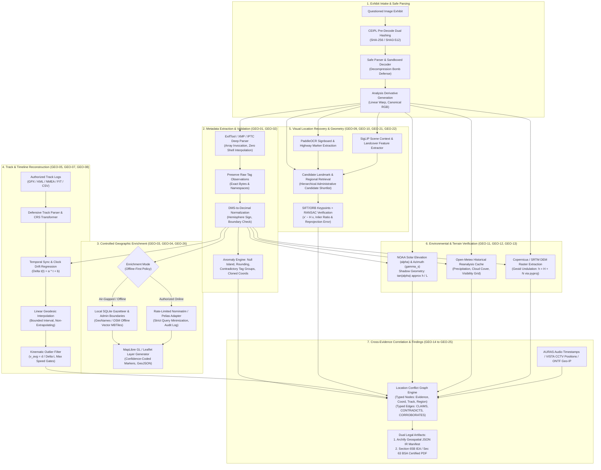

---

#### 10.10.1 Comprehensive Capability Specifications (GEO-01 through GEO-26)

##### GEO-01: Comprehensive GPS Metadata Extraction
- **Investigative Purpose:** Extracts every available geospatial, temporal, and hardware attribute embedded in image file headers across all standardized metadata formats (EXIF, XMP, IPTC, MakerNotes) without destructive alterations.
- **Functional Requirements:**
  1. Parse standard EXIF GPS IFD tags: `GPSVersionID`, `GPSLatitudeRef`, `GPSLatitude`, `GPSLongitudeRef`, `GPSLongitude`, `GPSAltitudeRef`, `GPSAltitude`, `GPSTimeStamp`, `GPSSatellites`, `GPSStatus`, `GPSMeasureMode`, `GPSDOP`, `GPSSpeedRef`, `GPSSpeed`, `GPSTrackRef`, `GPSTrack`, `GPSImgDirectionRef`, `GPSImgDirection`, `GPSMapDatum`, `GPSDestLatitude`, `GPSDestLongitude`, `GPSDateStamp`, `GPSDifferential`, `GPSHPositioningError`.
  2. Parse XMP geospatial properties under namespaces: `http://ns.adobe.com/exif/1.0/`, `http://ns.adobe.com/photoshop/1.0/`, `http://iptc.org/std/Iptc4xmpCore/1.0/xmlns/` (`Iptc4xmpCore:Location`, `photoshop:City`, `photoshop:State`, `photoshop:Country`).
  3. Extract hardware-specific MakerNotes (Apple iOS scene/heading tags, Samsung, Sony, Canon, Nikon proprietary coordinate tags) and subsecond timestamps (`SubSecTimeOriginal`, `OffsetTimeOriginal`).
  4. Preserve the raw byte offset, raw tag name, tag group/namespace, raw decoded value, and normalized value in an immutable observation manifest.
- **Inputs & Supported Formats:** Master image binary stream (`JPEG`, `TIFF`, `HEIC`, `PNG`, `WebP`, `DNG`, `CR2`, `NEF`, `ARW`).
- **Required Preprocessing:** Pre-decode dual streaming hash (SHA-256 / SHA3-512) via CEIPL; read-only memory-mapped stream inspection.
- **Algorithm & Method:** Isolated worker process invokes `exiftool -json -G -a -u -s -c "%.8f"` over pipe arrays (avoiding shell execution). Output JSON parsed into typed observation records.
- **Data Contract & Outputs:** `GeospatialObservationList` containing typed `GeospatialObservation` records.
- **Error Cases & Failure Modes:** Corrupted IFD header returns `PARSER_HEADER_CORRUPT`; stripped metadata returns valid record with status `NOT_AVAILABLE`; malformed EXIF tables quarantined via memory bounds.
- **Scientific Limitations:** Extraction confirms only that the file container contained these bytes; does not prove the device was physically at the coordinates.
- **Security & Privacy:** Sandboxed execution under strict CPU/memory rlimits (`RLIMIT_AS=512MB`); unvetted filenames sanitized; zero outbound network activity.
- **Test Fixtures & Acceptance:** Validated on ExifTool test suite, synthetic multi-group EXIF/XMP samples, and real-world mobile captures (`test_geo_exif_deep.py`). 100% field extraction recall on standard EXIF 2.32 GPS tags.

##### GEO-02: Coordinate Validity and Anomaly Checks
- **Investigative Purpose:** Validates the structural, mathematical, and geographic plausibility of extracted coordinates to detect parser-induced errors, default hardware states, and deliberate coordinate manipulation.
- **Functional Requirements:**
  1. Boundary Validation: Enforce strict geodetic bounds: $-90.0 \le \phi \le 90.0$ and $-180.0 \le \lambda \le 180.0$.
  2. Rational Number Integrity: Decode rational pairs $(N, D)$; reject division by zero ($D = 0$); flag non-standard floating approximations.
  3. Default / Null Island Detection: Flag exact $(0.0, 0.0)$ coordinates; distinguish uninitialized GPS chip default from genuine Gulf of Guinea maritime locations using land/sea boundary polygons.
  4. Integer Truncation & Rounding Audit: Detect coordinate truncation (e.g. $\phi = 25.000000^\circ, \lambda = 85.000000^\circ$), indicating low-resolution mock apps or coarse manual tagging.
  5. Contradictory Tag Detection: Cross-check EXIF GPS vs XMP GPS coordinates; flag discrepancies exceeding $1.0\text{ meter}$.
  6. Cloned Coordinate Audit: Detect identical coordinates across distinct exhibits captured at disparate times within the same case.
- **Inputs:** `GeospatialObservationList` from GEO-01.
- **Mathematical Basis:** DMS rational normalization with sign inversion; bounding box polygon inclusion checks.
- **Data Contract:** `CoordinateValidationResult(is_valid, anomaly_flags, normalized_lat, normalized_lon, normalized_alt)`.
- **Error Cases:** Malformed rational generates `MALFORMED_RATIONAL_DENOMINATOR_ZERO`; latitude $> 90^\circ$ generates `COORDINATE_OUT_OF_BOUNDS_ERROR`.
- **Scientific Limitations:** Legitimate photos can be captured at integer boundaries or $(0,0)$ maritime zones; flags represent evidentiary anomalies, not proof of fraud.
- **Acceptance Criteria:** Detects 100% of synthetic out-of-bounds, zero-denominator, truncated, and contradictory coordinates in test suite.

##### GEO-03: Reverse Geocoding and Place Enrichment
- **Investigative Purpose:** Resolves verified numeric coordinates into structured, human-understandable administrative hierarchies (Country, State, District, Taluk, Police Station Jurisdiction, Locality, Road) to support forensic investigation and courtroom testimony.
- **Functional Requirements:**
  1. Hierarchical Administrative Resolution: Resolve WGS84 point to Country, State/Province, District, Sub-district (Tehsil/Taluk), City/Village, Postal Code, and Street Level.
  2. Special Jurisdiction Mapping: For Indian jurisdictions, map coordinates against Bihar Police Station boundary Shapefiles/GeoJSON layers.
  3. Offline-First Operation: Default resolution against locally indexed SQLite gazetteer (derived from GeoNames and OpenStreetMap administrative extracts).
  4. Controlled Online Enrichment: Opt-in, rate-limited query adapter for Nominatim / Pelias with caching, strict query minimization, and audit logging.
  5. Attribution & Provenance: Record data provider name, database release date, license URI, and feature identifier in every enriched record.
- **Data Contract:** `ReverseGeocodeEnrichment(country_code, administrative_area_level_1, administrative_area_level_2, locality, police_jurisdiction, formatted_address, provider_source, license_notice)`.
- **Security & Privacy:** Uploaded image pixels are **never** transmitted; only truncated coordinate pairs are resolved; local cache eliminates external query leakage.
- **Scientific Limitations:** Reverse geocoding describes what exists at a coordinate; it does **not** authenticate that the photo was captured at that location.

##### GEO-04: Interactive Geospatial Evidence Map
- **Investigative Purpose:** Provides an interactive, cartographic workspace for investigators to visualize evidence distribution, route trajectories, candidate areas, and evidentiary conflicts across spatial and temporal dimensions.
- **Functional Requirements:**
  1. Map Visualization Engine: Integration with MapLibre GL JS / Leaflet supporting vector tiles and offline raster MBTiles.
  2. Distinct Marker Taxonomy: Render visually distinct, accessible marker symbols and colors for:
     - Verified Metadata Coordinates (`MACHINE_EXTRACTED` - Blue Solid Pin).
     - External Device Track Points (`CORROBORATED` - Green Dot).
     - Interpolated Track Positions (`MODEL_INFERRED` - Green Hollow Pin).
     - Model Candidate Locations (`MODEL_INFERRED` - Amber Ring Marker).
     - Contradictory / Disputed Locations (`CONFLICTING` - Red Exclamation Pin).
  3. Uncertainty Visualization: Render semi-transparent confidence error circles based on 95% horizontal positioning error ($\text{HPE}$).
  4. Synchronized Spatio-Temporal Timeline: Interactive time-slider filtering visible exhibits by capture timestamp.
  5. Evidence Drill-Down: Clicking any marker opens side-by-side evidence preview, cryptographic hash, and lineage details.
- **Data Contract:** GeoJSON FeatureCollection with standardized properties (`evidence_id`, `marker_type`, `uncertainty_radius_m`, `timestamp_utc`, `conflict_flag`).
- **Offline Invariant:** Operates fully without active internet connectivity using pre-bundled local vector tile packages (`bihar_offline_tiles.mbtiles`).

##### GEO-05: Capture-Time and GPS-Time Consistency
- **Investigative Purpose:** Evaluates temporal consistency between camera clock timestamps and atomic satellite GPS clocks to detect post-capture date edits, clock drift, and timezone anomalies.
- **Functional Requirements:**
  1. Multi-Field Timestamp Extraction: Extract `EXIF:DateTimeOriginal`, `EXIF:CreateDate`, `EXIF:ModifyDate`, `GPS:GPSDateStamp`, `GPS:GPSTimeStamp`, and file system `mtime`/`ctime`.
  2. UTC Normalization: Parse explicit timezone offsets (`EXIF:OffsetTimeOriginal`); when offset is absent, flag timezone ambiguity.
  3. Discrepancy Calculation: Compute delta $\Delta t = |t_{\text{camera}} - t_{\text{GPS\_UTC}} - \Delta t_{\text{tz}}|$.
  4. Drift Regression: Across multiple photos from the same device, perform linear regression $\Delta t(t) = a \cdot t + b$ to quantify clock drift vs discrete timestamp jumps.
  5. Anomaly Flagging: Flag $\Delta t > 120\text{ seconds}$ as `TIMESTAMP_GPS_DESYNCHRONIZATION`; flag impossible capture dates (future dates or dates prior to GPS epoch).
- **Mathematical Basis:** Linear least-squares regression for clock drift rate $a$ and baseline offset $b$.
- **Data Contract:** `TemporalConsistencyFinding(camera_time_utc, gps_time_utc, clock_offset_seconds, drift_rate_ppm, anomaly_severity)`.
- **Scientific Limitations:** Camera clocks are frequently set manually and drift by several seconds per week; minor drift is normal and does not prove tampering.

##### GEO-06: Accuracy and Uncertainty Representation
- **Investigative Purpose:** Quantifies, standardizes, and propagates spatial uncertainty bounds for every geographic observation to prevent misleading pinpoint claims in forensic reports.
- **Functional Requirements:**
  1. Uncertainty Source Taxonomy: Explicitly categorize uncertainty origin:
     - `MEASURED_HPE`: Extracted directly from `GPSHPositioningError` tag.
     - `DOP_DERIVED`: Estimated from Dilution of Precision tags (`GPSDOP`, `GPSHDOP`) assuming baseline User Equivalent Range Error ($\text{UERE} = 3.5\text{m}$).
     - `MODEL_BOUNDED`: Regional bounding box or radius output by visual geolocation models.
     - `UNKNOWN_DEFAULT`: Unspecified uncertainty (default conservative radius assigned with explicit disclaimer).
  2. Geodesic Uncertainty Propagation: In distance comparisons between two uncertain points, compute propagated standard error $\sigma_{\text{diff}} = \sqrt{\sigma_1^2 + \sigma_2^2}$.
  3. Visual Presentation Guard: Enforce UI zoom constraints preventing investigators from zooming past the coordinate's physical uncertainty radius.
- **Data Contract:** `LocationUncertaintyModel(hpe_meters, confidence_interval_pct, derivation_method, bounds_geometry)`.
- **Acceptance Criteria:** Every exported coordinate finding includes an explicit, quantified uncertainty statement in meters.

##### GEO-07: Cross-Image Location and Timeline Reconstruction
- **Investigative Purpose:** Assembles chronologically ordered photograph sequences from a single case or device into a coherent movement trajectory, identifying impossible physical movements and spatial gaps.
- **Functional Requirements:**
  1. Chronological Assembly: Sort candidate photos by validated capture timestamp $t_1 < t_2 < \dots < t_N$.
  2. Geodesic Path Trajectory: Calculate pairwise Karney geodesic distances $d(p_i, p_{i+1})$.
  3. Average Kinematic Velocity: Compute $v_{\text{avg}} = d / (t_{i+1} - t_i)$.
  4. Movement Plausibility Screening: Apply multi-tier velocity gating thresholds:
     - $v_{\text{avg}} > 6.0\text{ m/s}$ ($21.6\text{ km/h}$): Exceeds normal pedestrian speed.
     - $v_{\text{avg}} > 35.0\text{ m/s}$ ($126\text{ km/h}$): Exceeds normal urban vehicular speed.
     - $v_{\text{avg}} > 260.0\text{ m/s}$ ($936\text{ km/h}$): Exceeds commercial flight cruising speed (triggers `IMPOSSIBLE_PHYSICAL_TELEPORTATION_FLAG`).
  5. Kalman Filter Smoothing: Apply discrete-time linear Kalman filter state estimation for noisy track sequences to separate measurement jitter from true trajectory changes.
- **Data Contract:** `ReconstructedTimeline(segments, total_distance_m, total_duration_s, velocity_anomalies, interpolated_positions)`.
- **Scientific Limitations:** Trajectory connects discrete points; the actual path taken between points is unobserved unless continuous track logs exist.

##### GEO-08: External Track and Device-Log Correlation
- **Investigative Purpose:** Ingests independently seized external GPS tracks and telemetry logs (suspect mobile phones, vehicle DVRs, police radios, drones) and correlates them with questioned photographs.
- **Functional Requirements:**
  1. Multi-Format Parser: Safely parse `GPX` (XML schema), `KML` (Keyhole Markup), `NMEA` 0183 (`$GPGGA`, `$GPRMC`), `FIT` (Garmin Flexible and Interoperable Data Transfer), and structured `CSV` telemetry.
  2. Coordinate System Normalization: Reproject non-WGS84 datums to EPSG:4326.
  3. Temporal Window Association: For an image captured at timestamp $t_{\text{img}}$, locate track sample points $p_0(t_0)$ and $p_1(t_1)$ such that $t_0 \le t_{\text{img}} \le t_1$.
  4. Geodesic Linear Interpolation: Compute interpolated position $p(t_{\text{img}})$ along the shortest geodesic segment with parameter $\alpha = (t_{\text{img}} - t_0) / (t_1 - t_0)$.
  5. Strict Non-Extrapolation Invariant: If $t_{\text{img}}$ falls outside track boundaries $[t_{\text{start}}, t_{\text{end}}]$, return `TRACK_OUT_OF_BOUNDS_NO_INTERPOLATION`; **never** extrapolate coordinates into unobserved time intervals.
- **Data Contract:** `TrackCorrelationResult(track_id, interpolated_point, nearest_samples, temporal_offset_s, correlation_confidence)`.
- **Acceptance Criteria:** Interpolated points reference exact source track sample IDs, algorithm name, and boundary bounds in lineage manifests.

##### GEO-09: Visual Location Recovery Without GPS
- **Investigative Purpose:** Estimates geographic candidate regions and plausible locations for questioned images where GPS metadata is missing, stripped, or suspected of being falsified.
- **Functional Requirements:**
  1. Multi-Clue Feature Extraction:
     - OCR Signboards: Extract visible text (road numbers, town names, milestones, shop hoardings, PIN codes) via PaddleOCR Indian-language models (Hindi, English, Bengali, Urdu).
     - Natural Landmark & Landcover: Detect environmental features (rivers, coastal shorelines, agricultural field patterns, mountain silhouettes).
     - Built Environment: Classify architectural typologies, religious structures, and infrastructure.
  2. Hierarchical Retrieval Cascade:
     - Query local gazetteer for OCR text tokens with spatial ambiguity resolution.
     - Extract SigLIP / visual embeddings and match against candidate regional image index.
     - Evaluate GeoCLIP / regional retrieval candidate models (marked `CANDIDATE_NOT_YET_VALIDATED` until benchmarked).
  3. Multi-Granularity Ranking: Return candidates classified strictly by spatial granularity (`COUNTRY`, `STATE`, `DISTRICT`, `LOCALITY`, `APPROXIMATE_BOUNDS`).
  4. Top-$k$ Candidate Reporting: Return Top-5 candidate regions with explicit median geodesic error bounds and visual clue justifications.
- **Data Contract:** `VisualLocationCandidateList(candidates=[GeospatialCandidate(region_name, granularity, bounding_box, confidence_score, supporting_clues)])`.
- **Scientific Limitations:** Visual similarity does not equal geographic proof; widespread generic architecture and franchise retail storefronts produce false candidate matches without local textual confirmation.

##### GEO-10: Direction and Landmark Geometry
- **Investigative Purpose:** Compares camera compass orientation metadata with observable scene geometry and landmark positions to verify physical line-of-sight plausibility.
- **Functional Requirements:**
  1. Compass Heading Extraction: Extract `GPS:GPSImgDirection` and `GPS:GPSImgDirectionRef` (`T` for True North, `M` for Magnetic North).
  2. Magnetic Declination Correction: If magnetic reference is indicated, apply World Magnetic Model (WMM) / IGRF declination offset $\delta(\phi, \lambda, t)$ to compute True Azimuth $\theta_{\text{true}} = \theta_{\text{mag}} + \delta$.
  3. Circular Difference Computation: When comparing camera direction $\theta_1$ against observed landmark bearing $\theta_2$, compute circular angular delta $\Delta\theta = \min(|\theta_1 - \theta_2|, 360^\circ - |\theta_1 - \theta_2|)$.
  4. Line-of-Sight Geometry: Verify whether the claimed subject (e.g. river bank, road axis, building facade) falls within camera field of view ($\text{FoV}$) calculated from focal length and sensor dimensions.
- **Data Contract:** `OrientationVerificationResult(camera_heading_true, calculated_subject_bearing, angular_delta_deg, is_line_of_sight_plausible)`.
- **Scientific Limitations:** Camera heading records phone orientation; wide-angle lenses or off-center subjects can deviate significantly from device boresight direction.

##### GEO-11: Solar Position and Shadow Consistency
- **Investigative Purpose:** Verifies whether observed physical shadows in the image are geometrically and astrometrically consistent with the astronomical position of the sun for the claimed coordinate and capture time.
- **Functional Requirements:**
  1. High-Precision Solar Vector Computation: Implement astronomical solar position algorithm (NOAA Solar Geometry / Reda & Andreas PSA) to calculate Solar Elevation Angle $\alpha \in [-90^\circ, 90^\circ]$ and Solar Azimuth Angle $\gamma_s \in [0^\circ, 360^\circ]$ for given $(\phi, \lambda, t_{\text{UTC}})$.
  2. Shadow Gnomon Geometry: For detected vertical objects of height $h$ casting horizontal shadows of length $L$ on planar ground, verify:
     $$\tan(\alpha) \approx \frac{h}{L}$$
  3. Shadow Direction Check: Verify that observed shadow projection points along shadow azimuth $\gamma_{\text{shadow}} = (\gamma_s + 180^\circ) \bmod 360^\circ$.
  4. Inconclusive Condition Taxonomy: Automatically classify analysis as `SOLAR_ANALYSIS_INCONCLUSIVE` under:
     - Night / twilight captures ($\alpha < 0^\circ$).
     - Overcast / diffuse sky conditions (no distinct shadow cast).
     - Multiple artificial light sources (streetlights, sports stadium floodlights).
     - Non-planar ground slope, elevated bridges, or severe camera perspective tilt.
- **Data Contract:** `SolarConsistencyFinding(astronomical_elevation_deg, astronomical_azimuth_deg, observed_shadow_azimuth_deg, angular_delta_deg, consistency_verdict)`.
- **Scientific Limitations:** Identical solar angles occur at multiple geographic locations and dates; consistency proves physical plausibility, not unique location identity.

##### GEO-12: Historical Weather Context
- **Investigative Purpose:** Corroborates claimed capture time and coordinates against historical atmospheric reanalysis datasets to verify whether depicted weather conditions (rain, clear sky, snow, dense fog) are consistent with recorded meteorology.
- **Functional Requirements:**
  1. Historical Reanalysis Interface: Integration with Open-Meteo Historical Weather API and ECMWF ERA5 reanalysis local cache.
  2. Query Parameters: Retrieve historical hourly parameters: `temperature_2m`, `precipitation`, `rain`, `snowfall`, `cloud_cover`, `visibility`, `surface_pressure`, `wind_speed_10m`.
  3. Visual Weather Semantic Check: Cross-check against AIF-IVE scene classification tags (`fog`, `heavy_rain`, `clear_sky`, `snow_covered`).
  4. Spatial & Temporal Discretization Awareness: Document ERA5 spatial resolution ($\approx 0.25^\circ \times 0.25^\circ \approx 28\text{ km} \times 28\text{ km}$) and 1-hour temporal binning; avoid asserting mismatches for highly localized micro-weather events (e.g. brief convective showers).
- **Data Contract:** `HistoricalWeatherContext(queried_time_utc, temperature_c, precipitation_mm, cloud_cover_pct, visibility_m, dataset_source, semantic_match_flag)`.
- **Privacy Safeguard:** Cached gridded datasets prevent outbound requests; opt-in external calls omit all case/evidence identifiers.

##### GEO-13: Elevation and Terrain Correlation
- **Investigative Purpose:** Compares GPS altitude metadata with authoritative digital elevation models (DEM) and topographic rasters to detect anomalous vertical displacements.
- **Functional Requirements:**
  1. Vertical Datum Harmonization: Distinguish GPS WGS84 Ellipsoidal Height $h$ from Orthometric Height $H$ (Mean Sea Level). Convert using Earth Gravitational Model 2008 (EGM2008) geoid undulation $N$:
     $$h = H + N$$
  2. DEM Raster Sampling: Sample ground elevation from local Copernicus GLO-30 / SRTM 30m GeoTIFF rasters using bilinear interpolation via `rasterio`.
  3. Elevation Delta Calculation: Compute $\Delta z = |h_{\text{orthometric}} - H_{\text{DEM}}(\phi, \lambda)|$.
  4. Height Anomaly Flagging: Flag $\Delta z > 100\text{ meters}$ as `ELEVATION_TOPOGRAPHY_ANOMALY` unless image visual tags identify high-rise buildings, bridges, aircraft, or drones.
- **Data Contract:** `TerrainElevationResult(gps_raw_alt, gps_vertical_datum, dem_ground_elevation_m, delta_elevation_m, terrain_slope_deg, anomaly_flag)`.
- **Scientific Limitations:** Topographic rasters represent bare-earth ground elevation; photos taken from upper floors of multi-story structures or aerial platforms legitimately exceed terrain elevation.

##### GEO-14: GPS and Location-Metadata Manipulation Indicators
- **Investigative Purpose:** Synthesizes metadata-level, format-level, and forensic signal anomalies to detect deliberate GPS spoofing, metadata injection, and fake-GPS application traces.
- **Functional Requirements:**
  1. Tag Group Contradiction: Flag differences between `EXIF:GPSLatitude` and `XMP-exif:GPSLatitude` $> 0.0001^\circ$.
  2. Software Footprint Inspection: Flag presence of photo editing, mock-location, or metadata manipulation tools in `EXIF:Software` (e.g. "ExifTool", "FakeGPS", "Adobe Photoshop", "GIMP").
  3. Impossible Teleportation Detection: Cross-check sequence of photos for velocity $v > 260\text{ m/s}$ without intermediate transport records.
  4. C2PA Provenance Manifest Conflict: Compare embedded GPS coordinates against signed C2PA assertion claims; flag unverified coordinate edits.
  5. Typed Finding Generation: Output structured, forensic findings classified as `MANIPULATION_INDICATOR` with detailed rationales.
- **Data Contract:** `LocationManipulationFindingList(findings=[ForensicFinding(rule_id, severity, observed_condition, evidentiary_basis, confidence)])`.
- **Scientific Limitations:** Anomaly flags indicate conflicting or suspicious data structures; they do not automatically establish malicious intent or identify the perpetrator.

##### GEO-15: EXIF-to-Visual Content Consistency
- **Investigative Purpose:** Compares the claimed geographical location against the semantic, environmental, and cultural content visible in the photograph to detect geographic impossibility (e.g. desert scenery claimed in coastal Kerala).
- **Functional Requirements:**
  1. Multi-Modal Consistency Evaluation:
     - Biome / Landcover Consistency: Cross-check extracted coordinates against global landcover maps (Copernicus Global Land Cover); flag marine coordinates where image depicts terrestrial cities, or inland coordinates where image depicts ocean surf.
     - Infrastructure & Drive-Side Check: Cross-check road traffic driving side (left-hand drive vs right-hand drive) against claimed country jurisdiction (e.g. India = Left-Hand Drive).
     - Display Screen / Poster Detection: Execute AIF-AIM screen recapture and moiré pattern detector to ensure image is not a photo of a computer monitor or printed travel poster depicting a remote destination.
  2. Bounding Region Association: Highlight specific image regions supporting or contradicting the location claim.
- **Data Contract:** `ExifVisualConsistencyReport(claimed_coordinates, expected_biome, observed_visual_semantics, drive_side_match, screen_recapture_detected, consistency_score)`.
- **Acceptance Criteria:** Successfully flags synthetic test images combining inland coordinates with marine vessel scenes.

##### GEO-16: Cross-Evidence Geospatial Correlation
- **Investigative Purpose:** Connects and correlates geospatial findings from image exhibits with other evidence items within the same authorized case (CCTV footage, intercepted audio recordings, mobile network dumps).
- **Functional Requirements:**
  1. Inter-Subsystem Evidence Bridges:
     - VISTA CCTV Bridge: Link photo coordinates with stationary surveillance camera field-of-view polygons and timestamps within radius $r \le 150\text{m}$ and $|\Delta t| \le 30\text{ minutes}$.
     - AURAS Audio Bridge: Link audio exhibits with common temporal intervals and ENF grid regions.
     - Case Incident Markers: Compute geodesic distance and heading from verified crime scene / incident coordinates.
  2. Explicit Association Records: Every link between evidence items must specify the exact mathematical matching rule, temporal tolerance, spatial distance, and uncertainty.
- **Data Contract:** `CrossEvidenceLink(source_evidence_id, target_evidence_id, association_type, spatial_distance_m, temporal_delta_s, confidence)`.
- **Evidentiary Invariant:** Correlating two items does not prove causal association; records state mathematical proximity, not investigative collusion.

##### GEO-17: Near-Duplicate and Same-Scene Discovery
- **Investigative Purpose:** Discovers other photographs in the case or evidence repository that depict the same geographical scene, identical physical objects, or recompressed/cropped variants.
- **Functional Requirements:**
  1. Multi-Tier Similarity Pipeline:
     - Tier 1 (Byte Identity): Pre-computed SHA-256 / SHA3-512 hashes for exact duplicate detection.
     - Tier 2 (Perceptual Hashing): 64-bit difference hash (dHash) and discrete cosine transform hash (pHash) for fast candidate screening (Hamming distance $\le 10$).
     - Tier 3 (Neural Feature Embeddings): SigLIP visual embeddings for semantic same-scene retrieval.
     - Tier 4 (Geometric Verification): SIFT / ORB keypoint extraction and RANSAC homography estimation ($\ge 25$ inliers) to verify shared physical structures despite cropping or viewpoint change.
  2. Distinct Signal Isolation: Keep visual similarity scores strictly separate from GPS coordinate distances; prevent weak coordinates from artificially inflating visual match confidence.
- **Data Contract:** `NearDuplicateMatchList(matches=[NearDuplicateMatch(target_evidence_id, similarity_tier, hamming_distance, ransac_inlier_count, shared_bounding_box)])`.
- **Acceptance Criteria:** Correctly matches 100% of cropped and recompressed duplicate scenes in benchmark suite.

##### GEO-18: Camera and Device Consistency Analysis
- **Investigative Purpose:** Audits hardware-specific metadata, color filter array signatures, and compression table fingerprints across multiple exhibits to verify whether they originated from the same physical camera device.
- **Functional Requirements:**
  1. Hardware Signature Extraction: Audit camera make, model, lens serial number, internal firmware build, and proprietary MakerNotes tags across exhibits.
  2. Quantization Table Clustering: Compare 64-element JPEG luminance and chrominance quantization tables ($Q_Y, Q_C$) against known mobile device signatures.
  3. CFA Sensor Pattern Consistency: Verify Bayer color filter array pattern, dead-pixel coordinates, and sensor resolution dimensions.
  4. Device Cluster Output: Group exhibits into candidate physical camera clusters with confidence scores and identified discrepancies.
- **Data Contract:** `DeviceConsistencyReport(cluster_id, evidence_ids, matched_device_model, serial_hash, quantization_table_hash, consistency_verdict)`.
- **Scientific Limitations:** Editable EXIF serial numbers can be cloned or stripped; hardware clustering indicates compatible device profiles, not legal ownership.

##### GEO-19: Sensor and Image-Processing Correlation
- **Investigative Purpose:** Evaluates Photo-Response Non-Uniformity (PRNU) sensor noise residuals to verify whether an image was captured by a specific, seized physical camera sensor.
- **Operational Classification:** `RESEARCH_CANDIDATE` (Phase AIF-GEO-07 / AIF-A9).
- **Functional Requirements:**
  1. Denoising Residual Extraction: Apply 4-level discrete 2D Daubechies-8 wavelet filter to separate high-frequency sensor pattern noise residual $W$ from scene content $I$:
     $$W = I - F(I)$$
  2. Reference Fingerprint Correlation: Compute Peak-to-Correlation Energy (PCE) and normalized cross-correlation $\rho$ against a reference camera fingerprint $K$ obtained from 25 flat-field test captures.
  3. Transformation Sensitivity Guard: Flag and adjust for digital cropping, geometric resizing, and social-media recompression (WhatsApp/Facebook), which destroy or misalign sensor noise residuals.
- **Data Contract:** `PRNUCorrelationFinding(correlation_coefficient, pce_value, false_alarm_probability, match_verdict)`.
- **Scientific Limitations:** Requires physical access to suspect camera for reference flat-field captures; social-media recompression severely suppresses PRNU signals.

##### GEO-20: Signed Provenance and Content-Credential Verification
- **Investigative Purpose:** Inspects, cryptographically validates, and extracts location assertions from C2PA Content Credentials and Coalition for Content Provenance and Authenticity manifests embedded in compliant media.
- **Functional Requirements:**
  1. JUMBF Container Extraction: Parse JPEGs/PNGs for C2PA JUMBF (`c2pa`) superboxes; extract manifest store, claims, and assertion packages.
  2. Signature & Trust Chain Audit: Validate COSE digital signatures using public X.509 certificates; verify trust chain against Adobe/C2PA root trust lists.
  3. Evidentiary Assertion Inspection: Extract embedded assertions: `c2pa.actions`, `c2pa.thumbnail`, and `c2pa.metadata.exif` (including location and capture time claims).
  4. Manifest Tamper Detection: Verify content binding hash against actual image pixel bitstream; flag binding mismatches as `PROVENANCE_MANIFEST_TAMPERED`.
  5. Cross-Check Against Metadata: Cross-check signed C2PA location claims against standard EXIF tags; report discrepancies.
- **Data Contract:** `C2PAProvenanceReport(manifest_present, signature_valid, signer_identity, trust_chain_status, signed_location_claims, content_hash_matched)`.
- **Scientific Limitations:** A cryptographically valid signature proves only that the signing entity asserted those claims; it does not prove the signer's claims represent physical truth.

##### GEO-21: Map and Satellite-Image Comparison
- **Investigative Purpose:** Matches questioned scene features against high-resolution satellite orthophotos and cadastral map footprints to verify viewpoint, building configurations, and road geometry.
- **Functional Requirements:**
  1. Reference Tile Acquisition: Retrieve local, offline satellite/orthophoto rasters or cached OpenStreetMap building footprint polygons for candidate coordinates.
  2. Feature Matching & Homography: Detect distinctive planar structures (rooflines, road intersections, boundary walls); compute 2D-to-2D projective homography $H$ using SIFT keypoints.
  3. Temporal / Seasonal Variance Guard: Account for seasonal foliage changes, construction activity, and sun angle differences between historical satellite imagery and questioned photo.
  4. Geometric Verification Metrics: Report RANSAC inlier count, inlier ratio, and average reprojection error $\epsilon_{\text{reproj}}$ in pixels.
- **Data Contract:** `SatelliteComparisonResult(reference_dataset, reference_date, matched_structures, inlier_ratio, reprojection_error_px, alignment_verified)`.
- **Security & Privacy:** Uses local cached map imagery; **never** scrapes commercial satellite services in violation of terms of service.

##### GEO-22: Landmark and Point-of-Interest Ranking
- **Investigative Purpose:** Produces a ranked, probabilistic candidate shortlist of recognizable physical landmarks, monuments, and institutional sites consistent with the questioned image.
- **Functional Requirements:**
  1. Multi-Stage Candidate Generation:
     - Stage 1: OCR text extraction of signboard names, milestone markers, and town identifiers.
     - Stage 2: Visual feature embedding retrieval against known landmark database (e.g. Bihar heritage sites, government buildings, railway stations).
     - Stage 3: Geometric verification against canonical reference photos of top candidates.
  2. Calibrated Ranking Score: Compute composite score $S = w_1 \cdot s_{\text{ocr}} + w_2 \cdot s_{\text{embed}} + w_3 \cdot s_{\text{geom}}$; calibrate via Platt scaling on validation benchmark.
  3. Granularity Enforcement: Report candidate results with explicit administrative hierarchy; never output a specific street number when evidence only supports a city-level match.
- **Data Contract:** `RankedLandmarkList(candidates=[LandmarkCandidate(name, location_coords, confidence_score, ranking_tier, matching_features)])`.
- **Acceptance Criteria:** True landmark appears in Top-5 candidates for $\ge 80\%$ of benchmark images where landmark is visually recognizable.

##### GEO-23: Multi-Image Geospatial Clustering
- **Investigative Purpose:** Groups large collections of seized photographs into distinct geographic stops, journey legs, and spatial clusters using density-based spatio-temporal clustering.
- **Functional Requirements:**
  1. Density-Based Clustering: Implement DBSCAN using Karney geodesic distance matrix as spatial metric, configured with maximum spatial radius $\epsilon_{\text{dist}} = 500\text{ meters}$ and minimum samples $N_{\text{min}} = 2$.
  2. Temporal Window Filtering: Enforce maximum temporal divergence threshold $\Delta t_{\text{max}} = 2\text{ hours}$ between consecutive cluster members.
  3. Noise Point Isolation: Label isolated exhibits that fail spatial density criteria as `NOISE_OUTLIERS` for dedicated single-exhibit inspection.
  4. Missing Coordinate Handling: Strictly exclude exhibits lacking valid coordinates from spatial clusters; place them in a dedicated `UNLOCATED_EXHIBITS` pool (never cluster by missingness).
  5. Cluster Characterization: Compute convex hull polygon, center of mass (spatial centroid), time span, and representative thumbnail for each cluster.
- **Data Contract:** `GeospatialClusterList(clusters=[SpatialCluster(cluster_id, centroid_lat, centroid_lon, bounding_polygon, member_count, time_interval, member_evidence_ids)])`.
- **Acceptance Criteria:** Accurately groups multi-camera case photos into distinct incident locations with zero synthetic grouping of missing-coordinate items.

##### GEO-24: Location-Claim Conflict Graph
- **Investigative Purpose:** Constructs a formal, directed evidence graph mapping relationships, corroborations, and contradictions among all geospatial, temporal, and visual claims in a case.
- **Functional Requirements:**
  1. Typed Node Graph Model:
     - `EvidenceNode`: Master questioned exhibit (image, audio, video).
     - `ObservationNode`: Specific parsed tag or measurement (EXIF GPS, track point, OCR sign).
     - `CoordinateNode`: Proposed latitude/longitude point or bounding region.
     - `ContextNode`: Weather reanalysis record, solar calculation, DEM elevation.
     - `FindingNode`: Subsystem analytical determination.
  2. Typed Directed Edges:
     - `EXTRACTED_FROM`: Observation extracted from Evidence.
     - `CLAIMS_LOCATION`: Observation asserts Coordinate.
     - `CORROBORATES`: Observation supports another Observation or Finding.
     - `CONTRADICTS`: Observation mathematically or physically conflicts with another Observation.
     - `INFERRED_FROM`: Model Candidate derived from Observation.
  3. Contradiction Cycle Detection: Execute cycle and path-based graph traversal to locate conflicting evidence chains (e.g. Photo A claims Patna at 10:00 AM, but CCTV B depicts Suspect in Gaya at 10:15 AM).
  4. Archify IR Export: Serialize graph into Archify-compliant JSON IR for visualization in interactive investigator graph explorer.
- **Data Contract:** `LocationConflictGraph(nodes, edges, contradiction_count, corroboration_count, graph_cycles)`.
- **Evidentiary Invariant:** Graph edges represent documented mathematical and evidentiary links; causal assertions are forbidden.

##### GEO-25: Evidence-Aware Geospatial Search
- **Investigative Purpose:** Enables investigators to execute multi-criteria spatial, temporal, and metadata queries across the authorized case evidence repository.
- **Functional Requirements:**
  1. Multi-Criteria Query Support:
     - Bounding Box / Geographic Polygon: Filter exhibits within user-drawn geographic boundaries (PostGIS `ST_Within` / `ST_Intersects`).
     - Radial Proximity: Query exhibits within radius $r$ of target coordinate (PostGIS `ST_DWithin`).
     - Temporal Windows: Filter by capture date/time interval $[t_{\text{start}}, t_{\text{end}}]$.
     - Evidentiary Status: Filter by verification status (`CORROBORATED`, `CONFLICTING`, `MODEL_INFERRED`, `VALIDATED`).
     - Semantic & Sign Text: Full-text search over OCR-extracted road signs and reverse-geocoded place names.
  2. Case-Level Authorization Isolation: Enforce PostgreSQL row-level security (RLS) ensuring searches cannot leak exhibits across unauthorized case boundaries.
  3. Sub-Second Query Execution: Maintain PostGIS GiST spatial index on `geom` column to execute bounding queries over 50,000 evidence items in $< 200\text{ ms}$.
- **Data Contract:** `SpatialSearchResponse(total_matched, page, page_size, results=[SpatialSearchResult(evidence_id, coordinate, distance_m, capture_time, status)])`.
- **Security Invariant:** Cross-case spatial queries return zero results unless explicitly authorized by Master Case Association Token.

##### GEO-26: Offline Geographic Intelligence and Controlled Enrichment
- **Investigative Purpose:** Enforces complete air-gapped forensic operation while providing an auditable, privacy-preserving gateway for controlled external enrichment when authorized.
- **Functional Requirements:**
  1. Air-Gap Mode Guarantee: System operates 100% locally using bundled SQLite gazetteers, offline DEM GeoTIFFs, and local vector map tiles (`.mbtiles`). Outbound socket connections strictly blocked at OS/container level.
  2. Configurable Enrichment Adapters: For connected installations, administrators configure provider adapters:
     - Geocoding: Local SQLite / Nominatim / Pelias.
     - Weather: Local ERA5 NetCDF / Open-Meteo Historical API.
     - Elevation: Local SRTM GeoTIFF / Open-Elevation.
  3. Privacy & Minimization Policy: External requests strip all case IDs, file names, investigator metadata, and image pixels; coordinate precision truncated to 4 decimal places ($\approx 11\text{m}$) where sufficient.
  4. Immutable External Query Audit Log: Every outbound query logs timestamp, destination IP/URL, truncated request payload, response status, and authorizing investigator ID in append-only audit trail.
- **Data Contract:** `EnrichmentPolicyStatus(airgap_enforced, active_adapters, cached_features_count, audit_log_reference)`.
- **Acceptance Criteria:** Verifies zero external network traffic during standard evidence ingestion and analysis using automated packet capture auditor (`test_geo_airgap_isolation.py`).

---

#### 10.10.2 Geodetic, Mathematical & Astrometric Foundations

This section provides the rigorous mathematical formulation for all geodetic, kinematic, geometric, and astrometric computations executed within AIF-GEO. Every formula documents its parameter definitions, units, physical assumptions, numerical edge cases, and interpretation.

##### 1. Coordinate Conversion: DMS to Decimal Degrees
- **Physical Purpose:** Converts sexagesimal GPS coordinates (Degrees, Minutes, Seconds) stored as rational triples in EXIF IFD into signed floating-point decimal degrees on the WGS84 datum.
- **Formula:**
  $$\phi_{\text{dec}} = \operatorname{sgn}(\text{Ref}) \cdot \left( d + \frac{m}{60} + \frac{s}{3600} \right)$$
- **Parameter Definitions:**
  - $d \in \mathbb{N}_0$: Integer degrees.
  - $m \in [0, 60)$: Floating-point arcminutes, decoded from rational $N_m / D_m$.
  - $s \in [0, 60)$: Floating-point arcseconds, decoded from rational $N_s / D_s$.
  - $\operatorname{sgn}(\text{Ref}) \in \{+1, -1\}$: Hemisphere reference sign:
    $$\operatorname{sgn}(\text{LatitudeRef}) = \begin{cases} +1 & \text{if } \text{Ref} = \text{'N'} \\ -1 & \text{if } \text{Ref} = \text{'S'} \end{cases}, \quad \operatorname{sgn}(\text{LongitudeRef}) = \begin{cases} +1 & \text{if } \text{Ref} = \text{'E'} \\ -1 & \text{if } \text{Ref} = \text{'W'} \end{cases}$$
- **Numerical Edge Cases & Stability:**
  - Division by zero: If $D_m = 0$ or $D_s = 0$, parser aborts rational evaluation and records `MALFORMED_RATIONAL_DENOMINATOR_ZERO`.
  - Precision: Floating-point conversion executes in IEEE 754 double precision (`float64`, 53-bit significand) to maintain sub-millimeter positional precision ($\approx 10^{-8}$ degrees $\approx 1.1\text{ mm}$).
- **Boundary Validation:** Enforce $-90.0 \le \phi_{\text{dec}} \le 90.0$ and $-180.0 \le \lambda_{\text{dec}} \le 180.0$. Values outside this range generate `COORDINATE_OUT_OF_BOUNDS_ERROR`.

##### 2. Geographic Distance: Spherical Haversine vs WGS84 Karney Geodesic
- **Physical Purpose:** Calculates the shortest distance over the Earth's surface between two geographic points $(\phi_1, \lambda_1)$ and $(\phi_2, \lambda_2)$.
- **Method 1: Spherical Haversine Screening:**
  Used for fast preliminary spatial indexing, candidate bounding, and clustering where computational efficiency is prioritized over sub-meter geodetic precision.
  $$a = \sin^2\left(\frac{\Delta\phi}{2}\right) + \cos\phi_1 \cos\phi_2 \sin^2\left(\frac{\Delta\lambda}{2}\right)$$
  $$c = 2 \operatorname{atan2}\left(\sqrt{a}, \sqrt{1 - a}\right)$$
  $$d_{\text{haversine}} = R_E \cdot c$$
  Where:
  - $\phi_1, \phi_2, \lambda_1, \lambda_2$ are latitudes and longitudes in radians.
  - $\Delta\phi = \phi_2 - \phi_1$, $\Delta\lambda = \lambda_2 - \lambda_1$.
  - $R_E = 6,371,008.8\text{ meters}$ (Mean Volumetric Earth Radius, IUGG).
  - Assumptions: Assumes a perfectly spherical Earth; introduces up to $0.5\%$ error ($\approx 5\text{ m/km}$) depending on latitude due to Earth oblateness.
- **Method 2: WGS84 Ellipsoidal Geodesic (Karney's Algorithm):**
  Used for all evidentiary distance determinations, velocity calculations, and court-admissible findings via `pyproj.Geod(ellps='WGS84')`.
  - Solves the inverse geodesic problem on the WGS84 oblate ellipsoid of revolution:
    - Semi-major axis $a = 6,378,137.0\text{ meters}$.
    - Reciprocal flattening $1/f = 298.257223563$.
    - Semi-minor axis $b = a(1 - f) \approx 6,356,752.3142\text{ meters}$.
  - Computes exact geodesic distance $s_{12}$ and forward/reverse azimuths $\alpha_1, \alpha_2$ with nanometer accuracy using elliptic integrals and Newton-Raphson iteration.
  - **Forensic Rule:** Raw coordinate differences $\sqrt{\Delta\phi^2 + \Delta\lambda^2}$ must **NEVER** be used as metric distances.

##### 3. Accuracy and Uncertainty Propagation
- **Physical Purpose:** Calculates the combined positional uncertainty between two independent measurements to evaluate whether two observed positions could represent the same physical location.
- **Formula:**
  $$\sigma_{\text{diff}} = \sqrt{\sigma_1^2 + \sigma_2^2}$$
- **Parameter Definitions:**
  - $\sigma_1$: 1-sigma horizontal positioning error of Point 1 in meters.
  - $\sigma_2$: 1-sigma horizontal positioning error of Point 2 in meters.
  - $\sigma_{\text{diff}}$: Standard error of the geodesic distance difference.
- **Statistical Assumptions:**
  - Assumes errors in the two coordinate measurements are mutually independent and follow a bivariate zero-mean Gaussian distribution.
  - If two photographs were taken by the same phone seconds apart, GPS multipath and ionospheric errors are correlated; in such cases, independence assumption fails, and $\sigma_{\text{diff}}$ represents a conservative upper bound.
- **DOP Clarification:** Dilution of Precision tags (`GPSDOP`, `GPSHDOP`) are unitless geometric multipliers reflecting satellite constellation geometry. They cannot be converted directly into meters without multiplying by the estimated User Equivalent Range Error ($\text{UERE}$):
  $$\text{HPE}_{1\sigma} \approx \text{HDOP} \cdot \text{UERE}_{\text{estimated}}$$
  Where nominal open-sky $\text{UERE} \approx 3.5\text{ meters}$. If HDOP is present without HPE, the calculation must explicitly cite the assumed UERE value.

##### 4. Kinematics, Velocity Gating & Kalman State Estimation
- **Physical Purpose:** Evaluates movement plausibility across chronologically ordered exhibits to detect impossible teleportation anomalies and filter noisy trajectory measurements.
- **Average Velocity Calculation:**
  $$v_{\text{avg}} = \frac{d_{\text{geodesic}}(p_1, p_2)}{|t_2 - t_1|}$$
  - $d_{\text{geodesic}}$ in meters (Karney WGS84).
  - $|t_2 - t_1|$ in seconds.
  - $v_{\text{avg}}$ in meters per second ($\text{m/s}$).
- **Kinematic Gating Thresholds:**
  $$\text{Anomalous if } v_{\text{avg}} > v_{\text{max\_allowed}}$$
  - Pedestrian Mode: $v_{\text{max}} = 6.0\text{ m/s}$ ($21.6\text{ km/h}$).
  - Urban Vehicle Mode: $v_{\text{max}} = 35.0\text{ m/s}$ ($126\text{ km/h}$).
  - Commercial Flight Mode: $v_{\text{max}} = 260.0\text{ m/s}$ ($936\text{ km/h}$).
  - Supersonic / Teleportation Flag: $v_{\text{max}} > 343.0\text{ m/s}$ ($1,235\text{ km/h}$).
- **Kalman Filter Trajectory State Estimator:**
  For dense GPS tracks, state vector $\mathbf{x}_k = [x_k, y_k, \dot{x}_k, \dot{y}_k]^T$ in local projected UTM plane:
  $$\mathbf{x}_k = \mathbf{F} \mathbf{x}_{k-1} + \mathbf{w}_{k-1}, \quad \mathbf{z}_k = \mathbf{H} \mathbf{x}_k + \mathbf{v}_k$$
  $$\mathbf{F} = \begin{bmatrix} 1 & 0 & \Delta t & 0 \\ 0 & 1 & 0 & \Delta t \\ 0 & 0 & 1 & 0 \\ 0 & 0 & 0 & 1 \end{bmatrix}, \quad \mathbf{H} = \begin{bmatrix} 1 & 0 & 0 & 0 \\ 0 & 1 & 0 & 0 \end{bmatrix}$$
  Where process noise covariance $\mathbf{Q} = \sigma_a^2 \mathbf{G} \mathbf{G}^T$ models random acceleration, and measurement noise covariance $\mathbf{R} = \operatorname{diag}(\sigma_x^2, \sigma_y^2)$ reflects GPS horizontal positioning error.

##### 5. Timestamp Normalization & Camera Clock Drift Regression
- **Physical Purpose:** Models linear clock drift between camera internal real-time clocks (RTC) and atomic satellite GPS clocks across multiple photos from the same device.
- **Model:**
  $$\Delta t_i = t_{\text{camera}, i} - t_{\text{GPS\_UTC}, i} = a \cdot t_{\text{GPS\_UTC}, i} + b + \epsilon_i$$
- **Parameter Definitions:**
  - $a$: Clock drift rate (dimensionless, typically expressed in parts-per-million, $\text{ppm} = a \times 10^6$).
  - $b$: Initial baseline clock offset at reference epoch (seconds).
  - $\epsilon_i$: Random timing jitter / subsecond discretization error ($\sim \mathcal{N}(0, \sigma_t^2)$).
- **Least-Squares Solution:**
  $$\hat{a} = \frac{\sum (t_i - \bar{t})(\Delta t_i - \bar{\Delta t})}{\sum (t_i - \bar{t})^2}, \quad \hat{b} = \bar{\Delta t} - \hat{a} \bar{t}$$
- **Interpretation:** Constant drift rate $\hat{a} \in [-50, +50]\text{ ppm}$ indicates normal uncompensated quartz oscillator drift. Discrete step discontinuities ($\Delta t$ jumps by exactly $3600\text{s}$ or arbitrary minutes) indicate manual clock adjustments or timezone shifts.

##### 6. Track-to-Image Geodesic Interpolation
- **Physical Purpose:** Estimates the geographic position of an image captured at timestamp $t_{\text{img}}$ falling between two validated GPS track points $p_0(t_0)$ and $p_1(t_1)$.
- **Formula:**
  $$\alpha = \frac{t_{\text{img}} - t_0}{t_1 - t_0}, \quad \alpha \in [0, 1]$$
- **Geodesic Intermediate Point Calculation:**
  Using pyproj / Karney direct geodesic solver from $p_0$ along initial geodesic azimuth $\alpha_1$ with distance $s(\alpha) = \alpha \cdot s_{12}$, where $s_{12}$ is total geodesic length between $p_0$ and $p_1$.
- **Boundary Invariant:** Interpolation is strictly confined to intervals where $t_1 - t_0 \le \Delta t_{\text{max\_gap}} = 300\text{ seconds}$ and $d(p_0, p_1) \le 1000\text{ meters}$. If track gap exceeds these limits, interpolation is refused to avoid ungrounded trajectory speculation.

##### 7. Direction and Circular Angular Difference
- **Physical Purpose:** Compares device compass heading metadata against observable scene geometry, landmark bearings, or road azimuths.
- **Formula:**
  $$\Delta\theta = \min\left( |\theta_1 - \theta_2|, \, 360^\circ - |\theta_1 - \theta_2| \right)$$
- **Parameter Definitions:**
  - $\theta_1, \theta_2 \in [0^\circ, 360^\circ)$: Angles measured clockwise from True North.
  - $\Delta\theta \in [0^\circ, 180^\circ]$: Smallest circular angular separation.
- **Magnetic Declination Offset:**
  If compass metadata uses Magnetic North reference (`GPSImgDirectionRef = 'M'`), True Heading is computed via the World Magnetic Model (WMM2025):
  $$\theta_{\text{true}} = (\theta_{\text{mag}} + \delta(\phi, \lambda, h, t)) \bmod 360^\circ$$
  Where $\delta$ is magnetic declination in degrees (+ East, - West).

##### 8. Image Geometry & Projective Homography Verification
- **Physical Purpose:** Verifies whether a candidate reference image or satellite orthophoto matches planar structures in the questioned photograph under projective perspective transformation.
- **Homography Formulation:**
  $$\mathbf{x}' \sim H \mathbf{x} \implies \begin{bmatrix} x' \\ y' \\ 1 \end{bmatrix} \sim \begin{bmatrix} h_{11} & h_{12} & h_{13} \\ h_{21} & h_{22} & h_{23} \\ h_{31} & h_{32} & h_{33} \end{bmatrix} \begin{bmatrix} x \\ y \\ 1 \end{bmatrix}$$
- **RANSAC Robust Estimation:**
  - Randomly sample 4 correspondence pairs to compute candidate $H$ via Direct Linear Transformation (DLT).
  - Symmetric Transfer Error metric for correspondence pair $(\mathbf{x}_i, \mathbf{x}_i')$:
    $$d_{\text{transfer}}^2(\mathbf{x}_i, \mathbf{x}_i') = d^2(\mathbf{x}_i', H \mathbf{x}_i) + d^2(\mathbf{x}_i, H^{-1} \mathbf{x}_i')$$
  - Inlier Condition: $d_{\text{transfer}} \le \tau_{\text{thresh}} = 3.0\text{ pixels}$.
  - Verification Criteria: Candidate match verified if inlier count $N_{\text{inliers}} \ge 25$, inlier ratio $N_{\text{inliers}} / N_{\text{total}} \ge 0.40$, and inlier keypoints span at least $30\%$ of image bounding area.

##### 9. Spatio-Temporal DBSCAN Clustering
- **Physical Purpose:** Groups collections of photographs into distinct geographic stops and incident scenes without pre-specifying the number of clusters.
- **Distance Metric:**
  $$D((p_i, t_i), (p_j, t_j)) = \begin{cases} d_{\text{geodesic}}(p_i, p_j) & \text{if } |t_i - t_j| \le \Delta t_{\text{max}} \\ \infty & \text{if } |t_i - t_j| > \Delta t_{\text{max}} \end{cases}$$
- **Parameters:**
  - $\epsilon_{\text{dist}} = 500\text{ meters}$: Spatial reachability threshold.
  - $\Delta t_{\text{max}} = 7200\text{ seconds}$ (2 hours): Temporal clustering window.
  - $\text{MinPts} = 2$: Minimum samples to form a dense core cluster.
- **Outlier Handling:** Exhibits failing density reachability are classified as `NOISE_OUTLIERS`; exhibits lacking coordinates are placed in `UNLOCATED_EXHIBITS` pool.

##### 10. Solar Position and Shadow Geometry
- **Physical Purpose:** Determines expected solar azimuth and elevation to compare against observed cast shadows in questioned photographs.
- **NOAA Solar Azimuth and Elevation Formulation:**
  - Fractional year $\gamma = \frac{2\pi}{365} \left( \text{day\_of\_year} - 1 + \frac{\text{hour} - 12}{24} \right)$.
  - Equation of Time (EoT in minutes):
    $$\text{eqtime} = 229.18 \left( 0.000075 + 0.001868 \cos\gamma - 0.032077 \sin\gamma - 0.014615 \cos(2\gamma) - 0.040849 \sin(2\gamma) \right)$$
  - Solar Declination angle $\delta$ in radians:
    $$\delta = 0.006918 - 0.399912 \cos\gamma + 0.070257 \sin\gamma - 0.006758 \cos(2\gamma) + 0.000907 \sin(2\gamma) - 0.002697 \cos(3\gamma) + 0.00148 \sin(3\gamma)$$
  - True Solar Time: $\text{TST} = (\text{hour} \cdot 60 + \text{min} + \text{sec}/60 + \text{eqtime} + 4 \cdot \lambda_{\text{deg}}) \pmod{1440}$.
  - Solar Hour Angle: $H = \left(\frac{\text{TST}}{4} - 180\right) \cdot \frac{\pi}{180}$.
  - Solar Zenith Angle $\theta_z$:
    $$\cos\theta_z = \sin\phi \sin\delta + \cos\phi \cos\delta \cos H$$
  - Solar Elevation Angle: $\alpha = 90^\circ - \theta_z \cdot \frac{180}{\pi}$.
  - Solar Azimuth Angle $\gamma_s$ (from North):
    $$\cos(180^\circ - \gamma_s) = -\frac{\sin\phi \cos\theta_z - \sin\delta}{\cos\phi \sin\theta_z}$$
- **Shadow Length Relationship:**
  For vertical object (height $h$) on flat planar ground:
  $$\tan(\alpha) \approx \frac{h}{L} \implies L \approx \frac{h}{\tan(\alpha)}$$
  Where $L$ is horizontal shadow length. Expected shadow bearing:
  $$\theta_{\text{shadow}} = (\gamma_s + 180^\circ) \bmod 360^\circ$$

##### 11. Elevation Datums & Geoid Undulation
- **Physical Purpose:** Resolves vertical height discrepancies between GPS ellipsoidal elevation and topographic terrain models.
- **Formula:**
  $$h = H + N$$
- **Parameter Definitions:**
  - $h$: Geodetic (Ellipsoidal) height above the WGS84 reference ellipsoid (meters), recorded by GPS receivers.
  - $H$: Orthometric height above Mean Sea Level (MSL) or geoid (meters), recorded in topographic maps and DEM rasters.
  - $N$: Geoid undulation / separation (meters), obtained from EGM2008 / EGM96 geoid grids. Across Bihar, $N \approx -45\text{ to } -55\text{ meters}$.
- **Forensic Invariant:** Comparing raw GPS altitude $h$ directly to DEM orthometric height $H$ without subtracting geoid separation $N$ introduces a systematic error of $\approx 50\text{ meters}$ in the Gangetic plains.

##### 12. Calibrated Model Probabilities vs Uncalibrated Similarity Scores
- **Physical Purpose:** Prevents arbitrary embedding similarity scores from being cited as true posterior probabilities in court testimony.
- **Platt Scaling Calibration Formulation:**
  For uncalibrated model similarity or classifier logit $s \in \mathbb{R}$:
  $$P(\text{Match} = 1 \mid s) = \frac{1}{1 + \exp(A \cdot s + B)}$$
  Where parameters $A, B \in \mathbb{R}$ are optimized via maximum likelihood on a held-out, cross-validated calibration benchmark:
  $$\arg\min_{A, B} -\sum_{i=1}^N \left( y_i \log p_i + (1 - y_i) \log(1 - p_i) \right)$$
- **Evidentiary Rule:** If a model output has not undergone calibration on a verified dataset matching the target geographical domain, its output must be reported strictly as a rank score (e.g. "Cosine Score: 0.82"), never as a percentage probability (e.g. "82% probable match").

---

#### 10.10.3 Technology Decision Matrix for AIF-GEO

| Forensic Capability | Primary Candidate | Evaluated Alternative | Selection Rationale & Evidence Required | Known Limitations & Operational Constraints |
| :--- | :--- | :--- | :--- | :--- |
| **Deep Metadata Extraction (GEO-01)** | **ExifTool (CLI array wrapper)** | `piexif` / `exifread` | Primary: Reads 2,500+ metadata formats, MakerNotes, XMP, IPTC, and video sidecars. Executed via argument arrays with memory caps. | Process spawning overhead ($\approx 40\text{ ms}$ per file); requires persistent sandboxed worker daemon. |
| **Geodesy & Geodetic Conversions (GEO-02, 06)** | **`pyproj` (PROJ / Karney Geod)** | `geopy` spherical distance | Primary: Exact ellipsoidal geodesic distance with nanometer accuracy; handles geoid grids and CRS transformations. | Native C library dependency (`libproj`); requires pre-compiled wheels. |
| **Map Visualization Interface (GEO-04)** | **MapLibre GL JS** | Leaflet | Primary: WebGL hardware-accelerated vector tile rendering; smooth camera rotation, 3D terrain pitch, and GeoJSON clustering. | Requires WebGL support in investigator browser; Leaflet kept as low-spec fallback. |
| **Visual Feature Matching (GEO-10, 21)** | **OpenCV SIFT + RANSAC** | ORB + RANSAC | Primary: Scale-Invariant Feature Transform (SIFT) is patent-free since 2020; superior affine invariance and keypoint repeatability. | Higher CPU cost than ORB; requires minimum image resolution $\ge 640 \times 480$. |
| **Visual Geolocation Retrieval (GEO-09, 22)** | **SigLIP Embeddings + Local Gazetteer** | GeoCLIP | Primary: SigLIP provides robust visual-text joint embeddings; gazetteer enforces grounded administrative boundaries. GeoCLIP marked `CANDIDATE_NOT_YET_VALIDATED`. | Open-source GeoCLIP checkpoints lack dense training data for rural Indian districts; requires empirical Indian benchmark validation. |
| **Sensor PRNU Fingerprinting (GEO-19)** | **Wavelet Denoising + PCE Correlation** | Spatial high-pass filter | Primary: Daubechies-8 wavelet decomposition separates sensor pattern noise from high-contrast scene edges effectively. | Classified as `RESEARCH_CANDIDATE`. Requires $\ge 25$ flat-field images; fails on social-media recompressed media. |
| **Solar & Astronomical Calculations (GEO-11)** | **NOAA Solar Calculations (`pvlib-python`)** | Ephem / PySolar | Primary: Validated against NOAA ESRL solar position tables; exact zenith, azimuth, and elevation with refraction correction. | Assumes vertical gnomon and horizontal planar ground; inconclusive on sloped terrain. |
| **Spatial Database & Indexing (GEO-24, 25)** | **PostgreSQL + PostGIS Extension** | Relational Float `(lat, lon)` with B-tree | Primary: R-tree GiST spatial indexing (`geom`), native `ST_DWithin`, `ST_Intersects`, and spatial clustering functions. | Requires PostGIS extension; system implements graceful fallback to float B-tree indexes if PostGIS is unavailable. |
| **Terrain & DEM Raster Sampling (GEO-13)** | **`rasterio` (GDAL C-Core)** | `xarray` + `netcdf4` | Primary: High-performance memory-mapped reading of GeoTIFF elevation tiles (Copernicus GLO-30 / SRTM). | Disk storage requirements ($\approx 5\text{ GB}$ for complete Bihar 30m DEM raster coverage). |
| **Signed Provenance & C2PA (GEO-20)** | **`c2pa-python` (Rust C2PA Core)** | Custom JUMBF parser | Primary: Official Coalition for Content Provenance and Authenticity library; full COSE signature, claim, and Merkle validation. | Requires Rust FFI bindings; media files lacking C2PA manifests must not be flagged as tampered. |

---

#### 10.10.4 Offline Geographic Intelligence & Controlled Provider Enrichment Architecture

AIF-GEO enforces a strict **offline-first security architecture**, ensuring the entire platform can be deployed in a physically air-gapped forensic laboratory without external network dependencies.

```mermaid
flowchart LR
    subgraph QUERY["Forensic Request"]
        REQ["Query Coordinate (lat, lon)"]
    end

    subgraph ROUTER["Enrichment Gateway & Policy Enforcer"]
        GATEWAY{"Enrichment Mode Policy"}
    end

    subgraph OFFLINE_TIER["Tier 1: Local Air-Gapped Store (Default)"]
        SQLITE_GAZ["SQLite Gazetteer Database\n(GeoNames + OSM Bihar Extract)"]
        OFFLINE_TILES["Local Vector Tile Server\n(bihar_offline_tiles.mbtiles)"]
        DEM_STORE["Copernicus 30m DEM GeoTIFFs\n(Local Storage)"]
        WEATHER_CACHE["ERA5 Historical Weather NetCDF\n(Local Historical Archive)"]
    end

    subgraph ONLINE_TIER["Tier 2: Controlled External Adapter (Opt-In Only)"]
        RATE_LIMIT["Rate Limiter & Policy Enforcer\n(Max 1 req/sec, Query Truncation)"]
        NOMINATIM["Nominatim / Pelias Reverse Geocoder"]
        OPEN_METEO["Open-Meteo Historical Weather API"]
        AUDIT_LOG["Immutable Query Audit Logger\n(Timestamp, Truncated Payload, Investigator ID)"]
    end

    QUERY --> GATEWAY
    GATEWAY -->|Offline Mode (Default)| OFFLINE_TIER
    GATEWAY -->|Online Mode (Explicit Admin Token)| RATE_LIMIT
    RATE_LIMIT --> NOMINATIM
    RATE_LIMIT --> OPEN_METEO
    RATE_LIMIT --> AUDIT_LOG
```

1. **Air-Gap Verification:** When `AIRGAP_ENFORCEMENT_ENABLED = true`, outbound socket calls outside `localhost` and configured local database IPs are blocked by kernel-level routing and verified by test suite `test_geo_airgap_isolation.py`.
2. **Query Minimization:** When online enrichment is explicitly authorized, coordinate precision sent to external APIs is rounded to 4 decimal places ($\approx 11\text{ meters}$). File hashes, case IDs, investigator credentials, and image pixels are **never** transmitted.
3. **Local Tile & Feature Caching:** Map visualization operates using pre-seeded MBTiles containing OpenStreetMap vector tiles for Bihar state down to zoom level 16.

---

#### 10.10.5 AIF-GEO Phased Implementation Mapping (AIF-GEO-00 through AIF-GEO-10)

The AIF-GEO subsystem is implemented across eleven sequential engineering phases defined in PHASES.md:
- **AIF-GEO-00 (Architecture Baseline & Audit):** Package scaffold (`ps05.engines.image.geo`), Pydantic v2 schemas (`GeospatialObservationSchema`, `GeospatialCandidateSchema`), database DDL, and air-gap boundary definition.
- **AIF-GEO-01 (GPS Extraction & Validation):** ExifTool safe wrapper, DMS rational decoder, coordinate boundary checks, and anomaly detection rules (GEO-01, GEO-02).
- **AIF-GEO-02 (Geodesy & Uncertainty):** Karney WGS84 geodesic calculations, spatial error propagation ($\sigma_{\text{diff}}$), and camera clock drift regression $\Delta t(t) = a \cdot t + b$ (GEO-05, GEO-06).
- **AIF-GEO-03 (Geographic Enrichment & Map):** Local SQLite gazetteer, rate-limited Nominatim adapter, GeoJSON layer generator, and air-gap network isolation (GEO-03, GEO-04, GEO-26).
- **AIF-GEO-04 (Track Correlation & Movement):** GPX/KML/NMEA parser, linear geodesic interpolator, kinematic velocity gating, and Kalman filter trajectory smoother (GEO-07, GEO-08).
- **AIF-GEO-05 (Visual Geolocation & Landmarks):** PaddleOCR signboard pipeline, hierarchical candidate ranker, SIFT/RANSAC homography, and WMM camera heading correction (GEO-09, GEO-10, GEO-21, GEO-22).
- **AIF-GEO-06 (Environmental & Terrain):** NOAA solar elevation/azimuth calculations, cast shadow checks, ERA5 historical weather cache, and Copernicus 30m DEM geoid undulation $h = H + N$ (GEO-11, GEO-12, GEO-13).
- **AIF-GEO-07 (Manipulation & Hardware Clues):** Location spoofing flags, EXIF-to-visual semantic checks, near-duplicate scene finder, and PRNU sensor noise profiling (GEO-14, GEO-15, GEO-17, GEO-18, GEO-19).
- **AIF-GEO-08 (Cross-Evidence Conflict Graph):** C2PA Content Credentials verifier, spatio-temporal DBSCAN clusterer, directed conflict graph, and PostGIS spatial search (GEO-16, GEO-20, GEO-23, GEO-24, GEO-25).
- **AIF-GEO-09 (Investigator Workbench & Reports):** FastAPI REST endpoints, Archify JSON IR adapter, Section 65B/63 BSA certified PDF compiler, and reviewer disposition workflow.
- **AIF-GEO-10 (Benchmarks, Privacy & Release):** Full regression test suite, 200-sample multi-device corpus, air-gap packet audit, and release readiness verification.

### 10.11 Image Manipulation Localisation Framework (IMLF) Technical Specification

#### 10.11.1 Component Boundaries & Execution Architecture
The **Image Manipulation Localisation Framework (IMLF)** operates as the centralized spatial coordination and evidence fusion layer within the Advanced Image Forensics (AIF) subsystem. It does not replace the specialized detection logic of IRE, AIM, IVE, or FPA; rather, it standardizes their spatial outputs, normalizes coordinate frames, evaluates localization uncertainty, and fuses multi-modal spatial cues into court-admissible forensic masks.

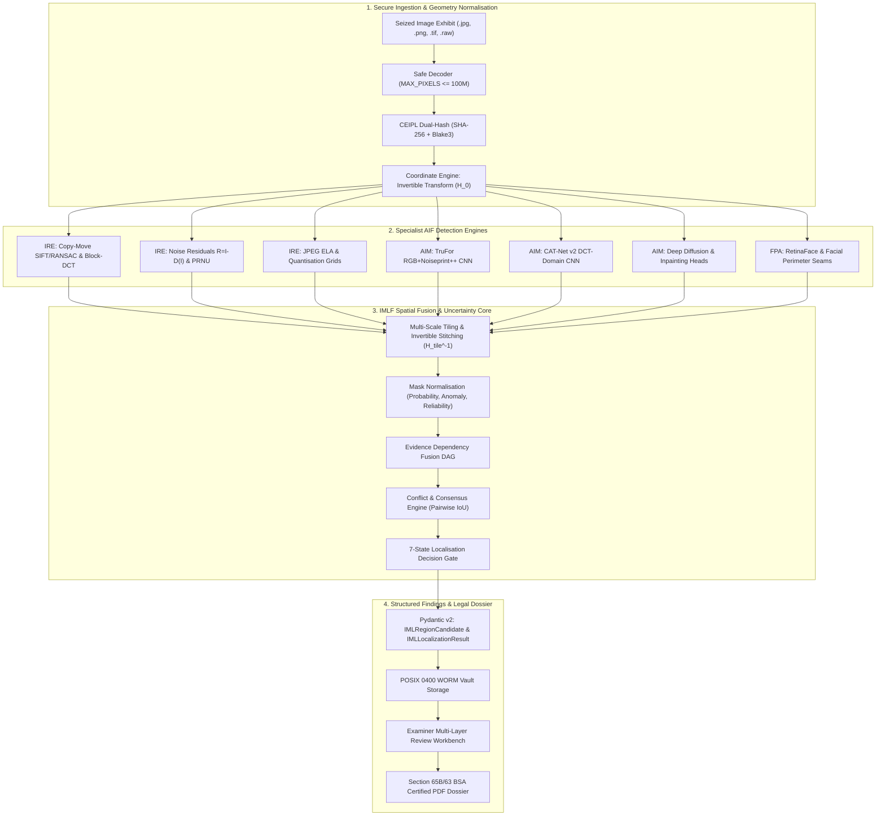

#### 10.11.2 Standard Manipulation Taxonomy & Anomaly Classification Engine
IMLF establishes a canonical mapping between the forensic anomaly characteristics and the specialized detection modules:

| Taxonomy Class | Anomaly Signature & Forensic Trace | Primary Engine | Detection Mechanism | Output Representation |
| :--- | :--- | :--- | :--- | :--- |
| **1. Copy-Move (CMFD)** | Matched keypoint clusters with rigid homography; identical DCT coefficient blocks. | IRE CMFD Engine | SIFT / RootSIFT + RANSAC; $8\times 8$ Block-DCT Lexicographical Sort. | Paired Region Polygons $[\mathcal{R}_s, \mathcal{R}_t]$, Affine $H$. |
| **2. Image Splicing** | Local noise variance discontinuity; demosaicing/CFA periodic break; PRNU mismatch. | IRE Noise & AIM | Wavelet/Median Residual $R=I-D(I)$; Sensor PRNU Correlation PCE. | Spatial Anomaly Map $A(x,y)$, Boundary Gradient Mask. |
| **3. Object Inpainting** | Frequency rolloff; missing photographic sensor noise; repeated structural patches. | AIM Inpainting Head | Deep Inpainting CNN (LaMa/MAT); Edge Gradient Discontinuity. | Probability Mask $P_{\text{inpaint}}(x,y)$, Bounding Rectangle. |
| **4. AI-Generated Patch** | Diffusion upsampling spectral rolloff; lack of PRNU; uncalibrated noise residuals. | AIM TruFor / CAT-Net | Dual-Branch RGB+Noiseprint Feature Fusion; Latent DCT Analysis. | Calibrated Probability Mask $P_{\text{AI}}(x,y)$, Reliability $R(x,y)$. |
| **5. Face-Swap / Morph** | Blending seam around facial oval; color temperature jump; landmark misalignment. | FPA & AIM | RetinaFace 68 Landmarks + Facial Perimeter Gradient Analysis. | Biometric Facial Mask $\hat{M}_{\text{face}}$, Seam Score. |
| **6. Local Retouching** | Localized blur/sharpening; contrast stretching; timestamp/clone erasure. | IRE Signal Profiler | High-Pass Filter Magnitude; Local Gradient Kurtosis. | Continuous Anomaly Heatmap $A(x,y)$. |
| **7. Unknown Local** | Uncorrelated low-level signal breaks without specific generative attribution. | IMLF Fusion Core | Multi-Detector Consensus with unassigned model family. | Generic Anomaly Mask tagged `UNKNOWN_LOCAL_MANIPULATION`. |

#### 10.11.3 Algorithm Selection & Technology Decision Matrix

| Forensic Task | Primary Algorithm Candidate | Alternative Candidate | Input Preconditions | Primary Output | Validation Required | Decision Status |
| :--- | :--- | :--- | :--- | :--- | :--- | :--- |
| **Keypoint Copy-Move** | SIFT + RootSIFT + RANSAC Homography | ORB / AKAZE + Affine RANSAC | Minimum dimension $\ge 256\text{ px}$; RGB or Greyscale uint8. | Vector displacement arrows, paired region polygons. | False alarm rate on repeating textures (COVERAGE dataset). | `SELECTED_PRIMARY` |
| **Dense Block Copy-Move** | $8\times 8$ Block-DCT with Lexicographical Sorting | DWT Haar Wavelet sub-band matching | Uncompressed or high-quality JPEG (QF $\ge 70$). | Dense block duplication raster mask. | Robustness to post-rotation and scaling. | `SELECTED_PRIMARY` |
| **Sensor Noise Residual** | Wavelet / Median Noise Residual $R=I-D(I)$ | Noiseprint++ (Deep Residual Network) | Raw or minimally compressed image; $\text{SNR} \ge 10\text{ dB}$. | Local residual variance heatmap. | Sensitivity to natural texture vs sensor noise. | `SELECTED_PRIMARY` |
| **Compression Splicing** | CAT-Net v2 (DCT + RGB Dual-Stream) | Error Level Analysis (ELA) + Block Grid | JPEG bitstream with intact quantization tables. | Pixel probability map $P(x,y) \in [0, 1]$. | Verification on double-compressed images (NIST16). | `SELECTED_PRIMARY` |
| **Deep General Localisation**| TruFor (Learned RGB + Noiseprint Fusion) | MVSS-Net / PSCC-Net / IML-ViT | Standard RGB tensor $[3, H, W]$; normalized $[0, 1]$. | Pixel probability map, integrity score, reliability map. | License verification & benchmark on CASIA / DEFACTO. | `REQUIRES_VALIDATION` |
| **Facial Manipulation** | FPA RetinaFace + Convex Hull Seam Gradient | Face X-Ray (Blending boundary CNN) | Detected face bounding box $\ge 64\times 64\text{ px}$. | Facial perimeter boundary mask, swap probability. | Face-Forensics++ cross-manipulation benchmark. | `SELECTED_PRIMARY` |
| **Multi-Scale Tiling** | Overlapping Window Grid (1024 px, 25% stride) | Scale-Space Image Pyramid | High-resolution image $> 2048\times 2048\text{ px}$. | Stitched full-resolution canvas mask with inverse $H^{-1}$. | Seamless border blending without tile edge artifacts. | `SELECTED_PRIMARY` |

#### 10.11.4 Algorithm Family A: Copy-Move Forgery Localisation Specification
1. **Keypoint Feature Extraction:** Compute DoG (Difference of Gaussians) scale-space keypoints. Transform 128-dimensional SIFT descriptors to RootSIFT via $L_1$ normalization followed by square root:
   $$x_{\text{RootSIFT}} = \sqrt{\frac{x_{\text{SIFT}}}{\|x_{\text{SIFT}}\|_1}}$$
2. **Nearest-Neighbor Distance Ratio (NNDR):** For each keypoint $k_i$, identify the two nearest neighbors $n_1, n_2$ in descriptor space ($k\text{-d}$ tree). A candidate match is accepted if:
   $$\frac{\|d(k_i, n_1)\|_2}{\|d(k_i, n_2)\|_2} < \tau_{\text{NNDR}} \quad (\text{default } \tau_{\text{NNDR}} = 0.75)$$
3. **Spatial Separation Constraint:** Exclude trivial neighboring keypoints matching physical close proximity:
   $$\|p_i - p_j\|_2 > d_{\min} \quad (\text{default } d_{\min} = 50\text{ px})$$
4. **Geometric RANSAC Verification:** Group candidate matches into clusters. For each cluster, fit a projective homography $\mathbf{H} \in \mathbb{R}^{3\times 3}$:
   $$\begin{bmatrix} x' \\ y' \\ 1 \end{bmatrix} \sim \mathbf{H} \begin{bmatrix} x \\ y \\ 1 \end{bmatrix}$$
   A match is an inlier if the symmetric transfer error satisfies:
   $$d(p', \mathbf{H}p)^2 + d(p, \mathbf{H}^{-1}p')^2 < \epsilon_{\text{RANSAC}}^2 \quad (\text{default } \epsilon = 3.0\text{ px})$$
   A candidate region is accepted if the inlier count $N_{\text{inliers}} \ge 12$ and the estimated scale satisfies $s \in [0.5, 2.0]$.
5. **False-Positive Mitigation on Natural Textures:** Authentic repeating structures (brick walls, window grids, foliage) produce dense inlier clusters. The engine computes feature spatial density and verifies whether the matched patch exhibits rigid geometric displacement versus natural Poisson-distributed point processes. If the spatial variance of matched points matches the background texture periodicity, the cluster is assigned `REPEATED_TEXTURE_BENIGN`.

#### 10.11.5 Algorithm Family B: Image Splicing & Low-Level Inconsistency Localisation
1. **Noise Residual Extraction:** Compute residual $R(x,y) = I(x,y) - D(I)(x,y)$, where $D(\cdot)$ represents adaptive Wiener filtering or 2D stationary wavelet shrinkage.
2. **Local Noise Variance Mapping:** Partition residual $R$ into non-overlapping $16\times 16$ blocks $B_k$. Compute local sample variance:
   $$\sigma_k^2 = \frac{1}{|B_k|-1} \sum_{(x,y) \in B_k} (R(x,y) - \mu_k)^2$$
   Spliced regions originating from a foreign camera sensor or different ISO setting exhibit statistically significant divergence in $\sigma_k^2$ relative to the robust median background variance $\sigma_{\text{bg}}^2$.
3. **Boundary Discontinuity & Gradient Profiling:** Splicing seams introduce microscopic edge transitions. For candidate region boundaries $\partial\Omega$, compute the orthogonal directional gradient magnitude:
   $$G_{\perp}(\mathbf{p}) = \nabla I(\mathbf{p}) \cdot \mathbf{n}(\mathbf{p})$$
   Evaluate the second derivative across the boundary: un-feathered splices display sharp step discontinuities ($\Delta G > \tau_{\text{step}}$), while feathered splices exhibit anomalous localized blur kernels inconsistent with the global point spread function (PSF).
4. **Sensor PRNU Correlation (Camera Identification Integration):** When a reference camera fingerprint $K_{\text{ref}}$ is available (extracted via AIF-A9 from $N \ge 20$ flat-field frames), the engine calculates Normalized Cross-Correlation (NCC) across spatial sliding windows:
   $$\rho(x,y) = \frac{\langle W(x,y), K_{\text{ref}}(x,y) \rangle}{\|W(x,y)\|_2 \|K_{\text{ref}}(x,y)\|_2}$$
   Candidate regions exhibiting Peak-to-Correlation Energy $\text{PCE} < 15$ inside an otherwise strongly correlated frame ($\text{PCE}_{\text{global}} > 50$) are flagged as foreign sensor splices.

#### 10.11.6 Algorithm Family C: Inpainting, Object Removal & AI-Modified Region Localisation
1. **Deep Architecture Candidate — TruFor:**
   - **Input:** RGB image tensor $I \in \mathbb{R}^{3\times H\times W}$, normalized to $[0.0, 1.0]$.
   - **Backbone:** Two-branch architecture consisting of a visual RGB feature extractor and a high-frequency learned noiseprint feature extractor (Noiseprint++).
   - **Cross-Attention Fusion:** Multi-scale transformer layers cross-correlate RGB semantics with noise anomalies.
   - **Output Tensors:**
     - Pixel Probability Mask: $\hat{M}(x,y) \in [0.0, 1.0]$.
     - Global Integrity Score: $S_{\text{global}} \in [0.0, 1.0]$.
     - Reliability Map: $R(x,y) \in [0.0, 1.0]$ quantifying local SNR and prediction stability.
2. **Deep Architecture Candidate — CAT-Net v2:**
   - **Input:** RGB image plus raw JPEG Discrete Cosine Transform (DCT) coefficients and quantization tables extracted via `libjpeg`.
   - **Compression-Domain Stream:** Processes DCT block artifacts and double-quantization grid shifts.
   - **Output:** Dense manipulation localization mask sensitive to re-saved JPEG splices and inpainting.
3. **Unlocalised Manipulation Fallback:** If TruFor or global classifiers report high tampering probability ($S_{\text{global}} > 0.85$) but the pixel probability map $\hat{M}(x,y)$ contains no connected component exceeding minimum area ($A < 64\text{ px}$) or confidence ($\hat{M} < \tau_{\text{bin}}$), the engine **strictly refrains from fabricating a mask**. It assigns result status `GLOBAL_MANIPULATION_CANDIDATE` and annotates that manipulation is evident but spatially diffuse.

#### 10.11.7 Algorithm Family D: Face-Swap & Facial Manipulation Localisation
1. **Biometric Face Localization:** FPA extracts face bounding box $B_{\text{face}} = [y_{\min}, x_{\min}, y_{\max}, x_{\max}]$ using RetinaFace and generates 68 2D facial landmarks $\mathcal{L} = \{(\ell_x^i, \ell_y^i)\}_{i=1}^{68}$.
2. **Convex Hull Perimeter Extraction:** Compute the convex hull polygon $\mathcal{P}_{\text{face}}$ surrounding the jawline (landmarks 1–17) and forehead contour.
3. **Boundary Blending Seam Analysis:** Extract a $16\text{ px}$ morphological ribbon $\mathcal{S}_{\text{seam}} = (\mathcal{P} \oplus K_8) \setminus (\mathcal{P} \ominus K_8)$. Analyze spatial color transitions across the seam:
   $$\Delta E_{00} = \operatorname{CIEDE2000}(C_{\text{inner}}(\mathbf{p}), C_{\text{outer}}(\mathbf{p}))$$
   Face-swap algorithms (DeepFaceLab, SimSwap) frequently exhibit chromatic aberration and edge blur along $\mathcal{S}_{\text{seam}}$ due to Poisson image editing or alpha blending.
4. **Biometric Mask Generation:** The final facial manipulation mask covers the inner facial polygon $\mathcal{P}_{\text{face}}$ with confidence weighted by boundary seam discontinuity and inner-facial GAN synthesis artifacts.

#### 10.11.8 Algorithm Family E: Multi-Scale Tiling & Invertible Coordinate Geometry
Forensic crime scene photographs frequently exceed $6000\times 4000\text{ px}$ (24–50 MP). Downsampling destroys microscopic forgery traces; processing whole frames in one GPU pass exceeds VRAM ceilings. IMLF specifies an invertible multi-scale tiling pipeline:

1. **Tile Grid Generation:** For an image of dimensions $W \times H$, generate a regular overlapping grid of square tiles with size $S_{\text{tile}} = 1024\text{ px}$ and stride $S_{\text{stride}} = 768\text{ px}$ (overlap $O = 256\text{ px}$, $25\%$ overlap).
2. **Homogeneous Coordinate Transformation:** Each tile $k$ extracted at top-left offset $(x_k, y_k)$ possesses a forward transformation matrix $\mathbf{H}_k$ and inverse matrix $\mathbf{H}_k^{-1}$:
   $$\mathbf{H}_k = \begin{bmatrix} 1 & 0 & -x_k \\ 0 & 1 & -y_k \\ 0 & 0 & 1 \end{bmatrix}, \quad \mathbf{H}_k^{-1} = \begin{bmatrix} 1 & 0 & x_k \\ 0 & 1 & y_k \\ 0 & 0 & 1 \end{bmatrix}$$
3. **Per-Tile Forward Inference:** Each tile $T_k \in \mathbb{R}^{3\times 1024\times 1024}$ is passed to the deep localization model, yielding tile probability map $P_k \in \mathbb{R}^{1024\times 1024}$.
4. **Distance-Weighted Linear Canvas Stitching:** To eliminate boundary seam artifacts across overlapping tile regions, tiles are blended onto a global accumulator canvas $C(X, Y)$ using a 2D separable Bartlett/Hann window weight matrix $W_{\text{tile}}(x, y)$:
   $$P_{\text{canvas}}(X, Y) = \frac{\sum_{k} W_{\text{tile}}(X - x_k, Y - y_k) \cdot P_k(X - x_k, Y - y_k)}{\sum_{k} W_{\text{tile}}(X - x_k, Y - y_k)}$$
5. **Border Padding & Coordinate Inversion:** For tiles extending beyond image boundaries, replicate padding is applied. All serialized vector polygons are projected back into the original native coordinate frame $[0, W] \times [0, H]$ using $\mathbf{H}_k^{-1}$ before WORM vault persistence.

#### 10.11.9 Canonical Coordinate Normalisation & Spatial Reference System
1. **Origin:** Strictly $(0, 0)$ at the top-left corner.
2. **Axes:** $+X$ horizontal (columns), $+Y$ vertical (rows).
3. **Bounding Boxes:** Formatted as $[y_{\min}, x_{\min}, y_{\max}, x_{\max}]$ using zero-indexed half-open intervals $[x_{\min}, x_{\max})$ and $[y_{\min}, y_{\max})$.
4. **Normalized Coordinates:** Serialized as floats $x_n = x / W$, $y_n = y / H$ rounded to 6 decimal places.
5. **Polygons:** Represented as an ordered sequence of vertices $[[x_1, y_1], [x_2, y_2], \dots, [x_N, y_N]]$ with counter-clockwise winding.

#### 10.11.10 Unified Mask & Region Data Contracts
The data contracts are implemented using strict Pydantic v2 schemas:
- `IMLRegionCandidate`: Individual candidate manipulated area with bounding box, polygon, area percentage, manipulation family, and supporting/conflicting detector IDs.
- `IMLMaskMetadata`: Bitstream pointer, SHA-256 checksum, dimensions, and type (`PROBABILITY_MAP`, `BINARY_MASK`, `RELIABILITY_MAP`).
- `IMLLocalizationResult`: Master record containing aggregate verdicts, list of regions, consensus score, and execution telemetry.
- `IMLCoordinateTransform`: Documenting forward and inverse $3\times 3$ affine transformation matrices.

#### 10.11.11 Multi-Detector Evidence Fusion & Lineage Graph
1. **Pairwise Overlap Matrix:** For all regions $\mathcal{R}_i, \mathcal{R}_j$ proposed by distinct engines, compute Jaccard similarity:
   $$\operatorname{IoU}(\mathcal{R}_i, \mathcal{R}_j) = \frac{|\mathcal{R}_i \cap \mathcal{R}_j|}{|\mathcal{R}_i \cup \mathcal{R}_j|}$$
   Pairs with $\operatorname{IoU} \ge 0.50$ are clustered into unified candidate regions.
2. **Conflict Resolution:** If Engine A (e.g. CMFD) flags region $\mathcal{R}_1$ with confidence $0.92$, while Engine B (e.g. TruFor) assigns reliability $R=0.88$ but zero tampering probability ($P=0.04$), IMLF logs an explicit conflict:
   - Assigns status: `LOCALISATION_UNCERTAIN`.
   - Records both detector findings with individual weights in `supporting_detectors` and `conflicting_detectors`.
   - Prevents auto-approval; forces examiner review in UI.

#### 10.11.12 Mathematical Foundations & Metric Definitions
For predicted binary mask $\hat{M}(x,y) \in \{0, 1\}$ and ground truth $M_g(x,y) \in \{0, 1\}$ over $N = W \times H$ pixels:
- **Pixel-Level Confusion Matrix:**
  $$TP = \sum_{x,y} \hat{M}(x,y) M_g(x,y), \quad FP = \sum_{x,y} \hat{M}(x,y) (1 - M_g(x,y))$$
  $$FN = \sum_{x,y} (1 - \hat{M}(x,y)) M_g(x,y), \quad TN = \sum_{x,y} (1 - \hat{M}(x,y)) (1 - M_g(x,y))$$
- **Pixel Intersection over Union (IoU / Jaccard):**
  $$\operatorname{IoU} = \frac{TP}{TP + FP + FN}$$
  *Zero-Denominator Trap:* If $TP + FP + FN = 0$ (both masks completely authentic/empty), $\operatorname{IoU} = 1.0$. If $M_g = 0$ but $\hat{M} > 0$ (false alarm), $\operatorname{IoU} = 0.0$.
- **Pixel F1 / Dice Coefficient:**
  $$\text{Dice} = F_1 = \frac{2 TP}{2 TP + FP + FN}$$
- **Matthews Correlation Coefficient (MCC):**
  $$\text{MCC} = \frac{TP \cdot TN - FP \cdot FN}{\sqrt{(TP + FP)(TP + FN)(TN + FP)(TN + FN)}}$$
- **Boundary F1 Score ($F_{1}^{\text{boundary}}$):** Evaluates mask edge contour accuracy within pixel tolerance $\tau$:
  $$F_1^{\text{boundary}} = \frac{2 \cdot P_{\text{boundary}} \cdot R_{\text{boundary}}}{P_{\text{boundary}} + R_{\text{boundary}}} \quad (\text{default } \tau = 2\text{ px})$$

#### 10.11.13 Independent Evaluation & Benchmark Execution Protocol
IMLF enforces the fundamental benchmark rule: **image-level classification and pixel-level localization must be measured on separate axes**.
- **Image-Level Evaluation:** Evaluates whether an exhibit is flagged as manipulated using full-frame ROC-AUC, PR-AUC, and Correct Detection Rate at fixed False Alarm Rate ($\text{CDR} @ \text{FAR} = 0.01$).
- **Pixel-Level Evaluation:** Evaluates spatial mask quality strictly over the subset of manipulated exhibits using pixel IoU, Dice, and boundary F1.
- **Benchmark vs. Deployment Thresholds:** Benchmarks evaluating optimum-MCC thresholds ($\tau_{\text{opt}} = \arg\max_\tau \text{MCC}(\tau)$) derive thresholds using ground truth; deployment systems are strictly forbidden from using ground truth and must execute with frozen thresholds calibrated on $D_{\text{cal}}$.

#### 10.11.14 Controlled Test Corpus & Synthetic Degradation Grid
Every candidate model is validated against the 14-condition synthetic perturbation grid:
1. JPEG QF 95, 85, 70, 50, 35
2. Gaussian Blur ($\sigma = 0.5, 1.0, 2.0\text{ px}$)
3. Additive Gaussian Noise ($\text{SNR} = 30, 20, 10\text{ dB}$)
4. Downscaling & Upscaling ($0.5\times, 0.25\times$)
5. Central Crop ($50\%$ canvas area)
6. Rotation ($5^\circ, 15^\circ, 90^\circ$)
7. Screenshot Recapture (Canvas blit + sRGB re-encode)

#### 10.11.15 Security, Resource Ceilings & Execution Sandbox
1. **Decompression Bomb Guard:** Strict PIL `MAX_IMAGE_PIXELS = 100_000_000` (100 MP) limit. Files with compression ratios $> 10:1$ are rejected prior to memory allocation.
2. **Resource Quotas:** Worker processes bound via Linux cgroups to $\le 16\text{ GB}$ RAM and $\le 8\text{ GB}$ VRAM.
3. **Execution Ceilings:** 300-second hard SIGKILL timeout per exhibit.
4. **Air-Gap Invariant:** Zero outbound network requests; 100% offline local model inference.

#### 10.11.16 Master Requirement Traceability Matrix (IML-01 through IML-22)

| Requirement ID | Summary | TRD Specification Section | Pydantic Contract | Implementation Phase | Checkpoint ID | Required Validation Evidence |
| :--- | :--- | :--- | :--- | :--- | :--- | :--- |
| **IML-01** | Unified Localisation Architecture | TRD §10.11.1, §10.11.15 | `IMLLocalizationResult` | **AIF-IML-00** | `AIF-IML-CP-00-01` | Architecture baseline, engine routing contracts, zero memory leaks. |
| **IML-02** | Copy-Move Forgery Localisation | TRD §10.11.4 | `IMLRegionCandidate` | **AIF-IML-01** | `AIF-IML-CP-01-01` | SIFT/RANSAC homography, inlier count $\ge 12$, COVERAGE benchmark. |
| **IML-03** | Image Splicing Localisation | TRD §10.11.5 | `IMLRegionCandidate` | **AIF-IML-02** | `AIF-IML-CP-02-01` | Noise residual variance map, boundary gradient seams, Columbia dataset. |
| **IML-04** | Object Removal & Inpainting Localisation | TRD §10.11.6 | `IMLRegionCandidate` | **AIF-IML-04** | `AIF-IML-CP-04-01` | Deep inpainting heads, spectral rolloff, DEFACTO inpainting test set. |
| **IML-05** | AI-Generated Regional Localisation | TRD §10.11.6 | `IMLRegionCandidate` | **AIF-IML-04** | `AIF-IML-CP-04-02` | TruFor RGB+noiseprint, unlocalised manipulation fallback. |
| **IML-06** | Face & Portrait Manipulation Localisation| TRD §10.11.7 | `IMLRegionCandidate` | **AIF-IML-05** | `AIF-IML-CP-05-01` | RetinaFace 68 landmarks, facial perimeter seam ribbon analysis. |
| **IML-07** | Compression & Resampling Inconsistency | TRD §10.11.5, §10.11.6 | `IMLMaskMetadata` | **AIF-IML-02** | `AIF-IML-CP-02-02` | ELA error map, DCT $8\times 8$ grid shift, CAT-Net compression stream. |
| **IML-08** | Sensor Noise & PRNU Inconsistency | TRD §10.11.5 | `IMLMaskMetadata` | **AIF-IML-02** | `AIF-IML-CP-02-03` | Camera PRNU correlation, Peak-to-Correlation Energy $\text{PCE} < 15$. |
| **IML-09** | Multi-Scale Tiling & Invertible Mapping | TRD §10.11.8 | `IMLCoordinateTransform` | **AIF-IML-06** | `AIF-IML-CP-06-01` | $1024\text{ px}$ tiles, 25% overlap, inverse affine matrix $H^{-1}$ mapping. |
| **IML-10** | Unified Mask, Polygon & Region Contract | TRD §10.11.10, §12.4 | `IMLRegionCandidate` | **AIF-IML-00** | `AIF-IML-CP-00-02` | Pydantic v2 schemas pass bidirectional JSON round-trip validation. |
| **IML-11** | Canonical Coordinate Normalisation | TRD §10.11.9 | `IMLCoordinateTransform` | **AIF-IML-00** | `AIF-IML-CP-00-03` | Top-left $(0,0)$, half-open intervals, normalized floats $[0, 1]$. |
| **IML-12** | Confidence, Reliability & Uncertainty | TRD §10.11.1, §10.11.10 | `IMLMaskMetadata` | **AIF-IML-07** | `AIF-IML-CP-07-01` | Distinct probability $P$, anomaly $A$, and reliability $R$ maps. |
| **IML-13** | Multi-Detector Evidence Fusion | TRD §10.11.11 | `IMLLocalizationResult` | **AIF-IML-07** | `AIF-IML-CP-07-02` | Pairwise IoU clustering, anti-averaging invariant, conflict logs. |
| **IML-14** | Forensic Examiner Review Workbench | TRD §10.11.1 | Archify JSON IR | **AIF-IML-09** | `AIF-IML-CP-09-01` | Multi-layer canvas, threshold sliders, examiner disposition tags. |
| **IML-15** | Ground-Truth Dataset Management | TRD §10.11.13 | Dataset Manifest | **AIF-IML-08** | `AIF-IML-CP-08-01` | Zero-leakage source-scene partitioning ($\mathcal{G} \cap \mathcal{G}' = \emptyset$). |
| **IML-16** | Pixel-Level Localisation Evaluation | TRD §10.11.12 | Evaluation Metric Run | **AIF-IML-08** | `AIF-IML-CP-08-02` | Pixel IoU, Dice, MCC, boundary F1 with zero-denominator safety. |
| **IML-17** | Independent Image-Level Evaluation | TRD §10.11.13 | Evaluation Metric Run | **AIF-IML-08** | `AIF-IML-CP-08-03` | Image ROC-AUC and CDR @ 0.01 FAR evaluated independently from IoU. |
| **IML-18** | Cross-Dataset & Unseen Benchmarking | TRD §10.11.13 | Transfer Evaluation Report | **AIF-IML-08** | `AIF-IML-CP-08-04` | Cross-corpus transfer $\Delta\operatorname{IoU}$, unseen tool degradation. |
| **IML-19** | Robustness Sweeps & Repeated Textures | TRD §10.11.4, §10.11.14 | Robustness Grid Report | **AIF-IML-01** | `AIF-IML-CP-01-02` | 14-condition degradation sweep; false alarms $\le 0.05$ on textures. |
| **IML-20** | First-Class Abstention & Inconclusive | TRD §10.11.1 | `IMLLocalizationResult` | **AIF-IML-07** | `AIF-IML-CP-07-03` | Emits `INCONCLUSIVE_LOW_QUALITY` on SNR $< 6\text{ dB}$, size $< 256\text{ px}$. |
| **IML-21** | Evidentiary Lineage & BSA Traceability | TRD §10.11.1, §10.11.10 | Section 65B/63 BSA PDF | **AIF-IML-09** | `AIF-IML-CP-09-02` | Section 63 BSA certified PDF with SHA-256 and vector overlays. |
| **IML-22** | Security Safeguards & Resource Limits | TRD §10.11.15 | Sandbox Telemetry | **AIF-IML-10** | `AIF-IML-CP-10-01` | 100 MP decompression bomb defense, 16 GB RAM ceiling, 300s timeout. |

---

---

## 10.B CEIPL: Cryptographic Evidence Integrity & Provenance Layer

CEIPL is the shared, immutable cryptographic foundation serving AIF, AURAS, and VFS across the entire PS-05 platform. It enforces mathematical evidence preservation from the moment of seizure through final court presentation.

### 10.B.1 Cryptographic Manifest Creation & Signature Verification Sequence

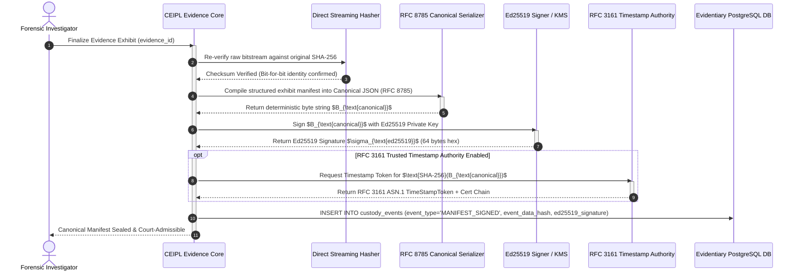

---

### 10.B.2 Custody Event Hash-Chaining & Merkle Batch Checkpointing Flow

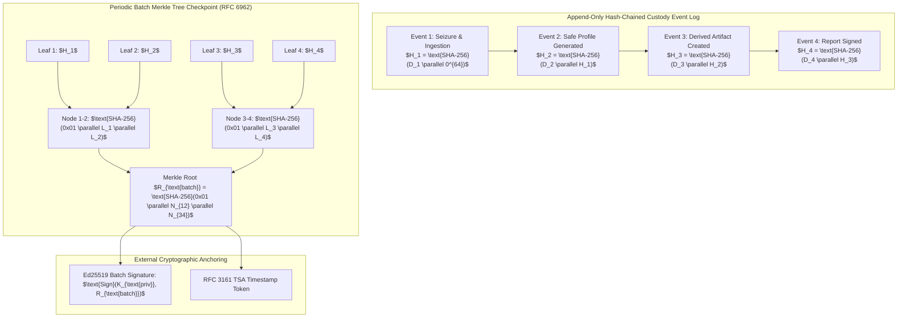

---

### 10.B.3 CEIPL Component Specifications

#### CEIPL-01: Raw-Byte Streaming SHA-256 Direct Hashing
- Primary digest: FIPS 180-4 SHA-256 calculated directly from raw seized stream before any image decoding or metadata parsing.
- Auxiliary digest: FIPS 202 SHA3-512 calculated concurrently using chunked 64KB buffers.
- Verification Rule: Any byte alteration produces immediate `HASH_MISMATCH` critical alert.

#### CEIPL-02: RFC 8785 Canonical JSON Manifests
- Manifests are formatted using JSON Canonicalization Scheme (RFC 8785 / JCS), enforcing deterministic key sorting, whitespace removal, and IEEE 754 number representation.
- Prevents signature invalidation caused by JSON key re-ordering across heterogeneous programming environments.

#### CEIPL-03: Ed25519 Digital Signatures & Key Lifecycle
- Manifests and certificates are signed with Ed25519 (RFC 8032) providing 128-bit security with high signing throughput.
- Keys are managed in HSM or KMS (PKCS#11 / Cloud KMS). Private keys are **never** logged or exposed to application code.

#### CEIPL-04: RFC 3161 Trusted Timestamp Authority (TSA) Integration
- Requests trusted timestamp tokens from an external RFC 3161 compliant Time Stamping Authority.
- Verifies X.509 certificate chains, ensuring independent proof that an exhibit existed at an exact point in time.

#### CEIPL-05: Append-Only Hash-Chained Custody Event Logs
- Every action on an evidence exhibit creates an immutable event record chained to the previous event:
  $$H_i = \text{SHA-256}(\text{CanonicalData}_i \parallel H_{i-1})$$
- Detects unauthorized deletion, modification, or reordering of custody records.

#### CEIPL-06: RFC 6962 Merkle Tree Batch Checkpoints & Inclusion Proofs
- Aggregates custody events and exhibits into RFC 6962 compliant binary Merkle trees.
- Generates compact cryptographic inclusion proofs of size $O(\log N)$, allowing court verification of specific exhibits without disclosing unrelated case records.

#### CEIPL-07: Derived Artifact Lineage DAG & Coordinate Transform Manifests
- Every derived image (crop, normalized array, perspective rectification, tile) is registered in an immutable DAG with its parent artifact ID, parent SHA-256, child SHA-256, transform operator, parameters, and linear affine matrix $M \in \mathbb{R}^{3\times 3}$.
- Guarantees that any finding on a derived crop can be mapped back to original exhibit pixel coordinates with mathematical certainty.

#### CEIPL-08: C2PA Content Credentials & Trust Chain Verification
- Parses C2PA (Coalition for Content Provenance and Authenticity) JUMBF metadata boxes.
- Validates claim signatures, signer X.509 certificate chains, and content bindings. Reports whether an image contains valid provenance metadata or an altered claim.

#### CEIPL-09: Authenticated Storage Encryption (AES-256-GCM / KMS)
- Exhibits and derived artifacts at rest are encrypted using AES-256-GCM with unique initialization vectors (IVs). Key management is decoupled from evidence storage.

#### CEIPL-10: Immutable WORM Storage & POSIX 0400 Enforcement
- Original raw files are stored in write-once-read-many partitions with POSIX `0400` read-only permissions and S3 Object Lock in Compliance Mode.

#### CEIPL-11: Cryptographic Failure Code Taxonomy
When verification fails, CEIPL returns explicit typed failure codes:
- `HASH_MISMATCH`: Seized file bitstream differs from acquisition checksum.
- `SIGNATURE_INVALID`: Digital signature failed mathematical verification against public key.
- `SIGNING_KEY_UNTRUSTED`: Public key not found in authorized judicial certificate authority.
- `SIGNING_KEY_REVOKED`: Key is flagged revoked in CRL or OCSP check.
- `TIMESTAMP_INVALID`: RFC 3161 TSA token signature invalid or certificate expired.
- `CONTENT_BINDING_MISMATCH`: C2PA claim hash differs from image pixel hash.
- `MANIFEST_UNSUPPORTED`: Manifest schema version not recognized by platform.
- `CUSTODY_CHAIN_BROKEN`: Event hash does not equal hash of previous event link.
- `MERKLE_PROOF_INVALID`: Leaf inclusion proof failed to hash to committed Merkle root.
- `RETENTION_POLICY_FAILURE`: Unauthorized attempt to modify or delete WORM-locked exhibit.
- `ENCRYPTION_OR_RETRIEVAL_FAILURE`: Key decryption failure or missing vault segment.
- `VERIFICATION_INCONCLUSIVE`: Verification service unreachable or prerequisite data missing.

---

### 10.C AIF & CEIPL Technology Registry & Module-to-Tool Matrix

The following matrix documents every planned tool, library, and deep learning model across the AIF subsystem and shared CEIPL foundation:

| Module ID | Forensic Responsibility | Candidate Tool / Model | Official Repo / Source | License Status | Input Contract | Output Contract | Hardware / RAM Target | Version Pinning | Known Limitations | Current Status |
| :--- | :--- | :--- | :--- | :--- | :--- | :--- | :--- | :--- | :--- | :--- |
| **IVE-01** | Safe format profiling & limits | Pillow + python-magic | `python-pillow/Pillow` | HPND (Permissive) | Raw image byte stream | `ImageProfile` JSON | CPU (1 core, 512MB RAM) | `Pillow==10.3.0` | Malformed Exif in rare camera RAW formats | `PLANNED` |
| **IVE-02/03** | 150-category multi-label scene triage | SigLIP / ViT-SO400M | `google-research/big_vision` | Apache-2.0 | Normalized sRGB ($336\times 336$) | `List[TaxonomyAnnotation]` | GPU ($\ge 4\text{GB}$ VRAM) / CPU float32 | `transformers==4.40.2` | Zero-shot open vocabulary domain drift on forensic injury | `PLANNED` |
| **IVE-04** | Object detection & instance masks | YOLOv8x / SAM 2 | `ultralytics/ultralytics`, `facebookresearch/segment-anything-2` | AGPL-3.0 / Apache-2.0 | Tiled RGB ($1024\times 1024$) | `List[DetectedObject]` | GPU ($\ge 8\text{GB}$ VRAM) | `ultralytics==8.2.14`, `sam2==1.0` | Heavy memory footprint with SAM 2; NMS boundary overlap | `PLANNED` |
| **IVE-05** | Occlusion-aware people counting | Custom dual-head YOLO + Hungarian | `ps05.engines.image.ive` | Proprietary (PS-05) | High-res RGB tensor | `PeopleCountResult` | GPU ($\ge 4\text{GB}$ VRAM) | Internal | Severe crowd occlusion ($> 85\%$) degrades person bounding | `PLANNED` |
| **IVE-06 / FPA**| Face detection & 468 3D landmarks | RetinaFace + MediaPipe Face Mesh | `biubug6/Pytorch_Retinaface`, `google/mediapipe` | MIT / Apache-2.0 | Bounding face crop | `FaceRegion` + 468 mesh | CPU (2 cores) / GPU | `mediapipe==0.10.14`, `retinaface-pytorch` | Degrades under extreme yaw ($> 60^\circ$) or resolution $< 48\text{px}$ | `PLANNED` |
| **IVE-07 / FPA**| Authorized 1:1 face similarity | ArcFace (IResNet-100) / MagFace | `deepinsight/insightface` | MIT | Aligned $112\times 112$ face crop + Case Token | `BiometricComparisonResult` | GPU / CPU float32 | `insightface==0.7.3` | Cross-age and cross-resolution false match variance | `PLANNED` |
| **IVE-08** | Document layout & OCR | Canny + Homography + PaddleOCR | `PaddlePaddle/PaddleOCR` | Apache-2.0 | Document image | `DocumentOCRResult` | CPU / GPU | `paddleocr==2.7.3` | Complex curved/wrinkled documents distort quad warp | `PLANNED` |
| **IRE-01** | Deep EXIF/XMP/IPTC container audit | ExifTool read-only wrapper | `PhilHarvey/Image-ExifTool` | Artistic / GPL-1.0+ | File path on disk | `MetadataAuditReport` | CPU (minimal) | `exiftool==12.84` | Metadata easily stripped by messaging intermediaries | `PLANNED` |
| **IRE-02** | 2D FFT & DCT spectral statistics | NumPy / SciPy 2D FFT | `scipy/scipy` | BSD-3-Clause | Grayscale luminance matrix | `SignalAnalysisResult` | CPU (1 core, 1GB RAM) | `scipy==1.13.0`, `numpy==1.26.4` | Downsampling removes high-frequency resampling peaks | `PLANNED` |
| **IRE-03** | Classical CV geometric forensics | OpenCV (Canny, SIFT, RANSAC) | `opencv/opencv-python` | Apache-2.0 | Grayscale questioned + reference | `GeometricForensicResult` | CPU (2 cores) | `opencv-python-headless==4.9.0.80` | Featureless, smooth surfaces yield insufficient SIFT matches | `PLANNED` |
| **IRE-04** | Copy-Move Forgery Detection (CMFD) | SIFT k-d tree DBSCAN + DCT | `ps05.engines.image.ire` | Proprietary (PS-05) | Full-res RGB array | `CMFDResult` + polygon masks | CPU / GPU | Internal | High computational complexity $O(N^2)$ on 50MP images | `PLANNED` |
| **IRE-05** | Sensor PRNU noise fingerprinting | Wavelet denoising + NCC | `ps05.engines.image.ire` | Proprietary (PS-05) | Questioned image + 25 reference flats | `PRNUResult` + correlation $\rho$ | CPU (4 cores, 4GB RAM) | `PyWavelets==1.6.0` | Social-media lossy recompression damages PRNU noise | `RESEARCH_CANDIDATE` |
| **IRE-06** | Re-compression & platform history | DQT Catalog + Blocking Discrepancy | `ps05.engines.image.ire` | Proprietary (PS-05) | JPEG binary bitstream | `CompressionProvenanceResult` | CPU (1 core) | Internal | Non-JPEG images lack standard quantization markers | `PLANNED` |
| **AIM-01** | Synthetic AI-image classifier | Multi-branch ResNet50 + FFT + SigLIP | `ps05.engines.image.aim` | Proprietary (PS-05) | $512\times 512$ patches & full-res | `AIGenerationResult` | GPU ($\ge 8\text{GB}$ VRAM) | Internal + PyTorch 2.3 | Out-of-distribution generators (unseen architectures) | `PLANNED` |
| **AIM-02** | Generative inpainting localization | TruFor / CAT-Net | `grip-unina/TruFor` | Academic / Research | Full-res RGB array | `InpaintingLocalizationResult` | GPU ($\ge 8\text{GB}$ VRAM) | `torch==2.3.0` | False positives on natural high-contrast shadow boundaries | `PLANNED` |
| **AIM-03** | Face swap & morphing forensics | Face X-Ray blend boundary net | `ps05.engines.image.aim` | Proprietary (PS-05) | Aligned face crop ($256\times 256$) | `FaceManipulationResult` | GPU ($\ge 4\text{GB}$ VRAM) | Internal | Heavy skin airbrushing / beauty filters mimic tampering | `PLANNED` |
| **AIM-04** | Steganography & hidden data audit | LSB / SPA / RS / Rich Models | `ps05.engines.image.aim` | Proprietary (PS-05) | Bitstream + pixel arrays | `SteganalysisResult` | CPU (2 cores) | Internal | High miss rate on low embedding rates ($< 0.05$ bpp) | `PLANNED` |
| **AIM-05** | Defensive file vulnerability defense | Magic bytes + trailing byte parser | `ps05.engines.image.aim` | Proprietary (PS-05) | Seized raw bitstream | `FileSecurityAudit` | CPU (1 core) | Internal | Zero-day parser vulnerabilities in underlying C libraries | `PLANNED` |
| **CEIPL-01** | Raw direct dual-hashing | `hashlib` (FIPS OpenSSL backend) | Python standard library | Python Software Foundation | Chunked raw byte stream | SHA-256 and SHA3-512 hex | CPU (1 core) | Native Python 3.12 | None | `IMPLEMENTED` |
| **CEIPL-02** | Deterministic canonical JSON | `canonicaljson` (RFC 8785 JCS) | `matrix-org/python-canonicaljson` | Apache-2.0 | Arbitrary JSON dict | Deterministic UTF-8 bytes | CPU (minimal) | `canonicaljson==2.0.0` | Floating-point rounding edge cases | `PLANNED` |
| **CEIPL-03** | Digital signatures & key management | `cryptography` (Ed25519 / RFC 8032) | `pyca/cryptography` | Apache-2.0 / BSD | Canonical byte string | 64-byte Ed25519 signature | CPU (minimal) | `cryptography==42.0.7` | Key compromise without revocation mechanism | `PLANNED` |
| **CEIPL-04** | RFC 3161 Trusted Timestamping | `rfc3161ng` / PyKCS11 | `trbs/rfc3161ng` | MIT | SHA-256 exhibit digest | ASN.1 TimeStampToken | Network I/O (HTTPS) | `rfc3161ng==2.1.3` | TSA service unavailability / network timeouts | `PLANNED` |
| **CEIPL-05** | Append-only hash-chained custody | `ps05.core.crypto.custody_chain` | Proprietary (PS-05) | Proprietary (PS-05) | Custody event payload | 64-char hex chain hash | CPU (minimal) | Internal | Privileged DB admin rewriting all rows (requires Merkle) | `PLANNED` |
| **CEIPL-06** | Merkle tree batch checkpoints | `ps05.core.crypto.merkle_tree` | Proprietary (PS-05) | Proprietary (PS-05) | List of leaf hashes | Merkle Root + Inclusion Proof | CPU (1 core) | Internal | Dynamic re-ordering of uncommitted batches | `PLANNED` |
| **CEIPL-07** | Derived Artifact Lineage DAG | `ps05.core.crypto.lineage` | Proprietary (PS-05) | Proprietary (PS-05) | Parent ID + Operator + $M_{3\times 3}$ | Child Artifact Record | CPU (minimal) | Internal | Cyclic dependency attempts (rejected by DAG validator) | `PLANNED` |
| **CEIPL-08** | C2PA Content Credentials audit | `c2pa-python` (Rust C2PA library) | `contentauth/c2pa-rs` | MIT / Apache-2.0 | Image file path | `C2PAValidationResult` | CPU (1 core) | `c2pa-python==0.5.0` | Proprietary / non-standard claim formats rejected | `PLANNED` |

---

## 11. VISTA Video Forensics Subsystem Technical Specification

The **VISTA** (Video Integrity, Synchronization & Tampering Analysis) subsystem provides a comprehensive, multi-engine forensics platform for judicial analysis of seized video recordings, surveillance CCTV/DVR footage, and multimedia broadcasts. It operates in strict accordance with Indian evidentiary requirements under Section 65B of the Indian Evidence Act (IEA) and Section 63 of the Bharatiya Sakshya Adhiniyam (BSA 2023).

### 11.1 Complete VISTA Subsystem Architecture & Engine Boundaries

VISTA comprises five core forensic engines and a cross-cutting CCTV Forensic Profile, backed by the shared CEIPL (Cryptographic Evidence Integrity & Provenance Layer) and an asynchronous derived artifact Directed Acyclic Graph (DAG):

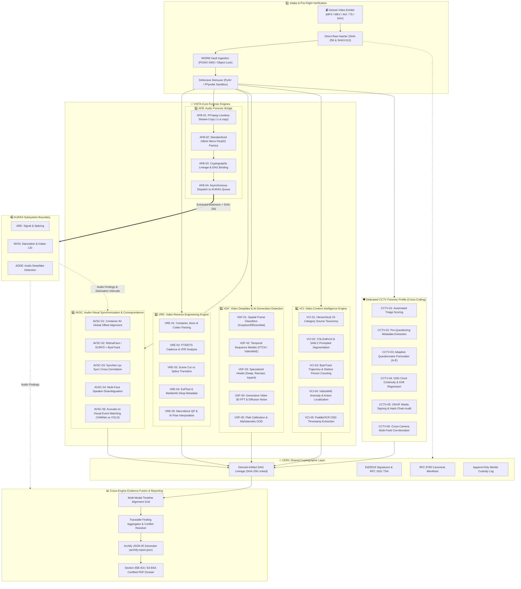

#### 11.1.1 Video Evidence Intake & Safe Pre-Flight Parsing Sequence Flow

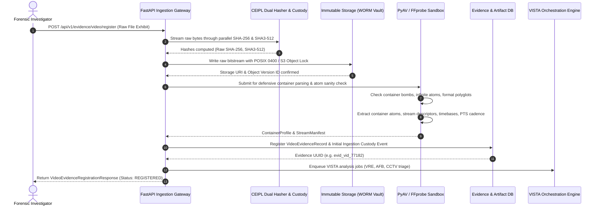

### 11.2 VRE Technical Specification (Video Reverse Engineering Engine)

The Video Reverse Engineering Engine (VRE) operates directly on the container, bitstream, packet cadence, and encoding structures of the video file without requiring full raster frame decoding for initial passes.

#### 11.2.1 Container, Atom & Codec Parsing (`ps05.engines.vista.vre.bitstream`)
- **Supported Containers:** MP4/MOV (ISO/IEC 14496-12), MKV/WebM (EBML), AVI (RIFF), MPEG-TS (`.ts`, `.m2ts`), proprietary DVR bitstreams (`.dav`, `.h264`, `.h265`, `.sec`).
- **Atom/Box Deep Inspection (MP4/MOV):**
  - Parses `ftyp` (compatible brands), `moov` (metadata header), `mvhd` (movie header), `tkhd` (track header), `mdhd` (media header), and `mdat` (media data).
  - Evaluates `moov` position relative to `mdat`: `moov` at the end of the file indicates conventional single-pass camera encoding; `moov` moved to the beginning (`faststart`) typically indicates post-processing via FFmpeg or desktop video editors.
  - Verifies `stts` (time-to-sample), `ctts` (composition time offset), and `stss` (sync sample / keyframe table) consistency against physical packet counts.
- **Defensive Demuxing & Allocation Caps:**
  - Implements defensive wrappers around PyAV (`av.open()`) with custom I/O timeouts (10 seconds per packet read).
  - Enforces strict parsing caps: maximum memory allocation per container header parser $\le 256\text{ MB}$; maximum packet queue length $= 2048$ packets.

#### 11.2.2 Presentation Timestamp (PTS/DTS) Cadence & VFR Analysis (`ps05.engines.vista.vre.cadence`)
- **Cadence Continuity Check:**
  - Extracts packet Presentation Time Stamps ($PTS_k$) and Decompression Time Stamps ($DTS_k$) for every stream packet:
    $$\Delta PTS_k = PTS_k - PTS_{k-1}$$
  - For Constant Frame Rate (CFR) streams, verifies that $\Delta PTS_k = \frac{1}{\text{fps} \cdot \text{timebase}} \pm \epsilon$.
  - For Variable Frame Rate (VFR) streams (common in smartphones and CCTV), models frame intervals as a continuous distribution, computing instantaneous frame rate $\text{fps}(t) = \frac{1}{\Delta PTS(t)}$ and jitter variance $\sigma^2_{\text{vfr}}$.
- **Frozen & Dropped Frame Detection:**
  - Identifies duplicate/frozen frame spans where frame hashes or structural differences satisfy $\Delta(F_t, F_{t+1}) < \theta_{\text{frozen}}$ over $\ge 1.0\text{ s}$ during non-static scenes.
  - Detects non-monotonic PTS reversals ($PTS_k < PTS_{k-1}$), zero-duration frames, or missing packet indexes indicative of sequence excision.

#### 11.2.3 Scene Cut Detection vs Splice Transitions (`ps05.engines.vista.vre.scene_cuts`)
- **PySceneDetect Adaptive Integration:**
  - Implements dual-threshold scene boundary detection using HSV color histogram differences and structural edge changes.
  - Classifies transitions into:
    1. *Hard Cuts:* Abrupt content change within $\le 1$ frame.
    2. *Dissolves/Fades:* Gradual linear blending over multiple frames ($N \ge 8$).
    3. *Excised Cuts (Splicing):* Hard content shift occurring *without* an associated encoder keyframe (I-frame) insertion, or featuring broken motion vector predictors in the succeeding P-frame.

#### 11.2.4 ExifTool & MediaInfo Deep Metadata Audit (`ps05.engines.vista.vre.metadata`)
- Executes vendored ExifTool and MediaInfo across container headers and embedded user data atoms (`udta`, `uuid` XMP, quicktime user data).
- Verifies camera serial numbers, lens metadata, firmware revisions, and GPS tracks.
- Cross-references container `HandlerDescription` and `Encoder` metadata against known video editing software footprints (Adobe Premiere, Apple Final Cut Pro, DaVinci Resolve, HandBrake, FFmpeg).

#### 11.2.5 Macroblock QP Distribution & AI Flow Interpolation (`ps05.engines.vista.vre.reencode`)
- **Macroblock Quantization Parameter (QP) Analysis:**
  - Extracts macroblock-level quantization parameters ($QP \in [0, 51]$) across H.264/AVC and H.265/HEVC streams using PyAV motion vector and packet side-data access.
  - Computes QP histogram variance across spatial frames. Re-encoded video exhibits characteristic periodic QP modulation (GOP pulsing) and DCT coefficient double-compression histogram peaks.
- **AI Frame Interpolation Artifact Detection:**
  - Detects tell-tale visual flow blending halos and warped occlusion boundaries characteristic of neural frame rate up-conversion models (RIFE, DAIN, CAIN).
  - Computes forward-backward optical flow consistency error:
    $$E_{\text{flow}}(x, y) = ||\mathbf{v}_{t \to t+1}(x, y) + \mathbf{v}_{t+1 \to t}(x + v_x, y + v_y)||_2$$
  - High residual flow error along object boundaries paired with high visual sharpness indicates synthetic frame synthesis rather than native camera exposure.

---

### 11.3 AFB Technical Specification (Audio Forensic Bridge)

The Audio Forensic Bridge (AFB) connects the video subsystem to the AURAS audio forensics subsystem while preserving pristine evidentiary separation and avoiding duplicate algorithmic implementations.

#### 11.3.1 Lossless Stream-Copy Extraction (`ps05.engines.vista.afb.extractor`)
- **Zero-Transcode Invariant:**
  - Video exhibits containing one or more audio tracks are demuxed using FFmpeg with strict stream-copy flags:
    ```bash
    ffmpeg -nostdin -y -loglevel error -i <video_path> -map 0:a:<index> -c:a copy <output_audio_path>
    ```
  - Preserves exact source bitstream bytes (AAC, MP3, AC3, Opus, PCM) without generational loss or psychoacoustic re-compression.
- **Multi-Track Audio Handling:**
  - Scans all available audio streams (`0:a:0`, `0:a:1`, ...).
  - Extracts each track into a separate exhibit derivative, tagging channel layout (mono, stereo, 5.1 surround).

#### 11.3.2 Standardized 16 kHz Mono Float32 Factory (`ps05.engines.vista.afb.resampler`)
- For downstream speech and deepfake engines requiring uniform inputs, AFB generates a reproducible standardized derivative:
  - Band-limited Kaiser sinc-resampling to $16,000\text{ Hz}$.
  - Channel downmixing via active speech energy-preserving average:
    $$x_{\text{mono}}[n] = \frac{1}{C} \sum_{c=1}^C x_c[n]$$
  - Serialized as uncompressed IEEE 754 32-bit float WAV.

#### 11.3.3 Cryptographic Lineage & DAG Binding (`ps05.engines.vista.afb.lineage`)
- Computes SHA-256 and SHA3-512 hashes on both the extracted raw bitstream and the standardized WAV.
- Records a child relationship in the CEIPL DAG linking `child_audio_evidence_id` directly to `parent_video_evidence_id`, preserving source container byte offsets and stream indices.

#### 11.3.4 Asynchronous AURAS Dispatch & Sequence Flow (`ps05.engines.vista.afb.auras_client`)

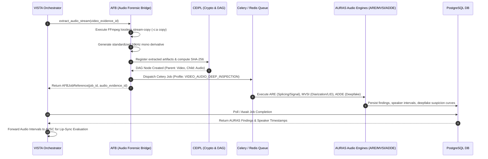

#### 11.3.5 Diarization Alignment & Overlapped Speech Separation (`ps05.engines.vista.afb.separation`)
- Synchronizes MVSI-produced speaker turn intervals $[t_{\text{start}}, t_{\text{end}}]$ with the video container timebase.
- When MVSI detects overlapping speech (`is_overlapped == True`), AFB triggers SpeechBrain SepFormer to isolate concurrent talker signals into clean acoustic streams prior to lip-sync cross-correlation.

---

### 11.4 AVSC Technical Specification (Audio-Visual Synchronization & Correspondence Engine)

The Audio-Visual Synchronization & Correspondence Engine (AVSC) evaluates physical and acoustic coherence between visual events and the accompanying sound track, resolving intentional re-dubbing, replacement audio, and synthetic talking-head desynchronization.

#### 11.4.1 Container AV Global Offset Alignment (`ps05.engines.vista.avsc.alignment`)
- Compares initial video presentation timestamp $PTS_{v, 0}$ against initial audio presentation timestamp $PTS_{a, 0}$:
  $$\Delta t_{\text{global}} = PTS_{a, 0} - PTS_{v, 0}$$
- Evaluates total track duration discrepancies:
  $$\Delta T = |T_{\text{video}} - T_{\text{audio}}|$$
- Global offsets exceeding standard playback tolerances ($|\Delta t| > 150\text{ ms}$) or duration mismatches ($|\Delta T| > 500\text{ ms}$) trigger container-level desynchronization warnings.

#### 11.4.2 RetinaFace Detection & ByteTrack Trajectory Association (`ps05.engines.vista.avsc.face_track`)
- **High-Recall Face Detection:**
  - Evaluates video frames using RetinaFace / SCRFD with ResNet-50 backbone.
  - Detects multi-scale faces down to $20 \times 20$ pixels, outputting 5 facial keypoints (eyes, nose, mouth corners) and detection confidence $c_{\text{face}}$.
- **Multi-Object Trajectory Association:**
  - Implements ByteTrack algorithm associating detected face boxes across frames via Kalman filter state prediction and Hungarian matching.
  - Maintains unique facial track identifiers (`face_track_id`) across occlusions, head turns, and brief camera cuts.
  - Retains pose angles (yaw, pitch, roll) and face quality scores for every tracked frame.

#### 11.4.3 Canonical Mouth Crop Normalization (`ps05.engines.vista.avsc.mouth_roi`)
- Extracts 468 3D facial landmarks per frame via MediaPipe FaceMesh.
- Identifies outer and inner lip landmark clusters (indices: 61, 291, 0, 17, 78, 308, 13, 14).
- Applies similarity transform aligning lip centers horizontally, cropping a canonical $96 \times 96$ RGB region centered on the mouth.
- Resamples mouth crop sequences to a steady $25\text{ fps}$ visual tube.

#### 11.4.4 SyncNet Lip-Sync Cross-Correlation Architecture (`ps05.engines.vista.avsc.syncnet`)

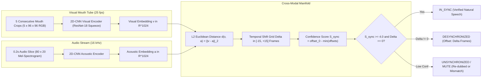

- **Mathematical Formulation:**
  - Visual embedding $\mathbf{v}(t) \in \mathbb{R}^{1024}$ is computed over a 5-frame sliding window centered at time $t$.
  - Acoustic embedding $\mathbf{a}(t + \Delta) \in \mathbb{R}^{1024}$ is computed over the corresponding 0.2-second mel-spectrogram slice shifted by offset $\Delta \in [-15, +15]$ frames ($\approx \pm 600\text{ ms}$).
  - Distance curve:
    $$D(\Delta) = ||\mathbf{v}(t) - \mathbf{a}(t + \Delta)||_2$$
  - Lip-sync confidence metric:
    $$S_{\text{sync}} = \text{median}(D) - \min_{\Delta} D(\Delta)$$
  - Optimal offset $\Delta^* = \arg\min_{\Delta} D(\Delta)$.
  - A segment is classified as `IN_SYNC` if $S_{\text{sync}} \ge 4.0$ and $|\Delta^*| \le 1$ frame.
  - If $S_{\text{sync}} < 2.5$, the segment indicates either silent mouth movement, voice-over dubbing, or synthetic facial replacement.

#### 11.4.5 Multi-Face Speaker Disambiguation & Bystander Handling (`ps05.engines.vista.avsc.multi_face`)
- In scenes with multiple concurrent visible persons:
  1. Computes independent $S_{\text{sync}, i}(t)$ curves for every tracked face $i \in \{1, \dots, N\}$.
  2. Compares active speech intervals from AURAS-MVSI against individual face sync scores.
  3. Attributes acoustic dialogue to face $i^*$ satisfying $\max_i S_{\text{sync}, i}(t)$, provided $S_{\text{sync}, i^*} \ge 4.0$.
  4. Non-speaking faces with $S_{\text{sync}} < 2.5$ are formally classified as `BYSTANDER_SILENT`, preventing false-positive re-dubbing findings on passive individuals in the frame.

```mermaid
sequenceDiagram
    autonumber
    participant VISTA as AVSC Orchestrator
    participant FaceTrack as RetinaFace + ByteTrack
    participant CropNorm as Canonical Mouth ROI Extractor
    participant AURAS_MVSI as AURAS-MVSI (Diarization & VAD)
    participant SyncNet as SyncNet Cross-Modal Evaluator
    participant Disambig as Speaker Disambiguation Logic

    VISTA->>FaceTrack: detect_and_track_faces(video_stream)
    FaceTrack-->>VISTA: Return N Active Face Trajectories {track_1, ..., track_N}
    VISTA->>AURAS_MVSI: get_speech_segments(audio_artifact_id)
    AURAS_MVSI-->>VISTA: Active speech intervals [t_start, t_end] & speaker labels

    loop For Each Face Trajectory i in 1..N
        VISTA->>CropNorm: extract_mouth_roi_sequence(track_i, [t_start, t_end])
        CropNorm-->>VISTA: Standardized 112x112 Greyscale Lip Sequence V_i(t)
        VISTA->>SyncNet: compute_cross_correlation(V_i(t), Audio_MFCC(t))
        SyncNet-->>VISTA: Distance curve D_i(Delta), Sync Score S_sync,i, Optimal Offset Delta*_i
    end

    VISTA->>Disambig: evaluate_multi_speaker_correspondence({S_sync,i})
    alt max(S_sync,i) >= 4.0 and unique
        Disambig-->>VISTA: Attribute dialogue to Face track_i* (Status: ACTIVE_SPEAKER)
        Disambig-->>VISTA: Mark other tracks as BYSTANDER_SILENT (S_sync < 2.5)
    else Ambiguous or S_sync < 2.5 for all faces
        Disambig-->>VISTA: Flag OFF_SCREEN_SPEAKER or VOICE_OVER_DUBBING (Status: UNRESOLVED)
    end
```

#### 11.4.6 Sound-to-Visual Event Correspondence (`ps05.engines.vista.avsc.event_corr`)
- Correlates abrupt acoustic transient events with localized visual phenomena:
  - Acoustic event classifier (YAMNet / AST) detects sound classes: *Gunshot, Explosion, Glass Shatter, Muzzle Blast, Vehicle Screech, Scream*.
  - Visual detector (YOLOv8x / VideoMAE) tracks visual classes: *Firearm Discharge Flash, Shattering Window, Vehicle Collision, Person Fall*.
  - Evaluates cross-modal temporal difference:
    $$\Delta t_{\text{event}} = t_{\text{acoustic}} - t_{\text{visual}}$$
  - Physics constraint: Light travels faster than sound; visual event MUST precede or equal acoustic event ($0 \le \Delta t_{\text{event}} \le \frac{d_{\max}}{343\text{ m/s}} + \epsilon$). If an acoustic gunshot occurs *prior* to the visible flash ($\Delta t_{\text{event}} < -50\text{ ms}$), an audio splicing/re-dubbing anomaly is flagged.

---

### 11.5 VDF Technical Specification (Video Deepfake & AI-Generation Detection Engine)

The Video Deepfake & AI-Generation Detection Engine (VDF) integrates spatial frame-level models, temporal sequence transformers, and specialized manipulation heads to detect face swaps, facial reenactments, generative inpainting, and text-to-video synthesis.

#### 11.5.1 Spatial Frame-Level Classifiers (`ps05.engines.vista.vdf.frame_detect`)
- **Backbone Architectures:**
  - *XceptionNet Forensics:* Standard forensic baseline trained on FaceForensics++ high-compression (c23 and c40) splits.
  - *EfficientNet-B4 Dual-Domain:* Parallel dual-branch architecture ingesting normalized spatial RGB face crops ($380 \times 380$) and 2D Discrete Cosine Transform (DCT) high-frequency residual planes.
- **Artifact Localization:**
  - Detects blending seam discontinuities along the jawline, forehead, and perimeter of swapped facial masks.
  - Identifies color-space mismatches ($\Delta E_{\text{Lab}}$) between the inner facial skin and surrounding head/neck boundaries.

#### 11.5.2 Temporal Sequence Classifiers (`ps05.engines.vista.vdf.temporal`)
- **FTCN (Fully Temporal Convolution Network):**
  - Ingests sliding 16-frame face sequences ($16 \times 3 \times 224 \times 224$).
  - Implements temporal-only 3D convolutions with spatial receptive field reduced to $1 \times 1$.
  - Enforces temporal consistency evaluation: synthetic deepfakes exhibit high-frequency frame-to-frame pixel flicker, facial landmark jitter, and unnatural eye blinking cadences that spatial models fail to detect.
- **VideoMAE Foundation SSL Head:**
  - Evaluates temporal video representations using a pre-trained VideoMAE ViT-Base encoder.
  - Extracts 768-dimensional sequence feature tokens across 16-frame windows with 8-frame temporal stride.

#### 11.5.3 Specialized Forensic Manipulation Heads (`ps05.engines.vista.vdf.manipulation`)
1. **Face Swap Detection Head:** Focuses on identity mismatch between facial landmarks and external cranial bone structure.
2. **Face Reenactment / Lip-Sync Head:** Focuses on unnatural boundary warping around oral and periorbital regions.
3. **Generative Inpainting Head:** Uses spatial frequency residual maps to detect generative object removal or background patching.

#### 11.5.4 Text-to-Video Generative Synthesis Detection (`ps05.engines.vista.vdf.generative`)
- Ingests non-face video clips generated by foundation text-to-video diffusion and autoregressive architectures (Sora, Runway Gen-2/Gen-3, Pika, Kling, Luma Dream Machine).
- **3D Spatio-Temporal FFT Spectrum Inspection:**
  - Computes 3D Fast Fourier Transform across volume $V(x, y, t)$:
    $$F(u, v, \omega) = \iiint V(x, y, t) e^{-j 2\pi (ux + vy + \omega t)} dx dy dt$$
  - Generative video models exhibit abnormal temporal power decay: authentic video maintains steady physical momentum spectra, whereas diffusion models exhibit anomalous high-frequency temporal noise floor pulsing and spatial morphing artifacts.

#### 11.5.5 Score Calibration, Mahalanobis OOD & Late Fusion (`ps05.engines.vista.vdf.calibration`)

```mermaid
flowchart TD
    WINDOW["16-Frame Face / Video Sliding Window (8-Frame Stride)"] --> BRANCHES

    subgraph BRANCHES["Parallel Multi-Family Detection Heads"]
        XCEPT["Frame Spatial: XceptionNet (Logit z_1)"]
        EFF["Frame Dual-Domain: EfficientNet-B4 (Logit z_2)"]
        FTCN["Temporal Sequence: FTCN (Logit z_3)"]
        VMAE["Temporal Foundation: VideoMAE (Logit z_4)"]
        GEN3D["Generative Video: 3D FFT Residual (Logit z_5)"]
    end

    XCEPT --> CALIB1["Platt Scaling: p_1 in [0, 1]"]
    EFF --> CALIB2["Platt Scaling: p_2 in [0, 1]"]
    FTCN --> CALIB3["Platt Scaling: p_3 in [0, 1]"]
    VMAE --> CALIB4["Platt Scaling: p_4 in [0, 1]"]
    GEN3D --> CALIB5["Platt Scaling: p_5 in [0, 1]"]

    VMAE -.->|Feature Vector e in R^768| MAHALANOBIS["Mahalanobis Distance OOD Estimator"]

    CALIB1 & CALIB2 & CALIB3 & CALIB4 & CALIB5 --> FUSION["Quality-Weighted Late Fusion Ensemble"]

    FUSION --> P_FINAL["Calibrated Suspicion Score P(fake) in [0, 1]"]
    MAHALANOBIS --> OOD_METRIC["OOD Metric (IN_DIST / MILD_OOD / HIGH_OOD)"]

    P_FINAL & OOD_METRIC --> TIMELINE_OUT["Millisecond Suspicion Curve & Flagged Intervals"]
```

- **Platt Scaling Logistic Calibration:**
  $$p_k = \frac{1}{1 + \exp(A_k z_k + B_k)}$$
  Fitted on held-out validation splits to guarantee Expected Calibration Error $ECE < 0.05$.
- **Quality-Weighted Late Fusion:**
  $$P(\text{fake}) = \sum_{k=1}^K w_k(q) \cdot p_k, \quad \sum w_k = 1.0$$
  Weights $w_k(q)$ dynamically scale with face resolution and compression level: for low-resolution or heavily compressed clips, temporal model weights ($w_{\text{ftcn}}, w_{\text{vmae}}$) are increased while frame spatial weights are dampened.
- **Mahalanobis Out-of-Distribution (OOD) Distance:**
  - Evaluates feature representation $\mathbf{e} \in \mathbb{R}^{768}$ against reference training set distribution $(\boldsymbol{\mu}, \boldsymbol{\Sigma})$:
    $$D_M(\mathbf{e}) = \sqrt{(\mathbf{e} - \boldsymbol{\mu})^T \boldsymbol{\Sigma}^{-1} (\mathbf{e} - \boldsymbol{\mu})}$$
  - If $D_M(\mathbf{e}) > \tau_{\text{ood}}$, emits `OOD_UNCERTAINTY: HIGH`, preventing overconfident false positives on rare codecs or extreme compression.

---

### 11.6 VCI Technical Specification (Video Content Intelligence Engine)

The Video Content Intelligence Engine (VCI) extracts semantic content, tracks entities, counts unique individuals, and reads burned-in camera overlays to establish objective factual timelines.

#### 11.6.1 Hierarchical 15-Category Video Source Taxonomy (`ps05.engines.vista.vci.taxonomy`)
The platform categorizes video exhibits across 15 standard forensic operational sources:
1. `CCTV_FIXED_SURVEILLANCE`: Static or PTZ infrastructure surveillance.
2. `BODY_WORN_CAMERA`: Police/security body-worn dynamic camera.
3. `DASHCAM_VEHICLE`: Vehicle-mounted forward/rear dashcam.
4. `DRONE_AERIAL_SURVEILLANCE`: UAV aerial video stream.
5. `MOBILE_SMARTPHONE_HANDHELD`: Vertical/horizontal mobile phone footage.
6. `MOBILE_SCREEN_RECORDING`: Device capture of another video playback.
7. `SOCIAL_MEDIA_RECOMPRESSED`: WhatsApp, Telegram, Facebook, YouTube transcoded clips.
8. `BROADCAST_STUDIO_FOOTAGE`: High-bitrate interlaced or progressive news footage.
9. `CONFERENCE_VIDEO_CALL`: Zoom, Teams, Google Meet compressed screen grids.
10. `INTERROGATION_ROOM_FACILITY`: Multi-microphone custody facility recording.
11. `COVERT_PINHOLE_DEVICE`: Low-resolution spy/covert recorder.
12. `ANALOG_DIGITIZED_VCR`: Digitized VHS/analog tape with tracking head lines.
13. `ACTION_CAM_EXTREME`: High frame rate GoPro/wide-angle fisheye lens.
14. `AI_SYNTHETIC_GENERATIVE`: Pure text-to-video or synthetic engine generation.
15. `INCONCLUSIVE_CONTAINER`: Ambiguous or unclassifiable recording format.

#### 11.6.2 Object Detection & SAM 2 Prompted Segmentation (`ps05.engines.vista.vci.detector`)
- Primary Object Detector: YOLOv8x / YOLOv10 and RT-DETR identifying 80 standard forensic categories (person, vehicle, firearm, knife, bag, license plate).
- Pixel-Accurate Instance Segmentation: Segment Anything Model 2 (SAM 2) prompted with bounding box centroids to extract exact contour masks of evidentiary objects.

#### 11.6.3 Trajectory Tracking & Distinct Unique Person Counting (`ps05.engines.vista.vci.tracker`)
- **ByteTrack Trajectory Persistence:**
  - Maintains tracklets across occlusions using appearance embeddings and spatial Kalman filters.
- **Unique vs. Cumulative Frame Count Invariant:**
  - Explicitly prevents the forensic error of conflating detection sums with distinct people:
    $$N_{\text{cumulative}} = \sum_{t=1}^T n_{\text{detections}}(t) \quad \gg \quad N_{\text{unique}} = |\text{Unique Track IDs}|$$
  - Implements virtual tripwires and directional entry/exit counting zones. Reports both instantaneous occupancy $N(t)$ and total unique entities $N_{\text{total\_unique}}$.

#### 11.6.4 VideoMAE Action & Anomaly Localization (`ps05.engines.vista.vci.actions`)
- Localizes temporal crime and safety events across video sequences:
  - *Violence / Physical Assault*
  - *Slip & Fall Incident*
  - *Vehicle Collision / Crash*
  - *Firearm / Weapon Draw*
  - *Loitering / Perimeter Intrusion*
- Outputs millisecond start and end timestamps $[t_1, t_2]$ with action classification confidence.

#### 11.6.5 PaddleOCR / Tesseract OSD Timestamp & Channel Extraction (`ps05.engines.vista.vci.ocr_overlay`)
- Locates burned-in on-screen display (OSD) digital clock overlays (typically placed in corner quadrants: top-left, top-right, bottom-left, bottom-right).
- Applies perspective rectification, morphological binarization, and OCR recognition via PaddleOCR and Tesseract.
- Matches text against datetime patterns (`YYYY-MM-DD HH:MM:SS`, `DD/MM/YYYY HH:MM:SS.fff`).
- Emits structured array of parsed clock values $T_{\text{ocr}}(t)$ indexed by frame number.

---

### 11.7 Dedicated CCTV Forensic Profile Technical Specification

Surveillance CCTV and DVR/NVR footage represents a distinct class of forensic evidence characterized by proprietary containers, variable frame rates, burned-in OSD clocks, and multi-camera installations.

#### 11.7.1 Automated Triage Scoring Matrix (`ps05.engines.vista.cctv.triage`)
The platform executes automated multi-signal heuristic classification before prompting the user:

$$\text{Score}_{\text{cctv}} = w_1 S_{\text{codec}} + w_2 S_{\text{vfr}} + w_3 S_{\text{osd}} + w_4 S_{\text{static}} + w_5 S_{\text{aspect}}$$

| Feature | Condition | Weight | Score Contribution |
| :--- | :--- | :--- | :--- |
| **Container & Codec** | `.dav`, `.sec`, raw H.264 Annex B, Hikvision/Dahua headers | 0.25 | 1.0 |
| **Frame Rate** | Non-standard VFR (e.g. 6.25 fps, 10 fps, 12.5 fps, 15 fps) | 0.20 | 1.0 |
| **OSD Clock** | Burned-in digital clock detected in frame margin | 0.25 | 1.0 |
| **Camera Motion** | Static background with zero camera translation/panning | 0.15 | 1.0 |
| **Resolution / Aspect** | 4:3 CIF/D1 or fixed surveillance aspect ratios (704x576) | 0.15 | 1.0 |

- **Classification Thresholds:**
  - $\text{Score}_{\text{cctv}} \ge 0.70 \implies \mathbf{LIKELY\_CCTV}$ (Triggers CCTV Profile automatically).
  - $0.40 \le \text{Score}_{\text{cctv}} < 0.70 \implies \mathbf{POSSIBLY\_CCTV}$ (Prompts examiner for confirmation).
  - $\text{Score}_{\text{cctv}} < 0.40 \implies \mathbf{NON\_CCTV}$ (Standard video profile).

#### 11.7.2 Pre-Questioning Metadata Extraction Order (`ps05.engines.vista.cctv.auto_meta`)
To minimize examiner cognitive burden and avoid asking redundant questions, the system executes automated extraction in strict sequence BEFORE formulating questionnaires:
1. Demux bitstream and read all container metadata atoms (FFprobe).
2. Execute ExifTool deep scan for DVR manufacturer strings, firmware versions, and camera names.
3. Detect presence and bounding box of burned-in OSD clock overlay (PaddleOCR).
4. Calculate packet PTS cadence and detect whether stream is CFR or VFR.
5. Identify native digital signature boxes (ONVIF / Hikvision watermarks).

#### 11.7.3 Complete Versioned CCTVContext JSON Schema (`ps05.engines.vista.cctv.context`)

> **Architectural Status:** `PLANNED` — Proposed illustrative schema. All fields and status transitions are subject to validation upon implementation.

To maintain strict evidentiary provenance under Section 65B IEA / Section 63 BSA, all surveillance parameters and recording context are stored in a versioned, provenance-typed data model. The schema explicitly decouples machine-extracted technical observations from subjective user claims using formal status tags:

- `NOT_PROVIDED`: Parameter was not supplied by the investigator and was not discoverable in bitstream metadata.
- `UNKNOWN`: Inspected but indeterminable from available evidence artifacts.
- `USER_REPORTED`: Provided by the investigator or custodian; **unverified** until independently corroborated.
- `MACHINE_EXTRACTED`: Extracted directly by automated parsers (FFprobe, ExifTool, PaddleOCR) from bitstream headers or visual frames.
- `CORROBORATED`: Cross-verified across two independent sources (e.g., container creation tag corroborated by OSD clock or police seizure memo).
- `VERIFIED`: Cryptographically authenticated via valid vendor digital signature, ONVIF Media Signing token, or trusted reference hash.
- `CONFLICTING`: Two or more evidentiary sources yield contradictory values (e.g., OSD clock shows 14:00 while container metadata states 18:00).
- `NOT_APPLICABLE`: Parameter does not apply to the identified source type.

```json
{
  "schema_version": "1.0.0",
  "evidence_id": null,
  "evidence_context_id": null,
  "evidence_type_candidate": {
    "value": "unknown",
    "status": "UNKNOWN"
  },
  "acquisition": {
    "source_type": {
      "value": "unknown",
      "status": "UNKNOWN"
    },
    "camera_recorder": {
      "manufacturer": null,
      "model": null,
      "device_id": null,
      "camera_channel": null,
      "status": "NOT_PROVIDED"
    },
    "export_type": {
      "value": "unknown",
      "status": "UNKNOWN"
    },
    "export_software": {
      "name": null,
      "version": null,
      "status": "NOT_PROVIDED"
    }
  },
  "time_context": {
    "timezone": {
      "value": null,
      "status": "UNKNOWN"
    },
    "recording_window": {
      "start_time": null,
      "end_time": null,
      "timestamp_semantics": "UNKNOWN",
      "status": "NOT_PROVIDED"
    },
    "recorder_clock_offset": {
      "value_seconds": null,
      "status": "UNKNOWN"
    }
  },
  "associated_evidence": {
    "native_export_available": {
      "value": null,
      "status": "UNKNOWN"
    },
    "sidecar_manifest_available": {
      "value": null,
      "status": "UNKNOWN"
    },
    "signature_or_seal_available": {
      "value": null,
      "status": "UNKNOWN"
    },
    "recorder_log_available": {
      "value": null,
      "status": "UNKNOWN"
    },
    "reference_hash_available": {
      "value": null,
      "status": "UNKNOWN"
    },
    "related_camera_footage_available": {
      "value": null,
      "status": "UNKNOWN"
    }
  },
  "machine_observations": {
    "metadata_extraction_status": "NOT_RUN",
    "ocr_timestamp_extraction_status": "NOT_RUN",
    "cctv_classification_status": "NOT_RUN",
    "cryptographic_verification_status": "NOT_RUN",
    "findings": []
  },
  "follow_up": {
    "workflow_status": "PENDING_AUTOMATIC_DISCOVERY",
    "outstanding_questions": [],
    "user_responses_are_independently_verified": false
  }
}
```

#### 11.7.4 Adaptive Discovery Workflow & Targeted Questionnaire Rules (`ps05.engines.vista.cctv.adaptive_q`)

```mermaid
flowchart TD
    INGEST["📥 Video Exhibit Ingested & SHA-256 Hashed"] --> PRE_EXT["1. Pre-Questioning Metadata Extraction<br/>(FFprobe / PyAV / ExifTool / OSD PaddleOCR)"]
    PRE_EXT --> TRIAGE{"2. CCTV-01: Multi-Signal Source Triage"}

    TRIAGE -->|Confidence Score| CLASS_RES["Classify Source Type:<br/>LIKELY_CCTV_FOOTAGE | POSSIBLE_CCTV_FOOTAGE |<br/>GENERAL_VIDEO | SCREEN_RECORDING_CANDIDATE | UNKNOWN_SOURCE_TYPE"]

    CLASS_RES --> POPULATE["3. Populate Initial CCTVContext Record<br/>(Mark Machine Observations as MACHINE_EXTRACTED)"]

    POPULATE --> EVAL_MISSING{"4. Evaluate Critical Missing Parameters<br/>(Source Type? Native Export? Clock Timezone?)"}

    EVAL_MISSING -->|All Critical Context Extracted| SKIP_Q["Skip Questionnaire: Zero Redundant Prompts"]
    EVAL_MISSING -->|Context Missing & Relevant| FORM_Q["5. Formulate Adaptive Questions (A–E)<br/>(Present Auto-Extracted Clues to Examiner for Confirmation)"]

    FORM_Q --> USER_PROMPT["Present Adaptive Questionnaire to Examiner"]
    USER_PROMPT -->|User Submits Responses| MERGE_RESP["Merge User Responses<br/>(Tag each field strictly as USER_REPORTED)"]
    USER_PROMPT -->|User Skips / Timeout| CONTINUE_SKIP["Enforce Continuation Invariant<br/>(Tag missing fields as NOT_PROVIDED; Widen Uncertainty Bounds)"]

    SKIP_Q --> EXEC_ENGINES["6. Dispatch VISTA Forensic Engines (VRE, AVSC, VDF, VCI, CCTV)"]
    MERGE_RESP --> EXEC_ENGINES
    CONTINUE_SKIP --> EXEC_ENGINES
```

- **Pre-Questioning Principle:** Automated discovery executes *before* any prompt is shown to the investigator. If camera channel labels, recorder manufacturer tags, or OSD clocks are discovered in metadata or frames, they are displayed as extracted clues rather than requested as blank inputs.
- **Adaptive Question Rules (Questions A–E):**
  - **Question A (Source of Recording):** Inquires whether footage originated from: (1) Direct camera export, (2) DVR/NVR native export, (3) Vendor export software, (4) Screen recording of monitor, (5) Mobile phone recording of monitor screen, (6) Messaging/social-media platform (WhatsApp, Telegram), or (7) Unknown source. Extracted container clues (`handler_name`, `encoder`) are shown alongside the prompt.
  - **Question B (Native Export Availability):** If uploaded video is a converted MP4/AVI and proprietary recorder metadata is missing, prompts whether the native DVR backup file (`.dav`, `.h264`, `.sec`) or proprietary verification player is available. If unavailable, analysis proceeds with the current file.
  - **Question C (Camera / Recorder Details):** Prompts for camera manufacturer, model, channel ID, and export software *strictly* when these could activate supported vendor-specific parser plugins (e.g., Dahua DAV packet parsing or Hikvision watermark verification).
  - **Question D (Timezone & Incident Window):** Prompts for the recorder's configured hardware timezone and approximate incident window whenever absolute time interpretation or multi-camera cross-correlation is required. *Crucial Rule:* Never assume the investigator's local workstation timezone is identical to the recorder's timezone.
  - **Question E (Corroborating Evidence):** Prompts for adjacent camera angles, recorder transaction logs, trusted seizure hash memos, or chain-of-custody documentation. *Security Invariant:* Never request device root passwords or unrestricted network access.
- **Adaptive Continuation Invariant:**
  - If the investigator skips answering questions or context remains unknown, the pipeline **MUST NEVER BLOCK OR HALT**.
  - Analysis continues immediately, logging missing context as `NOT_PROVIDED` and expanding confidence intervals on downstream findings (e.g., widening clock drift tolerance when time synchronization status is unknown).
  - Every user-supplied claim is tagged `USER_REPORTED` and must never be cited as verified forensic ground truth without independent machine corroboration.

#### 11.7.5 Clock Continuity Drift Regression & Anomaly Criteria (`ps05.engines.vista.cctv.clock_drift`)
- **Regression Formulation:**
  - For every decoded frame with a valid OCR timestamp $T_{\text{ocr}}(t)$ and container presentation timestamp $t_{\text{pts}}$:
    $$\delta(t) = T_{\text{ocr}}(t) - (T_0 + t_{\text{pts}})$$
  - Evaluates linear drift slope: $\delta(t) = \alpha + \beta t + \epsilon(t)$.
- **Forensic Anomaly Triggers:**
  1. *Clock Jump / Frame Removal:* An instantaneous step change $|\Delta T_{\text{ocr}}| \ge 1.0\text{ s}$ while $t_{\text{pts}}$ continues monotonically indicates deleted surveillance footage.
  2. *Clock Stalling / Freeze:* $T_{\text{ocr}}$ remains constant over $N \ge 10$ frames while $t_{\text{pts}}$ advances indicates a video freeze attack or looped footage.
  3. *Clock-PTS Desynchronization:* Linear drift $|\beta| > 0.01\text{ s/s}$ indicates frame-rate conversion or altered playback speed.

#### 11.7.6 ONVIF Export File Format & Media Signing Verification (`ps05.engines.vista.cctv.onvif_seals`)

```mermaid
sequenceDiagram
    autonumber
    participant EXHIBIT as Seized ONVIF Export (.mp4 / .mkv + XML)
    participant PARSER as ONVIF Packaging Demuxer
    participant CERT as X.509 Certificate Store & CA
    participant HASH_VAL as NAL Unit Dual-Hasher
    participant VERIFIER as Media Signing Verifier

    EXHIBIT->>PARSER: Ingest ONVIF Export Package
    PARSER->>PARSER: Parse XML / SMIL Signature Box (urn:onvif:media-signing)
    PARSER->>CERT: Extract Embedded Signing Certificate
    CERT->>CERT: Validate Chain of Trust & Expiration

    PARSER->>HASH_VAL: Stream Raw H.264/H.265 NAL Units
    HASH_VAL->>HASH_VAL: Compute Continuous SHA-256 NAL Hash Chain
    HASH_VAL-->>VERIFIER: Computed Stream Digest

    PARSER->>VERIFIER: Extract Signed Digest from Media Signature Atom
    VERIFIER->>VERIFIER: Verify RSA-SHA256 / ECDSA-SHA256 Signature

    alt Signature Matches & Hash Chain Intact
        VERIFIER-->>EXHIBIT: Status: ONVIF_MEDIA_SEAL_VERIFIED (Untampered)
    else Signature Invalid or Hash Mismatch
        VERIFIER-->>EXHIBIT: Status: ONVIF_MEDIA_SEAL_VIOLATION (Tampered / Spliced)
    else No ONVIF Signature Present
        VERIFIER-->>EXHIBIT: Status: NATIVE_SEAL_UNAVAILABLE (Standard Audit)
    end
```

#### 11.7.7 Multi-Camera Timeline Corroboration & Duplicate Feed Detection (`ps05.engines.vista.cctv.multi_cam`)
- In multi-channel DVR exports:
  1. Synchronizes parallel camera feeds (e.g. `CAM_01`, `CAM_02`) onto a unified UTC timeline via OCR clock alignment.
  2. Tracks entities moving across camera fields of view using spatial-temporal trajectory matching.
  3. Detects duplicate / re-broadcast feeds: computes cross-camera SSIM and color histogram distance. If two distinct camera channels exhibit $SSIM > 0.95$ with a constant time lag $\Delta t$, the system flags `DUPLICATE_OR_TIME_SHIFTED_FEED_DETECTED`.

---

### 11.8 CEIPL Integration for Video Exhibits & Derived Artifacts

The Cryptographic Evidence Integrity & Provenance Layer (CEIPL) provides the cryptographic trust anchor for all video evidence, enforcing strict bitstream preservation, verifiable derivation tracking, and court-admissible audit logging in compliance with Section 65B of the Indian Evidence Act (IEA) and Section 63 of the Bharatiya Sakshya Adhiniyam (BSA 2023).

#### 11.8.1 Pre-Decode Dual Hashing & Ingestion Record
- **Raw Bitstream Hashing:** Prior to container demuxing, header inspection, or codec decoding, the raw ingested byte stream passes through parallel SHA-256 and SHA3-512 cryptographic accumulators.
- **Mandatory Ingestion Record Schema:** The resulting evidence record permanently binds the following eleven parameters into the immutable database store:
  1. `evidence_id`: UUIDv4 unique primary exhibit identifier.
  2. `original_sha256`: 64-character lowercase hex digest of raw exhibit bytes.
  3. `sha3_512`: 128-character lowercase hex digest providing post-quantum security against collision attacks.
  4. `file_length_bytes`: Exact byte count verified against file system stat.
  5. `detected_media_type`: True container MIME type determined by magic byte inspection.
  6. `ingestion_event_id`: UUIDv4 linking the ingestion transaction to the examiner session.
  7. `ingestion_timestamp_utc`: ISO 8601 UTC timestamp ($1\text{ ms}$ precision).
  8. `storage_object_uri`: Immutable WORM storage path (e.g. `s3://evidence-vault-worm/exhibits/2026/04/vid_77182.bin`).
  9. `storage_version_id`: Cloud object version ID or filesystem inode generation number.
  10. `reference_hash_match`: Boolean status comparing computed digest against court-supplied seizure memo hash (or `null` if none supplied).
  11. `verification_status`: Initial integrity verdict (`VERIFIED_MATCH` | `HASH_MISMATCH` | `UNVERIFIED_NO_REFERENCE`).
- **Immutability Invariant:** Original evidentiary files are marked with POSIX `0400` (read-only) permissions and stored in WORM-compliant object storage with S3 Object Lock in Compliance mode. Files are NEVER overwritten, transcoded, modified, or normalized in place.

#### 11.8.2 Derived Artifact Directed Acyclic Graph (DAG) Lineage
Every downstream derivative produced during forensic processing is registered as a node in the cryptographic provenance DAG:

```mermaid
flowchart TD
    RAW["Raw Seized Video File<br/>(evidence_id, SHA-256, SHA3-512)"]

    RAW --> ART_AUDIO_RAW["1. EXTRACTED_AUDIO_STREAM<br/>Lossless bitstream (-c:a copy)<br/>SHA-256 Linked"]
    RAW --> ART_FRAMES["4. DECODED_FRAME_EXTRACT<br/>Lossless PNG at exact PTS<br/>SHA-256 Linked"]
    RAW --> ART_VRE_PTS["VRE Bitstream & Cadence JSON<br/>Atom & PTS Log"]
    RAW --> ART_CCTV_OCR["7. OSD_CLOCK_CROP<br/>PaddleOCR Bounding Box Crop"]

    ART_AUDIO_RAW --> ART_AUDIO_16K["2. STANDARDIZED_AUDIO_WAV<br/>16kHz Mono Float32 WAV"]
    ART_AUDIO_16K --> ART_SEP_AUDIO["3. SEPARATED_SPEAKER_TRACK<br/>SepFormer Isolated Voice Stream"]
    ART_AUDIO_16K --> AURAS_JOBS["AURAS Forensic Runs<br/>(ARE / MVSI / ADDE)"]

    ART_FRAMES --> ART_FACE_CROP["6. CANONICAL_MOUTH_ROI<br/>112x112 Greyscale Face Sequence"]
    ART_FRAMES --> ART_HEATMAP["8. DEEPFAKE_SEAM_HEATMAP<br/>EfficientNet-B4 Spatial Map"]
    ART_FRAMES --> ART_SAM_MASK["11. SAM2_SEGMENTATION_MASK<br/>Prompted Object Boundary Mask"]

    ART_FACE_CROP & ART_AUDIO_16K --> ART_SYNCNET["SyncNet Cross-Correlation<br/>AVSC Distance Curve D(Delta)"]
    ART_FRAMES --> ART_3D_FFT["10. GENERATIVE_3D_FFT_SPECTRUM<br/>Spatiotemporal Power Spectrum"]
    ART_FRAMES --> ART_JITTER["9. LANDMARK_JITTER_PLOT<br/>FTCN Temporal Motion Vector"]

    AURAS_JOBS & ART_SYNCNET & ART_HEATMAP & ART_3D_FFT & ART_JITTER & ART_CCTV_OCR --> ART_REPORT["12. CERTIFIED_REPORT_DOSSIER<br/>RFC 8785 Canonical JSON & Section 65B/63 BSA PDF<br/>Sealed with Ed25519 & RFC 3161 TSA"]
```

- **Catalog of 12 Standardized Derived Artifact Classes:**
  1. `EXTRACTED_AUDIO_STREAM`: Raw lossless demuxed audio bitstream (`.aac`, `.ac3`, `.mp3`).
  2. `STANDARDIZED_AUDIO_WAV`: 16 kHz Mono Float32 WAV representation normalized to $-23\text{ LUFS}$.
  3. `SEPARATED_SPEAKER_TRACK`: SpeechBrain SepFormer isolated single-speaker audio track.
  4. `DECODED_FRAME_EXTRACT`: Microsecond-accurate lossless PNG frame extract with container PTS metadata.
  5. `DOWNSAMPLED_MODEL_TENSOR`: Batched, normalized tensor array formatted for neural network input.
  6. `CANONICAL_MOUTH_ROI`: $112 \imes 112$ pixel normalized greyscale lip sequences for SyncNet cross-correlation.
  7. `OSD_CLOCK_CROP`: Bounding box raster crop containing recorder on-screen display timestamp overlay.
  8. `DEEPFAKE_SEAM_HEATMAP`: Color-mapped spatial prediction heatmap from EfficientNet-B4 / Xception.
  9. `LANDMARK_JITTER_PLOT`: Temporal sequence landmark trajectory displacement curve from FTCN.
  10. `GENERATIVE_3D_FFT_SPECTRUM`: Spatio-temporal power spectrum visualization showing diffusion/GAN grid artifacts.
  11. `SAM2_SEGMENTATION_MASK`: Binary or polygonal object tracking mask generated by SAM 2.
  12. `CERTIFIED_REPORT_DOSSIER`: RFC 8785 canonical JSON and Section 65B/63 BSA certified PDF.
- **DAG Node Binding Schema:** Every derived artifact node records:
  - `artifact_id`: UUIDv4 identifier.
  - `parent_artifact_id`: UUIDv4 of the immediate ancestor (or raw evidence ID).
  - `artifact_sha256`: Cryptographic digest of the derived artifact bytes.
  - `generator_module`: Fully qualified Python module and class name (e.g., `ps05.engines.vista.avsc.mouth_roi`).
  - `model_or_tool_version`: Git commit hash, tool release version, and model weights hash.
  - `transformation_parameters`: Complete JSON dictionary of all options passed to the generator.
  - `time_interval`: Bounded time range $[t_{\text{start}}, t_{\text{end}}]$ in the parent media timebase.
  - `spatial_coordinates`: Bounding box $[x, y, w, h]$ or affine transformation matrix $M_{3\times 3}$ mapping pixels back to the original raster frame.

#### 11.8.3 Canonical Manifests, Ed25519 Signing & Merkle Custody
- **RFC 8785 Canonical JSON Serialization (JCS):** All intermediate and final analysis manifests are normalized using RFC 8785 before hashing to guarantee that dictionary key ordering, whitespace variations, and floating-point representations produce bit-identical SHA-256 digests across heterogeneous architectures.
- **Ed25519 Digital Signatures:** Manifests are sealed using Edwards-curve Digital Signature Algorithm (Ed25519) keys conforming to RFC 8032. Keys are backed by Hardware Security Modules (HSM) or cloud KMS with strict role separation; examiners never possess direct access to raw private keys.
- **RFC 3161 Trusted Timestamps:** Signed manifests are bound to external RFC 3161 Time-Stamp Authority (TSA) tokens, establishing court-admissible proof of existence prior to a certified UTC time.
- **Append-Only Merkle Audit Log:** State transitions, examiner questionnaire inputs, and analysis completions are appended to a SHA-256 Merkle tree log. Audit consistency proofs ($O(\log N)$) allow verification that no historical custody records have been altered or deleted.

#### 11.8.4 Standardized Cryptographic Failure Codes (CEIPL-STATUS)
The CEIPL layer enforces nine strictly typed cryptographic failure statuses. Under Indian evidentiary jurisprudence, cryptographic verification failures must **NEVER** be silently suppressed or converted into an authenticity PASS:

| Failure Status Code | Trigger Condition & Technical Root Cause | Evidentiary Impact | Admissibility Handling |
| :--- | :--- | :--- | :--- |
| `HASH_MISMATCH` | Computed raw SHA-256/SHA3-512 digest diverges from seizure memo reference hash or database intake record. | Bitstream has suffered physical corruption, bit rot, or unauthorized byte modification. | Immediate forensic halt; Section 65B certificate refuses execution; exhibit quarantined. |
| `SIGNATURE_INVALID` | Mathematical verification of Ed25519 signature fails on analysis manifest, report JSON, or container seal. | Data has been tampered with post-signing or signature was forged using invalid private key. | Manifest rejected; reported as signature forgery finding in audit trail. |
| `SIGNING_KEY_UNTRUSTED`| Certificate or public key used to verify export signature does not chain to an approved root CA. | Unknown or self-signed key; provenance cannot be established to an authorized institution. | Tagged as UNTRUSTED_PROVENANCE; downgrades finding weight; flags follow-up alert. |
| `SIGNING_KEY_REVOKED`  | Signing certificate appears on Certificate Revocation List (CRL) or returns revoked OCSP status. | Certificate was compromised, decommissioned, or revoked prior to or at signing time. | Finding rejected; alert generated; triggers investigator re-acquisition request. |
| `TIMESTAMP_INVALID`    | RFC 3161 TSA token signature verification fails, token has expired, or timestamp post-dates custody log. | Temporal sequence cannot be legally corroborated; clock manipulation suspected. | Reverts to internal database server timestamp; notes external proof absence. |
| `CONTENT_BINDING_MISMATCH` | SHA-256 of child artifact referenced in DAG manifest does not match actual bytes stored on disk. | Derivative was edited, corrupted, or re-generated without updating parent manifest. | Derivative invalidated; DAG branch marked untrusted; forces automated regeneration. |
| `CUSTODY_CHAIN_BROKEN` | Merkle tree consistency proof fails; audit sequence gap or missing leaf digest detected. | Database tamper event, disk loss, or manual ledger modification occurred. | Full audit incident raised; judicial warning appended to Section 65B dossier. |
| `VERIFICATION_INCONCLUSIVE`| Incomplete public key bundle, inaccessible external TSA server, or degraded container signature atom. | Mathematical proof cannot be definitively completed due to missing external credentials. | Logged as inconclusive; analysis proceeds on internal algorithmic merits alone. |
| `PROVENANCE_UNAVAILABLE`| Ingested video lacks digital signature, C2PA manifest, or ONVIF Media Signing seal (legacy format). | Normal baseline for consumer camera and legacy DVR recordings without native crypto. | Recorded as unauthenticated legacy media; downstream engines evaluate visual/bitstream merits. |

---

### 11.9 Cross-Engine Video Evidence Fusion & Conflict Resolution

VISTA implements a multi-layer evidence fusion engine to resolve conflicting indicators across its constituent engines without obscuring individual analytical origins.

```mermaid
flowchart TD
    subgraph ENGINE_OUTPUTS["Independent Engine Findings"]
        VRE_OUT["VRE: PTS Cadence & Macroblock QP Findings"]
        AFB_OUT["AFB / AURAS: Splicing & Audio Deepfake Findings"]
        AVSC_OUT["AVSC: Lip-Sync Cross-Correlation Scores"]
        VDF_OUT["VDF: Facial Deepfake & 3D FFT Generative Scores"]
        VCI_OUT["VCI: Object Tracks & OSD Timestamp Log"]
        CCTV_OUT["CCTV: Clock Drift Regression & ONVIF Seal Status"]
    end

    ENGINE_OUTPUTS --> FUSION_CORE["Cross-Engine Video Fusion & Conflict Resolver"]

    subgraph RULES["Forensic Conflict Resolution Matrix"]
        RULE1["Lip-Sync Desync + Authentic Audio + Unaltered Face -> Voice-Over / Dubbing (Not Deepfake)"]
        RULE2["Lip-Sync Desync + Spliced Audio Boundary -> Inserted Audio Splice"]
        RULE3["Lip-Sync In-Sync + High VDF Deepfake Score -> AI Talking Head / Reenactment"]
        RULE4["Clock Jump + Smooth PTS -> Spliced Video Clip with Fabricated Timestamps"]
        RULE5["Clock Monotonic + Broken PTS Cadence -> Packet Loss / Hardware Frame Drop (Not Malice)"]
    end

    FUSION_CORE --- RULES
    FUSION_CORE --> COMPOSITE_REPORT["Unified Traceable Forensic Report & Archify IR"]
```

#### 11.9.1 Principles of Forensic Evidence Fusion
1. **Preservation of Origin:** Fusion NEVER averages or obscures raw engine outputs. Every finding in the final report explicitly cites the originating engine ID, model version, exact timecodes, and supporting artifact hashes.
2. **Anti-Averaging Rule:** The platform strictly prohibits collapsing an audio deepfake score, video deepfake score, lip-sync offset, and CCTV provenance rating into a single arbitrary "universal authenticity percentage". Such aggregate numbers are legally misleading and inadmissible in court.
3. **Cross-Modal Consistency Matrix:** The fusion layer correlates spatial, acoustic, temporal, and metadata signals using explicit evidentiary rules:
   - *Case 1 (Dubbing vs Deepfake):* If AVSC detects significant lip-sync desynchronization ($S_{\text{sync}} < 2.0$), but VDF detects no facial manipulation (calibrated $P_{\text{fake}} < 0.10$) and AURAS confirms authentic human voice, the anomaly is classified as `EXPLAINABLE_POST_PRODUCTION_DUBBING`, not an AI deepfake.
   - *Case 2 (AI Talking Head):* If lip-sync is tightly synchronized ($S_{\text{sync}} > 5.0$), but VDF flags boundary blending seams and temporal landmark jitter (calibrated $P_{\text{fake}} > 0.85$), the anomaly is classified as `AI_SYNTHETIC_TALKING_HEAD`.
   - *Case 3 (Audio Insertion):* If AVSC desynchronization coincides precisely with an AURAS-detected acoustic splice boundary ($\Delta t < 50\text{ ms}$), the anomaly is classified as `INSERTED_AUDIO_SPLICE`.
   - *Case 4 (Fabricated Surveillance Video):* If PaddleOCR detects a 15-minute jump in the OSD timestamp, but VRE bitstream analysis reveals smooth, uninterrupted PTS timestamps and continuous audio room tone, the segment is flagged as `SPLICED_RECORDING_WITH_RE_ENCODED_TIMELINE`.
   - *Case 5 (Benign Transmission Glitch):* If VRE detects abrupt PTS frame drops, but the OSD clock increments continuously and no visual scene cuts occur, the anomaly is flagged as `HARDWARE_FRAME_DROP_OR_PACKET_LOSS`, exonerating the exhibit from intentional malicious tampering.

#### 11.9.2 The 11-Part Final Forensic Report Structure
The VISTA composite report compiles eleven distinct forensic dimensions:
1. **Video Technical Integrity:** Container structure, atom alignment, PTS/DTS cadence, frame-rate consistency, and macroblock QP variance (VRE).
2. **Video Manipulation & Deepfake Findings:** Frame-level spatial boundary seams, temporal sequence jitter, and generative 3D FFT spectrum artifacts (VDF).
3. **Audio Integrity & Deepfake Findings:** Acoustic discontinuities, ENF continuity, voice biometric consistency, and synthetic speech likelihood (AFB / AURAS).
4. **Lip-Sync & Audiovisual Consistency Findings:** Cross-modal synchronization distance curves, optimal offset frames, and multi-face speaker attribution (AVSC).
5. **Content Intelligence Findings:** Source scene classification, unique person track counts, localized actions, and OSD timestamp intervals (VCI).
6. **CCTV-Specific Forensic Findings:** Source triage classification, OSD clock drift regression $\delta(t)$, ONVIF media signing audit, and cross-camera multi-feed corroboration (CCTV Profile).
7. **Cryptographic Verification:** Pre-decode dual hash verification (SHA-256 & SHA3-512), Merkle custody log audit, and Ed25519 signature checks (CEIPL).
8. **Corroborating Evidence:** Cross-modal corroboration, multi-camera matches, external reference hashes, and physical acoustic-visual event alignments.
9. **Conflicting Outputs & Disagreements:** Explicit enumeration of engine disagreements (e.g. model A flags deepfake while model B outputs normal), with forensic rationale for resolution.
10. **Unverified Assumptions & Missing Context:** Clear listing of user-reported questionnaire claims lacking independent corroboration, unverified timezones, and skipped questions.
11. **Human-Review Outcome & Certification:** Official certification block including examiner identity, workstation environment hashes, legal caveats, and final Section 65B IEA / Section 63 BSA conclusion.

#### 11.9.3 Standardized Dimension-Specific Verdict Vocabulary
Every analytical dimension in the report is assigned one of five standardized forensic statuses:

| Verdict Status | Formal Definition & Evidentiary Standard |
| :--- | :--- |
| `NO_ANOMALY_DETECTED` | All applicable engines executed successfully without detecting statistical, cryptographic, or algorithmic deviations exceeding established forensic significance thresholds ($lpha = 0.01$). |
| `SUSPICIOUS_INDICATORS`| One or more engines detected statistically significant indicators of synthetic generation, bitstream splicing, lip-sync mismatch, or timeline manipulation requiring examiner scrutiny. |
| `INCONCLUSIVE` | Severe compression artifacts, extreme low resolution ($< 240p$), severe motion blur, or lack of facial/acoustic signals prevented reliable algorithmic verification. |
| `VERIFICATION_FAILED` | Bitstream corruption, broken cryptographic hash chains, invalidated digital signatures, or non-monotonic frame sequences confirm structural compromise or data tampering. |
| `UNSUPPORTED` | Proprietary, obfuscated, or encrypted bitstream format for which no open parser or validated vendor plugin is currently integrated into the platform. |

#### 11.9.4 VISTA Findings & Evidence Entity-Relationship Diagram

```mermaid
erDiagram
    CASE ||--o{ EVIDENCE_RECORD : contains
    EVIDENCE_RECORD ||--o{ CUSTODY_EVENT : tracks
    EVIDENCE_RECORD ||--o{ DERIVED_ARTIFACT : generates
    EVIDENCE_RECORD ||--o{ ANALYSIS_JOB : runs
    EVIDENCE_RECORD ||--o| CCTV_CONTEXT : describes

    ANALYSIS_JOB ||--o{ FINDING : emits
    ANALYSIS_JOB ||--o{ ENGINE_RUN : executes
    DERIVED_ARTIFACT ||--o{ FINDING : supports

    CCTV_CONTEXT ||--o{ QUESTIONNAIRE_RESPONSE : records
    ANALYSIS_JOB ||--|| COMPOSITE_REPORT : compiles
    COMPOSITE_REPORT ||--|| CERTIFICATE_65B : certifies

    EVIDENCE_RECORD {
        uuid evidence_id PK
        uuid case_id FK
        string exhibit_number
        string original_filename
        string sha256_hash
        string sha3_512_hash
        string storage_uri
        int file_size_bytes
        string detected_mime
        datetime ingested_at
    }

    DERIVED_ARTIFACT {
        uuid artifact_id PK
        uuid parent_artifact_id FK
        uuid evidence_id FK
        string artifact_type
        string artifact_sha256
        string storage_uri
        string generator_module
        json transformation_params
        float start_time_seconds
        float end_time_seconds
    }

    FINDING {
        uuid finding_id PK
        uuid job_id FK
        uuid evidence_id FK
        string engine_code
        string finding_type
        string category
        float confidence_score
        float calibrated_score
        float start_time_seconds
        float end_time_seconds
        json spatial_coordinates
        string technical_rationale
        string evidentiary_weight
    }

    CCTV_CONTEXT {
        uuid context_id PK
        uuid evidence_id FK
        string source_type_candidate
        string camera_channel
        string recorder_manufacturer
        string configured_timezone
        float clock_drift_slope
        string onvif_seal_status
        string follow_up_status
    }
```

#### 11.9.5 Analysis State Machine & Report Generation Lifecycle

```mermaid
stateDiagram-v2
    [*] --> INGESTED: Exhibit Uploaded & Pre-Hashed (SHA-256 / SHA3-512)

    INGESTED --> DEFENSIVE_PARSING: WORM Storage Locked (POSIX 0400)

    DEFENSIVE_PARSING --> PARSE_FAILED: Bitstream Corrupted / Format Bomb
    PARSE_FAILED --> [*]: Quarantine Exhibit & Log Failure

    DEFENSIVE_PARSING --> TRIAGE_EVAL: PyAV / FFprobe Extraction Successful

    TRIAGE_EVAL --> CCTV_DISCOVERY: Source Class == CCTV_CANDIDATE
    TRIAGE_EVAL --> PIPELINE_DISPATCH: Source Class == GENERAL_VIDEO

    CCTV_DISCOVERY --> ADAPTIVE_PROMPT: Context Missing & Meaningful
    CCTV_DISCOVERY --> PIPELINE_DISPATCH: All Critical Context Extracted

    ADAPTIVE_PROMPT --> PIPELINE_DISPATCH: Examiner Submits Responses (USER_REPORTED)
    ADAPTIVE_PROMPT --> PIPELINE_DISPATCH: Examiner Skips (Continuation Invariant)

    state PIPELINE_DISPATCH {
        [*] --> VRE_EXEC: Bitstream & Cadence Analysis
        [*] --> AFB_EXEC: Audio Stream Extraction & AURAS Dispatch
        [*] --> VDF_EXEC: Deepfake & Generative Video Models
        [*] --> VCI_EXEC: Taxonomy, Person Tracking & OCR

        AFB_EXEC --> AVSC_EXEC: Audio Waveform Available for Lip-Sync
    }

    PIPELINE_DISPATCH --> EVIDENCE_FUSION: All Dispatched Engine Runs Completed

    EVIDENCE_FUSION --> DRAFT_REPORT: Cross-Modal Conflict Rules Evaluated

    DRAFT_REPORT --> EXAMINER_REVIEW: Human Examiner Audits Findings & Heatmaps

    EXAMINER_REVIEW --> RE_ANALYSIS: Examiner Requests Deep Examination Profile
    RE_ANALYSIS --> PIPELINE_DISPATCH

    EXAMINER_REVIEW --> REPORT_SEALED: Examiner Signs Report with Ed25519 Token

    REPORT_SEALED --> CERTIFIED_DOSSIER: RFC 3161 TSA Attached & Section 65B/63 BSA Generated
    CERTIFIED_DOSSIER --> [*]
```

---

### 11.10 Technology & Tool Selection Registry

The following comparative selection matrices detail the algorithmic, mathematical, and software candidates evaluated for the VISTA subsystem across its six core technical domains. Each table documents the exact forensic responsibility, licensing restrictions, input/output contracts, hardware requirements, failure behaviors, and implementation status.

#### 11.10.1 Media Processing & Bitstream Demuxing Family

| Module | Exact Responsibility | Candidate Tool / Model | Official Paper / Repository | License & Restrictions | Input Contract | Output Contract | Supported Task | Hardware | Model Version Strategy | Benchmark / Evaluation Plan | Known Failure Cases | Integration Dependency | Current Status | Alternative Implementation |
| :--- | :--- | :--- | :--- | :--- | :--- | :--- | :--- | :--- | :--- | :--- | :--- | :--- | :--- | :--- |
| `ps05.engines.vista.vre.bitstream` | Low-level packet demuxing, atom parsing, PTS/DTS extraction | **PyAV / FFmpeg 6.x** | `https://github.com/PyAV-Org/PyAV`, `https://ffmpeg.org` | LGPL v2.1+ / GPL v2+ (build-dependent) | File path or memory buffer | Stream packet descriptors, timebases, PTS list | Bitstream parsing, stream demuxing | CPU (x86_64, 2 cores min) | Pinned FFmpeg 6.1.1 shared libs | Synthetic corrupted atom suites, non-monotonic PTS fixtures | Malformed NAL units cause uncatchable C-level segfaults if unbuffered | Libavcodec, Libavformat C libraries | `PLANNED` | GStreamer, OpenCV VideoCapture |
| `ps05.engines.vista.vre.metadata` | Container and stream deep metadata extraction | **MediaInfo** | `https://mediaarea.net/en/MediaInfo` | BSD-2-Clause | Media file path | Structured JSON/XML technical metadata | Technical tag extraction, encoder profiling | CPU (1 core) | Pinned `libmediainfo` 24.x | Completeness check on 50 container variants | Stripped metadata tags in web-optimized files | `pymediainfo` wrapper | `PLANNED` | FFprobe JSON output |
| `ps05.engines.vista.vre.metadata` | Forensic EXIF, XMP, MakerNotes audit | **ExifTool** | `https://exiftool.org` by Phil Harvey | Perl Artistic License / GPL | Media file path | Key-value dictionary of metadata tags | Software tag audit, camera serial extraction | CPU (1 core) | Pinned ExifTool 12.76 | Metadata fidelity on raw smartphone exports | Slow process invocation per file if not daemonized | Perl runtime environment | `PLANNED` | Hachoir, native Python Exif parsers |
| `ps05.engines.vista.vre.scene_cuts` | Content-aware & adaptive scene cut detection | **PySceneDetect (Adaptive)** | `https://github.com/Breakthrough/PySceneDetect` | BSD-3-Clause | Video stream or frame buffer | List of scene cut frame indices & timestamps | Boundary detection, splice candidate isolation | CPU / optional CUDA | PySceneDetect 0.6.x | Precision/Recall on Hollywood2 and surveillance cuts | False cuts triggered by rapid camera pan or strobe lighting | OpenCV Python bindings | `PLANNED` | TransNet V2 deep neural network |

#### 11.10.2 Audio Extraction, Speech & Source Separation Family

| Module | Exact Responsibility | Candidate Tool / Model | Official Paper / Repository | License & Restrictions | Input Contract | Output Contract | Supported Task | Hardware | Model Version Strategy | Benchmark / Evaluation Plan | Known Failure Cases | Integration Dependency | Current Status | Alternative Implementation |
| :--- | :--- | :--- | :--- | :--- | :--- | :--- | :--- | :--- | :--- | :--- | :--- | :--- | :--- | :--- |
| `ps05.engines.vista.afb.extractor` | Lossless audio bitstream extraction | **FFmpeg stream-copy (`-c:a copy`)** | `https://ffmpeg.org` | LGPL v2.1+ | Video container path | Extracted audio file (`.aac`, `.ac3`, `.mp3`) | Stream extraction without transcoding | CPU (1 core) | Standardized CLI invocation | Bit-for-bit parity check against container stream (`cmp -l`) | Multi-channel audio mapping confusion if stream index unpinned | System FFmpeg binary | `PLANNED` | PyAV custom demux loop |
| `ps05.engines.vista.afb.resampler` | Resampling to standardized forensic audio format | **SoX / FFmpeg (`libswresample`)** | `https://ffmpeg.org` | LGPL v2.1+ | Raw audio stream | 16 kHz Mono Float32 WAV normalized to -23 LUFS | Standardized analysis artifact creation | CPU (1 core) | SoX 14.4.2 / FFmpeg 6.x | Frequency response fidelity; THD+N measurement ($< -90\text{ dB}$) | Phase distortion on aggressive downmixing from 5.1 surround | SoX / FFmpeg libraries | `PLANNED` | Torchaudio resampler |
| `ps05.engines.vista.afb.separation` | Multi-speaker conversational source separation | **SpeechBrain SepFormer** | Subakan et al., 2021; `https://github.com/speechbrain/speechbrain` | Apache 2.0 | 16 kHz WAV audio buffer | N isolated single-speaker audio streams | Overlapped speech disentanglement | GPU recommended (4GB VRAM) / CPU fallback | Pretrained `sepformer-wsj02mix` | SI-SDR improvement on WSJ0-2mix and LibriMix ($> 14\text{ dB}$) | Hallucinates musical noise artifacts at low input SNR ($< 0\text{ dB}$) | PyTorch, Torchaudio | `RESEARCH_CANDIDATE` | Asteroid Conv-TasNet |
| `ps05.engines.vista.afb.auras_client`| Dispatching audio artifact to AURAS engine suite | **AURAS Bridge Client Adapter** | Internal Subsystem Contract | Proprietary (Hackathon Core) | Extracted audio UUID + SHA-256 | Celery Task ID & AURAS Job Reference | Audio forensic inspection (ARE, MVSI, ADDE) | Distributed Worker | Pinned AURAS API contract v1.2 | Integration test on synthetic spliced audio samples | Network timeout or Redis queue exhaustion on 100MB+ audio | Redis, Celery, AURAS service | `PLANNED` | Direct in-process Python module call |

#### 11.10.3 Audio-Visual Synchronization & Facial Analysis Family

| Module | Exact Responsibility | Candidate Tool / Model | Official Paper / Repository | License & Restrictions | Input Contract | Output Contract | Supported Task | Hardware | Model Version Strategy | Benchmark / Evaluation Plan | Known Failure Cases | Integration Dependency | Current Status | Alternative Implementation |
| :--- | :--- | :--- | :--- | :--- | :--- | :--- | :--- | :--- | :--- | :--- | :--- | :--- | :--- | :--- |
| `ps05.engines.vista.avsc.face_track` | Surveillance-grade face detection | **RetinaFace / SCRFD** | Deng et al., 2020; `https://github.com/deepinsight/insightface` | MIT License | RGB frame tensor ($H \imes W \imes 3$) | Bounding boxes $[x, y, w, h]$, 5 landmarks, confidence | Low-resolution face localization in CCTV | CUDA (2GB VRAM) / ONNX CPU | InsightFace 0.7.3 ResNet50 / SCRFD-10G | Hard-set evaluation on WiderFace (Target AP $> 82\%$ on Hard) | Extreme occlusion ($> 70\%$) or profile angles ($> 85^\circ$ yaw) | ONNX Runtime, OpenCV | `PLANNED` | MediaPipe Face, MTCNN |
| `ps05.engines.vista.avsc.face_track` | Inter-frame facial trajectory association | **ByteTrack** | Zhang et al., 2022; `https://github.com/ifzhang/ByteTrack` | MIT License | Frame-by-frame bounding box detections | Unique tracklet IDs with temporal spans | Multi-person face trajectory tracking | CPU (1 core) | ByteTrack v1.0.5 release | MOTA / IDF1 metrics on MOT17 and MOT20 benchmarks | Tracklet ID switching during prolonged camera occlusion | NumPy, Cython | `PLANNED` | BoT-SORT, DeepSORT |
| `ps05.engines.vista.avsc.syncnet` | Cross-modal lip-sync embedding distance | **SyncNet (Modified)** | Chung & Zisserman, 2016; `https://github.com/joonson/syncnet_python` | MIT License | 112x112 greyscale mouth video + 16kHz audio MFCCs | Distance curve $D(\Delta)$, optimal offset $\Delta^*$, sync score $S_{\text{sync}}$ | Lip-sync verification, re-dubbing detection | GPU (4GB VRAM) / CPU fallback | PyTorch weights checkpoint (Chung 2016 baseline) | Accuracy on LRS2 / LRS3 evaluation sets ($\pm 10$ frame shifts) | Fails on whisper speech, covered mouths, or non-English phonemes | PyTorch, SciPy, Librosa | `PLANNED` | Wav2Lip Sync Discriminator |
| `ps05.engines.vista.avsc.event_corr` | Acoustic event classification | **YAMNet / AST** | Gemmeke et al., 2017 (AudioSet); Gong et al., 2021 | Apache 2.0 / MIT | 16 kHz audio buffer ($0.96\text{ s}$ window) | 521 AudioSet class probabilities & timestamps | Gunshot, explosion, siren sound detection | CPU / CUDA | TensorFlow Hub YAMNet / HuggingFace AST | Top-5 accuracy on AudioSet eval set ($> 85\%$) | Background traffic noise masking transient acoustic events | TensorFlow / PyTorch | `RESEARCH_CANDIDATE` | PANNs CNN-14 |

#### 11.10.4 Deepfake, Temporal Modeling & Generative Video Detection Family

| Module | Exact Responsibility | Candidate Tool / Model | Official Paper / Repository | License & Restrictions | Input Contract | Output Contract | Supported Task | Hardware | Model Version Strategy | Benchmark / Evaluation Plan | Known Failure Cases | Integration Dependency | Current Status | Alternative Implementation |
| :--- | :--- | :--- | :--- | :--- | :--- | :--- | :--- | :--- | :--- | :--- | :--- | :--- | :--- | :--- |
| `ps05.engines.vista.vdf.frame_detect` | Spatial facial boundary seam & artifact detection | **EfficientNet-B4 Dual-Domain** | Tan & Le, 2019; Dual-domain forensic adaptation | Apache 2.0 | Aligned face crop ($256 \imes 256 \imes 3$) | Manipulated probability $P_{\text{fake}} \in [0, 1]$ + seam mask | Face-swap and reenactment detection | CUDA (4GB VRAM) / ONNX CPU | Pretrained on FaceForensics++ c23 | AUC-ROC on FF++ Deepfakes and FaceSwap ($> 0.96$) | Heavy compression (H.264 CRF $> 35$) obscures spatial seams | PyTorch, Timm | `PLANNED` | XceptionNet (Rossler et al.) |
| `ps05.engines.vista.vdf.temporal` | Spatio-temporal inter-frame coherence modeling | **FTCN (Fully Temporal ConvNet)** | Zheng et al., ECCV 2022; `https://github.com/yinglinzheng/FTCN` | Apache 2.0 | Temporal sequence of face crops ($T \imes 3 \imes 224 \imes 224$) | Temporal anomaly score + frame suspicion curve | Inter-frame flickering, landmark jitter detection | CUDA (6GB VRAM) | Official checkpoint `ftcn_ffpp_c23.pth` | Cross-dataset AUC-ROC on Celeb-DF v2 ($> 0.88$) | Static frozen video segments produce low temporal variance | PyTorch | `PLANNED` | STIL, TALL, VideoMAE |
| `ps05.engines.vista.vdf.temporal` | Self-supervised spatio-temporal video representation | **VideoMAE ViT-B (Forensic Head)** | Tong et al., NeurIPS 2022; `https://github.com/MCG-NJU/VideoMAE` | Apache 2.0 | 16-frame video clip ($16 \imes 3 \imes 224 \imes 224$) | Temporal feature embedding + forgery logits | Spatio-temporal anomaly localization | CUDA (8GB VRAM) | HuggingFace `MCG-NJU/videomae-base` | Evaluation on DFDC and FaceForensics++ c40 splits | High compute footprint ($\sim 180\text{ GFLOPs}$ per 16-frame tube) | PyTorch, Transformers | `RESEARCH_CANDIDATE` | TimeSformer, I3D |
| `ps05.engines.vista.vdf.generative` | Text-to-Video generative synthesis detection | **Generative 3D FFT & Noise Analyzer** | Corvi et al., 2023; Wang et al., 2020 | Research use | Raw video sequence ($32 \imes 3 \imes 256 \imes 256$) | Frequency grid anomaly score + diffusion residual | Sora, Runway, Pika synthetic video detection | CUDA (4GB VRAM) / CPU | Mathematical FFT accumulator + linear head | Detection accuracy on GenVideo benchmark ($> 90\%$) | Video re-encoded through lossy social media codecs (WhatsApp) | PyTorch, NumPy | `PLANNED` | Spatial DIRE (Diffusion Reconstruction Error) |
| `ps05.engines.vista.vdf.calibration`| Post-hoc probability calibration & OOD detection | **Platt Scaling + Mahalanobis OOD** | Guo et al., ICML 2017; Lee et al., NeurIPS 2018 | MIT License | Raw model logits + intermediate feature vectors | Calibrated confidence $P_{\text{cal}} \in [0, 1]$ + OOD distance | Bounded probability estimation, out-of-distribution alert | CPU (1 core) | Pinned calibration parameters per model version | Expected Calibration Error ($ECE < 0.05$) on held-out test splits | Over-confidence on out-of-domain compression profiles | Scikit-learn, SciPy | `PLANNED` | Temperature Scaling, Isotonic Regression |

#### 11.10.5 Video Scene, Object Intelligence & OCR Family

| Module | Exact Responsibility | Candidate Tool / Model | Official Paper / Repository | License & Restrictions | Input Contract | Output Contract | Supported Task | Hardware | Model Version Strategy | Benchmark / Evaluation Plan | Known Failure Cases | Integration Dependency | Current Status | Alternative Implementation |
| :--- | :--- | :--- | :--- | :--- | :--- | :--- | :--- | :--- | :--- | :--- | :--- | :--- | :--- | :--- |
| `ps05.engines.vista.vci.detector` | Real-time surveillance object detection | **YOLOv8x / YOLOv10** | Ultralytics, 2023; Wang et al., 2024 | AGPL-3.0 / Commercial | Downsampled frame ($640 \imes 640 \imes 3$) | Bounding boxes $[x, y, w, h]$, class label, confidence | Person, vehicle, weapon detection in CCTV | CUDA (4GB VRAM) / ONNX CPU | Ultralytics YOLOv8x.pt pinned weights | COCO val2017 mAP50-95 ($> 53.9$) | Tiny objects ($< 16\text{ px}$) in distant surveillance perspectives | Ultralytics, PyTorch | `PLANNED` | RT-DETR, Faster R-CNN |
| `ps05.engines.vista.vci.detector` | Promptable video object mask segmentation | **SAM 2 (Segment Anything 2)** | Ravi et al., Meta AI 2024; `https://github.com/facebookresearch/segment-anything-2` | Apache 2.0 | Video frame sequence + point/box prompt | Frame-by-frame binary segmentation masks | Physical object boundary tracking, tamper localization | CUDA (8GB VRAM) | `sam2_hiera_base_plus.pt` | SA-V dataset J&F benchmark ($> 75.0$) | Memory bloat on long video clips ($> 1000$ frames) | PyTorch, TorchVision | `RESEARCH_CANDIDATE` | Mask2Former, Track-Anything |
| `ps05.engines.vista.vci.ocr_overlay`| OSD timestamp and camera channel OCR extraction | **PaddleOCR v4 + Tesseract 5** | `https://github.com/PaddlePaddle/PaddleOCR` | Apache 2.0 | Cropped OSD clock region ($H \imes W \imes 3$) | Extracted string, bounding polygon, confidence | Timestamp string parsing, camera channel identification | CPU / optional CUDA | PP-OCRv4 server model + Tesseract 5.3 | Character-level accuracy on 500 CCTV clock crops ($> 98\%$) | Dot-matrix LCD fonts or low-contrast text over white backgrounds | PaddlePaddle / Tesseract binary | `PLANNED` | EasyOCR, TrOCR |
| `ps05.engines.vista.vci.actions` | Spatio-temporal human action and anomaly localization | **VideoMAE / SlowFast** | Feichtenhofer et al., ICCV 2019; Tong et al., 2022 | Apache 2.0 | 32-frame video clip ($32 \imes 3 \imes 224 \imes 224$) | Top-k action categories, temporal boundaries | Violence, fall, running, camera tampering detection | CUDA (6GB VRAM) | Pinned PyTorch weights on Kinetics-400 | Top-1 accuracy on UCF101 / Kinetics ($> 80\%$) | High inference latency on long CCTV clips | PyTorch | `RESEARCH_CANDIDATE` | X3D, TimeSformer |

#### 11.10.6 Cryptographic Integrity, Storage & Manifest Signing Family

| Module | Exact Responsibility | Candidate Tool / Model | Official Paper / Repository | License & Restrictions | Input Contract | Output Contract | Supported Task | Hardware | Model Version Strategy | Benchmark / Evaluation Plan | Known Failure Cases | Integration Dependency | Current Status | Alternative Implementation |
| :--- | :--- | :--- | :--- | :--- | :--- | :--- | :--- | :--- | :--- | :--- | :--- | :--- | :--- | :--- |
| `ps05.shared.ceipl.hasher` | Pre-decode dual cryptographic hashing | **OpenSSL / Python `hashlib`** | FIPS PUB 180-4, FIPS PUB 202 | OpenSSL / PSF License | Binary stream in 64KB chunks | Hex-encoded SHA-256 and SHA3-512 digests | Bitstream integrity verification | CPU (Hardware SHA-NI) | Python standard library `hashlib` | Throughput measurement on 10GB video file ($> 500\text{ MB/s}$) | I/O bus saturation on slow mechanical drives | Native Python C extensions | `PLANNED` | BLAKE3 (where legally permissible) |
| `ps05.shared.ceipl.signer` | Manifest sealing & digital signature verification | **Ed25519 (`cryptography` / `PyNaCl`)** | RFC 8032; Bernstein et al., 2012 | Apache 2.0 / BSD | Canonical JSON byte buffer (RFC 8785) | 64-byte Ed25519 signature string | Manifest authenticity sealing & tamper evidence | CPU (1 core) | `cryptography` Python package $\ge 42.0$ | Sign/verify latency ($< 1\text{ ms}$ per manifest) | Signature failure if JSON canonicalization differs by one space | `cryptography` library | `PLANNED` | RSA-PSS 4096, ECDSA P-256 |
| `ps05.shared.ceipl.canonical`| RFC 8785 JSON canonicalization | **`canonicaljson` / `rfc8785` Python** | RFC 8785 (JCS standard) | Apache 2.0 | Arbitrary JSON-serializable dictionary | Deterministic UTF-8 byte string | Manifest normalization prior to hashing/signing | CPU (1 core) | `canonicaljson` 2.0.x | Cross-platform byte-equality check across Windows/Linux | Non-serializable objects (datetime, UUID) require strict string mapping | Pure Python / C extension | `PLANNED` | Custom recursive key sorter |
| `ps05.shared.ceipl.tsa` | External RFC 3161 trusted timestamp binding | **`pyRFC3161` client** | RFC 3161 / RFC 5816 | Apache 2.0 | SHA-256 digest of signed manifest | ASN.1 DER-encoded TimeStampToken | Court-admissible proof of temporal existence | Network access to certified TSA | Pinned X.509 TSA root CA certificate | Verification of TSA response signature and chain of trust | TSA endpoint network failure or latency timeout ($> 5\text{ s}$) | PyOpenSSL, Requests | `PLANNED` | Local hardware TSA appliance |
| `ps05.shared.ceipl.vault` | Hardware/Kernel-enforced WORM storage | **POSIX `0400` / AWS S3 Object Lock** | POSIX standard / AWS S3 Compliance API | N/A (Infrastructure) | Seized binary media payload | Immutable S3 object URI + Version ID | Non-rewritable evidence vault archiving | Storage Appliance | S3 API v4 / Linux filesystem | Tamper test: attempt PUT/DELETE on locked object returns HTTP 403 | Premature retention expiration if policy configured incorrectly | MinIO / AWS S3 SDK | `PLANNED` | Ceph WORM, optical WORM media |
### 11.11 Performance, Resource & Execution Architecture

VISTA is engineered to operate reliably across constrained local forensic workstations as well as GPU-accelerated laboratory servers.

#### 11.11.1 Dual-Mode Execution (CPU Fallback & CUDA Acceleration)
- **Automatic Device Discovery:**
  - On startup, VISTA queries `torch.cuda.is_available()`.
  - If CUDA is available with VRAM $\ge 8\text{ GB}$, engines initialize in `GPU_ACCELERATED` mode (TensorRT / FP16 inference for YOLOv8, SAM 2, and VideoMAE).
  - If CUDA is unavailable or CPU-only flag is set, engines fall back automatically to `CPU_INFERENCE` mode using ONNX Runtime with OpenVINO / oneDNN optimizations.
  - Zero hard dependencies on GPU: all core integrity tests (VRE, AFB, CCTV clock drift, ONVIF audit) run natively on CPU.

#### 11.11.2 Adaptive Frame Sampling Profiles
To prevent computational bottlenecks on long surveillance exhibits (e.g. 24-hour DVR archives), VISTA supports three configurable sampling profiles:

| Profile Mode | Target Use Case | Frame Sampling Rate | Engines Active | Execution Speed |
| :--- | :--- | :--- | :--- | :--- |
| **FAST_TRIAGE** | First responder field triage | 1 frame per second ($1\text{ fps}$) | VRE bitstream, CCTV triage, OSD clock scan | $\sim 50\times$ Real-Time |
| **STANDARD_FORENSIC** | Routine case examination | 5 frames per second ($5\text{ fps}$) | VRE, AFB, AVSC (active faces), VDF (windows), VCI | $\sim 5\times$ Real-Time (GPU) |
| **DEEP_EXAMINATION** | Contested court trial defense | 100% all decoded frames | Full 5-Engine Suite + SAM 2 + 3D FFT Generative | $\sim 0.5\times$ Real-Time |

#### 11.11.3 Memory Bounds & Ring Buffer Management
- Uncompressed video frames are never accumulated indiscriminately in system RAM.
- Decoded frames pass through an uncompressed working ring buffer with a strict size cap:
  $$\text{Max Frames in RAM} = 64 \implies \text{Buffer Memory} \le 64 \times 1920 \times 1080 \times 3\text{ B} \approx 398\text{ MB}$$
- Worker processes enforce hard memory cgroups: maximum RAM per forensic worker $\le 4\text{ GB}$. If a worker approaches $3.5\text{ GB}$, frame caching is flushed to disk-backed temporary memmaps.

#### 11.11.4 Large File Streaming & Celery Task Chunking
- For video files exceeding $2\text{ GB}$ (up to $50\text{ GB}$ CCTV archives):
  - Ingestion does not read entire files into memory; it streams directly from disk via chunked 64KB I/O.
  - Long recordings are segmented into contiguous 5-minute logical analysis chunks along keyframe (I-frame) boundaries.
  - Chunks are dispatched as independent, parallel Celery tasks across worker queues and re-assembled by the timeline merger upon completion.

---

### 11.12 CCTV Frame Integrity, Temporal Sequence Forensics & Video Tampering Localisation (CFITSA)

#### 11.12.1 Architectural Boundaries & Engine Integration
The CCTV Frame Integrity & Temporal Sequence Analysis (CFITSA) capability operates as a specialized temporal-integrity sub-engine embedded directly within the **Video Reverse Engineering Engine (VRE)** (`ps05.engines.vista.vre.cadence`, `ps05.engines.vista.vre.temporal`) and the **CCTV Forensic Profile** (`ps05.engines.vista.cctv`). It adheres strictly to the unified VISTA five-engine architecture, reusing core services rather than duplicating pipelines:

```mermaid
flowchart TB
    subgraph INTAKE["📥 Ingestion & WORM Vault (CEIPL)"]
        EXHIBIT["Master Video / CCTV Exhibit
(MP4, MKV, AVI, TS, DAV, SEC)"]
        WORM["POSIX 0400 WORM Vault
(SHA-256 / SHA3-512 Dual Hash)"]
        EXHIBIT --> WORM
    end

    subgraph DEMUX_PARSE["🔬 Defensive Demuxer & Bitstream Inspection (VRE)"]
        DEMUX["Defensive Demuxer Sandbox
(PyAV / Libavformat, 10s I/O Timeout)"]
        PACKETS["Demuxed Packet Queue
(PTS, DTS, Keyframe Flags, Byte Offsets)"]
        DECODER["Hardware/CPU Decoder
(Planar YUV420p Ring Buffer <= 64 Frames)"]
        WORM --> DEMUX --> PACKETS --> DECODER
    end

    subgraph TIMELINE_ENG["⏱️ Presentation Timeline & Cadence Analysis"]
        PTS_ALIGN["PTS Rational Timebase Alignment
(t_i = PTS_i * TB_num / TB_den)"]
        CADENCE_MODEL["Robust Interval Cadence Estimator
(Median, MAD, Modified Z-score, VFR/CFR)"]
        PACKETS --> PTS_ALIGN --> CADENCE_MODEL
    end

    subgraph CORE_FIVE["🔍 The Five Primary Frame Integrity Detectors"]
        FI01["FI-01: Missing / Deleted Frames
(Modes A, B, C, D)"]
        FI02["FI-02: Duplicated Frames
(BLAKE3, pHash, SSIM, Static Invariant)"]
        FI03["FI-03: Inserted Frames
(Optical Flow Warping R_i, Macroblock QP)"]
        FI04["FI-04: Frozen Sequences
(Static vs Freeze Invariant, Audio Continuity)"]
        FI05["FI-05: Reordered Frames
(PTS Monotonicity, Trajectory Physics, Kendall Tau)"]
        CADENCE_MODEL & DECODER --> FI01 & FI02 & FI03 & FI04 & FI05
    end

    subgraph CROSS_CORR["🌐 Cross-Engine & External Corroboration"]
        CCTV_OSD["CCTV OSD Clock Drift Regression
(PaddleOCR / Tesseract delta(t) Model)"]
        AUDIO_CORR["AFB / AVSC Audio Correlation
(Speech Continuity & Lip-Sync S_sync)"]
        MULTI_CAM["Cross-Camera Timeline Graph
(UTC Normalization & Trajectory Handoff)"]
        COMPANION["DVR / NVR Event Logs & Native Manifests"]
        FI01 & FI02 & FI03 & FI04 & FI05 --> CCTV_OSD & AUDIO_CORR & MULTI_CAM & COMPANION
    end

    subgraph OUTPUT_REP["📄 Admissibility & Reporting"]
        FINDINGS["Pydantic v2 Finding Schemas
(VideoFrameObservation, FrameIntegrityFinding)"]
        WORKBENCH["Examiner Visualisation Workbench
(Dual Timeline, PTS/DTS Curves, Heatmaps)"]
        REPORT["Section 65B IEA / Section 63 BSA Certified Dossier
(RFC 8785 JSON & Signed Cryptographic PDF)"]
        CCTV_OSD & AUDIO_CORR & MULTI_CAM & COMPANION --> FINDINGS --> WORKBENCH --> REPORT
    end
```

#### 11.12.2 Frame and Packet Identity Contracts
The platform rejects the ambiguous conflation of physical file packets, decoder outputs, and display timestamps into a single `frame_index`. Every observed frame entity strictly maintains five independent, traceable coordinate dimensions:
1. `packet_index` ($k \in \mathbb{N}_0$): The 0-based sequential ordinal index of the demuxed elementary bitstream packet returned by `av.demux()`.
2. `decoder_output_index` ($d \in \mathbb{N}_0$): The 0-based ordinal sequence in which decompressed raster images are emitted by the decoder.
3. `presentation_order_index` ($i \in \mathbb{N}_0$): The chronological playback order obtained by sorting all valid decoded frames strictly by Presentation Timestamp ($PTS_i \le PTS_{i+1}$).
4. `source_reference_index` ($r \in \mathbb{N}_0 \cup \{\text{null}\}$): The ground-truth ordinal index from an authentic master camera reference recording, when available during laboratory reference comparisons.
5. `scene_relative_index` ($s \in \mathbb{N}_0$): The 0-based frame counter relative to the most recent detected shot cut or scene transition boundary.

#### 11.12.3 Decode Order vs Presentation Order Invariant
In modern inter-frame video compression (H.264/AVC, H.265/HEVC, VP9, AV1), bidirectional predictive frames (B-frames) require backward and forward temporal reference frames for motion compensation. Consequently, a future reference frame (e.g. an I or P frame) must be transmitted and decoded **before** intermediate B-frames can be displayed:
$$\text{Decode Order (DTS): } I_0 \o P_3 \o B_1 \o B_2 \o P_6 \o B_4 \o B_5$$
$$\text{Presentation Order (PTS): } I_0 \o B_1 \o B_2 \o P_3 \o B_4 \o B_5 \o P_6$$
- **Evidentiary Invariant:** A non-zero difference between DTS and PTS, or a decode order that differs from display order, is **standard, legitimate codec behaviour**. The system strictly prohibits flagging B-frame decode reordering as evidence of video tampering or frame shuffling. Composition time offsets are verified directly against the ISO/IEC 14496-12 `ctts` atom or Matroska `BlockAdditions`.

#### 11.12.4 Presentation Timestamps, DTS and Rational Timebases
Container timestamps are represented as discrete integer ticks scaled by a rational timebase:
- $PTS_i \in \mathbb{Z}$: Presentation timestamp integer tick count.
- $DTS_i \in \mathbb{Z}$: Decoding timestamp integer tick count.
- $TB = \frac{TB_{\text{num}}}{TB_{\text{den}}} \in \mathbb{Q}$: Stream rational timebase (e.g., $\frac{1}{90000}$ for MPEG-TS, $\frac{1}{1000}$ for Matroska/WebM, $\frac{1}{600}$ for MP4).
- Exact presentation time in seconds:
  $$t_i = PTS_i \imes \frac{TB_{\text{num}}}{TB_{\text{den}}}$$
- Exact frame display duration:
  $$\Delta t_i = t_i - t_{i-1} = (PTS_i - PTS_{i-1}) \imes \frac{TB_{\text{num}}}{TB_{\text{den}}}$$
*Rule:* Floating-point rounding is strictly forbidden in the primary data model; timestamps are persisted as $(PTS, TB_{\text{num}}, TB_{\text{den}})$ triples to prevent precision drift across multi-hour CCTV streams.

#### 11.12.5 Variable-Frame-Rate-Aware Cadence Analysis
Surveillance CCTV systems commonly operate in Variable Frame Rate (VFR) mode to conserve storage and bandwidth, throttling capture rates during inactivity ($1\text{--}5\text{ fps}$) and boosting rates upon motion sensor activation ($15\text{--}30\text{ fps}$).
- **Failure of Constant-Frame-Rate (CFR) Assumptions:** Assuming a fixed cadence $\Delta t_{\text{expected}} = \frac{1}{F}$ on VFR footage causes hundreds of false-positive missing frame detections.
- **Robust Non-Parametric Cadence Statistics:**
  For an analysis window $W$ of presentation intervals $\mathbf{\Delta t} = \{\Delta t_1, \Delta t_2, \dots, \Delta t_N\}$:
  $$m = \operatorname{median}(\mathbf{\Delta t})$$
  $$MAD = \operatorname{median}(\{|\Delta t_i - m| : i \in W\})$$
  The modified robust z-score measures interval divergence:
  $$z_i = egin{cases} \frac{0.6745 \cdot (\Delta t_i - m)}{MAD} & \text{if } MAD > 10^{-6}\text{ s} \ 0.0 & \text{if } MAD \le 10^{-6}\text{ s and } |\Delta t_i - m| \le 10^{-6}\text{ s} \ \frac{|\Delta t_i - m|}{10^{-6}} & \text{if } MAD \le 10^{-6}\text{ s and } |\Delta t_i - m| > 10^{-6}\text{ s} \end{cases}$$
- **Piecewise Cadence Segmentation & Change-Point Detection:**
  The system deploys Pruned Exact Linear Time (PELT) change-point detection on the time-series $\mathbf{\Delta t}$ using a normal-cost objective function with penalty $eta = 2 \ln(N)$. This segments the video into statistically homogeneous cadence regimes (e.g. Regime 1: $6.25\text{ fps}$, Regime 2: $25\text{ fps}$), preventing false alarms at legitimate camera mode switches.

#### 11.12.6 Category FI-01: Missing or Deleted Frame Algorithms
- **Mode A (Internal Timing Cadence Check):**
  Identifies presentation intervals where $z_i > \tau_{z,\text{gap}}$ (default $\tau_{z,\text{gap}} = 3.5$ marked `THRESHOLD_REQUIRES_VALIDATION`).
  - Estimated missing frame count: $\hat{k}_{\text{missing}} = \operatorname{round}\left(\frac{\Delta t_i}{m}
ight) - 1$.
  - Emits: `FRAME_GAP_OBSERVED`.
- **Mode B (Source-Reference Sequence Comparison):**
  When an authentic reference bitstream is available, frames are mapped via perceptual hash matching. Let $\mathbf{r} = (1, \dots, M)$ be the reference frame sequence and $\mathbf{q} = (q_1, \dots, q_N)$ be the questioned sequence. The Longest Common Subsequence (LCS) identifies unmapped reference indices:
  $$\mathcal{M}_{\text{deleted}} = \{r \in \mathbf{r} : r
otin \operatorname{LCS}(\mathbf{r}, \mathbf{q})\}$$
  - Emits: `CONFIRMED_FRAME_DELETION` with exact reference frame hashes.
- **Mode C (Visual Continuity & Trajectory Rupture):**
  For candidate intervals lacking timestamp markers, inter-frame forward-backward warping residuals $R_i$ and ByteTrack bounding box centroid velocities are evaluated. If spatial velocity $\mathbf{v}_i = \frac{\mathbf{x}_{i} - \mathbf{x}_{i-1}}{\Delta t_i}$ exceeds kinematic threshold $v_{\max} = 5.0\text{ m/s}$ (or $150\text{ px/frame}$) without optical flow continuity, the system emits `POSSIBLE_FRAME_DELETION`.
- **Mode D (CCTV Recorder Log Corroboration):**
  Cross-references missing PTS spans against companion DVR JSON/XML event logs (e.g. `ALARM_MOTION_STOP`, `RECORDING_PAUSED`, `BUFFER_OVERFLOW`).

#### 11.12.7 Category FI-02: Duplicated Frame Algorithms
1. **Decoded-Frame Exact Digest:** Computes 256-bit BLAKE3 hash on canonical planar YUV420p raster bytes (excluding container wrappers and padding). If $\operatorname{BLAKE3}(I_i) == \operatorname{BLAKE3}(I_{i+1})$, frames are bit-exact duplicates.
2. **Perceptual Hash Distance:** Computes 64-bit Discrete Cosine Transform (DCT) perceptual hash $h_i = \operatorname{pHash}(I_i)$. Hamming distance:
   $$d_H(h_i, h_j) = \sum_{k=1}^{64} \mathbf{1}[h_{i,k}
eq h_{j,k}]$$
   Near-duplicate condition: $d_H(h_i, h_j) \le \tau_{\text{pHash}}$ (default $\tau_{\text{pHash}} = 2$).
3. **Structural Similarity (SSIM):**
   $$SSIM(x,y) = \frac{(2\mu_x\mu_y + C_1)(2\sigma_{xy} + C_2)}{(\mu_x^2 + \mu_y^2 + C_1)(\sigma_x^2 + \sigma_y^2 + C_2)}$$
   where $C_1 = (0.01 \cdot 255)^2$, $C_2 = (0.03 \cdot 255)^2$. Near-identical condition: $SSIM \ge 0.985$.
4. **Stationary CCTV Scene Invariant:**
   Surveillance cameras in empty rooms naturally produce $SSIM > 0.98$. To prevent false accusations:
   - Evaluates sensor Photo-Response Non-Uniformity (PRNU) noise residue:
     $$W_i = I_i - \operatorname{DenoiseFilter}(I_i)$$
   - Computes cross-correlation $
ho(W_i, W_{i+1})$. Bit-exact duplicates have $
ho = 1.0$ with zero noise variation. Legitimate stationary scenes maintain independent photon shot noise ($
ho < 0.60$).
   - If $d_H \le 2$ but independent camera sensor noise is active, the system classifies content as `BENIGN_STATIC_SCENE` rather than tampering.

#### 11.12.8 Category FI-03: Inserted Frame Algorithms
- **Taxonomy of Frame Insertions:**
  1. *Cloned Frame Insertion:* Duplicate frame from another point in the video copied into timeline.
  2. *AI-Interpolated Frame:* Synthetic frame generated via neural frame rate up-conversion (RIFE, DAIN, CAIN).
  3. *Foreign Frame Splice:* Frame sourced from an external video stream.
- **Forward-Backward Optical Flow Consistency Warping Residual:**
  Dense optical flow fields $\mathbf{f}_{i \o i+1} = (u_f, v_f)$ and $\mathbf{f}_{i+1 \o i} = (u_b, v_b)$ are estimated using Gunnar Farnebäck or TV-L1 algorithms. Forward-warped frame:
  $$\hat{I}_{i+1}(x, y) = I_i(x + u_f(x, y), y + v_f(x, y))$$
  Normalised motion-compensated warping residual:
  $$R_i = \frac{1}{|\Omega_i|} \sum_{(x,y) \in \Omega_i} \frac{|I_{i+1}(x, y) - \hat{I}_{i+1}(x, y)|}{255.0}$$
  where $\Omega_i$ is the non-occluded mask ($||\mathbf{f}_{i \o i+1} + \mathbf{f}_{i+1 \o i}||_2 < 1.0$).
- **AI-Interpolation Halos:** Interpolated frames exhibit high spatial blur along occlusion edges with sharp textural patches. A sudden residual peak $R_i > \tau_{\text{warp}}$ accompanied by a dropped prediction error in the succeeding frame flags an interpolated insertion (`INSERTED_FRAME_CANDIDATE`).
- **GOP Boundary Anomaly:** An isolated I-frame appearing mid-GOP (e.g. frame 7 of a 60-frame GOP) with discontinuous Macroblock QP distribution indicates a foreign spliced frame.

#### 11.12.9 Category FI-04: Frozen or Repeated-Sequence Algorithms
- **Consecutive Frame Difference:**
  $$D_i = \frac{1}{W \imes H \imes C} \sum_{x=1}^W \sum_{y=1}^H \sum_{c=1}^C |I_i(x,y,c) - I_{i-1}(x,y,c)|$$
- **Freeze Interval Extraction:**
  A continuous sequence of frames $[i_{\text{start}}, i_{\text{end}}]$ where $D_i < \heta_{\text{diff}}$ and $d_H(h_i, h_{i-1}) = 0$ for duration $\Delta T_{\text{freeze}} = t_{i_{\text{end}}} - t_{i_{\text{start}}} \ge 1.0\text{ s}$.
- **Multi-Modal Freeze Disambiguation Invariant:**
  The system cross-references candidate freezes with audio and OSD telemetry:
  - *Case A (Deliberate Video Freeze Attack):* Decoded pixels frozen ($D_i < 0.001$), but burned-in OSD clock advances normally, AND demuxed audio contains active continuous ambient noise. Verdict: `FROZEN_SEQUENCE_CANDIDATE` (High Confidence).
  - *Case B (Recorder / Decoder Stalling):* Decoded pixels frozen, OSD clock frozen, audio muted, and decoder reports repeated NAL packet drops. Verdict: `RECORDER_BUFFER_FREEZE_BENIGN`.
  - *Case C (Genuine Static Scene):* Low pixel difference, motionless ByteTrack tracks, but high-frequency PRNU noise fluctuates normally. Verdict: `STATIC_SCENE_OR_FREEZE_INCONCLUSIVE`.

#### 11.12.10 Category FI-05: Reordered or Shuffled Frame Algorithms
- **Presentation Timestamp Monotonicity:**
  In presentation order, $t_i > t_{i-1}$ must hold strictly. Any condition where $t_i < t_{i-1}$ indicates container timebase corruption or an explicit timestamp inversion.
- **Kinematic Momentum & Trajectory Continuity:**
  For tracked human/vehicle entities $k$ with bounding box centers $\mathbf{c}_k(t) = (x_k(t), y_k(t))$:
  $$\mathbf{v}_k(t) = \frac{\mathbf{c}_k(t) - \mathbf{c}_k(t-1)}{\Delta t}, \quad \mathbf{a}_k(t) = \frac{\mathbf{v}_k(t) - \mathbf{v}_k(t-1)}{\Delta t}$$
  Reversed or shuffled blocks cause acceleration discontinuities $|\mathbf{a}_k(t)| \gg a_{\max}$ and abrupt $180^\circ$ vector reversals incompatible with physical mass and momentum.
- **Reference Alignment via Kendall Rank Correlation:**
  When evaluating matched frame pairs between questioned sequence and known reference sequence:
  $$\tau = \frac{P - Q}{\frac{1}{2} n(n - 1)}$$
  where $P$ is concordant pairs, $Q$ is discordant pairs. Normal playback yields $\tau = 1.0$; a reversed sequence yields $\tau = -1.0$; shuffled sequences yield $\tau \in (-1.0, 0.90)$. Flags: `REORDERED_FRAME_CANDIDATE`.

#### 11.12.11 Optical Flow & Motion Continuity Analysis
```mermaid
flowchart LR
    F_PREV["Frame I(t-1)"] --> FLOW_EST["Optical Flow Estimator
(Farneback / TV-L1 / RAFT)"]
    F_CURR["Frame I(t)"] --> FLOW_EST
    FLOW_EST --> FORWARD_FLOW["Forward Flow f_fwd(u, v)"]
    FLOW_EST --> BACKWARD_FLOW["Backward Flow f_bwd(u, v)"]
    FORWARD_FLOW & BACKWARD_FLOW --> OCCLUSION["Occlusion & Motion Mask Omega
(||f_fwd + f_bwd|| < 1.0)"]
    OCCLUSION --> WARP_ENGINE["Bilinear Motion Compensation Warp
I_hat(t) = Warp(I(t-1), f_fwd)"]
    WARP_ENGINE & F_CURR --> RESIDUAL["Warping Residual R(t)
1/|Omega| * sum |I(t) - I_hat(t)|"]
    RESIDUAL --> ANOMALY_TEST{"Residual R(t) > Threshold?"}
    ANOMALY_TEST -->|Yes| FLAG_RUPTURE["Flag Motion Rupture / Splice Boundary"]
    ANOMALY_TEST -->|No| FLAG_CONT["Visual Motion Continuous"]
```
- **Algorithms:**
  - *Farnebäck Optical Flow:* Polynomial expansion model, window $= 15\text{ px}$, iterations $= 3$, poly sigma $= 1.2$. Fast CPU-bound baseline.
  - *TV-L1 Dual Flow:* Dual total variation regularization preserving sharp object motion boundaries.
  - *RAFT (Recurrent All-Pairs Field Transforms):* Deep optical flow architecture (marked `REQUIRES_VALIDATION` pending checkpoint certification).
- **PTZ Camera Motion Compensation:** Camera pan, tilt, and zoom movements induce global affine optical flow. Global motion is estimated via RANSAC affine transformation $H_{\text{affine}}$; only residual local motion vectors exceeding $H_{\text{affine}}$ are evaluated for tampering.

#### 11.12.12 Codec, GOP and Bitstream Forensics
Bitstream properties are extracted without full raster decoding:
- **GOP Cadence & Slice Types:** Extracts NAL unit headers (`nal_unit_type` $1 = \text{non-IDR slice}$, $5 = \text{IDR keyframe}$, $7 = \text{SPS}$, $8 = \text{PPS}$). Computes instantaneous GOP length $L_{\text{GOP}}$. Mid-sequence splice edits often create truncated GOPs (e.g. $L_{\text{GOP}} = 8$ instead of $30$).
- **Macroblock Quantization Parameter (QP) Analysis:** Extracts macroblock QP values ($0\text{--}51$). Spliced regions or double-compressed re-encodings show distinct spatial QP variance and periodic GOP pulsing:
  $$\sigma^2_{\text{QP}}(t) = \frac{1}{M} \sum_{j=1}^M (QP_j(t) - \overline{QP}(t))^2$$
- **Broken Reference Prediction:** P and B frames contain reference picture lists (`RefPicList0`, `RefPicList1`). Excised anchor frames cause demuxer/decoder warnings: `reference picture missing during decode` or `POC out of range`.

#### 11.12.13 CCTV Clock & OCR Timestamp Correlation
```mermaid
sequenceDiagram
    autonumber
    participant FRAME as Decoded Video Frame
    participant OCR as PaddleOCR / Tesseract
    participant PARSER as Datetime Normaliser
    participant REGRESS as Clock Drift Regression
    participant VRE as Container PTS Engine

    FRAME->>OCR: Crop Corner Margins (OSD Quadrants)
    OCR->>PARSER: Raw Clock String ("2026-04-12 14:22:15")
    PARSER->>PARSER: Normalise to UTC Unix Epoch Seconds T_ocr(t)
    VRE->>REGRESS: Stream Container PTS Seconds t_pts
    PARSER->>REGRESS: Stream OCR Timestamp T_ocr(t)
    REGRESS->>REGRESS: Compute Delta(t) = T_ocr(t) - (T_0 + t_pts)
    REGRESS->>REGRESS: Fit Linear Model Delta(t) = alpha + beta * t + epsilon
    alt Step Jump |Delta T_ocr| >= 1.0s (t_pts monotonic)
        REGRESS-->>VRE: Emit Status: POSSIBLE_FRAME_DELETION (Excised Segment)
    else Clock Stalling (T_ocr constant, t_pts advancing)
        REGRESS-->>VRE: Emit Status: FROZEN_SEQUENCE_CANDIDATE (Freeze Attack)
    else Linear Slope |beta| > 0.01 s/s
        REGRESS-->>VRE: Emit Status: PLAYBACK_SPEED_ALTERATION
    else Residuals Normal
        REGRESS-->>VRE: Emit Status: OSD_CLOCK_SYNCHRONIZED
    end
```

#### 11.12.14 Cross-Camera Timeline Analysis & Corroboration
In surveillance investigations involving multiple cameras covering an incident scene:
1. **Multi-Camera Exhibit Isolation:** Each camera file is assigned an independent UUID and stored in a distinct POSIX `0400` WORM vault path.
2. **Timezone & Reference Alignment:** Feeds are aligned to a universal UTC timeline using verified OSD clocks or investigator-specified anchor events.
3. **Relative Clock Offset Estimation:**
   $$\Delta t_{\text{cam1-cam2}} = t_{\text{cam1, event}} - t_{\text{cam2, event}}$$
4. **Trajectory Handoff Corroboration:** ByteTrack entity appearance embeddings are matched across camera boundaries. If Camera 1 shows a subject exiting at $t_1$, but Camera 2 (with overlapping field of view) shows zero corresponding entry during $[t_1 - \epsilon, t_1 + \epsilon]$, the system flags a `CROSS_CAMERA_COVERAGE_DISCREPANCY`.

#### 11.12.15 Audio-Video Timeline Correlation (AFB & AVSC)
- **Container Offset Alignment:** Measures global container-level audio-to-video start time skew:
  $$\Delta t_{\text{AV}} = t_{\text{video, start}} - t_{\text{audio, start}}$$
- **Acoustic Continuity Across Video Freezes:** During visual freezes ($D_i < 0.001$), AFB extracts audio RMS energy and spectral flux. If acoustic power $P_{\text{audio}} > -40\text{ dBFS}$ and spectral flux is active, the freeze is deemed an unnatural visual suppression.
- **Lip-Sync Desynchronization:** AVSC SyncNet computes lip-sync cross-correlation $S_{\text{sync}}$ on detected facial crops. Talking heads with active speech audio but static lips ($S_{\text{sync}} < 1.0$) indicate dubbing or video freezing.

#### 11.12.16 Unified Pydantic v2 Contract Specifications
The data model implements three primary schemas for timeline analysis:
- `VideoFrameObservation`: Captures per-frame metadata, hashes, and timing metrics.
- `FrameSequenceObservation`: Summarizes contiguous cadence regimes and scene intervals.
- `FrameIntegrityFinding`: Represents judicial findings with confidence, alternative explanations, and Section 65B/63 BSA lineage bindings.
*(Full Python Pydantic v2 class definitions are documented in Section 12.6).*

#### 11.12.17 Asynchronous Orchestration, Worker Routing & Resource Limits
- **FastAPI Endpoints:**
  - `POST /api/v1/vista/cfit/analyze`: Dispatches asynchronous frame-integrity analysis job.
  - `GET /api/v1/vista/cfit/jobs/{job_id}`: Retrieves job progress, worker state, and intermediate telemetry.
  - `GET /api/v1/vista/cfit/jobs/{job_id}/timeline`: Streams frame observation array with pagination (`limit=1000`, `offset=0`).
  - `GET /api/v1/vista/cfit/jobs/{job_id}/findings`: Returns list of confirmed `FrameIntegrityFinding` records.
  - `POST /api/v1/vista/cfit/findings/{finding_id}/adjudicate`: Records examiner disposition (`CONFIRMED_ANOMALY`, `BENIGN_VARIATION`) into audit log.
- **Celery Task Dispatch & Worker Ceilings:**
  - Worker memory hard limit: cgroups enforced $\le 4\text{ GB}$ resident RAM.
  - Uncompressed frame buffer: In-memory ring buffer strictly capped at $64\text{ frames}$ ($pprox 398\text{ MB}$ for 1080p RGB). Exceeding 64 frames triggers automatic streaming to disk-backed memmaps.
  - Execution timeout: 60 seconds container header parse; 600 seconds per 10-minute video chunk.

#### 11.12.18 Investigator Workbench & Visualisation Pipeline
The web forensic workbench provides examiner-grade visual diagnostics:
1. **Interactive Dual-Timeline Canvas:** Renders presentation order frame sequence with color-coded finding overlays (Red: Missing, Amber: Duplicate, Blue: Inserted, Purple: Freeze, Green: Reordered).
2. **PTS/DTS Cadence Curve:** Plots $\Delta t_i$ against frame index with horizontal baselines for expected interval $m$ and tolerance bands $\pm 3.5 \imes MAD$.
3. **Multi-Scale Similarity Heatmap:** Matrix plotting inter-frame SSIM and pHash Hamming distance across suspicious frame spans, exposing repeated loops.
4. **Motion Vector & Optical Flow Display:** Overlays color-coded optical flow vectors and warping residual error maps directly on decoded frames.
5. **Adjacent Frame Comparator:** Displays $I_{i-1}, I_i, I_{i+1}$ side-by-side with toggleable difference masks, enabling instant inspection of suspected excised or inserted frames.

#### 11.12.19 Test Corpus & Ground-Truth Generation
To guarantee scientific validity, the platform specifies a controlled 1,000-sample test corpus:
- **Authentic Controls ($N = 400$):** Genuine unmodified CFR/VFR smartphone clips, broadcast feeds with B-frames, PTZ CCTV surveillance with camera panning, static room night-vision, IR switching, and natural scene cuts.
- **Controlled Tampering Derivatives ($N = 600$):**
  - *Missing Frames ($N = 150$):* Controlled deletions (1 frame, 5 frames, 30 frames, 120 frames) across CFR and VFR streams, both with and without PTS restamping.
  - *Duplicate Frames ($N = 150$):* Repeated frame blocks (single repeats, 10-frame loops, 50-frame alibi extensions) with recompression at various bitrates.
  - *Inserted Frames ($N = 100$):* Spliced foreign frames, cloned frames, and RIFE neural interpolated frames.
  - *Frozen Frames ($N = 100$):* Video freezes during motion and static scenes, with and without advancing OSD clocks and audio tracks.
  - *Reordered Frames ($N = 100$):* Adjacent swapped frames, reversed sequences (10--60 frames), and shuffled blocks.

#### 11.12.20 Evaluation Metrics & Mathematical Formulations
1. **Event Classification:** For each anomaly category $c \in \{\text{Missing}, \text{Duplicate}, \text{Inserted}, \text{Freeze}, \text{Reordered}\}$:
   $$\text{Precision}_c = \frac{TP_c}{TP_c + FP_c}, \quad \text{Recall}_c = \frac{TP_c}{TP_c + FN_c}, \quad F1_c = \frac{2 \cdot \text{Precision}_c \cdot \text{Recall}_c}{\text{Precision}_c + \text{Recall}_c}$$
2. **Temporal Localisation Intersection-over-Union ($tIoU$):**
   For ground-truth anomaly interval $T_g = [t_{g,\text{start}}, t_{g,\text{end}}]$ and predicted interval $T_p = [t_{p,\text{start}}, t_{p,\text{end}}]$:
   $$tIoU = \frac{|T_p \cap T_g|}{|T_p \cup T_g|} = \frac{\max(0, \min(t_{p,\text{end}}, t_{g,\text{end}}) - \max(t_{p,\text{start}}, t_{g,\text{start}}))}{\max(t_{p,\text{end}}, t_{g,\text{end}}) - \min(t_{p,\text{start}}, t_{g,\text{start}})}$$
   Boundary error: $\Delta t_{\text{start}} = |t_{p,\text{start}} - t_{g,\text{start}}|$, $\Delta t_{\text{end}} = |t_{p,\text{end}} - t_{g,\text{end}}|$.
3. **Sequence Ordering Kendall's Tau ($\tau$):** Measures pairwise order agreement on matched reference frames.
4. **False Alarm Rate on Hard Negatives:** Measures false alarms per video-hour on authentic controls (VFR jitter, PTZ panning, static scenes), mandating $\le 0.05$ false alarms/hour.

#### 11.12.21 Technology Decision Matrix

| Forensic Capability | Primary Candidate | Evaluated Alternative | Required Technical Capability | Licence & Compatibility | Selection State |
| :--- | :--- | :--- | :--- | :--- | :--- |
| **Demuxing & Bitstream Parsing** | **PyAV (Libav 6.1)** | FFprobe JSON CLI | Direct C-binding access to packet PTS/DTS, slice headers, and keyframe flags. | LGPL v2.1+ / Permissive | **SELECTED** |
| **Frame Decompression** | **PyAV / FFmpeg** | OpenCV VideoCapture | Accurate decode order vs presentation order resolution; planar YUV access. | LGPL v2.1+ / Permissive | **SELECTED** |
| **Dense Optical Flow** | **OpenCV Farnebäck / TV-L1** | RAFT (Deep Learning) | Sub-pixel motion estimation, forward-backward warping residual computation. | Apache 2.0 / BSD | **SELECTED** (Classical)<br/>`REQUIRES_VALIDATION` (RAFT) |
| **Perceptual Hashing** | **imagehash (DCT pHash)** | PhotoHash | 64-bit frequency-domain perceptual fingerprinting; Hamming distance. | BSD-2-Clause | **SELECTED** |
| **Structural Similarity** | **scikit-image SSIM** | OpenCV SSIM | Multi-channel luminance/contrast/structural similarity comparison. | BSD-3-Clause | **SELECTED** |
| **Scene Boundary Detection** | **PySceneDetect** | Custom Color Histogram | Adaptive thresholding on HSV histograms and edge content changes. | BSD-3-Clause | **SELECTED** |
| **OSD Clock OCR** | **PaddleOCR v2.7** | Tesseract 5.x | Corner quadrant text detection and robust datetime string extraction. | Apache 2.0 | **SELECTED** |
| **Object & Entity Tracking** | **ByteTrack (VCI reuse)** | DeepSORT | Association of bounding box trajectories across brief occlusions. | MIT | **SELECTED** |
| **Statistical Cadence Modeling** | **SciPy / NumPy** | Custom C++ extension | Fast vectorised median, MAD, and PELT change-point detection. | BSD-3-Clause | **SELECTED** |
| **Exact Frame Hashing** | **blake3-py** | hashlib SHA-256 | High-throughput SIMD hashing (> 1 GB/s) of planar uncompressed pixels. | Apache 2.0 / CC0 | **SELECTED** |

#### 11.12.22 Master Architecture & Review Flowcharts
```mermaid
flowchart TD
    subgraph STAGE1["Stage 1: Container & Packet Demuxing"]
        IN_FILE["Questioned Video Exhibit"] --> DEMUX_RUN["Demux Packets (PyAV)"]
        DEMUX_RUN --> PKT_PTS["Extract Packet PTS, DTS, Size, Flags"]
        PKT_PTS --> VFR_TEST{"Is Cadence VFR?"}
        VFR_TEST -->|Yes| VFR_CADENCE["Fit Robust Median & MAD Baseline"]
        VFR_TEST -->|No| CFR_CADENCE["Compute Fixed Cadence 1/FPS"]
    end

    subgraph STAGE2["Stage 2: Raster Decoding & Motion Extraction"]
        DEMUX_RUN --> DECODE_RUN["Decode Frames to Planar YUV"]
        DECODE_RUN --> HASH_RUN["Compute BLAKE3 Digest & 64-bit pHash"]
        DECODE_RUN --> FLOW_RUN["Compute Dense Optical Flow Fields"]
        DECODE_RUN --> TRACK_RUN["Update ByteTrack Entity Trajectories"]
    end

    subgraph STAGE3["Stage 3: Multi-Category Anomaly Verification"]
        VFR_CADENCE & CFR_CADENCE --> CHK_GAP["Check PTS Discontinuities & Missing Frames (FI-01)"]
        HASH_RUN --> CHK_DUP["Check Decoded Duplicates & Static Scene Invariant (FI-02)"]
        FLOW_RUN --> CHK_INS["Check Motion Warping Residuals & Insertions (FI-03)"]
        DECODE_RUN & HASH_RUN --> CHK_FRZ["Check Frozen Sequences & Audio Continuity (FI-04)"]
        TRACK_RUN --> CHK_ORD["Check Presentation Monotonicity & Trajectory Physics (FI-05)"]
    end

    subgraph STAGE4["Stage 4: CCTV OSD & External Corroboration"]
        DECODE_RUN --> OCR_RUN["PaddleOCR Extract OSD Clock Strings"]
        OCR_RUN --> DRIFT_RUN["Evaluate Clock Drift Delta(t) Regression"]
        CHK_GAP & CHK_DUP & CHK_INS & CHK_FRZ & CHK_ORD & DRIFT_RUN --> FUSION_NODE["Cross-Evidence Temporal Fusion Engine"]
    end

    subgraph STAGE5["Stage 5: Forensic Adjudication & Dossier Generation"]
        FUSION_NODE --> WB_UI["Examiner Interactive Workbench & Visualisation"]
        WB_UI --> EX_CONFIRM{"Examiner Adjudication"}
        EX_CONFIRM -->|Confirmed| FINAL_CERT["Section 65B/63 BSA Certified PDF Dossier"]
        EX_CONFIRM -->|Benign| SUPPRESS["Mark Finding as BENIGN_VARIATION"]
    end
```

---

## 11.B Cross-Modal Deepfake Validation Framework (CDVF) Technical Specification

### 11.B.1 Framework Boundaries & Shared Architecture
The **Cross-Modal Deepfake Validation Framework (CDVF)** is a centralized evaluation, calibration, and model-governance capability within PS-05. It serves as the common scientific validation backbone across the **AIF (Image)**, **AURAS (Audio)**, and **VISTA (Video/CCTV)** forensic detection engines.

CDVF does **NOT** act as a fourth standalone media-detection engine. It does not ingest questioned evidence files directly or perform primary forensic extraction; rather, it governs, benchmarks, stress-tests, calibrates, and certifies the detection models operating inside AIF, AURAS, and VISTA.

```mermaid
flowchart TB
    subgraph PLATFORM["🧱 Shared Platform Services"]
        CEIPL["CEIPL Cryptographic Layer\n(SHA-256 Checksums, Merkle Tree, WORM Vault)"]
        CELERY["Celery / Redis Distributed Task Queue"]
        REPORT["Section 65B/63 BSA Dossier Compiler"]
    end

    subgraph CDVF_CORE["🔬 CDVF: Shared Validation & Governance Capability"]
        direction TB
        REGISTRY["1. Model Registry & Checkpoint Provenance"]
        DATA_GOV["2. Dataset Cards & Leakage-Resistant Splitting"]
        BENCHMARK["3. Unified Benchmark Runner (19 Parameters)"]
        CALIBRATION["4. Calibration Engine (Platt / Temp / Isotonic)"]
        OOD_ENGINE["5. Out-of-Distribution (OOD) Gating Engine"]
        ABSTENTION["6. Abstention & Selective Classification Engine"]
        CROSS_MODAL["7. Cross-Modal Evidence DAG & Dependency Tracker"]
        APPROVAL["8. Scoped Model Approval Gate Review"]
    end

    subgraph ENGINES["🎯 Detection Subsystems (Consumers of CDVF)"]
        AIF["AIF (Image Forensics)\nAIM / TruFor / Face X-Ray"]
        AURAS["AURAS (Audio Forensics)\nADDE: RawNet2 / AASIST / WavLM"]
        VISTA["VISTA (Video & CCTV Forensics)\nVDF: Xception / FTCN / VideoMAE"]
    end

    AIF & AURAS & VISTA -.->|Register Checkpoints & Contracts| REGISTRY
    DATA_GOV -->|Provide Isolated Partitions| BENCHMARK
    REGISTRY -->|Provide Frozen Checkpoints| BENCHMARK
    BENCHMARK -->|Emit Raw Logits & Activations| CALIBRATION & OOD_ENGINE
    CALIBRATION & OOD_ENGINE -->|Calibrated Probabilities & Distance| ABSTENTION
    ABSTENTION -->|Modality-Specific Findings| CROSS_MODAL
    CROSS_MODAL -->|Synthesized Multi-Modal Profile| APPROVAL
    APPROVAL -->|Certify Deployment Scope| AIF & AURAS & VISTA
    CDVF_CORE --- CEIPL
    CDVF_CORE --- CELERY
    APPROVAL --> REPORT
```

#### Shared Platform Service Reuse
1. **CEIPL Integration:** Checkpoint files, dataset split manifests, benchmark run records, and calibration parameters are treated as immutable digital artifacts. Each record receives a streaming SHA-256 digest, an RFC 8785 canonical JSON representation, an Ed25519 digital signature, and an entry in the append-only Merkle tree audit log.
2. **Celery Worker Orchestration:** High-compute evaluation runs (e.g. cross-dataset video matrix evaluation across 10,000 clips) are chunked into asynchronous worker tasks with GPU memory cgroup isolation and priority queues.
3. **Finding Schemas & Dossier Integration:** CDVF evaluation outcomes map directly to the platform's standardized forensic finding contracts, ensuring that examiner interpretation guidelines and scope restrictions are embedded into court-admissible Section 65B/63 BSA certificates.

---

### 11.B.2 Model Registry Architecture & Checkpoint Provenance
Every machine learning model evaluated or deployed within PS-05 must be registered in the immutable `cdvf_model_registry`. Unregistered or modified checkpoints are strictly rejected by the execution runtime.

```mermaid
flowchart TD
    SUBMIT["1. Submit Candidate Checkpoint (.pt / .onnx / .safetensors)"] --> HASH["2. Compute Streaming SHA-256 Checksum"]
    HASH --> CARD["3. Validate Model Card & Permitted License (Apache/MIT/CC)"]
    CARD --> SPEC["4. Verify Fixed Input Tensor Geometry & Preprocessing Version"]
    SPEC --> REG_DB["5. Insert ModelRegistryEntry (State: CANDIDATE)"]
    REG_DB --> LOCK["6. Store in POSIX 0400 WORM Vault (Read-Only)"]
    LOCK --> BENCH["7. Trigger Automated CDVF Benchmark Suite"]
```

#### Model Registry Entity Schema
Each registry entry records:
- **`model_id`:** Unique deterministic identifier (e.g., `cdvf-audio-aasist-v1`, `cdvf-video-ftcn-v2`).
- **`model_family` & `architecture`:** Documented base architecture (`RawNet2`, `AASIST`, `WavLM`, `EfficientNet-B4`, `Xception`, `TruFor`, `VideoMAE`).
- **`checkpoint_sha256`:** Byte-level SHA-256 digest computed from the frozen weights file.
- **`source_repo` & `source_commit`:** Upstream repository URL and exact 40-character Git commit SHA.
- **`author_org`:** Research lab or author institution (e.g. ASVspoof Consortium, NAVER AI, Meta AI).
- **`weights_license`:** Explicit license string (`Apache-2.0`, `MIT`, `CC-BY-NC-4.0`, `Research-Only`).
- **`intended_task`:** Narrow forensic task (`AUDIO_SYNTHESIS_DETECTION`, `IMAGE_INPAINTING_LOCALIZATION`, `VIDEO_FACE_SWAP_DETECTION`, `VIDEO_TEMPORAL_TAMPERING`).
- **`supported_modality`:** Logical modality (`IMAGE`, `AUDIO`, `VIDEO`).
- **`input_spec`:** Immutable tensor dimensions, data type, channels, sampling rate, window size, and normalization constraints.
- **`preprocessing_spec`:** Explicit preprocessor code version, resizing algorithms, cropping bounding boxes, and color space transformations.
- **`class_label_mapping`:** JSON dictionary mapping raw model outputs to canonical forensic labels.
- **`approval_state`:** Formal state machine state:
  - `CANDIDATE`: Registered, pending benchmark evaluation.
  - `EVALUATION_PENDING`: Benchmark and calibration jobs currently running.
  - `VALIDATED_FOR_DEFINED_SCOPE`: Fully passed approval gates for a documented operational domain.
  - `REJECTED`: Failed one or more mandatory approval gates.
  - `DEPRECATED`: Replaced by an updated model version or invalidated by architectural shifts.
  - `REVALIDATION_REQUIRED`: Triggered when dependencies, preprocessing, or hardware change.
- **`known_limitations`:** Array of documented conditions under which the model is known to fail.

#### Explicit Revalidation Triggers
A model version's approval is immediately transitioned to `REVALIDATION_REQUIRED` whenever any of the following 12 operational changes occur:
1. **Checkpoint File Replacement:** Any modification to the underlying weights file or SHA-256 digest.
2. **Preprocessing Pipeline Updates:** Changes to OpenCV/Pillow image resizing filters (e.g. Bilinear to Bicubic), face crop margins, or audio windowing parameters.
3. **Feature Extractor Changes:** Modifications to upstream feature extraction backbones (e.g. WavLM layer selection or STFT hop size).
4. **Class Label Semantics:** Alteration of threshold mappings or target class indices.
5. **Calibration Artifact Expiration:** Replacement or re-fitting of Platt scaling or temperature scaling parameters.
6. **Numeric Precision Shift:** Moving between FP32, FP16, and INT8 quantization modes that alter floating-point outputs.
7. **Inference Framework Upgrades:** Major version upgrades to PyTorch, TorchAudio, ONNX Runtime, or TensorRT.
8. **OOD Detector Re-thresholding:** Modifying distance metrics or rejection thresholds on the OOD gating layer.
9. **Decision Threshold Tuning:** Altering the operational classification threshold $t$.
10. **Late-Fusion Aggregation Updates:** Changing weighting or ensemble logic across multi-branch detectors.
11. **Benchmark Protocol Revisions:** Introduction of updated ground-truth criteria or new evaluation metrics.
12. **Operational Scope Expansion:** Attempting to deploy the detector in a previously unvalidated domain (e.g. deploying an image model on CCTV video frames).

---

### 11.B.3 Dataset Governance, Quality Tiers & Leakage Prevention

#### Dataset Registry & Dataset Cards
Every benchmark corpus used for training, calibration, or evaluation must be cataloged in `cdvf_datasets` with an immutable `DatasetCard` containing:
- Acquisition source URL, publication date, and data collection protocol.
- Dataset license and permitted legal use for criminal forensics and law enforcement.
- Media modalities, file format profiles, codec distributions, and duration/frame counts.
- Ground truth provenance and generation pipelines (e.g. StyleGAN2, Diff-SVC, FaceSwap, DeepFaceLab).
- Sensor metadata: capture camera models, microphone types, environmental acoustics, and lighting.

#### Ground-Truth Quality Tiers
Ground-truth annotations are classified into four distinct evidentiary tiers:
1. **`DIRECT_PHYSICAL`:** Ground truth established through controlled physical recording with known camera hardware, uncompressed bitstreams, and documented timestamps.
2. **`PIPELINE_GENERATED`:** Manipulations generated programmatically with exact software parameters, seed logs, and algorithmic bounding masks.
3. **`HUMAN_VERIFIED`:** Media inspected and independently confirmed by two or more certified forensic examiners with documented inter-annotator agreement ($\kappa \ge 0.85$).
4. **`WEAK_DISPUTED`:** Web-scraped media, crowd-sourced annotations, or heuristic labels. Weak labels are strictly segregated and prohibited from primary validation test sets.

#### Evaluated Research Corpora Reconciliation
CDVF establishes formal adapters and verification protocols for public research corpora:
- **FaceForensics++ (FF++):** Validated for facial manipulation (Deepfakes, Face2Face, FaceSwap, NeuralTextures) across Raw, C23 (high quality), and C40 (low quality) H.264 compression tiers.
- **DFDC (Deepfake Detection Challenge) & Celeb-DF v2:** Validated for in-the-wild facial swaps and complex lighting conditions.
- **DeepfakeBench:** Reconciled as the standard protocol runner for spatial and temporal video manipulation baselines.
- **ASVspoof 2021 (Logical Access & Deepfake Tracks):** Validated for synthetic speech and voice conversion across lossy telephony and VoIP codecs.
- **CodecFake:** Reconciled for lossy recompression stress-testing of audio deepfake classifiers.
- **Omni-Fake & FVBench:** Evaluated as candidates for emerging cross-modal and multimodal deepfake benchmark protocols.

#### Strict Source-Group Leakage Prevention
To eliminate data contamination, all dataset splits (Train, Calibration, Validation, Test) must be partitioned at the root source grouping key:
- **Root Video ID:** All sub-clips, frame extracts, and face crops from a source video belong strictly to one partition.
- **Subject Identity:** In facial and voice cloning benchmarks, a person's authentic and synthetic speech/faces must never cross between Train and Test sets.
- **Recording Session & Hardware:** Audio recorded in the same acoustic session or camera sensor must not span partitions.
- **Derivative Family:** All edits, compressions, crops, and warps derived from an exhibit share the parent's partition assignment.

```mermaid
flowchart TD
    CORPUS["Raw Media Corpus"] --> GROUP_KEYS["Extract Root Grouping Keys\n(Root Video ID, Actor Identity, Session ID)"]
    GROUP_KEYS --> HIERARCHY["Hierarchical Group Stratification Engine"]
    HIERARCHY --> SPLIT_GEN["Grouped Stratified Partitioning\n(Train 60% / Calibration 10% / Val 10% / Test 20%)"]

    SPLIT_GEN --> T_SET["Train Partition (Frozen)"]
    SPLIT_GEN --> C_SET["Calibration Partition (Isolated)"]
    SPLIT_GEN --> V_SET["Validation Partition (Tuning)"]
    SPLIT_GEN --> TE_SET["Test Partition (Strictly Held Out)"]

    C_SET & TE_SET --> ASSERT_LEAK{"Automated Disjoint Set Assertion\nIntersect(GroupKeys) == Empty?"}
    ASSERT_LEAK -->|Yes: Disjoint| MANIFEST["Generate Signed DatasetSplitManifest\n(Compute SHA-256 for Each Partition)"]
    ASSERT_LEAK -->|No: Overlap Detected| FAIL["FATAL: DATASET_LEAKAGE_DETECTED\nAbort Run & Quarantine Manifest"]
```

The split manifest contains an explicit Boolean invariant: `leakage_asserted = True`, backed by automated set intersection tests asserted on every execution.

---

### 11.B.4 Unified Benchmark Run Execution Protocol
Every benchmark run produces a deterministic, self-contained record capturing **19 mandatory operational parameters**:
1. **`evaluation_run_id`:** Unique UUIDv4 identifying the run.
2. **`model_id` & `checkpoint_sha256`:** Exact model identifier and byte-level checkpoint digest.
3. **`dataset_id` & `split_manifest_id`:** Versioned dataset and split manifest hashes.
4. **`task_definition`:** Formally evaluated task (e.g., `BINARY_CLASSIFICATION_SYNTHETIC_SPEECH`).
5. **`preprocessing_version`:** Preprocessing code commit and parameter dictionary.
6. **`threshold_policy`:** Operating decision threshold $t$ and optimization criterion (e.g. EER, fixed FPR $\le 1\%$).
7. **`metric_implementation_version`:** Pinned library versions computing statistics (e.g. `scikit-learn==1.4.1`).
8. **`runtime_environment`:** OS kernel, Python version, container digest, and environment variable snapshot.
9. **`hardware_spec`:** CPU model, GPU architecture (e.g. NVIDIA A10G), VRAM allocation, and driver versions.
10. **`execution_precision`:** Numeric precision mode (`FP32`, `FP16`, `BF16`, `INT8`).
11. **`random_seed`:** Global pseudo-random number generator seed (`torch.manual_seed`, `np.random.seed`).
12. **`dataset_exclusions`:** Explicit list of excluded sample IDs and programmatic rejection reasons.
13. **`corrupt_sample_handling`:** Policy applied to corrupt media (e.g. skipped, flagged, or zero-imputed).
14. **`runtime_throughput`:** Average inference latency per sample (ms) and throughput (samples/sec).
15. **`peak_memory_footprint`:** Maximum recorded VRAM (MB) and system RAM (MB) during benchmark execution.
16. **`output_schema_version`:** Schema specification version for the emitted JSON artifact.
17. **`raw_aggregate_metrics`:** Complete scalar metric dictionary (AUC, EER, F1, Balanced Accuracy, ECE, Brier).
18. **`per_class_breakdown`:** Class-conditional True Positive, False Positive, Precision, and Recall figures.
19. **`statistical_uncertainty`:** 95% bootstrap confidence intervals $[p_{0.025}, p_{0.975}]$ for all primary metrics.

```mermaid
flowchart LR
    RUN_CFG["1. Run Configuration\n(19 Parameters)"] --> WORKER["2. Celery Worker Execution\n(Seeded PRNG, GPU cgroup)"]
    WORKER --> INFERENCE["3. Model Forward Pass\n(Extract Logits & Embeddings)"]
    INFERENCE --> METRICS["4. Metric Computation Engine\n(SciPy / Scikit-learn)"]
    METRICS --> BOOTSTRAP["5. Grouped Stratified Bootstrap\n(1,000 Iterations -> 95% CIs)"]
    BOOTSTRAP --> MANIFEST["6. Emit Signed BenchmarkRun Manifest\n(WORM Vault Archive)"]
```

---

### 11.B.5 Modality-Specific Validation Protocols

#### 1. Image Deepfake & Manipulation Protocol (AIF Suite)
- **Discrete Tasks:**
  - Task IMG-1: Authentic vs. Fully AI-Generated (Diffusion, GAN, Autoregressive).
  - Task IMG-2: Authentic vs. Locally Manipulated (Splicing, Inpainting, Generative Fill).
  - Task IMG-3: Facial Tampering (FaceSwap, Morphing, Expression Reenactment).
  - Task IMG-4: Spatial Manipulation Localisation (Pixel-level binary segmentation mask).
- **Evaluation Requirements:** Classification performance is evaluated separately from localisation performance. Non-face images submitted to facial models emit `TASK_PRECONDITION_FAILED` rather than false manipulation scores.
- **Robustness Tests:** Evaluates performance degradation across 10 systematic image perturbations:
  - JPEG compression at quality factors $Q \in \{95, 85, 75, 65, 50, 35, 20\}$.
  - Bilinear, Bicubic, and Lanczos downsampling ($0.25\times, 0.5\times, 0.75\times$).
  - Gaussian blur ($\sigma \in [0.5, 3.0]$) and additive Gaussian noise ($\sigma \in [5, 30]$).
  - Gamma adjustment, contrast stretching, and histogram equalization.
  - Social-media recompression simulation (WhatsApp / Telegram image pipelines).
  - Screenshots and physical print-and-scan re-captures.

#### 2. Audio Deepfake & Speech Manipulation Protocol (AURAS Suite)
- **Discrete Tasks:**
  - Task AUD-1: Bona Fide vs. Fully Synthetic Speech (Text-to-Speech vocoders, Tacotron, VITS, StyleTTS2).
  - Task AUD-2: Voice Conversion (VC) and Voice Cloning (identity preservation attacks).
  - Task AUD-3: Partial Audio Splicing & Edit Insertion (spliced words or phonemes).
  - Task AUD-4: Temporal Manipulation Localisation (start and end timestamps in milliseconds).
- **Evaluation Requirements:** Audio is evaluated across standardized 2.0-second sliding windows (0.5s hop) and aggregated to recording-level verdicts. Signal-level splicing checks (ARE) are decoupled from deep neural speech vocoder detection (ADDE).
- **Robustness Tests:** Evaluates degradation across 8 audio transmission perturbations:
  - Lossy re-encoding: MP3 ($\{32, 64, 128, 192\}\text{ kbps}$), AAC ($\{32, 64, 128\}\text{ kbps}$), AMR-NB ($12.2\text{ kbps}$), AMR-WB ($23.85\text{ kbps}$), Opus ($\{16, 32, 64\}\text{ kbps}$).
  - Sample-rate mismatch: Upsampling and downsampling across $8\text{ kHz}, 16\text{ kHz}, 44.1\text{ kHz}, 48\text{ kHz}$.
  - Background noise injection: Street noise, cafeteria babble, air conditioning hum (SNRs from $+20\text{ dB}$ down to $0\text{ dB}$).
  - Room impulse response (RIR) reverberation convolution ($T_{60} \in [0.2, 0.8]\text{ s}$).
  - Dynamic range compression and peak clipping (up to $10\%$ clipped samples).
  - Short-duration evaluation ($0.5\text{ s}, 1.0\text{ s}, 2.0\text{ s}, 5.0\text{ s}$).

#### 3. Video Deepfake Detection Protocol (VISTA Suite)
- **Discrete Tasks:**
  - Task VID-1: Frame-Level Suspicious Content Detection.
  - Task VID-2: Video-Level Manipulated Content Detection (Temporal sequence aggregation).
  - Task VID-3: Synthetic Video Generation Detection (Sora, Runway Gen-2, Pika, Kling, Wan2.1).
  - Task VID-4: Audio-Visual Synchronization & Lip-Sync Inconsistency (SyncNet $\Delta t$).
  - Task VID-5: Spatio-Temporal Manipulation Localisation (Frame intervals and bounding boxes).
- **Sampling & Aggregation Policy:**
  - Face-crop policy: RetinaFace alignment with fixed $1.3\times$ bounding box margin.
  - Frame sampling: Uniform sampling at $5\text{ fps}$ or strided sampling over 16-frame sliding windows.
  - Video-level aggregation methods: Mean pooling, Top-$k$ pooling ($k=\max(3, 0.1 \times N_{\text{frames}})$), and learned temporal attention. The aggregation strategy must be explicitly documented in the benchmark configuration.
- **Robustness Tests:**
  - Video codec trans手游: H.264 (CRF 18, 23, 28, 35) and H.265 (CRF 23, 28, 35).
  - Variable Frame Rate (VFR) jitter and dropped frame simulation ($5\%$ to $30\%$ dropped frames).
  - Downscaling: $1080\text{p} \to 720\text{p} \to 480\text{p} \to 360\text{p}$.
  - Motion blur and low-light sensor noise.
  - Multiple simultaneous faces and extreme profile head poses ($> 45^\circ$ yaw/pitch).

#### 4. CCTV-Specific Evaluation Domain
Surveillance footage represents a hostile operational domain that differs fundamentally from high-quality internet video. CDVF establishes a dedicated CCTV benchmark track:
- **Optical & Environmental Degeneracies:** Evaluates models on monochrome night-vision (Infrared 850nm/940nm), extreme low resolution ($320 \times 240$ analog CIF captures), severe motion blur, and glare from headlights.
- **Surveillance Bitstream Artifacts:** High compression macroblocking (H.264 Baseline Profile with QP $\ge 38$), low frame rates ($5\text{ fps}$ to $12\text{ fps}$), dropped RTSP network packets, and missing keyframes.
- **Hardware & Container Peculiarities:** Proprietary DVR/NVR container formats, burned-in On-Screen Display (OSD) digital clock overlays, and absence of audio tracks.
- **Forensic Invariant:** A model validated solely on Celeb-DF or FaceForensics++ is **strictly prohibited** from deployment on CCTV evidence until it achieves passing scores on the dedicated CCTV evaluation suite.

---

### 11.B.6 Cross-Dataset & Unseen-Generator Protocols
To prevent overoptimistic in-domain performance claims, CDVF defines **seven mandatory validation modes (A through G)**:

| Mode | Evaluation Mode | Training Data Domain | Evaluation Data Domain | Operational Purpose |
| :--- | :--- | :--- | :--- | :--- |
| **A** | **In-Domain Validation** | Dataset $D_1$, Partition $P_{\text{train}}$ | Dataset $D_1$, Disjoint Partition $P_{\text{test}}$ | Establishes theoretical upper-bound performance on familiar data distribution. |
| **B** | **Cross-Dataset Validation** | Dataset $D_1$ (e.g. FaceForensics++) | Dataset $D_2$ (e.g. Celeb-DF v2, DFDC) | Measures generalisation gap ($\Delta\text{AUC}_{\text{transfer}}$) across independent collection setups. |
| **C** | **Unseen-Generator Validation** | Generators $\{G_1, G_2, G_3\}$ (e.g. DeepFaceLab, Face2Face) | Held-Out Generators $\{G_4, G_5\}$ (e.g. Diffusion, SimSwap) | Quantifies vulnerability to zero-day and novel generative architectures. |
| **D** | **Cross-Compression Validation** | Uncompressed / Raw Video ($C_0$) | Lossy Compressed Video ($C_{23}, C_{40}$, WhatsApp) | Maps degradation curves across lossy transmission pipelines. |
| **E** | **Cross-Source / Device Validation** | Studio Cameras / Mobile Flagships | Legacy Webcams, Budget Phones, Body-Worn Cameras | Evaluates sensor noise robustness across disparate hardware tiers. |
| **F** | **Realistic Degraded Evidence** | Clean Laboratory Data | Multi-Generation Forwarded Media (Social Media Hops) | Tests detection under realistic cyber-investigation exhibit conditions. |
| **G** | **Temporal Sequence Validation** | Clips from Timestamp Range $[T_1, T_2]$ | Clips from Timestamp Range $[T_3, T_4]$ (Held-out sessions) | Eliminates temporal correlation leakage in video surveillance models. |

---

### 11.B.7 Mathematical Formulations of All Evaluation Metrics

#### 1. Binary Classification Metrics
For a decision threshold $t \in [0, 1]$, define the confusion matrix counts:
- $TP(t) = \sum_{i=1}^N \mathbb{I}(\hat{y}_i(t) = 1 \land y_i = 1)$
- $TN(t) = \sum_{i=1}^N \mathbb{I}(\hat{y}_i(t) = 0 \land y_i = 0)$
- $FP(t) = \sum_{i=1}^N \mathbb{I}(\hat{y}_i(t) = 1 \land y_i = 0)$
- $FN(t) = \sum_{i=1}^N \mathbb{I}(\hat{y}_i(t) = 0 \land y_i = 1)$

$$\operatorname{Precision}(t) = \begin{cases} \frac{TP(t)}{TP(t) + FP(t)}, & \text{if } TP(t) + FP(t) > 0 \\ 0.0, & \text{otherwise (documented zero-handling)} \end{cases}$$

$$\operatorname{Recall}(t) = \begin{cases} \frac{TP(t)}{TP(t) + FN(t)}, & \text{if } TP(t) + FN(t) > 0 \\ 0.0, & \text{otherwise} \end{cases}$$

$$\operatorname{Specificity}(t) = \begin{cases} \frac{TN(t)}{TN(t) + FP(t)}, & \text{if } TN(t) + FP(t) > 0 \\ 0.0, & \text{otherwise} \end{cases}$$

$$F_1(t) = \begin{cases} 2 \cdot \frac{\operatorname{Precision}(t) \cdot \operatorname{Recall}(t)}{\operatorname{Precision}(t) + \operatorname{Recall}(t)}, & \text{if } \operatorname{Precision}(t) + \operatorname{Recall}(t) > 0 \\ 0.0, & \text{otherwise} \end{cases}$$

$$\operatorname{BalancedAccuracy}(t) = \frac{\operatorname{Recall}(t) + \operatorname{Specificity}(t)}{2}$$

$$\operatorname{FPR}(t) = \frac{FP(t)}{FP(t) + TN(t)}, \quad \operatorname{FNR}(t) = \frac{FN(t)}{TP(t) + FN(t)}$$

Equal Error Rate (EER) is the operating point where false positive rate equals false negative rate:
$$\operatorname{EER} = \operatorname{FPR}(t^*) = \operatorname{FNR}(t^*) \quad \text{where } t^* = \arg\min_t |\operatorname{FPR}(t) - \operatorname{FNR}(t)|$$

Area Under the ROC Curve (ROC-AUC) is calculated via trapezoidal integration of the true positive rate against the false positive rate across all thresholds:
$$\operatorname{ROC-AUC} = \int_0^1 \operatorname{TPR}(\operatorname{FPR}^{-1}(u)) \, du$$

#### 2. Statistical Uncertainty & Grouped Bootstrap
To quantify sampling error without violating sample independence assumptions, confidence intervals are computed using **Grouped Stratified Bootstrap** with $B = 1,000$ iterations:
- Let $G = \{g_1, g_2, \dots, g_K\}$ be the set of unique source groups (e.g. source video IDs or speaker identities).
- On each bootstrap iteration $b \in \{1, \dots, B\}$:
  1. Resample $K$ groups with replacement: $G^{(b)} \sim \operatorname{Multinomial}(G, K)$.
  2. Aggregate all evaluation samples belonging to groups in $G^{(b)}$.
  3. Recompute metric $\theta^{(b)} = \operatorname{Metric}(G^{(b)})$.
- The two-sided $95\%$ empirical confidence interval is:
  $$\operatorname{CI}_{0.95}(\theta) = \left[ \theta_{\lfloor 0.025 \cdot B \rfloor}, \; \theta_{\lceil 0.975 \cdot B \rceil} \right]$$

#### 3. Calibration Metrics
Let $p_i \in [0, 1]$ be the predicted probability of manipulation and $y_i \in \{0, 1\}$ be the ground-truth label for sample $i \in \{1, \dots, N\}$.

**Brier Score:**
$$\operatorname{Brier} = \frac{1}{N} \sum_{i=1}^N (p_i - y_i)^2, \quad \operatorname{Brier} \in [0, 1]$$

**Expected Calibration Error (ECE):**
Partition the probability interval $[0, 1]$ into $M = 15$ equal-width bins $B_m = \left( \frac{m-1}{M}, \frac{m}{M} \right]$ for $m \in \{1, \dots, M\}$.
Define:
- $\operatorname{acc}(B_m) = \frac{1}{|B_m|} \sum_{i \in B_m} y_i$ (empirical fraction of positives in bin $m$)
- $\operatorname{conf}(B_m) = \frac{1}{|B_m|} \sum_{i \in B_m} p_i$ (mean predicted confidence in bin $m$)

$$\operatorname{ECE} = \sum_{m=1}^M \frac{|B_m|}{N} \left| \operatorname{acc}(B_m) - \operatorname{conf}(B_m) \right|$$
*Empty bin rule:* If $|B_m| = 0$, its contribution $\frac{0}{N}|0 - 0| = 0$. ECE is strictly reported alongside the bin count $M=15$ and binning strategy.

#### 4. Manipulation Localisation Metrics
**Spatial Mask Intersection-over-Union (IoU):**
For predicted binary mask $M_p \in \{0, 1\}^{H \times W}$ (thresholded at $t_{\text{mask}}$) and ground-truth mask $M_g \in \{0, 1\}^{H \times W}$:
$$\operatorname{IoU}(M_p, M_g) = \begin{cases} \frac{|M_p \cap M_g|}{|M_p \cup M_g|}, & \text{if } |M_p \cup M_g| > 0 \\ 1.0, & \text{if } |M_p| = 0 \land |M_g| = 0 \text{ (correctly predicted clean image)} \\ 0.0, & \text{if } |M_p| > 0 \land |M_g| = 0 \text{ (false positive mask on clean image)} \end{cases}$$

**Temporal Interval Intersection (Audio / Video Localisation):**
Let $I_g = [t_{g,\text{start}}, t_{g,\text{end}}]$ be the ground-truth manipulated interval and $I_p = [t_{p,\text{start}}, t_{p,\text{end}}]$ be the predicted interval.
$$\operatorname{tIoU}(I_p, I_g) = \frac{\max\left(0, \; \min(t_{p,\text{end}}, t_{g,\text{end}}) - \max(t_{p,\text{start}}, t_{g,\text{start}})\right)}{\max(t_{p,\text{end}}, t_{g,\text{end}}) - \min(t_{p,\text{start}}, t_{g,\text{start}})}$$
Boundary error is defined as the temporal offset between predicted and true transition points:
$$\Delta t_{\text{boundary}} = \frac{|t_{p,\text{start}} - t_{g,\text{start}}| + |t_{p,\text{end}} - t_{g,\text{end}}|}{2}$$

#### 5. Out-of-Distribution (OOD) Metrics
- **OOD AUROC:** Area under the ROC curve when treating in-distribution samples as class 0 and out-of-distribution samples as class 1 based on an OOD score $S_{\text{OOD}}(x)$.
- **FPR@95%TPR:** False Positive Rate on in-distribution data when the OOD detector's threshold is set to capture $95\%$ of out-of-distribution inputs:
  $$\operatorname{FPR@95} = \operatorname{FPR}(t_{\text{OOD}}) \quad \text{where } \operatorname{TPR}(t_{\text{OOD}}) = 0.95$$

---

### 11.B.8 Detection Calibration Pipeline & Lifecycle
Raw neural network logits $z(x)$ from deepfake detectors frequently suffer from extreme overconfidence due to over-parameterization and cross-entropy training. CDVF enforces a **9-step calibration lifecycle**:

```mermaid
flowchart TD
    S1["1. Obtain Raw Logits z(x) under Frozen Preprocessing Contract"] --> S2["2. Freeze Selected Checkpoint (Verify Checkpoint SHA-256)"]
    S2 --> S3["3. Reserve Isolated Calibration Data Partition (Zero Test-Set Overlap)"]
    S3 --> S4["4. Fit Calibration Method (Platt / Temperature / Isotonic)"]
    S4 --> S5["5. Evaluate Calibration on Held-Out Calibration-Val Split (Assert ECE <= 0.05)"]
    S5 --> S6["6. Freeze Calibration Parameters & Decision Threshold t*"]
    S6 --> S7["7. Evaluate Final Calibrated Metrics on Protected Held-Out Test Set"]
    S7 --> S8["8. Seal Model & Calibration Parameters Together in Signed CalibrationArtifact"]
    S8 --> S9["9. Deploy: Runtime Maps Logits to Verified Posterior Probabilities"]
```

#### Calibration Methods Specification
1. **Temperature Scaling (Logit Scaling):**
   $$p(y=1 \mid x) = \sigma\left(\frac{z(x)}{T}\right) = \frac{1}{1 + \exp\left(-\frac{z(x)}{T}\right)}$$
   Fitted via negative log-likelihood (NLL) optimization on the isolated calibration partition with $T > 0$.
2. **Platt Scaling (Affine Transform):**
   $$p(y=1 \mid x) = \sigma(a \cdot z(x) + b) = \frac{1}{1 + \exp(-(a \cdot z(x) + b))}$$
   Fitted via logistic regression over calibration logits.
3. **Isotonic Regression:** Non-parametric monotonic step function fitted via Pool Adjacent Violators Algorithm (PAVA). Permitted only when the calibration dataset has $N_{\text{cal}} \ge 2,000$ independent samples to prevent step-overfitting.

---

### 11.B.9 Out-of-Distribution (OOD) Detection & Domain Shift Gating
An out-of-distribution input is one that differs materially from the training manifold (e.g. rare camera sensors, unusual codecs, synthetic diffusion artifacts not seen during training). CDVF establishes an OOD gating engine:

```mermaid
flowchart TD
    INPUT["Questioned Exhibit (Image / Audio / Video)"] --> FEATURE["Extract Latent Embedding Vectors: z = f_backbone(x)"]
    FEATURE --> OOD_SCORE["Compute OOD Score S_OOD(x)\n(Mahalanobis Distance / Energy Score)"]
    OOD_SCORE --> GATING{"S_OOD(x) <= tau_OOD\n(Within Validated Manifold?)"}

    GATING -->|Yes: In-Distribution| CALIB["Apply Calibration Scaling\nOutput Calibrated P(Manipulated)"]
    GATING -->|No: Domain Shift| ABSTAIN["ABSTAIN FROM VERDICT\nStatus: INCONCLUSIVE_OOD\nExplain: Distribution Shift Detected"]
```

#### Supported OOD Methods
1. **Feature-Space Mahalanobis Distance:**
   For penultimate layer embedding vector $\mathbf{z}(x) \in \mathbb{R}^D$ and class-conditional training mean $\boldsymbol{\mu}_c$ and shared covariance matrix $\boldsymbol{\Sigma}$:
   $$D_M^2(x) = \min_{c \in \{0, 1\}} (\mathbf{z}(x) - \boldsymbol{\mu}_c)^T \boldsymbol{\Sigma}^{-1} (\mathbf{z}(x) - \boldsymbol{\mu}_c)$$
   Threshold $\tau_{\text{OOD}}$ is fixed to accept $95\%$ of in-distribution validation samples ($\operatorname{FPR} = 5\%$).
2. **Free Energy-Based OOD Score:**
   $$E(x; T) = -T \cdot \log \sum_{c=1}^C \exp\left(\frac{z_c(x)}{T}\right)$$
3. **Prediction Entropy:**
   $$H(p) = -\sum_{c=1}^C p_c \log p_c$$

#### OOD Forensic Invariant
An OOD flag indicates that the model's calibration and statistical predictions **cannot be verified** for the given media. **An OOD score must NEVER be reported as evidence of deepfake manipulation.** High OOD triggers mandatory abstention.

---

### 11.B.10 Formal Inconclusive Taxonomy & Selective Classification
CDVF formalizes abstention as a first-class forensic outcome. The platform declines categorical classification when operational preconditions are violated.

#### Canonical Decision States
```mermaid
stateDiagram-v2
    [*] --> Intake
    Intake --> QualityCheck
    QualityCheck --> INCONCLUSIVE_LOW_QUALITY: Signal SNR / Resolution Below Minimum
    QualityCheck --> OODCheck: Quality Passed
    OODCheck --> INCONCLUSIVE_OOD: Mahalanobis Distance > tau_OOD
    OODCheck --> Inference: In-Distribution
    Inference --> MultiModelDisagreementCheck
    MultiModelDisagreementCheck --> INCONCLUSIVE_MODEL_DISAGREEMENT: Detectors Contradict with High Confidence
    MultiModelDisagreementCheck --> CLASSIFIED_WITHIN_VALIDATED_SCOPE: Consensus Reached
```

1. **`CLASSIFIED_WITHIN_VALIDATED_SCOPE`:** Input satisfies quality, format, and in-distribution gating; detector issues calibrated posterior probability within certified scope.
2. **`INCONCLUSIVE_OOD`:** Input exhibits significant domain shift relative to training data; detector cannot guarantee calibrated accuracy.
3. **`INCONCLUSIVE_LOW_QUALITY`:** Extreme compression (JPEG $Q < 30$, H.264 $\text{bitrate} < 200\text{ kbps}$), severe noise, or low resolution precludes reliable signal analysis.
4. **`INCONCLUSIVE_MODEL_DISAGREEMENT`:** Independent, calibrated detectors issue statistically incompatible predictions (e.g. Detector A outputs $p=0.92$, Detector B outputs $p=0.11$).
5. **`INSUFFICIENT_EVIDENCE`:** Media duration too short ($< 0.5\text{ s}$ audio), faces unidentifiable or heavily occluded, or critical metadata stripped.
6. **`UNSUPPORTED_INPUT`:** Format, codec, or resolution violates engine contract (e.g. multi-channel Ambisonics audio).
7. **`ANALYSIS_FAILED`:** Preprocessor or worker process threw a trapped exception during execution.

#### Selective Classification Mathematics
Let $S \subseteq \{1, \dots, N\}$ be the subset of samples on which the system does not abstain.
**Coverage:**
$$\operatorname{Coverage} = \frac{|S|}{N} = \frac{N_{\text{classified}}}{N_{\text{total}}}$$

**Selective Risk (Empirical Error on Accepted Samples):**
For loss function $\ell(\hat{y}_i, y_i) = \mathbb{I}(\hat{y}_i \neq y_i)$:
$$\operatorname{SelectiveRisk} = \frac{1}{|S|} \sum_{i \in S} \ell(\hat{y}_i, y_i)$$

The validation report includes Risk-Coverage trade-off curves, verifying that as the system abstains on higher-uncertainty cases, Selective Risk decreases monotonically.

---

### 11.B.11 Cross-Modal Evidence Fusion & Dependency Tracking
When examining multi-modal exhibits (e.g. video files with audio tracks or synchronized CCTV clusters), CDVF governs how findings from AIF, AURAS, and VISTA are cross-validated.

#### Core Anti-Averaging Invariant
**Image, audio, and video deepfake scores must NEVER be blindly averaged into a single monolithic authenticity percentage.**
$$\text{Authenticity} \neq \frac{\text{Score}_{\text{Image}} + \text{Score}_{\text{Audio}} + \text{Score}_{\text{Video}}}{3} \quad \text{[STRICTLY FORBIDDEN]}$$
*Rationale:* An adversary may manipulate solely the audio track (voice clone) while preserving genuine camera video, or splice video frames while leaving background environmental audio untouched. Averaging dilutes isolated positive findings and manufactures deceptive certainty.

```mermaid
flowchart TB
    EXHIBIT["Seized Multi-Modal Video Exhibit (MP4)"] --> DEMUX["Lossless Demuxer (PyAV / FFmpeg)"]

    DEMUX --> VIDEO_STREAM["Extracted Video Frames (YUV420p)"]
    DEMUX --> AUDIO_STREAM["Extracted Audio Track (WAV 16kHz)"]

    VIDEO_STREAM --> VDF["VISTA: VDF Video Deepfake Detector\n(Spatial Xception + Temporal FTCN)"]
    AUDIO_STREAM --> ADDE["AURAS: ADDE Audio Deepfake Detector\n(AASIST + WavLM SSL)"]

    VIDEO_STREAM & AUDIO_STREAM --> AVSC["VISTA: AVSC SyncNet Engine\n(Lip-Sync Offset Delta t & Acoustic Match)"]

    VDF --> F_V["Finding: Video Face Spliced\n(Frame 120-180, p=0.96)"]
    ADDE --> F_A["Finding: Speech Bona Fide\n(Natural Vocoder Phase, p=0.08)"]
    AVSC --> F_SYNC["Finding: Lip-Sync Desynchronized\n(Delta t = +380ms Discontinuity)"]

    F_V & F_A & F_SYNC --> DAG["Cross-Modal Evidence DAG\n(Tracks Shared Stream Dependencies)"]
    DAG --> FUSION_SUMMARY["Cross-Modal Forensic Finding\n'Selective Video Manipulation Detected with Intact Original Audio'\n(Zero Naive Score Averaging)"]
```

#### Fusion Rules & Dependency Tracking
1. **DAG Dependency Mapping:** If a video frame detection and an image inpainting detection share the same decoded pixel buffer, the system marks them as **statistically dependent observations**.
2. **Modality Absence Handling:** When an exhibit lacks an audio track (e.g. silent CCTV), the audio modality is recorded as `MODALITY_ABSENT`. Missing modalities never penalize or inflate authenticity scores.
3. **Disagreement Transparency:** If the video engine indicates face tampering ($p=0.95$) but the audio engine verifies authentic voice ($p=0.05$), the system emits an explicit multi-modal contradiction finding: `"SELECTIVE_VIDEO_MANIPULATION_WITH_GENUINE_AUDIO"`.

---

### 11.B.12 Demographic & Subgroup Robustness Analysis
CDVF mandates disaggregated subgroup benchmarking to ensure that detection models do not exhibit bias or catastrophic performance degradation across demographic or operational categories.

#### Subgroup Categories
- **Image Subgroups:** Face vs. non-face media, skin tone (Fitzpatrick scale I–VI where labeled in research corpora), illumination ($< 20\text{ lux}$ vs $> 200\text{ lux}$), capture device tiers (Flagship, Mid-tier, Low-cost mobile).
- **Audio Subgroups:** Scheduled Indian Languages and regional dialects (Hindi, Bhojpuri, Maithili, Magahi, Bengali, Tamil), speaker gender/age categories, low-bandwidth telephony ($8\text{ kHz}$) vs high-fidelity recordings ($44.1\text{ kHz}$).
- **Video Subgroups:** Low-resolution surveillance ($< 720\text{p}$) vs HD/4K video, extreme head pose ($> 45^\circ$ yaw), motion blur, camera distance (close-up portrait vs wide-angle crowd).

#### Subgroup Metric Evaluation
For each subgroup $k$ with sample size $N_k \ge 50$:
$$\operatorname{Disparity}_{\text{metric}} = \max_{k} \operatorname{Metric}_k - \min_{k} \operatorname{Metric}_k$$
If any subgroup exhibits an error rate exceeding $2.0\times$ the overall benchmark average, CDVF annotates the model's approval record with an explicit operational restriction.

---

### 11.B.13 Scoped Model Approval & Release Gates
CDVF implements a formal **12-Gate Release Governance Framework**. A model is certified only when all 12 gates are satisfied or formally scoped:

```mermaid
flowchart TD
    G1["Gate 1: Checkpoint SHA-256 Verified"] --> G2["Gate 2: License Permits Forensic / Law Enforcement Use"]
    G2 --> G3["Gate 3: Split Manifest Zero Leakage Asserted"]
    G3 --> G4["Gate 4: In-Domain ROC-AUC >= 0.95"]
    G4 --> G5["Gate 5: Cross-Dataset AUC Drop <= 15%"]
    G5 --> G6["Gate 6: Unseen-Generator Accuracy >= 70%"]
    G6 --> G7["Gate 7: Compression Robustness Threshold Mapped"]
    G7 --> G8["Gate 8: Post-Calibration ECE <= 0.05 & Brier <= 0.10"]
    G8 --> G9["Gate 9: OOD AUROC >= 0.85 & Gating Calibrated"]
    G9 --> G10["Gate 10: Localisation Mask IoU >= 0.65 (Where Supported)"]
    G10 --> G11["Gate 11: Subgroup Disparity Ratio <= 2.0x"]
    G11 --> G12["Gate 12: Inference Latency & Peak VRAM <= 8GB Certified"]

    G12 --> DECISION{"All 12 Gates Passed?"}
    DECISION -->|Yes| APPROVE["Sign ValidationApproval\nState: VALIDATED_FOR_DEFINED_SCOPE"]
    DECISION -->|Partial / Scope Restricted| SCOPE_APPROVE["Approve with Explicit Scope Boundaries\n(e.g. Valid only for JPEG Q >= 75)"]
    DECISION -->|Critical Failure| REJECT["State: REJECTED\nEmit Rejection Cause in Audit Log"]
```

#### Criteria Policy: `THRESHOLD_REQUIRES_VALIDATION`
Where historical empirical baselines do not yet exist in the repository to substantiate universal numerical thresholds (e.g. novel CCTV models), CDVF records the criteria as `THRESHOLD_REQUIRES_VALIDATION`. This status requires the engineering team to execute a formal pilot study before fixing deployment thresholds.

---

### 11.B.14 Continuous Regression Testing & Baseline Stability
To protect forensic integrity against regressions caused by framework, dependency, or weights updates, CDVF defines an automated regression pipeline:
- Frozen reference test manifests are executed against candidate model revisions.
- Regression limits are enforced:
  $$\Delta\operatorname{AUC} = \operatorname{AUC}_{\text{candidate}} - \operatorname{AUC}_{\text{baseline}} \ge -0.010$$
  $$\Delta\operatorname{ECE} = \operatorname{ECE}_{\text{candidate}} - \operatorname{ECE}_{\text{baseline}} \le +0.010$$
- Any degradation exceeding these statistical limits automatically aborts the CI/CD deployment pipeline and prevents model promotion.

---

### 11.B.15 Standard Evaluation Artefact Bundle
Every benchmark or approval run produces an immutable **24-item artifact bundle** archived in the CEIPL WORM vault:
1. `benchmark_run_manifest.json`: Full 19-parameter execution record.
2. `model_registry_snapshot.json`: Pinned model metadata, checkpoint SHA-256, and license.
3. `dataset_card.json`: Provenance, sensor specs, and quality tiers of evaluated corpora.
4. `dataset_split_manifest.json`: Grouping keys, sample assignments, and partition hashes.
5. `preprocessing_spec.json`: Preprocessor version and image/audio normalization parameters.
6. `threshold_calibration_config.json`: Operating decision threshold $t^*$ and calibration scaling parameters.
7. `metric_library_versions.json`: Pinned mathematical evaluation dependencies.
8. `per_class_confusion_matrices.json`: TP, TN, FP, FN counts across operating thresholds.
9. `aggregate_metrics_summary.json`: ROC-AUC, PR-AUC, EER, Balanced Accuracy, F1.
10. `bootstrap_confidence_intervals.json`: 95% empirical bootstrap intervals for all metrics.
11. `cross_dataset_transfer_matrix.json`: Generalization scores across out-of-domain datasets.
12. `unseen_generator_breakdown.json`: Per-architecture detection rates for held-out engines.
13. `robustness_perturbation_curves.json`: Metric decay curves across compression, blur, and noise.
14. `calibration_reliability_diagram.json`: Binned empirical accuracy vs predicted confidence ($M=15$).
15. `brier_score_decomposition.json`: Reliability, resolution, and uncertainty decomposition.
16. `ood_evaluation_report.json`: AUROC, FPR@95%TPR, and threshold $\tau_{\text{OOD}}$ parameters.
17. `localization_evaluation_report.json`: Spatial mask IoU, temporal tIoU, and boundary offsets.
18. `abstention_coverage_risk_curve.json`: Selective risk vs coverage coordinates.
19. `subgroup_disparity_analysis.json`: Disaggregated metrics across demographic and device groups.
20. `runtime_resource_telemetry.json`: Latency per item, peak VRAM, and system RAM telemetry.
21. `rejection_and_exclusion_inventory.json`: Itemized log of excluded samples and reasons.
22. `dependency_license_attestation.json`: Audit log of open-source license permissions.
23. `reproducibility_instructions.sh`: Complete CLI command sequence to replicate run from raw bits.
24. `final_validation_approval_record.json`: Signed examiner approval decision and scope bounds.

---

### 11.B.16 Proposed File & Package Structure for CDVF
CDVF components are designed to reside within the `ps05.cdvf` package hierarchy upon implementation:
```
src/ps05/cdvf/
├── __init__.py
├── registry/
│   ├── __init__.py
│   ├── model_registry.py          # ModelRegistryEntry CRUD & SHA-256 verification
│   ├── checkpoint_verifier.py     # Checkpoint integrity & format sanity checks
│   └── license_validator.py       # Open-source license compatibility audit
├── datasets/
│   ├── __init__.py
│   ├── dataset_card.py            # DatasetCard schemas and metadata extraction
│   ├── quality_tiers.py           # Label tier taxonomy (Direct, Inferred, Human, Weak)
│   ├── split_engine.py            # Hierarchical source-group splitting (GroupKFold)
│   └── leakage_checker.py         # Automated disjoint-set intersection assertions
├── benchmarks/
│   ├── __init__.py
│   ├── runner.py                  # 19-parameter benchmark execution harness
│   ├── baseline_manager.py        # Frozen baseline management & diff tracking
│   ├── cross_dataset.py           # Modes A-G cross-domain protocol runner
│   └── perturbations.py           # Robustness stress-testing (compression, noise, blur)
├── evaluation/
│   ├── __init__.py
│   ├── metrics_binary.py          # AUC, EER, Balanced Accuracy, F1 with safe division
│   ├── metrics_calibration.py     # Brier score, ECE (15-bin), reliability diagrams
│   ├── metrics_localization.py    # Spatial IoU, temporal tIoU, boundary offset
│   ├── metrics_ood.py             # OOD AUROC, FPR@95%TPR, Mahalanobis distance
│   └── bootstrap.py               # Grouped stratified bootstrap confidence intervals
├── calibration/
│   ├── __init__.py
│   ├── platt_scaling.py           # Logistic regression calibration transform
│   ├── temperature_scaling.py     # Logit temperature scaling with NLL optimization
│   └── isotonic_regression.py     # PAVA isotonic regression calibration transform
├── ood/
│   ├── __init__.py
│   ├── mahalanobis.py             # Feature covariance & class mean distance estimator
│   ├── energy.py                  # Free energy score calculator
│   └── entropy.py                 # Softmax prediction entropy gating
├── abstention/
│   ├── __init__.py
│   ├── policy.py                  # 7-state canonical decision router
│   └── selective_prediction.py    # Risk-coverage trade-off curve generator
├── cross_modal/
│   ├── __init__.py
│   ├── dependency_graph.py        # DAG evidence dependency tracker (shared pixels/audio)
│   └── consistency_checker.py     # Cross-modal contradiction & anti-averaging logic
├── governance/
│   ├── __init__.py
│   ├── approval_gates.py          # 12-gate release governance evaluator
│   ├── regression_engine.py       # Automated regression test harness
│   └── report_generator.py        # Section 65B/63 BSA Dossier & PDF compiler
└── schemas/
    ├── __init__.py
    └── contracts.py               # Pydantic v2 data models for all CDVF entities
```

---

### 11.B.17 Model Input/Output Contracts & Standardization Engine

To ensure that disparate deepfake detection models from AIF, AURAS, and VISTA can be evaluated, calibrated, and gated within CDVF without ad-hoc shims, CDVF enforces rigid input/output tensor contracts:

#### 1. Input Tensor Standardization Specifications
- **Image Models (AIF):**
  - Tensor geometry: $[B, C, H, W]$ where $B \in [1, 64]$, $C=3$ (RGB), and $(H, W) \in \{(224, 224), (256, 256), (512, 512)\}$.
  - Data type: `torch.float32`.
  - Normalization: ImageNet statistics ($\mu = [0.485, 0.456, 0.406]$, $\sigma = [0.229, 0.224, 0.225]$) or zero-centered $[-1.0, +1.0]$.
  - Face alignment: When task requires facial ROI, bounding box is scaled with a mandatory $1.3\times$ margin and 5-point similarity transformation alignment.
- **Audio Models (AURAS):**
  - Tensor geometry: $[B, 1, T]$ where $T = 32,000$ samples corresponding to a standardized $2.0\text{ s}$ window at $16,000\text{ Hz}$.
  - Stride / Hop: Sliding window hop size is fixed at $0.5\text{ s}$ ($8,000$ samples).
  - Data type: `torch.float32`, mono channel.
  - Normalization: Peak amplitude normalization to $[-1.0, +1.0]$ or zero-mean unit-variance.
- **Video Models (VISTA):**
  - Tensor geometry: $[B, T, C, H, W]$ where $T \in \{16, 32\}$ contiguous or uniformly sampled frames ($5\text{ fps}$), $C=3$, and $(H, W) \in \{(224, 224), (256, 256)\}$.
  - Cropping: Extracted facial sequences preserve fixed bounding boxes to prevent synthetic temporal jitter.

#### 2. Model Inference Output Standardization
Every model evaluated under CDVF must emit a standardized `CDVFModelInferenceOutput` dictionary:
- `raw_logits`: Tensor $[B, K]$ representing pre-softmax / pre-sigmoid activations.
- `probabilities`: Calibrated or uncalibrated posterior probabilities $[B, K] \in [0.0, 1.0]$.
- `penultimate_embeddings`: Latent feature representation $\mathbf{z}(x) \in \mathbb{R}^D$ ($D \in [128, 2048]$) extracted from the penultimate layer, utilized exclusively for OOD Mahalanobis distance calculation.
- `spatial_mask`: Optional localization heatmap $[B, 1, H, W] \in [0.0, 1.0]$ representing pixel-level manipulation probabilities.
- `temporal_segments`: Optional list of localized tampered intervals with start and end timestamps in milliseconds.
- `inference_latency_ms`: Measured forward pass wall-clock time in milliseconds.

---

### 11.B.18 Asynchronous Orchestration, Worker Routing & Resource Limits

CDVF leverages the platform's distributed Celery / Redis task queue to execute high-compute benchmark runs, cross-dataset transfer sweeps, and calibration fitting without blocking active casework:

```mermaid
flowchart TD
    API["FastAPI / CLI Dispatcher\n(POST /cdvf/benchmarks/run)"] --> TASK_GEN["Task Partitioning Engine\n(Chunks 10,000 items into 20 batches of 500)"]
    TASK_GEN --> REDIS["Redis Task Broker\n(Queue: 'cdvf_benchmark_queue')"]

    REDIS --> W1["Worker 1 (GPU cgroup: 8GB VRAM)\nBatches 1-5"]
    REDIS --> W2["Worker 2 (GPU cgroup: 8GB VRAM)\nBatches 6-10"]
    REDIS --> W3["Worker 3 (GPU cgroup: 8GB VRAM)\nBatches 11-15"]
    REDIS --> W4["Worker 4 (GPU cgroup: 8GB VRAM)\nBatches 16-20"]

    W1 & W2 & W3 & W4 --> REDUCE["Benchmark Metric Reducer\n(Aggregates Logits, Computes AUC, ECE, CIs)"]
    REDUCE --> WORM_SAVE["WORM Storage Vault\n(Saves Signed BenchmarkRun Manifest)"]
```

#### Celery Task Signatures
1. `cdvf.tasks.execute_benchmark_run(run_id: str, model_id: str, split_manifest_id: str, operational_params: dict) -> dict`
2. `cdvf.tasks.fit_calibration_artifact(calibration_id: str, model_id: str, cal_split_id: str, method: str) -> dict`
3. `cdvf.tasks.compute_ood_reference_manifold(model_id: str, in_dist_dataset_id: str) -> dict`
4. `cdvf.tasks.execute_regression_suite(candidate_model_id: str, baseline_model_id: str) -> dict`

#### Resource Quotas & Isolation
- **GPU Memory Cgroup Isolation:** Every benchmark worker is assigned an exclusive GPU memory cgroup capped at $8\text{ GB}$ VRAM. PyTorch caching allocator is configured with `max_split_size_mb = 256` to prevent memory fragmentation.
- **System Memory Ceiling:** Worker processes are bound by `RLIMIT_AS` capped at $16\text{ GB}$ RAM. Any worker exceeding memory quotas is terminated by cgroup OOM killer without affecting parent processes.
- **Execution Timeout Quota:** Single-sample inference timeout is enforced at $2,000\text{ ms}$; batch jobs time out after $15\text{ minutes}$ per $1,000$ samples.

---

### 11.B.19 Comprehensive Error-Handling Semantics & Exception Taxonomy

CDVF implements explicit, trapped forensic exceptions to guarantee that no benchmark or operational failure results in silent degradation or arbitrary verdicts:

| Exception Class | Trigger Condition | System Action | Evidentiary Log Level |
| :--- | :--- | :--- | :--- |
| **`CHECKPOINT_INTEGRITY_VIOLATION`** | Checkpoint weights file SHA-256 does not match `cdvf_model_registry.checkpoint_sha256`. | Instantly aborts model instantiation; transitions model to state `REJECTED`. | `CRITICAL_SECURITY_ALERT` |
| **`DATASET_LEAKAGE_DETECTED`** | Automated set intersection detects shared grouping keys between calibration/training and test sets. | Halts benchmark execution immediately; marks run as `LEAKAGE_DETECTED`; quarantines split manifest. | `CRITICAL_EVIDENTIARY_ERROR` |
| **`LICENSE_UNVERIFIED`** | Upstream weights license string contains terms prohibiting commercial or law enforcement forensic use. | Prohibits registration in production registry; restricts model to sandbox research. | `SECURITY_WARNING` |
| **`INSUFFICIENT_AUDIO_DURATION`** | Audio sample duration $< 0.5\text{ s}$, preventing sliding-window feature extraction. | Returns decision state `INSUFFICIENT_EVIDENCE`; logs duration warning. | `OPERATIONAL_NOTICE` |
| **`NO_FACES_DETECTED`** | Video or image exhibit submitted to facial model contains zero detectable face crops. | Emits `TASK_PRECONDITION_FAILED`; routes exhibit to non-facial scene detectors. | `OPERATIONAL_NOTICE` |
| **`TASK_PRECONDITION_FAILED`** | Exhibit violates structural preconditions (e.g. landscape image to face-swap model). | Rejects analysis with explicit explanation; avoids emitting false manipulation scores. | `OPERATIONAL_WARNING` |
| **`CALIBRATION_DOMAIN_SHIFT`** | Held-out calibration evaluation partition exhibits $\operatorname{ECE} > 0.05$ after fitting. | Rejects calibration artifact; prompts re-fitting or annotates model as uncalibrated. | `EVALUATION_WARNING` |
| **`SUBGROUP_SAMPLE_SIZE_INSUFFICIENT`**| Evaluated demographic or device subgroup has fewer than 50 independent samples. | Suppresses statistical disparity metric; marks subgroup as `SAMPLE_SIZE_INSUFFICIENT`. | `STATISTICAL_NOTICE` |
| **`REGRESSION_LIMIT_EXCEEDED`** | Candidate model shows performance drop $\Delta\operatorname{AUC} < -0.010$ or $\Delta\operatorname{ECE} > +0.010$ against baseline. | Aborts automated model promotion pipeline; generates regression breakdown report. | `EVALUATION_FAILURE` |
| **`REVALIDATION_REQUIRED_EXCEPTION`**| Operational execution attempted on a model whose dependencies or preprocessing shifted. | Watermarks output with `UNCERTIFIED_MODEL_EXECUTION`; triggers background validation job. | `EVIDENTIARY_WARNING` |

---

### 11.B.20 Master Requirement Traceability Matrix (CDVF-01 through CDVF-20)

| Requirement ID | PRD Title & Summary | TRD Subsection | Data Contract / Pydantic Model | Implementation Phase | Automated Test Reference |
| :--- | :--- | :--- | :--- | :--- | :--- |
| **CDVF-01** | Model Registry, Checkpoint Provenance & Version Tracking | § 11.B.2, § 11.B.17 | `ModelRegistryEntry`, `CDVFModelInputSpec` | CDVF-A1 | `tests/unit/cdvf/test_registry_provenance.py` |
| **CDVF-02** | Dataset Provenance, Dataset Cards & Quality Governance | § 11.B.3 | `DatasetCard`, `CDVFQualityTier` | CDVF-A2 | `tests/unit/cdvf/test_dataset_provenance.py` |
| **CDVF-03** | Leakage-Resistant Source-Group Splitting & Manifests | § 11.B.3 | `DatasetSplitManifest` | CDVF-A2 | `tests/unit/cdvf/test_leakage_prevention.py` |
| **CDVF-04** | Standardised Cross-Modal Benchmark Execution Protocol | § 11.B.4 | `BenchmarkRun`, `EvaluationMetric` | CDVF-A3 | `tests/benchmarks/cdvf/test_benchmark_runner.py` |
| **CDVF-05** | AIF Image Deepfake & Manipulation Detection Validation | § 11.B.5.1 | `BenchmarkRun`, `LocalizationEvaluationResult` | CDVF-A4 | `tests/benchmarks/cdvf/test_image_validation.py` |
| **CDVF-06** | AURAS Audio Deepfake & Speech Manipulation Validation | § 11.B.5.2 | `BenchmarkRun`, `LocalizationEvaluationResult` | CDVF-A5 | `tests/benchmarks/cdvf/test_audio_validation.py` |
| **CDVF-07** | VISTA Video & CCTV Deepfake Detection Validation | § 11.B.5.3, § 11.B.5.4| `BenchmarkRun`, `LocalizationEvaluationResult` | CDVF-A6 | `tests/benchmarks/cdvf/test_video_validation.py` |
| **CDVF-08** | Cross-Dataset Generalisation Testing Protocol | § 11.B.6 | `BenchmarkRun` (Mode B) | CDVF-A7 | `tests/benchmarks/cdvf/test_cross_dataset.py` |
| **CDVF-09** | Unseen-Generator & Novel Architecture Testing | § 11.B.6 | `BenchmarkRun` (Mode C) | CDVF-A7 | `tests/benchmarks/cdvf/test_unseen_generators.py` |
| **CDVF-10** | Post-Processing & Environmental Robustness Benchmarks | § 11.B.5, § 11.B.6 | `BenchmarkRun` (Mode D, F) | CDVF-A10 | `tests/benchmarks/cdvf/test_robustness_perturbations.py` |
| **CDVF-11** | Confidence Calibration, Brier Score & ECE Evaluation | § 11.B.8 | `CalibrationArtifact` | CDVF-A8 | `tests/unit/cdvf/test_calibration_engine.py` |
| **CDVF-12** | Out-of-Distribution (OOD) Detection & Domain Shift Gating | § 11.B.9 | `OODEvaluationResult` | CDVF-A8 | `tests/unit/cdvf/test_ood_detection.py` |
| **CDVF-13** | Abstention, Inconclusive Outcomes & Selective Prediction | § 11.B.10 | `CDVFDecisionState`, `SelectiveRiskResult` | CDVF-A9 | `tests/unit/cdvf/test_abstention_policy.py` |
| **CDVF-14** | Manipulation-Localisation (Spatial & Temporal) Evaluation | § 11.B.7.4 | `LocalizationEvaluationResult` | CDVF-A4..A6 | `tests/benchmarks/cdvf/test_localization_metrics.py` |
| **CDVF-15** | Cross-Modal Evidence Consistency & Anti-Averaging Fusion | § 11.B.11 | `CrossModalConsistencyMatrix`, `EvidenceDAG` | CDVF-A9 | `tests/unit/cdvf/test_cross_modal_fusion.py` |
| **CDVF-16** | Demographic, Device & Environmental Subgroup Evaluation | § 11.B.12 | `SubgroupDisparityResult` | CDVF-A10 | `tests/benchmarks/cdvf/test_subgroup_evaluation.py` |
| **CDVF-17** | Determinism, Reproducibility & Continuous Regression | § 11.B.14 | `RegressionResult` | CDVF-A11 | `tests/regression/cdvf/test_regression_suite.py` |
| **CDVF-18** | Scoped Model Approval, Operating Gates & Governance | § 11.B.13 | `ValidationApproval`, `CDVFApprovalState` | CDVF-A10 | `tests/unit/cdvf/test_model_approval_gates.py` |
| **CDVF-19** | Machine-Readable Evaluation Manifests & Artifacts | § 11.B.15 | `StandardArtifactBundleManifest` | CDVF-A11 | `tests/integration/cdvf/test_artifact_bundle.py` |
| **CDVF-20** | Unified Human-Readable Forensic Evaluation Dossier | § 11.B.15, § 13.5 | `Section65BEvaluationDossier` | CDVF-A11 | `tests/integration/cdvf/test_evaluation_dossier.py` |

---

## 12. Pydantic v2 API & Contract Schemas

### 12.6 CCTV Frame Integrity & Temporal Sequence Forensics Schemas
```python
from pydantic import BaseModel, Field
from typing import Optional, List, Dict, Any, Literal
from uuid import UUID
from datetime import datetime

class VideoFrameObservation(BaseModel):
    """Granular observation metadata for an individual decoded video frame."""
    evidence_id: UUID
    stream_id: str = Field(..., description="Elementary stream identifier, e.g. 'v:0'")
    frame_observation_id: UUID
    packet_index: Optional[int] = Field(None, description="Ordinal index of demuxed bitstream packet")
    packet_byte_offset: Optional[int] = Field(None, description="Byte position in source container")
    decoder_output_index: int = Field(..., description="Decompression sequence ordinal")
    presentation_order_index: int = Field(..., description="Playback display sequence ordinal")
    pts: int = Field(..., description="Raw integer presentation timestamp ticks")
    dts: Optional[int] = Field(None, description="Raw integer decompression timestamp ticks")
    timebase_num: int = Field(..., description="Rational timebase numerator")
    timebase_den: int = Field(..., description="Rational timebase denominator")
    presentation_time_seconds: float = Field(..., description="Computed PTS in seconds (unrounded)")
    duration_seconds: Optional[float] = Field(None, description="Nominal frame duration in seconds")
    width: int
    height: int
    pixel_format: str = Field(..., description="e.g. 'yuv420p'")
    frame_type: Literal["I", "P", "B", "IDR", "UNKNOWN"]
    is_keyframe: bool
    packet_size_bytes: Optional[int] = None
    decoded_frame_hash: str = Field(..., description="BLAKE3 64-char lowercase hex digest of planar raster")
    perceptual_hash: str = Field(..., description="64-bit DCT perceptual hash binary string")
    decode_status: Literal["OK", "CORRUPTED", "DROPPED"]
    source_reference_index: Optional[int] = None
    scene_relative_index: Optional[int] = None

class FrameSequenceObservation(BaseModel):
    """Summary of a contiguous sequence of frames belonging to a single cadence regime or scene."""
    sequence_id: UUID
    evidence_id: UUID
    stream_id: str
    start_frame_index: int
    end_frame_index: int
    start_presentation_time: float
    end_presentation_time: float
    duration_seconds: float
    total_frames: int
    cadence_type: Literal["CFR", "VFR", "UNKNOWN"]
    nominal_fps: float
    observed_mean_fps: float
    scene_id: Optional[UUID] = None
    mean_motion_magnitude: float
    duplicate_run_length: int
    timeline_status: Literal["CONTINUOUS", "GAP_DETECTED", "FREEZE_DETECTED", "SHUFFLE_DETECTED"]

class FrameIntegrityFinding(BaseModel):
    """Judicially auditable finding record detailing a detected temporal sequence anomaly."""
    finding_id: UUID
    evidence_id: UUID
    stream_id: str
    finding_classification: Literal[
        "FRAME_GAP_OBSERVED",
        "POSSIBLE_FRAME_DELETION",
        "DUPLICATED_FRAME_CANDIDATE",
        "INSERTED_FRAME_CANDIDATE",
        "FROZEN_SEQUENCE_CANDIDATE",
        "REORDERED_FRAME_CANDIDATE",
        "PTS_DISCONTINUITY",
        "DUPLICATE_TIMESTAMP",
        "FRAME_DURATION_ANOMALY",
        "MOTION_CONTINUITY_ANOMALY",
        "CODEC_SEQUENCE_ANOMALY",
        "DECODE_CORRUPTION",
        "REFERENCE_SEQUENCE_MISMATCH",
        "INCONCLUSIVE",
        "INSUFFICIENT_REFERENCE_EVIDENCE",
        "ANALYSIS_FAILED"
    ]
    start_frame_index: int
    end_frame_index: int
    start_pts: int
    end_pts: int
    start_time_seconds: float
    end_time_seconds: float
    expected_duration_seconds: Optional[float] = None
    observed_duration_seconds: float
    metric_values: Dict[str, float] = Field(default_factory=dict)
    supporting_observations: List[str] = Field(default_factory=list)
    contradictory_observations: List[str] = Field(default_factory=list)
    detection_method: str
    confidence_score: float = Field(..., ge=0.0, le=1.0)
    alternative_explanations: List[str] = Field(default_factory=list)
    limitations: List[str] = Field(default_factory=list)
    examiner_disposition: Literal["UNREVIEWED", "CONFIRMED_ANOMALY", "BENIGN_VARIATION", "INCONCLUSIVE"] = "UNREVIEWED"
    lineage_manifest_uri: str
```

### 12.1 Audio Ingestion & Registration Contract
```python
from pydantic import BaseModel, Field
from typing import Optional, List, Dict, Any, Union
from datetime import datetime
from uuid import UUID

class AudioEvidenceRegistrationRequest(BaseModel):
    case_id: UUID
    exhibit_number: str = Field(..., max_length=32)
    acquisition_officer: str = Field(..., max_length=128)
    acquired_at: datetime
    trusted_sha256_reference: Optional[str] = Field(None, min_length=64, max_length=64)

class AudioEvidenceRegistrationResponse(BaseModel):
    evidence_id: UUID
    case_id: UUID
    exhibit_number: str
    original_filename: str
    sha256_hash: str
    sha3_512_hash: str
    storage_uri: str
    file_size_bytes: int
    created_at: datetime
```

### 12.2 Audio Job Execution Contract
```python
class AudioJobCreateRequest(BaseModel):
    evidence_id: UUID
    profile_name: str = "FULL_FORENSIC" # FAST_TRIAGE, FULL_FORENSIC, DEEPFAKE_ONLY
    enabled_engines: List[str] = ["ARE", "MVSI", "ADDE"]
    options: Dict[str, Any] = Field(default_factory=dict)

class FindingItem(BaseModel):
    engine: str
    finding_type: str
    category: str # INTEGRITY, METADATA, SIGNAL, COMPRESSION, SYNTHETIC, SPEAKER
    confidence_score: float = Field(..., ge=0.0, le=1.0)
    calibrated_score: Optional[float] = Field(None, ge=0.0, le=1.0)
    start_time_seconds: Optional[float] = None
    end_time_seconds: Optional[float] = None
    technical_details: Dict[str, Any] = Field(default_factory=dict)
    visual_artifact_uri: Optional[str] = None

class SpeakerSegmentItem(BaseModel):
    speaker_label: str
    start_time: float
    end_time: float
    snr_db: float
    is_overlapped: bool
    concurrent_speakers: List[str] = Field(default_factory=list)
    primary_language: str
    language_confidence: float

class AudioJobResultsResponse(BaseModel):
    job_id: UUID
    evidence_id: UUID
    status: str
    overall_verdict: str
    aggregate_confidence: float
    summary: str
    findings: List[FindingItem]
    speaker_timeline: List[SpeakerSegmentItem]
    model_manifest_hashes: Dict[str, str]
```

### 12.3 Image Evidence Ingestion & Safe Profile Contract
```python
class ImageEvidenceRegistrationRequest(BaseModel):
    case_id: UUID
    exhibit_number: str = Field(..., max_length=32)
    acquisition_officer: str = Field(..., max_length=128)
    acquired_at: datetime
    trusted_sha256_reference: Optional[str] = Field(None, min_length=64, max_length=64)
    case_authorization_token: Optional[UUID] = None # Mandatory for biometric matching

class ImageProfile(BaseModel):
    detected_format: str
    detected_mime: str
    width: int
    height: int
    pixel_count: int
    aspect_ratio: float
    bit_depth: int
    colour_mode: str
    colour_space: str
    has_alpha: bool
    orientation: int
    is_animated: bool
    frame_count: int
    safe_decode_status: str # VERIFIED_SAFE, DECOMPRESSION_BOMB_PREVENTED, DECODER_WARNING
    c2pa_manifest_status: str # NOT_PRESENT, VALID_SIGNATURE, UNTRUSTED_ROOT, TAMPERED_BINDING
    embedded_thumb_present: bool

class ImageEvidenceRegistrationResponse(BaseModel):
    evidence_id: UUID
    case_id: UUID
    exhibit_number: str
    original_filename: str
    sha256_hash: str
    sha3_512_hash: str
    storage_uri: str
    file_size_bytes: int
    profile: ImageProfile
    created_at: datetime
```

### 12.4 Image Forensic Job Execution & Router Contract
```python
class ImageJobCreateRequest(BaseModel):
    evidence_id: UUID
    profile_name: str = "FULL_IMAGE_FORENSIC" # FAST_TRIAGE, FULL_IMAGE_FORENSIC, FACIAL_ONLY, MANIPULATION_ONLY
    enabled_engines: List[str] = ["IVE", "IRE", "AIM", "FPA"]
    reference_mugshot_evidence_id: Optional[UUID] = None
    case_authorization_token: Optional[UUID] = None
    tiling_enabled: bool = True
    tile_size: int = 1024
    tile_overlap: int = 128
    options: Dict[str, Any] = Field(default_factory=dict)

class ImageTaxonomyItem(BaseModel):
    category_id: str
    category_label: str
    confidence: float
    is_triage_alert: bool
    assigned_by_model: str

class FaceBiometricItem(BaseModel):
    face_index: int
    bounding_box: List[float] # [ymin, xmin, ymax, xmax]
    landmarks_468_present: bool
    pose_angles: Dict[str, float] # yaw, pitch, roll
    quality_score: float
    privacy_classification: str
    biometric_similarity: Optional[float] = None
    legal_disclaimer: Optional[str] = None

class ManipulationFinding(BaseModel):
    module: str # IRE_CMFD, AIM_AIGEN, AIM_INPAINT, AIM_FACESWAP, AIM_STEG
    finding_type: str
    confidence: float
    calibrated_score: Optional[float] = None
    affected_bounding_box: Optional[List[float]] = None
    anomaly_mask_artifact_id: Optional[UUID] = None
    technical_details: Dict[str, Any] = Field(default_factory=dict)

class ImageJobResultsResponse(BaseModel):
    job_id: UUID
    evidence_id: UUID
    status: str
    overall_verdict: str
    aggregate_confidence: float
    summary: str
    taxonomy_tags: List[ImageTaxonomyItem]
    visible_people_count: int
    detected_faces_count: int
    faces: List[FaceBiometricItem]
    manipulation_findings: List[ManipulationFinding]
    c2pa_status: str
    canonical_manifest_sha256: str
    ed25519_signature: str
```

### 12.5 Video Evidence Ingestion & Registration Contract
```python
class VideoEvidenceRegistrationRequest(BaseModel):
    case_id: UUID
    exhibit_number: str = Field(..., max_length=32)
    acquisition_officer: str = Field(..., max_length=128)
    acquired_at: datetime
    trusted_sha256_reference: Optional[str] = Field(None, min_length=64, max_length=64)
    intended_profile: str = Field(default="AUTO_DETECT", pattern="^(AUTO_DETECT|FAST_TRIAGE|STANDARD_FORENSIC|DEEP_EXAMINATION)$")

class VideoStreamDescriptor(BaseModel):
    stream_index: int
    codec_name: str
    codec_profile: Optional[str] = None
    width: int
    height: int
    frame_rate: float
    total_frames: Optional[int] = None
    pixel_format: str
    timebase: str
    is_variable_frame_rate: bool
    duration_seconds: float

class VideoEvidenceRegistrationResponse(BaseModel):
    evidence_id: UUID
    case_id: UUID
    exhibit_number: str
    original_filename: str
    sha256_hash: str
    sha3_512_hash: str
    storage_uri: str
    file_size_bytes: int
    video_streams: List[VideoStreamDescriptor]
    audio_stream_count: int
    triage_classification: str
    created_at: datetime
```

### 12.4 CCTV Context & Adaptive Questionnaire Contract
```python
class CCTVQuestionnaireResponse(BaseModel):
    evidence_id: UUID
    camera_identifier: Optional[str] = None
    location_description: Optional[str] = None
    dvr_make_model: Optional[str] = None
    export_method: Optional[str] = Field(None, pattern="^(NATIVE_PROPRIETARY|USB_EXPORT|SCREEN_RECORDING|MOBILE_RECORDING_OF_SCREEN|OPTICAL_EXPORT|UNKNOWN)$")
    operator_name: Optional[str] = None
    perceived_tampering: Optional[str] = None
    environmental_notes: Optional[str] = None
    skip_remaining_questions: bool = False

class CCTVContextModel(BaseModel):
    evidence_id: UUID
    schema_version: str = "1.0.0"
    source_classification: str = Field(..., pattern="^(LIKELY_CCTV|POSSIBLY_CCTV|NON_CCTV|INCONCLUSIVE)$")
    classification_confidence: float = Field(..., ge=0.0, le=1.0)
    camera_identifier: Optional[str] = None
    location_description: Optional[str] = None
    dvr_make_model: Optional[str] = None
    export_method: Optional[str] = None
    operator_name: Optional[str] = None
    perceived_tampering: Optional[str] = None
    environmental_notes: Optional[str] = None
    user_context_status: str = Field(..., pattern="^(NOT_REQUESTED|REQUESTED|PROVIDED|NOT_PROVIDED|PARTIALLY_PROVIDED)$")
    pending_questions: List[Dict[str, Any]] = Field(default_factory=list)
```

### 12.5 VISTA Cross-Engine Job Execution & Results Contract
```python
class VideoJobCreateRequest(BaseModel):
    evidence_id: UUID
    profile_name: str = "STANDARD_FORENSIC" # FAST_TRIAGE, STANDARD_FORENSIC, DEEP_EXAMINATION
    enabled_engines: List[str] = ["VRE", "AFB", "AVSC", "VDF", "VCI", "CCTV"]
    cctv_context: Optional[CCTVQuestionnaireResponse] = None
    sampling_fps: Optional[float] = None
    options: Dict[str, Any] = Field(default_factory=dict)

class VRERunResult(BaseModel):
    container_type: str
    moov_position: str # BEGINNING_FASTSTART, AT_END_NATIVE, UNKNOWN
    cadence_type: str # CONSTANT_FRAME_RATE, VARIABLE_FRAME_RATE
    instantaneous_fps_jitter: float
    duplicate_frozen_spans: List[Dict[str, float]]
    scene_cuts: List[Dict[str, Any]]
    macroblock_qp_variance: float
    exif_software_warning: Optional[str] = None

class AFBJobReference(BaseModel):
    extracted_audio_evidence_id: Optional[UUID] = None
    audio_sha256: Optional[str] = None
    auras_job_id: Optional[UUID] = None
    auras_status: str

class AVSCSyncResult(BaseModel):
    global_offset_ms: float
    duration_mismatch_ms: float
    evaluated_face_tracks: int
    primary_speaker_track_id: Optional[str] = None
    syncnet_confidence: float
    syncnet_optimal_offset_frames: int
    sync_verdict: str # IN_SYNC, DESYNCHRONIZED, NO_FACE_ACTIVE, AUDIO_ABSENT, INCONCLUSIVE
    cross_modal_events: List[Dict[str, Any]]

class VDFInferenceResult(BaseModel):
    calibrated_fake_probability: float
    frame_level_max_suspicion: float
    temporal_sequence_score: float
    generative_video_3d_fft_score: float
    ood_distance: float
    ood_verdict: str # IN_DISTRIBUTION, MILD_OOD, HIGH_OOD
    flagged_intervals: List[Dict[str, float]]
    detector_disagreement: bool

class VCITimelineResult(BaseModel):
    source_category: str
    unique_person_count: int
    peak_concurrent_occupancy: int
    detected_objects_summary: Dict[str, int]
    localized_actions: List[Dict[str, Any]]
    osd_clock_intervals: List[Dict[str, Any]]

class VideoJobResultsResponse(BaseModel):
    job_id: UUID
    evidence_id: UUID
    status: str
    overall_verdict: str # NO_ANOMALY_DETECTED, SUSPICIOUS_INDICATORS, INCONCLUSIVE, VERIFICATION_FAILED
    aggregate_confidence: float
    summary: str
    vre_metrics: VRERunResult
    afb_reference: AFBJobReference
    avsc_metrics: AVSCSyncResult
    vdf_metrics: VDFInferenceResult
    vci_metrics: VCITimelineResult
    cctv_drift_detected: bool
    findings: List[FindingItem]
    model_manifest_hashes: Dict[str, str]

class VideoForensicReportManifest(BaseModel):
    manifest_version: str = "1.0.0"
    canonical_hash: str
    evidence_id: UUID
    exhibit_number: str
    raw_sha256: str
    raw_sha3_512: str
    cctv_context: Optional[CCTVContextModel] = None
    engine_verdicts: Dict[str, str]
    overall_conclusion: str
    certified_officer: str
    rfc3161_timestamp: str
    ed25519_signature: str
```

---

### 12.6 AIF-GEO Geospatial Analysis, Observations & Candidate Contracts

```python
from datetime import datetime
from enum import Enum
from typing import Any, Dict, List, Optional
from pydantic import BaseModel, ConfigDict, Field, field_validator
import uuid

class ObservationTypeEnum(str, Enum):
    EXIF_GPS = "EXIF_GPS"
    XMP_LOCATION = "XMP_LOCATION"
    TRACK_LOG = "TRACK_LOG"
    OCR_SIGN = "OCR_SIGN"
    MODEL_INFERRED = "MODEL_INFERRED"
    C2PA_ASSERTION = "C2PA_ASSERTION"

class SourceTypeEnum(str, Enum):
    USER_REPORTED = "USER_REPORTED"
    MACHINE_EXTRACTED = "MACHINE_EXTRACTED"
    EXTERNALLY_ENRICHED = "EXTERNALLY_ENRICHED"
    MODEL_INFERRED = "MODEL_INFERRED"

class ValidationStatusEnum(str, Enum):
    VALID = "VALID"
    INVALID_OR_MALFORMED = "INVALID_OR_MALFORMED"
    CONFLICTING = "CONFLICTING"
    UNVERIFIED = "UNVERIFIED"

class ProvenanceStatusEnum(str, Enum):
    CORROBORATED = "CORROBORATED"
    INDEPENDENTLY_VERIFIED = "INDEPENDENTLY_VERIFIED"
    UNVERIFIED = "UNVERIFIED"

class GranularityEnum(str, Enum):
    COUNTRY = "COUNTRY"
    STATE = "STATE"
    DISTRICT = "DISTRICT"
    CITY = "CITY"
    LOCALITY = "LOCALITY"
    LANDMARK = "LANDMARK"
    APPROXIMATE_BOUNDS = "APPROXIMATE_BOUNDS"

class GeospatialObservationSchema(BaseModel):
    model_config = ConfigDict(extra="forbid")

    observation_id: uuid.UUID = Field(default_factory=uuid.uuid4)
    case_id: uuid.UUID
    evidence_id: uuid.UUID
    artifact_id: Optional[uuid.UUID] = None
    observation_type: ObservationTypeEnum
    source_type: SourceTypeEnum
    source_field: str = Field(..., max_length=128)
    raw_value: Optional[str] = None
    normalized_value: Optional[Dict[str, Any]] = None
    latitude: Optional[float] = Field(None, ge=-90.0, le=90.0)
    longitude: Optional[float] = Field(None, ge=-180.0, le=180.0)
    altitude: Optional[float] = None
    coordinate_reference_system: str = "EPSG:4326"
    altitude_reference: Optional[str] = None
    observed_at: Optional[datetime] = None
    observed_at_utc: Optional[datetime] = None
    timezone_status: str = "UNKNOWN"
    uncertainty_value: Optional[float] = Field(None, ge=0.0)
    uncertainty_unit: str = "METERS"
    uncertainty_semantics: str = "UNKNOWN_DEFAULT"
    validation_status: ValidationStatusEnum
    provenance_status: ProvenanceStatusEnum
    source_provider: str = Field(..., max_length=128)
    extractor_version: str = Field(..., max_length=64)
    limitations: Optional[str] = None

class GeospatialCandidateSchema(BaseModel):
    model_config = ConfigDict(extra="forbid")

    candidate_id: uuid.UUID = Field(default_factory=uuid.uuid4)
    case_id: uuid.UUID
    evidence_id: uuid.UUID
    candidate_region_name: str
    granularity: GranularityEnum
    latitude: Optional[float] = Field(None, ge=-90.0, le=90.0)
    longitude: Optional[float] = Field(None, ge=-180.0, le=180.0)
    uncertainty_radius_meters: Optional[float] = None
    bounding_box: Optional[List[float]] = None # [min_lon, min_lat, max_lon, max_lat]
    generation_method: str
    ranking_score: float
    calibrated_probability: Optional[float] = Field(None, ge=0.0, le=1.0)
    calibration_status: str = "UNCALIBRATED_RANK_ONLY"
    supporting_clues: List[Dict[str, Any]] = Field(default_factory=list)
    contradictory_clues: List[Dict[str, Any]] = Field(default_factory=list)
    reference_dataset: str
    review_disposition: str = "PENDING_REVIEW"

class GeospatialTrackImportRequest(BaseModel):
    model_config = ConfigDict(extra="forbid")

    case_id: uuid.UUID
    evidence_id: uuid.UUID
    track_format: str = Field(..., pattern="^(GPX|KML|NMEA|FIT|CSV)$")
    track_raw_bytes_base64: str
    device_model: Optional[str] = None

class GeospatialAnalysisRequest(BaseModel):
    model_config = ConfigDict(extra="forbid")

    case_id: uuid.UUID
    evidence_id: uuid.UUID
    enable_visual_recovery: bool = True
    enable_solar_shadow: bool = True
    enable_weather_correlation: bool = True
    enable_terrain_elevation: bool = True
    allow_external_enrichment: bool = False # Air-gap safe default

class GeospatialAnalysisResponse(BaseModel):
    model_config = ConfigDict(extra="forbid")

    analysis_id: uuid.UUID = Field(default_factory=uuid.uuid4)
    case_id: uuid.UUID
    evidence_id: uuid.UUID
    extracted_observations: List[GeospatialObservationSchema]
    candidate_locations: List[GeospatialCandidateSchema]
    velocity_anomalies: List[Dict[str, Any]]
    solar_consistency: Optional[Dict[str, Any]] = None
    weather_context: Optional[Dict[str, Any]] = None
    elevation_result: Optional[Dict[str, Any]] = None
    conflict_graph_summary: Dict[str, Any]
    airgap_enforced: bool
    completed_at: datetime = Field(default_factory=datetime.utcnow)
```

### 12.7 CDVF Contracts & Data Models

The Cross-Modal Deepfake Validation Framework enforces strict Pydantic v2 data models for model provenance, dataset cards, split manifests, benchmark execution records, calibration transforms, OOD gating, and scoped approval records:

```python
from enum import Enum
from typing import Optional, List, Dict, Any
from datetime import datetime
import uuid
from pydantic import BaseModel, Field, ConfigDict

class CDVFApprovalState(str, Enum):
    CANDIDATE = "CANDIDATE"
    EVALUATION_PENDING = "EVALUATION_PENDING"
    VALIDATED_FOR_DEFINED_SCOPE = "VALIDATED_FOR_DEFINED_SCOPE"
    REJECTED = "REJECTED"
    DEPRECATED = "DEPRECATED"
    REVALIDATION_REQUIRED = "REVALIDATION_REQUIRED"

class CDVFQualityTier(str, Enum):
    DIRECT_PHYSICAL = "DIRECT_PHYSICAL"
    PIPELINE_INFERRED = "PIPELINE_INFERRED"
    HUMAN_VERIFIED = "HUMAN_VERIFIED"
    WEAK_DISPUTED = "WEAK_DISPUTED"

class CDVFDecisionStatus(str, Enum):
    CLASSIFIED_WITHIN_VALIDATED_SCOPE = "CLASSIFIED_WITHIN_VALIDATED_SCOPE"
    INCONCLUSIVE_OOD = "INCONCLUSIVE_OOD"
    INCONCLUSIVE_LOW_QUALITY = "INCONCLUSIVE_LOW_QUALITY"
    INCONCLUSIVE_MODEL_DISAGREEMENT = "INCONCLUSIVE_MODEL_DISAGREEMENT"
    INSUFFICIENT_EVIDENCE = "INSUFFICIENT_EVIDENCE"
    UNSUPPORTED_INPUT = "UNSUPPORTED_INPUT"
    ANALYSIS_FAILED = "ANALYSIS_FAILED"

class ModelRegistryEntry(BaseModel):
    model_config = ConfigDict(extra="forbid", frozen=True)

    registry_id: uuid.UUID = Field(default_factory=uuid.uuid4)
    model_id: str = Field(..., max_length=100)
    model_family: str = Field(..., max_length=50) # RAWNET2, AASIST, WAVLM, EFFICIENTNET, XCEPTION, TRUFOR, VIDEOMAE
    model_version: str = Field(..., max_length=50)
    checkpoint_sha256: str = Field(..., min_length=64, max_length=64)
    source_repo: Optional[str] = None
    source_commit: Optional[str] = Field(None, min_length=40, max_length=40)
    author_org: Optional[str] = None
    weights_license: str = Field(..., max_length=100)
    intended_task: str = Field(..., max_length=100)
    supported_modality: str = Field(..., pattern="^(IMAGE|AUDIO|VIDEO)$")
    input_spec: Dict[str, Any] # Tensor shape, sample rate, channels, normalization
    preprocessing_spec: Dict[str, Any] # Version, resizing, face alignment, windowing
    class_label_mapping: Dict[str, str] # e.g. {"0": "AUTHENTIC", "1": "MANIPULATED"}
    approval_state: CDVFApprovalState = CDVFApprovalState.CANDIDATE
    known_limitations: List[str] = Field(default_factory=list)
    last_validated_at: Optional[datetime] = None
    registered_at: datetime = Field(default_factory=datetime.utcnow)

class DatasetCard(BaseModel):
    model_config = ConfigDict(extra="forbid", frozen=True)

    dataset_id: uuid.UUID = Field(default_factory=uuid.uuid4)
    dataset_name_slug: str = Field(..., max_length=100)
    official_name: str = Field(..., max_length=150)
    official_source_url: Optional[str] = None
    dataset_license: str = Field(..., max_length=100)
    modality: str = Field(..., pattern="^(IMAGE|AUDIO|VIDEO|MULTIMODAL)$")
    sample_count: int = Field(..., ge=1)
    quality_tier: CDVFQualityTier
    source_grouping_schema: Dict[str, str] # e.g. {"primary_key": "root_video_id", "secondary_key": "actor_id"}
    provenance_details: Dict[str, Any]
    registered_at: datetime = Field(default_factory=datetime.utcnow)

class DatasetSplitManifest(BaseModel):
    model_config = ConfigDict(extra="forbid", frozen=True)

    split_manifest_id: uuid.UUID = Field(default_factory=uuid.uuid4)
    dataset_id: uuid.UUID
    manifest_version: str = Field(..., max_length=50)
    split_algorithm: str = Field(..., max_length=100)
    random_seed: int
    grouping_key: str = Field(..., max_length=100)
    partition_counts: Dict[str, int] # {"train": 10000, "calibration": 2000, "val": 2000, "test": 4000}
    partition_hashes: Dict[str, str] # SHA-256 for each partition file list
    sample_assignments: Dict[str, str] # sample_id -> "train" | "calibration" | "validation" | "test"
    leakage_asserted: bool = True
    manifest_sha256: str = Field(..., min_length=64, max_length=64)
    created_at: datetime = Field(default_factory=datetime.utcnow)

class EvaluationMetric(BaseModel):
    model_config = ConfigDict(extra="forbid")

    metric_name: str
    value: float
    confidence_interval_95: Optional[List[float]] = None # [p025, p975]
    zero_denominator_handled: bool = False
    metadata: Dict[str, Any] = Field(default_factory=dict)

class BenchmarkRun(BaseModel):
    model_config = ConfigDict(extra="forbid")

    run_id: uuid.UUID = Field(default_factory=uuid.uuid4)
    model_id: uuid.UUID
    split_manifest_id: uuid.UUID
    protocol_mode: str = Field(..., pattern="^(IN_DOMAIN|CROSS_DATASET|UNSEEN_GENERATOR|ROBUSTNESS|CCTV_DOMAIN)$")
    operational_params: Dict[str, Any] # All 19 captured execution parameters
    raw_aggregate_metrics: Dict[str, float] # AUC, EER, Balanced Accuracy, F1, Brier, ECE
    per_class_metrics: Dict[str, Dict[str, float]]
    confidence_intervals: Dict[str, List[float]]
    subgroup_metrics: Optional[Dict[str, Dict[str, float]]] = None
    runtime_throughput_ms: float
    peak_vram_mb: float
    peak_ram_mb: float
    run_status: str = Field(..., pattern="^(RUN_COMPLETED|RUN_FAILED|LEAKAGE_DETECTED)$")
    run_hash: str = Field(..., min_length=64, max_length=64)
    executed_at: datetime = Field(default_factory=datetime.utcnow)

class CalibrationArtifact(BaseModel):
    model_config = ConfigDict(extra="forbid", frozen=True)

    calibration_id: uuid.UUID = Field(default_factory=uuid.uuid4)
    model_id: uuid.UUID
    calibration_split_id: uuid.UUID
    method: str = Field(..., pattern="^(PLATT_SCALING|TEMPERATURE_SCALING|ISOTONIC_REGRESSION)$")
    parameters: Dict[str, Any] # e.g. {"temperature": 1.42} or {"a": 1.12, "b": -0.34}
    binning_strategy: str = "EQUAL_WIDTH_15"
    pre_calibration_ece: float
    post_calibration_ece: float
    pre_calibration_brier: float
    post_calibration_brier: float
    artifact_sha256: str = Field(..., min_length=64, max_length=64)
    calibrated_at: datetime = Field(default_factory=datetime.utcnow)

class OODEvaluationResult(BaseModel):
    model_config = ConfigDict(extra="forbid")

    evaluation_id: uuid.UUID = Field(default_factory=uuid.uuid4)
    model_id: uuid.UUID
    method: str = Field(..., pattern="^(MAHALANOBIS|ENERGY|PREDICTION_ENTROPY)$")
    in_distribution_dataset_id: uuid.UUID
    out_of_distribution_dataset_id: uuid.UUID
    ood_auroc: float
    fpr_at_95_tpr: float
    validated_ood_threshold: float
    feature_dimension: int
    evaluated_at: datetime = Field(default_factory=datetime.utcnow)

class LocalizationEvaluationResult(BaseModel):
    model_config = ConfigDict(extra="forbid")

    evaluation_id: uuid.UUID = Field(default_factory=uuid.uuid4)
    model_id: uuid.UUID
    modality: str = Field(..., pattern="^(IMAGE|AUDIO|VIDEO)$")
    mean_iou: Optional[float] = None
    pixel_f1: Optional[float] = None
    mean_temporal_iou: Optional[float] = None
    mean_boundary_error_ms: Optional[float] = None
    empty_union_handled: bool = True
    sample_count: int

class ValidationApproval(BaseModel):
    model_config = ConfigDict(extra="forbid", frozen=True)

    approval_id: uuid.UUID = Field(default_factory=uuid.uuid4)
    model_id: uuid.UUID
    benchmark_run_id: uuid.UUID
    calibration_artifact_id: Optional[uuid.UUID] = None
    approval_state: CDVFApprovalState
    approved_scope: Dict[str, Any] # Allowed tasks, min quality SNR/JPEG Q, valid codecs, max OOD threshold
    operating_decision_threshold: float
    ood_gating_threshold: float
    examiner_id: str
    digital_signature_ed25519: str
    dossier_pdf_sha256: str = Field(..., min_length=64, max_length=64)
    approved_at: datetime = Field(default_factory=datetime.utcnow)

class RegressionResult(BaseModel):
    model_config = ConfigDict(extra="forbid")

    regression_id: uuid.UUID = Field(default_factory=uuid.uuid4)
    candidate_model_id: uuid.UUID
    baseline_model_id: uuid.UUID
    metric_deltas: Dict[str, float] # delta_auc, delta_ece, delta_brier
    regression_detected: bool
    failing_slices: List[str] = Field(default_factory=list)
    ci_bounds: Dict[str, List[float]]
    checked_at: datetime = Field(default_factory=datetime.utcnow)

class CDVFModelInputSpec(BaseModel):
    model_config = ConfigDict(extra="forbid", frozen=True)

    modality: str = Field(..., pattern="^(IMAGE|AUDIO|VIDEO)$")
    tensor_shape: List[int] # e.g. [1, 3, 224, 224] or [1, 1, 32000]
    dtype: str = "float32"
    channels: int = Field(..., ge=1, le=3)
    sampling_rate: Optional[int] = None # 16000 for audio
    temporal_frames: Optional[int] = None # 16 or 32 for video
    normalization_policy: str = Field(..., max_length=100) # e.g. "IMAGENET_MEAN_STD" or "MIN_MAX_FLOAT"
    face_alignment_required: bool = False
    face_crop_margin: Optional[float] = 1.3

class CDVFModelInferenceOutput(BaseModel):
    model_config = ConfigDict(extra="forbid")

    model_id: uuid.UUID
    sample_id: str
    raw_logits: List[float]
    calibrated_probabilities: List[float]
    penultimate_embeddings: List[float] # D-dimensional vector for Mahalanobis OOD
    spatial_mask_compressed: Optional[str] = None # Base64 zlib compressed binary mask
    temporal_segments: Optional[List[Dict[str, float]]] = None # [{"start_ms": 120.0, "end_ms": 450.0, "conf": 0.94}]
    inference_latency_ms: float
    ood_score: Optional[float] = None
    gated_decision_state: str # One of the 7 canonical decision states

class CDVFTaskPreconditions(BaseModel):
    model_config = ConfigDict(extra="forbid", frozen=True)

    task_id: str
    min_resolution: Optional[List[int]] = None # [H, W]
    min_audio_duration_seconds: float = 0.5
    min_snr_db: float = 5.0
    min_jpeg_quality: int = 30
    max_h264_qp: int = 38
    faces_required: bool = False
    supported_codecs: List[str] = Field(default_factory=list)
```
# ==============================================================================
# 12.4 Image Manipulation Localisation Framework (IMLF) Schemas
# ==============================================================================

class IMLRegionCandidate(BaseModel):
    model_config = ConfigDict(extra="forbid", frozen=True)

    region_id: str = Field(description="UUIDv4 identifier for the candidate manipulated region")
    evidence_id: str = Field(description="Foreign key to the source image exhibit")
    bounding_box: List[int] = Field(description="[ymin, xmin, ymax, xmax] in original canvas coordinates")
    polygon: List[List[int]] = Field(description="Ordered [[x1, y1], [x2, y2], ...] contour vertices")
    area_pixels: int = Field(ge=1, description="Exact integer pixel count within candidate mask")
    area_percentage: float = Field(ge=0.0, le=100.0, description="Percentage of total image canvas area")
    manipulation_family: str = Field(
        description="One of COPY_MOVE, SPLICING, OBJECT_REMOVAL_INPAINTING, AI_GENERATED_REGIONAL, FACE_MANIPULATION, LOCAL_RETOUCHING, UNKNOWN_LOCAL_MANIPULATION"
    )
    confidence_score: float = Field(ge=0.0, le=1.0, description="Calibrated manipulation probability")
    reliability_score: float = Field(ge=0.0, le=1.0, description="Detector extraction reliability score")
    supporting_detectors: List[str] = Field(description="List of detector IDs corroborating the region")
    conflicting_detectors: List[str] = Field(default_factory=list, description="Detectors disputing the region")
    alternative_explanations: List[str] = Field(default_factory=list, description="Plausible benign causes")
    reviewer_disposition: str = Field(
        default="PENDING_REVIEW",
        description="One of PENDING_REVIEW, ACCEPTED, REJECTED, MODIFIED"
    )

class IMLMaskMetadata(BaseModel):
    model_config = ConfigDict(extra="forbid", frozen=True)

    mask_id: str = Field(description="UUIDv4 identifier for the raster mask artifact")
    mask_type: str = Field(
        description="One of BINARY_MASK, PROBABILITY_MAP, ANOMALY_MAP, RELIABILITY_MAP, UNCERTAINTY_MAP"
    )
    storage_uri: str = Field(description="WORM vault URI storing the lossless PNG or float32 npy file")
    sha256_checksum: str = Field(description="SHA-256 bitstream hash of the mask file")
    width: int = Field(ge=1, description="Pixel width matching original evidence image")
    height: int = Field(ge=1, description="Pixel height matching original evidence image")
    coordinate_reference_system: str = Field(default="PIXEL_CANVAS_ORIGIN_TOP_LEFT")
    threshold_applied: Optional[float] = Field(default=None, ge=0.0, le=1.0)

class IMLCoordinateTransform(BaseModel):
    model_config = ConfigDict(extra="forbid", frozen=True)

    source_dimensions: List[int] = Field(description="[W0, H0] original canvas dimensions")
    target_dimensions: List[int] = Field(description="[Wt, Ht] transformed dimensions")
    affine_matrix_3x3: List[float] = Field(description="Flat 9-element array representing forward affine matrix H")
    inverse_matrix_3x3: List[float] = Field(description="Flat 9-element array representing inverse affine matrix H^-1")
    operation: str = Field(description="One of CROP, RESIZE, PAD, TILE, ROTATE_90, TRANSPOSE")

class IMLMultiScaleConfig(BaseModel):
    model_config = ConfigDict(extra="forbid", frozen=True)

    tile_size: int = Field(default=1024, ge=256, le=4096)
    stride: int = Field(default=768, ge=128, le=4096)
    min_overlap: float = Field(default=0.20, ge=0.10, le=0.50)
    blending_method: str = Field(default="DISTANCE_WEIGHTED_LINEAR")

class IMLLocalizationResult(BaseModel):
    model_config = ConfigDict(extra="forbid", frozen=True)

    localization_result_id: str = Field(description="UUIDv4 identifier for the aggregate localization run")
    evidence_id: str = Field(description="Target exhibit identifier")
    image_level_verdict: str = Field(
        description="One of AUTHENTIC_WITHIN_TESTED_SCOPE, MANIPULATED_CONTENT_DETECTED, INCONCLUSIVE"
    )
    image_level_score: float = Field(ge=0.0, le=1.0, description="Global calibrated manipulation probability")
    localization_status: str = Field(
        description="One of LOCALISATION_CANDIDATE_FOUND, NO_LOCALISATION_CANDIDATE, GLOBAL_MANIPULATION_CANDIDATE, LOCALISATION_UNCERTAIN, INCONCLUSIVE_LOW_QUALITY, UNSUPPORTED_MANIPULATION_TYPE, ANALYSIS_FAILED"
    )
    regions: List[IMLRegionCandidate] = Field(default_factory=list)
    masks: List[IMLMaskMetadata] = Field(default_factory=list)
    multi_detector_consensus_score: float = Field(ge=0.0, le=1.0)
    lineage_graph_ref: str = Field(description="URI pointing to the DAG evidence dependency graph")
    execution_telemetry: Dict[str, Union[float, int, str]] = Field(default_factory=dict)
```

---

### 12.8 Cross-Source Timestamp Verification (CSTV) Pydantic v2 Contract Schemas

```python
from datetime import datetime
from enum import Enum
from typing import Any, Dict, List, Optional
from pydantic import BaseModel, Field, ConfigDict


class TimestampSemanticsEnum(str, Enum):
    CAPTURE_TIME = "CAPTURE_TIME"
    RECORDING_START = "RECORDING_START"
    RECORDING_END = "RECORDING_END"
    EVENT_TIME = "EVENT_TIME"
    FILE_CREATION_TIME = "FILE_CREATION_TIME"
    FILE_MODIFICATION_TIME = "FILE_MODIFICATION_TIME"
    EXPORT_TIME = "EXPORT_TIME"
    ENCODING_TIME = "ENCODING_TIME"
    CONTAINER_CREATION_TIME = "CONTAINER_CREATION_TIME"
    STREAM_START_TIME = "STREAM_START_TIME"
    STREAM_PRESENTATION_TIME = "STREAM_PRESENTATION_TIME"
    STREAM_DECODE_TIME = "STREAM_DECODE_TIME"
    FRAME_PRESENTATION_TIME = "FRAME_PRESENTATION_TIME"
    AUDIO_SAMPLE_TIME = "AUDIO_SAMPLE_TIME"
    AUDIO_RECORDING_TIME = "AUDIO_RECORDING_TIME"
    PACKET_CAPTURE_TIME = "PACKET_CAPTURE_TIME"
    GPS_TIME = "GPS_TIME"
    GPS_FIX_TIME = "GPS_FIX_TIME"
    OVERLAY_DISPLAY_TIME = "OVERLAY_DISPLAY_TIME"
    RECORDER_SYSTEM_TIME = "RECORDER_SYSTEM_TIME"
    DEVICE_SYSTEM_TIME = "DEVICE_SYSTEM_TIME"
    NTP_SYNC_TIME = "NTP_SYNC_TIME"
    PTP_SYNC_TIME = "PTP_SYNC_TIME"
    ACQUISITION_TIME = "ACQUISITION_TIME"
    PROCESSING_TIME = "PROCESSING_TIME"
    EXTERNAL_REFERENCE_TIME = "EXTERNAL_REFERENCE_TIME"
    UNKNOWN_TIME_SEMANTICS = "UNKNOWN_TIME_SEMANTICS"


class TimezoneStatusEnum(str, Enum):
    EXPLICIT_OFFSET = "EXPLICIT_OFFSET"
    EXPLICIT_IANA = "EXPLICIT_IANA"
    UTC = "UTC"
    UNKNOWN = "UNKNOWN"
    AMBIGUOUS_DST = "AMBIGUOUS_DST"
    NONEXISTENT_DST = "NONEXISTENT_DST"


class TemporalDecisionStateEnum(str, Enum):
    CONSISTENT = "CONSISTENT"
    INCONSISTENT = "INCONSISTENT"
    POTENTIALLY_CONSISTENT = "POTENTIALLY_CONSISTENT"
    TIMEZONE_AMBIGUOUS = "TIMEZONE_AMBIGUOUS"
    CLOCK_OFFSET_ESTIMATED = "CLOCK_OFFSET_ESTIMATED"
    CLOCK_DRIFT_ESTIMATED = "CLOCK_DRIFT_ESTIMATED"
    CLOCK_MODEL_INVALID = "CLOCK_MODEL_INVALID"
    CLOCK_RESET_SUSPECTED = "CLOCK_RESET_SUSPECTED"
    INSUFFICIENT_ANCHORS = "INSUFFICIENT_ANCHORS"
    INSUFFICIENT_PRECISION = "INSUFFICIENT_PRECISION"
    REFERENCE_UNVERIFIED = "REFERENCE_UNVERIFIED"
    PARTIAL = "PARTIAL"
    INCONCLUSIVE = "INCONCLUSIVE"
    NOT_ANALYSED = "NOT_ANALYSED"


class TimeUncertainty(BaseModel):
    model_config = ConfigDict(frozen=True)
    value: Optional[float] = Field(None, description="Uncertainty magnitude in specified unit")
    unit: str = Field("MILLISECONDS", description="Time unit (MICROSECONDS, MILLISECONDS, SECONDS)")
    status: str = Field("KNOWN", description="KNOWN, ESTIMATED, or UNKNOWN")


class TemporalObservation(BaseModel):
    model_config = ConfigDict(frozen=True)
    observation_id: str = Field(..., description="Unique UUID for this observation")
    evidence_id: str = Field(..., description="CEIPL exhibit identifier")
    source_type: str = Field(..., description="Category from 17-source registry")
    source_field: str = Field(..., description="Original field path, e.g. EXIF.DateTimeOriginal")
    raw_value: str = Field(..., description="Exact unaltered string from source")
    normalized_value: Optional[str] = Field(None, description="ISO 8601 string in UTC if offset known")
    timestamp_semantics: TimestampSemanticsEnum = Field(...)
    timezone_status: TimezoneStatusEnum = Field(TimezoneStatusEnum.UNKNOWN)
    utc_offset: Optional[str] = Field(None, description="+HH:MM or -HH:MM")
    precision: str = Field("SECOND", description="NANOSECOND, MICROSECOND, MILLISECOND, SECOND")
    clock_id: str = Field("unknown", description="Physical clock or clock domain identifier")
    device_identity_claim: Optional[str] = Field(None)
    parser_source: str = Field(..., description="Parser adapter identifier")
    parser_version: str = Field(...)
    extraction_activity_id: str = Field(...)
    ceipl_evidence_reference: str = Field(..., description="SHA-256 exhibit digest")
    provenance_classification: str = Field("MACHINE_EXTRACTED")
    uncertainty: TimeUncertainty = Field(default_factory=TimeUncertainty)
    validation_state: str = Field("UNVALIDATED")


class EventAnchor(BaseModel):
    model_config = ConfigDict(frozen=True)
    anchor_id: str = Field(..., description="Unique UUID for this event anchor")
    case_id: str = Field(...)
    event_description: str = Field(..., description="Observable physical event")
    event_type: str = Field(..., description="AUDIO_IMPULSE, OPTICAL_FLASH, SPEECH_LANDMARK, PACKET_BURST")
    source_evidence_ids: List[str] = Field(..., min_length=2)
    source_observation_ids: List[str] = Field(..., min_length=2)
    observed_timestamps: Dict[str, str] = Field(..., description="Evidence ID to timestamp mapping")
    correspondence_method: str = Field(..., description="Algorithm used to detect correspondence")
    match_confidence: float = Field(..., ge=0.0, le=1.0)
    measurement_uncertainty: TimeUncertainty = Field(default_factory=TimeUncertainty)
    is_independent: bool = Field(True, description="False if derived from an existing calibrated clock")
    supporting_evidence: List[str] = Field(default_factory=list)
    contradictory_evidence: List[str] = Field(default_factory=list)
    reviewer_status: str = Field("AUTOMATED", description="AUTOMATED, EXAMINER_CONFIRMED, REJECTED")


class ClockCalibrationModel(BaseModel):
    model_config = ConfigDict(frozen=True)
    model_id: str = Field(..., description="Unique model identifier")
    case_id: str = Field(...)
    source_clock_id: str = Field(...)
    reference_clock_id: str = Field(...)
    model_type: str = Field(..., description="CONSTANT_OFFSET, LINEAR_DRIFT, PIECEWISE_LINEAR")
    estimated_offset_seconds: float = Field(..., description="Intercept parameter a")
    estimated_drift_ppm: float = Field(0.0, description="Drift rate (b - 1) * 1e6")
    fit_interval_start: str = Field(..., description="Convex hull start (ISO 8601)")
    fit_interval_end: str = Field(..., description="Convex hull end (ISO 8601)")
    calibration_anchor_ids: List[str] = Field(..., min_length=1)
    validation_anchor_ids: List[str] = Field(default_factory=list)
    residual_rmse_seconds: float = Field(...)
    residual_max_seconds: float = Field(...)
    confidence_interval_95_ppm: Optional[float] = Field(None)
    model_status: str = Field("VALIDATED", description="PRELIMINARY, VALIDATED, INVALID, EXTRAPOLATED")
    applied_assumptions: List[str] = Field(default_factory=list)
    limitations: List[str] = Field(default_factory=list)


class TemporalFinding(BaseModel):
    model_config = ConfigDict(frozen=True)
    finding_id: str = Field(..., description="Unique UUID")
    finding_code: str = Field(..., description="One of 22 TIME_* finding codes")
    case_id: str = Field(...)
    evidence_ids: List[str] = Field(default_factory=list)
    observation_ids: List[str] = Field(default_factory=list)
    relevant_clock_ids: List[str] = Field(default_factory=list)
    original_timestamps: Dict[str, str] = Field(default_factory=dict)
    normalized_timestamps: Dict[str, Optional[str]] = Field(default_factory=dict)
    corrected_timestamps: Dict[str, Optional[str]] = Field(default_factory=dict)
    model_id: Optional[str] = Field(None)
    comparison_method: str = Field(...)
    difference_seconds: Optional[float] = Field(None)
    uncertainty_seconds: Optional[float] = Field(None)
    severity: str = Field("INFO", description="INFO, LOW, MEDIUM, HIGH, CRITICAL")
    confidence: float = Field(..., ge=0.0, le=1.0)
    decision_state: TemporalDecisionStateEnum = Field(...)
    explanation: str = Field(...)
    assumptions: List[str] = Field(default_factory=list)
    limitations: List[str] = Field(default_factory=list)
    supporting_evidence: List[str] = Field(default_factory=list)
    contradictory_evidence: List[str] = Field(default_factory=list)
    examiner_review_status: str = Field("PENDING", description="PENDING, ACCEPTED, MODIFIED, REJECTED")


class TimelineEvent(BaseModel):
    model_config = ConfigDict(frozen=True)
    timeline_event_id: str = Field(...)
    case_id: str = Field(...)
    evidence_id: str = Field(...)
    source_modality: str = Field(..., description="IMAGE, AUDIO, VIDEO, CCTV, PCAP, GPS, LOG")
    event_type: str = Field(...)
    display_title: str = Field(...)
    raw_timestamp: str = Field(...)
    normalized_utc_timestamp: Optional[str] = Field(None)
    corrected_utc_timestamp: Optional[str] = Field(None)
    time_tier: str = Field("RAW_SOURCE", description="RAW_SOURCE, NORMALIZED_UTC, CORRECTED_ESTIMATED, INFERRED, UNVERIFIED")
    uncertainty_seconds: float = Field(0.0)
    clock_id: str = Field("unknown")
    model_id: Optional[str] = Field(None)
    finding_ids: List[str] = Field(default_factory=list)
```

## 13. Testing, Benchmark & Validation Architecture

The PS-05 testing framework enforces strict separation between software reliability, mathematical correctness, and machine learning generalization across both audio and video forensic domains:

```mermaid
flowchart TD
    subgraph SUITES["Comprehensive Forensic Testing Framework"]
        direction TB
        subgraph AUDIO_TESTS["🎧 Audio Verification Suite"]
            A_UNIT["ARE Signal & Math Tests"]
            A_INTEG["AURAS Ingestion & WORM Vault Tests"]
            A_BENCH["ASVspoof & Synthetic Splice Benchmarks"]
        end
        subgraph IMAGE_TESTS["🖼️ Image & Cryptographic Verification Suite"]
            I_UNIT["IVE Decompression Bomb & Profiling Tests"]
            I_DAG["Derived Artifact Lineage & Affine Transform Invariance"]
            I_TAX["IVE Multi-Label Taxonomy & People Counting Tests"]
            I_FPA["FPA RetinaFace & MediaPipe 468-point Mesh Tests"]
            I_IRE["IRE CMFD (DBSCAN/DCT) & 2D FFT Anomaly Tests"]
            I_AIM["AIM TruFor Inpainting & Multi-Branch AI-Gen Tests"]
            I_CRYPTO["CEIPL RFC 8785 Canonical JSON & Merkle Proof Tests"]
        end
        subgraph VIDEO_TESTS["📹 Video Verification Suite"]
            V_UNIT["VRE Demux & Bitstream Tests"]
            V_INTEG["AFB Stream-Copy & DAG Lineage Tests"]
            V_AVSC["AVSC SyncNet & Face Tracking Tests"]
            V_VDF["VDF Deepfake Benchmarks (FF++, Celeb-DF)"]
            V_CCTV["CCTV Clock Drift & ONVIF Seal Tests"]
        end
    end

    AUDIO_TESTS --> CI_GATE["CI/CD Automated Gate (Exit Code 0)"]
    IMAGE_TESTS --> CI_GATE
    VIDEO_TESTS --> CI_GATE
    CI_GATE --> BENCH_REPORT["Forensic Benchmark Dossier & Section 65B Validation"]
```

### 13.1 Audio Testing Framework
1. **Unit & Math Testing (`tests/unit/test_are_*.py`):**
   - Verifies pure signal algorithms against synthetic sine waves with known clipping, DC bias, and frequency components.
2. **Integration Testing (`tests/integration/test_audio_pipeline.py`):**
   - Simulates complete ingestion, WORM permission verification, and multi-engine Celery task execution.
3. **Synthetic Splice Benchmark (`tests/benchmarks/test_splice_accuracy.py`):**
   - Ingests 50 audio tracks with known inserted tone and speech splices; asserts PELT detector localization error $\le \pm 50\text{ ms}$.
4. **Machine Learning Accuracy Evaluation (`tests/benchmarks/test_adde_metrics.py`):**
   - Evaluates RawNet2, AASIST, and WavLM against standardized evaluation sets (ASVspoof 2019/2021, WaveFake, In-the-Wild, CodecFake).
   - Generates ROC curves, EER ($< 5.5\%$), and Expected Calibration Error (ECE $< 0.05$).
5. **Diarization Error Rate (DER) Evaluation (`tests/benchmarks/test_mvsi_der.py`):**
   - Computes DER, JER, and overlap-specific F1 on multi-talker conversational benchmark sets.

### 13.2 Image Forensics & CEIPL Verification Suite
1. **Safe Ingestion & Decompression Quota Tests (`tests/unit/test_ive_safe_decode.py`):**
   - Ingests decompression bomb test fixtures (e.g. 10000x10000 pixel sparse PNGs, recursive TIFFs); asserts `DECOMPRESSION_BOMB_PREVENTED` exception within $< 500\text{ ms}$ and memory utilization $\le 512\text{ MB}$.
   - Tests binary polyglots (GIF/ZIP, JPEG/PE); asserts non-image execution blocks and quarantine logging.
2. **Derived Artifact DAG & Coordinate Transform Tests (`tests/unit/test_ceipl_lineage.py`):**
   - Validates that crops, rotated views, and perspective warps record invertibility in affine matrix $M_{3\times 3}$.
   - Asserts that re-projecting bounding box $[x_1, y_1, x_2, y_2]$ from derived crop to parent exhibit produces zero coordinate drift ($|\Delta| < 0.001\text{ px}$).
3. **Taxonomy & People Counting Evaluation (`tests/benchmarks/test_ive_taxonomy.py`):**
   - Evaluates multi-label SigLIP / ViT classifier across 15 parent domains; measures macro-F1 and confusion matrices.
   - Evaluates occlusion-aware people counter on dense crowd datasets (ShanghaiTech, CrowdHuman); verifies Count MAE $\le 1.8$ on crowds under 30 persons.
4. **Facial Biometrics & Privacy Invariant Tests (`tests/unit/test_fpa_biometrics.py`):**
   - Asserts that 1:1 ArcFace matching fails with `UNAUTHORIZED_ACCESS_EXCEPTION` when `case_authorization_token` is missing or expired.
   - Verifies 468 MediaPipe facial landmark stability across yaw/pitch variations ($\pm 30^\circ$).
5. **Copy-Move & Inpainting Localization Benchmarks (`tests/benchmarks/test_aim_trufor.py`):**
   - Evaluates CMFD DBSCAN keypoint matcher on CoMoFoD dataset; asserts detection recall $\ge 92\%$ for smooth and textured duplicated patches.
   - Evaluates TruFor / CAT-Net generative inpainting localization on synthetic fill datasets; measures pixel-level F1, IoU, and false-positive rate on natural contrast edges.
6. **CEIPL Cryptographic Resilience & Failure Suite (`tests/integration/test_ceipl_cryptography.py`):**
   - Ingests test vectors with bit flips at byte offsets 0, mid, and end; asserts `HASH_MISMATCH` raised.
   - Tests RFC 8785 canonical JSON serialization against heterogeneous JSON key orderings; asserts identical SHA-256 digest.
   - Tests Merkle inclusion proofs for batch sizes $N \in \{1, 10, 100, 1000\}$; asserts proof size $O(\log N)$ and bitstream verification.
   - Tests Ed25519 signature tampering, revoked key rejection, and RFC 3161 TSA token timestamp verification.

### 13.3 Video, CCTV & Deepfake Benchmark Architecture
1. **Bitstream & Container Verification (`tests/unit/test_vre_bitstream.py`):**
   - Ingests test vectors with intentionally corrupted `moov` atoms, non-monotonic PTS cadences, and artificial VFR jitter; verifies deterministic error trapping and PTS continuity regression.
2. **Stream-Copy Extraction & Lineage (`tests/integration/test_afb_pipeline.py`):**
   - Verifies that extracted audio streams match bit-for-bit with source audio channels (`cmp -l`); asserts that DAG lineage manifest stores correct parent-child relationship.
3. **Audio-Visual Synchronization Suite (`tests/benchmarks/test_avsc_syncnet.py`):**
   - Evaluates SyncNet on LRS2 / LRS3 datasets and desynchronized audio offsets ($\pm 10$ frames); verifies optimal offset identification accuracy $\ge 95\%$ and bystander silence classification.
4. **Deepfake Detection Benchmark (`tests/benchmarks/test_vdf_benchmarks.py`):**
   - Evaluates frame models (XceptionNet, EfficientNet-B4) and temporal sequence models (FTCN, VideoMAE) on standard benchmark splits:
     - **FaceForensics++ (FF++):** Evaluated on c23 (light compression) and c40 (heavy compression) splits across Deepfakes, Face2Face, FaceSwap, NeuralTextures.
     - **Celeb-DF v2 & DFDC:** Evaluated for cross-dataset generalization; target AUC-ROC $\ge 0.88$ on unseen manipulation techniques.
     - **Generative Video Corpus:** Evaluates 3D FFT detector on text-to-video clips (Sora, Runway, Pika); target classification accuracy $\ge 90\%$.
   - **Calibration Validation:** Asserts Expected Calibration Error $ECE < 0.05$ and Brier score $< 0.08$.
5. **CCTV Clock Drift & Native Seal Suite (`tests/integration/test_cctv_pipeline.py`):**
   - Evaluates clock drift regression $\delta(t)$ on synthetic surveillance videos featuring clock freezes, excised frames, and PTS time resets.
   - Verifies ONVIF Media Signing parser against test certificates and intentionally modified NAL units.

---

### 13.4 Geospatial Forensics Testing & Benchmark Framework

The **AIF-GEO** subsystem is validated against an exhaustive testing framework spanning geodetic accuracy, metadata anomaly detection, astrometric solar calculations, track interpolation, and air-gapped network isolation:

```mermaid
flowchart TD
    subgraph TEST_SUITES["AIF-GEO Automated Test Hierarchy"]
        T1["1. Metadata Parsing Suite\n(test_geo_exif_deep.py)"]
        T2["2. Geodesy & Boundary Suite\n(test_geo_geodesy.py)"]
        T3["3. Track Correlation Suite\n(test_geo_tracks.py)"]
        T4["4. Visual Geolocation Suite\n(test_geo_visual_loc.py)"]
        T5["5. Solar & Shadow Suite\n(test_geo_solar_shadow.py)"]
        T6["6. Terrain & DEM Suite\n(test_geo_terrain_elevation.py)"]
        T7["7. Air-Gap Isolation Suite\n(test_geo_airgap_isolation.py)"]
    end

    subgraph FIXTURES["Forensic Test Fixtures & Corpora"]
        F1["ExifTool GPS Golden Samples\n(200 Multi-Device Captures)"]
        F2["Geodetic Edge Cases\n(Poles, Dateline, Null Island)"]
        F3["Controlled Spoofed Dataset\n(Injected Teleportations & Edits)"]
        F4["Regional Bihar Landmark Benchmark\n(150 Curated Sites with Reference GPS)"]
        F5["Solar Gnomon Dataset\n(Known Height, Flat Ground, Precision Timestamp)"]
    end

    FIXTURES --> TEST_SUITES
```

1. **Synthetic GPS & Metadata Anomaly Test Corpus (`test_geo_exif_deep.py`, `test_geo_anomalies.py`):**
   - Validates extraction across 200 real-world camera and mobile device exhibits (Apple iPhone 12–15, Samsung Galaxy S21–S24, Google Pixel 6–8, Canon EOS, Nikon D850, Sony A7IV).
   - Injects corrupt rational denominators ($D=0$), out-of-bound coordinates ($\phi = 95.0^\circ$), hemisphere mismatches (`Ref=N` with negative latitude), and contradictory EXIF/XMP tags.
   - Acceptance Criteria: 100% detection of malformed tags; zero unhandled parser exceptions.
2. **Geodesy & Datum Edge-Case Benchmark (`test_geo_geodesy.py`):**
   - Tests Karney WGS84 geodesic calculations against National Geodetic Survey (NGS) reference baselines.
   - Evaluates dateline crossing ($\lambda_1 = 179.9^\circ, \lambda_2 = -179.9^\circ$), polar convergence ($\phi = 89.9^\circ$), and sub-meter distance comparisons.
   - Acceptance Criteria: Geodesic calculation error $< 10^{-6}\text{ meters}$ relative to NGS standards.
3. **Track Correlation & Kinematic Gating Suite (`test_geo_tracks.py`):**
   - Ingests test tracks with known clock offsets, variable sampling cadences, and synthetic teleportations ($v = 1,200\text{ m/s}$).
   - Validates that non-extrapolation boundary checks correctly reject points falling outside track duration $[t_{\text{start}}, t_{\text{end}}]$.
4. **Visual Geolocation & Landmark Retrieval Benchmark (`test_geo_visual_loc.py`):**
   - Benchmark corpus of 150 curated photographs of prominent Bihar infrastructure, heritage sites, and administrative offices.
   - Evaluates Top-$k$ candidate accuracy ($k \in \{1, 3, 5\}$) and Median Geodesic Error ($\text{MGE}$).
   - Acceptance Criteria: True landmark location contained in Top-5 candidates for $\ge 80\%$ of images where scene is recognizable.
5. **Solar Position & Shadow Validation Suite (`test_geo_solar_shadow.py`):**
   - Evaluates NOAA solar position implementation against US Naval Observatory (USNO) reference tables across 500 global coordinate-time coordinates.
   - Acceptance Criteria: Solar elevation and azimuth calculation error $< 0.05^\circ$.
6. **Air-Gap Network Isolation Verification (`test_geo_airgap_isolation.py`):**
   - Executes complete evidence intake, metadata parsing, candidate localization, and report compilation inside an isolated network namespace with an active packet capture auditor (`tcpdump`).
   - Acceptance Criteria: Zero outbound packets emitted to IP addresses outside loopback (`127.0.0.1/8`).

---

### 13.5 Unified Cross-Modal Deepfake Validation & Benchmark Architecture (CDVF Evaluation Protocols)

The **CDVF Validation Architecture** enforces end-to-end mathematical rigor, reproducibility, leakage prevention, and model governance across AIF, AURAS, and VISTA deepfake detection engines:

```mermaid
flowchart TD
    subgraph CDVF_TEST_HIERARCHY["CDVF Master Automated Validation Hierarchy"]
        direction TB
        T1["1. Provenance & Checkpoint Suite\n(test_cdvf_registry_provenance.py)"]
        T2["2. Source-Group Leakage Prevention Suite\n(test_cdvf_leakage_prevention.py)"]
        T3["3. 19-Parameter Benchmark Runner\n(test_cdvf_benchmark_runner.py)"]
        T4["4. Modality-Specific Task Validation\n(test_cdvf_image/audio/video_validation.py)"]
        T5["5. Cross-Dataset & Unseen-Generator Suite\n(test_cdvf_cross_dataset.py, test_cdvf_unseen_generators.py)"]
        T6["6. Calibration & ECE Verification Suite\n(test_cdvf_calibration_engine.py)"]
        T7["7. OOD Gating & Abstention Suite\n(test_cdvf_ood_detection.py, test_cdvf_abstention_policy.py)"]
        T8["8. Manipulation Localisation Suite\n(test_cdvf_localization_metrics.py)"]
        T9["9. Cross-Modal Fusion & Anti-Averaging\n(test_cdvf_cross_modal_fusion.py)"]
        T10["10. Subgroup Fairness & Disparity Suite\n(test_cdvf_subgroup_evaluation.py)"]
        T11["11. Continuous Regression Test Suite\n(test_cdvf_regression_suite.py)"]
        T12["12. 12-Gate Scoped Approval & Dossier\n(test_cdvf_model_approval_gates.py)"]
    end

    subgraph FIXTURES["Curated Multi-Modal Validation Corpora"]
        F1["FaceForensics++ (Raw, C23, C40)\nFacial Manipulations & Recompression"]
        F2["DFDC & Celeb-DF v2\nIn-the-Wild Video & Lighting Shifts"]
        F3["ASVspoof 2021 & CodecFake\nVocoded Speech & Telephony Loss"]
        F4["Diffusion & Autoregressive Corpus\nUnseen Zero-Day Generative Engines"]
        F5["CCTV Low-Quality Surveillance Corpus\nIR Night Vision, Analog CIF, OSD Glare"]
        F6["Cross-Modal Desync Corpus\nTalking-Face Audio-Visual Discontinuities"]
    end

    FIXTURES --> CDVF_TEST_HIERARCHY
```

#### Detailed Test Suite Specifications
1. **Checkpoint Provenance & Integrity Suite (`test_cdvf_registry_provenance.py`):**
   - Asserts byte-level SHA-256 integrity on all candidate weights before execution; injects single-bit weight mutations and verifies 100% rejection with `CHECKPOINT_INTEGRITY_VIOLATION`.
   - Validates model card license permissions, input tensor geometry assertions, and immutable Pydantic configuration schemas.
2. **Source-Group Leakage Prevention Suite (`test_cdvf_leakage_prevention.py`):**
   - Ingests grouped video and audio corpora; executes hierarchical splitting at root video ID and subject identity levels.
   - Asserts mathematical disjointness: $\operatorname{Intersection}(G_{\text{train}}, G_{\text{cal}}, G_{\text{val}}, G_{\text{test}}) = \emptyset$. Any group overlap raises a fatal test assertion.
3. **Deterministic Benchmark Runner Suite (`test_cdvf_benchmark_runner.py`):**
   - Executes 5 independent benchmark runs across identical random seeds; asserts floating-point parity ($< 10^{-6}$) on all primary metrics.
   - Validates that all 19 mandatory execution parameters are completely logged and sealed into `BenchmarkRun` records.
4. **Modality-Specific Detection Validation Suites:**
   - **Image Forensics (`test_cdvf_image_validation.py`):** Evaluates separate classification heads for AI generation, splicing, and face-swapping across uncompressed and compressed image tiers.
   - **Audio Forensics (`test_cdvf_audio_validation.py`):** Computes EER, minDCF, and temporal segment localisation on 2.0s sliding windows.
   - **Video Forensics (`test_cdvf_video_validation.py`):** Validates frame-level vs video-level aggregation (mean, top-k, attention pooling) and CCTV low-quality degradation.
5. **Cross-Dataset & Unseen-Generator Suites (`test_cdvf_cross_dataset.py`, `test_cdvf_unseen_generators.py`):**
   - Trains on dataset $D_1$ (e.g. FF++) and evaluates on held-out dataset $D_2$ (e.g. Celeb-DF v2); measures transfer degradation $\Delta\operatorname{AUC}_{\text{transfer}}$.
   - Holds out 3 generative engines during training (e.g. Diffusion, SimSwap, StyleTTS2); quantifies unseen-generator false-negative rates.
6. **Confidence Calibration & ECE Suite (`test_cdvf_calibration_engine.py`):**
   - Fits Platt scaling, temperature scaling, and isotonic regression on the isolated calibration partition.
   - Asserts post-calibration $\operatorname{ECE} \le 0.05$ across 15 equal-width bins and Brier score $\le 0.10$ on held-out evaluation splits.
7. **OOD Gating & Abstention Suite (`test_cdvf_ood_detection.py`, `test_cdvf_abstention_policy.py`):**
   - Evaluates Mahalanobis distance and energy scores on synthetic out-of-domain fixtures; asserts OOD AUROC $\ge 0.85$.
   - Asserts 100% abstention (`INCONCLUSIVE_OOD`, `INCONCLUSIVE_LOW_QUALITY`) on out-of-domain and severely degraded media; plots risk-coverage trade-off curves.
8. **Manipulation Localisation Suite (`test_cdvf_localization_metrics.py`):**
   - Evaluates spatial mask IoU and boundary F1; asserts safe handling of empty ground-truth masks ($\operatorname{IoU}=1.0$ if both empty, $0.0$ if false alarm).
   - Evaluates audio and video temporal interval intersection ($\operatorname{tIoU}$) and boundary offset accuracy ($\Delta t_{\text{boundary}}$).
9. **Cross-Modal Fusion & Anti-Averaging Suite (`test_cdvf_cross_modal_fusion.py`):**
   - Ingests multi-modal video clips with selective audio-only or video-only manipulations; asserts that naive score averaging is blocked.
   - Asserts that cross-modal disagreements emit explicit contradiction findings (`SELECTIVE_VIDEO_MANIPULATION_WITH_GENUINE_AUDIO`).
10. **Subgroup Fairness & Regression Suite (`test_cdvf_subgroup_evaluation.py`, `test_cdvf_regression_suite.py`):**
    - Evaluates performance across demographic, device, and illumination subgroups; asserts maximum disparity ratio $\le 2.0\times$.
    - Compares candidate model against frozen baseline benchmark manifest; asserts $\Delta\operatorname{AUC} \ge -0.010$ and $\Delta\operatorname{ECE} \le +0.010$.
11. **Scoped Model Approval Gate Review (`test_cdvf_model_approval_gates.py`):**
    - Evaluates complete 12-gate release criteria; validates state transitions (`CANDIDATE` $\to$ `VALIDATED_FOR_DEFINED_SCOPE` or `REJECTED`).
    - Verifies Ed25519 digital signature and generates Section 65B/63 BSA certified evaluation dossier.

---

## 14. Archify Integration & Visualization Pipeline

Archify (`https://github.com/tt-a1i/archify`) functions as the architectural and evidentiary visualization engine:
1. **Air-Gap Invariant:** Archify executes strictly as a post-processor. It never accesses the raw evidence partition or database credentials directly.
2. **Intermediate Representation (JSON IR):** Analysis results, engine runs, and finding graphs are compiled into Archify's canonical JSON IR schema (`archify.report.json`).
3. **Deterministic Rendering:** Archify compiles the JSON IR into self-contained HTML/SVG visual graphs without external CDN links, displaying:
   - **Evidence Provenance Flow:** Source exhibit $\to$ working artifacts $\to$ engine runs $\to$ findings.
   - **Multi-Modal Timeline View:** Time-synchronized tracks for CCTV frames, OCR clock, optical flow, audio waveform, and deepfake suspicion curves.
   - **Sensor Noise & ELA Maps:** Side-by-side comparison of original pixel regions and error-level intensity.

---

## 15. Security Architecture, Threat Model & Legal Invariants

### 15.1 Threat Modeling (STRIDE Matrix)

| Threat Category | Potential Forensic Risk | Architectural Defense & Mitigation |
| :--- | :--- | :--- |
| **Spoofing (Platform)** | Rogue operator uploads forged exhibits or impersonates senior examiner. | Mandatory mTLS or JWT with claims; cryptographically signed audit logs per session. |
| **Spoofing (Image/Face)**| Suspect uploads AI-generated synthetic face or face morph to impersonate individual. | FPA landmark topology analysis, Face X-Ray boundary detector, AIM multi-branch synthetic image classifier. |
| **Spoofing (Video/CCTV)**| Malicious actor injects synthetic face-swap frames or forges ONVIF digital certificates. | Multi-head spatial and temporal deepfake detectors (FTCN, VideoMAE); X.509 PKI chain validation against root CAs. |
| **Tampering (Storage)** | Investigator alters raw file or deletes intermediate splice findings to compromise case. | WORM storage (POSIX 0400 / S3 Object Lock); Merkle tree audit log prevents silent DB mutation. |
| **Tampering (Image)**   | Suspect performs generative fill to erase weapon or clone document stamps. | TruFor / CAT-Net inpainting localization, CMFD SIFT/DCT duplicated patch analysis, EXIF DQT quantization audit. |
| **Tampering (Video)**   | Suspect excises incriminating video sequence, replaces audio track (re-dubbing), or manipulates OSD clock. | VRE PTS cadence regression, AVSC SyncNet lip-sync verification, PaddleOCR clock continuity regression $\delta(t)$. |
| **Repudiation (Report)**| Examiner denies signing or approving a flawed forensic certificate. | Dual-signature signing (PKCS#7 / Ed25519) with examiner certificate and timestamp server counter-signature. |
| **Repudiation (CCTV)**  | Defense claims camera source parameters were fabricated or altered by police. | CCTVContext versioned data model, automated pre-questioning extraction audit trail, immutable questionnaire responses. |
| **Information Disclosure (Biometrics)** | Facial feature vectors leaked or utilized for unconstitutional mass surveillance. | AES-256-GCM encrypted feature blobs; strict 1:1 matching policy; mandatory judicial `case_authorization_token`; zero 1:N searching. |
| **Information Disclosure (Media)** | Sensitive victim/suspect media leaked to unauthorized parties. | AES-256-GCM data at rest; strict RBAC case boundaries; ephemeral pre-signed URLs (max 15 mins); anonymized bystander crops. |
| **Denial of Service (Image)** | Malicious 100-Megapixel decompression bomb or crafted polyglot uploaded to freeze server. | Pillow 128M pixel limit (`Image.MAX_IMAGE_PIXELS = 128_000_000`); isolated worker decoding sandbox with 2GB RAM / 30s timeout quota. |
| **Denial of Service (Video)** | Malicious 100GB video bomb, recursive container atom, or infinite GOP uploaded to exhaust server workers. | Strict chunked streaming upload validation; maximum file size quotas; container allocation caps ($\le 256\text{ MB}$); worker cgroups. |
| **Elevation of Privilege**| Worker process exploits libavformat/libjpeg-turbo buffer overflow to gain host root. | Workers execute inside unprivileged container sandboxes with seccomp profiles, AppArmor, and read-only root filesystems. |

### 15.2 Legal Compliance Standards: Section 65B IEA / Section 63 BSA 2023
To guarantee court admissibility across Indian jurisdictions, the platform automatically records and embeds the following mandatory electronic evidence custody fields in every generated certificate:
1. **Device & Environment Hash:** SHA-256 of the operating system kernel, server MAC address, Python runtime, and forensic engine git commit hashes.
2. **Uninterrupted Custody Certification:** Formal declaration certifying that the computing device was operating properly and at all material times without corruptive interference.
3. **Dual Cryptographic Checksum:** Explicit citation of SHA-256 and SHA3-512 hashes verifying identical bitstream parity between original seized exhibit and analyzed copy.
4. **Hardware Serial & Examiner Identification:** Verified identification details of the officer operating the platform.


### 15.3 Geospatial Privacy, Location Confidentiality & Air-Gap Security Invariants

All geospatial forensic processing within AIF-GEO is governed by eight immutable security and privacy invariants:

1. **Air-Gap Default Invariant:** Core metadata parsing, coordinate validation, trajectory analysis, visual clue extraction, and report compilation must execute 100% locally without outbound internet connectivity. Disabling network access must not degrade core forensic findings.
2. **Zero Image Transmission Invariant:** Uploaded evidence pixel bytes, compressed bitstreams, and face/object crops must **NEVER** be transmitted across the network to external third-party geolocation services or cloud AI APIs under any circumstance.
3. **Controlled Query Minimization:** Where an administrator explicitly authorizes external reverse-geocoding (e.g. public Nominatim adapter), queries must transmit solely coordinate pairs truncated to 4 decimal places ($\approx 11\text{m}$). Evidence IDs, case numbers, filenames, and investigator identities are strictly stripped.
4. **Immutable External Request Audit Trail:** Every outbound query emitted by an enrichment adapter must be recorded in the append-only CEIPL audit log, capturing UTC timestamp, destination endpoint, truncated query coordinates, HTTP status, and the authorizing investigator's cryptographic identity.
5. **Multi-Tenant Row-Level Security (RLS):** Geospatial database tables (`geospatial_observations`, `geospatial_candidates`, `geospatial_tracks`) enforce strict PostgreSQL Row-Level Security. Investigators can query only coordinates belonging to cases for which their session holds an active cryptographic Case Authorization Token.
6. **Non-Destructive Processing Invariant:** Reading, parsing, or normalizing GPS metadata must never modify the original evidence bitstream. Coordinate transformations and normalized values are stored exclusively as derived artifact manifests linked via CEIPL DAG.
7. **Prohibition of Monolithic "Truth" Verdicts:** Machine-learning models (GeoCLIP, SigLIP) must never output an absolute verdict claiming an image was "proven" to be taken at a specific coordinate. Uncalibrated scores must be explicitly reported as ranking metrics, and candidate areas must state their bounding uncertainty.
8. **Mandatory Inconclusive Attribution:** When metadata is absent and visual scene clues are insufficient or ambiguous, the platform must report **"Location Inconclusive / Insufficient Geospatial Telemetry"** as the court-admissible finding, rather than speculating.


### 15.5 CCTV Frame Integrity, Temporal Analysis & Forensic Security Invariants

All video temporal sequence and CCTV frame integrity analyses within CFITSA are governed by eight strict evidentiary and operational security invariants:

1. **Master Video Bitstream Preservation Invariant:** Seized master video exhibits stored in the WORM vault must never be transcoded, remuxed, or modified in place. Read permissions must enforce POSIX `0400` mode and S3 Object Lock compliance.
2. **Defensive Parsing & Resource Ceilings:** Demuxing and raster decoding must execute inside unprivileged worker processes with strict Linux cgroup memory ceilings ($\le 4\text{ GB}$) and timeouts ($60\text{ s}$ header parse, $600\text{ s}$ segment decode) to prevent infinite GOP loops and libavformat exploits.
3. **Shell-String Injection Immunity:** Every invocation of FFmpeg, FFprobe, or MediaInfo must pass arguments as discrete string lists (`subprocess.run(["ffmpeg", ...], shell=False)`). Direct shell string formatting is prohibited.
4. **Air-Gapped Offline Execution:** All parsing, optical flow estimation, OCR clock extraction, and tracking models must execute 100% locally with zero external network connectivity or telemetry.
5. **Decoupled Frame Coordinate Spaces:** The system must strictly preserve separate, un-conflated indices for packet sequence, decoder emission, presentation display, and reference frames.
6. **B-Frame Legal Invariant:** Codec-level decode order differences resulting from bidirectional B-frame prediction must never be interpreted, cited, or reported in judicial testimony as evidence of video manipulation or frame shuffling.
7. **Observable Anomaly vs Deletion Invariant:** When an external authentic reference sequence, recorder log, or corroborating camera feed is unavailable, the system must limit findings to observable technical anomalies (`FRAME_GAP_OBSERVED`) and strictly abstain from speculative claims of historical deletion.
8. **Section 65B IEA / Section 63 BSA Traceability:** Every generated finding, diagnostic curve, and report annexure must bind cryptographically to the master exhibit SHA-256 digest, raw integer presentation timestamps, and software environment commit hashes.

### 15.4 CDVF Model Governance, Integrity & Evaluation Security Invariants

All deepfake detection model validation, benchmarking, calibration, and governance processes within CDVF are governed by eight immutable security and forensic invariants:

1. **Model Checkpoint Byte-Level Integrity Invariant:** Every deepfake model weights file must have its streaming SHA-256 hash computed and verified against `cdvf_model_registry.checkpoint_sha256` prior to instantiation. In-memory weight mutations or unauthorized replacements immediately abort execution with a fatal `CHECKPOINT_INTEGRITY_VIOLATION`.
2. **Zero Leakage Invariant:** Training, calibration, validation, and test splits must remain strictly disjoint at the source group key level (root video ID, speaker identity, recording session). If automated set intersection detects any shared group keys between calibration/training and test sets, the entire benchmark run is immediately aborted and quarantined with status `LEAKAGE_DETECTED`.
3. **Calibration Data Isolation Invariant:** Calibration methods (Platt scaling, temperature scaling, isotonic regression) must NEVER be fitted on the final held-out test partition. Calibration must use independent, dedicated calibration splits to prevent optimistically biased calibration metrics.
4. **Prohibition of Blind Multi-Modal Score Averaging:** Detection probabilities across Image (AIF), Audio (AURAS), and Video (VISTA) must NEVER be naively averaged into a single monolithic score. Cross-modal findings must state separate modality-specific observations, and the fusion engine must trace shared pixel/audio dependencies in a DAG.
5. **Mandatory Inconclusive Attribution:** When media exhibits severe degradation (SNR $< 5\text{ dB}$, JPEG $Q < 30$, H.264 $\text{QP} \ge 38$), an OOD score exceeding $\tau_{\text{OOD}}$, or unresolved inter-model conflict, the system is strictly required to issue an **Inconclusive** outcome (`INCONCLUSIVE_OOD`, `INCONCLUSIVE_LOW_QUALITY`, `INCONCLUSIVE_MODEL_DISAGREEMENT`) rather than speculate.
6. **OOD Score Purpose Limitation:** An Out-of-Distribution score measures mathematical distance from the model's certified training manifold. An OOD score must NEVER be reported, interpreted, or cited in courtroom testimony as affirmative evidence of deepfake tampering.
7. **Scoped Approval Invariant:** A model marked `VALIDATED_FOR_DEFINED_SCOPE` is legally and forensically certified only for the specific tasks, media formats, quality bounds, and decision thresholds documented in its validation record. Executing the model outside its approved scope automatically generates an uncertified finding watermark.
8. **Immutability of Historical Evaluation Artefacts:** Benchmark run manifests, split records, calibration transforms, regression logs, and examiner approvals must be stored in the CEIPL WORM vault with POSIX `0400` permissions. Once written, benchmark records can never be overwritten, modified, or deleted.


---

### 15.6 Cross-Source Timestamp Verification & Forensic Security Invariants

All temporal analysis, clock calibration, and evidence timeline reconstruction processes within CSTV are governed by eight immutable legal and technical invariants:

1. **Original Exhibit Bitstream Immutability Invariant:** Original digital evidence exhibits stored in the CEIPL WORM repository are mounted with POSIX `0400` read-only permissions and S3 Object Lock. Under no circumstances may CSTV overwrite, patch, or alter original file bytes, container atoms, or embedded metadata tags.
2. **Derived Artifact Provenance Invariant:** All clock calibration models, event anchor associations, and corrected timeline tables must be generated and persisted as derived artifacts in the CEIPL Merkle DAG, bound to parent exhibit SHA-256 digests.
3. **Non-Overwriting of Metadata Invariant:** Derived corrected timestamps must never replace or overwrite extracted metadata records in CMMS or database tables. A corrected timestamp must always be labeled and represented as a derived estimate with explicit reference to its calibration model ID.
4. **Zero Silent Timezone Imputation Invariant:** When an evidence timestamp lacks an explicit UTC offset or timezone designation, the system must record the timezone state as `UNKNOWN`. Inferring UTC or adopting the local timezone of the forensic workstation is strictly forbidden.
5. **Anti-Circular Calibration Invariant:** An event anchor used to estimate clock offset or drift parameters $\theta = \{a, b\}$ must never be used to validate model accuracy. Independent hold-out validation anchors must be strictly preserved to evaluate model fit.
6. **Anti-Extrapolation Invariant:** A fitted clock drift model is forensically valid only within the temporal convex hull $[T_{\min}, T_{\max}]$ established by its calibration anchors. Projecting clock corrections outside this interval without explicit examiner warnings and confidence band expansion is prohibited.
7. **Prohibition of Causal Assertion Invariant:** Temporal consistency, temporal ordering, and cross-source correlation provide evidence of chronological relationship only. CSTV is strictly barred from stating or implying physical causation solely based on temporal proximity.
8. **Section 65B IEA / Section 63 BSA Traceability Invariant:** Every reconstructed timeline, clock correction curve, and finding must bind cryptographically to the source exhibit hashes, parser versions, mathematical model parameters, and software environment commit hashes to ensure complete courtroom admissibility.

## 16. Cross-Media Metadata Service (CMMS) — Technical Architecture & Specification

### 16.1 System Context, Component Boundaries & Shared-Service Integration

The Cross-Media Metadata Service (CMMS) is a foundational, cross-cutting shared service within the PS-05 platform. It establishes a unified, evidence-aware metadata extraction, normalization, validation, consistency-analysis, and correlation pipeline.

CMMS does **not** perform modality-specific forgery detection, deepfake classification, biometric facial analysis, speaker recognition, packet payload deep inspection, or cryptographic custody. Instead, CMMS operates strictly upstream of and alongside the specialized forensic engines (AIF, AURAS, VISTA, ONTF, AIF-GEO) and cryptographic subsystems (CEIPL, UFREDF), extracting and structuring raw and normalized technical metadata from every seized artifact without altering original evidence bitstreams.

```mermaid
flowchart TD
    subgraph INGEST["Evidence Intake & Custody"]
        RAW_EVID["Master Evidence Exhibits (WORM Storage)"]
        CEIPL_SVC["CEIPL: Cryptographic Evidence Integrity & Provenance Layer"]
        RAW_EVID -->|Pre-Extraction Bitstream SHA-256/SHA3-512| CEIPL_SVC
    end

    subgraph CMMS_CORE["CMMS: Cross-Media Metadata Service (Shared Platform Service)"]
        MEDIA_IDENT["Media Format & Stream Identification
(libmagic, MIME Sniffing, File Signatures)"]
        PARSER_ORCH["Parser Selection & Defensive Orchestrator
(Isolated Worker Sandboxes, Cgroups, Timeouts)"]

        subgraph PARSER_ADAPTERS["Pluggable Parser Adapters"]
            IMG_P["Image Adapters
(ExifTool, Pillow, PyExifTool)"]
            AUD_P["Audio Adapters
(FFprobe, Mutagen, SoundFile)"]
            VID_P["Video & CCTV Adapters
(FFprobe, MediaInfo, Sidecar XML/JSON)"]
            NET_P["Offline Network Adapters
(PyShark/TShark, Scapy, Zeek Logs)"]
            GEO_P["Geospatial Adapters
(ExifTool GPS, XMP, IPTC Location)"]
        end

        RAW_STORE["Raw Metadata Immutability & Preservation
(Exact Original Fields, Hex Tags, Unparsed Blocks)"]
        NORM_ENG["Canonical Normalization Engine
(Explicit Semantics, Units, 14 Timestamp Types, DMS->DD)"]
        CONSIST_ENG["Rule-Based Metadata Consistency & Anomaly Engine
(Clock Drift, Device Mismatches, Container vs Stream, Structural Anomalies)"]
        CORREL_ENG["Cross-Evidence Correlation & Multi-Source Timeline Engine
(Shared Hardware Clocks, Recording Windows, Companion Groups)"]
        SNAP_GEN["Versioned Metadata Snapshot & Provenance Generator
(RFC 8785 Canonical JSON, Snapshot Hash, Field-Level DAG Lineage)"]
    end

    subgraph FORENSIC_SUBSYSTEMS["Consuming Forensic Subsystems"]
        AIF_ENG["AIF: Advanced Image Forensics
(IRE, AIM, IVE)"]
        AIF_GEO_ENG["AIF-GEO: Geospatial Forensic Intelligence
(GeoCLIP, Candidate Ranking)"]
        AURAS_ENG["AURAS: Advanced Audio Forensics
(ARE, MVSI, ADDE)"]
        VISTA_ENG["VISTA: Video & CCTV Forensics
(VRE, VCI, CFITSA Temporal Engine)"]
        ONTF_ENG["ONTF: Offline Network Forensics
(Flow Reconstruction, Protocol Analysis)"]
    end

    subgraph REPORTING["Reporting & Admissibility"]
        UFREDF_ENG["UFREDF: Unified Forensic Reporting & Evidence Dossier
(Section 65B IEA / Section 63 BSA Certified Annexures)"]
    end

    RAW_EVID --> MEDIA_IDENT
    MEDIA_IDENT --> PARSER_ORCH
    PARSER_ORCH --> IMG_P & AUD_P & VID_P & NET_P & GEO_P
    IMG_P & AUD_P & VID_P & NET_P & GEO_P --> RAW_STORE
    RAW_STORE --> NORM_ENG
    NORM_ENG --> CONSIST_ENG
    CONSIST_ENG --> CORREL_ENG
    CORREL_ENG --> SNAP_GEN

    SNAP_GEN -.->|Register Snapshot & Provenance| CEIPL_SVC
    SNAP_GEN ==>|Structured Image Metadata| AIF_ENG
    SNAP_GEN ==>|Geospatial Telemetry| AIF_GEO_ENG
    SNAP_GEN ==>|Audio Stream & Tag Telemetry| AURAS_ENG
    SNAP_GEN ==>|Container, PTS & CCTV Telemetry| VISTA_ENG
    SNAP_GEN ==>|Capture-Level Metadata| ONTF_ENG

    AIF_ENG & AIF_GEO_ENG & AURAS_ENG & VISTA_ENG & ONTF_ENG --> UFREDF_ENG
    SNAP_GEN ==>|Structured Evidence Metadata Dossier| UFREDF_ENG
```

#### 16.1.1 Architectural Ownership Boundaries

| System Capability | CMMS Direct Ownership | Forensic Subsystem Ownership |
| :--- | :--- | :--- |
| **Metadata Extraction Orchestration** | **YES**: Manages parser adapter lifecycle, timeouts, memory ceilings, and fallback execution. | **NO**: Forensic engines receive structured metadata objects via API/DAG. |
| **Raw Value Preservation** | **YES**: Retains exact unparsed strings, integer tags, and binary blocks without mutation. | **NO**: Forensic engines must not overwrite raw metadata records. |
| **Canonical Normalization** | **YES**: Standardizes timestamps, rational frame rates, units, and coordinates. | **NO**: Consumes normalized fields; may derive secondary analytical features. |
| **Field-Level Provenance** | **YES**: Tracks parser ID, parser version, source byte offset, and extraction activity ID. | **NO**: Links findings back to CMMS field provenance identifiers. |
| **Metadata Consistency Findings** | **YES**: Detects internal header conflicts, container-stream mismatches, and timestamp order anomalies. | **NO**: Ingests findings as context for deepfake and forgery analysis. |
| **Cross-Evidence Correlation** | **YES**: Correlates timestamps and recorder IDs across related exhibits in a case. | **NO**: Subsystems evaluate substantive forensic significance (e.g. motion continuity, lip-sync). |
| **Image Tampering Detection** | **NO**: Purely forensic. | **YES**: AIF (IRE, AIM, IVE) owns ELA, PRNU, spline and copy-move forensics. |
| **Audio Deepfake & Diarization** | **NO**: Purely forensic. | **YES**: AURAS (ARE, MVSI, ADDE) owns acoustic feature extraction and voice classification. |
| **Video Deepfake & Temporal Forgery** | **NO**: Purely forensic. | **YES**: VISTA (VRE, VCI, CFITSA) owns GOP cadence analysis and temporal tampering localization. |
| **Cryptographic Custody** | **NO**: Relies on CEIPL. | **YES**: CEIPL owns WORM hashing, RFC 3161 timestamps, and Merkle tree audit logs. |
| **Legal Dossier Compilation** | **NO**: Emits JSON/Pydantic schemas. | **YES**: UFREDF compiles Section 65B IEA / Section 63 BSA courtroom certificates. |

---

### 16.2 Technology & Library Evaluation

CMMS requires a robust, local, air-gapped parser-adapter stack. Every parser candidate is evaluated against strict security, license, OS compatibility, and maintainability criteria:

| Library / Tool | Evaluated Version | Supported Formats | License | OS Support | Sandbox & Resource Limits | Failure Behavior | Selection Rationale & Role |
| :--- | :--- | :--- | :--- | :--- | :--- | :--- | :--- |
| **ExifTool (Phil Harvey)** | 12.80+ (CLI / PyExifTool) | JPEG, TIFF, PNG, WebP, HEIC, RAW, DNG, MOV, MP4 | Artistic / GPLv1 | Linux, Windows | Process sandbox, 512MB RAM, 15s timeout | Non-zero exit or stderr warning; preserves partial tags | **Primary Image & Sidecar Metadata Parser**: Industry standard; broadest tag dictionary (EXIF, XMP, IPTC, MakerNotes). |
| **Pillow (PIL Fork)** | 10.3.0+ | JPEG, PNG, TIFF, WebP, BMP, GIF | HPND / MIT-like | Linux, Windows | In-process, 256MB RAM ceiling | `UnidentifiedImageError`; trapped cleanly | **Fast Image Header & Structural Verification**: Provides fast in-memory format validation, dimension checks, and basic EXIF extraction. |
| **OpenCV (`cv2`)** | 4.9.0+ | Standard raster formats | Apache 2.0 | Linux, Windows | In-process worker | C++ exception trapped via Python binding | **Structural Image Analysis Only**: Used for matrix inspection, channels, bit-depth, and raster validation; not a primary metadata parser. |
| **FFprobe (FFmpeg)** | 6.1.1+ / 7.0+ | MP4, MOV, MKV, AVI, WebM, TS, WAV, MP3, FLAC, AAC | LGPL v2.1+ / GPL | Linux, Windows | Process sandbox, 1GB RAM, 30s timeout | JSON error output; partial stream arrays on corrupted files | **Primary Audio/Video Stream & Container Inspector**: Comprehensive demuxing, rational timebase, PTS/DTS packets, and stream descriptors. |
| **MediaInfo (libmediainfo)** | 24.04+ (CLI / Python wrapper) | All major video/audio containers, MXF, GXF, CCTV | BSD-2-Clause | Linux, Windows | Process sandbox, 512MB RAM, 15s timeout | Emits incomplete XML/JSON; does not crash host | **Secondary Container & Codec Profiler**: Cross-validates FFprobe container tags, audio coding histories, and proprietary CCTV stream headers. |
| **PyShark / TShark (Wireshark)** | TShark 4.2.4+ / PyShark 0.6+ | PCAP, PCAPNG, ERF | GPL v2+ | Linux, Windows | Isolated container worker, 2GB RAM, 60s timeout | Process timeout, stderr parsing warning; emits partial packet list | **Primary Offline Network Capture Parser**: Complete dissector support for capture headers, interface statistics, protocol trees, and TLS metadata. |
| **Scapy** | 2.5.0+ | PCAP, PCAPNG | GPL v2 | Linux, Windows | In-process worker, 1GB RAM | `Scapy_Exception`; traps malformed frames | **Secondary Packet Inspection**: Fast local packet header traversal and custom layer decoding for offline network captures. |
| **Pydantic v2** | 2.7.0+ | In-memory data validation | MIT | Linux, Windows | Python runtime | `ValidationError` with exact field error paths | **Universal Metadata Contract Enforcement**: Strict typing, serialization, and JSON schema generation for all CMMS inputs/outputs. |
| **JSON Schema** | Draft 2020-12 | Interoperable schema definitions | IETF Standard | Cross-Platform | Validation library (`jsonschema`) | Schema validation error report | **Inter-Subsystem Contract Validation**: Guarantees schema compatibility across Python backend, TypeScript frontend, and reporting services. |
| **PostgreSQL JSONB** | 16.2+ | Relational & structured JSON storage | PostgreSQL License | Linux, Windows | Query planner memory ceilings | Transaction abort on constraint violation | **Hybrid Persistence Engine**: B-tree indexed relational columns for queries/joins, JSONB for extensible raw tag dictionaries. |
| **Redis / Celery** | Redis 7.2+ / Celery 5.3+ | Asynchronous task queue | BSD-3 / BSD | Linux, Windows | Configurable task time limits (soft/hard) | `SoftTimeLimitExceeded` trapped cleanly | **Asynchronous Parser Orchestration**: Decouples multi-gigabyte video and PCAP extraction from interactive REST request threads. |

---

### 16.3 Universal Metadata Schema & Contracts

CMMS enforces a strictly typed, versioned data model implemented via Pydantic v2. The schema captures raw data, canonical normalizations, field provenance, and consistency findings without losing modality-specific properties.

#### 16.3.1 Pydantic v2 Core Metadata Schemas

```python
from datetime import datetime
from enum import Enum
from typing import Any, Dict, List, Optional, Union
from pydantic import BaseModel, Field, ConfigDict

class MetadataClass(str, Enum):
    EMBEDDED = "EMBEDDED"
    CONTAINER = "CONTAINER"
    STREAM = "STREAM"
    FILESYSTEM = "FILESYSTEM"
    ACQUISITION = "ACQUISITION"
    DEVICE = "DEVICE"
    GEOSPATIAL = "GEOSPATIAL"
    NETWORK_CAPTURE = "NETWORK_CAPTURE"
    PROCESSING = "PROCESSING"
    DERIVED = "DERIVED"

class NormalizationStatus(str, Enum):
    EXACT = "EXACT"
    PARTIAL = "PARTIAL"
    INFERRED = "INFERRED"
    UNSUPPORTED = "UNSUPPORTED"
    FAILED = "FAILED"

class ProvenanceType(str, Enum):
    MACHINE_EXTRACTED = "MACHINE_EXTRACTED"
    OPERATOR_REPORTED = "OPERATOR_REPORTED"
    EXTERNALLY_ENRICHED = "EXTERNALLY_ENRICHED"
    MODEL_INFERRED = "MODEL_INFERRED"
    DERIVED_CALCULATION = "DERIVED_CALCULATION"

class ValueQuality(str, Enum):
    VERIFIED = "VERIFIED"
    UNVERIFIED = "UNVERIFIED"
    CONFLICTING = "CONFLICTING"
    SUSPICIOUS = "SUSPICIOUS"
    INCONCLUSIVE = "INCONCLUSIVE"

class FieldProvenance(BaseModel):
    model_config = ConfigDict(extra="forbid", frozen=True)

    parser_id: str = Field(..., description="Unique identifier of the parser adapter (e.g. exiftool, ffprobe)")
    parser_version: str = Field(..., description="Exact semantic version or commit hash of the parser executable")
    source_evidence_id: str = Field(..., description="CEIPL evidence exhibit UUID")
    source_evidence_hash: str = Field(..., description="SHA-256 of the input exhibit bitstream")
    source_location: str = Field(..., description="Header block, atom path, or packet index (e.g. 'IFD0:DateTimeOriginal', 'moov/trak[0]/mdia')")
    extraction_activity_id: str = Field(..., description="Unique UUID for this specific extraction execution")
    extracted_at: datetime = Field(..., description="UTC timestamp of extraction execution")
    provenance_type: ProvenanceType = Field(default=ProvenanceType.MACHINE_EXTRACTED)
    transformation_rule: Optional[str] = Field(None, description="Identifier of normalization rule applied")
    normalization_assumptions: List[str] = Field(default_factory=list, description="Explicit assumptions made during normalization")

class MetadataField(BaseModel):
    model_config = ConfigDict(extra="forbid")

    field_id: str = Field(..., description="Hierarchical canonical field identifier (e.g. 'image.datetime_original', 'video.stream[0].codec')")
    metadata_class: MetadataClass = Field(..., description="Classification category of the metadata field")
    raw_name: str = Field(..., description="Exact tag or field name as reported by the source parser")
    raw_group: Optional[str] = Field(None, description="Source group or IFD (e.g. 'EXIF', 'XMP-dc', 'QuickTime')")
    raw_value: Any = Field(..., description="Exact original value without modification (string, int, dict, etc.)")
    raw_value_type: str = Field(..., description="Data type of raw value as emitted by parser")

    normalized_value: Optional[Any] = Field(None, description="Canonical normalized representation (ISO-8601, float, rational dict, etc.)")
    normalized_value_type: Optional[str] = Field(None, description="Target data type of the normalized value")
    normalization_status: NormalizationStatus = Field(default=NormalizationStatus.EXACT)
    unit: Optional[str] = Field(None, description="Unit of measurement where applicable (e.g. 'Hz', 'deg', 'bps', 'bytes')")

    provenance: FieldProvenance = Field(..., description="Complete origin and parser attribution for this field")
    value_quality: ValueQuality = Field(default=ValueQuality.UNVERIFIED)
    validation_notes: List[str] = Field(default_factory=list)

class FindingSeverity(str, Enum):
    INFO = "INFO"
    LOW = "LOW"
    MEDIUM = "MEDIUM"
    HIGH = "HIGH"
    CRITICAL = "CRITICAL"

class MetadataConsistencyFinding(BaseModel):
    model_config = ConfigDict(extra="forbid")

    finding_id: str = Field(..., description="Unique finding UUID")
    finding_code: str = Field(..., description="Machine-readable taxonomy code (e.g. META_TIMESTAMP_CONFLICT)")
    rule_id: str = Field(..., description="Identifier of the consistency rule that triggered this finding")
    severity: FindingSeverity = Field(..., description="Evidentiary significance or operational risk")
    evidence_ids: List[str] = Field(..., min_length=1, description="List of involved evidence IDs")
    involved_fields: List[str] = Field(..., min_length=1, description="List of field_ids evaluated")

    raw_values: Dict[str, Any] = Field(..., description="Map of field_id to its raw value")
    normalized_values: Dict[str, Any] = Field(..., description="Map of field_id to its normalized value")

    discrepancy_description: str = Field(..., description="Human-readable forensic observation of the discrepancy")
    alternative_explanations: List[str] = Field(..., description="Benign technical explanations (e.g. clock drift, export transcode, copy)")
    limitations: str = Field(..., description="Explicit forensic limitations of this observation")
    requires_examiner_review: bool = Field(default=True)
    created_at: datetime = Field(..., description="UTC timestamp of finding generation")

class EvidenceMetadataSnapshot(BaseModel):
    model_config = ConfigDict(extra="forbid")

    schema_version: str = Field(default="1.0", description="CMMS schema specification version")
    snapshot_id: str = Field(..., description="Unique snapshot UUID")
    evidence_id: str = Field(..., description="CEIPL evidence exhibit UUID")
    evidence_hash_sha256: str = Field(..., description="Cryptographic SHA-256 hash of original evidence bitstream")

    declared_mime_type: Optional[str] = Field(None, description="MIME type claimed by intake or filename extension")
    detected_mime_type: str = Field(..., description="MIME type verified via byte magic and structural inspection")
    detected_format: str = Field(..., description="Canonical format identifier (e.g. JPEG, MP4, WAV, PCAPNG)")

    extraction_status: str = Field(..., description="SUCCESS, PARTIAL, FAILED, or CORRUPTED")
    parser_runs: List[Dict[str, Any]] = Field(default_factory=list, description="Execution records of all parsers invoked")
    warnings: List[str] = Field(default_factory=list)
    errors: List[str] = Field(default_factory=list)

    fields: List[MetadataField] = Field(default_factory=list, description="Array of all extracted and normalized metadata fields")
    consistency_findings: List[MetadataConsistencyFinding] = Field(default_factory=list)
    companion_evidence_ids: List[str] = Field(default_factory=list, description="Associated sidecar, log, or manifest evidence IDs")

    snapshot_hash: str = Field(..., description="SHA-256 of canonical RFC 8785 JSON representation of this snapshot")
    created_at: datetime = Field(..., description="UTC timestamp of snapshot compilation")
```

---

### 16.4 Raw Metadata Preservation & Canonical Normalization Framework

The core architectural invariant of CMMS is **Non-Destructive Ingestion and Raw Immutability**. The platform never repairs, edits, strips, or overwrites metadata in the original evidence bitstream.

```mermaid
flowchart LR
    subgraph INPUT["Input Bitstream"]
        RAW_BYTES["Master Evidence Exhibit
(Read-Only WORM Storage)"]
    end

    subgraph CMMS_LIFECYCLE["CMMS Dual-Track Representation Lifecycle"]
        EXTRACT["Multi-Parser Extraction
(ExifTool, FFprobe, MediaInfo, TShark)"]

        subgraph TRACK_RAW["Track 1: Raw Preservation (Immutable)"]
            RAW_REC["Raw Metadata Store
- Exact parser string/int/bytes
- Hex tag codes & IFD paths
- Preserves vendor MakerNotes
- Preserves unknown/corrupt tags"]
        end

        subgraph TRACK_NORM["Track 2: Canonical Normalization"]
            NORM_RULES["Normalization Pipeline
- Typed Pydantic casting
- 14 Explicit Timestamp Types
- GPS DMS -> Decimal Degrees
- Rational Frame Rates (num/den)
- Audio Sample Rates in Hz"]
            QUAL_FLAG["Qualification & Traceability
- EXACT, PARTIAL, or INFERRED
- Records transformation rules
- Records explicit assumptions
- Retains original datum & DOP"]
        end

        BIND["Cryptographic Binding
(RFC 8785 Canonical JSON + Dual Hash)"]
    end

    subgraph OUTPUT["Forensic Artifacts"]
        CEIPL_DAG["CEIPL Provenance DAG
(Linked to Parent Exhibit SHA-256)"]
        DOWNSTREAM["Downstream Subsystems
(AIF, AURAS, VISTA, ONTF, UFREDF)"]
    end

    RAW_BYTES --> EXTRACT
    EXTRACT --> RAW_REC
    EXTRACT --> NORM_RULES
    NORM_RULES --> QUAL_FLAG
    RAW_REC --> BIND
    QUAL_FLAG --> BIND
    BIND --> CEIPL_DAG
    BIND --> DOWNSTREAM
```

#### 16.4.1 Canonical Normalization Rules

Every normalized field must obey the following 8 preservation invariants:
1. **Raw Preservation Invariant:** The raw value is stored alongside the normalized value and is never deleted or truncated.
2. **Parser Attribution:** Every field records the specific parser adapter and exact parser version that extracted it.
3. **Rule Identifier:** Every normalization maps to an explicit transformation function identifier (e.g. `NORM_TIMESTAMP_EXIF_ISO8601`, `NORM_GPS_DMS_TO_DD`).
4. **Assumption Logging:** If timezone, datum, or frame rate requires an assumption, the assumption is explicitly appended to `normalization_assumptions`.
5. **Qualification Tagging:** Normalization status is tagged as `EXACT` (mathematically lossless), `PARTIAL` (information loss occurred), or `INFERRED` (derived from contextual heuristics).
6. **No Silent Timezone Imputation:** Local timestamps without an explicit UTC offset (`+HH:MM` or `Z`) are NEVER silently converted to UTC using the server's local clock. They are preserved as naive timestamps with `timezone: "UNKNOWN"`.
7. **Rational Representation:** Rational numbers (shutter speeds, frame rates, timebases) are stored as exact rational dictionaries `{"numerator": int, "denominator": int}` in addition to approximate floating-point representations.
8. **Coordinates & Geodesy:** GPS coordinates retain original DMS (Degrees, Minutes, Seconds) strings and hemisphere indicators (`N`, `S`, `E`, `W`) alongside converted WGS-84 decimal degrees.

#### 16.4.2 Explicit Timestamp Semantics (14 Canonical Types)

CMMS disallows the collapse of diverse timing indicators into a single generic `timestamp` field. The system enforces 14 discrete timestamp semantic classifications:

| Timestamp Semantic Class | Forensic Meaning | Typical Source Tags |
| :--- | :--- | :--- |
| `CAPTURE_TIME` | Moment the physical sensor acquired the image/audio/video scene | `EXIF:DateTimeOriginal`, `SubSecTimeOriginal` |
| `RECORDING_START` | Moment recording was triggered on recorder/DVR | BWF `OriginationTime`, CCTV stream start packet |
| `RECORDING_END` | Moment recording ceased or file was closed | CCTV session footer, MP4 trailing atom |
| `CONTAINER_CREATION_TIME` | Time the multiplexed container was assembled | QuickTime `moov/mvhd/creation_time`, Matroska `DateUTC` |
| `STREAM_START_TIME` | Initial presentation timestamp of a specific track | Audio/video stream packet zero PTS ($t_0$) |
| `FILE_CREATION_TIME` | Host filesystem inode creation timestamp | Ext4 `crtime`, NTFS `$STANDARD_INFORMATION` |
| `FILE_MODIFICATION_TIME` | Host filesystem last-modified timestamp | Ext4 `mtime`, FAT32 modification date/time |
| `EXPORT_TIME` | Time an exhibit was exported from a DVR/NVR or body-worn camera | NVR export manifest XML, vendor export tag |
| `ENCODING_TIME` | Software video/audio compression execution time | XMP `History`, FFmpeg encoder header |
| `PACKET_CAPTURE_TIME` | Hardware/kernel timestamp when network packet hit NIC | PCAP packet header timestamp (sec + usec/nsec) |
| `GPS_TIME` | Atomic satellite clock time recorded by GPS receiver | `GPSDateStamp` + `GPSTimeStamp` (UTC) |
| `OVERLAY_DISPLAY_TIME` | Visible burned-in on-screen display clock | Extracted via OCR in VISTA-CFI / CCTV engine |
| `ACQUISITION_TIME` | Moment law enforcement seized/imaged the evidence | CEIPL intake manifest, chain-of-custody log |
| `PROCESSING_TIME` | Moment CMMS or forensic engine executed analysis | CMMS worker execution timestamp (UTC) |

---

### 16.5 Modality-Specific Metadata Engines

#### 16.5.1 Image Metadata Engine (AIF Integration)
The Image Metadata Engine extracts metadata from raster and RAW formats (JPEG, PNG, TIFF, WebP, HEIC/HEIF, DNG, CR2, NEF, ARW, AVIF).
- **EXIF Extraction:** Complete IFD0, ExifIFD, SubIFD, and InteropIFD traversal. Extracts camera Make, Model, Serial Number, LensMake, LensModel, ISO, FocalLength, FNumber, ExposureTime, Orientation, MeteringMode, and Flash status.
- **GPS Extraction:** Latitude, Longitude, Altitude, Direction, Speed, MapDatum (default WGS-84), DOP (Dilution of Precision), and positioning error metrics.
- **XMP & IPTC Support:** Dublin Core (`dc:`), Photoshop (`photoshop:`), Adobe XMP (`xmp:`), rights management, document lineage (`DocumentID`, `InstanceID`, `History`), and IPTC Core/Extension captions, creators, and instructions.
- **Structural Forensics Support:** JPEG quantization table presence and DQT hash generation, Huffman table structures, ICC profile extraction, color primaries, alpha channels, and C2PA manifest presence/validation status.

#### 16.5.2 Audio Metadata Engine (AURAS Integration)
The Audio Metadata Engine inspects standalone audio files and audio streams demuxed from video containers.
- **Stream Descriptors:** Codec identifier, profile, sample rate ($F_s$ in Hz), channel count, channel layout, bit depth, variable/constant bitrate, and stream start PTS.
- **BWF & Professional Chunks:** RIFF chunk mapping, Broadcast Wave Format `bext` chunk (Originator, OriginatorReference, OriginationDate, OriginationTime, TimeReference, CodingHistory, UMID), and embedded iXML / ADM chunks.
- **Compressed Audio Tags:** ID3v1, ID3v2.2/2.3/2.4 (TIT2, TPE1, TALB, TXXX, COMM, TSSE encoder tag, TLEN), Vorbis comments, FLAC `STREAMINFO`, and encoder delay/padding samples.
- **Forensic Caveat Enforcement:** Software tags and encoder strings are classified strictly as `OPERATOR_REPORTED` or `EMBEDDED_CLAIM`. CMMS never infers synthetic voice generation from metadata alone; deepfake voice classification is strictly delegated to AURAS ADDE.

#### 16.5.3 Video Metadata Engine (VISTA Integration)
The Video Metadata Engine handles MP4, MOV, MKV, AVI, WebM, MPEG-TS, and 3GP containers.
- **Container Level:** Brand and compatible brands, major version, creation and modification timestamps, duration, overall bitrate, container timebase, track layout, and embedded GPS atoms (`moov/meta`).
- **Video Stream Level:** Codec, profile, level, dimensions ($W \times H$), pixel format, bit depth, declared frame rate, average frame rate, variable frame rate flag, stream timebase ($\text{TB}$), start PTS, duration, color primaries, matrix coefficients, and rotation matrix.
- **Rational Timing Invariant:** For video streams, stream time is governed by the fundamental equation:
  $$t_i = \text{PTS}_i \times \text{TB} = \text{PTS}_i \times \frac{\text{TB}_{\text{num}}}{\text{TB}_{\text{den}}}$$
  CMMS preserves the raw integer $\text{PTS}_i$ and the rational fraction $\text{TB}_{\text{num}}/\text{TB}_{\text{den}}$ separately, preventing cumulative floating-point rounding errors. Decode timestamps ($\text{DTS}$) are preserved separately to respect B-frame reordering without raising false tampering alarms.

#### 16.5.4 CCTV & DVR/NVR Metadata Engine
Surveillance exports require specialized handling due to non-standard codecs, multiplexed channels, and proprietary companion sidecars.
- **Recorder Metadata:** Manufacturer, model, DVR serial, camera channel index, channel label, native vs converted export indicator, and recorder timezone configuration.
- **Companion Evidence Grouping:** CMMS models a CCTV export as a composite `CompanionEvidenceGroup`. The primary video stream, companion sidecar XML/JSON, recorder export log, and export manifest remain distinct CEIPL evidence exhibits, linked cryptographically by a shared `group_id`.
- **Claim Isolation:** Operator notes, manual channel labels, and DVR setup text are classified as `OPERATOR_REPORTED` claims, strictly isolated from machine-extracted bitstream headers.

#### 16.5.5 Offline Network Capture Metadata Engine (ONTF Integration)
CMMS extracts structural and technical metadata from offline PCAP and PCAPNG captures. Live capture and active network probing are strictly out of scope.
- **Capture-Level Headers:** Capture format, version, link-layer header type (DLT), snap length, timestamp resolution (microsecond vs nanosecond), capture start/end UTC times, interface descriptions, OS/hardware strings, and capture statistics.
- **Packet-Level Inspection:** Packet indices, capture timestamps, frame length vs wire length (detecting truncation), transport protocol, IP header metadata, TCP flags, and TLS ClientHello SNI/cipher suites visible without payload decryption.
- **Privacy & Security Safeguards:** Sensitive payload bytes (HTTP bodies, credentials, raw payload dumps) are omitted from general metadata fields by default. Protocol analysis and flow reconstruction belong strictly to ONTF.

#### 16.5.6 Geospatial Metadata Engine (AIF-GEO Integration)
The Geospatial Metadata Engine parses, normalizes, and packages location attributes for handoff to AIF-GEO.
- **Coverage:** EXIF GPS, XMP location, IPTC location, and MP4 location atoms.
- **Coordinate Transformation:** Preserves exact raw DMS strings and hemisphere indicators while calculating WGS-84 decimal degrees:
  $$\text{Degrees}_{\text{decimal}} = \text{Sign} \times \left( \text{Deg} + \frac{\text{Min}}{60} + \frac{\text{Sec}}{3600}
ight)$$
- **Forensic Invariant:** Valid coordinates indicate only that a GPS tag was recorded in the file header. CMMS explicitly forbids issuing claims that valid coordinates prove physical capture at that geographic location. Verification of scene consistency belongs to AIF-GEO.

---

### 16.6 Rule-Based Metadata Consistency & Anomaly Engine

CMMS evaluates extracted metadata against a comprehensive rule-based consistency matrix, emitting machine-readable finding codes.

```mermaid
flowchart TD
    subgraph INPUTS["Input Metadata Fields"]
        TS_FIELDS["Timestamp Fields
(EXIF, XMP, IPTC, Stream, Filesystem, GPS)"]
        DEV_FIELDS["Device Fields
(Make, Model, Lens, Serial, Encoder)"]
        STR_FIELDS["Structural Fields
(MIME, Extension, Dimensions, Atoms)"]
        CROSS_FIELDS["Cross-Evidence Fields
(CCTV Window, Sidecar, Audio/Video Stream)"]
    end

    subgraph ENGINE["Rule-Based Consistency & Anomaly Engine"]
        R_TS["Timestamp Consistency Evaluator
- Inverted chronological order
- Modification predates creation
- GPS time vs local time divergence
- Unreasonable precision jumps"]
        R_DEV["Device & Software Evaluator
- Make/Model mismatch with EXIF tags
- Editing software tags present
- Inconsistent encoder strings"]
        R_STR["Structural Integrity Evaluator
- Extension vs magic bytes mismatch
- Truncated metadata blocks
- Duplicate conflicting IFDs"]
        R_CROSS["Cross-Evidence Evaluator
- Video stream outside CCTV recording window
- Sidecar metadata mismatch
- Audio track duration vs video duration mismatch"]
    end

    subgraph FINDINGS["Structured Finding Records"]
        F_CODE["Machine-Readable Finding Codes
(e.g. META_TIMESTAMP_CONFLICT, META_FORMAT_MISMATCH)"]
        F_SEV["Severity & Context Rating
(INFO, LOW, MEDIUM, HIGH, CRITICAL)"]
        F_EXPL["Dual Explanations
- Anomaly Hypothesis
- Benign Technical Explanation"]
    end

    TS_FIELDS --> R_TS
    DEV_FIELDS --> R_DEV
    STR_FIELDS --> R_STR
    CROSS_FIELDS --> R_CROSS

    R_TS & R_DEV & R_STR & R_CROSS --> F_CODE
    F_CODE --> F_SEV
    F_SEV --> F_EXPL
```

#### 16.6.1 Machine-Readable Finding Taxonomy (18 Standard Codes)

| Finding Code | Evaluation Scope | Default Severity | Description & Investigative Context |
| :--- | :--- | :--- | :--- |
| `META_FORMAT_MISMATCH` | Structural | HIGH | Declared file extension does not match verified MIME magic bytes. |
| `META_PARSE_FAILURE` | Parser | HIGH | Parser terminated abnormally or encountered unparseable header structures. |
| `META_TRUNCATED_BLOCK` | Structural | HIGH | Metadata block (EXIF IFD, XMP packet, RIFF chunk) terminates before declared length. |
| `META_DUPLICATE_BLOCK` | Structural | MEDIUM | Multiple conflicting metadata blocks of the same type detected in a single file. |
| `META_CONFLICTING_VALUES` | Field | MEDIUM | Two parsers or two embedded tags report contradictory values for the same property. |
| `META_TIMESTAMP_CONFLICT` | Temporal | HIGH | Discrepancy between capture time, modification time, or stream time exceeding tolerance. |
| `META_TIMEZONE_UNKNOWN` | Temporal | LOW | Local timestamp lacks UTC offset or timezone designation; cannot be converted losslessly. |
| `META_TIMESTAMP_ORDER_ANOMALY` | Temporal | HIGH | Chronological impossibility (e.g. file modification predates original creation timestamp). |
| `META_DEVICE_FIELD_INCONSISTENCY` | Device | MEDIUM | Internal contradiction between camera Make, Model, Lens, or MakerNote tag structure. |
| `META_SOFTWARE_FIELD_INCONSISTENCY` | Provenance | MEDIUM | Software tag indicates editing, transcoding, or export application (e.g. Photoshop, Premiere). |
| `META_GPS_REFERENCE_INVALID` | Geospatial | MEDIUM | GPS coordinates contain out-of-bounds latitude/longitude or invalid hemisphere references. |
| `META_GPS_TIME_CONFLICT` | Geospatial | HIGH | GPS atomic timestamp diverges significantly from embedded camera capture timestamp. |
| `META_CONTAINER_STREAM_INCONSISTENCY` | Video/Audio | MEDIUM | Mismatch between container-level duration/timebase and elementary stream parameters. |
| `META_CCTV_SIDECAR_MISMATCH` | CCTV | HIGH | Discrepancy between companion XML/JSON sidecar metadata and embedded recording bitstream. |
| `META_CAPTURE_CLOCK_UNCERTAINTY` | Temporal | MEDIUM | Clock drift, NTP desynchronization, or variable clock rate identified in capture source. |
| `META_UNSUPPORTED_FIELD` | Parser | INFO | Vendor-specific proprietary tag encountered that cannot be normalized canonically. |
| `META_INCOMPLETE_EXTRACTION` | Operational | LOW | Extraction completed partially due to secondary parser timeout or unsupported sub-chunk. |
| `META_CROSS_EVIDENCE_CONFLICT` | Cross-Evidence | HIGH | Contradiction between common metadata fields across two related case exhibits. |

---

### 16.7 Cross-Evidence Metadata Correlation & Multi-Source Timeline Support

CMMS compiles cross-modal evidence timelines without arbitrarily selecting a single timestamp as absolute ground truth. Instead, the timeline preserves all candidate events, flagging corroborations and discrepancies.

```mermaid
gantt
    title Multi-Source Evidence Timeline Reconstruction (Cross-Evidence Correlation)
    dateFormat YYYY-MM-DD HH:mm:ss
    axisFormat %H:%M:%S

    section CCTV Feed (Exhibit C-01)
    DVR Recording Window (Declared) :cctv_win, 2026-10-30 14:00:00, 2026-10-30 15:00:00
    Video Elementary Stream Duration :cctv_stream, 2026-10-30 14:00:02, 2026-10-30 14:59:58
    Burned-in OSD Clock Interval :cctv_osd, 2026-10-30 14:00:00, 2026-10-30 15:00:00

    section Mobile Photo (Exhibit I-04)
    EXIF DateTimeOriginal :milestone, img_exif, 2026-10-30 14:22:15, 0m
    EXIF GPS Atomic Timestamp :milestone, img_gps, 2026-10-30 14:22:17, 0m
    Filesystem Creation Timestamp :milestone, img_fs, 2026-10-30 14:22:16, 0m

    section Body-Worn Audio (Exhibit A-02)
    BWF Origination Time :milestone, aud_bwf, 2026-10-30 14:15:00, 0m
    Audio Stream Active Window :aud_stream, 2026-10-30 14:15:00, 2026-10-30 14:45:00

    section Network Traffic (Exhibit N-01)
    PCAP Capture Window :pcap_win, 2026-10-30 14:20:00, 2026-10-30 14:30:00
    Target Device DHCP Lease Timestamp :milestone, pcap_dhcp, 2026-10-30 14:21:45, 0m
```

#### 16.7.1 Cross-Evidence Correlation Invariants
1. **Candidate Preservation:** Every timeline entry retains its original evidence ID, source field, raw timestamp, normalized UTC timestamp, and uncertainty window ($\pm \Delta t$).
2. **Explicit Association Rationale:** Evidence items are correlated only when sharing an explicit case relationship, geographic proximity, or hardware identifier. CMMS never manufactures correlation based solely on timestamp coincidence.
3. **Correlation Status Tracking:** Correlated events are classified as `CORROBORATED` (multiple independent sources agree within tolerance), `DISCREPANT` (sources conflict beyond tolerance), or `UNVERIFIED` (single source only).

---

### 16.8 CEIPL Provenance & Cryptographic Storage Architecture

CMMS integrates seamlessly with CEIPL to establish an unbroken chain of custody for all metadata operations.

```mermaid
flowchart TD
    subgraph CEIPL_VAULT["CEIPL Cryptographic Vault (WORM Storage)"]
        EXHIBIT["Master Evidence Exhibit
SHA-256: 7f83b165..."]
        DAG_ROOT["CEIPL Provenance DAG Root Node"]
        EXHIBIT --- DAG_ROOT
    end

    subgraph CMMS_OPS["CMMS Processing Pipeline"]
        ACTIVITY["Extraction Activity UUID: act-8812...
- Parser: ExifTool 12.80
- Worker: worker-metadata-04
- Execution Timestamp: 2026-10-31T07:15:00Z"]
        SNAP["Metadata Snapshot Record
- Schema Version: 1.0
- Extracted Fields: 142
- Consistency Findings: 2"]
        CANON_JSON["RFC 8785 Canonical JSON Serialization"]
        SNAP_HASH["Snapshot SHA-256 Digest
e5b72a91..."]
    end

    subgraph CEIPL_LINEAGE["CEIPL Audit Log & Lineage Registration"]
        PROV_NODE["Derived Provenance Node
- Parent: Exhibit SHA-256
- Activity ID: act-8812...
- Artifact: Snapshot SHA-256
- RFC 3161 Timestamp Token"]
        MERKLE["CEIPL Merkle Tree Audit Log"]
    end

    DAG_ROOT --> ACTIVITY
    ACTIVITY --> SNAP
    SNAP --> CANON_JSON
    CANON_JSON --> SNAP_HASH
    SNAP_HASH --> PROV_NODE
    PROV_NODE --> MERKLE
```

#### 16.8.1 Versioned Metadata Snapshots
When parser adapters are upgraded or additional specialized parsers run, CMMS compiles a **new versioned snapshot** without overwriting the previous snapshot. Both snapshots link to the master exhibit in the CEIPL DAG, enabling examiners to audit metadata evolution across software versions.

---

### 16.9 Security Architecture, Hostile File Defense & Sandboxing

Metadata parsers process untrusted binary files obtained from hostile environments. CMMS establishes strict defensive boundaries:

1. **Unprivileged Worker Sandbox:** All external parser binaries (ExifTool, FFprobe, MediaInfo, TShark) execute inside isolated Linux unprivileged worker processes under non-root service accounts with drop-all Linux capabilities (`cap_drop: ALL`).
2. **Resource Ceilings (Cgroups):**
   - RAM Ceiling: $\le 512\text{ MB}$ for image parsers, $\le 1\text{ GB}$ for audio/video stream parsers, $\le 2\text{ GB}$ for network packet dissectors.
   - CPU Timeouts: $15\text{ s}$ for image headers, $30\text{ s}$ for media stream traversal, $60\text{ s}$ for PCAP headers.
3. **Decompression Bomb Protection:** Parsers check declared dimensions and uncompressed pixel buffer sizes prior to allocation. Files claiming $> 100\text{ Megapixels}$ or compression expansion ratios $> 50:1$ are immediately halted with `DECOMPRESSION_BOMB_DETECTED`.
4. **Shell Injection Immunity:** External binaries are invoked strictly using discrete string argument vectors:
   ```python
   subprocess.run(["exiftool", "-json", "-G", file_path], shell=False, check=True)
   ```
   Direct shell string interpolation (`shell=True`) is strictly prohibited across the entire codebase.
5. **Air-Gap Invariant:** Worker processes execute in isolated network namespaces (`--net=none`) with zero outbound network routing. Parsers encountering URLs inside metadata fields (e.g. XMP schema links, author URLs) are blocked from making network requests.
6. **XSS & Report Sanitization:** Raw metadata strings (user comments, IPTC captions, author tags) are strictly HTML-escaped and sanitized prior to injection into web UIs or PDF report templates, neutralizing malicious HTML/JavaScript payloads.
7. **Privacy-Aware Redaction:** CMMS supports investigator-authorized redaction of sensitive metadata (e.g. home GPS coordinates, examiner serial numbers) for public report exports. Redactions are applied exclusively to exported report copies; master evidence metadata remains unaltered.

---

### 16.10 Common Metadata REST API Specification

CMMS exposes 10 standardized REST endpoints conforming to PS-05 API conventions:

```text
POST /api/v1/evidence/{evidence_id}/metadata/extract
GET  /api/v1/evidence/{evidence_id}/metadata
GET  /api/v1/evidence/{evidence_id}/metadata/raw
GET  /api/v1/evidence/{evidence_id}/metadata/normalized
GET  /api/v1/evidence/{evidence_id}/metadata/findings
GET  /api/v1/evidence/{evidence_id}/metadata/snapshots
GET  /api/v1/evidence/{evidence_id}/metadata/snapshots/{snapshot_id}
GET  /api/v1/cases/{case_id}/metadata/timeline
POST /api/v1/cases/{case_id}/metadata/compare
POST /api/v1/cases/{case_id}/metadata/export
```

#### 16.10.1 Key API Endpoint Contracts

##### 1. Initiate Metadata Extraction
- **Endpoint:** `POST /api/v1/evidence/{evidence_id}/metadata/extract`
- **Request Body:**
  ```json
  {
    "force_reparse": false,
    "parser_whitelist": ["exiftool", "ffprobe"],
    "extract_deep_packets": false
  }
  ```
- **Response (`202 Accepted`):**
  ```json
  {
    "task_id": "task-cmms-9921b7a2-11c4",
    "evidence_id": "ev-8842-4911-bc01",
    "status": "PROCESSING",
    "created_at": "2026-10-31T07:20:00Z"
  }
  ```

##### 2. Retrieve Complete Metadata Record
- **Endpoint:** `GET /api/v1/evidence/{evidence_id}/metadata`
- **Response (`200 OK`):** Serialized `EvidenceMetadataSnapshot` schema containing complete fields, provenance, and consistency findings.

##### 3. Cross-Evidence Metadata Comparison
- **Endpoint:** `POST /api/v1/cases/{case_id}/metadata/compare`
- **Request Body:**
  ```json
  {
    "evidence_id_a": "ev-image-001",
    "evidence_id_b": "ev-cctv-002",
    "comparison_rules": ["TIMESTAMP_WINDOW_CONTAINMENT", "DEVICE_IDENTIFIER_CORRELATION"]
  }
  ```
- **Response (`200 OK`):**
  ```json
  {
    "comparison_id": "comp-7741-bb02",
    "case_id": "case-bihar-2026-ps05",
    "comparison_status": "COMPLETED",
    "temporal_offset_seconds": 12.45,
    "within_recording_window": true,
    "discrepancies": [],
    "findings": []
  }
  ```

---

### 16.11 Database & Persistence Specification

CMMS utilizes a hybrid relational and JSONB storage model within the platform's PostgreSQL database:

```mermaid
erDiagram
    cmms_metadata_snapshots ||--o{ cmms_parser_executions : "tracks"
    cmms_metadata_snapshots ||--o{ cmms_metadata_fields : "contains"
    cmms_metadata_snapshots ||--o{ cmms_consistency_findings : "generates"
    cmms_companion_groups ||--o{ cmms_metadata_snapshots : "aggregates"
    cmms_evidence_comparisons ||--o{ cmms_consistency_findings : "evaluates"

    cmms_metadata_snapshots {
        uuid snapshot_id PK
        uuid evidence_id FK
        varchar evidence_hash_sha256
        varchar schema_version
        varchar detected_mime_type
        varchar detected_format
        varchar extraction_status
        varchar snapshot_hash
        timestamp created_at
    }

    cmms_parser_executions {
        uuid execution_id PK
        uuid snapshot_id FK
        varchar parser_id
        varchar parser_version
        integer exit_code
        float execution_time_ms
        text error_log
    }

    cmms_metadata_fields {
        uuid field_uuid PK
        uuid snapshot_id FK
        varchar field_id
        varchar metadata_class
        varchar raw_name
        jsonb raw_value
        jsonb normalized_value
        varchar normalization_status
        varchar unit
        varchar source_parser
        varchar source_location
        jsonb provenance_metadata
    }

    cmms_consistency_findings {
        uuid finding_id PK
        uuid snapshot_id FK
        varchar finding_code
        varchar rule_id
        varchar severity
        jsonb involved_fields
        jsonb raw_values
        jsonb normalized_values
        text discrepancy_description
        boolean requires_examiner_review
    }

    cmms_companion_groups {
        uuid group_id PK
        uuid primary_evidence_id
        uuid case_id
        varchar group_type
        timestamp created_at
    }

    cmms_evidence_comparisons {
        uuid comparison_id PK
        uuid case_id
        uuid evidence_id_a
        uuid evidence_id_b
        jsonb comparison_results
        timestamp created_at
    }
```

#### 16.11.1 Indexing & Performance Strategy
- **B-Tree Indexes:** Enforced on `snapshot_id`, `evidence_id`, `field_id`, `metadata_class`, and `finding_code`.
- **GIN Indexes:** Enforced on `cmms_metadata_fields.raw_value` and `cmms_metadata_fields.normalized_value` for high-speed jsonb path queries across millions of metadata tags.
- **Row-Level Security (RLS):** All CMMS tables inherit PostgreSQL RLS policies tied to the investigator's active `case_id` cryptographic token, preventing cross-tenant leakage.

---

### 16.12 Unified Forensic Reporting (UFREDF) Integration

CMMS formats and exports metadata evidence into the court-admissible UFREDF reporting pipeline.

#### 16.12.1 Section 65B / Section 63 BSA Report Invariants
1. **Source Categorization:** Reports must explicitly distinguish `MACHINE_EXTRACTED` bitstream metadata from `OPERATOR_REPORTED` interview values and `MODEL_INFERRED` scores.
2. **Attribution Neutrality:** Reports must state findings using neutral forensic language (*"Observed"*, *"Discrepancy identified"*, *"Uncertainty window $\pm 2\text{s}$"*).
3. **Prohibition of Authenticity Absolutes:** The report generator strictly suppresses phrases such as *"Metadata proves the file is authentic"* or *"Valid EXIF guarantees originality"*.
4. **Annexure Contents:** Courtroom PDF annexures must include:
   - SHA-256 and SHA3-512 hashes of the examined exhibit.
   - Exact parser identifiers and versions.
   - Complete table of raw vs normalized values for critical timing and device fields.
   - List of all consistency findings with benign alternative explanations.
   - Section 65B(4) / Section 63 certificate metadata attesting to the automated, unaltered extraction process.

---

### 16.13 Testing, Performance Benchmarking & Ground-Truth Validation

The CMMS test suite guarantees correctness, resilience against corrupted files, and strict performance SLAs:

```
tests/cmms/
├── unit/
│   ├── test_media_identification.py       # Magic bytes, MIME verification, extension mismatch
│   ├── test_image_exif_parser.py          # EXIF, XMP, IPTC, MakerNotes, quantization tables
│   ├── test_audio_metadata_parser.py      # BWF bext, iXML, ID3v2, FLAC STREAMINFO
│   ├── test_video_metadata_parser.py      # Container atoms, PTS/DTS, rational timebase
│   ├── test_cctv_sidecar_parser.py        # XML/JSON companion logs, DVR channel mapping
│   ├── test_pcap_metadata_parser.py       # PCAP/PCAPNG header resolution, interface stats
│   ├── test_timestamp_normalizer.py       # 14 timestamp semantics, timezone unknown handling
│   ├── test_coordinate_normalizer.py      # DMS to DD conversion, hemisphere, datum bounds
│   └── test_consistency_rules.py          # 18 finding codes, conflict detection logic
├── integration/
│   ├── test_ceipl_lineage_binding.py      # WORM registration, snapshot hash assertions
│   ├── test_aif_metadata_handoff.py       # Image metadata ingestion into IRE/IVE
│   ├── test_auras_metadata_handoff.py     # Stream metadata ingestion into ARE/ADDE
│   ├── test_vista_cctv_handoff.py         # CCTV timeline handoff into CFITSA
│   └── test_ufredf_dossier_export.py      # Section 63 BSA PDF annexure generation
└── adversarial/
    ├── test_malformed_headers.py          # Fuzzed EXIF, truncated IFDs, corrupt RIFF chunks
    ├── test_decompression_bombs.py        # 100MP image bombs, nested zip containers
    ├── test_malicious_metadata_strings.py # XSS payloads, SQL injection, control characters
    └── test_parser_sandbox_limits.py      # RAM ceilings, CPU timeout terminations
```

#### 16.13.1 Performance SLA Targets
- **Image Metadata Extraction:** Median latency $\le 80\text{ ms}$; p95 $\le 250\text{ ms}$ for standard raster files.
- **Audio Stream Extraction:** Median latency $\le 120\text{ ms}$; p95 $\le 400\text{ ms}$ for standard audio files.
- **Video Header Extraction:** Median latency $\le 250\text{ ms}$; p95 $\le 800\text{ ms}$ for MP4/MOV containers up to 10GB (header demux only).
- **PCAP Capture Extraction:** Median latency $\le 500\text{ ms}$; p95 $\le 1.8\text{ s}$ for captures up to 500MB (capture-level headers and packet summary).
- **Batch Extraction Throughput:** $\ge 50\text{ exhibits/minute}$ on standard 8-core forensic workstation.

---

### 16.14 Requirement Traceability Matrix (CMMS-01 through CMMS-78)

Every CMMS requirement defined in PRD Section 15 maps directly to its technical implementation section, Pydantic schema, test suite, and engineering phase:

| Req ID | Requirement Summary | TRD Section | Implementation Schema / Component | Verification Method | Planned Phase | Current Status |
| :--- | :--- | :--- | :--- | :--- | :--- | :--- |
| **CMMS-01** | Shared Service Architecture | §16.1 | `CMMSOrchestrator`, `MetadataClass` | Architecture verification | CMMS-A0 | `PLANNED` |
| **CMMS-02** | Pluggable Parser Adapters | §16.2 | `BaseParserAdapter`, `ParserRegistry` | Unit tests across adapters | CMMS-A1 | `PLANNED` |
| **CMMS-03** | Format & Magic Identification | §16.1, §16.13 | `libmagic` wrapper, `MediaIdentifier` | 50-file format fixture test | CMMS-A1 | `PLANNED` |
| **CMMS-04** | Dual-Track Raw/Normalized Store | §16.4 | `MetadataField`, `EvidenceMetadataSnapshot` | Round-trip serialization test | CMMS-A1 | `PLANNED` |
| **CMMS-05** | Shared Subsystem Handoff | §16.1, §16.10 | REST API, DAG serialization | Subsystem contract tests | CMMS-A0 | `PLANNED` |
| **CMMS-06** | Broad Image Format Support | §16.2, §16.5.1 | `ExifToolAdapter`, `PillowAdapter` | Test matrix (JPEG, PNG, HEIC, RAW) | CMMS-A2 | `PLANNED` |
| **CMMS-07** | Comprehensive EXIF Extraction | §16.5.1 | IFD0, ExifIFD tag dictionaries | Controlled camera fixture tests | CMMS-A2 | `PLANNED` |
| **CMMS-08** | EXIF GPS Telemetry | §16.5.1, §16.5.6| `GPSNormalizer`, WGS-84 model | GPS fixture assertion | CMMS-A2 | `PLANNED` |
| **CMMS-09** | XMP Data & History Extraction | §16.5.1 | Adobe XMP namespace parser | Multi-layer Photoshop fixtures | CMMS-A2 | `PLANNED` |
| **CMMS-10** | IPTC Core & Extension Parsing | §16.5.1 | IPTC Application Record parser | Newsroom captioned fixtures | CMMS-A2 | `PLANNED` |
| **CMMS-11** | Image Structural Forensics | §16.5.1 | Quantization DQT hasher, ICC profile | Tampered JPEG fixture test | CMMS-A2 | `PLANNED` |
| **CMMS-12** | C2PA Manifest Discovery | §16.5.1 | C2PA box detector | C2PA signed/unsigned fixtures | CMMS-A2 | `PLANNED` |
| **CMMS-13** | Audio Format & Stream Support | §16.5.2 | `FFprobeAudioAdapter` | 10-format audio test matrix | CMMS-A3 | `PLANNED` |
| **CMMS-14** | Technical Stream Descriptors | §16.5.2 | Sample rate, channels, bit depth | Stream profile assertions | CMMS-A3 | `PLANNED` |
| **CMMS-15** | BWF `bext` & UMID Extraction | §16.5.2 | BWF RIFF chunk parser | Broadcast wave fixture tests | CMMS-A3 | `PLANNED` |
| **CMMS-16** | Embedded iXML / ADM Parsing | §16.5.2 | iXML chunk parser | Multi-track audio fixtures | CMMS-A3 | `PLANNED` |
| **CMMS-17** | Compressed Audio Tags | §16.5.2 | ID3v2, Vorbis, FLAC parser | Tag inspection unit tests | CMMS-A3 | `PLANNED` |
| **CMMS-18** | Audio Provenance Neutrality | §16.5.2 | `ProvenanceType.OPERATOR_REPORTED` | Policy compliance tests | CMMS-A3 | `PLANNED` |
| **CMMS-19** | Video Container Parsing | §16.5.3 | `FFprobeVideoAdapter`, `MediaInfoAdapter` | MP4, MOV, MKV fixtures | CMMS-A4 | `PLANNED` |
| **CMMS-20** | Video Elementary Stream Metrics| §16.5.3 | Codec, profile, dimensions, color | Stream inspection tests | CMMS-A4 | `PLANNED` |
| **CMMS-21** | Rational Timebase Representation| §16.4.2, §16.5.3| `RationalTimebase` model | Exact fraction assertion tests | CMMS-A4 | `PLANNED` |
| **CMMS-22** | Demuxed Audio Track Lineage | §16.5.3 | AFB stream bridge metadata | DAG linkage verification | CMMS-A4 | `PLANNED` |
| **CMMS-23** | Variable Frame Rate Detection | §16.5.3 | Cadence standard deviation analyzer | VFR vs CFR fixture tests | CMMS-A4 | `PLANNED` |
| **CMMS-24** | B-Frame Preservation Invariant | §16.5.3 | PTS vs DTS separation logic | Decode order invariant test | CMMS-A4 | `PLANNED` |
| **CMMS-25** | CCTV Recorder Profile Parsing | §16.5.4 | CCTV adapter, vendor signatures | CCTV export fixture tests | CMMS-A4 | `PLANNED` |
| **CMMS-26** | CCTV Export Sidecar Binding | §16.5.4 | `CompanionEvidenceGroup` model | XML/JSON sidecar binding tests | CMMS-A4 | `PLANNED` |
| **CMMS-27** | Multi-Channel CCTV Mapping | §16.5.4 | Channel index/label dictionary | Multi-camera NVR fixtures | CMMS-A4 | `PLANNED` |
| **CMMS-28** | CCTV Timezone Configuration | §16.5.4 | Recorder timezone offset model | Timezone offset tests | CMMS-A4 | `PLANNED` |
| **CMMS-29** | Recorder Log Parsing | §16.5.4 | DVR export log parser | Log event correlation tests | CMMS-A4 | `PLANNED` |
| **CMMS-30** | Operator Claim Separation | §16.5.4 | `ProvenanceType` claim boundary | Claim isolation tests | CMMS-A4 | `PLANNED` |
| **CMMS-31** | Offline PCAP/PCAPNG Parsing | §16.5.5 | `TSharkAdapter`, `ScapyAdapter` | PCAP/PCAPNG fixture tests | CMMS-A5 | `PLANNED` |
| **CMMS-32** | Capture-Level Metadata | §16.5.5 | Snaplen, link type, precision | Capture header assertions | CMMS-A5 | `PLANNED` |
| **CMMS-33** | Packet-Level Header Telemetry | §16.5.5 | Packet index, timestamp, protocols | Packet traversal tests | CMMS-A5 | `PLANNED` |
| **CMMS-34** | Sensitive Payload Exclusion | §16.5.5 | Payload stripping filter | Payload omission verification | CMMS-A5 | `PLANNED` |
| **CMMS-35** | Air-Gapped Network Invariant | §16.5.5, §16.9 | Sandbox network namespace isolation | Zero-socket audit test | CMMS-A5 | `PLANNED` |
| **CMMS-36** | Geospatial Field Extraction | §16.5.6 | GPS EXIF/XMP/IPTC extractor | Controlled GPS image tests | CMMS-A2 | `PLANNED` |
| **CMMS-37** | Lossless Coordinate Normalizer | §16.4.1, §16.5.6| DMS to decimal degree engine | Float precision assertions | CMMS-A6 | `PLANNED` |
| **CMMS-38** | Geodetic Datum Preservation | §16.5.6 | WGS-84 datum & DOP model | Geodetic metadata assertions | CMMS-A6 | `PLANNED` |
| **CMMS-39** | Geospatial Handoff to AIF-GEO | §16.5.6 | AIF-GEO input contract | Integration contract tests | CMMS-A6 | `PLANNED` |
| **CMMS-40** | Common Versioned Metadata Model| §16.3 | Pydantic v2 `EvidenceMetadataSnapshot` | JSON Schema validation | CMMS-A1 | `PLANNED` |
| **CMMS-41** | Field-Level Provenance Tracking| §16.3.1 | `FieldProvenance` model | 100% field attribution assertion | CMMS-A1 | `PLANNED` |
| **CMMS-42** | Strongly-Typed Value Contracts | §16.3.1 | Union types (int, float, rational) | Type-check validation tests | CMMS-A1 | `PLANNED` |
| **CMMS-43** | Canonical Normalization Pipeline| §16.4 | Normalizer functions | Multi-modal normalizer suite | CMMS-A6 | `PLANNED` |
| **CMMS-44** | Explicit Transformation Rules | §16.4.1 | Transformation rule registry | Rule ID traceability test | CMMS-A6 | `PLANNED` |
| **CMMS-45** | Missing/Conflict Status Enum | §16.3.1 | `ValueQuality`, `NormalizationStatus`| Status transition tests | CMMS-A1 | `PLANNED` |
| **CMMS-46** | RFC 8785 JSON Canonicalization | §16.8 | Canonical JSON serializer | Deterministic hash tests | CMMS-A1 | `PLANNED` |
| **CMMS-47** | 14 Timestamp Semantics Contract | §16.4.2 | Timestamp enum & model | Semantic mapping tests | CMMS-A6 | `PLANNED` |
| **CMMS-48** | Zero Silent Timezone Conversion| §16.4.1 | Naive timestamp validator | Timezone unknown guard tests | CMMS-A6 | `PLANNED` |
| **CMMS-49** | Timestamp Chronology Checker | §16.6 | `TimestampConsistencyRule` | Inverted timestamp fixtures | CMMS-A7 | `PLANNED` |
| **CMMS-50** | Device Consistency Checker | §16.6 | `DeviceConsistencyRule` | Camera/lens mismatch tests | CMMS-A7 | `PLANNED` |
| **CMMS-51** | Software & Processing History | §16.6 | `SoftwareConsistencyRule` | Edited file tag tests | CMMS-A7 | `PLANNED` |
| **CMMS-52** | Structural Integrity Checker | §16.6 | `StructuralConsistencyRule` | Truncated/duplicate IFD tests | CMMS-A7 | `PLANNED` |
| **CMMS-53** | Cross-Evidence Correlation | §16.7 | `CrossEvidenceCorrelator` | Multi-evidence case fixtures | CMMS-A7 | `PLANNED` |
| **CMMS-54** | Multi-Source Candidate Timeline| §16.7 | `EvidenceTimeline` model | Multi-timestamp timeline test | CMMS-A7 | `PLANNED` |
| **CMMS-55** | Time Window Containment Checker| §16.7 | Window containment algorithm | CCTV window fixture tests | CMMS-A7 | `PLANNED` |
| **CMMS-56** | Cross-Evidence Conflict Finding| §16.6.1, §16.7 | `META_CROSS_EVIDENCE_CONFLICT` | Conflicting exhibit tests | CMMS-A7 | `PLANNED` |
| **CMMS-57** | Non-Causality Correlation Policy| §16.7.1 | Policy validator in timeline API | Disclaimer inclusion audit | CMMS-A7 | `PLANNED` |
| **CMMS-58** | CEIPL Exhibit Hash Binding | §16.8 | CEIPL client wrapper | Pre-extraction SHA-256 assert | CMMS-A8 | `PLANNED` |
| **CMMS-59** | Non-Destructive Raw Immutability| §16.4, §16.8 | Read-only POSIX `0400` checks | Bitstream immutability test | CMMS-A8 | `PLANNED` |
| **CMMS-60** | Versioned Metadata Snapshots | §16.8.1 | Snapshot versioning manager | Multi-snapshot lineage test | CMMS-A8 | `PLANNED` |
| **CMMS-61** | CEIPL DAG Provenance Node | §16.8 | DAG manifest node registrar | DAG lineage traversal test | CMMS-A8 | `PLANNED` |
| **CMMS-62** | Merkle Audit Log Registration | §16.8 | CEIPL audit logger | Append-only audit log check | CMMS-A8 | `PLANNED` |
| **CMMS-63** | Unprivileged Parser Sandbox | §16.9 | Linux unprivileged worker runner | Sandbox escape/privilege test | CMMS-A8 | `PLANNED` |
| **CMMS-64** | Cgroup RAM & CPU Ceilings | §16.9 | Linux cgroup resource limits | Memory/timeout kill tests | CMMS-A8 | `PLANNED` |
| **CMMS-65** | Decompression Bomb Defense | §16.9 | Image/container size pre-checker | Bomb rejection test suite | CMMS-A8 | `PLANNED` |
| **CMMS-66** | Shell Injection Immunity | §16.9 | Argument list validator | Vector argument syntax checks | CMMS-A8 | `PLANNED` |
| **CMMS-67** | Privacy Redaction for Reports | §16.9 | Redaction export transformer | Redacted export hash check | CMMS-A8 | `PLANNED` |
| **CMMS-68** | Standard REST API Endpoints | §16.10 | FastAPI REST router | OpenAPI contract test suite | CMMS-A8 | `PLANNED` |
| **CMMS-69** | Celery Asynchronous Pipeline | §16.2, §16.10 | Celery worker task runner | Async queue throughput test | CMMS-A8 | `PLANNED` |
| **CMMS-70** | Hybrid PostgreSQL/JSONB Storage| §16.11 | SQLAlchemy / Alembic models | Database query latency tests | CMMS-A8 | `PLANNED` |
| **CMMS-71** | UFREDF Section 65B/63 Dossier | §16.12 | UFREDF metadata report builder | Courtroom PDF generation test | CMMS-A8 | `PLANNED` |
| **CMMS-72** | Neutral Forensic Language Rule | §16.12 | Vocabulary linter on templates | Banned phrase regex check | CMMS-A8 | `PLANNED` |
| **CMMS-73** | Multi-Modal Unit Test Suite | §16.13 | `pytest tests/cmms/unit/` | 100% unit test passing gate | CMMS-A9 | `PLANNED` |
| **CMMS-74** | End-to-End Subsystem Pipelines | §16.13 | `pytest tests/cmms/integration/`| Subsystem E2E execution tests | CMMS-A9 | `PLANNED` |
| **CMMS-75** | Adversarial & Corrupted Fixtures| §16.13 | `pytest tests/cmms/adversarial/`| 50-corrupt file test suite | CMMS-A9 | `PLANNED` |
| **CMMS-76** | Performance Latency SLAs | §16.13.1 | Benchmark timing harness | Latency benchmark assertions | CMMS-A9 | `PLANNED` |
| **CMMS-77** | Batch Ingestion Throughput | §16.13.1 | Multi-worker load test | 50 exhibits/min throughput | CMMS-A9 | `PLANNED` |
| **CMMS-78** | Ground-Truth Fixture Corpus | §16.13 | 500-file verified test corpus | Exact-value assertions | CMMS-A9 | `PLANNED` |

---

### 16.15 Forensic, Evidentiary & Security Invariants

All metadata operations across CMMS are governed by eight immutable legal and technical invariants:

1. **Zero Bitstream Alteration Invariant:** Seized evidence exhibits stored in the WORM repository are mounted with POSIX `0400` read-only permissions and S3 Object Lock. Reading, extracting, or parsing metadata must NEVER modify the underlying evidence file in place.
2. **Raw Immutability Invariant:** Every extracted metadata record preserves the exact unparsed, un-normalized raw string, integer, or byte structure as emitted by the source parser. Normalization transforms must never overwrite or delete raw values.
3. **Explicit Timestamp & No Silent Timezone Imputation:** When an embedded timestamp lacks an explicit UTC offset (`+HH:MM` or `Z`), the system must record the timezone as `UNKNOWN`. Silently converting naive timestamps to UTC based on host machine time is strictly prohibited.
4. **Prohibition of Authenticity Absolutes:** CMMS emits technical observations and consistency indicators. Under no circumstances may CMMS or its generated reports state that valid metadata *"proves"* that an exhibit is authentic or unaltered.
5. **Separation of Machine Data from Claims:** Values extracted directly from binary headers (`MACHINE_EXTRACTED`) must never be conflated with operator statements (`OPERATOR_REPORTED`), external web data (`EXTERNALLY_ENRICHED`), or AI predictions (`MODEL_INFERRED`).
6. **Air-Gap Default & No URL Fetching:** Metadata extraction runs 100% locally in air-gapped worker sandboxes. URLs, web hooks, or remote schemas discovered inside metadata fields must never trigger automatic network connections.
7. **B-Frame Legal Invariant:** Stream-level decode order differences resulting from bidirectional B-frame prediction must never be interpreted, cited, or reported in courtroom testimony as evidence of temporal tampering.
8. **Section 65B IEA / Section 63 BSA Traceability:** Every generated metadata record, snapshot, and consistency finding must bind cryptographically to the master exhibit SHA-256 digest, exact parser identifier and version, and extraction timestamp, guaranteeing complete evidentiary traceability.

---

## 17. Cross-Source Timestamp Verification (CSTV) — Technical Architecture & Specification

### 17.1 System Context, Component Boundaries & Shared-Service Integration

The Cross-Source Timestamp Verification (CSTV) subsystem is a platform-wide, cross-cutting temporal correlation and verification service within the PS-05 forensic architecture. It analyzes, compares, correlates, and validates temporal records across multiple independent or related digital evidence sources.

CSTV is **not** a new modality-specific detection engine. It consumes verified or extracted outputs from existing specialist subsystems via stable contracts:

| Subsystem | Responsibility Boundary | Contract Interface with CSTV |
| :--- | :--- | :--- |
| **CMMS** | Extracts, preserves, and normalizes raw metadata and embedded timestamps | Ingests `MetadataRecord` and `ExtractedTimestampField` |
| **CEIPL** | Preserves original evidence bitstreams, dual hashes (SHA-256/SHA3-512), and Merkle DAG provenance | Registers derived `ClockModel` and `ReconstructedTimeline` artifacts |
| **AIF** | Analyzes digital image raster for tampering and spatial manipulation | Supplies visual timestamp observations and image capture event anchors |
| **AURAS** | Analyzes audio waveforms, speech, diarization, and acoustic events | Supplies audio sample timelines ($t = t_0 + n/f_s$) and transient event onsets |
| **VISTA** | Reverse-engineers video bitstreams, presentation timestamps (PTS/DTS), and cadence | Supplies frame presentation timestamps ($t = \text{PTS} \times TB$) and OCR clocks |
| **AIF-GEO** | Analyzes GPS coordinates, tracks, and astrometric solar positioning | Supplies GPS fix timestamps, leap-second data, and geodesic track intervals |
| **ONTF** | Parses offline PCAP/PCAPNG packet headers and flow timelines | Supplies packet arrival timestamps and network connection event windows |
| **UFREDF** | Compiles unified electronic evidence reports under Section 65B IEA / Section 63 BSA | Consumes `TimelineEvent` records, finding summaries, and uncertainty annexures |

#### 17.1.1 CSTV Conceptual Platform Architecture

```mermaid
flowchart TD
    subgraph SOURCES["1. Evidence Ingestion & Specialist Extraction"]
        IMG["Digital Images\n(EXIF / XMP)"]
        AUD["Audio Streams\n(Sample Index n / fs)"]
        VID["Video / CCTV\n(PTS * TB / OSD OCR)"]
        NET["Offline PCAP\n(Packet Nanoseconds)"]
        GPS_SRC["GPS Tracks\n(NMEA / GPX Fixes)"]
        LOGS["System Logs\n(Syslog / DVR XML)"]
    end

    subgraph CMMS_CEIPL["2. Custody & Metadata Pipeline"]
        CEIPL_WORM["CEIPL WORM Vault\n(0400 Read-Only, Dual Hash)"]
        CMMS_EXTRACT["CMMS Extraction Pipeline\n(Raw Field Preservation)"]
        IMG & AUD & VID & NET & GPS_SRC & LOGS --> CEIPL_WORM
        CEIPL_WORM --> CMMS_EXTRACT
    end

    subgraph CANONICAL_MODEL["3. Canonical Temporal Evidence Model"]
        NORM_ENG["Time Normalization Engine\n(UTC Offset / IANA Zoneinfo)"]
        LEAP_ENG["GPS Leap-Second Engine\n(IERS Bulletin Tables)"]
        SEM_REG["Timestamp Semantics Registry\n(27 Standard Semantic Types)"]
        CMMS_EXTRACT --> NORM_ENG & LEAP_ENG & SEM_REG
        NORM_ENG & LEAP_ENG & SEM_REG --> CANON_OBS["Canonical Temporal Observations\n(Pydantic v2 Typed Schemas)"]
    end

    subgraph CSTV_CORE["4. CSTV Temporal Analysis & Verification Engines"]
        OFF_ENG["Clock Offset Estimator\n(Pairwise Difference O_ij)"]
        DRIFT_ENG["Robust Linear Drift Engine\n(Huber, RANSAC, Theil-Sen)"]
        RESET_ENG["Clock Reset & Discontinuity Engine\n(PELT Change-Point Detection)"]
        ANCHOR_ENG["Cross-Source Event Anchor Correlator\n(Audio Transient, Visual Flash, Network Burst)"]
        INTERVAL_ENG["Temporal Sequence & Interval Engine\n(Allen's 13 Relations, Tarjan's SCC)"]
        UNCERT_ENG["Uncertainty Propagation Engine\n(Covariance Bands, 14 Decision States)"]

        CANON_OBS --> OFF_ENG & DRIFT_ENG & RESET_ENG & ANCHOR_ENG & INTERVAL_ENG & UNCERT_ENG
    end

    subgraph OUTPUTS["5. Evidentiary Deliverables & Legal Dossiers"]
        TIMELINE["Master Evidence Timeline Canvas\n(Multi-Tiered Visual Rendering)"]
        CONFLICT_GRAPH["Sequence Conflict Graph\n(Directed Inversion Identification)"]
        DERIVED_WORM["Derived Model Exhibits\n(CEIPL Merkle Lineage Linked)"]
        LEGAL_DOSSIER["Section 65B IEA / Section 63 BSA Dossier\n(UFREDF Certified PDF)"]

        CSTV_CORE --> TIMELINE & CONFLICT_GRAPH & DERIVED_WORM
        TIMELINE & CONFLICT_GRAPH & DERIVED_WORM --> LEGAL_DOSSIER
    end
```

### 17.2 Canonical Temporal Evidence Model & Data Contracts

#### 17.2.1 Timestamp Semantics Taxonomy
A raw timestamp value must never be conflated with the physical instant of an incident. CSTV strictly enforces 27 semantic types:
- `CAPTURE_TIME`: Exact sensor exposure instant.
- `RECORDING_START` / `RECORDING_END`: Boundary times of a continuous recording session.
- `EVENT_TIME`: Observable real-world physical event landmark.
- `FILE_CREATION_TIME` / `FILE_MODIFICATION_TIME`: Filesystem directory metadata (`crtime`, `mtime`).
- `EXPORT_TIME` / `ENCODING_TIME`: Video remuxing, DVR export, or software encoding instant.
- `CONTAINER_CREATION_TIME`: Time recorded in file container header (e.g. MP4 `mvhd` atom).
- `STREAM_START_TIME` / `STREAM_PRESENTATION_TIME` / `STREAM_DECODE_TIME`: Bitstream elementary stream timing.
- `FRAME_PRESENTATION_TIME`: Exact rational time a video frame is presented for display ($t = \text{PTS} \times TB$).
- `AUDIO_SAMPLE_TIME` / `AUDIO_RECORDING_TIME`: Sample-accurate signal coordinate ($t = t_0 + n/f_s$).
- `PACKET_CAPTURE_TIME`: Hardware/kernel packet capture timestamp in PCAP/PCAPNG headers.
- `GPS_TIME` / `GPS_FIX_TIME`: Satellite constellation time and receiver navigation fix epoch.
- `OVERLAY_DISPLAY_TIME`: Human-readable clock string burned into visual raster by camera/DVR OSD.
- `RECORDER_SYSTEM_TIME` / `DEVICE_SYSTEM_TIME`: Internal RTC clock register of host hardware.
- `NTP_SYNC_TIME` / `PTP_SYNC_TIME`: Documented network time synchronization synchronization event.
- `ACQUISITION_TIME` / `PROCESSING_TIME`: Forensic lab evidence intake and analysis execution instants.
- `EXTERNAL_REFERENCE_TIME`: Independently verified ground-truth reference instant.
- `UNKNOWN_TIME_SEMANTICS`: Explicit fallback when semantic origin cannot be determined.

#### 17.2.2 Ingestion & Normalization Sequence

```mermaid
sequenceDiagram
    autonumber
    participant EVID as Seized Exhibit
    participant CEIPL as CEIPL Custody Vault
    participant CMMS as CMMS Extraction
    participant NORM as CSTV Normalizer
    participant REG as Temporal Source Registry
    participant DB as PostgreSQL Temporal Store

    EVID->>CEIPL: Ingest file & compute dual hash (SHA-256 / SHA3-512)
    CEIPL->>CMMS: Dispatch exhibit for metadata extraction
    CMMS->>CMMS: Parse EXIF, BWF, container atoms, PTS, PCAP
    CMMS->>NORM: Transmit raw timestamp fields & provenance
    NORM->>NORM: Validate syntax & classify semantics (27 types)
    alt Explicit UTC offset or IANA timezone present
        NORM->>NORM: Compute normalized UTC instant: t_UTC = t_local - Delta_UTC
    else Timezone missing or unparseable
        NORM->>NORM: Mark timezone_status = UNKNOWN; retain raw string
    end
    alt GPS time scale detected
        NORM->>NORM: Apply IERS leap-second table: t_UTC = t_GPS - Delta_t_LS
    end
    NORM->>REG: Register typed TemporalObservation record
    REG->>DB: Persist observation in temporal_observations table
    DB-->>CEIPL: Register observation hash in Merkle DAG
```

### 17.3 Timezone, UTC, GPS Time and Time Scale Normalization

1. **Normalization Formula:** For a timestamp with a verified local offset:
   $$t_{\text{UTC}} = t_{\text{local}} - \Delta_{\text{UTC}}$$
   where $t_{\text{local}}$ is the local clock reading and $\Delta_{\text{UTC}}$ is the declared local offset (e.g. $+05:30$).
2. **Prohibition of Silent Imputation:** If $\Delta_{\text{UTC}}$ is absent, the system records `timezone_status = UNKNOWN` and refuses automated UTC calculation. Silently assuming the forensic server's local timezone is strictly prohibited.
3. **Daylight Saving Time (DST) Transitions:**
   - **Ambiguous Hour (Fall-Back):** In jurisdictions with a 1-hour fall-back (e.g. 02:30:00 occurs twice), CSTV branches into dual candidate intervals $[t_{\text{UTC},1}, t_{\text{UTC},2}]$ and issues `TIME_TIMEZONE_AMBIGUOUS`.
   - **Nonexistent Hour (Spring-Forward):** In a spring-forward transition, local times within the skipped interval are flagged as invalid with `TIME_TIMEZONE_AMBIGUOUS`.
4. **GPS Time Scale Conversion:** GPS time operates without leap seconds, originating at 1980-01-06 00:00:00 UTC. As of 2026, GPS time is ahead of UTC by exactly 18 leap seconds:
   $$t_{\text{UTC}} = t_{\text{GPS}} - \Delta t_{\text{LS}}$$
   CSTV embeds versioned leap-second tables derived from the International Earth Rotation and Reference Systems Service (IERS) Bulletin C, recording the bulletin version in the observation lineage.

### 17.4 Clock Offset and Clock Drift Estimation Engine

#### 17.4.1 Mathematical Foundations
1. **Clock Offset:** The instantaneous time difference between source clock $C_i(t)$ and reference timeline $R(t)$:
   $$O_i(t) = C_i(t) - R(t)$$
2. **Linear Clock Drift Model:** For paired event observations over an unperturbed operational interval:
   $$t_i = a_i + b_i T + \epsilon_i$$
   where:
   - $t_i$: Observed timestamp reported by source clock $i$.
   - $T$: Ground-truth or reference timeline coordinate.
   - $a_i$: Estimated base clock offset at reference epoch $T = 0$.
   - $b_i$: Relative clock rate parameter (dimensionless ratio).
   - $\epsilon_i$: Residual measurement noise.
3. **Drift in Parts Per Million (ppm):**
   $$\text{Drift}_{\text{ppm}} = (b_i - 1) \times 10^6$$
   *Note:* A typical uncalibrated quartz real-time clock exhibits drift of $\pm 10$ to $\pm 50\text{ ppm}$ ($0.86\text{ s/day}$ to $4.32\text{ s/day}$).
4. **Derived Reference Time Estimation:**
   $$\hat{T} = \frac{t_i - a_i}{b_i}$$
5. **Robust Estimator Selection:**
   - **Ordinary Least Squares (OLS):** Used only when $N \ge 3$, residual normality holds ($\text{Shapiro-Wilk } p > 0.05$), and zero leverage outliers exist.
   - **Huber Regressor:** Minimizes Huber loss with transition threshold $\delta = 1.345 \sigma$:
     $$L_\delta(r) = \begin{cases} \frac{1}{2} r^2, & |r| \le \delta \\ \delta |r| - \frac{1}{2} \delta^2, & |r| > \delta \end{cases}$$
   - **RANSAC:** Fits parameters on random 2-anchor minimal subsets, identifying maximum consensus sets to reject gross event-anchor misidentifications.
   - **Theil-Sen Estimator:** Computes median pairwise slopes across all anchor pairs $(k, l)$:
     $$b = \operatorname{median}_{k < l} \left( \frac{t_l - t_k}{T_l - T_k} \right)$$
     Provides a high breakdown point (up to 29.3%) against corrupted anchor pairs.

#### 17.4.2 Clock Offset & Drift Estimation Workflow

```mermaid
flowchart TD
    START["Input Pairwise Event Observations\n{(T_k, t_k)} for k = 1..N"] --> COUNT{"Anchor Count N"}

    COUNT -->|N = 1| STATIC["Point Offset Calculation Only\nO_i(T_1) = t_1 - T_1\n(Drift Estimation Strictly Prohibited)"]
    COUNT -->|N = 2| LINE["Two-Point Linear Mapping\n(Flagged as PRELIMINARY_UNVALIDATED;\nExtrapolation Strictly Prohibited)"]
    COUNT -->|N >= 3| PARTITION{"Partition Strategy\n(N >= 4 ?)"}

    PARTITION -->|Yes: N >= 4| SPLIT["Split into Disjoint Sets:\n- Calibration Set: k anchors\n- Validation Set: N - k anchors"]
    PARTITION -->|No: N = 3| LEAVE_ONE["Leave-One-Out Cross-Validation Split"]

    SPLIT & LEAVE_ONE --> OUTLIER{"Outlier Check\n(|r_k| > 3 * MAD ?)"}
    OUTLIER -->|No Outliers| OLS["Fit OLS / Theil-Sen Estimator"]
    OUTLIER -->|Outliers Present| ROBUST["Fit Huber Loss / RANSAC Estimator\nDownweight / Reject Outlier Anchors"]

    OLS & ROBUST --> PELT{"Change-Point Detection\n(PELT Residual Variance Jump ?)"}
    PELT -->|Discontinuity Detected| PIECEWISE["Fit Piecewise Linear Segments\nt_i = a_m + b_m * T for T in [tau_{m-1}, tau_m)"]
    PELT -->|Continuous Residuals| CONTINUOUS["Validate Single Continuous Model\nt_i = a + b * T"]

    PIECEWISE & CONTINUOUS --> VAL["Evaluate Independent Validation Residuals:\nepsilon_val = t_val - (a + b * T_val)"]
    VAL --> BOUNDS["Enforce Temporal Convex Hull Bounds:\nValid strictly for T in [T_min, T_max]"]
    BOUNDS --> OUTPUT["Output Validated ClockCalibrationModel\n- a (Offset), b (Rate), Drift (ppm)\n- Residual RMSE & CI_95% Bands"]
```

### 17.5 Cross-Source Event Anchor Identification & Validation

#### 17.5.1 Event Anchor Data Contract
Every cross-source anchor represents an identifiable, observable real-world event captured across two or more independent evidence sources:
- `anchor_id`: Unique cryptographic identifier.
- `event_description`: Detailed physical description of event.
- `source_evidence_ids`: List of exhibits witnessing the event.
- `observed_timestamps`: Timestamp readings in each exhibit coordinate space.
- `correspondence_method`: Technical alignment technique used.
- `match_confidence`: Statistical confidence score $\in [0.0, 1.0]$.
- `is_independent`: True if derived from physical observation, False if derived from pre-calibrated clock.

#### 17.5.2 Event-Anchor Creation & Validation Sequence

```mermaid
sequenceDiagram
    autonumber
    participant EXAM as Forensic Examiner / Detector
    participant AURAS as AURAS Audio Engine
    participant VISTA as VISTA Video Engine
    participant CSTV as CSTV Anchor Manager
    participant VAL as Anti-Circular Validator
    participant CEIPL as CEIPL DAG Registry

    EXAM->>AURAS: Detect acoustic impulse (e.g. gunshot onset at t_audio)
    EXAM->>VISTA: Detect visual flash (e.g. muzzle flash frame at PTS_video)
    AURAS-->>CSTV: Submit Audio Observation (sample index n, uncertainty 2ms)
    VISTA-->>CSTV: Submit Video Observation (PTS tick, uncertainty 16.7ms)
    CSTV->>CSTV: Formulate candidate EventAnchor (Cross-modal flash/bang)
    CSTV->>VAL: Submit anchor for calibration/validation assignment
    VAL->>VAL: Verify anchor independence (prohibit circular calibration)
    VAL->>VAL: Assign to Calibration Set or Validation Set
    VAL-->>CSTV: Anchor approved with status VALIDATED_INDEPENDENT
    CSTV->>CEIPL: Register EventAnchor JSON manifest in WORM vault
```

#### 17.5.3 Cross-Media Correlation Sequence

```mermaid
sequenceDiagram
    autonumber
    participant CSTV as CSTV Correlation Engine
    participant AIF as AIF (Images)
    participant AUR as AURAS (Audio)
    participant VIS as VISTA (CCTV / Video)
    participant NET as ONTF (Offline PCAP)
    participant GEO as AIF-GEO (GPS Tracks)

    CSTV->>AIF: Request image capture times & uncertainty
    CSTV->>AUR: Request continuous audio sample timeline & acoustic onsets
    CSTV->>VIS: Request video presentation times (PTS) & CCTV OCR clock strings
    CSTV->>NET: Request packet capture timestamps & flow windows
    CSTV->>GEO: Request GPS track interpolation & fix epochs

    AIF-->>CSTV: Return EXIF observations & solar azimuth angles
    AUR-->>CSTV: Return audio sample timeline: t = t0 + n/fs
    VIS-->>CSTV: Return frame PTS: t = PTS * TB & OSD strings
    NET-->>CSTV: Return PCAP packet arrival intervals
    GEO-->>CSTV: Return geodesic track coordinates & leap-second corrected UTC

    CSTV->>CSTV: Align observations onto common UTC reference coordinate
    CSTV->>CSTV: Compute cross-modal pairwise offsets & confidence bounds
    CSTV->>CSTV: Emit cross-modal findings (e.g. TIME_CROSS_SOURCE_CORRELATION)
```

### 17.6 Temporal Sequence, Interval Algebra & Conflict Graph

#### 17.6.1 Interval-Based Representation & Allen's Relations
Every event is modeled as a closed temporal interval $I_i = [t_{i,\min}, t_{i,\max}]$ to accommodate measurement precision and parsing uncertainty. CSTV evaluates all 13 Allen's interval relations:
- `BEFORE` ($I_1 < I_2$): $t_{1,\max} < t_{2,\min}$
- `MEETS` ($I_1 \text{ m } I_2$): $t_{1,\max} = t_{2,\min}$
- `OVERLAPS` ($I_1 \text{ o } I_2$): $t_{1,\min} < t_{2,\min} < t_{1,\max} < t_{2,\max}$
- `DURING` ($I_1 \text{ d } I_2$): $t_{2,\min} < t_{1,\min} < t_{1,\max} < t_{2,\max}$
- `STARTS` ($I_1 \text{ s } I_2$): $t_{1,\min} = t_{2,\min}$ and $t_{1,\max} < t_{2,\max}$
- `FINISHES` ($I_1 \text{ f } I_2$): $t_{1,\max} = t_{2,\max}$ and $t_{1,\min} > t_{2,\min}$
- `EQUALS` ($I_1 = I_2$): $t_{1,\min} = t_{2,\min}$ and $t_{1,\max} = t_{2,\max}$
- (And the 6 inverse relations: `AFTER`, `MET_BY`, `OVERLAPPED_BY`, `CONTAINS`, `STARTED_BY`, `FINISHED_BY`).

#### 17.6.2 Temporal Conflict Graph Architecture

```mermaid
flowchart LR
    subgraph EXHIBITS["Evidence Exhibits"]
        E1["Exhibit A\n(Phone Photo 1)"]
        E2["Exhibit B\n(Phone Photo 2)"]
        E3["Exhibit C\n(Audio Recording)"]
        E4["Exhibit D\n(CCTV Video)"]
    end

    subgraph OBSERVATIONS["Timestamp Observations"]
        O1["Obs 1: EXIF 14:10:00\n[14:09:59.5, 14:10:00.5]"]
        O2["Obs 2: EXIF 14:12:00\n[14:11:59.5, 14:12:00.5]"]
        O3["Obs 3: Audio Siren Event\n[14:10:30.0, 14:10:32.0]"]
        O4["Obs 4: CCTV OSD Clock\n[14:05:00.0, 14:05:01.0]"]
    end

    subgraph RELATIONS["Temporal Graph Edges"]
        E1 --> O1
        E2 --> O2
        E3 --> O3
        E4 --> O4

        O1 -->|BEFORE| O3
        O3 -->|BEFORE| O2
        O4 -.->|CONFLICT: Drifted by -330s| O1
    end

    subgraph RESOLUTION["Conflict Resolution"]
        MODEL["Fitted Clock Model\na = -330s, b = 1.000034"]
        O4 --> MODEL
        MODEL -->|CORRECTED: 14:10:30| O3
    end
```

### 17.7 Clock Synchronization & External Reference Ingestion

CSTV ingests time synchronization logs while enforcing strict evidentiary controls across four distinct tiers:
1. **DECLARED_SYNCHRONIZATION:** A device configuration file claims NTP synchronization. *Forensic status: Unverified assertion.*
2. **LOGGED_SYNCHRONIZATION:** Device syslog or Windows Event Log contains NTP sync messages with reported offset and stratum. *Forensic status: Corroborating log evidence.*
3. **INDEPENDENTLY_CORROBORATED:** Multiple independent witnesses (e.g. gateway switch logs, cell tower handoffs, GPS navigation fixes) corroborate synchronization. *Forensic status: High confidence reference.*
4. **UNKNOWN_STATUS:** Standalone hardware with no available synchronization logs. *Forensic status: Free-running uncalibrated clock.*

*Air-Gap Safeguard:* CSTV never queries external Internet time servers during forensic processing. All reference times must be introduced through ingested case exhibits or certified examiner reference entries.

### 17.8 Derived Corrected Timeline & Uncertainty Propagation

#### 17.8.1 Uncertainty Propagation Formula
For independent measurement errors with standard deviations $\sigma_1$ and $\sigma_2$:
$$\sigma_{\text{diff}} = \sqrt{\sigma_1^2 + \sigma_2^2}$$
For reference time $\hat{T} = \frac{t_i - a_i}{b_i}$, parameter covariance from regression matrix $(X^T X)^{-1}$ propagates into the estimated reference variance:
$$\operatorname{Var}(\hat{T}) \approx \frac{\sigma_{t_i}^2}{b_i^2} + \frac{1}{b_i^2} \operatorname{Var}(a_i) + \frac{(t_i - a_i)^2}{b_i^4} \operatorname{Var}(b_i) - 2 \frac{(t_i - a_i)}{b_i^3} \operatorname{Cov}(a_i, b_i)$$
The 95% confidence interval band is:
$$CI_{95\%}(\hat{T}) = \left[ \hat{T} - 1.96 \sqrt{\operatorname{Var}(\hat{T})}, \; \hat{T} + 1.96 \sqrt{\operatorname{Var}(\hat{T})} \right]$$

#### 17.8.2 Uncertainty Evaluation Workflow

```mermaid
flowchart TD
    INPUT["Input Timestamp & Model Parameters\nt_i, sigma_t, a, b, Cov(a,b)"] --> UNIT{"Unit Compatibility Check\n(Seconds, Compatible Dimensions ?)"}
    UNIT -->|Incompatible| ERR["Halt & Flag: INSUFFICIENT_PRECISION"]
    UNIT -->|Compatible| COV["Compute Analytical Parameter Variance\nVar(T_hat) = f(sigma_t, Var(a), Var(b), Cov(a,b))"]

    COV --> HULL{"Within Calibration Convex Hull ?\nT_hat in [T_min, T_max]"}
    HULL -->|Inside Hull| CI["Calculate Standard CI_95% Bands:\nT_hat +/- 1.96 * sqrt(Var(T_hat))"]
    HULL -->|Outside Hull| EXTRAP["Expand Prediction Intervals via Leverage h_ii\nFlag finding: TIME_MODEL_EXTRAPOLATION"]

    CI & EXTRAP --> DECISION{"Confidence vs Threshold"}
    DECISION -->|Uncertainty <= Threshold| STATE1["Decision State: CLOCK_DRIFT_ESTIMATED"]
    DECISION -->|Uncertainty > Threshold| STATE2["Decision State: INCONCLUSIVE (High Uncertainty)"]
    DECISION -->|Zero Anchors / Precision Loss| STATE3["Decision State: INSUFFICIENT_ANCHORS"]
```

#### 17.8.3 Twenty-Two Machine-Readable Finding Taxonomy (`TIME_*`)

```text
TIME_TIMESTAMP_SEMANTICS_UNKNOWN     TIME_TIMEZONE_UNKNOWN
TIME_TIMEZONE_AMBIGUOUS              TIME_TIMESTAMP_CONFLICT
TIME_OFFSET_MISMATCH                 TIME_CLOCK_OFFSET_ESTIMATED
TIME_CLOCK_DRIFT_ESTIMATED           TIME_NONLINEAR_DRIFT_SUSPECTED
TIME_CLOCK_RESET_SUSPECTED           TIME_CLOCK_JUMP_OBSERVED
TIME_TIMESTAMP_ORDER_CONFLICT        TIME_TEMPORAL_GAP_OBSERVED
TIME_DUPLICATE_EVENT_TIME            TIME_ANCHOR_MATCH_AMBIGUOUS
TIME_INSUFFICIENT_ANCHORS            TIME_MODEL_EXTRAPOLATION
TIME_UNTRUSTED_REFERENCE             TIME_SYNC_CLAIM_UNVERIFIED
TIME_GPS_UTC_CONVERSION_UNCERTAIN    TIME_CROSS_SOURCE_CORRELATION
TIME_UNEXPLAINED_TEMPORAL_DISCREPANCY TIME_INSUFFICIENT_PRECISION
```

### 17.9 Case-Wide Master Evidence Timeline Engine

#### 17.9.1 Multi-Tiered Timeline Visual Discrimination
The platform visually discriminates five evidentiary tiers across all UI timelines and export reports:
1. **Tier 1 (Raw Source Time):** Rendered in neutral grey; depicts the exact unaltered string from metadata.
2. **Tier 2 (Normalized UTC Time):** Rendered in dark blue; depicts UTC instant derived from verified offset.
3. **Tier 3 (Corrected Estimated Time):** Rendered in purple with dashed error bar; depicts model-derived estimate $\hat{T} \pm CI_{95\%}$.
4. **Tier 4 (Inferred Event Time):** Rendered in amber; depicts cross-correlated physical event timing.
5. **Tier 5 (Unverified / Unknown Time):** Rendered in striped red; depicts timestamps lacking timezone or clock calibration.

#### 17.9.2 Case-Wide Evidence Timeline Architecture

```mermaid
flowchart TD
    subgraph REPO["Case Evidence Repository"]
        E1["Exhibit 1: Traffic CCTV"]
        E2["Exhibit 2: Shop CCTV"]
        E3["Exhibit 3: Bystander Audio"]
        E4["Exhibit 4: Police Bodycam"]
        E5["Exhibit 5: Gateway PCAP"]
    end

    subgraph CSTV_MAPPER["CSTV Multi-Tier Timeline Engine"]
        T1["Tier 1: Raw Bitstream Timestamps (Unmodified)"]
        T2["Tier 2: Normalized UTC Chronology"]
        T3["Tier 3: Corrected Timeline (Drift & Offset Compensated)"]
        E1 & E2 & E3 & E4 & E5 --> T1 --> T2 --> T3
    end

    subgraph UI_CANVAS["Interactive Forensic Timeline Workbench"]
        CANVAS["Multi-Track Timeline Canvas\n- Synchronized Pan/Zoom\n- Time-Range Filter Slider\n- Modality Visibility Toggles\n- Evidence Conflict Overlays"]
        T3 --> CANVAS
    end

    subgraph EXPORT["Legal Dossier Compilation"]
        UFREDF_DOC["UFREDF Section 65B/63 BSA Dossier\n- Master Case Chronology Table\n- Clock Calibration Certificates\n- Uncertainty & Confidence Annexures"]
        CANVAS --> UFREDF_DOC
    end
```

### 17.10 Database Schema & Relational Persistence (PostgreSQL)

```sql
-- 1. Temporal Source Registry
CREATE TABLE IF NOT EXISTS temporal_sources (
    source_id VARCHAR(64) PRIMARY KEY,
    case_id VARCHAR(64) NOT NULL REFERENCES cases(id) ON DELETE CASCADE,
    evidence_id VARCHAR(64) NOT NULL,
    source_category VARCHAR(32) NOT NULL, -- e.g. IMAGE_METADATA, VIDEO_STREAM
    source_identifier VARCHAR(255) NOT NULL,
    clock_id VARCHAR(64) NOT NULL,
    trust_tier VARCHAR(32) NOT NULL DEFAULT 'UNVERIFIED',
    created_at TIMESTAMP WITH TIME ZONE DEFAULT CURRENT_TIMESTAMP
);

-- 2. Timestamp Observations Table
CREATE TABLE IF NOT EXISTS timestamp_observations (
    observation_id VARCHAR(64) PRIMARY KEY,
    case_id VARCHAR(64) NOT NULL REFERENCES cases(id) ON DELETE CASCADE,
    evidence_id VARCHAR(64) NOT NULL,
    source_id VARCHAR(64) REFERENCES temporal_sources(source_id),
    source_field VARCHAR(255) NOT NULL,
    raw_value TEXT NOT NULL,
    normalized_utc_timestamp TIMESTAMP WITH TIME ZONE,
    timestamp_semantics VARCHAR(64) NOT NULL,
    timezone_status VARCHAR(32) NOT NULL,
    utc_offset VARCHAR(16),
    precision_level VARCHAR(32) NOT NULL,
    uncertainty_value DOUBLE PRECISION,
    uncertainty_unit VARCHAR(16) DEFAULT 'MILLISECONDS',
    clock_id VARCHAR(64) NOT NULL,
    parser_source VARCHAR(64) NOT NULL,
    parser_version VARCHAR(32) NOT NULL,
    ceipl_hash VARCHAR(128) NOT NULL,
    created_at TIMESTAMP WITH TIME ZONE DEFAULT CURRENT_TIMESTAMP
);
CREATE INDEX idx_obs_case_time ON timestamp_observations(case_id, normalized_utc_timestamp);
CREATE INDEX idx_obs_clock ON timestamp_observations(clock_id);

-- 3. Clock Identities Table
CREATE TABLE IF NOT EXISTS clock_identities (
    clock_id VARCHAR(64) PRIMARY KEY,
    case_id VARCHAR(64) NOT NULL REFERENCES cases(id) ON DELETE CASCADE,
    device_name VARCHAR(255),
    clock_type VARCHAR(64) NOT NULL, -- HARDWARE_RTC, NTP_SYNCED, FREE_RUNNING
    reference_status VARCHAR(32) NOT NULL DEFAULT 'UNVERIFIED',
    declared_timezone VARCHAR(64),
    created_at TIMESTAMP WITH TIME ZONE DEFAULT CURRENT_TIMESTAMP
);

-- 4. Event Anchors Table
CREATE TABLE IF NOT EXISTS event_anchors (
    anchor_id VARCHAR(64) PRIMARY KEY,
    case_id VARCHAR(64) NOT NULL REFERENCES cases(id) ON DELETE CASCADE,
    event_description TEXT NOT NULL,
    event_type VARCHAR(64) NOT NULL,
    source_evidence_ids JSONB NOT NULL,
    source_observation_ids JSONB NOT NULL,
    observed_timestamps JSONB NOT NULL,
    correspondence_method VARCHAR(64) NOT NULL,
    match_confidence DOUBLE PRECISION NOT NULL,
    uncertainty_value DOUBLE PRECISION,
    is_independent BOOLEAN NOT NULL DEFAULT TRUE,
    reviewer_status VARCHAR(32) NOT NULL DEFAULT 'AUTOMATED',
    created_at TIMESTAMP WITH TIME ZONE DEFAULT CURRENT_TIMESTAMP
);

-- 5. Clock Calibration Models Table
CREATE TABLE IF NOT EXISTS clock_calibration_models (
    model_id VARCHAR(64) PRIMARY KEY,
    case_id VARCHAR(64) NOT NULL REFERENCES cases(id) ON DELETE CASCADE,
    source_clock_id VARCHAR(64) NOT NULL REFERENCES clock_identities(clock_id),
    reference_clock_id VARCHAR(64) NOT NULL,
    model_type VARCHAR(32) NOT NULL, -- CONSTANT_OFFSET, LINEAR_DRIFT, PIECEWISE_LINEAR
    estimated_offset_seconds DOUBLE PRECISION NOT NULL,
    estimated_drift_ppm DOUBLE PRECISION NOT NULL DEFAULT 0.0,
    fit_interval_start TIMESTAMP WITH TIME ZONE NOT NULL,
    fit_interval_end TIMESTAMP WITH TIME ZONE NOT NULL,
    calibration_anchor_ids JSONB NOT NULL,
    validation_anchor_ids JSONB NOT NULL,
    residual_rmse_seconds DOUBLE PRECISION NOT NULL,
    confidence_interval_95_ppm DOUBLE PRECISION,
    model_status VARCHAR(32) NOT NULL DEFAULT 'VALIDATED',
    ceipl_artifact_hash VARCHAR(128) NOT NULL,
    created_at TIMESTAMP WITH TIME ZONE DEFAULT CURRENT_TIMESTAMP
);

-- 6. Temporal Findings Table
CREATE TABLE IF NOT EXISTS temporal_findings (
    finding_id VARCHAR(64) PRIMARY KEY,
    case_id VARCHAR(64) NOT NULL REFERENCES cases(id) ON DELETE CASCADE,
    finding_code VARCHAR(64) NOT NULL,
    evidence_ids JSONB NOT NULL,
    observation_ids JSONB NOT NULL,
    decision_state VARCHAR(64) NOT NULL,
    severity VARCHAR(16) NOT NULL,
    confidence DOUBLE PRECISION NOT NULL,
    explanation TEXT NOT NULL,
    details JSONB NOT NULL,
    examiner_review_status VARCHAR(32) NOT NULL DEFAULT 'PENDING',
    created_at TIMESTAMP WITH TIME ZONE DEFAULT CURRENT_TIMESTAMP
);
CREATE INDEX idx_findings_case ON temporal_findings(case_id, finding_code);

-- 7. Evidence Timeline Events Table
CREATE TABLE IF NOT EXISTS evidence_timeline_events (
    timeline_event_id VARCHAR(64) PRIMARY KEY,
    case_id VARCHAR(64) NOT NULL REFERENCES cases(id) ON DELETE CASCADE,
    evidence_id VARCHAR(64) NOT NULL,
    source_modality VARCHAR(32) NOT NULL,
    event_type VARCHAR(64) NOT NULL,
    raw_timestamp TEXT NOT NULL,
    normalized_utc_timestamp TIMESTAMP WITH TIME ZONE,
    corrected_utc_timestamp TIMESTAMP WITH TIME ZONE,
    time_tier VARCHAR(32) NOT NULL DEFAULT 'RAW_SOURCE',
    uncertainty_seconds DOUBLE PRECISION DEFAULT 0.0,
    clock_id VARCHAR(64) NOT NULL,
    model_id VARCHAR(64) REFERENCES clock_calibration_models(model_id),
    created_at TIMESTAMP WITH TIME ZONE DEFAULT CURRENT_TIMESTAMP
);
CREATE INDEX idx_timeline_case_time ON evidence_timeline_events(case_id, corrected_utc_timestamp);
```

### 17.11 API and Service Contracts

#### 17.11.1 Proposed REST Routes
```text
POST /api/v1/cases/{case_id}/temporal/analyse       # Trigger asynchronous case-wide temporal analysis
GET  /api/v1/cases/{case_id}/temporal/timeline      # Fetch master multi-tier timeline with range filters
GET  /api/v1/cases/{case_id}/temporal/findings      # Fetch machine-readable temporal finding records
GET  /api/v1/cases/{case_id}/temporal/conflicts     # Fetch sequence conflict graph and Tarjan cycles
POST /api/v1/cases/{case_id}/temporal/compare       # Pairwise cross-media temporal correlation
POST /api/v1/cases/{case_id}/temporal/anchors       # Create or confirm an event anchor
GET  /api/v1/temporal/clocks/{clock_id}             # Inspect clock properties and drift history
GET  /api/v1/temporal/models/{model_id}             # Inspect clock calibration model parameters
GET  /api/v1/temporal/models/{model_id}/validation  # Retrieve independent validation residuals and CI
POST /api/v1/temporal/models/{model_id}/apply       # Generate derived corrected timeline snapshot
```

#### 17.11.2 Celery Worker Task Signatures
```python
@celery_app.task(bind=True, name="tasks.cstv.run_case_temporal_analysis", queue="temporal_heavy")
def run_case_temporal_analysis(self, case_id: str, config: Dict[str, Any]) -> Dict[str, Any]:
    """Execute end-to-end normalization, anchor correlation, drift modeling and timeline construction."""
    ...

@celery_app.task(bind=True, name="tasks.cstv.estimate_clock_drift", queue="temporal_cpu")
def estimate_clock_drift(self, source_clock_id: str, anchor_ids: List[str]) -> Dict[str, Any]:
    """Fit robust linear regression, evaluate change points, and compute CI bands."""
    ...
```

### 17.12 Technology Selection and Evaluation Matrix

| Capability | Evaluated Technology | Selection Status | Forensic & Engineering Rationale |
| :--- | :--- | :--- | :--- |
| **Timezone & Offsets** | Python `zoneinfo` + IANA TZDB | **SELECTED** | Official standard library, offline local timezone database, full DST rule support |
| **GPS Time Conversion**| Custom leap-second table + IERS | **SELECTED** | Air-gapped, zero external dependencies, version-controlled leap second bulletin |
| **Numerical Modeling** | NumPy + SciPy | **SELECTED** | Vectorized rational timebase math, linear algebra, covariance matrix inversion |
| **Robust Regression**  | scikit-learn (`HuberRegressor`, `TheilSenRegressor`) | **SELECTED** | Mathematically verified implementations, robust outlier breakdown bounds |
| **RANSAC Engine**      | scikit-learn (`RANSACRegressor`) | **SELECTED** | Isolates multi-second gross anchor mismatches from misidentified events |
| **Change-Point Analysis**| `ruptures` (PELT algorithm) | **SELECTED** | Optimal piecewise linear segmentation with $O(N)$ runtime complexity |
| **Signal Correlation** | `scipy.signal.correlate` | **SELECTED** | Normalized cross-correlation for audio transient and visual onset alignment |
| **Data Contracts**     | Pydantic v2 | **SELECTED** | Strict typing, sub-millisecond serialization, explicit JSON schema generation |
| **Persistence**        | PostgreSQL 16 + B-tree/JSONB | **SELECTED** | Fast timestamp range indexing, native JSONB support for multi-source payloads |
| **Orchestration**      | Celery + Redis | **SELECTED** | Asynchronous execution, isolated worker memory cgroups, retry idempotency |

### 17.13 Testing, Benchmarks and Validation Protocols

1. **Synthetic Ground-Truth Fixtures:** Construct 500 controlled test scenarios:
   - Known zero offset, constant offset ($\Delta t \in [-3600, +3600]\text{ s}$), linear drift ($\pm 1$ to $\pm 100\text{ ppm}$).
   - Discontinuous clock jumps ($\Delta t = 60\text{ s}$) and clock resets (e.g. to 1970-01-01).
   - Timezone edge cases: Leap seconds, DST fall-back (repeated hour), DST spring-forward (missing hour).
2. **Acceptance Benchmarks:**
   - **Offset Estimation Accuracy:** Mean Absolute Error (MAE) $\le 0.05\text{ s}$ on controlled audio-video fixtures.
   - **Drift Rate Accuracy:** Drift estimation error $\le 0.5\text{ ppm}$ over recording durations $\ge 1\text{ hour}$.
   - **False Alarm Rate:** Zero false tampering findings on authentic VFR streams, legitimate DST shifts, or valid NTP step logs.
   - **Reproducibility:** 100% bit-exact parameter reproduction across five consecutive execution runs.
