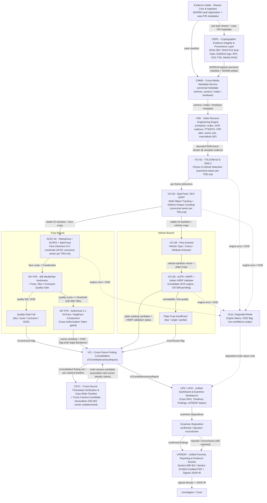
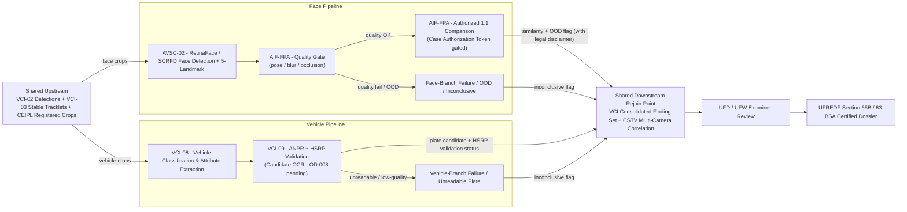

# 1. Document Control

| Field | Value |
| :--- | :--- |
| **Title** | CCTV Visual Intelligence - Architecture Specification |
| **Project** | PS-05 - Digital Evidence Authenticity & Integrity Verification Platform |
| **Version** | 0.1 |
| **Status** | Design Specification - Proposed (capabilities not implemented) |
| **Last Updated** | 2026-05-31 |
| **Audience** | Forensic architects, VISTA engineering, examiners |
| **Scope** | CCTV / visual-intelligence workflow only (see §2 for boundaries and the §4 reference matrix for what is NOT in scope) |
| **Related Documents** | TRD.md, PRD.md, PHASES.md, AI_INSTRUCTIONS.md, archify.config.json, README.md, pyproject.toml |

> **Note on canonical sources:** `PRODUCT_BRIEF.md` and `AGENTS.md` do not exist in this repository. This document was produced exclusively from the remaining canonical documents listed above, with TRD.md as the highest-authority source per `AI_INSTRUCTIONS.md` §1. Where a detail was ambiguous, the corresponding Open Decision (§ Open Decisions) records the question; nothing in this document invents a canonical expansion, license claim, or benchmark value on its own.

---

# 2. Executive Summary

Multi-source surveillance CCTV footage is one of the most frequently ingested evidence classes in PS-05 digital-evidence cases. Investigators working such cases do not need raw analytics output — bounding boxes, embedding dumps, unreviewed OCR strings — they need **traceable, quality-gated person / vehicle / plate findings** that survive Section 65B IEA / Section 63 BSA scrutiny.

## Investigative Problems Addressed

1. **Provenance and integrity.** Seized CCTV exhibits (MP4/MKV/AVI/TS/DAV, DVR exports) must be bit-for-bit verifiable from intake to courtroom via CEIPL dual-hashing, Ed25519 signatures, RFC 3161 TSA tokens, and Merkle-DAG custody.
2. **Multi-source correlation.** The same person or vehicle can appear on cameras that do not share a clock or field of view. Investigators need a *candidate-association* view — explicitly labelled as candidate, never as identity — not a claim of identification.
3. **Person findings.** Reliable person detection, stable multi-object tracking, and — separately — face detection / landmarks / quality-gating and optional authorized 1:1 reference-image comparison.
4. **Vehicle findings.** Vehicle-class / attribute extraction and ANPR *candidate* readings with Indian HSRP syntax validation; authoritative registration-data lookup is out of scope and remains external-authority data.
5. **Reproducibility.** Every finding must trace back to (a) a CEIPL-hash-registered crop, (b) the exact engine run and SHA-256-pinned model checkpoint, and (c) the examiner's disposition in UFD/UFW.
6. **Court admissibility.** A Section 65B IEA / Section 63 BSA certified dossier via UFREDF, with explicit uncertainty annexures and statutory disclaimers, not a bare "matches / doesn't match" verdict.

## Benchmarks and Technical References

| Class | Reference | Role in this document |
| :--- | :--- | :--- |
| **Primary product benchmark** | BriefCam (Milestone) | Commercial CCTV analytics product; capability reference only; NOT a runtime dependency (internal algorithms proprietary, not publicly available) |
| **Processing-framework reference** | NVIDIA DeepStream (with NvDCF bundled tracker; DeepSORT supported as a third-party integration) | GPU video-pipeline framework candidate; platform-specific feature support — do not assume all trackers run on all hardware |
| **Research - face detection** | RetinaFace (Deng et al., CVPR 2020) | Single-shot face DETECTOR + 5 landmarks; a DETECTOR only, not a recognition system |
| **Research - face recognition** | AdaFace (Li et al., ICCV 2024) | Retrieval-oriented, quality-aware embedding; CANDIDATE only, not selected |
| **Research - small-footprint face** | LittleFaceNet | Open-access methodology article; CANDIDATE for benchmarking, not a production choice; availability UNVERIFIED |
| **Research - tracking** | ByteTrack (ECCV 2024 oral), BoT-SORT (CVPR 2022) | Tracker candidates; TRD.md already names both as VCI-03 (and AVSC-02) |
| **Commercial ANPR / vehicle benchmark** | Genetec AutoVu | Capability reference only; NOT a runtime dependency; specifics UNVERIFIED against current official docs |
| **ANPR / OCR candidates** | PaddleOCR PP-OCRv4, Tesseract, EasyOCR, plate-ocr | CANDIDATE - pending evaluation; general OCR alone is not assumed sufficient for ANPR |

Full matrix with capability / integration-role / limitation / licence columns in §4.

## Fit into VISTA's Five Engines

TRD.md §11.1 defines **VISTA** (Video Integrity, Synchronization & Tampering Analysis) with exactly **five** core forensic engines — **VRE**, **AFB**, **AVSC**, **VDF**, **VCI** — and a cross-cutting CCTV Forensic Profile that TRD.md describes as a profile, not a sixth engine. No sixth engine is introduced by this document.

Where this document's proposed heuristic mapping of a capability to an engine differs from TRD.md's assignment, TRD.md's assignment is used in the §5 "Canonical Engine" column and the discrepancy is recorded as an Open Decision. AFB's role in the CCTV *visual* branch is limited to what TRD.md assigns to it (audio extraction & AURAS routing); face and vehicle visual work does not move into AFB by this document.

## What the Final Investigator-Facing Report Contains

Produced by UFREDF into the Section 65B IEA / Section 63 BSA certified dossier (consumed by UFD/UFW for review):

- **Auto findings.** Every raw engine finding (bbox / tracklet / plate candidate / similarity score) with its engine run id, model checkpoint SHA-256, input-crop provenance (CEIPL DAG node), and OOD / uncertainty flag. An auto finding alone is not a conclusion.
- **Examiner-confirmed conclusions.** Examiner dispositions in UFW (`confirmed` / `rejected` / `inconclusive`) linked to each auto finding; the conclusion is the examiner's, not the engine's.
- **Uncertainty annexures.** Confidence intervals, OOD flags, quality-gate fail reasons, and explicit "inconclusive / insufficient evidence" verdicts where warranted.
- **Provenance.** SHA-256/SHA3-512 hashes, Ed25519 signature, RFC 3161 TSA token, Merkle inclusion proof, and the append-only custody chain from CEIPL; C2PA claims where the exhibit carries them.
- **Limitations.** Section 65B / 63 BSA statutory disclaimers: biometric-comparison disclaimers on face-comparison output, authoritative-registration-lookup disclaimers on ANPR output, and OOD / low-quality disclaimers when quality gates fail.

---

# 3. Product Goals and Non-Goals

## Measurable Goal Categories

Metric names are declared below. Values are `TBD - benchmark required` pending evaluation against a validated CCTV corpus; no fabricated accuracy, recall, latency, or throughput numbers appear anywhere in this document.

| Goal Category | Named Metric(s) | Target Value |
| :--- | :--- | :--- |
| Person detection | Precision / Recall on CCTV corpus | TBD - benchmark required |
| Person counting (distinct-unique, not per-frame) | Count MAE | TBD - benchmark required |
| Multi-object tracking | HOTA, IDF1, mean ID-switches per tracklet | TBD - benchmark required |
| Face detection | Recall by face-size bucket (large / medium / small / very-small) | TBD - benchmark required |
| Face comparison (authorized 1:1, calibrated threshold) | FAR / FNR at the calibrated operating point | TBD - benchmark required |
| Vehicle attribute extraction | Attribute accuracy (class, colour, fine-grained type) | TBD - benchmark required |
| ANPR | Character Error Rate (CER) + Exact-Plate Accuracy | TBD - benchmark required |
| Cross-camera candidate association | Candidate-association quality (top-k recall / precision on validated pairs) | TBD - benchmark required |
| End-to-end traceability | % of findings that carry a complete CEIPL DAG lineage from intake hash | TBD - benchmark required |
| Report generation completeness | UFREDF dossier field coverage (findings, uncertainty annexures, examiner dispositions, disclaimers) | TBD - benchmark required |

## Non-Goals (explicit)

- **No identification guarantees under all conditions.** Under low resolution, heavy occlusion, extreme non-frontal pose, or OOD inputs, the system may return "inconclusive"; that is a legally valid result, not a failure mode.
- **No real-time deployment.** This is post-hoc forensic analysis of seized exhibits; no live-stream latency targets are set.
- **No new temporal-verification subsystem.** Multi-camera / cross-source time synchronization uses **CSTV** (Cross-Source Timestamp Verification) exactly as TRD.md already assigns it; this document does not introduce a parallel or successor subsystem.
- **No new reporting subsystem.** Court-dossier production uses **UFREDF** (Unified Forensic Reporting & Evidence Dossier) exactly as TRD.md already assigns it.
- **No authoritative vehicle-registration lookup.** ANPR output is a *candidate* plate reading. Authoritative registration lookups remain in external government data systems and must be cited in the report as external-authority data; the platform stores no authoritative registration data.
- **People-counting, face-detection, and unique-person identification are three different measurements** with different error modes. They are never presented interchangeably in any report, panel, or finding.
- **Similarity scores are never presented as identity probabilities** unless the producing pipeline (AIF-FPA per TRD.md) has undergone Platt calibration / OOD gating on the applicable CCTV cohort. Otherwise the raw cosine similarity is reported with a legal disclaimer and treated as supporting evidence only.

---

# 4. Competitor and Technical Reference Matrix

> **Footnote:** Inclusion in this matrix does not mean the item is selected for production use. Selection is recorded in the relevant OD row (§ Open Decisions).

| Reference | Category | Primary Responsibility | Capabilities Studied | Potential Integration Role | Limitations | Licence / Usage Verification |
| :--- | :--- | :--- | :--- | :--- | :--- | :--- |
| **BriefCam** (Milestone) - <https://www.milestonesys.com/products/briefcam/> | Commercial benchmark | Commercial CCTV analytics product (person, vehicle, plate, behaviour) | Product scope; feature set to compare against; **NOT** a runtime dependency - its internal algorithms are proprietary and not publicly available | Capability reference only; shapes §3 goal categories; defines what "good" looks like | Proprietary; cannot be integrated; its published numbers are not our expected performance | Licence n/a - no code or weights reused |
| **NVIDIA DeepStream** - <https://docs.nvidia.com/metropolis/deepstream/dev-guide/> | SDK / framework | GPU video-inference pipeline framework (multi-stream, multi-tenant, NvDCF bundled tracker, DeepSORT supported as a third-party integration) | Multi-camera parallel processing; model orchestration; platform-specific feature support | Candidate processing framework for the detection + tracking branch; tracker-plugin choice is open (OD-007) | NvDCF bundled; DeepSORT is a **third-party integration** and must be enabled explicitly; **platform-specific feature support - do not assume all trackers run on all hardware** (not all tracker plugins are available on all NVIDIA GPU generations); version-specific API surface | NVIDIA proprietary SDK; permissive development use; commercial deployment requires a valid NVIDIA EULA; confirm target version + GPU SKU against current NVIDIA docs |
| **RetinaFace** (Deng et al., CVPR 2020) | Research model | Single-shot face detector + 5-landmark regression | **Face DETECTOR ONLY** (bounding box + landmarks), NOT a face recognition / identity system | Candidate face DETECTOR feeding the face branch; TRD.md already names RetinaFace / SCRFD as the AVSC-02 detector | Face detector only - not a recognition system; low-res / masked / non-frontal CCTV performance UNVERIFIED | Reference implementation in `insightface` - **check the license of the repository and the license of any pretrained weights separately** (typically MIT for code, separate terms for weights) |
| **AdaFace** (Li et al., ICCV 2024) - <https://github.com/mk-minchul/AdaFace> | Research model | Retrieval-oriented face recognition, quality-aware embedding | Candidate quality-aware face recognition | Candidate for the face-comparison branch; TRD.md's AIF-FPA already names ArcFace/MagFace for authorized 1:1 comparison - AdaFace is a separate candidate to benchmark against these | **CANDIDATE, NOT SELECTED**; code Apache-2.0; **pretrained weights are research / non-commercial per the repo - verify in-repo licence before claiming permissive use**; low-res / masked CCTV performance UNVERIFIED | Apache-2.0 code; research / non-commercial weights - verify in-repo licence before claiming |
| **LittleFaceNet** ("LittleFaceNet: A Small-Sized Face Recognition Method Based on RetinaFace and AdaFace", open-access) - <https://pmc.ncbi.nlm.nih.gov/articles/PMC11766931/> | Research model | Small-footprint face recognition combining RetinaFace + AdaFace | Paper records methodology, datasets, results, and limitations **AS PUBLISHED**; the paper's numbers are **NOT** our expected performance | **CANDIDATE for benchmarking, NOT a production choice**; do NOT call it "RetinaFaceNet" | Weight / implementation availability **UNVERIFIED**; paper-only reference; no claim of code or weights at the stated URL | No licence claim made - verify independently before use |
| **ByteTrack** - <https://github.com/ifzhang/ByteTrack> | Research model / reference implementation | AP-based low-score detection association; ECCV 2024 oral | Multi-object tracker candidate; TRD.md already names ByteTrack as a VCI-03 (and AVSC-02) tracker | Candidate tracker for person / vehicle branches | Tracker choice **PENDING CCTV CORPUS BENCHMARK** against BoT-SORT; not selected | Code Apache-2.0 per repo - verify |
| **BoT-SORT** - <https://github.com/NirAharon/BoT-SORT> | Research model / reference implementation | Adds camera-motion compensation (SPD) + appearance re-ID + motion to DeepSORT-style tracking; CVPR 2022 | Multi-camera-aware tracker candidate; TRD.md already names BoT-SORT as a VCI-03 tracker | Candidate tracker where camera pan/tilt and cross-camera re-ID matter | Tracker choice **PENDING CCTV CORPUS BENCHMARK** against ByteTrack; not selected | Licence per repo - verify |
| **Genetec AutoVu** - <https://www.genetec.com/products/unified-security/autovu> | Commercial benchmark | Commercial ANPR / vehicle analytics platform | Product scope; capability reference; **NOT** a runtime dependency | Capability reference only; informs §3 ANPR goal category | Its internal algorithms are proprietary; capabilities **MUST BE VERIFIED AGAINST CURRENT OFFICIAL DOCS** - specifics marked **UNVERIFIED** | Licence n/a - no code or weights reused |
| **ANPR / OCR candidates** (shortlist to evaluate) | Candidates - pending evaluation | Plate reading + recognition; **general OCR alone is not assumed sufficient for ANPR** - plate-localization + perspective correction + Indian HSRP format validation are also required | PaddleOCR PP-OCRv4 (Apache-2.0, multilingual); Tesseract (Apache-2.0); EasyOCR (Apache-2.0 code - verify current licence); plate-ocr (MIT - verify) | **CANDIDATE - pending evaluation** for the ANPR branch of VCI-09; TRD.md already names PaddleOCR for VCI-05 OSD clock reading (a different, easier task) | All four are candidates, **NOT** production selections; shortlist decision is OD-008; a separate plate-localization + perspective-correction stage may be required in front of the OCR engine | Licence per repo - verify |

---

# 5. Canonical Engine Mapping

> Where this section's proposed heuristic differs from TRD.md's assignment, **TRD.md's assignment is used** in the "Canonical Engine" column and the discrepancy is recorded in § Open Decisions. No sixth engine is introduced by this document; supporting components are external to VISTA's five engines. A capability with no clear owner in TRD.md is marked "owner undetermined - open decision".

| Capability | Canonical Engine (per TRD.md) | Supporting Component | Input | Output | Downstream Consumer |
| :--- | :--- | :--- | :--- | :--- | :--- |
| Video intake / decoding / frame sampling | **VRE** (VRE-01 to VRE-05: container, codec, GOP cadence, PTS/DTS continuity, VFR jitter, scene cuts, macroblock QP re-encoding traces) | CEIPL (pre-decode dual-hashing, WORM registration, provenance); CMMS (container / codec / timebase metadata) | Master video exhibit (MP4/MKV/AVI/TS/DAV) | PTS continuity curve, instantaneous FPS, scene-cut list, decoded RGB frame stream | VCI (detector), VDF (spatial face-context scoring), AVSC (face tracking), UFD/UFW |
| Person + vehicle detection, multi-object tracking, counting | **VCI** (VCI-02 YOLOv8/v10 & SAM 2 detection; VCI-03 ByteTrack / BoT-SORT tracking + distinct-unique people counting) — *initial heuristic in this document said VDF; TRD.md assigns detection/tracking/counting to VCI, not VDF; discrepancy recorded as OD-001* | CEIPL (crop provenance, DAG nodes); CMMS (camera metadata); AIF (image-level supporting forensics on crops) | Decoded RGB frames at sampled cadence | Bounding boxes, segmentation masks, stable-ID tracklets, per-frame object count, distinct-unique person count | VCI (VCI-11 summariser, VCI-12 case RAG), UFD/UFW, UFREDF |
| Face detection / 5-landmark / quality-gating / authorized 1:1 reference-image comparison | **AVSC** (AVSC-02: RetinaFace/SCRFD detection + ByteTrack face tracking, 468-landmark MediaPipe mouth-crop normalization) + **AIF-FPA** (RetinaFace/SCRFD detection, 468 MediaPipe landmarks, pose/blur/occlusion quality scoring, authorized 1:1 ArcFace/MagFace comparison gated by `case_authorization_token`) — *initial heuristic in this document said AFB; TRD.md assigns AFB strictly to audio extraction & AURAS routing; visual face work belongs to AVSC-02 (detection/tracking) and AIF-FPA (quality + authorized comparison); discrepancy recorded as OD-002* | CEIPL (AES-256-GCM encrypted embedding storage; `case_authorization_token` gating; Merkle DAG for crops); CMMS | Decoded RGB frames / face crops + authorized reference image + valid `case_authorization_token` (for comparison) | Landmark coordinates, pose/blur/occlusion quality scores, (when authorized) cosine similarity with legal disclaimer, OOD flag | VDF (spatial face-context scoring), AIF-AIM (face-swap / morph forensics context), UFD/UFW, UFREDF |
| Vehicle classification / attribute extraction + ANPR | **VCI** (VCI-08 fine-grained vehicle type/colour/attribute extractor; VCI-09 separately versioned ALPR / ANPR + Indian HSRP validator) — *initial heuristic in this document said AVSC; TRD.md assigns AVSC to audio-visual time alignment, SyncNet lip-sync, and acoustic-to-visual event matching; vehicle + ANPR work belongs to VCI-08/VCI-09; discrepancy recorded as OD-003* | CEIPL (plate-crop DAG registration); CMMS (camera FOV polygons) | Decoded RGB frames / vehicle crops / plate crops (perspective-corrected) | Vehicle attribute vector (class, colour, fine-grained type), candidate plate-reading string, HSRP syntax validation status, low-quality / unreadable flags | UFD/UFW (examiner review of candidate readings), UFREDF (dossier with authoritative-registration-lookup disclaimer); **NO authoritative registration data is stored in-platform - stays external-authority** |
| Cross-camera / cross-frame / temporal correlation + finding consolidation | **VCI** (VCI search_rag, VCIUnifiedInventoryReport consolidation) + **CSTV** (multi-camera timeline synchronization; cross-camera **candidate association** for person/vehicle is **owner undetermined - open decision** OD-004 - TRD.md references both VCI and CSTV for multi-camera timelines but does not explicitly assign the association work itself) | CMMS (camera FOV polygons & per-camera timestamps); CEIPL (per-exhibit provenance) | Tracklets, OSD clock OCR outputs ($T_{ocr}(t)$), container PTS ($T_{pts}(t)$), per-camera FOV polygons | Synced multi-camera timeline, candidate-association sets (never identity claims), consolidated VCIUnifiedInventoryReport | UFD/UFW (examiner review), UFREDF (Section 65B IEA / Section 63 BSA certified dossier) |

---

# 6. End-to-End Architecture

> Node labels use TRD.md's canonical spellings. Diagrams are authored as Mermaid flowcharts in fenced ` ```mermaid ` blocks, matching the convention used throughout TRD.md §2 and AI_INSTRUCTIONS.md §3. Diagram IDs: `ps05-cctv-full-workflow` (§6.1) and `ps05-cctv-parallel-pipelines` (§6.2). Archify's IR layer (archify.config.json) is a post-processing consumer of structured JSON IR; these diagrams are authored as Mermaid flowcharts, not as Archify IR diagram types (the `cctv-frame-cadence` Archify IR diagram type is out of scope for this draft).

## 6.1 Full End-to-End Workflow (`ps05-cctv-full-workflow`)



## 6.2 Parallel Face + Vehicle Pipelines with Shared Upstream / Downstream (`ps05-cctv-parallel-pipelines`)



---

# Open Decisions (chunk 01)

> IDs OD-001 to OD-009. Status is `Open` for every row; none of these are silently resolved by this document.

| ID | Decision | Impact | Evidence Required | Owner / Role | Status |
| :--- | :--- | :--- | :--- | :--- | :--- |
| OD-001 | Person + vehicle detection, multi-object tracking, and counting: **VCI** (per TRD.md VCI-02/VCI-03) vs **VDF** (per this document's initial heuristic). TRD.md already assigns detection / tracking / counting to VCI and assigns VDF to deepfake / AI-generation detection. This document follows TRD.md (VCI) and records the heuristic's VDF mapping as a discrepancy. | Determines which engine package owns the detection / tracking branch of the CCTV workflow; affects UFD / UFREDF output routing and the engine-attribution fields in the report. | TRD.md §2 component table, TRD.md §11.1 VISTA Architecture diagram, and `ps05/` package layout confirming `ps05.engines.vista.vci` owns VCI-02/VCI-03 code | Forensic Architect + VISTA Engineering | Open |
| OD-002 | Face detection / 5-landmark / quality-gating / authorized 1:1 comparison: **AVSC + AIF-FPA** (per TRD.md AVSC-02 and AIF-FPA) vs **AFB** (per this document's initial heuristic). TRD.md assigns AFB strictly to audio extraction & AURAS routing; the visual face work belongs to AVSC-02 (detection / tracking) and AIF-FPA (quality + authorized comparison). This document follows TRD.md (AVSC + AIF-FPA). | Determines which package owns the face branch; determines whether the face-comparison call is a VISTA engine call or an AIF call; affects the UFD / UFW "Face Findings" panel's engine attribution. | TRD.md §2 AFB row, TRD.md §11 AVSC-02 spec, TRD.md §10.1 AIF-FPA spec, `ps05.engines.vista.avsc.face_track` and `ps05.engines.image.fpa` module layouts | Forensic Architect + VISTA Engineering | Open |
| OD-003 | Vehicle classification / attribute extraction + ANPR: **VCI** (per TRD.md VCI-08/VCI-09) vs **AVSC** (per this document's initial heuristic). TRD.md assigns AVSC to audio-visual time alignment, SyncNet lip-sync, and acoustic-to-visual event matching; vehicle + ANPR work belongs to VCI-08/VCI-09. This document follows TRD.md (VCI). | Determines which engine package owns the vehicle branch; affects the UFD / UFW "Vehicle Findings" panel's engine attribution and the ANPR candidate-OCR choice (OD-008). | TRD.md §2 AVSC row, TRD.md §11 VCI-08/VCI-09 specs, `ps05.engines.vista.vci.vehicle_attributes` and `ps05.engines.vista.vci.alpr` module layouts | VISTA Engineering | Open |
| OD-004 | Cross-camera **candidate association** (person / vehicle across cameras without shared clock or FOV): which VISTA engine + which supporting component owns it? TRD.md assigns multi-camera timeline synchronization to **CSTV** and cross-frame finding consolidation to **VCI**, but the association work itself (matching a person-track on Camera A to a person-track on Camera B under appearance + spatial + temporal constraints) is not explicitly assigned. Candidate owners: VCI (VCI search_rag) with CSTV as supporting, or a new capability inside VCI. This document marks it **owner undetermined - open decision**. | Determines where candidate-association logic lives; determines the "Cross-Camera Candidates" panel in UFD / UFW; determines UFREDF's uncertainty-annexure content for cross-camera claims. | TRD.md §11 VCI spec (VCI search_rag), TRD.md §16.12 CSTV spec, `ps05.engines.vista.vci.search_rag` module layout; a decision on whether association is VCI-native or a VCI + CSTV hybrid | Forensic Architect + VISTA Engineering | Open |
| OD-005 | Face / person / vehicle detector + tracker model & checkpoint selection for CCTV workloads: RetinaFace (AVSC-02), YOLOv8/v10 (VCI-02), ByteTrack vs BoT-SORT (VCI-03), plus (if DeepStream is the processing framework) NvDCF bundled tracker vs DeepSORT third-party integration. No model is selected by this document; selection is pending a validated CCTV corpus benchmark. | Determines every engine's `model_registry` entry (SHA-256-pinned checkpoint, TRD.md §5.10 / RULE 5 invariant); affects OOD gating and quality-threshold calibration. | Validated CCTV corpus (low-res, low-light, occluded, non-frontal, masked) + benchmark run per §3 goal categories; all values `TBD - benchmark required`; no fabricated numbers allowed | VISTA Engineering + CDVF (model calibration / OOD gating per TRD.md §20) | Open |
| OD-006 | Minimum face-quality threshold (pose / blur / occlusion scoring cutoff below which a face crop is not eligible for AIF-FPA 1:1 comparison). | Determines the "quality-gate fail" branch of §6.1 / §6.2 face pipeline; determines how many face findings are reported as "inconclusive / low quality" vs "compared". Value is `TBD - benchmark required` on the CCTV corpus. | ROC analysis on the CCTV face subset: sweep thresholds, measure FAR/FNR, pick the operating point that matches the §3 face-comparison goal category | AIF Engineering + CDVF | Open |
| OD-007 | DeepStream version + target GPU SKU for the detection / tracking branch. TRD.md references DeepStream as a platform-specific framework; NvDCF is bundled, DeepSORT is a third-party integration, and not all tracker plugins are available on all hardware generations. No version or SKU is selected by this document. | Determines which tracker plugin is available; determines the CI / CD GPU image; determines the "platform-specific feature support" caveat in §4. | NVIDIA DeepStream current release notes + target deployment GPU SKU + confirmation of which tracker plugin is available on that SKU | VISTA Engineering + Infrastructure | Open |
| OD-008 | ANPR / OCR candidate shortlist decision: PaddleOCR PP-OCRv4, Tesseract, EasyOCR, or plate-ocr. General OCR alone is not assumed sufficient for ANPR - plate-localization + perspective correction + Indian HSRP format validation are also required. No candidate is selected by this document; all are marked CANDIDATE pending evaluation. | Determines the VCI-09 ALPR implementation; determines the "ANPR candidate" disclaimers in UFREDF; determines whether a separate plate-localization + perspective-correction stage is required in front of the OCR engine. | CER + Exact-Plate Accuracy on a validated Indian-plate corpus (HSRP-compliant plates); plate-localization IoU; perspective-correction MAE; per-candidate licence re-verification | VISTA Engineering | Open |
| OD-009 | TRD.md §2 lists a "VISTA - CCTV Profile" (`ps05.engines.vista.cctv`) alongside the five VISTA engines. TRD.md §11.1 calls it "a cross-cutting CCTV Forensic Profile", not a sixth engine. This document treats it as a **profile / module** (configuration + triage + adaptive questionnaire + clock-drift regression + ONVIF / seal audit) attached to the existing five engines, not a new engine. | Determines whether `ps05.engines.vista.cctv` is a sixth engine (prohibited by §5 of this document - "never add a sixth engine") or a profile / module. If it is a profile, its outputs (CCTV classification confidence, clock-drift curve, native-seal validation) are routed into VCI / CSTV as inputs. | TRD.md §11.1 VISTA Architecture diagram, `ps05/` package layout confirming `ps05.engines.vista.cctv` is a subpackage (profile) not a peer engine to VRE/AFB/AVSC/VDF/VCI | Forensic Architect | Open |
