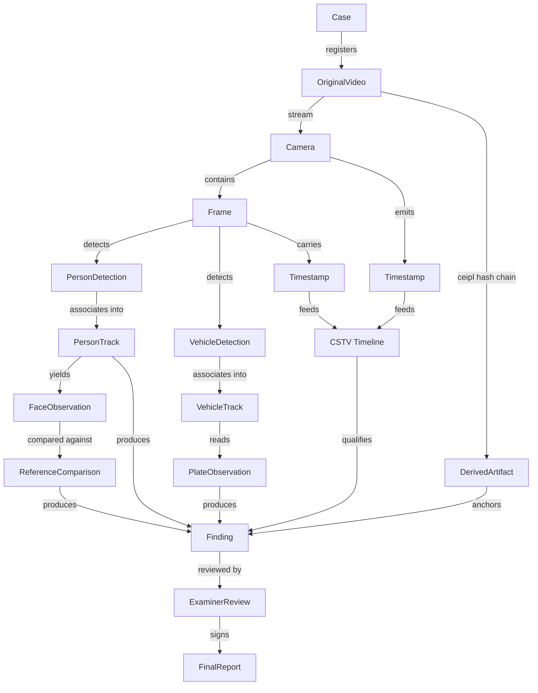

# PS-05 CCTV Architecture — Draft Chunk 02 (Sections 7–9)

> **Status:** DRAFT — this chunk covers Sections 7 (Detailed Engine Specifications), 8 (Input and Output Contracts), and 9 (Cross-Engine Correlation and Evidence Graph) of the proposed CCTV Forensics Architecture document for PS-05. Open items are marked `TBD - benchmark required` for numeric thresholds and collected in `# Open Decisions (chunk 02)` at the end. No numeric threshold in this chunk is a final value; none is fabricated.
>
> **Conventions (per AI_INSTRUCTIONS.md / archify.config.json):**
> - Every derived value is tied to its source evidence via the CEIPL provenance contract (§ 8.7). Decoded frames and crops are WORM-derived artifacts; original evidence is never modified.
> - Similarity and confidence scores are reported as calibrated values with explicit uncertainty; `inconclusive` / `abstained` are first-class decision states, not failure cases.
> - Local-first: all models run locally with pinned, license-audited checkpoints; no cloud inference on the core path.
> - Status markers follow PHASES.md: `PLANNED`, `RESEARCH_REQUIRED`, etc. This entire chunk is `PLANNED` (specification only).

## Canonical acronym table (from TRD.md)

| Acronym | Canonical name (as spelled in TRD.md) | TRD location |
| :--- | :--- | :--- |
| VRE | Video Reverse Engineering Engine (VISTA) | TRD.md §2 I/O table, `ps05.engines.vista.vre` |
| AFB | Audio Forensic Bridge (Extract & Route) (VISTA) | TRD.md §2, `ps05.engines.vista.afb` |
| AVSC | Audio-Visual Synchronization & Correspondence (VISTA) | TRD.md §2, `ps05.engines.vista.avsc` |
| VDF | Video Deepfake & AI-Generation Detection (VISTA) | TRD.md §2, `ps05.engines.vista.vdf` |
| VCI | Video Content Intelligence Engine (VISTA) | TRD.md §2, `ps05.engines.vista.vci` |
| AIF | Advanced Image Forensics Subsystem | TRD.md §2, `ps05.engines.image.*` |
| CMMS | Cross-Media Metadata Service (Universal Metadata Schema, Anomaly Rules) | TRD.md §2 / §16, `ps05.core.*` (shared service) |
| CSTV | Cross-Source Timestamp Verification & Case-Wide Timeline | TRD.md §2 / §12.15 (Pydantic contracts) |
| CEIPL | Cryptographic Evidence Integrity & Provenance Layer | TRD.md §10.B, `ps05.core.crypto` |
| UFREDF | Unified Forensic Reporting & Evidence Dossier (Legal Reporting) | TRD.md §2 / §11.B.16 |
| UFD | Unified Dashboard & Examiner Workbench (Case RAG, Timelines, Findings, UFREDF Status) | TRD.md §2 (architecture graph) |
| UFW | Unified Forensic Workbench (paired with UFD; same workbench component) | TRD.md §2 (architecture graph) |

Note: "UFD / UFW" appear together in TRD.md as one workbench node; they are treated here as a single examiner-facing surface. Where this draft references a platform service without a TRD section, it is cited as "TRD.md VISTA section" and an open decision is raised rather than the name invented.

---

# 7. Detailed Engine Specifications

Each subsection below carries the same 15 numbered fields. Field 15 ("Dependencies & open decisions") collects the OD-xxx references (defined at the end of this file) that apply to the component. Numeric thresholds are marked `TBD - benchmark required` until the CCTV benchmark dataset is defined.

---

## 7.1 Video intake & decoding

1. **Purpose.** Accept the original video exhibit (from the WORM vault), verify its integrity, and produce a memory-bounded, chunked stream of decoded frames plus container/codec telemetry for every downstream engine.
2. **Responsibility boundaries (what it does NOT do).** Does not run detection, tracking, or content analysis. Does not repair, transcode, or normalize the original file. Does not perform audio analysis (that is AFB/AURAS). Does not make custody decisions (CEIPL). Does not interpret timestamps (CMMS/CSTV).
3. **Reference implementations / research.** VRE (Video Reverse Engineering Engine, TRD.md §2: container/codec/GOP/PTS analysis over MP4/MKV/AVI/TS/DAV), the VISTA intake pipeline (defensive demuxer — PyAV/FFprobe in a sandboxed subprocess, per TRD.md §11.7 CCTV profile), and TRD.md §15.12 parser-hardening gates (decompression-bomb and untrusted-container defenses). Supported containers/codecs: `TBD` per project requirements (the TRD.md floor is MP4/MKV/AVI/TS/DAV; the CCTV-specific codec list — e.g. H.265/HEVC DVR streams, MJPEG/NV12 exports — is an open decision, see OD-019).
4. **Input contract.** Read-only reference to the original evidence exhibit: `evidence_id` + CEIPL pre-decode SHA-256/SHA3-512 digests; case authorization context. File opened with POSIX `0400` semantics; any read-through hash must match the recorded digest or the run halts with `HASH_MISMATCH`.
5. **Preprocessing.** Container/codec inspection (bitstream-level probes, no re-encode): codec id, profile/level, timebase, declared/average FPS, VFR flag, GOP structure, duration. FPS/duration extraction from the container's authoritative timing (stream timebase + PTS/DTS), cross-checked against average-frame-rate metadata; discrepancies are recorded, not silently resolved. Corrupt/partially-readable streams: continue decoding the readable portion, emit per-segment read status (`FULL`, `PARTIAL`, `CORRUPT_SEGMENTED`), and never fabricate missing frames.
6. **Processing algorithm.** Sandboxed, memory-bounded decode with a sliding window of decoded frames; long videos are chunked into contiguous decode segments (chunk boundaries aligned to keyframes; chunk length is an open performance parameter, `TBD - benchmark required`). Each frame record carries `frame_id`, source reference (`evidence_id`, stream index), container PTS/DTS, and decode-ordinal index so any frame projects back to source-video + timestamp. CPU fallback is a first-class path (GPU unavailable or OOM ⇒ automatic CPU decode, recorded in run metadata), so no capability in this document depends on a GPU.
7. **Output contract.** `FrameSequence` records: `{frame_id, evidence_id, camera_id, pts/dts, decode_index, decode_status, width/height, pix_fmt}`; `ContainerTelemetry` (codec, timebase, VFR flag, GOP stats, segment integrity map). Frame pixels are registered as derived artifacts (CEIPL-07 lineage); originals are untouched.
8. **Confidence / quality fields.** Per-segment integrity status; VFR-jitter indicator (from VRE cadence analysis); decode-error count per segment; a frame-level `readable=true/false` flag. No probabilistic confidence — integrity is binary per segment.
9. **Error handling.** `HASH_MISMATCH` ⇒ abort run, critical alert. Unreadable container header ⇒ quarantined as `UNREADABLE_EVIDENCE`, still hashable and still reportable as a negative result. Mid-stream decode failure ⇒ record last-good `frame_id`, emit `PARTIAL` status, and mark all downstream results in the affected range as limited. Parser crashes isolated in the sandbox; a crash never takes down the orchestrator.
10. **Resource requirements.** Sandboxed subprocess with memory cap and timeout (values follow the TRD.md parser-hardening gate, `TBD - benchmark required` for video-specific caps). CPU fallback path mandatory; GPU optional acceleration only.
11. **Downstream consumers.** All VISTA content engines (§ 7.2–§ 7.9), AVSC (face tracking over decoded frames), CMMS (timing fields), CSTV (PTS vs OSD-clock regression).
12. **Validation methodology.** Golden-frame equivalence tests (known clips, known FPS/PTS); corrupt-stream corpus (truncated headers, mid-file zero-runs, VFR recordings); memory-cap stress on long videos; original-file non-modification audit (pre/post SHA-256 of the exhibit).
13. **Known limitations.** VFR and DVR export formats make "the" FPS a per-segment value, not a global one. Burned-in OSD clocks are not container timing. Decoder output on genuinely corrupt segments is best-effort; gaps are declared, never filled.
14. **Acceptance criteria.** 100% of frames emitted carry `frame_id` + source reference (traceability invariant). Memory usage bounded by the configured cap on a longest supported video. CPU fallback produces identical frame telemetry modulo decoder version notes. Original exhibit hash unchanged after a full run. Numeric resource caps: `TBD - benchmark required`.
15. **Dependencies & open decisions.** OD-016 (V1 vs later capability split for long-video/codec scope), OD-019 (container/codec support list), OD-017 (contract versioning of `FrameSequence`).

---

## 7.2 Person & vehicle detection

1. **Purpose.** Frame-level open-set detection of persons and vehicles on CCTV frames, emitting structured detection records that tracking (§ 7.3) and downstream counting/classification engines consume.
2. **Responsibility boundaries.** Does NOT identify, count, or track — it only produces per-frame detections. Does NOT guarantee detection of any specific individual or vehicle. Does NOT perform face or plate analysis. Does NOT run across cameras (single-camera, single-run scope).
3. **Reference implementations / research.** VCI-02: YOLOv8/v10 & RT-DETR object detection plus SAM 2 instance segmentation (TRD.md §2 I/O table: input "decoded RGB frames (sampled cadence)", output "object tracklets, bounding boxes"). Categories: `person, car, motorcycle, bus, truck, bicycle, other_justified` — `other_justified` is a closed fallback label requiring an examiner-visible justification string; open-vocabulary extensions come only via VCI-07 object-inventory, not ad hoc.
4. **Input contract.** `FrameSequence` records from § 7.1: `frame_id`, `evidence_id`, `camera_id`, decoded pixel buffer reference, source PTS. Detector model name + version are declared in the run manifest (pinned checkpoint hash).
5. **Preprocessing.** Resize to model input size with documented scaling (never silent letterboxing that shifts coordinates; crop/scale metadata recorded so every bbox projects back to source-frame pixels per the TRD.md coordinate-preservation invariant). Low-illumination frames are flagged, not "fixed" — brightness/blur descriptors are carried in the record.
6. **Processing algorithm.** Per-frame inference at the configured sample cadence (not necessarily every frame — cadence is a run parameter). NMS with a per-class IoU threshold; detections below the run's minimum-confidence floor are suppressed but retained in an audit buffer. Duplicate detections (two bboxes, same object, adjacent frames) are a matter for the tracker, not this stage; this stage reports all qualifying boxes. Small objects and partially visible objects are reported with reduced confidence and a `partially_visible` indicator, never dropped silently. Uncertain class (low top-1 confidence or high top-2 spread) is labeled with `class_uncertain=true` rather than forced into the nearest class.
7. **Output contract.** `DetectionRecord`: `{detection_id, evidence_id, frame_id, source_timestamp (PTS), class_label, bbox [x1,y1,x2,y2], confidence, detector_model_name, detector_model_version, partially_visible, class_uncertain}`.
8. **Confidence / quality fields.** Per-detection class confidence; frame-level `image_quality_flags` (blur, low light, compression artifact) that downstream consumers must consider; `class_uncertain` boolean.
9. **Error handling.** Decode failure on a frame ⇒ skip with a gap record; the tracker sees the gap and handles it. Model checkpoint hash mismatch ⇒ abort (per TRD.md model-registry rule). Insufficient confidence ⇒ record is still emitted (detection with low confidence is a data point, not an error).
10. **Resource requirements.** GPU-accelerated inference path with CPU fallback (independent of § 7.1's decode fallback; both must work). Model memory footprint: `TBD - benchmark required`.
11. **Downstream consumers.** § 7.3 (tracking), § 7.4 (counting), § 7.5 (face region prefilter for person detections), § 7.8 (vehicle crops), § 7.9 (vehicle prefilter for plate search), UFD (bbox overlay on the workbench).
12. **Validation methodology.** Labeled benchmark set drawn from representative CCTV footage (see OD-011): per-class precision/recall/F1 and mAP at multiple IoU thresholds; explicit small-object and occlusion stratified slices; miss-rate reporting by frame quality bucket.
13. **Known limitations.** **Category detectability varies with resolution, distance, occlusion, and illumination — no uniform detection guarantee is made for any category.** A car at 4 px height and a car at 400 px height are different detection problems. Missed detections propagate into every count and track; this is why § 7.4 and § 7.3 report uncertainty explicitly.
14. **Acceptance criteria.** Detection-record schema compliance (all fields present, coordinates project to source pixels). Benchmark metrics on the CCTV dataset meet thresholds `TBD - benchmark required`. `other_justified` usage is always accompanied by a justification string.
15. **Dependencies & open decisions.** OD-011 (detector choice), OD-017 (contract versioning of `DetectionRecord`).

---

## 7.3 Multi-object tracking

1. **Purpose.** Associate frame-level detections (§ 7.2) into temporally coherent tracks within one camera, producing track IDs with documented lifetime, association confidence, and quality — so downstream counting, re-identification, and reporting can reason about "a moving object over time" without confusing it with "an identified person/vehicle".
2. **Responsibility boundaries.** Three distinct tasks are kept explicitly separate: **(a) frame-level detection** (§ 7.2), **(b) within-camera tracking** (this section), **(c) cross-camera re-identification** (§ 7.10). This stage performs only (b). A track ID is a stable label for an object hypothesis within one camera — **a track ID is NOT a verified individual or vehicle**, and no downstream report may assert otherwise.
3. **Reference implementations / research.** Candidates, per TRD.md VCI-03 (ByteTrack / BoT-SORT multi-object trajectory tracker) and AVSC-02 (RetinaFace + ByteTrack for face tracks): **ByteTrack** (low-threshold second-stage matching), **BoT-SORT** (byte-level tracking + camera-motion compensation + reid), **DeepStream NvDCF** (GPU DCF tracker, where a DeepStream pipeline is in scope), and **DeepSORT** (CNN reid gating, where applicable to dense scenes). **Selection process:** run all finalists on the representative CCTV benchmark corpus with metrics **HOTA, IDF1, ID switch rate, and track fragmentation (mean/max track breaks per true object)**; the choice is made on that evidence, recorded in the open-decision log (OD-010), and re-validated on any corpus change. Until selected: `RESEARCH_REQUIRED`.
4. **Input contract.** `DetectionRecord` stream from § 7.2, `FrameSequence` timing (frame_id, PTS), camera id, optional camera calibration (intrinsic/external, where available) for motion-compensation variants.
5. **Preprocessing.** Detections are grouped by camera and sorted by frame; frame gaps from § 7.1 are injected as explicit "no-frames" entries so association across gaps is measured, not assumed.
6. **Processing algorithm.** **Track-id generation:** monotonically increasing per-camera ids, assigned at first confirmed detection (confirmation gate: N consecutive associations — N is a run parameter, `TBD - benchmark required`). **Lifetime:** track has `STARTED / ACTIVE / LOST / TERMINATED` states. **Detection-to-track association:** nearest-neighbor / Hungarian on (IoU + class + appearance) distance; the selected tracker's reid component (if any) gates cross-gap re-association. **Track confidence:** running score = association-confidence EMA plus quality of the underlying detections (low image-quality frames lower track confidence, they do not terminate it). **Missed detection:** bounded `LOST` window (frame budget, `TBD - benchmark required`); within budget the track is re-associable, past it the track is terminated. **Occlusion:** overlapping boxes do not force termination; an occluded track keeps `LOST`-window semantics and an `occlusion_score`. **Termination:** LOST-window expiry, or camera exit with motion consistent with leaving the field of view. **Reappearance:** a new track inside the LOST window of a terminated track may be re-attached only with high association confidence; the re-attachment is recorded, and the original track id is not silently reused for a different object. **Duplicate-track prevention:** duplicate candidates (two tracks with near-identical trajectories) are merged with the merge recorded in the audit buffer; unresolvable duplicates are kept separate and flagged `duplicate_track_suspected`. **ID-switch monitoring:** switches are detected when a track's appearance/reid score distribution shifts across an association; every switch event is recorded with frame id and scores — switches are data, never hidden. **Camera-boundary handling:** tracks are strictly per-camera; at frame boundaries (a person enters camera B after camera A) this stage emits no cross-camera link — that is § 7.10's job, emitted as a *candidate association*, not a merged identity.
7. **Output contract.** `TrackRecord`: `{track_id, evidence_id, camera_id, class_label, state, start_frame_id, end_frame_id, frame_count, avg_association_confidence, id_switch_events[], occlusion_score, duplicate_track_suspected}`.
8. **Confidence / quality fields.** Per-association confidence (per contract § 8.2 `association_confidence`, optional but recommended), track-level average association confidence, id-switch count, fragmentation indicator (breaks per track from the HOTA suite).
9. **Error handling.** Missing frame gap ⇒ LOST-window logic; sustained decode failure ⇒ all affected tracks marked `DEGRADED_TIMING` (uncertainty propagated, per § 7.11). Tracker OOM ⇒ fall back to the CPU variant of the same algorithm or terminate tracks at the failure point with a declared boundary.
10. **Resource requirements.** Tracker memory grows with active-track count; the LOST window caps it. GPU required only for reid components (BoT-SORT/DeepSORT reid embeddings); base IoU tracking is CPU-eligible. `TBD - benchmark required` for concrete caps.
11. **Downstream consumers.** § 7.4 (unique-person estimates from tracks), § 7.10 (tracks are the cross-camera correlation units), § 7.11 (track intervals feed CSTV), UFD (track overlay + switch-event inspection).
12. **Validation methodology.** The OD-010 benchmark: HOTA/IDF1/switch/fragmentation on the CCTV corpus for each candidate; switch-visibility audit (every recorded switch must be reproducible from scores); duplicate-track rate on dense-corridor scenes.
13. **Known limitations.** Track identity degrades with fragmentation; dense crowds break reid gating; a track surviving occlusion is a hypothesis, and id-switches during occlusion are the classic failure — the contract therefore carries switch events as first-class fields. Cross-camera continuity is explicitly out of scope here.
14. **Acceptance criteria.** Schema compliance (§ 8.2); id-switch events recorded for 100% of detected switches on validation corpus; per-track confidence present; `RESEARCH_REQUIRED` until tracker selection (OD-010) is evidenced.
15. **Dependencies & open decisions.** OD-010 (tracker selection pending CCTV benchmark), OD-017.

---

## 7.4 People counting & crowd analysis

1. **Purpose.** Estimate how many people are in, enter, exit, or occupy defined regions of CCTV footage, with explicit uncertainty — and never present a single unsourced number.
2. **Responsibility boundaries.** Does NOT identify individuals (a person-estimate is not a name; a track id is not a verified person). Does NOT detect faces for this purpose. **Never equate face-detection count with people count**: faces are one weak signal among occlusion, back-facing people, children, masks, and detection misses; counting is built on the methods below and reported per method.
3. **Reference implementations / research.** Per TRD.md VCI-03 ("distinct unique person counting vs per-frame count") and IVE-05 people counting: (a) **line-crossing counts** (vector crossing, direction-aware, deduplicated by track); (b) **entry/exit counts** (gate lines on region boundaries, using track in/out events); (c) **region occupancy** (time-integrated presence inside a region, per-frame and per-track views); (d) **unique-tracked-person estimates** (deduplicated track ids over a window, with fragmentation penalty — one true person across track breaks is estimated, not assumed, from reid/appearance consistency); (e) **dense-crowd estimation** via a dedicated crowd-density model (e.g. heat-map density regression, CR-CNN/CrowdCount-lineage research — `RESEARCH_REQUIRED`) because detection+tracking are known to be insufficient at high densities where bodies overlap and reid collapses.
4. **Input contract.** `DetectionRecord` + `TrackRecord` streams, region/line geometry definitions (examiner or auto-suggested, both versioned), frame quality flags from § 7.2.
5. **Preprocessing.** Per-frame quality gating: density estimate and line-crossing counts are only computed where image quality passes the run's quality floor; results below the floor are marked `DEGRADED` rather than omitted.
6. **Processing algorithm.** Each method above produces its own estimate with its own uncertainty. Overlapping bodies: occupied-area vs individual count differ, so density-model output is a head-count estimate with a wider uncertainty band. Partial visibility and multi-directional crowds: line-crossing deduplication uses track identity, so a person crossing twice is counted twice only if the tracks are genuinely separate — fragmentation can overcount and merging can undercount; both risks are stated in the uncertainty. Missed detections bias all methods low; track fragmentation biases unique-person estimates low; people entering/leaving frame bias occupancy low. **Camera placement** (wide vs low-angle, single vs overlapping cameras) is a standing uncertainty term: overlapping cameras need a cross-camera de-duplication step, which is a § 7.10 candidate association, not a count — so multi-camera counts are reported per camera with an explicit overlap note.
7. **Output contract.** Per method: `{method, region_or_line_id, estimate, uncertainty (interval or qualitative band), population (track ids / frame range), quality_flags}`. A single `people_count` field does not exist in the contract; aggregation is the report layer's job, with all method values visible.
8. **Confidence / quality fields.** Uncertainty per estimate (interval preferred, qualitative band where intervals are unjustified); fragmentation factor on unique-person estimates; density-model OOD flag where the crowd density exceeds the model's training range.
9. **Error handling.** Low-quality region ⇒ estimate omitted with `DEGRADED` reason, not zero. Density model OOD ⇒ qualitative band only. Zero detections in a crowded-looking scene is itself a signal: a "0 with low-confidence detections" result is flagged `POSSIBLE_MISDETECTION` rather than reported as an absence of people.
10. **Resource requirements.** Detection/tracking views are light; the dense-crowd model adds one model per frame at the configured cadence. `TBD - benchmark required` for cadence/memory.
11. **Downstream consumers.** UFD (occupancy timeline, count panels with method selector), UFREDF (count statements with the per-method values and uncertainty), § 7.11 (entry/exit events as timeline anchors).
12. **Validation methodology.** Labeled count ground truth on the CCTV corpus: MAE and bias per method, stratified by density, occlusion, and camera angle; fragmentation sensitivity study (known track breaks → count shift).
13. **Known limitations.** No method above is exact at high density; unique-person estimates are lower bounds that depend on tracking quality; face counts are explicitly excluded as a counting basis (see § 7.5) but may be shown as a separate, labeled indicator.
14. **Acceptance criteria.** Per-method outputs with uncertainty fields present on 100% of results; MAE on the benchmark `TBD - benchmark required`; "face count ≠ people count" invariant holds in the report layer (automated schema check that no report field is populated from a face-detection counter).
15. **Dependencies & open decisions.** OD-010 (tracking quality propagates into unique-person estimates), OD-016 (whether dense-crowd modeling ships in V1 or later).

---

## 7.5 Face detection & landmarks

1. **Purpose.** Detect faces and facial landmarks on CCTV frames, produce aligned face crops, and assess each face's usability for the quality-gated comparison stage (§ 7.6–§ 7.7).
2. **Responsibility boundaries.** Does NOT compare faces to any reference (that is § 7.7, gated on § 7.6). Does NOT identify anyone. Does NOT count people (a face detection is not a person). Does NOT enhance images.
3. **Reference implementations / research.** **RetinaFace** is the reference detector (TRD.md AIF-FPA: "RetinaFace/SCRFD face detection, 468 MediaPipe landmarks, pose/blur/occlusion scoring"). This spec adopts RetinaFace + 5-point landmarks (eyes, nose tip, mouth corners) as the baseline; SCRFD is a documented alternate candidate; 468-landmark MediaPipe meshes remain available where AVSC needs them.
4. **Input contract.** Person detections (§ 7.2) used as a region prefilter where cadence allows; otherwise full-frame face detection. `frame_id`, source timestamp, pixel buffer reference.
5. **Preprocessing.** Face-crop generation from the detected bbox with recorded padding; alignment (Euler/affine alignment to canonical 5-landmark pose) with the **crop transformation metadata preserved** (affine matrix, per the TRD.md coordinate-preservation invariant); blur measurement (Laplacian/variance-of-Laplacian family) and effective resolution (face height in px after alignment); occlusion indicators per landmark region (mask area, overlap with bbox edge, hair/hand heuristics); orientation/pose estimate (yaw/pitch/roll proxy from landmark geometry) plus a coarsely estimated head-pose label.
6. **Processing algorithm.** RetinaFace detection at the configured cadence → NMS → landmark regression (5 points) → alignment → quality descriptors: `face_pixel_size`, `blur_score`, `occlusion_indicators[]`, `pose_estimate`, `face_visibility` (fraction of canonical face region unoccluded and inside frame). **Usability assessment:** a face is `USABLE_FOR_COMPARISON` only if it passes all rejection conditions in § 7.6; otherwise it is `USABLE_FOR_RECORDING` (kept, reported, not compared) or `NOT_USABLE`. **Rejection conditions for downstream identity comparison** (all numeric values `TBD - benchmark required`, calibration on the CCTV corpus): minimum pixel size, minimum quality score, maximum occlusion fraction, pose limits (yaw/pitch bounds), minimum blur threshold.
7. **Output contract.** `FaceObservation` (§ 8.3): face bbox in source-frame coordinates + crop artifact id, 5 landmarks, pose estimate, quality fields, `face_model_version`, `derived_artifact_id`. **Source-frame reference (frame_id + timestamp + crop transform metadata) is mandatory on every record.**
8. **Confidence / quality fields.** Detection confidence, `face_quality` composite + its components, occlusion indicators, pose, `usability_state`.
9. **Error handling.** Degraded frames ⇒ faces detected but flagged; the quality gate, not the detector, decides usability. Landmark regression failure on a detected face ⇒ record kept, usability `NOT_USABLE`, reason recorded.
10. **Resource requirements.** RetinaFace-class model on GPU with CPU fallback; landmark regression is cheap. `TBD - benchmark required`.
11. **Downstream consumers.** § 7.6 (quality gate), § 7.7 (comparable-embedding pool), AVSC-02 (face tracks), UFD (face overlay).
12. **Validation methodology.** Face-detection metrics (mAP, miss rate by size bucket) + landmark accuracy on the CCTV corpus (occlusion/pose/blur stratified); alignment-drift audit (crop→source pixel projection, per TRD.md invariant).
13. **Known limitations.** Small distant faces fall below usable pixel sizes — that is a property of the footage, not a defect to paper over. Landmark-based pose estimates are proxies, not metric pose.
14. **Acceptance criteria.** Every `FaceObservation` carries source-frame reference + crop transform metadata (schema check); rejection thresholds exist and are calibration-tracked (not hardcoded magic numbers) once OD-012 is resolved; alignment drift within the TRD.md tolerance.
15. **Dependencies & open decisions.** OD-012 (min face quality threshold, calibration required), OD-016 (5-point vs 468-landmark scope split).

---

## 7.6 Face quality & difficult CCTV conditions

1. **Purpose.** A mandatory quality-gating stage between face observation (§ 7.5) and any biometric comparison (§ 7.7), covering the degraded conditions CCTV footage actually presents.
2. **Responsibility boundaries.** Does NOT perform any comparison. Does NOT alter the original frame or crop. Does NOT turn an unusable face into a usable one by enhancement and then treat the result as observed fact.
3. **Reference implementations / research.** Quality-gating heuristics following the AIF-FPA scoring model in TRD.md (pose/blur/occlusion/quality scoring); enhancement candidates (restoration / super-resolution, e.g. Real-ESRGAN-class or GAN-restoration research — `RESEARCH_REQUIRED`) treated strictly as **derived-artifact generators**, not as observation sources.
4. **Input contract.** `FaceObservation` with its quality descriptors; the original frame + crop artifacts (read-only).
5. **Preprocessing.** Condition detection: low resolution (px size vs gate), motion blur (blur score + frame-pair edge heuristics), defocus, low illumination (luminance histogram), overexposure (clipped highlights), compression artifacts (blockiness/DCT-residue indicators), extreme angles (pose vs gate), partial occlusion (occlusion indicators), masks (coverage heuristics on nose/mouth regions), small faces, long distances.
6. **Processing algorithm.** Score each condition; the face passes only if every gate passes. Enhancement (restoration/super-resolution), when enabled, operates on the crop and produces a **separately stored derived artifact** with: the enhancing model name + config + version recorded, a link to the original frame and crop, and a `DERIVED` marker. **Reconstructed detail is NEVER represented as observed fact**: any metric, finding, or similarity computed on an enhanced artifact is labeled `computed_on_derived_artifact` and carries lower evidentiary weight by default. **Enhancement cannot bypass the quality/confidence gates**: the gates run on the original observation; an enhanced crop of a gate-failing face is a visualization aid only, not a comparison input unless the calibrated (and documented) policy for derived-input comparison says otherwise.
7. **Output contract.** `QualityGateResult`: per-condition scores, pass/fail per gate, overall `QUALITY_OK / QUALITY_DEGRADED / QUALITY_REJECTED` + reason list; optional `enhanced_artifact_id`.
8. **Confidence / quality fields.** The full condition score vector — this is the stage's native output.
9. **Error handling.** Enhancement failure ⇒ the original crop remains the only input; nothing is lost. Undetectable condition ⇒ gate is marked `UNKNOWN_CONDITION` and the face is `QUALITY_REJECTED` by default (fail-closed).
10. **Resource requirements.** Enhancement is the heavy part (GPU-class); it is optional and off by default in V1 (OD-016).
11. **Downstream consumers.** § 7.7 (gate input), UFD (quality panel per face), UFREDF (limitation text generation).
12. **Validation methodology.** Controlled degradation study: real CCTV faces with measured blur/occlusion/size degradation as ground-truth labels; measure gate pass/fail against a "comparison-usable" reference judged on the benchmark; report gate false-accept (bad face passes) and false-reject rates — both are `TBD - benchmark required`.
13. **Known limitations.** No gate separates "low quality" from "unusable for this comparison" perfectly; thresholds are the OD-012 calibration. Masked faces are a population issue for any gate, not a bug.
14. **Acceptance criteria.** 100% of comparisons have a recorded `QualityGateResult`; enhanced outputs are 100% stored as separately hashed derived artifacts with model+config; zero enhanced pixels presented in reports without the `computed_on_derived_artifact` marker.
15. **Dependencies & open decisions.** OD-012, OD-016 (enhancement in V1 or later).

---

## 7.7 Reference-image face comparison

1. **Purpose.** Given authorized reference images for a case and the gate-passing face observations from CCTV (§ 7.5–§ 7.6), compute similarity, decide match / no-match / inconclusive with calibrated thresholds, and route significant results to examiner review.
2. **Responsibility boundaries.** Performs ONLY authorized 1:1-style reference comparisons (TRD.md AIF-FPA: "authorized 1:1 ArcFace/MagFace comparison"; automatic 1:N mass biometric search is prohibited platform-wide). Does NOT output identity claims — outputs similarity and a decision state. Does NOT run without authorization records. **A similarity score is NOT a probability of identity.** No promise of identification from a visually-insufficient face: gate-failed faces never enter this stage, and "could not compare" is a valid, expected outcome.
3. **Reference implementations / research.** **AdaFace** (quality-aware embedding with per-pair uncertainty modeling) and **LittleFaceNet** (super-resolution-in-the-loop low-quality face recognition) are research candidates, **not selections** — adoption requires the TRD.md model-registry process (license audit, checkpoint pinning, benchmark evidence); until then this stage is `RESEARCH_REQUIRED`. Baseline family for calibration: ArcFace/MagFace-class embedding models as specified in TRD.md.
4. **Input contract.** (a) **Reference intake:** authorized reference images per case, with a provenance record (who supplied, when, how) and access-restriction record (which roles may see them). (b) **Reference quality requirements:** minimum resolution, frontal-or-near-frontal pose, clean illumination, no occlusion — enforced at intake, failures are `reference_unusable` and never compared. **Crop requirements:** aligned face crops with recorded transform metadata, identical pipeline class to § 7.5 crops. (c) **CCTV side:** gate-passing `FaceObservation`s with embeddings.
5. **Preprocessing.** Embedding extraction on both sides with the **embedding format + model version recorded per result** (vector dims, L2-normalized or not, model name, checkpoint hash, input size). OOD screening: faces far from the embedding model's training distribution (face-pixel quality out of distribution) are marked `OOD_SUSPECTED` before scoring.
6. **Processing algorithm — the 10-step workflow, exactly as numbered:**
   1. **Authorized reference intake** — references registered with case authorization (TRD.md `case_authorization_token` model; biometric search restricted to authorized cases).
   2. **Provenance + access-restriction record** — supplier, timestamp, legal basis, and role restrictions recorded in the custody layer.
   3. **Reference face detection + quality check** — reference faces detected, aligned, quality-gated; unusable references quarantined with reason.
   4. **Eligible CCTV face observations** — only `QUALITY_OK` observations from § 7.6 are eligible.
   5. **Comparable embeddings** — embeddings extracted on both sides with compatible format/model (mismatch ⇒ `INCOMPARABLE`, not compared).
   6. **Similarity scoring** — cosine similarity (per TRD.md FPA output: "cosine similarity with legal disclaimer"); score is a raw number with its model version attached.
   7. **Validation-based thresholds** — decision against thresholds calibrated on the CCTV benchmark with the false-positive/false-negative operating point chosen per case sensitivity (threshold + `threshold_version` recorded per result; calibration method: ranked-threshold sweep on a held-out, identity-disjoint set, reporting EER/FPR at fixed FAR targets — all target values `TBD - benchmark required`).
   8. **Candidate matches OR inconclusive** — `MATCH_CANDIDATE` / `NON_MATCH` / `INCONCLUSIVE` / `ABSTAINED` (abstained = quality or OOD reason; inconclusive = within the threshold's undecided band). **Out-of-distribution handling:** `OOD_SUSPECTED` results are forced to `INCONCLUSIVE` regardless of score.
   9. **Preserve frames/timestamps/quality** — for every result, the source CCTV frame + timestamp, crop artifacts, quality scores, and reference artifact id are preserved in the CEIPL lineage.
   10. **Examiner review of significant matches** — `MATCH_CANDIDATE` (and any examiner-requested review) routes to the workbench with side-by-side originals; the examiner's status (`ACCEPTED / REJECTED / NOT_REVIEWED`) is recorded and is the only path to a report-level statement. **Human-review requirement:** no report may state identity based on similarity alone; the examiner record is a mandatory field in any report that references a match.
7. **Output contract.** `ReferenceComparison` (§ 8.4) with the decision enum including `INCONCLUSIVE` and `ABSTAINED`; `review_status` initial state `PENDING_EXAMINER`.
8. **Confidence / quality fields.** `similarity_score` (not a probability), `quality_assessment` (both sides), `threshold_version`, `ood_flag`, uncertainty note (per AdaFace-class research: pair-level uncertainty where the chosen model provides it).
9. **Error handling.** Unauthorized request ⇒ hard reject, logged (RBAC violation, not a soft warning). Model version mismatch between sides ⇒ `INCOMPARABLE`. No eligible faces ⇒ `NO_ELIGIBLE_FACES` (a result, not an error).
10. **Resource requirements.** Embedding inference on GPU with CPU fallback; 1:N-free design keeps compute linear in eligible faces × references. `TBD - benchmark required` for batch sizes.
11. **Downstream consumers.** UFD (review queue), UFREDF (with disclaimer + examiner-status text), § 7.10 (a `MATCH_CANDIDATE` is one signal among many for cross-camera association — never the only one).
12. **Validation methodology.** Identity-disjoint benchmark (no shared identities between calibration and test); EER, FPR at fixed FAR, and the undecided-band width recorded; OOD-injection study (out-of-distribution faces must never yield `MATCH_CANDIDATE`).
13. **Known limitations.** Similarity is not identity probability; lighting/angle gaps between a mugshot reference and a CCTV frame are a standing source of both false positives and false negatives; low-quality CCTV faces are, by design, mostly `INCONCLUSIVE`/`ABSTAINED`.
14. **Acceptance criteria.** Every result carries model name + version + threshold version + quality + decision + preservation references (schema check); biometric search restricted to authorized cases with RBAC, auditability, retention controls, and legal safeguards (authorization record, audit log entry, retention class); 100% of `MATCH_CANDIDATE`s carry a review path; disclaimers present in all report renders.
15. **Dependencies & open decisions.** OD-014 (reference-image authorization/retention policy), OD-012 (quality gate feeds eligibility), OD-016 (enhancement-assisted comparison scope), AD candidates (AdaFace/LittleFaceNet) remain `RESEARCH_REQUIRED` pending the model-registry process.

---

## 7.8 Vehicle classification & attribute extraction

1. **Purpose.** For each vehicle track, extract a vehicle-type estimate and visual attributes (make/model/colour/body style/orientation/visible distinguishing features), tied to the exact source frame and timestamp.
2. **Responsibility boundaries.** Does NOT link to registration data (visual attribute estimation is **NOT** authoritative registration data — a colour match is not an owner, a model match is not a plate). Does NOT read plates (§ 7.9 does). Does NOT identify the vehicle's owner.
3. **Reference implementations / research.** TRD.md VCI-08 ("fine-grained vehicle type, colour & attribute extractor") is the canonical home; make/model on regional vehicle lineages is a dataset task (`RESEARCH_REQUIRED` — the regional make/model taxonomy and its versioning are open).
4. **Input contract.** `TrackRecord` + the vehicle crops from detection bboxes (crop pipeline identical to § 7.5's, with transform metadata).
5. **Preprocessing.** Crop selection: representative frames per track (best-quality frames per track — sharpness, size, front/rear orientation), with each attribute result citing the specific frame + timestamp it came from.
6. **Processing algorithm.** Multi-label / multi-head classification: `vehicle_type` (coarse, from the detector class refined), body style, colour (a controlled vocabulary, e.g. `RED/GREEN/…/UNKNOWN`), make, model, orientation (front/rear/side), visible distinguishing features (damages, markings, unusual fitments — free-text + region reference). **Confidence thresholds with explicit `unknown` labels and abstention:** every attribute has a confidence; below the per-attribute floor (each `TBD - benchmark required`) the attribute is emitted as `UNKNOWN` (or, for a model that supports it, `ABSTAINED`) with the reason — the schema does not force a guess.
7. **Output contract.** `VehicleObservation` (§ 8.5) + per-attribute confidence map + source frame/timestamp + `attribute_confidence`.
8. **Confidence / quality fields.** Per-attribute confidence; frame quality flag; `unknown` is a valid value, not an error.
9. **Error handling.** No eligible crop for a track (too short/too occluded) ⇒ `NO_EVIDENCE_FOR_ATTRIBUTES` with the track still reportable by type only.
10. **Resource requirements.** Attribute model inference, GPU with CPU fallback; per-track (not per-frame) cadence keeps cost bounded. `TBD - benchmark required`.
11. **Downstream consumers.** § 7.9 (vehicle crops for plate search), § 7.10 (attributes are cross-camera correlation features), UFD, UFREDF.
12. **Validation methodology.** Regional vehicle benchmark: per-attribute accuracy with the `UNKNOWN` rate reported as a first-class metric (abstention quality: is abstaining the right call, measured by error rate had it guessed instead).
13. **Known limitations.** Distant/occluded vehicles yield mostly `UNKNOWN` attributes; colour is illumination-dependent (white vs overexposed white); make/model granularity is bounded by the training data's regional coverage.
14. **Acceptance criteria.** 100% of attribute values carry confidence + source frame/timestamp; per-attribute accuracy `TBD - benchmark required`; "not authoritative registration data" disclaimer present wherever vehicle attributes are rendered.
15. **Dependencies & open decisions.** OD-016 (attribute depth in V1), OD-017.

---

## 7.9 ANPR (license-plate reading)

1. **Purpose.** Read registration plates from vehicle tracks under CCTV conditions, with a raw/interpreted separation, format validation for Indian registrations, multi-frame aggregation, and explicit handling of conflicting readings.
2. **Responsibility boundaries.** Does NOT verify a plate against a registration database (no authority-DB linkage in-platform; cross-referencing is an examiner/off-platform act). Does NOT resolve ambiguity silently. A plate reading is **evidence of a reading**, not evidence of the vehicle's registration.
3. **Reference implementations / research.** TRD.md VCI-09 ("separately versioned ALPR / ANPR & Indian HSRP validator") is the canonical home; HSRP (High Security Registration Plate) format validation is the documented Indian-format path.
4. **Input contract.** `VehicleObservation` (track + best-frame crops) + full-track frame stream for multi-frame aggregation.
5. **Preprocessing.** Plate-region detection within the vehicle crop → plate crop (transform metadata recorded) → perspective correction (homography from the 4 plate corners; the corrected plate is a derived artifact).
6. **Processing algorithm — 11 stages, exactly as numbered:**
   1. **Vehicle detection** — from § 7.2 (or vehicle-track entry events).
   2. **Plate-region detection** — dedicated plate-detection model on vehicle crops.
   3. **Plate crop** — region crop registered as a derived artifact.
   4. **Perspective correction** — rectify to a frontal plate view; correction quality recorded (residual skew indicator).
   5. **Image-quality assessment** — blur, glare, night-frame flag, compression; quality gates the confidence, never the raw output.
   6. **Character recognition** — plate-OCR model (per- character confusions, e.g. 8/B, 5/S, 0/O, are first-class outputs).
   7. **Plate-format validation (Indian registration formats)** — validate against the Indian state-code format + HSRP validator (TRD.md VCI-09); invalid readings are kept with `validation_status=INVALID_FORMAT`, never auto-repaired.
   8. **Confidence estimation** — per-character and whole-plate confidence; below floor ⇒ `LOW_CONFIDENCE` with the character-confusion set.
   9. **Multi-frame reading aggregation** — all frame-level readings for a track are pooled; consensus and its stability over time are computed; **conflicting readings are preserved with their alternatives and flagged for review** — the aggregator never silently picks a winner, and **never silently corrects uncertain characters**.
   10. **Vehicle-to-plate association** — the plate observation is bound to the `vehicle_track_id` (and the specific frames/timestamps used).
   11. **Evidence linking & reporting** — raw OCR output and the interpreted value are stored separately (see contract § 8.6), both linked to the vehicle track, frames, and CEIPL artifacts, then routed to UFD/UFREDF with the `review_status` field.
   **Condition handling:** blurred / partially visible / glare / night / skewed / occluded / motion-blurred / compressed / unsupported-format / conflicting — every condition has an explicit disposition recorded in `validation_status` + `review_status`, none is dropped.
7. **Output contract.** `PlateObservation` (§ 8.6): `raw_ocr_text`, `interpreted_plate_text`, per-character + whole `ocr_confidence`, `validation_status` (`VALID / INVALID_FORMAT / CONFLICTING / LOW_CONFIDENCE`), alternatives list, `review_status`.
8. **Confidence / quality fields.** Per-character confidences, character-confusion sets, whole-plate confidence, quality flags, conflict count.
9. **Error handling.** No plate region detected ⇒ `NO_PLATE_DETECTED` (a result). Plate outside Indian formats (foreign/irregular) ⇒ read as-is, `OUT_OF_FORMAT`, never forced into a template.
10. **Resource requirements.** Two models (plate detection + plate OCR), GPU with CPU fallback; multi-frame aggregation is cheap. `TBD - benchmark required`.
11. **Downstream consumers.** § 7.10 (plate readings are the strongest cross-camera vehicle signal, but still a signal, not a fact), UFD (readings + alternatives + confidence panel), UFREDF, examiner cross-reference workflow.
12. **Validation methodology.** Regional plate corpus (states, HSRP, night, glare, blur strata): per-character CER, whole-plate accuracy, conflict-rate, and "silent-correction" audit (0 auto-corrections by construction, verified by test).
13. **Known limitations.** Distant/obscured plates are unreadable — that's an input limit, not a bug. Conflicting readings from one vehicle can persist across the whole recording; the contract's job is to surface them, not resolve them.
14. **Acceptance criteria.** Raw and interpreted values always stored separately (schema check); 100% of `CONFLICTING` readings carry alternatives + review flag; whole-plate accuracy on the benchmark `TBD - benchmark required`.
15. **Dependencies & open decisions.** OD-013 (ANPR implementation choice + Indian/HSRP format coverage for V1), OD-017.

---

## 7.10 Cross-camera & cross-frame correlation

1. **Purpose.** Build candidate associations between objects observed in different cameras / different recordings of the same event, using calibration, known locations, synchronized time, and appearance similarity — always as hypotheses with uncertainty, never as asserted identity.
2. **Responsibility boundaries.** **Same-camera tracking (done in § 7.3) and cross-camera candidate association (this section) are kept strictly separate** — no shared id space between them. **A cross-camera match NEVER automatically establishes same person/vehicle**: the output is a candidate association with its supporting evidence and uncertainty; only examiner confirmation (or, in-report, a clearly-labeled "candidate" phrasing) can state identity across cameras.
3. **Reference implementations / research.** Appearance-similarity correlation using the § 7.5/§ 7.7 embedding infrastructure (reuse, don't duplicate), plus spatio-temporal feasibility reasoning (a person cannot be in two non-adjacent locations within the travel time implied by camera geometry). No new research required beyond the model-registry process for the embedding choice (OD-010's outcome informs the appearance side).
4. **Input contract.** Correlatable items: **person tracks** (§ 7.3), **face observations** (§ 7.5), **vehicle tracks** (§ 7.8), **plate readings** (§ 7.9), **timestamps** (§ 7.11 via CSTV), **camera ids + location metadata** (where known), **entry/exit events** (§ 7.4), and **related evidence items** (other case exhibits).
5. **Preprocessing.** Time normalization: all timestamps are expressed in the case's time model with their uncertainty attached (from § 7.11); camera location/calibration data (where it exists) is registered as case metadata.
6. **Processing algorithm.** **Camera calibration** (intrinsic + relative placement where surveyed) supports geometric feasibility; **known locations** support adjacency rules; **time synchronization** (CSTV outputs, with clock-reliability indicators) bounds the time-window in which a re-identification is even possible; **appearance similarity** (embeddings from § 7.7's infrastructure, run cross-camera here) ranks candidates. Every association candidate carries: the features used (list, not a black box), per-feature similarity/confidence, the spatio-temporal feasibility check result (`FEASIBLE / IMPOSSIBLE / UNCHECKED`), and the propagated uncertainty (feature uncertainty × time uncertainty). **Uncertainty propagation is documented per candidate.** Plate readings get privileged handling: two HSRP readings of the same format across cameras is strong *evidence*, still phrased as a candidate association, never auto-identity.
7. **Output contract.** `CrossCameraCandidateAssociation`: `{candidate_id, item_a, item_b (evidence + track/face/plate ids), feature_set, per_feature_scores, spatio_temporal_check, propagated_uncertainty, decision_state (CANDIDATE / INCONCLUSIVE / IMPOSSIBLE_BY_TIME), examiner_status}`.
8. **Confidence / quality fields.** Per-feature scores + aggregate candidate score + feasibility check + uncertainty envelope.
9. **Error handling.** Missing time sync data ⇒ `UNCHECKED` feasibility (the candidate still surfaces, labeled as time-unconstrained). Missing calibration ⇒ geometry reasoning degrades to location-level reasoning, recorded.
10. **Resource requirements.** Embedding cross-products are O(N²) over eligible items; the candidate pool is bounded by camera-pair windows (a camera only correlates with adjacent cameras in a defined span) — `TBD - benchmark required` for pair-span defaults.
11. **Downstream consumers.** UFD (association explorer), UFREDF (candidate phrasing rules), § 7.11 (association windows are timeline features), examiner review.
12. **Validation methodology.** Labeled cross-camera corpus (known same-person/same-vehicle pairs + impostor pairs): candidate-ranking quality (precision@k), feasibility-check catch rate on impossible pairs (geometry must reject them), and an identity-overstatement audit of report phrasing (0 unconfirmed identity statements across cameras).
13. **Known limitations.** Without calibration/location data, correlation is appearance-only and weaker; occlusion-heavy CCTV degrades the appearance signal; dense crowds produce many plausible candidates by construction — the contract's job is to keep them hypotheses.
14. **Acceptance criteria.** 100% of cross-camera statements in contracts/reports carry `candidate`/`inconclusive` states until `EXAMINER_CONFIRMED`; feasibility checks recorded on 100% of candidates; no auto-identity path exists in the schema (structural, not procedural, guarantee).
15. **Dependencies & open decisions.** OD-015 (cross-camera feasibility subset for V1 — which features ship first), OD-010, OD-017.

---

## 7.11 Temporal correlation

1. **Purpose.** Make every time-based statement in the CCTV pipeline honest about which clock it came from and how reliable that clock is — **by integrating with CSTV (Cross-Source Timestamp Verification & Case-Wide Timeline), not by creating a temporal subsystem of its own.** This section defines what the CCTV side *supplies to* CSTV and how it consumes CSTV's outputs.
2. **Responsibility boundaries.** No new timeline engine, no new clock models, no new timestamp classes — all of that lives in TRD.md §12.15 (CSTV contracts) and §16.4 (CMMS's 14 timestamp semantic classes). This stage's job: emit well-formed CSTV observations and consume CSTV decisions. **Never assume CCTV clocks are accurate or synchronized**: every camera clock is treated as a clock with an estimated offset/drift (`CLOCK_OFFSET_ESTIMATED` / `CLOCK_DRIFT_ESTIMATED` states per the CSTV `TemporalDecisionStateEnum`), and no cross-camera time comparison is made without a CSTV-validated clock model or an explicit uncertainty envelope.
3. **Reference implementations / research.** TRD.md §12.15 (CSTV Pydantic contracts: `TemporalObservation`, `EventAnchor`, `ClockCalibrationModel`, `TimeUncertainty`), §16.4 (CMMS timestamp semantic classes including `OVERLAY_DISPLAY_TIME` for burned-in OSD clocks, `RECORDER_SYSTEM_TIME`, `PROCESSING_TIME`), §16.5.3 (video timing: rational timebase invariants, PTS/DTS separation).
4. **Input contract.** From the CCTV side into CSTV: **source timestamps** (container PTS/DTS per frame), **frame timestamps** (decode-ordinal + PTS), **timezone where available** (OSD clock zone, NTP-synced recorder claim — recorded as claims, `OPERATOR_REPORTED`/`EMBEDDED_CLAIM` class, never as verified), **camera-clock reliability indicators** (OSD-clock OCR readings vs container time — the OSD-vs-PTS regression that TRD.md already routes VCI/CCTV OCR output into CSTV), **recording-window metadata** (recorder session start/end per `RECORDING_START`/`RECORDING_END`), and **processing-time info** (when each engine result was produced, `PROCESSING_TIME`). **Timestamp uncertainty** accompanies every observation (the CSTV `TimeUncertainty` model).
5. **Preprocessing.** The four timestamp kinds are classified explicitly and kept distinct in every record — **original recording timestamps** (recorder/OSD), **embedded metadata timestamps** (container atoms, sidecars), **file-system timestamps** (inode/NVR export), **processing timestamps** (engine execution). No record may collapse two of these into one field (the CMMS non-collapsing invariant).
6. **Processing algorithm.** (a) Emit one `TemporalObservation`-shaped record per timestamp source with parser id/version, semantics class, precision, and uncertainty. (b) Where OSD OCR is available, supply the regression pairs (OSD clock value, container PTS at the same frame) that CSTV uses for clock-drift models. (c) Consume CSTV `ClockCalibrationModel`s and `TemporalDecisionStateEnum` states: time-window feasibility checks in § 7.10 use CSTV-validated windows, not raw clock subtraction. (d) Recording-window metadata (gaps in coverage, session boundaries) is attached to the timeline so "nothing happened between 14:02 and 14:11" is never conflated with "no recording exists 14:02–14:11".
7. **Output contract.** Per-engine: `TemporalObservation` records (CSTV schema, verbatim), recording-window records, and — for consumers — every time-bearing result in § 8 carries the timestamp + its semantic class + uncertainty, never a bare float.
8. **Confidence / quality fields.** `TimeUncertainty` (value/unit/status: `KNOWN`/`ESTIMATED`/`UNKNOWN`), CSTV decision state per camera clock, OSD-vs-PTS residual (the reliability indicator).
9. **Error handling.** Undecodable OSD clock ⇒ absent, not zero; a missing clock source is a recorded absence. Unvalidated clock models are not used for feasibility checks (they produce `UNCHECKED`, per § 7.10's handling).
10. **Resource requirements.** Negligible (bookkeeping + OCR output already produced by the CCTV profile's OSD-reading path).
11. **Downstream consumers.** CSTV (directly), § 7.10 (feasibility windows), UFREDF (time statements with their stated uncertainty and clock class), UFD (timeline view with clock-reliability indicators).
12. **Validation methodology.** Synthetic clock-drift study (known ppm offsets across cameras) → CSTV must recover them; four-kind classification audit (every timestamp in a corpus carries exactly one semantic class, none mixed); "assumed-accurate-clock" regression test — any pipeline result that would change under a 30-minute clock offset must be flagged by the check.
13. **Known limitations.** OSD OCR fails on damaged/dark OSDs — clock reliability is then `UNKNOWN`, and § 7.10's feasibility degrades accordingly. Multi-camera systems with genuinely unsynchronized clocks are correlated only within each clock's uncertainty envelope; that is a floor, not a bug.
14. **Acceptance criteria.** 100% of time-bearing records carry semantic class + uncertainty + parser provenance; zero bare-timestamp fields in § 8 contracts; "CCTV clocks are not assumed accurate or synchronized" invariant holds structurally (no code path in the spec compares raw clock values across cameras directly).
15. **Dependencies & open decisions.** OD-018 (provenance schema alignment with CEIPL), OD-016 (OSD-clock OCR scope in V1).

---

# 8. Input and Output Contracts

Versioned, machine-readable contracts. Each example is a fenced JSON block with a `schema_version` field; field sets are exactly as specified. Enums are shown by value; the permitted values are listed in the block's comment fields.

## 8.1 `detection_result`

```json
{
  "schema_version": "1.0.0-draft",
  "detection_id": "det-000123",
  "case_id": "case-2026-00042",
  "evidence_id": "ev-vid-000007",
  "analysis_run_id": "run-2026-0701-0003",
  "frame_id": "ev-vid-000007.s0.f001148",
  "timestamp": {
    "value": 3426.733,
    "unit": "SECONDS_FROM_STREAM_START",
    "semantic_class": "FRAME_PRESENTATION_TIME",
    "uncertainty": { "value": null, "unit": "MILLISECONDS", "status": "KNOWN" }
  },
  "class_label": "person",
  "bounding_box": [412, 287, 498, 511],
  "confidence": 0.87,
  "model_name": "yolov8-xygh",
  "model_version": "8.2.1+sha256:9f2c...",
  "partial_justification": null
}
```

Permitted `class_label` values: `person`, `car`, `motorcycle`, `bus`, `truck`, `bicycle`, `other_justified` (the last requires `partial_justification` to be a non-null string).

## 8.2 `tracking_result`

```json
{
  "schema_version": "1.0.0-draft",
  "track_id": "trk-ev000007-cam02-000141",
  "evidence_id": "ev-vid-000007",
  "camera_id": "cam-02",
  "frame_id": "ev-vid-000007.s0.f001148",
  "timestamp": {
    "value": 3426.733,
    "unit": "SECONDS_FROM_STREAM_START",
    "semantic_class": "FRAME_PRESENTATION_TIME",
    "uncertainty": { "value": null, "unit": "MILLISECONDS", "status": "KNOWN" }
  },
  "class_label": "person",
  "bounding_box": [412, 287, 498, 511],
  "track_status": "ACTIVE",
  "association_confidence": 0.92
}
```

`track_status` enum: `STARTED`, `ACTIVE`, `LOST`, `TERMINATED`, `DEGRADED_TIMING`. `association_confidence` is optional (omit when the tracker does not score the association) — its absence must be meaningful, and every record that omits it carries the tracker's version in the run manifest. **A `track_id` is not a verified individual** (see § 7.3); report layers must phrase track references accordingly.

## 8.3 `face_observation`

```json
{
  "schema_version": "1.0.0-draft",
  "face_observation_id": "fov-000881",
  "evidence_id": "ev-vid-000007",
  "frame_id": "ev-vid-000007.s0.f001148",
  "timestamp": {
    "value": 3426.733,
    "unit": "SECONDS_FROM_STREAM_START",
    "semantic_class": "FRAME_PRESENTATION_TIME",
    "uncertainty": { "value": null, "unit": "MILLISECONDS", "status": "KNOWN" }
  },
  "bounding_box": [430, 300, 471, 352],
  "landmarks": {
    "left_eye": [441, 318],
    "right_eye": [459, 318],
    "nose_tip": [450, 332],
    "mouth_left": [443, 344],
    "mouth_right": [457, 344]
  },
  "face_quality": {
    "composite_score": 0.61,
    "components": { "blur": 0.55, "illumination": 0.80, "occlusion_fraction": 0.12, "pose_offset_deg": 24.0, "pixel_size": 52 },
    "usability_state": "USABLE_FOR_RECORDING"
  },
  "occlusion_indicators": ["partial_edge_occlusion"],
  "face_model_version": "retinaface-0.9.4+sha256:3a1d...",
  "derived_artifact_id": "art-fov-000881-crop"
}
```

**Note:** raw biometric embeddings are **NOT** included in ordinary reports (TRD.md §5.3: encrypted storage only, never in unencrypted report payloads). Embedding vectors exist only in the access-controlled store; `face_observation` carries references (`derived_artifact_id`) and quality, never the vector.

## 8.4 `reference_comparison`

```json
{
  "schema_version": "1.0.0-draft",
  "comparison_id": "cmp-000042",
  "reference_asset_id": "ref-00012",
  "face_observation_id": "fov-000881",
  "model_name": "adaface-candidate",
  "model_version": "0.1.0-research+sha256:77b1...",
  "similarity_score": 0.74,
  "threshold_version": "thr-v2026-07",
  "quality_assessment": {
    "cctv_side": "QUALITY_OK",
    "reference_side": "QUALITY_OK",
    "ood_suspected": false
  },
  "decision": "MATCH_CANDIDATE",
  "limitations": [
    "similarity_score is not a probability of identity",
    "cctv face: yaw estimate 24 deg, 52 px height",
    "threshold calibrated on held-out identity-disjoint set (see thr-v2026-07 record)"
  ],
  "review_status": "PENDING_EXAMINER"
}
```

`decision` enum: `MATCH_CANDIDATE`, `NON_MATCH`, **`INCONCLUSIVE`**, **`ABSTAINED`**, `INCOMPARABLE`, `NO_ELIGIBLE_FACES`. `review_status` enum: `PENDING_EXAMINER`, `EXAMINER_CONFIRMED`, `EXAMINER_REJECTED`, `NOT_REVIEWED`. `INCONCLUSIVE` (undecided band, or OOD-forced) and `ABSTAINED` (quality/ineligibility reason) are first-class states: a comparison that cannot decide is a valid result, reported as such.

## 8.5 `vehicle_observation`

```json
{
  "schema_version": "1.0.0-draft",
  "vehicle_observation_id": "veh-obs-000210",
  "evidence_id": "ev-vid-000007",
  "frame_id": "ev-vid-000007.s1.f004400",
  "timestamp": {
    "value": 9866.2,
    "unit": "SECONDS_FROM_STREAM_START",
    "semantic_class": "FRAME_PRESENTATION_TIME",
    "uncertainty": { "value": null, "unit": "MILLISECONDS", "status": "KNOWN" }
  },
  "vehicle_track_id": "trk-ev000007-cam05-000077",
  "vehicle_type": "car",
  "make_estimate": "UNKNOWN",
  "model_estimate": "UNKNOWN",
  "colour_estimate": "WHITE (overexposure-risk)",
  "attribute_confidence": {
    "vehicle_type": 0.95,
    "make": 0.31,
    "model": 0.22,
    "colour": 0.58
  },
  "model_version": "vehattr-1.0.0-draft+sha256:1c9e..."
}
```

`UNKNOWN` is a permitted value for every estimate field (abstention below the per-attribute floor, § 7.8). Visual attributes are **not** authoritative registration data.

## 8.6 `anpr_result`

```json
{
  "schema_version": "1.0.0-draft",
  "plate_observation_id": "pl-000102",
  "vehicle_track_id": "trk-ev000007-cam05-000077",
  "frame_id": "ev-vid-000007.s1.f004412",
  "timestamp": {
    "value": 9876.8,
    "unit": "SECONDS_FROM_STREAM_START",
    "semantic_class": "FRAME_PRESENTATION_TIME",
    "uncertainty": { "value": null, "unit": "MILLISECONDS", "status": "KNOWN" }
  },
  "plate_crop_artifact_id": "art-pl-000102-crop",
  "raw_ocr_text": "BH 12 AB 8B45",
  "interpreted_plate_text": "BH12AB8B45",
  "ocr_confidence": {
    "per_character": [0.98, 0.97, 0.95, 0.99, 0.96, 0.90, 0.93, 0.97, 0.41, 0.97, 0.98, 0.95],
    "whole_plate": 0.89,
    "low_confidence_characters": ["position 8: 'B' (confusion set {B,8,D}), conf 0.41"]
  },
  "validation_status": "VALID",
  "alternatives": [
    { "text": "BH12AB8D45", "reason": "character 8 B/D confusion at low light" }
  ],
  "model_version": "anpr-in-hsrp-0.3.0-draft+sha256:5e0a...",
  "review_status": "PENDING_EXAMINER"
}
```

`raw_ocr_text` (the model's verbatim output) and `interpreted_plate_text` (normalized/validated form) are **separate fields by contract** — never merged. Uncertain characters are never silently corrected; conflicting readings appear in `alternatives` and `review_status` stays `PENDING_EXAMINER` until an examiner acts. `validation_status` enum: `VALID`, `INVALID_FORMAT`, `CONFLICTING`, `LOW_CONFIDENCE`, `OUT_OF_FORMAT`, `NO_PLATE_DETECTED`.

## 8.7 Evidence & provenance (CEIPL-aligned)

This contract reuses the existing CEIPL provenance machinery (TRD.md §4.3 DDL + §10.B specs): `artifacts`, `derived_artifact_lineage` (CEIPL-07: parent/child SHA-256 + transform operator + affine matrix), `custody_events` (CEIPL-05: hash-chained event log), and the RFC 8785 canonical manifest + Ed25519 signature (CEIPL-01/02/03). **No competing schema is invented here**; findings and derived artifacts attach to that layer.

Every finding in § 8.1–§ 8.6 links to the following provenance record:

```json
{
  "schema_version": "1.0.0-draft",
  "finding_id": "find-000077",
  "ceipl_evidence_reference": "sha256:2f9a...c3",
  "original_evidence_id": "ev-vid-000007",
  "source_frame": "ev-vid-000007.s1.f004412",
  "source_timestamp": {
    "value": 9876.8,
    "unit": "SECONDS_FROM_STREAM_START",
    "semantic_class": "FRAME_PRESENTATION_TIME"
  },
  "artifact_id": "art-pl-000102-crop",
  "artifact_sha256": "sha256:88ab...",
  "lineage_ref": "derived_artifact_lineage: art-pl-000102-crop -> ev-vid-000007 (transform_operator=CROP, affine_matrix=[...])",
  "analysis_run_id": "run-2026-0701-0003",
  "model_versions": { "anpr": "anpr-in-hsrp-0.3.0-draft+sha256:5e0a...", "vehattr": "vehattr-1.0.0-draft+sha256:1c9e..." },
  "processing_status": "COMPLETED",
  "examiner_review_status": "PENDING_EXAMINER"
}
```

Invariants (from TRD.md §10.B / §5.3): the chain is hash-chained and append-only; derived artifacts never modify the original; the original exhibit digest re-verifies at report time, and any mismatch produces `HASH_MISMATCH` — a hard failure, never a passing verdict (`VERIFICATION_INCONCLUSIVE` at best, per TRD.md §5.11). See OD-018 for the remaining alignment work with the finalized CEIPL schema.

---

# 9. Cross-Engine Correlation and Evidence Graph

## 9.1 Evidence graph



Node mapping to contracts: `Frame` = § 8.1 timing frame; `PersonDetection` = § 8.1 `detection_result`; `PersonTrack` = § 8.2 `tracking_result`; `FaceObservation` = § 8.3; `ReferenceComparison` = § 8.4; `VehicleDetection` / `VehicleTrack` = § 8.1 `car`/`truck` class + § 8.5; `PlateObservation` = § 8.6; `Timestamp` = § 8.7 temporal records (CSTV/CMMS classes); `DerivedArtifact` = CEIPL-07 lineage nodes; `Finding` / `ExaminerReview` / `FinalReport` = the § 8.7 provenance record + UFREDF. Edge labels are relationship types; every edge carries, in the data (not just in this diagram), source, supporting evidence, and uncertainty — the diagram shows the topology, the contract records the epistemics.

## 9.2 Epistemic classes

Every finding, observation, and statement in the pipeline belongs to exactly one epistemic class. Reports must label which class a statement is in.

| Class | Meaning | Examples |
| :--- | :--- | :--- |
| **Directly observed evidence** | Sensing from the original pixels/metadata, no generative model in the causal path | Container PTS values, frame pixels, decoded telemetry, OSD-OCR readings, custody-event hashes |
| **Model-generated observations** | Outputs of a model over observed data; uncertain by construction | Detections, tracks, plate reads, face qualities, vehicle attributes |
| **Correlation hypotheses** | Inferences linking two model observations; always candidates until confirmed | Cross-camera candidate associations, track re-attachment, multi-frame plate consensus, timeline feasibility |
| **Examiner-confirmed conclusions** | The only class permitted to state identity or "happened at time T" in a report | Examiner-accepted match, examiner-confirmed association, signed report statement |

Demotion rule: a report statement may only sit in a class *at least as strong* as the evidence actually behind it — an examiner may confirm a hypothesis into a conclusion; the pipeline may not promote a model observation into a conclusion on its own.

## 9.3 Binding rules (structural invariants)

1. **No identity merge on appearance alone.** Two identities (person or vehicle) are never merged on face similarity, clothing, or general appearance similarity alone. A merge requires at least one independent signal class (e.g. a valid plate reading, an examiner-confirmed association with its documented rationale) and is recorded as a correlation hypothesis until an examiner confirms it.
2. **No causal claim from temporal proximity alone.** Timestamp proximity between two events does not establish that one caused or accompanied the other — this mirrors the CSTV "Prohibition of Causal Assertion Invariant" (TRD.md §12: temporal consistency is evidence of chronological relationship only). Reports phrasing events in time must use chronological language, not causal.
3. **Every relationship carries source, supporting evidence, uncertainty.** Structural requirement on the graph: an edge without its three fields is an invalid graph state (schema check at build time).
4. **Track ID ≠ person. Plate ≠ owner. Similarity ≠ probability.** Repeated here because the report layer is where these collapse into overstatements: track, plate, and similarity are hypothesis-level objects (classes 2–3), and only class 4 may assert identity.
5. **Time statements carry clock class + uncertainty** (§ 7.11); a statement "event X at time T" without T's clock model and uncertainty envelope is invalid.

---

# Open Decisions (chunk 02)

| ID | Decision | Impact | Evidence Required | Owner/Role | Status |
| :--- | :--- | :--- | :--- | :--- | :--- |
| OD-010 | Tracker selection (ByteTrack vs BoT-SORT vs DeepStream NvDCF vs DeepSORT) pending CCTV benchmark on HOTA/IDF1/ID-switch/fragmentation | § 7.3–§ 7.4, § 7.10 quality; track fragmentation propagates into every unique-person estimate and cross-camera candidate pool | Representative CCTV benchmark corpus (dense, occluded, VFR, multi-camera); full metric run per candidate | VISTA engineering lead | OPEN |
| OD-011 | Person/vehicle detector choice (YOLOv8 vs YOLOv10 vs RT-DETR class) on the same CCTV corpus | § 7.2; detection floor sets every downstream miss rate | Per-class + small-object stratified benchmark results on the corpus | VISTA engineering lead | OPEN |
| OD-012 | Minimum face quality threshold (pixel size, quality score, occlusion, pose limits) | § 7.5–§ 7.7 eligibility gate; determines the abstention rate of comparisons | Calibration study: gate false-accept/false-reject against the benchmark's "comparison-usable" reference | Biometric module owner | OPEN |
| OD-013 | ANPR implementation + Indian/HSRP format coverage for V1 | § 7.9; `validation_status` behavior and the alternatives policy | Plate corpus across states (night, glare, blur strata); CER/whole-plate accuracy + conflict rate | VCI owner | OPEN |
| OD-014 | Reference-image authorization & retention policy (retention class, access RBAC, audit log fields, legal basis per case type) | § 7.7 legal viability; custody layer records | Legal review (Section 65B IEA / 63 BSA fit), policy document, custody-event mapping | Legal + platform security owner | OPEN |
| OD-015 | Cross-camera feasibility subset for V1 (which features: plate readings, appearance, time windows — and which stay later) | § 7.10 scope; candidate-pool size and compute | Feasibility study on labeled cross-camera pairs; camera calibration/location data availability survey | VISTA architecture owner | OPEN |
| OD-016 | V1 vs later capability split (long-video/chunking params, dense-crowd model, enhancement stage, OSD-OCR depth) | Sizing of the whole chunk; acceptance-criteria timing | PHASES.md milestone alignment; benchmark evidence for each deferred feature | PM + VISTA lead | OPEN |
| OD-017 | Contract versioning policy (schema_version semantics, breaking-change rules, coexistence windows for § 8.x) | All § 8 consumers; report reproducibility | Versioning RFC (semver-for-contracts rule), migration test corpus | Platform schema owner | OPEN |
| OD-018 | Provenance schema alignment with CEIPL — finalize § 8.7 fields against the CEIPL DDL once the CEIPL schema is frozen | § 8.7, every finding's link | Final CEIPL DDL + § 10.B specs; field-mapping table, no new competing schema | CEIPL owner | OPEN (TRD.md § 4.3/§ 10.B contract taken as-is where defined; gaps listed above) |
| OD-019 | Container/codec support list (beyond the TRD.md floor of MP4/MKV/AVI/TS/DAV; e.g. H.265 DVR, MJPEG/NV12 exports) + resource caps for § 7.1 | § 7.1 intake scope; sandbox caps | Codec inventory of the expected seizure corpus; memory-cap stress runs | VISTA intake owner | OPEN |
