# 10. Investigator-Facing Search and Reporting

## 10.1 Investigator Workflow (UFD Presentation Layer, UFW Examiner Interface)

This section integrates with the **Unified Forensic Evidence Dashboard (UFD)** and its
practitioner interface, the **Unified Forensic Workbench (UFW)** — the shared
presentation, navigation and investigation-workflow layer for PS-05 (TRD § 20). The
UFD/UFW is a read-only consumer plane: it does not implement forensic detection,
calculate inferences, or act as an evidence vault. It securely consumes authoritative
records produced by backend subsystems and coordinates the examiner's investigation
workflow against them (TRD § 20, `ps05.presentation`).

For CCTV evidence, the examiner interface operates over the video forensics outputs
produced by the VISTA subsystem (TRD § 11, § 20): the **VCI Engine**
(`ps05.engines.vista.vci`) supplies object/vehicle detection, ByteTrack-based
tracking, unique-people counting, PaddleOCR OSD-clock extraction and video taxonomy;
the **ALPR/ANPR** capability (`ps05.engines.vista.vci.alpr`, TRD § 11.6, VCI-09, a
separately versioned plate reader with an Indian HSRP validator) supplies plate text
and alternative readings. All of this is presented through UFD/UFW and consumed from
`CMMS` (metadata context, TRD § 16) and `CSTV` (temporal verification, TRD § 12.15,
§ 15.6).

### 10.1.1 Searchable Attributes

The UFD/UFW examiner interface exposes the following searchable attributes, each
backed by a backend engine's durable state and never by in-flight broker state
(TRD § 20.11 — a backend being down must never corrupt what the BFF read):

- **Person detections in time ranges** — person-tracklets and sampled-detection
  intervals from `ps05.engines.vista.vci.detector`, addressable by camera and time
  window (VCI-07).
- **Candidate matches against authorized reference images** — 1:1 face comparisons
  against case-scoped reference sets, released only where the active
  `case_authorization_token` permits (TRD § 15.2, § 15.1, Information Disclosure
  row); zero unsupervised 1:N mass matching.
- **Vehicle type / make / model / colour** — attribute classifications derived from
  the VCI hierarchical video taxonomy and object detector (TRD § 11.6.1, § 11.6.2).
- **Plate text, including alternative readings** — ANPR/ALPR output with a ranked
  alternative-reading set and per-character confusions (`ps05.engines.vista.vci.alpr`).
- **People-counting results** — unique-person counts from `ps05.engines.vista.vci`
  (ByteTrack unique-people counting).
- **Camera-specific events** — per-camera scene cuts, OSD-clock OCR logs, PTS/DTS
  cadence anomalies (VISTA VRE/VCI; TRD § 11).
- **Cross-camera candidate observations** — cross-source candidate correlations
  surfaced via the `CSTV` case-wide timeline (TRD § 12.15, § 15.6).
- **Low-quality / inconclusive detections** — OOD-gated, low-SNR and low-QP
  frames carrying an explicit `INCONCLUSIVE_LOW_QUALITY` / `INCONCLUSIVE_OOD`
  outcome (TRD § 15.4, § 11.8 CDVF OOD gating) rather than a silent guess.
- **Processing errors and incomplete analyses** — terminal task failures,
  dead-lettered stages and recorded `PARTIAL_SUCCESS` gaps, each linked to its
  `TaskRecord` and error-class taxonomy (TRD § 23.10; `ps05.core.task_record`,
  `ps05.core.dlq`).

Every result — detection, candidate match, plate reading, count, event, correlation
or error — links to its **source footage, timestamp and evidence artifacts**: the
master exhibit SHA-256 digest, the raw presentation timestamp, and the CEIPL derived
artifact lineage record (TRD § 15.5, § 15.8; CEIPL-07 lineage DAG).

### 10.1.2 Examiner Review → Annotation/Confirmation → Report Generation

```mermaid
flowchart LR
    subgraph UFW_REVIEW["UFW Examiner Review"]
        A["Search &amp; filter CCTV detections"]
        B["Examine result - source footage and timestamps"]
        C["Review candidate matches and ALPR readings"]
        D["Review low-quality and inconclusive results"]
    end
    subgraph UFW_ANNOTATE["Examiner Annotation and Confirmation"]
        E["Annotate and confirm findings"]
        F["Record examiner annotations and dual-signature"]
    end
    subgraph UFR_COMPILE["UFREDF Report Compilation"]
        G["Compile 14-section report"]
        H["Bind to CEIPL provenance and evidence artifacts"]
        I["Certified Section 65B / 63 BSA dossier"]
    end
    A --> B
    B --> C
    C --> D
    D --> E
    E --> F
    F --> G
    G --> H
    H --> I
```

### 10.1.3 Report Content — the 14 Required Sections

Report generation integrates with **UFREDF** (TRD § 16.12, § 11.B.16 —
"Unified Forensic Reporting & Evidence Dossier"; compiles the statutory
Section 65B IEA / Section 63 BSA certified dossier). **No new reporting
subsystem is introduced**; this section only defines the content contract the
UFREDF report builder must emit. The report MUST contain exactly these 14
sections:

1. **Case & evidence references**
2. **Evidence-integrity status (CEIPL)**
3. **Source-video metadata (CMMS)**
4. **Processing configuration**
5. **Person & vehicle observations**
6. **People-counting methodology & limitations**
7. **Face observations & comparison results (only where authorized)**
8. **Vehicle attributes & ANPR results**
9. **Cross-camera & temporal correlations (CSTV)**
10. **Confidence, quality, uncertainty**
11. **Processing failures & omitted analyses**
12. **Examiner review & annotations**
13. **Model & software provenance**
14. **Final findings & limitations**

Two hard invariants govern the report (TRD § 15.2, § 15.5):

- **Automated vs. examiner-confirmed distinction.** Every section separates
  automated engine findings (VCI/ALPR/ByteTrack/OCR/face-comparison outputs) from
  examiner-confirmed conclusions (examiner annotations, dual-signature approvals).
  The examiner's dual-signature and timestamp-server counter-signature are recorded
  on the final dossier (TRD § 15.1, Repudiation row).
- **Traceability to source artifacts.** Every claim, finding, diagnostic curve and
  annexure binds cryptographically to the master exhibit SHA-256 digest, raw integer
  presentation timestamps and software-environment commit hashes
  (TRD § 15.5, § 15.6, § 15.8 traceability invariants; CEIPL-07).

# 11. Security, Privacy, and Evidence Integrity

This section states the CCTV-specific security requirements and **references** the
canonical security architecture in **TRD § 15 (Security Architecture, Threat Model
& Legal Invariants)** rather than re-stating it. The canonical anchors cited below
are authoritative; where this section finds a gap or a control not yet mapped, it is
recorded as an open decision (see "Open Decisions, chunk 03").

## 11.1 Canonical Security References

- **STRIDE threat matrix and platform-level defenses** — TRD § 15.1
  (mTLS/JWT + signed audit logs; WORM + Merkle custody; unprivileged worker
  sandboxes with seccomp/AppArmor and read-only root filesystems; per-worker
  cgroup and decoding-timeout quotas).
- **Legal compliance baseline** — TRD § 15.2 (Section 65B IEA / Section 63 BSA
  2023 custody fields).
- **Security objectives & control baseline** — TRD § 15.9 (SEC-001 protection
  scope; SEC-002 baseline = OWASP ASVS 5.0.0 plus OWASP 2025 LLM risk list; all
  controls are `PLANNED` until verified by an executed test, § 15.21).
- **CCTV frame-integrity & temporal invariants** — TRD § 15.5 (CFITSA).
- **Model-governance invariants** — TRD § 15.4 (CDVF).
- **Evidence-integrity & custody invariants** — TRD § 15.8 (EIV).
- **Geospatial privacy & air-gap invariants** — TRD § 15.3.

## 11.2 CCTV-Specific Security Requirements

Mapped to the canonical section above; each is a *reference*, not a re-specification.

1. **Authorized access to reference images.** Case-scoped access to face/vehicle
   reference sets via RBAC and active `case_authorization_token`; every read,
   release and comparison is written to the append-only audit log
   (TRD § 15.1, Information Disclosure row; § 15.9 SEC-001 biometric-templates
   protection class).
2. **Biometric search restricted to authorized cases, with auditability and retention
   controls.** 1:1 matching against a judicially authorized case only; zero 1:N
   mass surveillance; feature blobs AES-256-GCM encrypted; retention of
   biometric comparisons bounded and logged (TRD § 15.1, § 15.9).
3. **Sensitive-data protection.** Victim/suspect media and bystander crops
   protected at rest (AES-256-GCM) and in transit (ephemeral pre-signed URLs,
   max 15 min); anonymized bystander crops by default (TRD § 15.1, § 15.9).
4. **Evidence retention.** Original exhibits retained in WORM storage
   (POSIX `0400` / S3 Object Lock); retention governed by EIV and the statutory
   custody fields (TRD § 15.8; CEIPL-10).
5. **Model & configuration provenance recorded per run.** Each `TaskRecord`
   captures `model_version` and `configuration_version`; findings bind to software
   commit hashes (TRD § 15.5, § 15.8; `ps05.core.task_record`).
6. **Secure processing of UNTRUSTED video files.** Untrusted CCTV media is
   demuxed/decoded inside unprivileged, isolated workers with cgroup memory
   ceilings and decode timeouts; container-allocation caps; **no execution of
   embedded content** (TRD § 15.1 Denial-of-Service / Elevation rows; § 15.5
   invariants 2–4). Worker isolation and resource limits are provided by the
   Celery worker pool (`ps05.workers.celery_app`) and the orchestrator's task
   model (`ps05.core.orchestrator`).
7. **Source / derived-artifact separation.** Original exhibits are never mutated;
   every derived artifact (frames, crops, OCR text, reports) is registered in the
   CEIPL Merkle DAG with parent digests and transform matrices (TRD § 15.5,
   § 15.8 invariants 1, 5; CEIPL-07).
8. **Integrity verification.** Pre-decode dual hashing, fixity re-verification,
   Merkle inclusion proofs and fail-closed quarantine on mismatch
   (TRD § 15.8; CEIPL-01/04/05/06/10).
9. **Reproducibility & traceability.** Re-running under an unchanged
   idempotency key yields a distinct-but-consistent record; every finding is
   replayable from durable checkpoints and outbox events
   (TRD § 23.4, § 23.7; `ps05.core.idempotency`, `ps05.core.checkpoints`).

## 11.3 Face-Matching Scope & Presentation Constraint

- **Face matching occurs only within authorized workflows** (judicial
  `case_authorization_token`, 1:1 scope). No unsupervised 1:N biometric search.
- **Similarity scores, automated detections and any enhancements are NEVER
  presented as independently verified facts.** They are reported as engine outputs
  with calibrated confidence and uncertainty, and every such figure is
  examiner-confirmed before it can appear as a conclusion
  (TRD § 15.4 invariants 6–7, § 15.5 invariant 3, § 15.8 invariant 3).

## 11.4 Gaps Identified Against the Canonical Security Spec

The mapping above exposed controls that TRD § 15 does not yet bind to a
CCTV-specific requirement; these are recorded as open decisions OD-025..OD-027
below (security-control mapping, biometric retention, sensitive-data retention).

# 12. Performance and Resource Management

All performance targets in this section are marked **TBD - benchmark required**. No
numeric performance target is asserted until it is measured (TRD § 15.4
immutability of historical evaluation artefacts; CDVF benchmark-runner discipline).
This section builds exclusively on the **existing orchestration architecture**
verified in `ps05/` — no new queue, broker, database or workflow engine is
introduced (any such addition requires a recorded architecture decision, see
OD-021..OD-024 below).

## 12.1 Existing Orchestration Components (Verified)

The performance model is expressed entirely in terms of these named components:

- **`ps05.core.orchestrator` — `WorkflowEngine`.** The single shared orchestration
  surface: investigation planning, DAG-based task dispatch (`dispatch_ready`),
  readiness/blocking, terminal-failure aggregation and partial-success
  settlement. Fan-in nodes (e.g. `CSTV`, `AGG`) tolerate a recorded gap and
  report `PARTIAL_SUCCESS` rather than a false `ANALYSIS_COMPLETED`.
- **`ps05.core.task_record` — `TaskRecord` / `platform_task_records`.** One
  durable row per DAG node per analysis generation; carries `worker_id`,
  `lease_expires_at`, `heartbeat_at`, `attempt_number`/`max_attempts`,
  `model_version` and `configuration_version`.
- **`ps05.core.leases` — worker leases & Stale-Task Reaper.** A live
  `platform_task_lease` is acquired in the same transaction as the move to
  `CLAIMED` (REO-007); the reaper finds expired leases on `CLAIMED`/`RUNNING`
  tasks, marks them `WORKER_LOST` and reassigns under the same idempotency key.
- **`ps05.core.checkpoints` — durable stage checkpoints / `platform_checkpoints`.**
  A stage completes only when its output is persisted, digest-verified and lineage
  linked in one transaction (REO-010); a recovered task resumes from its last
  completed checkpoint, never from in-memory progress (REO-009). Canonical
  checkpoints include `cp_video_chunk`, `cp_frame_sampling`,
  `cp_model_inference_batch`, `cp_finding_normalization`,
  `cp_report_compilation`.
- **`ps05.core.outbox` — transactional outbox / `platform_outbox`.** Business
  write + outbox-event insert in one call site; a `PENDING`-but-undelivered row
  is a first-class, redriveable state, never silently dropped.
- **`ps05.core.dlq` — dead-letter queue & quarantine (REO-008).** Tasks that
  exhaust their retry budget or fail with a *permanent* error class are parked
  with full failure evidence; redrive is a deliberate, dual-control, operator-only
  action.
- **`ps05.workers.celery_app` — Celery worker pool.** At-least-once delivery
  (`task_acks_late`, `worker_prefetch_multiplier=1`); bounded per-workload retry
  budgets live in `TaskRecord.max_attempts`, not a global `max_retries`.
  Broker/result backend is `settings.redis_url` (Redis).

## 12.2 Engineering Requirements

Each requirement is stated against the components above; concrete numbers are
`TBD - benchmark required`.

- **Long CCTV recordings.** Process the master bitstream via the `cp_video_chunk`
  and `cp_frame_sampling` checkpoints in bounded chunks; a run spanning hours of
  footage advances stage-by-stage so partial progress is durable. Target throughput
  for long recordings — **TBD - benchmark required.**
- **Multiple concurrent streams.** Concurrent cases/streams share the Celery
  worker pool; concurrency is bounded by `celery_concurrency` and per-task
  admission. Target concurrent-stream capacity — **TBD - benchmark required**
  (see OD-022).
- **Bounded frame buffers.** Decoded RGB frames held in memory are bounded; buffer
  size and the streaming-decode rate are set so a single stream cannot exhaust the
  worker. Buffer cap — **TBD - benchmark required.**
- **Chunked processing.** Long inputs are split into fixed work chunks, each
  committed through `cp_video_chunk`/`cp_model_inference_batch` before the next is
  admitted, enabling checkpoint-granular idempotency. Chunk size — **TBD -
  benchmark required.**
- **CPU/GPU worker pools.** Distinct pool classes for CPU-bound (parsing, OCR,
  counting) and GPU-bound (detection, face comparison) inference; routing is by
  engine, per the TRD § 1 engine-to-package mapping. Pool sizing — **TBD -
  benchmark required** (see OD-021, OD-023).
- **GPU memory management.** Streaming decode with bounded batch sizes keeps the
  GPU working set under the device limit; batch size and the decode-window length
  are chosen so inference and decode do not contend for VRAM. Batch cap — **TBD -
  benchmark required** (see OD-023).
- **Model loading & reuse across cases.** Checkpoints are loaded once per worker
  process and reused across cases; re-loading is avoided by keeping models warm.
  Reload overhead and cross-case reuse gain — **TBD - benchmark required.**
- **Backpressure.** When downstream (GPU inference, outbox publishing) saturates,
  the orchestrator admits work at a controlled rate; a `PENDING` outbox row is the
  durable backpressure signal rather than unbounded queue growth. Backpressure
  thresholds — **TBD - benchmark required.**
- **Cancellation.** An examiner or operator-initiated cancellation moves a task to
  `TaskState.CANCELLED` (a terminal state in the `WorkflowEngine` model) and stops
  further dispatch; already-committed checkpoints are retained. Target cancel
  latency — **TBD - benchmark required.**
- **Worker recovery.** A lost worker's expired lease is reaped by the Stale-Task
  Reaper and the task reassigns under the same idempotency key from its last
  checkpoint (REO-007, REO-009). Recovery time / reprocessing cost — **TBD -
  benchmark required.**
- **Partial success.** Fan-in nodes report `PARTIAL_SUCCESS` (never a false
  `ANALYSIS_COMPLETED`) when a required input failed; the report's
  "Processing failures & omitted analyses" section (14th report-section group, § 10.1.3)
  surfaces the recorded gap. Behaviour is correct by construction; observed
  frequency — **TBD - benchmark required.**
- **Resource exhaustion.** Cgroup memory ceilings and decode timeouts on
  untrusted media (TRD § 15.1, § 15.5) bound a single stream; exhaustion triggers
  a terminal, permanent-class failure parked to the DLQ with full evidence.
  Exhaustion thresholds — **TBD - benchmark required.**
- **Graceful shutdown.** On worker shutdown, in-flight tasks that have not
  committed are re-leasable via the lease mechanism; no committed checkpoint is
  lost. Target drain time — **TBD - benchmark required.**

# 13. Evaluation and Benchmarking

This is a test/evaluation *plan*. **No fabricated benchmark results appear here,
and no published model score is presented as this system's expected accuracy.**
Every target number is **TBD - benchmark required** until measured in the CDVF
deterministic benchmark runner (TRD § 15.4, CDVF-06 / CDVF-100).

## 13.1 Evaluation Metrics Table

| Capability Area | Metric | Dataset/Protocol | Notes |
| :--- | :--- | :--- | :--- |
| Person & vehicle detection | Precision, recall, class-wise mAP; small-object recall; performance under varying illumination | TBD - benchmark required (surveillance-footage test set) | All target values TBD - benchmark required; measure small-object and low-illumination slices separately. |
| Tracking | HOTA, IDF1, ID switches, fragmentation, counting error | MOT/ByteTrack's own eval protocol + public tracking sequences | ByteTrack protocol (see § 13.2); counts must reconcile to VCI unique-people counting. |
| Face detection | Precision/recall overall and by face size, occlusion, low illumination, landmark quality | WIDER FACE (difficulty tiers) | WIDER FACE is a difficulty-tiered face-detection benchmark; record tier-wise results. |
| Face comparison | False-match rate, false-non-match rate, ROC/DET curves, performance by image-quality level, threshold calibration, abstention rate, surveillance-footage subset | Market-1501 / MSMT17 (re-ID) + a held-out CCTV subset | 1:1 only, authorized cases; calibration split is independent (TRD § 15.4 invariant 3). |
| Vehicle classification | Per-attribute accuracy, confidence calibration, unknown-class handling | TBD - benchmark required | Include explicit "unknown class" handling and calibrated confidence. |
| ANPR | Character error rate, exact-plate accuracy, by illumination/blur/angle/plate quality, vehicle-to-plate association accuracy | Indian plate reading dataset — license terms to be verified (see § 13.2, OD-020/OD-028) | If the dataset is not cleared, mark TBD - benchmark required and do not rely on it. |
| End-to-end | Latency, resource consumption, partial-failure behavior, recovery after interruption, evidence-to-finding traceability | Synthetic + real CCTV corpus, run through `ps05.core.orchestrator` | Numbers all TBD - benchmark required; traceability measured against CEIPL DAG provenance. |

## 13.2 Dataset Shortlist (with USE-TERMS flags)

Each dataset lists its use-terms status. **No dataset is relied upon until its
license is verified; where verification is pending the plan is held at TBD -
benchmark required.**

- **MOT / ByteTrack own eval protocol + public tracking sequences** — public
  tracking evaluation protocol. *USE-TERMS: verify public-research use rights
  of each sequence before benchmarking.*
- **WIDER FACE** — difficulty-tiered face-detection benchmark. *USE-TERMS:
  check license and download terms.*
- **Market-1501 / MSMT17** — person re-identification. *USE-TERMS: both
  require agreeing to research-use terms; verify.*
- **Indian plate reading dataset (e.g. an "Indian Number Plates" dataset on
  Kaggle)** — candidate ANPR evaluation corpus. *USE-TERMS: UNVERIFIED — must be
  verified and recorded before reliance (OD-020 / OD-028). If not cleared, mark
  TBD - benchmark required and do not depend on it.*

**Cross-dataset constraints to record per dataset:**

- **Demographic coverage** — note the population/attribute distribution and any
  coverage gaps; face/ANPR results must be reported by demographic slice, not
  just overall.
- **Domain gap (lab vs. CCTV)** — public datasets are largely not real CCTV
  surveillance footage; lab/CCTV domain gap must be recorded and a CCTV subset
  held out for the surveillance-specific target.
- **Licensing constraints** — record the exact license, redistribution limits and
  any non-commercial / research-only restriction per dataset.

## 13.3 Rules (Binding)

1. **No fabricated benchmark results.** No number in this plan is asserted.
2. **No published-model score presented as our system's expected accuracy.**
   Published scores may only appear as cited references, clearly labelled, never
   as this platform's target.
3. **Every target number is "TBD - benchmark required"** until measured by the
   CDVF deterministic benchmark runner (TRD § 15.4).
4. **Leakage and calibration discipline.** Train/val/test/calibration splits
   remain disjoint at source-group-key level; calibration is never fitted on the
   held-out test set (TRD § 15.4 invariants 2–3).

# Open Decisions (chunk 03)

| ID | Decision | Impact | Evidence Required | Owner/Role | Status |
| :--- | :--- | :--- | :--- | :--- | :--- |
| OD-020 | Evaluation dataset selection and license clearance | § 13 benchmarks cannot be run or reported on a non-cleared dataset; ANPR corpus unresolved | Verified use-terms for each dataset in § 13.2; sign-off on research-use licenses | Benchmark/CDVF owner | OPEN |
| OD-021 | DeepStream hardware/platform support matrix | Determines which decode/inference paths are actually deployable; affects GPU pool design in § 12 | Supported GPU/vcodec list + compatibility report | Platform owner | OPEN |
| OD-022 | GPU vs CPU deployment targets | Sets pool-class mix and per-pool sizing for § 12 | Deployment topology + measured throughput per class (benchmark) | Platform owner | OPEN |
| OD-023 | Concurrent-stream capacity targets | Fixes the concurrent-stream upper bound and backpressure thresholds in § 12 | Load benchmark under target stream count (benchmark required) | Performance owner | OPEN |
| OD-024 | Report retention requirements | § 11.2(4) evidence retention; interacts with WORM/§ 15.8 and statutory custody | Legal retention schedule + storage class | Legal/compliance owner | OPEN |
| OD-025 | Examiner review SLA expectations | § 10 examiner workflow; sets review turnaround and dual-signature timing | Agreed SLA + audit-log capability | Workflow owner | OPEN |
| OD-026 | Security-control mapping to canonical security spec (gaps found in § 11.4) | § 11.2 controls not yet fully bound to TRD § 15 | Mapping table § 11.2 → § 15 subsections; any unmapped control | Security owner | OPEN |
| OD-027 | Biometric & sensitive-data retention controls | § 11.2(2),(3); bounds retention of face/vehicle embeddings | Retention policy + AES-256-GCM scope confirmation | Security/compliance owner | OPEN |
| OD-028 | Which ANPR candidate dataset survives license review | § 13.2 Indian-plate dataset; governs ANPR evaluation feasibility | License-verification result for the Indian plate dataset | Benchmark owner | OPEN |
| OD-029 | Final dataset shortlist after demographic/domain-gap review | § 13.2 coverage constraints; prunes datasets that fail domain-gap or coverage | Documented demographic + domain-gap + licensing assessment | Benchmark owner | OPEN |
