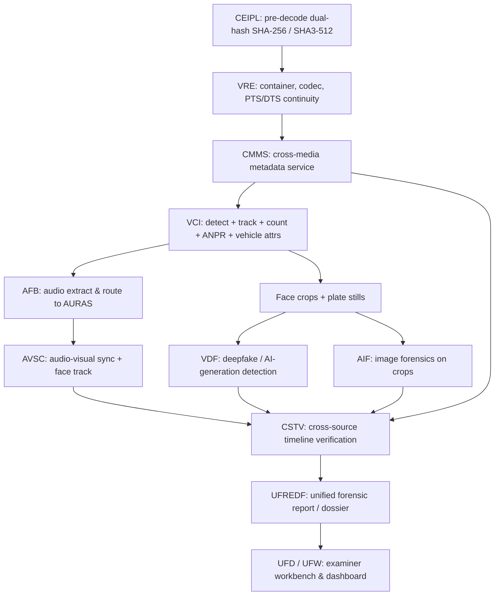
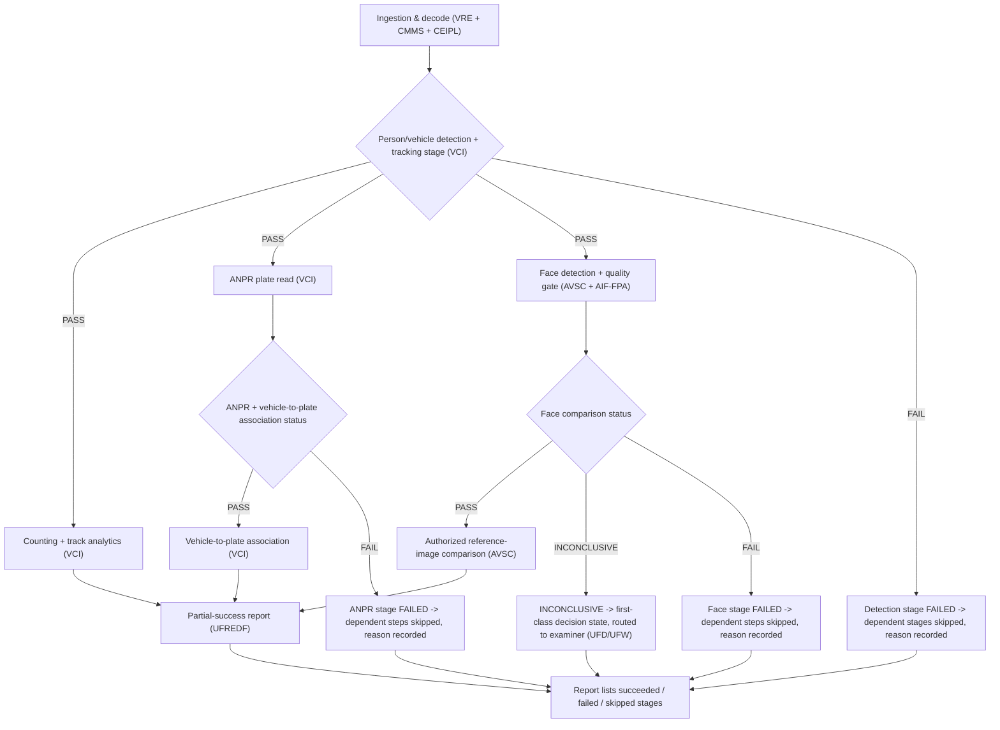

# PS-05 CCTV Architecture — Chunk 04: Acceptance, Roadmap & Governance

> **Drafting status:** This file is chunk 04 of the CCTV architecture document. It is one of several parallel chunks; sibling chunks 01/02/03 are owned by other authors and assembled by the document owner. This chunk carries the acceptance, roadmap, licensing, diagram/table/governance indexes, references, and the consolidated open-decisions register seed. All items are `Draft` until assembly and reconciliation.

---

# 14. Acceptance Criteria

**Priority legend:**
- **P0** = essential to the defined V1 workflow (must pass for release).
- **P1** = important capability (target for V1 if feasible, otherwise V1.1).
- **P2** = advanced / conditional (later capability or opt-in path).

**Conventions:**
- Every **Acceptance Test** is an executable, named check (a test/assertion a harness can run).
- Every numeric target is recorded as `TBD - benchmark required` (no fabricated numbers).
- Every **Status** is `Draft`.
- **Required Evidence** names the concrete artifact (report field, database row, hash, or test output) that proves the check.

| ID | Requirement | Priority | Acceptance Test | Required Evidence | Status |
|----|-------------|----------|-----------------|-------------------|--------|
| AC-001 | Correct source-frame references on every finding | P0 | `test_finding_source_frame_binding` — asserts every finding row carries a non-null `source_frame_id` and `source_timestamp` that resolves to an actual frame in the ingested source, with a matching artifact hash. | `findings` table row (`source_frame_id`, `source_timestamp`, `artifact_sha256`); test exit 0. | Draft |
| AC-002 | Stable tracking under supported conditions (HOTA / IDF1 at calibrated thresholds) | P0 | `test_tracker_stability` — runs the tracker on the reference CCTV clip, computes HOTA and IDF1, and asserts both ≥ calibrated threshold. | Calibrated threshold values: `TBD - benchmark required`. Thresholds calibrated on representative footage before promotion. | Draft |
| AC-003 | Transparent counting methodology (method + uncertainty stated in report) | P0 | `test_count_methodology_disclosed` — asserts the report includes an explicit `counting_method` field and an `uncertainty` field (count basis, e.g. unique tracklets vs per-frame). | Report JSON fields `counting_method`, `count_uncertainty`. | Draft |
| AC-004 | Quality-gated face comparison (below-threshold faces excluded, gate recorded) | P0 | `test_face_quality_gate` — asserts faces scoring below the minimum quality threshold are excluded from comparison and that the gate decision (in/out + score) is recorded. | Gate threshold: `TBD - benchmark required`. Record in `face_quality_gate` log per frame. | Draft |
| AC-005 | Inconclusive face-match handling (inconclusive is a first-class decision state, routed to examiner, not suppressed) | P0 | `test_inconclusive_face_routing` — asserts an `INCONCLUSIVE` match result is emitted as a first-class decision state, routed to the examiner workbench, and never silently dropped or coerced to a match/non-match. | Decision-state enum value `INCONCLUSIVE` in the finding; examiner routing record. | Draft |
| AC-006 | Vehicle-to-plate association | P1 | `test_vehicle_plate_association` — asserts each vehicle track is associated with its plate reading (or an explicit `NO_PLATE` / `UNCERTAIN` state), linking track ID to plate record. | `vehicle_track` ↔ `plate_reading` association table. | Draft |
| AC-007 | Preservation of alternative OCR readings (raw + interpreted + alternatives all stored) | P0 | `test_ocr_alternatives_preserved` — asserts the OCR record stores the raw string, the interpreted string, and the ranked alternative candidates, not just the top-1. | `ocr_readings` table with `raw`, `interpreted`, `alternatives[]` fields. | Draft |
| AC-008 | Partial-success reporting (a failed optional component does not invalidate unrelated successful results) | P0 | `test_partial_success` — injects a failure in one optional engine stage and asserts unrelated successful stages still emit valid results in the report. | Report `stage_status` map (succeeded/failed/skipped) + unaffected result payloads. | Draft |
| AC-009 | Versioned model provenance (model_name + model_version + config recorded per result) | P0 | `test_model_provenance_recorded` — asserts each result row records `model_name`, `model_version`, and the exact `config` (and weight checksum) used. | `model_provenance` fields on each result row; weight SHA-256 from `model_registry`. | Draft |
| AC-010 | Mandatory human review for significant matches | P0 | `test_significant_match_review_required` — asserts a "significant" match (by defined confidence rule) cannot be finalized without an examiner-review record. | Examiner-review record bound to the finding; confidence rule: `TBD - benchmark required`. | Draft |
| AC-011 | Secure reference-image access (case-scoped, RBAC, audit) | P0 | `test_reference_image_access_control` — asserts reference images are only accessible within the authorized case, RBAC-protected, and that every access is audit-logged. | RBAC check + audit-log entry; authorization token scope; case-scoping assertion. | Draft |
| AC-012 | End-to-end report traceability (every report claim → finding → observation → source frame/timestamp + artifact hash) | P0 | `test_report_traceability` — walks each report claim back to a finding, then to an observation, then to a source frame/timestamp and its artifact hash, with no broken links. | Traceability chain test; hash chain from claim to `artifact_sha256`. | Draft |
| AC-013 | Feasible cross-camera association subset (V1 scope) | P2 | `test_cross_camera_subset` — asserts the V1 cross-camera association covers the declared feasible subset (spatial + temporal overlap rules), with out-of-scope pairs marked `NOT_ASSOCIATED`. | Declared subset spec; association records with coverage flag. | Draft |
| AC-014 | Deepfake / AI-generation verdict on face crops (calibrated, with OOD flag) | P1 | `test_vdf_verdict_calibration` — asserts VDF emits calibrated probabilities and an OOD/uncertainty flag on face crops, never a universal "authentic/fake" claim. | VDF calibrated probabilities + OOD flag per crop. | Draft |
| AC-015 | Audio-visual synchronization on the extracted track (AVSC) | P1 | `test_avsc_sync` — asserts AVSC computes the global offset Δt and lip-sync confidence on the extracted audio-visual pair for the supported track. | AVSC `Δt` + lip-sync confidence records. | Draft |

> The 12 mandated requirement areas are AC-001 through AC-012. AC-013 to AC-015 are added to exercise the P1/P2 tiers and to align with roadmap stages G–H; they are optional extensions beyond the mandated minimum.

---

# 15. Phased Implementation Roadmap

> **Subordination statement:** These stages are proposals until reconciled with `PHASES.md`. This roadmap does **not** propose modifying `PHASES.md`. Cross-references use `PHASES.md`'s canonical naming style — the dedicated VISTA CCTV playbook `Phase VISTA-CFI-00 … Phase VISTA-CFI-09` and the broader `Phase VISTA-A0 … Phase VISTA-A13` tracks (see §2 / §4 / §4.B of `PHASES.md`). Reconciliation maps each stage A–I below onto the nearest canonical `VISTA-CFI-*` phase; the document owner performs that mapping at assembly.

Canonical naming reference (from `PHASES.md`):
- `Phase VISTA-CFI-00: Repository Audit, Temporal Architecture & Contract Baseline`
- `Phase VISTA-CFI-01: Container Demuxing, Frame/Packet Extraction & Timeline Construction`
- `Phase VISTA-CFI-02: Variable-Frame-Rate Cadence Analysis & Robust Interval Statistics`
- `Phase VISTA-CFI-03: Decoded-Frame Duplicate Detection & Frozen-Sequence Analysis`
- `Phase VISTA-CFI-04: Missing-Frame Detection & Inserted-Frame Localization`
- `Phase VISTA-CFI-05: Reordering Detection, Optical Flow & Motion Continuity Analysis`
- `Phase VISTA-CFI-06: Codec/GOP Forensics, CCTV OSD Clock & DVR Log Corroboration`
- `Phase VISTA-CFI-07: Cross-Camera Timeline Graph & Audio-Visual Alignment`
- `Phase VISTA-CFI-08: Unified Findings Synthesis & Examiner Review Workbench`
- `Phase VISTA-CFI-09: Controlled Test Corpus, Benchmarking, Security & Release Validation`

Each stage below: **Objective, Dependencies (named), Deliverables, Acceptance criteria (AC ids), Risks, Exit conditions.**

## Stage A — Requirements, Contracts, Datasets & Baseline Evaluation
- **Objective:** Freeze input/output contracts, dataset plan, and the baseline evaluation harness for the CCTV pipeline.
- **Dependencies (named):** `PHASES.md` `Phase VISTA-CFI-00` (contract baseline); `CMMS` (cross-media metadata schema); `CEIPL` (pre-decode hashing + manifest contracts); PRD/TRD FR ids for CCTV.
- **Deliverables:** contract specs (Pydantic v2), dataset acquisition/split plan, baseline metric harness skeleton, `model_registry` schema.
- **Acceptance criteria (AC ids):** AC-001, AC-009 (provenance schema), AC-012 (traceability chain defined).
- **Risks:** ambiguous source-frame identity between container PTS and decoded frame index; dataset licensing/availability.
- **Exit conditions:** contracts compile; baseline harness runs on a held-out sample and emits a report with traceable fields.

## Stage B — Video Ingestion, Decoding & Metadata
- **Objective:** Safe ingestion, container/codec demux, decode, and metadata extraction (incl. pre-decode dual hashing).
- **Dependencies (named):** `VRE` (container/codec/PTS parsing); `CMMS` (metadata adapters); `CEIPL` (pre-decode SHA-256/SHA3-512); safe-parser/decompression-bomb defenses.
- **Deliverables:** ingestion + decode path, metadata records, CEIPL hash binding, defensive-decoding hardening.
- **Acceptance criteria (AC ids):** AC-001 (source-frame identity), AC-012 (hash binding in traceability).
- **Risks:** malformed/corrupt exhibits; large file ceilings; hash mismatch halts analysis.
- **Exit conditions:** supported formats ingest cleanly; every ingested exhibit bound to a verified artifact hash.

## Stage C — Person/Vehicle Detection + Tracking
- **Objective:** Person/vehicle object detection and multi-object tracking across frames.
- **Dependencies (named):** `VCI` (detection + tracker); chosen detector (OD-030) + chosen tracker (OD-032); `VRE` for frame order; `CEIPL` hashes.
- **Deliverables:** detector + tracker integration, track/tracklet records, stability evaluation output.
- **Acceptance criteria (AC ids):** AC-002 (HOTA/IDF1 at calibrated thresholds), AC-009 (model provenance per track).
- **Risks:** tracker identity switches under occlusion; threshold calibration on CCTV-specific footage.
- **Exit conditions:** calibrated stability thresholds recorded in `model_registry`/config; tracklets link to source frames.

## Stage D — Counting + Track Analytics
- **Objective:** Unique people/vehicle counting and track-level analytics with explicit methodology + uncertainty.
- **Dependencies (named):** Stage C tracklets; `VCI` counting; `CMMS` for scene metadata.
- **Deliverables:** counting module, methodology + uncertainty reporting, per-frame vs unique-count distinction.
- **Acceptance criteria (AC ids):** AC-003 (method + uncertainty disclosed), AC-001 (frame binding).
- **Risks:** conflation of per-frame count with unique count; occlusion-based under/over-count.
- **Exit conditions:** report exposes `counting_method` and `count_uncertainty`; counts resolve to source frames.

## Stage E — Face Detection + Quality
- **Objective:** Face detection and a quality gate (pose/blur/occlusion/size) that records in/out decisions.
- **Dependencies (named):** `AVSC` (face track) / `AIF-FPA` (detection + quality gating); detector (RetinaFace/SCRFD — open decision).
- **Deliverables:** face detector integration, quality-gate module, gate decision log.
- **Acceptance criteria (AC ids):** AC-004 (below-threshold excluded + gate recorded), AC-009 (model provenance).
- **Risks:** low-quality CCTV faces at distance; gate threshold calibration.
- **Exit conditions:** gate threshold recorded; every compared face has a quality record.

## Stage F — Authorized Reference-Image Comparison
- **Objective:** Judicially-authorized 1:1 reference-image comparison with quality gating and first-class inconclusive handling.
- **Dependencies (named):** `AIF-FPA` (ArcFace/MagFace 1:1); `case_authorization_token` + RBAC + audit; Stage E quality gate; `CEIPL` (encrypted embeddings).
- **Deliverables:** authorized comparison pipeline, RBAC + audit logging, `INCONCLUSIVE` decision-state routing to examiner.
- **Acceptance criteria (AC ids):** AC-004, AC-005, AC-010, AC-011.
- **Risks:** biometric privacy; misuse of 1:N; authorization token lifecycle; embedding security.
- **Exit conditions:** no match is finalized without examiner review; inconclusive is routed, never suppressed; all access audit-logged.

## Stage G — Vehicle Attributes + ANPR
- **Objective:** Vehicle attribute extraction and ANPR with alternative-reading preservation and vehicle-to-plate association.
- **Dependencies (named):** `VCI` (vehicle_attributes, alpr/anpr); target Indian plate formats (open decision); Stage C vehicle tracklets.
- **Deliverables:** attribute extractor, ANPR engine (separately versioned, HSRP validator), alternative-OCR storage, plate↔track association.
- **Acceptance criteria (AC ids):** AC-006, AC-007, AC-009.
- **Risks:** OCR ambiguity at range/angle; plate-format coverage; association confidence.
- **Exit conditions:** raw + interpreted + alternatives stored; each plate tied to a track or explicit `NO_PLATE`/`UNCERTAIN`.

## Stage H — Cross-Camera + Temporal Correlation
- **Objective:** Cross-camera and temporal correlation of tracks/plates across cameras and over time.
- **Dependencies (named):** `CSTV` (cross-source timeline); `CMMS` (case-wide metadata); Stage C/G records.
- **Deliverables:** cross-camera association subset, temporal correlation, case-wide timeline records.
- **Acceptance criteria (AC ids):** AC-013, AC-015.
- **Risks:** clock drift across cameras; out-of-scope association pairs; correlation false positives.
- **Exit conditions:** V1 feasible subset declared and tested; out-of-scope pairs marked `NOT_ASSOCIATED`.

## Stage I — Reporting, Validation & Reliability Testing
- **Objective:** Report/dossier assembly (UFREDF), examiner workbench (UFD/UFW), end-to-end validation and reliability testing.
- **Dependencies (named):** `UFREDF` (dossier), `UFD`/`UFW` (workbench), `CEIPL` (signing + Merkle proofs), all prior stages.
- **Deliverables:** unified forensic report/dossier (Sec 65B/63 BSA), examiner review UI, end-to-end reliability + partial-success tests.
- **Acceptance criteria (AC ids):** AC-008, AC-010, AC-012.
- **Risks:** traceability gaps; partial-success masking failures; legal-dossier correctness.
- **Exit conditions:** every report claim traceable to source frame/timestamp + hash; partial-success verified; reliability suite passes.

---

# 16. Licensing, Dependencies, and Model Governance

**Rules:**
- **Code licence and weight licence are separate columns and are never assumed from each other.** Open-source code does **not** imply unrestricted model weights.
- If any entry cannot be verified from the repo/official docs, the field is marked `UNVERIFIED - legal review required`.
- **Commercial benchmarks are kept visually separate from candidate components.** They are referenced for capability context only and are **not** dependencies.

## 16.1 Candidate Components & Dependencies

| Candidate | Official Repo/Docs URL | Code Licence | Model-Weight Licence | Dataset Licence | Commercial-Use Restriction | Redistribution Restriction | Hardware Requirements | Dependencies | Maintenance Status |
|-----------|------------------------|--------------|----------------------|-----------------|---------------------------|---------------------------|----------------------|--------------|--------------------|
| ByteTrack | https://github.com/ifzhang/ByteTrack | Apache-2.0 | No trained weights of its own (algorithm; weights are the underlying detector's) | `UNVERIFIED - legal review required` (training data terms not stated in repo) | Detector weights govern, not ByteTrack | ByteTrack code: Apache-2.0 terms | Runs on the underlying detector (CPU/GPU) | ByteDLC / MOT det; PyTorch; MOTeval | UNVERIFIED - legal review required (current maintenance activity) |
| BoT-SORT | https://github.com/NirAharon/BoT-SORT | `UNVERIFIED - legal review required` (verify repo licence; likely MIT) | Uses ReID model weights — `UNVERIFIED - legal review required` (separate from code) | `UNVERIFIED - legal review required` | `UNVERIFIED - legal review required` | `UNVERIFIED - legal review required` | GPU recommended for ReID | ReID model, ByteTrack, PyTorch, DeepSORT-family | UNVERIFIED - legal review required |
| RetinaFace | reference implementation in insightface (repo MIT) | MIT (insightface reference) | Pretrained weights: research / non-commercial per weight-file terms — `UNVERIFIED - legal review required` (verify and separate code vs weight licence) | WIDER FACE training data: `UNVERIFIED - legal review required` | Weight-file non-commercial term may restrict commercial forensic use | Code: MIT; weights: per weight-file terms | GPU recommended | insightface, PyTorch / ONNX | Verify against repo + weight-file terms before asserting |
| AdaFace | https://github.com/mk-minchul/AdaFace | Apache-2.0 (code) | Pretrained weights: research / non-commercial per repo — `UNVERIFIED - legal review required` (verify in repo before asserting) | `UNVERIFIED - legal review required` | `UNVERIFIED - legal review required` (weight terms) | Code: Apache-2.0; weights: per repo terms | GPU recommended (ArcFace-based) | PyTorch, ArcFace backbone | Verify in repo before asserting |
| LittleFaceNet | https://pmc.ncbi.nlm.nih.gov/articles/PMC11766931/ | Open-access article; weights/code availability `UNVERIFIED - legal review required` | `UNVERIFIED - legal review required` | `UNVERIFIED - legal review required` | `UNVERIFIED - legal review required` | `UNVERIFIED - legal review required` | `UNVERIFIED - legal review required` | `UNVERIFIED - legal review required` | **Treat as benchmark candidate only** until weights/code confirmed |
| PaddleOCR | (PaddleOCR repo/docs) | Apache-2.0 | PaddleOCR model weights: verify terms — `UNVERIFIED - legal review required` | PaddleOCR datasets: `UNVERIFIED - legal review required` | Verify | PaddleOCR: Apache-2.0 (code) | CPU/GPU | PaddlePaddle, onnxruntime | UNVERIFIED - legal review required (current version) |
| Tesseract | (Tesseract repo/docs) | Apache-2.0 | N/A (no learned weights in core) | N/A | None known (verify) | Apache-2.0 | CPU | leptonica | Mature / stable |
| EasyOCR | (EasyOCR repo/docs) | `UNVERIFIED - legal review required` (verify current licence) | Detects + recognizes; uses pretrained model weights — `UNVERIFIED - legal review required` | `UNVERIFIED - legal review required` | `UNVERIFIED - legal review required` | `UNVERIFIED - legal review required` | GPU recommended | PyTorch | UNVERIFIED - legal review required |
| plate-ocr | (plate-ocr repo/docs) | MIT — verify | `UNVERIFIED - legal review required` | `UNVERIFIED - legal review required` | `UNVERIFIED - legal review required` | MIT (verify) | CPU/GPU | PyTorch | UNVERIFIED - legal review required |
| NVIDIA DeepStream SDK | (docs.nvidia.com/metropolis/deepstream/dev-guide/) | Proprietary NVIDIA licence; free with registration | Bundled model weights under NVIDIA terms | N/A | Proprietary terms apply | No redistribution beyond NVIDIA terms | GPU platform (CUDA) requirements | CUDA toolkit, GStreamer; NvDCF bundled; DeepSORT third-party integration | Maintained by NVIDIA |

## 16.2 Commercial Benchmarks (context only — NOT dependencies)

The following are commercial products referenced solely to frame capability expectations. They are **benchmarks, not dependencies**, and carry no licensing row:

| Product | Role | Note |
|---------|------|------|
| BriefCam (Milestone Systems) | Commercial video-search / CCTV benchmark | Benchmark, not a dependency |
| Genetec AutoVu | Commercial ANPR / video-analytics benchmark | Benchmark, not a dependency |

> **Governance note:** Any model promoted into the CCTV pipeline must be pinned in `model_registry` with an exact SHA-256 checksum, a recorded `model_name + model_version + config` (AC-009), and a verified permissive or explicitly-authorized licence. Weight licences are audited separately from code licences.

---

# 17. Required Diagrams

Index of the six required Mermaid diagrams, with their placement. All diagrams use the exact subsystem names: VISTA engines `VRE / AFB / AVSC / VDF / VCI`, subsystems `AIF`, `CMMS`, `CSTV`, `CEIPL`, and reporting/UI `UFREDF`, `UFD`, `UFW`.

| # | Diagram | Placement | Owner |
|---|---------|-----------|-------|
| 1 | Overall CCTV architecture | §6 (chunk-01 file) | chunk-01 |
| 2 | Parallel face + vehicle pipelines | §6 (chunk-01) | chunk-01 |
| 3 | Engine execution order & dependencies | §7 (chunk-02) — **rendered here in chunk 04** and copied into §7 at assembly | **chunk-04 (this file)** |
| 4 | Cross-engine evidence correlation | §9 (chunk-02) | chunk-02 |
| 5 | Failure handling & partial success | **chunk 04 (this file)** | **chunk-04 (this file)** |
| 6 | Investigator review & report generation | §10 (chunk-03) | chunk-03 |

## Diagram 3 — Engine Execution Order (rendered into §7 at assembly)

## Diagram 5 — Failure Handling & Partial Success

> Failure semantics: a failed optional stage marks itself `FAILED` with a recorded reason; its dependent stages are `SKIPPED` with reason; **unrelated** stages continue and their valid results are preserved. The partial-success report enumerates `succeeded / failed / skipped` (AC-008).

---

# 18. Required Tables

Index of the ten required tables and the section each lands in.

| # | Table | Lands in section |
|---|-------|------------------|
| 1 | Reference matrix | §4 |
| 2 | Engine mapping | §5 |
| 3 | Component responsibility matrix | §7 (rendered here in chunk 04, copied into §7 at assembly) |
| 4 | Input/output contract matrix | §8 |
| 5 | Execution & dependency matrix | §7 |
| 6 | Failure-handling matrix | §7 / §17 |
| 7 | Evaluation-metrics matrix | §13 |
| 8 | Acceptance-criteria matrix | §14 |
| 9 | Licensing matrix | §16 |
| 10 | Open-decisions register | §19 |

## Component Responsibility Matrix (rendered into §7 at assembly)

| Component | Owns | Consumes | Produces | Does NOT Do |
|-----------|------|----------|----------|-------------|
| VRE | Container / codec / PTS-DTS continuity, scene-cut & re-encode analysis | Master video exhibit bytes, CEIPL hashes | PTS continuity curve, scene-cut list, re-encode traces | Does not extract/route audio (that is AFB) |
| AFB | Lossless audio extraction & AURAS routing | Video bitstream audio track | Extracted 16 kHz mono artifact, AURAS job references | Does not run ARE/MVSI/ADDE engines itself |
| AVSC | Audio-visual sync + face tracking + lip-sync | Decoded frames, extracted audio | Global offset Δt, lip-sync confidence curves | Does not make deepfake verdicts (that is VDF) |
| VDF | Deepfake / AI-generation detection | Normalized face crops, 16-frame windows | Calibrated deepfake probabilities, OOD flags | Does not perform 1:1 identity comparison (AVSC/FPA) |
| VCI | Video content intelligence (detect, track, count, OCR/ANPR, vehicle attrs) | Sampled decoded RGB frames | Object tracklets, unique person count, plate reads, vehicle attributes | Does not extract audio (AFB) or run 1:1 biometric compare |
| CMMS | Cross-media canonical metadata schema | All engine outputs | Universal metadata records, anomaly flags | Does not produce forensic verdicts |
| CSTV | Cross-source timestamp verification & case-wide timeline | CMMS metadata, engine timestamps | Case-wide verified timeline | Does not emit individual findings |
| CEIPL | Crypto provenance (hashing, signing, custody, Merkle) | Raw bytes, event payloads | Canonical manifests, Ed25519 signatures, Merkle proofs, custody hashes | Does not interpret evidence content |
| AIF | Image forensics on crops (face/plate stills) | VCI-derived stills, CEIPL hashes | Image-manipulation findings | Does not run temporal video deepfake (VDF) |
| UFREDF | Unified forensic report / dossier assembly | All engine findings, CEIPL proofs | Signed Sec 65B / 63 BSA dossier | Does not alter underlying findings |
| UFD / UFW | Examiner workbench & dashboard | UFREDF dossiers, findings, case RAG | Reviewer dispositions, timeline views | Does not recompute engine results |

---

# 19. Open Decisions Register

> **Consolidation note:** Entries **OD-001 – OD-029** are authored by the other document chunks and are merged into this register by the document owner at assembly. This file seeds **OD-030 through OD-039** (all `Open`). The ten minimum decisions are listed in the register rows below; the closing "Open Decisions (chunk 04)" block re-presents the first five (OD-030…OD-034) as this chunk's own seed.

| ID | Decision | Impact | Evidence Required | Owner/Role | Status |
|----|----------|--------|-------------------|------------|--------|
| OD-030 | Detector selection for first implementation | Fixes Stage C detector + weights + licence posture; gates AC-002 | Benchmark comparison on representative CCTV footage; licence verification | Pipeline lead | Open |
| OD-031 | Supported DeepStream version + hardware config | Determined GPU/CUDA platform, NvDCF availability, build targets | DeepStream release notes + target hardware spec | Platform lead | Open |
| OD-032 | Tracker winner on representative CCTV footage | Fixes HOTA/IDF1 calibration basis; gates AC-002 | Tracked evaluation results (HOTA/IDF1) on the reference set | Pipeline lead | Open |
| OD-033 | Face-recognition candidate acceptable on low-quality footage | Gates AC-004/AC-005/AC-010/AC-011; sets quality floor | Low-quality footage benchmark (EER/ROC-AUC, minDCF, ECE) | Biometrics lead | Open |
| OD-034 | Minimum face quality threshold | Sets the quality gate value recorded in `face_quality_gate` | Calibration study on the reference dataset (value TBD - benchmark required) | Biometrics lead | Open |
| OD-035 | ANPR implementation supporting target Indian plate formats | Gates AC-006/AC-007; fixes the ANPR engine + HSRP validator scope | Target plate-format list + OCR benchmark (CER) on sampled plates | ANPR lead | Open |
| OD-036 | Reference-image authorization + retention policy | Governs AC-011; sets the biometric data retention window | Legal / authorization-token spec + retention schedule | Legal / Privacy lead | Open |
| OD-037 | Measurable V1 performance targets | Sets release gates for AC-002 / AC-003 / AC-012 | Calibrated benchmark values (HOTA / IDF1, count MAE) on a held-out set | Pipeline lead | Open |
| OD-038 | Feasible cross-camera association subset | Bounds Stage H / AC-013 scope | Association-rule spec + correlation study on a multi-camera set | CSTV lead | Open |
| OD-039 | V1 vs later capability split | Allocates P1 / P2 requirements to release waves | Capability prioritization against the AC priorities | Product / PM lead | Open |

> **Minimum-decisions list (this chunk):** the ten decisions seeded as OD-030…OD-039. The closing "Open Decisions (chunk 04)" block re-presents the first five (OD-030…OD-034); OD-035…OD-039 are carried in this §19 register. All Status values are `Open`.

---

# 20. References

> Rules: no large verbatim external passages; vendor claims are labelled as vendor claims; no fabricated citations. Access status recorded as `accessed 2026-05` or `UNVERIFIED`.

## 20.a Commercial benchmarks
- **BriefCam (Milestone Systems)** — product page. Vendor claim, benchmark only. Access status: `UNVERIFIED`. Relevance: commercial video-search / CCTV capability benchmark.
- **Genetec AutoVu** — product page. Vendor claim, benchmark only. Access status: `UNVERIFIED`. Relevance: commercial ANPR / video-analytics capability benchmark.

## 20.b SDKs / frameworks
- **NVIDIA DeepStream Developer Guide** — https://docs.nvidia.com/metropolis/deepstream/dev-guide/ — Access status: `UNVERIFIED`. Relevance: GPU deep-learning video analytics framework; NvDCF + bundled DeepSORT third-party integration; hardware prerequisites.

## 20.c Research / models
- **RetinaFace** — Deng, Zhang, et al., CVPR 2020. Reference implementation in insightface. Access status: `UNVERIFIED` (weight licence to be confirmed). Relevance: candidate face detector (high-FPS facial landmark + detection).
- **AdaFace** — Li et al., ICCV 2024. https://github.com/mk-minchul/AdaFace — Access status: `UNVERIFIED` (weight terms to be confirmed). Relevance: adaptive-margin face recognition; low-quality-robust candidate.
- **LittleFaceNet** — https://pmc.ncbi.nlm.nih.gov/articles/PMC11766931/ — Open-access article. Access status: `accessed 2026-05` (article); weights/code `UNVERIFIED`. Relevance: lightweight face recognition, benchmark candidate only.
- **ByteTrack** — ECCV 2024. https://github.com/ifzhang/ByteTrack — Access status: `UNVERIFIED` (maintenance/licence to be confirmed). Relevance: candidate multi-object tracker (two-stage assignment).
- **BoT-SORT** — CVPR 2022. https://github.com/NirAharon/BoT-SORT — Access status: `UNVERIFIED` (licence to be confirmed). Relevance: candidate reid-aware tracker.

## 20.d Internal
- `TRD.md` — subsystem/engine technical specification (VRE/AFB/AVSC/VDF/VCI, CMMS, CSTV, CEIPL, UFD/UFW). Internal.
- `PRD.md` — product & legal requirements (Sec 65B IEA / Sec 63 BSA), FR ids. Internal.
- `PHASES.md` — implementation roadmap; canonical `Phase VISTA-CFI-*` / `VISTA-A*` naming. Internal.
- `README.md` — user-facing platform overview. Internal.
- `AI_INSTRUCTIONS.md` — agent behavioral contract. Internal.
- `archify.config.json` — Archify post-processing config. Internal.
- Relevant `ps05` modules — `ps05.engines.vista.{vre,afb,avsc,vdf,vci}`, `ps05.core.crypto` (CEIPL). Internal.

---

# 21. Quality Control Checklist

> Status of all items: **pending assembly** (verified by the document owner when chunks 01/02/03 are assembled into the final document).

- [ ] File exists at `docs/cctv_draft/04_acceptance_roadmap_governance.md` — *pending assembly*
- [ ] Acceptance table covers all 12 mandated requirement areas (AC-001…AC-012) — *pending assembly*
- [ ] Every acceptance test is an executable, named check — *pending assembly*
- [ ] Every numeric target recorded as `TBD - benchmark required` (no fabricated numbers) — *pending assembly*
- [ ] Every acceptance Status is `Draft` — *pending assembly*
- [ ] Priority legend (P0/P1/P2) present and exercised across the table — *pending assembly*
- [ ] Roadmap contains all nine stages A–I with objective/dependencies/deliverables/AC/risks/exit — *pending assembly*
- [ ] Roadmap explicitly subordinate to `PHASES.md`; no proposal to modify `PHASES.md` — *pending assembly*
- [ ] Cross-references use `PHASES.md` canonical naming style — *pending assembly*
- [ ] Licensing table separates code licence vs weight licence in distinct columns — *pending assembly*
- [ ] Unverified entries marked `UNVERIFIED - legal review required` — *pending assembly*
- [ ] Open-source code not assumed to grant unrestricted weights — *pending assembly*
- [ ] Commercial benchmarks visually separated from candidate components — *pending assembly*
- [ ] At least one valid fenced Mermaid diagram (failure-handling flowchart, Diagram 5) with valid syntax — *pending assembly*
- [ ] All six required diagrams indexed with correct placement sections — *pending assembly*
- [ ] Diagrams use exact subsystem names (VRE/AFB/AVSC/VDF/VCI, AIF, CMMS, CSTV, CEIPL, UFREDF, UFD, UFW) — *pending assembly*
- [ ] All ten required tables indexed with landing sections — *pending assembly*
- [ ] Open-decisions register seeded with OD-030+; consolidated note for OD-001…OD-029 present — *pending assembly*
- [ ] References grouped (a–d), vendor claims labelled, no fabricated citations, access-verified status recorded — *pending assembly*
- [ ] **Open-decision registers from all chunks merged without duplicate IDs** — *pending assembly*

---

# Open Decisions (chunk 04)

> Chunk-04 seed: OD-030 … OD-034, the five decisions this chunk owns. All `Open`. These mirror the §19 register rows OD-030…OD-034 one-for-one; the remaining five minimum decisions (OD-035…OD-039) are carried in the §19 register.

| ID | Decision | Impact | Evidence Required | Owner/Role | Status |
|----|----------|--------|-------------------|------------|--------|
| OD-030 | Detector selection for first implementation | Fixes Stage C detector + weights + licence posture; gates AC-002 | Benchmark comparison on representative CCTV footage; licence verification | Pipeline lead | Open |
| OD-031 | Supported DeepStream version + hardware config | Determines GPU/CUDA platform, NvDCF availability, build targets | DeepStream release notes + target hardware spec | Platform lead | Open |
| OD-032 | Tracker winner on representative CCTV footage | Fixes HOTA/IDF1 calibration basis; gates AC-002 | Tracked evaluation results (HOTA/IDF1) on the reference set | Pipeline lead | Open |
| OD-033 | Face-recognition candidate acceptable on low-quality footage | Gates AC-004/AC-005/AC-010/AC-011; sets the quality floor | Low-quality footage benchmark (EER / ROC-AUC, minDCF, ECE) | Biometrics lead | Open |
| OD-034 | Minimum face quality threshold | Sets the quality-gate value recorded in `face_quality_gate` | Calibration study on the reference dataset (value `TBD - benchmark required`) | Biometrics lead | Open |

> **Note on ID continuity:** This block seeds OD-030…OD-034; the §19 register carries the full chunk-04 seed OD-030…OD-039. OD-001…OD-029 belong to the other chunks. The document owner verifies at assembly that the merged register (all chunks) has unique, gap-free IDs.
