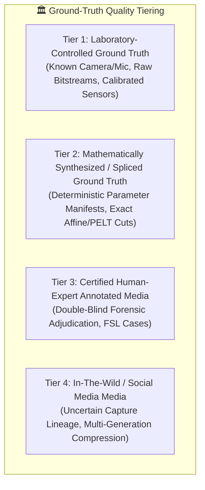

# Dataset Strategy & Benchmark Corpus Governance — Digital Evidence Authenticity & Integrity Verification Platform

**Document Track:** Track A (Research & Scientific Validation)  
**Status:** Approved Research Foundation  
**Version:** 1.0.0  

---

## 1. Dataset Governance Overview

To ensure legal admissibility, scientific reproducibility, and ethical rigor, the research initiative implements strict dataset governance protocols. Datasets are organized across four evidence modalities (Audio, Image, Video/CCTV, and Network) and categorized into four explicit ground-truth quality tiers.

---

## 2. Standardized Benchmark Datasets Inventory

### 2.1 Audio Forensics & Voice Spoofing Benchmarks
| Benchmark Dataset | Primary Modality & Focus | Ground-Truth Tier | Size / Duration | License & Citation |
| :--- | :--- | :--- | :--- | :--- |
| **ASVspoof 2019 (LA)** | Logical Access (TTS & Voice Conversion) | Tier 1 / Tier 2 | ~120,000 utterances | ODC-BY (Todisco et al., 2019) |
| **ASVspoof 2021 (DF)** | Deepfake speech through lossy codecs | Tier 2 | ~600,000 utterances | ODC-BY (Yamagishi et al., 2021) |
| **WaveFake** | Diverse neural vocoders (MelGAN, HiFi-GAN) | Tier 2 | ~117,000 clips | MIT License (Frank & Schönherr, 2021) |
| **VoxCeleb 1 & 2** | Authentic speaker identification & diarization | Tier 1 | 2,000+ hours | CC BY-NC 4.0 (Nagrani et al., 2020) |
| **AESL Benchmark (Internal)** | Multi-channel audio splicing with known $t_{\text{splice}}$ | Tier 1 / Tier 2 | 500 calibrated fixtures | Research Internal / Ground Truth Linked |

### 2.2 Image Manipulation & Localisation Benchmarks
| Benchmark Dataset | Primary Modality & Focus | Ground-Truth Tier | Size / Image Count | License & Citation |
| :--- | :--- | :--- | :--- | :--- |
| **Columbia Splicing** | Uncompressed raw image splicing | Tier 1 | 1,845 images | Academic Free (Hsu & Chang, 2006) |
| **CASIA v1 & v2** | Splicing & copy-move with post-processing | Tier 2 | 12,000+ images | Academic Research (CASIA, 2010) |
| **CoMoFoD** | Copy-Move Forgery with rotation & scaling | Tier 1 | 10,400 image pairs | CC BY-NC-SA (Tralic et al., 2013) |
| **TruFor Evaluation Set** | Splicing & AI inpainting with pixel masks | Tier 1 / Tier 2 | 1,000 benchmark images | Research License (Trabucco et al., 2024) |
| **GenImage** | Generative diffusion & GAN images | Tier 2 | 1.3M images | Open Research (Zhu et al., 2023) |

### 2.3 Video & CCTV Surveillance Benchmarks
| Benchmark Dataset | Primary Modality & Focus | Ground-Truth Tier | Size / Clip Count | License & Citation |
| :--- | :--- | :--- | :--- | :--- |
| **FaceForensics++ (FF++)** | Deepfakes, Face2Face, FaceSwap, NeuralTextures | Tier 2 | 1,000 sequences | Non-Commercial (Rossler et al., 2019) |
| **DFDC** | Diverse lighting, deepfakes, talking heads | Tier 2 / Tier 3 | 128,000+ videos | DFDC Competition License (Dolhansky, 2020) |
| **Celeb-DF v2** | High-quality temporal deepfakes | Tier 2 | 5,639 videos | Academic Research (Li et al., 2020) |
| **UCF-Crime CCTV** | Real-world surveillance anomaly & cadence | Tier 3 / Tier 4 | 1,900 CCTV clips | Research Fair Use (Sultani et al., 2018) |
| **CFITSA CCTV Corpus** | Dropped, duplicate, frozen, and reordered frames | Tier 1 / Tier 2 | 500 calibrated streams | Ground-Truth Script Generated |

### 2.4 Offline Network Traffic Forensics Benchmarks
| Benchmark Dataset | Primary Modality & Focus | Ground-Truth Tier | Size / Flow Count | License & Citation |
| :--- | :--- | :--- | :--- | :--- |
| **CIC-IDS2017** | PCAP captures with labeled attack flows | Tier 1 | 51 GB raw PCAP | Open Access (Sharafaldin et al., 2018) |
| **UNSW-NB15** | Modern synthesized attack & normal traffic | Tier 1 | 100 GB PCAP / CSV | Academic Research (Moustafa & Slay, 2015) |

---

## 3. Data Ingestion & Immutability Protocol

Every dataset ingested into the research framework traverses a 4-step preservation gate:
1. **Raw Storage Locking:** Saved directly to the read-only partition (`chmod 0400`).
2. **Pre-Decode Dual Hashing:** Primary SHA-256 and secondary SHA3-512 hashes recorded in `dataset_registry`.
3. **Structured Dataset Card:** Documents exact URL, download timestamp, uncompressed size, and author citations.
4. **Partition Integrity Verification:** Before every training or evaluation run, checksums are verified to prevent silent dataset corruption.
