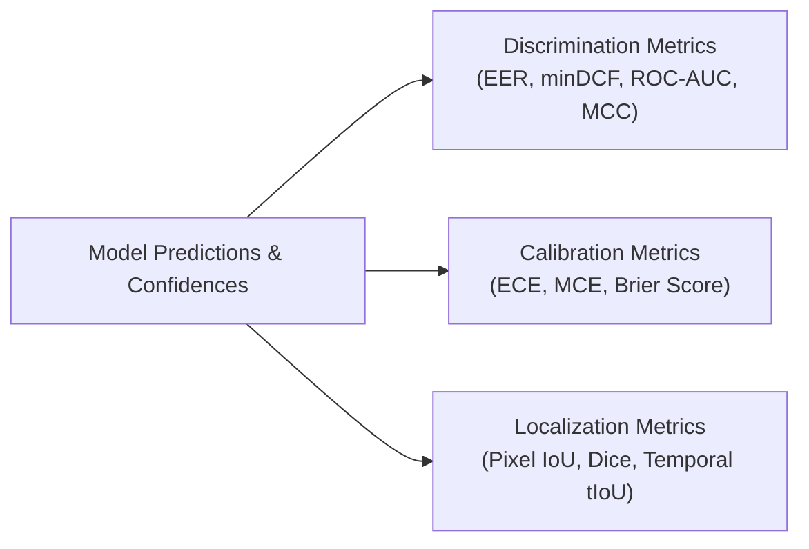

# Evaluation Metrics & Mathematical Formulations — Digital Evidence Authenticity & Integrity Verification Platform

**Document Track:** Track A (Research & Scientific Validation)  
**Status:** Approved Research Foundation  
**Version:** 1.0.0  

---

## 1. Classification & Biometric Discrimination Metrics

### 1.1 Equal Error Rate (EER)
The decision threshold $\theta_{\text{EER}}$ where the False Acceptance Rate ($\text{FAR}$) equals the False Rejection Rate ($\text{FRR}$):
$$\text{FAR}(\theta) = \frac{\text{False Positives}}{\text{True Negatives} + \text{False Positives}}$$
$$\text{FRR}(\theta) = \frac{\text{False Negatives}}{\text{True Positives} + \text{False Negatives}}$$
$$\text{EER} = \text{FAR}(\theta_{\text{EER}}) = \text{FRR}(\theta_{\text{EER}})$$
Computed via linear interpolation across ROC operating points.

### 1.2 Normalized Minimum Detection Cost Function ($\text{minDCF}$)
Standard NIST Speaker Recognition Evaluation (SRE) and ASVspoof metric weighting false alarms and missed detections under operational prior probabilities:
$$\text{DCF}(\theta) = C_{\text{miss}} \cdot P_{\text{target}} \cdot \text{FRR}(\theta) + C_{\text{fa}} \cdot (1 - P_{\text{target}}) \cdot \text{FAR}(\theta)$$
$$\text{DCF}_{\text{norm}}(\theta) = \frac{\text{DCF}(\theta)}{\min\left( C_{\text{miss}} \cdot P_{\text{target}}, \; C_{\text{fa}} \cdot (1 - P_{\text{target}}) \right)}$$
$$\text{minDCF} = \min_\theta \text{DCF}_{\text{norm}}(\theta)$$
Standard ASVspoof parameters: $C_{\text{miss}} = 1.0$, $C_{\text{fa}} = 10.0$, $P_{\text{target}} = 0.05$.

### 1.3 Matthews Correlation Coefficient (MCC)
Measures binary classification quality invariant to severe class imbalance:
$$\text{MCC} = \frac{TP \times TN - FP \times FN}{\sqrt{(TP + FP)(TP + FN)(TN + FP)(TN + FN)}} \in [-1, +1]$$

---

## 2. Confidence Calibration & Probability Quality Metrics

### 2.1 Expected Calibration Error (ECE)
Partitions the predicted probabilities into $M$ equal-width bins $B_m \subset (0, 1]$ (typically $M = 15$ or $20$):
$$\text{acc}(B_m) = \frac{1}{|B_m|} \sum_{i \in B_m} \mathbf{1}(\hat{y}_i = y_i)$$
$$\text{conf}(B_m) = \frac{1}{|B_m|} \sum_{i \in B_m} \hat{p}_i$$
$$\text{ECE} = \sum_{m=1}^M \frac{|B_m|}{N} |\text{acc}(B_m) - \text{conf}(B_m)|$$
*Acceptance Criterion:* $\text{ECE} \le 0.05$ across all promoted deepfake detection models.

### 2.2 Brier Score
The strictly proper scoring rule measuring mean squared difference between predicted probabilities $\hat{p}_i$ and binary ground truth $y_i \in \{0, 1\}$:
$$\text{Brier} = \frac{1}{N} \sum_{i=1}^N (\hat{p}_i - y_i)^2 \in [0, 1]$$

---

## 3. Spatiotemporal Manipulation Localization Metrics

### 3.1 Spatial Pixel Intersection-over-Union (IoU / Jaccard)
For binary ground-truth manipulation mask $\mathbf{Y} \in \{0, 1\}^{H \times W}$ and predicted mask $\hat{\mathbf{Y}} \in \{0, 1\}^{H \times W}$:
$$\text{IoU} = \frac{|\mathbf{Y} \cap \hat{\mathbf{Y}}|}{|\mathbf{Y} \cup \hat{\mathbf{Y}}|} = \frac{\sum_{x, y} Y(x, y) \cdot \hat{Y}(x, y)}{\sum_{x, y} \left( Y(x, y) + \hat{Y}(x, y) - Y(x, y) \cdot \hat{Y}(x, y) \right)}$$

### 3.2 Pixel Dice Coefficient ($F_1$-Score)
$$\text{Dice} = \frac{2 |\mathbf{Y} \cap \hat{\mathbf{Y}}|}{|\mathbf{Y}| + |\hat{\mathbf{Y}}|} = \frac{2 \times \text{IoU}}{1 + \text{IoU}}$$

### 3.3 Boundary $F_1$-Score ($\text{BF}_1$)
Evaluates contour alignment along the manipulation perimeter within tolerance distance $\tau = 2\text{ px}$:
$$\text{BF}_1 = \frac{2 \cdot P_{\text{boundary}} \cdot R_{\text{boundary}}}{P_{\text{boundary}} + R_{\text{boundary}}}$$

### 3.4 Temporal Intersection-over-Union ($t\text{IoU}$) for Audio & Video Intervals
For ground-truth edit interval $I_g = [t_{g1}, t_{g2}]$ and predicted interval $I_p = [t_{p1}, t_{p2}]$:
$$t\text{IoU} = \frac{\max(0, \min(t_{g2}, t_{p2}) - \max(t_{g1}, t_{p1}))}{\max(t_{g2}, t_{p2}) - \min(t_{g1}, t_{p1})}$$

### 3.5 Boundary Mean Absolute Error ($\text{MAE}_{\text{boundary}}$)
$$\text{MAE}_{\text{boundary}} = \frac{1}{2} \left( |t_{p1} - t_{g1}| + |t_{p2} - t_{g2}| \right) \quad (\text{expressed in milliseconds})$$

---

## 4. Video, CCTV & OCR Verification Metrics

### 4.1 Multiple Object Tracking Accuracy (MOTA)
$$\text{MOTA} = 1 - \frac{\sum_t (FN_t + FP_t + \text{IDSW}_t)}{\sum_t GT_t}$$
where $\text{IDSW}_t$ is the number of tracking identity switches at frame $t$.

### 4.2 OCR Character Error Rate (CER) & Word Error Rate (WER)
$$\text{CER} = \frac{S + D + I}{N_{\text{chars}}}, \quad \text{WER} = \frac{S_w + D_w + I_w}{N_{\text{words}}}$$
where $S$ is substitutions, $D$ is deletions, and $I$ is insertions computed via Levenshtein distance.
