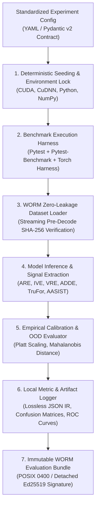

# Experimental Framework & Benchmarking Architecture — Digital Evidence Authenticity & Integrity Verification Platform

**Document Track:** Track A (Research & Scientific Validation)  
**Status:** Approved Research Foundation  
**Version:** 1.0.0  

---

## 1. Experimental Architecture & Governance

The Experimental Framework establishes the computational runtime, determinism controls, and logging infrastructure supporting reproducible digital forensics experiments across all research tracks.



---

## 2. Hardware Environment Profiles & Resource Constraints

To reflect practical deployment constraints across both central forensic laboratories and field workstations, experiments are evaluated under two standardized hardware profiles:

| Specification Parameter | Profile A: Forensic Server / Lab Cluster | Profile B: Air-Gapped Field Laptop |
| :--- | :--- | :--- |
| **Operating System** | Ubuntu 22.04 LTS (x86_64) | Debian 12 / Windows 11 Enterprise (x86_64) |
| **CPU Architecture** | 32-core AMD EPYC 7543 / Intel Xeon Gold | 8-core Intel Core i7 / AMD Ryzen 7 |
| **System Memory (RAM)** | 128 GB DDR4 ECC (cgroup capped to 64GB) | 32 GB DDR4/DDR5 (cgroup capped to 16GB) |
| **Hardware Accelerator** | NVIDIA RTX A6000 (48GB VRAM) / A100 | NVIDIA RTX 4070 Laptop (8GB) / CPU Fallback |
| **CUDA / CuDNN Version** | CUDA 12.2 / CuDNN 8.9 | CUDA 12.1 / CPU Float32 / ONNX Runtime |
| **Storage Subsystem** | PCIe 4.0 NVMe SSD (Read $\ge 5000\text{ MB/s}$) | PCIe 3.0 NVMe SSD (Read $\ge 2000\text{ MB/s}$) |
| **Network Boundary** | Strict Air-Gap (Local loopback 127.0.0.1 only) | Strict Air-Gap (Zero network connectivity) |

---

## 3. Determinism & Scientific Reproducibility Controls

To prevent experimental drift across computational nodes, every execution script enforces five mandatory initialization steps:

```python
import os
import random
import numpy as np
import torch

def enforce_deterministic_environment(seed: int = 42) -> None:
    """Enforces bitstream determinism across CPU and GPU runtimes."""
    os.environ["PYTHONHASHSEED"] = str(seed)
    os.environ["CUBLAS_WORKSPACE_CONFIG"] = ":4096:8"
    
    random.seed(seed)
    np.random.seed(seed)
    torch.manual_seed(seed)
    torch.cuda.manual_seed_all(seed)
    
    # Enforce deterministic convolution algorithms
    torch.backends.cudnn.deterministic = True
    torch.backends.cudnn.benchmark = False
    
    # Enforce PyTorch deterministic operations
    torch.use_deterministic_algorithms(True, warn_only=True)
```

---

## 4. Model Checkpoint Governance & SHA-256 Provenance

All external pre-trained model weights (such as RawNet2, AASIST, TruFor, YOLOv8, SAM 2, and RetinaFace) must be registered in the immutable `model_registry` schema prior to experimental execution:

```json
{
  "model_id": "mdl-audio-aasist-v2",
  "architecture_family": "spectrotemporal_graph_attention",
  "framework": "PyTorch 2.2",
  "checkpoint_filename": "aasist_ssl_voxceleb_v2.pt",
  "checkpoint_sha256": "4a7d3b2e98c76f1025a3d0fbc8129e74bcde3029148b89c310237dfb4a56c098",
  "parameter_count": 8940250,
  "input_tensor_shape": [1, 64600],
  "sample_rate_hz": 16000,
  "license": "Apache 2.0",
  "origin_repository": "https://github.com/clovaai/aasist"
}
```

* **Validation Rule:** Before allocating model weights to GPU memory, the harness reads the binary checkpoint and calculates its SHA-256 digest. If the hash does not match the pinned registry value, execution aborts with a fatal `CHECKPOINT_INTEGRITY_VIOLATION`.

---

## 5. Experiment Tracking & Artifact Output Specification

Experiments output a structured 5-part evaluation dossier stored in the WORM vault:
1. **`manifest.json` (RFC 8785 Canonical JSON):** Complete parameters, hardware metadata, and dependency tree.
2. **`predictions.parquet`:** Lossless record containing per-sample IDs, ground-truth labels, raw logits, calibrated probabilities, and OOD distances.
3. **`metrics.json`:** Overall metrics (EER, minDCF, ROC-AUC, ECE, Brier score, latency).
4. **`curves/` (Vector Graphics):** Lossless SVG plots of ROC curves, DET curves, reliability calibration diagrams, and PRNU PCE distributions.
5. **`evaluation.sig`:** Detached Ed25519 digital signature sealing the evaluation dossier.
