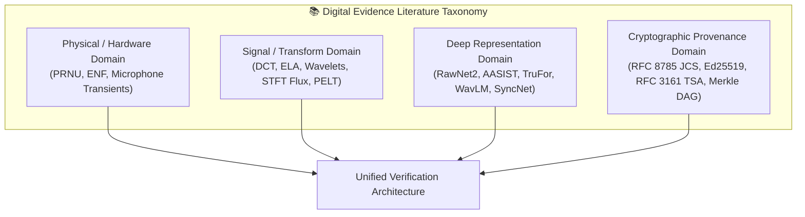

# Literature Review — Digital Evidence Authenticity & Integrity Verification Platform

**Document Track:** Track A (Research & Scientific Validation)  
**Status:** Approved Research Foundation  
**Version:** 1.0.0  

---

## 1. Introduction & Survey Taxonomy

The scientific literature on digital evidence authenticity spans four primary foundational disciplines:
1. **Classical Physics- & Hardware-Based Forensics:** Exploiting imperfections in physical hardware (camera sensor silicon, microphone diaphragms, power grid fluctuations).
2. **Signal-Processing & Transform-Domain Forensics:** Auditing mathematical transformations (discrete cosine transform DCT, fast Fourier transform FFT, wavelets, short-time Fourier transform STFT) and lossy quantization traces.
3. **Deep Learning & Neural Manipulation Detection:** Deploying convolutional, graph-based, and transformer architectures to learn high-dimensional synthetic artifacts.
4. **Cryptographic Integrity & Provenance Architectures:** Utilizing cryptographic digests, append-only Merkle ledgers, digital signatures, and trusted timestamps to guarantee post-intake chain of custody.

---

## 2. Image Forensics Literature

### 2.1 Sensor-Level & Hardware Artifacts (PRNU)
* **Foundational Work:** Lukas, Fridrich, and Goljan (2006) established Photo-Response Non-Uniformity (PRNU) as the premier deterministic physical fingerprint of digital imaging sensors. Caused by minute silicon wafer manufacturing variations, PRNU acts as an intrinsic spread-spectrum signature unique to individual camera sensors.
* **Extraction Methodology:** Given an image $\mathbf{I}$, a denoising filter $F(\cdot)$ (e.g., Mihcak wavelet or BM3D) extracts the noise residual:
  $$\mathbf{W} = \mathbf{I} - F(\mathbf{I}) \approx \mathbf{I} \cdot \mathbf{K} + \mathbf{\Theta}$$
  where $\mathbf{K}$ is the sensor PRNU fingerprint and $\mathbf{\Theta}$ represents uncorrelated scene noise. The correlation between the camera reference fingerprint $\mathbf{K}_{\text{ref}}$ and the noise residual $\mathbf{W}$ is computed via Peak-to-Correlation Energy (PCE):
  $$\text{PCE} = \frac{r_{\text{peak}}^2}{\frac{1}{N - |\mathcal{N}|} \sum_{(i,j) \notin \mathcal{N}} r^2(i,j)}$$
* **Forensic Significance in PS-05:** Embedded within the **IRE** engine (`IRE-05`). It serves as an empirical physical check to confirm whether two questioned photographs originated from the same physical device or to expose spliced image patches bearing foreign sensor noise ($PCE < 15$).

### 2.2 Transform Domain & Quantization Forensics (DCT & ELA)
* **Error Level Analysis (ELA):** Popularized by Krawetz (2007), ELA computes the pixel-level difference between an input JPEG image and a version intentionally re-compressed at a standardized quality level (typically Q90 or Q95). Regions previously compressed at different quality factors or modified in uncompressed space exhibit elevated error levels:
  $$\Delta_{\text{ELA}}(x, y) = |\mathbf{I}(x, y) - \mathcal{JPEG}_{Q}(\mathbf{I})(x, y)|$$
* **Double-Quantization Modeling:** Stamm & Liu (2008) and Bianchi & Piva (2012) formalized statistical models of primary and secondary quantization table interaction in JPEG bitstreams. Re-compression introduces periodic histogram zeros and rounding peaks into DCT coefficient distributions, enabling estimation of prior compression parameters.
* **Limitations in Literature:** ELA is vulnerable to false positives caused by natural high-contrast edges and textured surfaces. Our research combines ELA with classical Canny edge boundary masking and CAT-Net DCT stream parsing (`IRE-02`, `AIM-02`).

### 2.3 Copy-Move Forgery Detection (CMFD)
* **Key Literature:** Christlein, Riess, Jordan, and Angelopoulou (2012) conducted the seminal comparative evaluation of CMFD algorithms, showing that keypoint-based methods (SIFT, RootSIFT) and dense block-based DCT features outperform naive spatial matching.
* **Algorithmic Baseline:** Lowe (2004) SIFT descriptors matched via $k$-d tree 2-NN ratio tests ($r < 0.75$), followed by RANSAC (Fischler & Bolles, 1981) estimation of affine homography:
  $$\mathbf{x}' \sim \mathbf{H}\mathbf{x}, \quad \text{with } \mathbf{H} \in \mathbb{R}^{3\times 3}$$
  requiring a minimum of $\ge 12$ geometric inliers to suppress false matches from repeating architectural textures.

### 2.4 Deep Learning Localisation (TruFor & CAT-Net)
* **TruFor (Trabucco et al., 2024):** Integrates RGB features with a high-pass noise extraction stream via a learned cross-modal transformer encoder, outputting a calibrated pixel-level anomaly heatmap and confidence reliability map.
* **CAT-Net v2 (Kwon et al., 2022):** Explicitly ingests the raw JPEG DCT coefficient stream and quantization matrices alongside the decoded RGB bitmap, enabling the localization of splicing boundaries even when re-encoded at matching JPEG quality factors.

---

## 3. Audio Forensics Literature

### 3.1 Electric Network Frequency (ENF) Analysis
* **Foundational Work:** Grigoras (2005) and Cooper (2008) established that electrical hum (50 Hz in India and Europe; 60 Hz in the Americas) induced into audio recordings via magnetic coupling or power supplies fluctuates around its nominal frequency due to dynamic grid load imbalances.
* **Methodology:** The instantaneous frequency curve $f_{\text{ENF}}(t)$ is extracted via narrow bandpass filtering around the fundamental (50 Hz) or prominent harmonics (150 Hz, 250 Hz) using the Hilbert transform or parabolic interpolation on the STFT:
  $$f_{\text{instant}}(t) = \frac{1}{2\pi} \frac{d}{dt} \arg(z(t))$$
* **Forensic Utility:** Serves as an immutable time-synchronization and edit-detection anchor. An edit that splices or removes audio creates a discontinuous phase jump or frequency step in the 50 Hz ENF trace (`ARE-05`).

### 3.2 Spectral Flux & Change-Point Splice Detection
* **Change-Point Detection (PELT):** Killick, Fearnhead, and Eckley (2012) formulated the Pruned Exact Linear Time (PELT) algorithm for optimal piecewise cost minimization:
  $$\min_{\tau} \sum_{i=1}^{M+1} \left[ \mathcal{C}(y_{(\tau_{i-1}+1):\tau_i}) + \beta \right]$$
  Applied across the half-wave rectified STFT spectral flux:
  $$SF[m] = \sum_{k=0}^{K-1} H(|X(m,k)| - |X(m-1,k)|)^2$$
  PELT identifies candidate splice boundaries without requiring heuristic peak-picking thresholds.

### 3.3 Synthetic Speech & Vocoder Detection (RawNet2 & AASIST)
* **RawNet2 (Tak et al., 2021):** Bypasses lossy time-frequency representations by operating directly on the raw 1D time-domain waveform using parameterized Sinc-convolution filterbanks (SincNet; Ravanelli & Bengio, 2018).
* **AASIST (Jung et al., 2022):** Audio Anti-Spoofing using Integrated Spectro-Temporal Graph Attention Networks. AASIST constructs heterogeneous graphs linking temporal and spectral nodes, capturing subtle vocoder phase inconsistencies and high-frequency spectral rolloff across Tacotron, VITS, and HiFi-GAN synthesis architectures.
* **Self-Supervised Speech Models:** Chen et al. (2022) WavLM and Pratap et al. (2023) Meta MMS provide foundational representations pre-trained across diverse multilingual acoustic environments, significantly enhancing out-of-domain generalization.

---

## 4. Video & CCTV Forensics Literature

### 4.1 Audio-Visual Lip Synchronization (SyncNet)
* **Seminal Architecture:** Chung and Zisserman (2016) developed SyncNet, a two-stream convolutional network that calculates the cosine distance between a 5-frame video mouth region crop ($V$) and a 0.2-second MFCC audio spectrogram segment ($A$):
  $$S_{\text{sync}}(v, a) = \frac{\mathbf{f}_v \cdot \mathbf{f}_a}{\|\mathbf{f}_v\|_2 \|\mathbf{f}_a\|_2}$$
  By sliding the audio window across a candidate offset range $[-1.0\text{s}, +1.0\text{s}]$, SyncNet detects deliberate audio track replacement, dubbed voiceovers, and synthetic talking-head desynchronization (`AVSC-03`).

### 4.2 Temporal Frame Cadence & Video Sequence Forensics
* **Cadence & Frame Integrity:** Stamm and Liu (2011) investigated anti-forensic frame deletion detection via periodic temporal prediction residual analysis. Video streams conforming to ISO/IEC 14496-12 record presentation timestamps (PTS) and decoding timestamps (DTS). Legitimate B-frame decode order differs from presentation order via the composition time-to-sample (`ctts`) atom.
* **Our Research Contribution (CFITSA):** Extends cadence analysis to robust non-parametric statistics (Median Absolute Deviation and piecewise linear drift regression), resolving the open challenge of variable frame rate (VFR) surveillance jitter.

---

## 5. Cryptographic Provenance & Standards Literature

### 5.1 Canonical Serialization (RFC 8785)
* **Problem in JSON Forensics:** Standard JSON serialization is non-deterministic (key ordering is arbitrary, floating-point representations differ across IEEE 754 platforms, and whitespace formatting varies). Hashing raw serialized JSON across different runtimes yields divergent hashes.
* **RFC 8785 (JSON Canonicalization Scheme - JCS):** Rundgren, Jordan, and Erdtman (2020) standardized deterministic byte serialization:
  * Strict UTF-8 without Byte Order Marks.
  * Lexicographical sorting of object keys by Unicode code points.
  * Deterministic ECMAScript-compliant number representation.
  * Strict elimination of all insignificant whitespace.
  In **CEIPL**, every evidence manifest is processed through RFC 8785 before computing digital signatures.

### 5.2 Digital Signatures & Non-Repudiation (Ed25519)
* **RFC 8032 (Edwards-Curve Digital Signature Algorithm - EdDSA):** Bernstein et al. (2012) designed Ed25519 over Curve25519. Offering 128-bit security with high verification speeds and zero susceptibility to side-channel timing attacks or biased nonce leakage (a fatal flaw in ECDSA). CEIPL adopts detached Ed25519 signatures for all manifest attestations.

### 5.3 Trusted Timestamping & Merkle Proofs
* **RFC 3161 (Time-Stamp Protocol - TSP):** Adams et al. (2001) established standard protocols for binding cryptographic digests to a verified UTC timestamp issued by an accredited Time Stamping Authority (TSA) through X.509 PKI certificate chains.
* **RFC 6962 (Certificate Transparency):** Laurie et al. (2013) formalized binary Merkle trees providing $O(\log N)$ inclusion proofs, enabling verification that a custody event exists within an append-only ledger without downloading the full transaction history.

---

## 6. Summary of Theoretical Foundations

| Component | Foundational Literature Reference | Governing Mathematical Principle |
| :--- | :--- | :--- |
| **PRNU Noise Fingerprint** | Lukas, Fridrich & Goljan (IEEE T-IFS, 2006) | Wavelet residual cross-correlation; Peak-to-Correlation Energy (PCE) |
| **Error Level Analysis** | Krawetz (2007); Stamm & Liu (IEEE T-IFS, 2008) | Quantization error variance $\Delta_{\text{ELA}}$ across JPEG block grids |
| **SIFT / RANSAC CMFD** | Christlein et al. (IEEE T-IFS, 2012) | SIFT feature distance ratio; Affine homography $\mathbf{x}' \sim \mathbf{H}\mathbf{x}$ |
| **Change-Point Detection** | Killick, Fearnhead & Eckley (JASA, 2012) | Optimal penalized cost minimization (PELT) on spectral flux |
| **Raw Waveform Spoofing** | Tak et al. (Interspeech, 2021) | SincNet parameterized bandpass filterbanks in time-domain |
| **Spectrotemporal Graph** | Jung et al. (ACM MM, 2022) | Heterogeneous graph attention over spectral-temporal node topologies |
| **Lip Synchronization** | Chung & Zisserman (CVPR Workshop, 2016) | Dual-stream audiovisual embedding cosine distance $S_{\text{sync}}$ |
| **Canonical Serialization** | Rundgren et al. (IETF RFC 8785, 2020) | Deterministic UTF-8 JSON Canonicalization Scheme (JCS) |
| **Digital Signatures** | Bernstein et al. (IETF RFC 8032, 2012) | Ed25519 Edwards-curve signature verification over Curve25519 |
| **Trusted Timestamping** | Adams et al. (IETF RFC 3161, 2001) | X.509-bound RFC 3161 Time-Stamp Token (TST) ASN.1 imprints |
