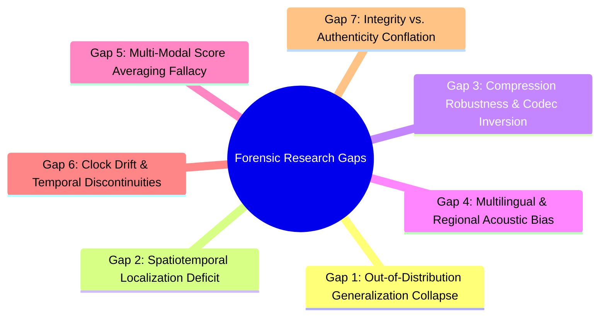

# Research Gap Analysis — Digital Evidence Authenticity & Integrity Verification Platform

**Document Track:** Track A (Research & Scientific Validation)  
**Status:** Approved Research Foundation  
**Version:** 1.0.0  

---

## 1. Introduction

Digital forensics research has historically progressed in domain silos: image researchers study JPEG artifacts and PRNU; audio researchers study vocoder artifacts and synthetic speech detection; video researchers study optical flow and facial blending; and systems researchers study filesystem metadata and cryptographic hashing. 

However, modern evidentiary challenges occur across multimodal, cross-carrier interfaces where these silos fail. This document formalizes a systematic gap analysis identifying seven foundational weaknesses in contemporary academic literature and commercial tooling.

---

## 2. The Seven Primary Forensic Research Gaps

### Gap 1: Out-of-Distribution (OOD) Generalization Collapse in Deep Learning Detectors
* **Current State:** The vast majority of deepfake detection models (e.g., RawNet2, AASIST, MesoNet, Xception, EfficientNet-B4) report exceptional in-distribution performance on closed academic benchmarks (ASVspoof 2019/2021, FaceForensics++, DFDC) with EER $< 3\%$ and AUC $> 0.98$.
* **The Research Gap:** When deployed on real-world evidence generated by novel diffusion samplers (SDXL, Flux, Midjourney v6), unseen vocoders (BigVGAN, VITS), or mobile voice changers, detection performance degrades sharply—often falling to near-random guessing ($EER > 40\%$).
* **Research Focus:** Developing representation-learning architectures with explicit out-of-distribution distance quantification (e.g., Mahalanobis feature covariance gating) that trigger typed abstention (`INCONCLUSIVE_OOD`) rather than emitting uncalibrated overconfident errors.

### Gap 2: The Spatiotemporal Localization Deficit (Binary Score vs. Precise Boundaries)
* **Current State:** Most forensic classifiers output a single scalar probability per file ($P(\text{fake}) \in [0, 1]$).
* **The Research Gap:** In judicial proceedings, a bare scalar classification is vulnerable under cross-examination. Courts require precise bounding:
  * In audio: exact millisecond intervals $[t_{\text{start}}, t_{\text{end}}]$ with sample index bounds ($n_{\text{start}} = t_{\text{start}} \times f_s$).
  * In imagery: pixel-level coordinate masks $[x_1, y_1, x_2, y_2]$ and affine transformation matrices $\mathbf{H}$.
  * In video: exact frame numbers, presentation timestamps (PTS), and cadence anomalies.
* **Research Focus:** Designing multi-resolution spatial and temporal change-point engines (e.g., PELT on STFT spectral flux, TruFor/CAT-Net pixel localization, and backward-forward optical flow warping residuals).

### Gap 3: Social Media Compression Fragility & Codec Inversion
* **Current State:** Forensic benchmarks are predominantly evaluated on raw uncompressed waveforms (PCM WAV) or mildly compressed media (JPEG Q90, ProRes, H.264 CRF 18).
* **The Research Gap:** Over 90% of questioned digital exhibits seized from suspects or witnesses have traversed social media networks (WhatsApp, Telegram, Signal, Instagram). These platforms enforce aggressive multi-generation recompression:
  * Audio: Downmixed to 16 kHz or 48 kHz mono Opus at 16–24 kbps.
  * Images: Stripped of all EXIF metadata, rescaled to 1600 px max dimension, and re-quantized at JPEG Q70–Q75.
  * Video: Re-encoded with variable frame rate (VFR), high CRF (CRF 28–32), and macroblock quantization pulsing.
  Such compression strips high-frequency spectral cues, obliterates subtle PRNU sensor fingerprints, and destroys LSB bit-plane steganography.
* **Research Focus:** Investigating compression-invariant feature extractors, error-level analysis calibrated for multi-generational quantization tables, and MDCT/DCT coefficient distribution modeling under aggressive rate-distortion optimization.

### Gap 4: Multilingual, Regional Acoustic & Dialectal Blindness
* **Current State:** Academic speech deepfake corpora (ASVspoof, WaveFake, In-the-Wild) are overwhelmingly dominated by standard English and standard Mandarin Chinese.
* **The Research Gap:** When voice-cloning detectors are evaluated on non-tonal South Asian languages (Hindi, Urdu) or regional dialects (Bhojpuri, Maithili, Magahi) featuring rapid code-switching (e.g., Hindi-English bilingual speech), phoneme transition models fail. Natural prosodic variations, aspirated consonants, and unique formant transitions are frequently misclassified as vocoder synthesis artifacts.
* **Research Focus:** Constructing language-orthogonal acoustic front-ends utilizing self-supervised foundation features (WavLM, MMS) evaluated against phonetically diverse regional dialect corpora.

### Gap 5: Multi-Modal Evidence Averaging & Anti-Averaging Violation
* **Current State:** Many proposed multimodal forensics frameworks compute a weighted linear combination or simple arithmetic average of image, audio, and video suspicion scores:
  $$S_{\text{overall}} = w_1 S_{\text{img}} + w_2 S_{\text{aud}} + w_3 S_{\text{vid}}$$
* **The Research Gap:** Linear score averaging introduces a fatal forensic vulnerability. In a realistic targeted manipulation, an adversary leaves authentic high-resolution video frames completely untouched, while splicing an audio track with synthesized speech (or conversely, dubbing authentic audio over a deepfake talking avatar). An arithmetic average suppresses the manipulated modality's signal, yielding a false "likely authentic" verdict.
* **Research Focus:** Formalizing an **Anti-Averaging Evidence DAG**. Each modality represents an independent proposition; multimodal findings are linked via causal dependency graphs where a single verified manipulation on any carrier invalidates whole-artifact authenticity.

### Gap 6: Surveillance Clock Drift, VFR Cadence & Timestamp De-synchronization
* **Current State:** Video forensics literature largely assumes constant frame rate (CFR) streams with synchronized, trusted system timecodes.
* **The Research Gap:** Real-world surveillance CCTV and DVR systems operate with uncalibrated quartz real-time clocks (RTC) that drift by up to several minutes per week, experience power-cycle resets (defaulting to 1970-01-01), employ variable frame rates (VFR) to save bandwidth during periods of inactivity, and introduce non-linear presentation timestamp jitter. Naive linear timestamp comparisons generate catastrophic false allegations of selective frame deletion.
* **Research Focus:** Developing non-parametric cadence statistics (Median Absolute Deviation, modified z-score, Huber robust regression) and optical character recognition (OCR) clock drift tracking:
  $$\delta(t) = T_{\text{ocr}}(t) - (T_0 + t_{\text{pts}}) = \alpha + \beta t + \epsilon(t)$$
  distinguishing benign hardware clock drift ($\text{Drift}_{\text{ppm}}$) from intentional temporal sequence manipulation.

### Gap 7: Conflation of Cryptographic Hashing with Factual Authenticity
* **Current State:** Many commercial digital evidence management systems (DEMS) brand files with "100% Authentic" green checkmarks upon verifying an intake SHA-256 hash.
* **The Research Gap:** A hash match guarantees only bit-exact preservation since the moment of acquisition ($H(x_t) = H(x_0)$). It cannot verify:
  * Whether the image was generated by Midjourney prior to seizure.
  * Whether the audio was voice-cloned before being recorded to tape.
  * Whether the on-screen clock was tampered with before capture.
* **Research Focus:** Formulating the **Evidence Integrity Verification (EIV)** model within CEIPL that strictly separates:
  1. *Bitstream Fixity* (SHA-256 / SHA3-512 dual hash match).
  2. *Provenance Attestation* (Ed25519 digital signature on RFC 8785 canonical manifests).
  3. *Temporal Existence* (RFC 3161 Trusted Timestamp Token).
  4. *Physical Signal Authenticity* (empirical forensic engine determinations with explicit uncertainty bounds).

---

## 3. Summary of Research Targets

| Research Gap | Target Metric / Deliverable | Target Venues |
| :--- | :--- | :--- |
| **G-1: OOD Generalization** | Mahalanobis OOD distance with ECE $\le 0.05$ | IEEE T-IFS / ACM IH&MMSec |
| **G-2: Spatiotemporal Localization** | Temporal IoU $\ge 0.75$, boundary MAE $\le 15\text{ ms}$; spatial IoU $\ge 0.65$ | Interspeech / CVPR / ECCV |
| **G-3: Social Media Compression** | Robustness across Opus 16kbps and JPEG Q70 | DFRWS / Forensic Science Int. |
| **G-4: Multilingual Prosody** | Dialectal false positive rate $< 5\%$ on Indic dialects | Interspeech / ICASSP |
| **G-5: Anti-Averaging Fusion** | Directed Acyclic Graph (DAG) conflict resolution matrix | IEEE T-IFS / ACM CCS |
| **G-6: Temporal Sequence & Drift** | Clock drift estimation error $< 50\text{ ppm}$; VFR cadence precision | IEEE T-CSVT / DFRWS |
| **G-7: Cryptographic Lineage** | RFC 8785 JCS + Ed25519 offline verification without cloud dependencies | ACM DFRWS / IEEE S&P Workshop |
