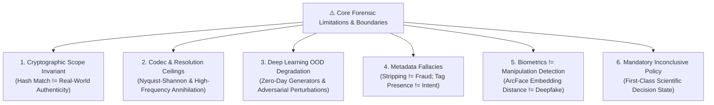

# Research Limitations & Forensic Uncertainty Principles — Digital Evidence Authenticity & Integrity Verification Platform

**Document Track:** Track A (Research & Scientific Validation)  
**Status:** Approved Research Foundation  
**Version:** 1.0.0  

---

## 1. Scientific Honesty & The Anti-Overclaiming Mandate

In judicial proceedings and scientific publications, overconfident or exaggerated claims undermine the integrity of electronic evidence. The **Digital Evidence Authenticity & Integrity Verification Platform** enforces absolute scientific transparency. This document records the theoretical, mathematical, and operational limitations governing the platform's research findings and production outputs.

---

## 2. The Nine Fundamental Forensic Limitations

### Limitation 1: Cryptographic Integrity Does NOT Prove Factual Authenticity
* **Principle:** A mathematical match between a file's intake digest ($H(x_0)$) and its retrieval digest ($H(x_t)$) proves bit-level preservation during the period bounded by those two timestamps.
* **Boundary:** Hashing cannot verify whether the file was altered, staged, or generated by an AI model *prior* to forensic acquisition. A 100% genuine video of an actor reading a fabricated script produces a valid hash; an entirely synthetic image generated by Midjourney and hashed immediately upon generation produces a valid hash. Hashing certifies storage fixity, not historical truth.

### Limitation 2: Resolution & Signal Ceilings (Nyquist-Shannon Theorem)
* **Audio:** When audio is recorded with low sampling rates ($f_s \le 8\text{ kHz}$) or compressed at extreme bitrates (Opus $\le 12\text{ kbps}$), spectral content above 4 kHz is extinguished by low-pass anti-aliasing filters. Subtle phase anomalies, vocoder artifacts, and high-frequency noise discrepancies become mathematically unrecoverable.
* **Video & Imagery:** When image resolution falls below $320\times 240$ pixels, or when faces occupy fewer than $64\times 64$ pixels, high-frequency spatial gradients and sensor PRNU fingerprints are obliterated. Any attempt to infer facial blending seams on sub-resolution crops yields severe false-positive rates.

### Limitation 3: Generalization Limits on Zero-Day Generative Architectures
* **Principle:** Supervised deep learning detectors optimize decision boundaries over known training distributions (e.g., specific diffusion schedulers, GAN loss functions, or neural vocoders).
* **Boundary:** Detectors cannot guarantee generalizability to unreleased, unseen zero-day generative foundation models. When novel generative paradigms emerge, model uncertainty increases. The platform quantifies this shift via Mahalanobis distance and flags samples as `INCONCLUSIVE_OOD` rather than asserting a confident false verdict.

### Limitation 4: The Metadata Stripping & Software Tag Fallacies
* **Absence of Metadata:** Mainstream messaging applications (WhatsApp, Telegram, Signal) and social media services routinely strip all EXIF, XMP, IPTC, and GPS tags by default to protect user privacy and optimize transmission bandwidth. The absence of metadata is normal operational behavior and must **never** be cited as affirmative proof of malicious tampering.
* **Presence of Editing Tags:** An EXIF software tag indicating `Adobe Photoshop` or `Lavf` proves that an export or transcoder pass occurred; it does **not** prove that fraudulent manipulation took place. Legitimate cropping, format conversion, and watermarking introduce editing tags without altering evidentiary facts.

### Limitation 5: Functional Decoupling of Biometric Similarity and Deepfake Detection
* **Principle:** Facial recognition embedding models (e.g., ArcFace, MagFace, AdaFace) measure cosine distance in identity feature space:
  $$S_{\text{id}} = \cos(\mathbf{e}_1, \mathbf{e}_2) = \frac{\mathbf{e}_1 \cdot \mathbf{e}_2}{\|\mathbf{e}_1\|_2 \|\mathbf{e}_2\|_2}$$
* **Boundary:** A high ArcFace similarity score proves that two faces look alike; it does **not** prove that either face is authentic, unmanipulated, or real. An authentic photo of a celebrity compared to a high-quality deepfake face-swap of that same celebrity will yield a very high ArcFace similarity score ($S_{\text{id}} > 0.85$). Conversely, Face X-Ray and TruFor detect pixel-level manipulation boundaries, not who the subject is. The platform strictly prohibits interpreting biometric similarity scores as indicators of authenticity.

### Limitation 6: Temporal Proximity Does NOT Establish Physical Causality
* **Principle:** Cross-Source Timestamp Verification (CSTV) evaluates temporal consistency and estimates clock drift ($\text{Drift}_{\text{ppm}}$).
* **Boundary:** Two independent events recorded at the same millisecond timestamp across different cameras or network logs demonstrate temporal alignment; they do **not** autonomously establish that Event A caused Event B. Physical causality remains the exclusive analytical domain of the human investigator.

### Limitation 7: Surveillance Clock Drifts Occur Naturally
* **Principle:** Hardware quartz real-time clock (RTC) oscillators in commercial DVR/NVR surveillance recorders naturally experience thermal frequency drift (typically $\pm 20$ to $\pm 100\text{ ppm}$).
* **Boundary:** A measured discrepancy between on-screen display (OSD) clock text and container stream timestamps often reflects uncalibrated hardware RTC drift, unsynchronized NTP servers, or battery degradation. It must be reported as a *technical cadence anomaly with alternative hypotheses*, not immediate proof of deliberate evidence scrubbing.

### Limitation 8: Mandatory Inconclusive Policy as a First-Class Output
* When input media violates operational minimum thresholds:
  * Audio Signal-to-Noise Ratio: $\text{SNR} < 5\text{ dB}$
  * Image Resolution: Dimension $< 320\text{ px}$ or Decompression Bomb Trap $> 128\text{ MP}$
  * Video Frame Rate: $f_{\text{fps}} < 5\text{ fps}$
  * Out-of-Distribution Distance: $D_M(\mathbf{x}) > \tau_{\text{OOD}}$
* The platform issues a mandatory typed outcome: **`INCONCLUSIVE / INSUFFICIENT EVIDENCE`**. This is a legally valid, scientifically rigorous determination that protects justice systems from speculative machine assertions.

### Limitation 9: Software Cannot Autonomously Declare Legal Admissibility
* The platform prepares structured evidence dossiers conforming to Section 63 of Bharatiya Sakshya Adhiniyam, 2023, and Section 65B of the Indian Evidence Act.
* However, statutory admissibility in a court of law is determined solely by the presiding judicial magistrate upon the formal declaration of an authorized, certified human forensic examiner (`ROLE-EXAMINER`). The platform software serves to assist the examiner, not replace judicial authority.
