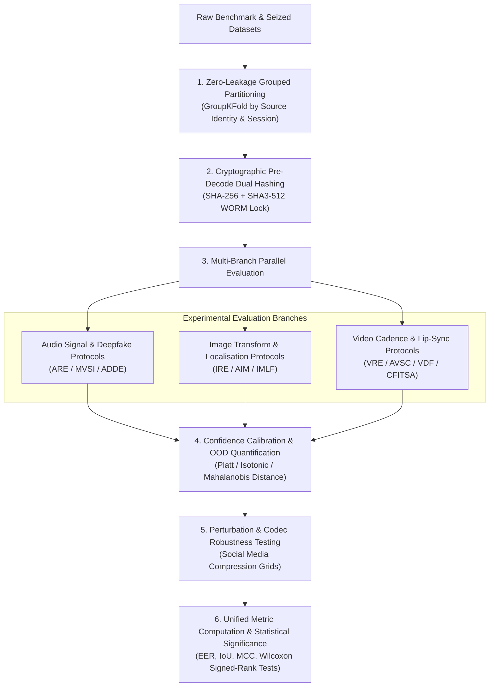

# Research Methodology — Digital Evidence Authenticity & Integrity Verification Platform

**Document Track:** Track A (Research & Scientific Validation)  
**Status:** Approved Research Foundation  
**Version:** 1.0.0  

---

## 1. Experimental Methodology Overview

The research methodology adheres to strict scientific principles of reproducibility, zero data leakage, and rigorous evaluation across diverse acoustic, optical, and temporal transmission channels.

---

## 2. Zero-Leakage Dataset Partitioning Protocol

Data contamination is a prevalent methodological flaw in multimedia deepfake literature. When frames or audio segments derived from the same original recording session, individual actor, or camera model appear in both training and evaluation splits, reported metrics measure identity memorization rather than forensic feature generalizability.

### Hierarchical Grouping Invariant
All dataset splits must be generated using **Hierarchical Grouped K-Fold Cross-Validation** enforced across four orthogonal levels:
1. **Source Group Level:** Frames or audio snippets derived from the same source file must never cross splits.
2. **Identity Level:** A speaker or portrait subject in the evaluation split must be completely absent from training splits ($\text{Speakers}_{\text{train}} \cap \text{Speakers}_{\text{test}} = \emptyset$).
3. **Capture Device Level:** Images captured with the same physical hardware sensor (PRNU reference) must not cross splits.
4. **Generator Family Level (Held-Out Generators):** In cross-generator generalization studies, entire synthesis architectures (e.g., all samples from VITS or Flux.1) are held out exclusively for test splits.

---

## 3. Mathematical & Algorithmic Formulations

### 3.1 Audio Splice Detection & Boundary Refinement (ARE / AESL)
* **Short-Time Spectral Flux:**
  $$SF[m] = \sum_{k=0}^{K-1} H\left( |X(m, k)| - |X(m - 1, k)| \right)^2$$
  where $X(m, k)$ is the STFT of the native-rate signal at frame $m$ and frequency bin $k$, and $H(v) = \frac{v + |v|}{2}$ is the half-wave rectifier function.
* **Penalized Change-Point Minimization (PELT):**
  $$\min_{\tau} \sum_{i=1}^{M+1} \left[ \mathcal{C}(y_{(\tau_{i-1}+1):\tau_i}) + \beta \right]$$
  where $\mathcal{C}$ denotes the segment negative log-likelihood cost under Gaussian variance assumption and $\beta = 2 \ln(N)$ is the Schwarz Information Criterion penalty preventing over-segmentation.
* **Reverberation Energy Decay Steps ($RT60$):**
  Computed via Schroeder backward integration on the ambient room impulse response (RIR) estimate:
  $$\text{EDC}(t) = \int_t^\infty h^2(\tau) d\tau$$
  Sudden steps $> 3.5\text{ dB}$ in the linear decay slope indicate room-acoustic environmental splicing.

### 3.2 Image Manipulation & Localisation (IRE / AIM / IMLF)
* **PRNU Peak-to-Correlation Energy (PCE):**
  $$\text{PCE} = \frac{r_{\text{peak}}^2}{\frac{1}{N - |\mathcal{N}|} \sum_{(i,j) \notin \mathcal{N}} r^2(i,j)}$$
  where $r(i,j)$ is the 2D cross-correlation surface between the image noise residual $\mathbf{W}$ and sensor reference $\mathbf{K}_{\text{ref}}$.
* **SIFT Keypoint Homography (CMFD):**
  $$\mathbf{x}' \sim \mathbf{H}\mathbf{x}, \quad \mathbf{H} = \begin{bmatrix} h_{11} & h_{12} & h_{13} \\ h_{21} & h_{22} & h_{23} \\ h_{31} & h_{32} & 1 \end{bmatrix}$$
  solved via RANSAC with symmetric transfer error:
  $$d_{\text{sym}}(\mathbf{x}, \mathbf{x}') = d(\mathbf{x}, \mathbf{H}^{-1}\mathbf{x}')^2 + d(\mathbf{x}', \mathbf{H}\mathbf{x})^2 < \epsilon_{\text{dist}}$$

### 3.3 Temporal Cadence & Clock Drift Regression (VRE / CFITSA)
* **Presentation Timeline Mapping:**
  $$t_i = \text{PTS}_i \times \frac{\text{TB}_{\text{num}}}{\text{TB}_{\text{den}}}$$
  using unrounded exact rational arithmetic.
* **Non-Parametric Cadence Outliers:**
  Median frame interval $m = \text{median}(\Delta t_i)$ and Median Absolute Deviation (MAD):
  $$\text{MAD} = \text{median}(|\Delta t_i - m|)$$
  Modified z-score:
  $$z_i = \frac{0.6745 \times (\Delta t_i - m)}{\text{MAD}}$$
  Observations with $|z_i| > 3.5$ are cataloged as candidate cadence anomalies.
* **Linear Clock Drift Modeling:**
  $$\delta(t) = T_{\text{ocr}}(t) - (T_0 + t_i) = \alpha + \beta t_i + \epsilon(t)$$
  solved via Huber M-estimation ($\delta = 1.345\sigma$) to resist OCR misread outliers. Estimated drift in parts per million:
  $$\text{Drift}_{\text{ppm}} = (\beta) \times 10^6$$

### 3.4 Confidence Calibration & OOD Quantification (CDVF)
* **Platt Scaling (Binary Logistic Calibration):**
  $$P(\hat{y} = 1 \mid z) = \sigma(a z + b) = \frac{1}{1 + \exp(-(a z + b))}$$
  where parameters $a, b \in \mathbb{R}$ are optimized via cross-entropy loss over a dedicated, held-out calibration split.
* **Mahalanobis Out-of-Distribution Distance:**
  $$D_M(\mathbf{x}) = \min_c \sqrt{(\mathbf{f}(\mathbf{x}) - \boldsymbol{\mu}_c)^T \mathbf{\Sigma}^{-1} (\mathbf{f}(\mathbf{x}) - \boldsymbol{\mu}_c)}$$
  where $\mathbf{f}(\mathbf{x})$ is the penultimate neural feature vector, $\boldsymbol{\mu}_c$ is the class centroid, and $\mathbf{\Sigma}$ is the shared tied covariance matrix. If $D_M(\mathbf{x}) > \tau_{\text{OOD}}$, the framework triggers mandatory abstention (`INCONCLUSIVE_OOD`).

---

## 4. Robustness Perturbation Testing Grids

To rigorously simulate real-world transmission channels, all models undergo standardized perturbation stress-testing across ten predefined operational grids:

| Perturbation Dimension | Tested Parameter Grid Range | Forensic Operational Scenario |
| :--- | :--- | :--- |
| **JPEG Recompression** | Quality Factors $Q \in \{30, 50, 70, 80, 90, 95\}$ | Social media re-encoding (WhatsApp, Telegram) |
| **Lossy Audio Codecs** | Opus (12, 16, 24, 32 kbps), AMR-WB, AAC (64, 128 kbps) | VoIP calls, cellular voice intercept, messaging audio |
| **Additive Acoustic Noise** | Street noise, babble, white Gaussian noise (SNR 0, 5, 10, 20 dB) | Real-world physical room recording environments |
| **Spatial Downscaling** | Scale factors $s \in \{0.25, 0.50, 0.75\}$ with bilinear/bicubic | Web thumbnails, preview scraping, mobile screenshots |
| **Video Transcoding** | H.264 / H.265 CRF $\in \{20, 24, 28, 32\}$ with VFR | Social media video forwarding, RTSP surveillance drops |
| **Gaussian Optical Blur** | Kernel size $k \in \{3, 5, 7, 9\}$, $\sigma \in [0.5, 2.0]$ | Defocus, camera sensor optics, anti-forensic smoothing |
| **Audio Re-Sampling** | $f_s \in \{8\text{ kHz}, 16\text{ kHz}, 22.05\text{ kHz}, 44.1\text{ kHz}, 48\text{ kHz}\}$ | Diverse audio hardware, DAC/ADC re-recording |

---

## 5. Statistical Significance & Hypothesis Testing

All experimental comparisons between baseline models and proposed architectures must report:
1. **Confidence Intervals:** 95% bootstrap confidence intervals computed via 10,000 resamples.
2. **Hypothesis Testing:** Non-parametric two-tailed **Wilcoxon signed-rank tests** (for paired observations) or **Mann-Whitney U tests** (for unpaired cross-dataset samples).
3. **Statistical Threshold:** Significance established at $\alpha = 0.01$ ($p < 0.01$). Differences failing to satisfy $p < 0.01$ must be documented as statistically indistinguishable.
