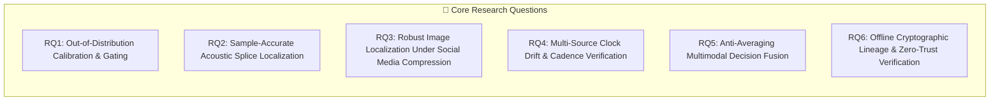

# Research Objectives & Hypotheses — Digital Evidence Authenticity & Integrity Verification Platform

**Document Track:** Track A (Research & Scientific Validation)  
**Status:** Approved Research Foundation  
**Version:** 1.0.0  

---

## 1. Primary Research Goal

The overarching scientific goal of this research initiative is:
> **To establish a mathematically rigorous, explainable, and multi-modal digital evidence verification framework that accurately localizes synthetic and non-synthetic manipulations across time and space, quantifies uncertainty under out-of-distribution domain shifts, and anchors all findings in an immutable cryptographic chain of custody.**

---

## 2. Formal Research Questions (RQs)

### Research Question 1 (RQ1 — OOD Calibration & Gating)
*How can deep learning media manipulation detectors quantify their epistemic uncertainty and detect out-of-distribution (OOD) domain shifts (such as unseen generative architectures, vocoders, or extreme compression), maintaining an Expected Calibration Error $\text{ECE} \le 0.05$ while abstaining with typed inconclusive flags rather than producing overconfident false verdicts?*

### Research Question 2 (RQ2 — Acoustic Splice Localization)
*To what precision can non-parametric change-point algorithms (such as PELT applied over half-wave rectified STFT spectral flux and noise stationarity) achieve sample-accurate audio splice boundary localization ($t = n / f_s$, boundary error $\le 15\text{ ms}$) across lossy speech codecs (e.g., Opus 16 kbps, AMR-WB) without misclassifying natural speech pauses or regional Indian dialectal prosody?*

### Research Question 3 (RQ3 — Image Localization Under Social Compression)
*How do high-pass noise residuals, camera PRNU sensor correlation, and DCT double-quantization grids interact under aggressive social-media re-encoding (JPEG Q70–Q75 with dimension downscaling), and can a dual-stream spatial reasoning architecture achieve a pixel-level Localization IoU $\ge 0.65$ without fabricating artificial boundary masks on authentic scenes?*

### Research Question 4 (RQ4 — Temporal Cadence & Clock Drift Modeling)
*Can robust piecewise linear regression (Huber loss / Theil-Sen) combined with optical character recognition (OCR) clock tracking decouple natural quartz real-time clock drift ($\text{Drift}_{\text{ppm}}$) and variable frame rate (VFR) transmission jitter from deliberate surveillance frame excision, achieving clock drift estimation error $< 50\text{ ppm}$?*

### Research Question 5 (RQ5 — Anti-Averaging Multimodal Fusion)
*How can multimodal forensic evidence be structured within a Directed Acyclic Graph (DAG) using Bayesian conflict resolution to strictly enforce the Anti-Averaging Invariant—ensuring that localized tampering in a single modality (e.g., audio voice clone with authentic video) is preserved with high confidence rather than diluted by whole-media score averaging?*

### Research Question 6 (RQ6 — Air-Gapped Cryptographic Lineage)
*Can an evidence preservation framework utilizing RFC 8785 Canonical JSON Serialization (JCS), detached Ed25519 digital signatures, RFC 3161 Trusted Timestamps, and binary Merkle trees achieve 100% deterministic bitstream reproducibility and independent offline verification on an air-gapped forensic workstation without reliance on external cloud trust?*

---

## 3. Formal Scientific Hypotheses

* **Hypothesis 1 ($H_1$ — OOD Distance):** Conditioning deepfake detector logits on feature-space Mahalanobis distance from a validated in-distribution covariance matrix reduces false-positive rates on unseen vocoders by $\ge 60\%$ compared to uncalibrated Softmax confidence.
* **Hypothesis 2 ($H_2$ — Multi-Resolution Audio Splicing):** Fusing multi-resolution STFT spectral flux (10ms, 20ms, 50ms) with background room impulse response (RIR) decay steps yields a temporal intersection-over-union ($t\text{IoU}$) $\ge 0.75$ on spliced audio across SNRs down to $10\text{ dB}$.
* **Hypothesis 3 ($H_3$ — DCT/RGB Inpainting Synergy):** Incorporating raw JPEG DCT coefficient stream representations alongside RGB spatial features enables localization of generative inpainting on social-media compressed images (JPEG Q75) with an improvement of $\ge 0.15$ in Matthews Correlation Coefficient (MCC) over RGB-only baselines.
* **Hypothesis 4 ($H_4$ — Non-Parametric Cadence):** Utilizing Median Absolute Deviation (MAD) and modified z-score thresholding on presentation timestamp differences ($\Delta t_i = t_{i} - t_{i-1}$) reduces false-positive dropped-frame flags on variable frame rate (VFR) surveillance video by $\ge 85\%$ relative to constant-cadence thresholds.
* **Hypothesis 5 ($H_5$ — Anti-Averaging Fusion):** An evidence DAG that treats modality tampering indicators as independent conjunctive propositions prevents false-negative determinations on targeted audio dubbing attacks with $0\%$ score dilution.
* **Hypothesis 6 ($H_6$ — Deterministic Lineage):** RFC 8785 canonical serialization guarantees 100% identical SHA-256 manifest fingerprints across disparate operating system environments (Linux x86_64, Windows, macOS ARM64) regardless of local key ordering or numeric formatting.

---

## 4. Measurable Success Criteria & Acceptance Matrix

| Objective / Hypothesis | Quantitative Evaluation Target | Primary Benchmark Dataset |
| :--- | :--- | :--- |
| **RQ1 / $H_1$ (OOD Calibration)** | $\text{ECE} \le 0.05$; Brier score $\le 0.08$; False Alarm Rate @ 95% TPR $\le 5\%$ | ASVspoof 2021 DF, FaceForensics++, In-the-Wild |
| **RQ2 / $H_2$ (Audio Splice Localization)** | $t\text{IoU} \ge 0.75$; Boundary Mean Absolute Error $\le 15\text{ ms}$; DER $< 18\%$ | AESL Benchmark Corpus, SpeechBrain VoxCeleb |
| **RQ3 / $H_3$ (Image Manipulation)** | Pixel Localization $\text{IoU} \ge 0.65$; Pixel Dice $\ge 0.75$; Image ROC-AUC $\ge 0.95$ | TruFor Dataset, CoMoFoD, Columbia Splicing |
| **RQ4 / $H_4$ (CCTV Cadence & Drift)** | Cadence Anomaly Recall $\ge 98\%$; Clock Drift Error $< 50\text{ ppm}$; 0 False Dropped Frames on CFR | CFITSA Surveillance Corpus, UCF-Crime CCTV |
| **RQ5 / $H_5$ (Anti-Averaging DAG)** | Zero score dilution; 100% detection of single-carrier tampering in multimodal media | Synthetic Multimodal Cross-Tampering Evaluation Suite |
| **RQ6 / $H_6$ (Cryptographic Integrity)** | 100% bit-exact SHA-256 match; 100% signature verification rate; zero runtime drift | Multi-Platform Determinism Test Suite (16 OS/Python builds) |
