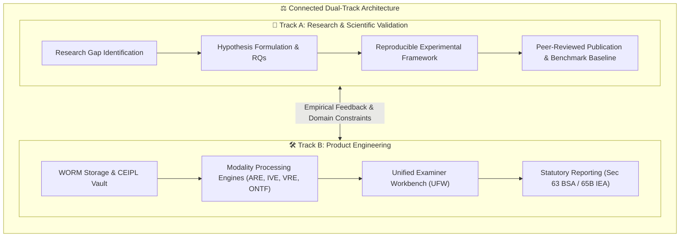
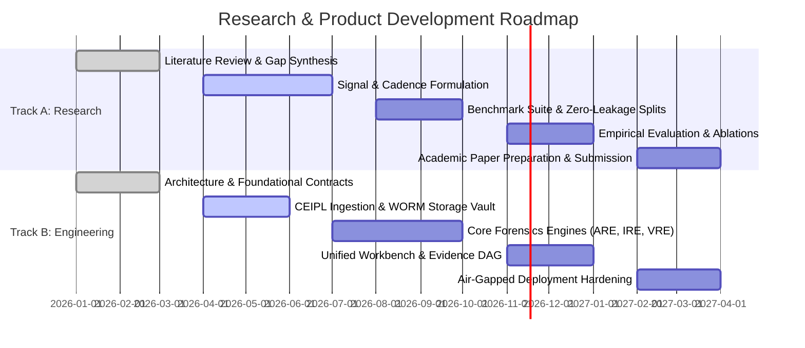

# Research Overview — Digital Evidence Authenticity & Integrity Verification Platform

**Initiative:** Digital Evidence Authenticity & Integrity Verification Platform  
**Document Track:** Track A (Research & Scientific Validation)  
**Status:** Approved Research Foundation  
**Version:** 1.0.0  

---

## 1. Executive Summary & Research Vision

The rapid proliferation of sophisticated media synthesis technologies—including latent diffusion models (e.g., Stable Diffusion, Midjourney, Flux), neural vocoders (HiFi-GAN, WaveGlow), speech foundation representations (WavLM, Whisper), and generative video models (Sora, Wan, VideoCrafter)—has precipitated a profound credibility crisis in electronic evidence. Concurrently, non-generative, classical manipulation techniques (such as localized splicing, copy-move cloning, frame excision, and container restamping) remain prevalent and increasingly difficult to distinguish from benign transcoding artifacts introduced by commercial social messaging networks (WhatsApp, Telegram) and content delivery networks.

The **Digital Evidence Authenticity & Integrity Verification Platform** establishes an independent, dual-track initiative bridging rigorous academic computer science with deployable digital-forensics engineering:

The primary research vision is to **transcend black-box scalar classification** (e.g., generic probability scores that fail judicial scrutiny) by engineering **physics-grounded, signal-aware, and mathematically bounded multi-modal forensic verification systems**. Every positive tampering indication must be corroborated by spatiotemporal coordinates, physical signal anomalies, and explicit confidence intervals bounded by out-of-distribution (OOD) distance metrics.

---

## 2. Research Problem Definition

In contemporary forensic examinations, courts and authorized investigators encounter three fundamental scientific challenges:

### 2.1 The Post-Intake vs. Pre-Intake Invariant
A fundamental misconception in digital forensics conflates **cryptographic integrity** with **factual authenticity**:
$$\text{Cryptographic Hash Match } (H(x_t) = H(x_0)) \centernot\implies \text{Authenticity of Event Depicted in } x$$
A bit-exact SHA-256 match proves only that the seized file has suffered zero alteration since the exact moment of forensic acquisition. It does *not* prove that the recording medium was authentic, that the lens recorded reality, or that the file was untampered before acquisition. Our research formalizes this boundary across all data models and reporting structures.

### 2.2 The Generalization Collapse of Deep Learning Detectors
State-of-the-art neural network deepfake detectors trained on curated benchmarks (such as ASVspoof 2019/2021 or FaceForensics++) exhibit catastrophic performance degradation when evaluated against out-of-distribution (OOD) samples:
* Unseen neural vocoders or diffusion samplers.
* Aggressive lossy re-encoding (e.g., WhatsApp Opus at 16 kbps; H.264 CRF 28).
* Variable optical/acoustic transmission channels (re-recording, microphone handling, room impulse response variation).
* Regional acoustic dialects, code-switching, and multilingual prosody (e.g., Indic languages, Bhojpuri, Maithili).

### 2.3 The Explainability & Admissibility Deficit
Black-box classifiers providing scalar outputs (e.g., `0.94 Fake`) are legally indefensible under rigorous judicial cross-examination. Forensic standards (such as Section 63 of Bharatiya Sakshya Adhiniyam, 2023, and Section 65B of the Indian Evidence Act) require verifiable technical methodology:
* *Where* was the splice made (exact sample coordinates $t = n / f_s$ and bounding pixel polygons)?
* *What* physical or mathematical anomaly confirms the intervention (phase discontinuity, PRNU noise variance, ELA residue, or frame PTS cadence)?
* *What* alternative benign explanations were tested and ruled out (such as automatic gain control, codec blocking, or sensor clipping)?

---

## 3. Core Research Domains & Subsystem Mapping

The research initiative investigates six interconnected technical domains, each mapped to modular software engines in Track B:

| Research Domain | Core Scientific Questions | Corresponding Track B Engine |
| :--- | :--- | :--- |
| **1. Electroacoustic Signal Forensics** | Can sample-accurate splice boundaries be differentiated from natural speech pauses and room transitions across variable SNR? | **AURAS / ARE / AESL** |
| **2. Physical & Frequency Image Forensics** | How do PRNU camera sensor fingerprints, double-JPEG quantization grids, and 2D FFT noise residuals interact under social media compression? | **AIF / IRE / IMLF** |
| **3. Temporal Cadence & Video Forensics** | Can container presentation timestamps (PTS), GOP structures, and optical flow residuals distinguish deliberate frame excision from transmission packet dropouts? | **VISTA / VRE / CFITSA** |
| **4. Multimodal Synchronization & Lip-Sync** | How can talking-head visual-speech correspondence (SyncNet) be decoupled from legitimate post-production dubbing vs. malicious neural avatars? | **VISTA / AVSC** |
| **5. Network Telemetry Threat Forensics** | How can post-incident, offline PCAP/PCAPNG traffic flow distributions and inter-arrival timing jitter establish host attribution without continuous sniffing? | **ONTF** |
| **6. Cryptographic Provenance & Lineage DAGs** | How can RFC 8785 canonical serialization, Ed25519 signatures, RFC 3161 timestamps, and Merkle DAGs ensure tamper-evident evidence lineage without trusted third-party cloud dependencies? | **CEIPL / EIV** |

---

## 4. Methodological Guiding Principles

To preserve academic integrity and prevent scientific overclaiming:

1. **Zero Fabrication Policy:** No benchmark scores, accuracy claims, dataset counts, or mathematical proofs may be invented. Unverified models are cataloged as `RESEARCH_REQUIRED` or `PROPOSED`.
2. **First-Class Inconclusive Verdicts:** When signal-to-noise ratio (SNR) is $< 5\text{ dB}$, image resolution is $< 320\times240$, or Mahalanobis OOD distance exceeds calibration thresholds, the system must emit typed inconclusive determinations (`INCONCLUSIVE_LOW_QUALITY`, `INCONCLUSIVE_OOD`).
3. **Anti-Averaging Invariant:** Cross-modal detection scores must never be averaged into a monolithic percentage. If video frames are pristine but the audio speech track has been cloned via TTS, the system must localize the attack exclusively to the acoustic carrier.
4. **Reproducibility by Design:** All experiments must declare random seeds, deterministic PyTorch execution flags, complete hardware manifests, fixed dataset split hashes, and open-source evaluation protocols.

---

## 5. Dual-Track Milestones & Publication Roadmap

1. **Milestone R-1 (Foundational Synthesis):** Publication of technical whitepaper establishing the mathematical definitions of cross-modal forensic evidence invariants and the 16-step WORM preservation lifecycle.
2. **Milestone R-2 (Acoustic & Temporal Benchmark):** Experimental release of the AESL audio splice evaluation dataset and CFITSA temporal frame cadence verification benchmark.
3. **Milestone R-3 (Academic Manuscript Submission):** Submission of a full research paper to a leading peer-reviewed venue (e.g., IEEE Transactions on Information Forensics and Security, ACM Workshop on Information Hiding and Multimedia Security, or DFRWS Digital Forensics Research Conference).
